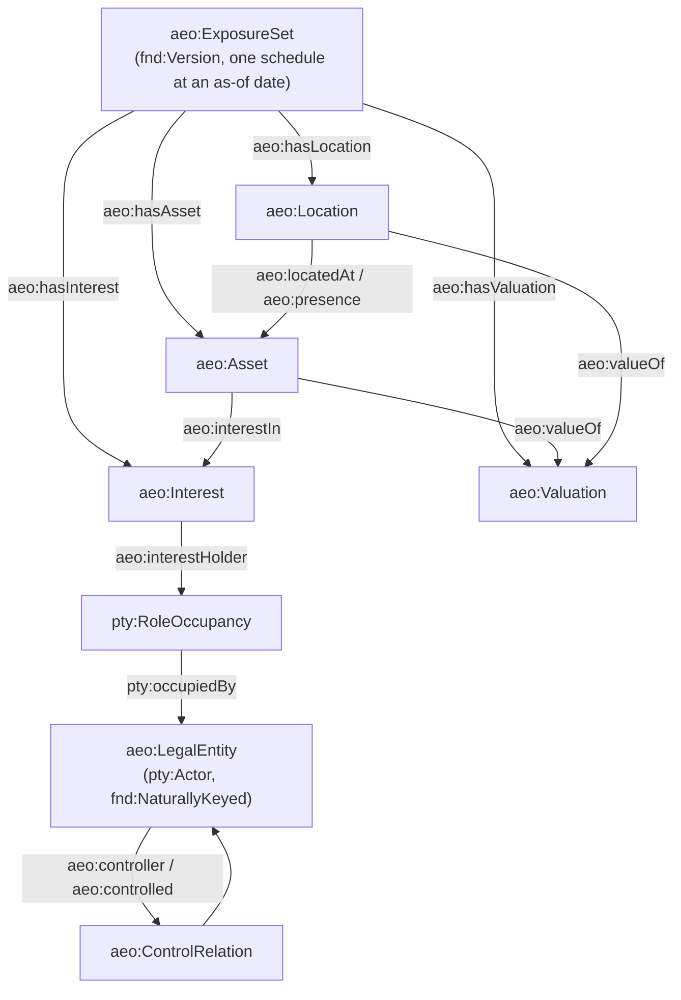

<!-- SPDX-License-Identifier: CC-BY-SA-4.0 -->

# Asset Exposure Ontology (`aeo:`)

Literate specification for the asset exposure ontology, built by the
[`applied-insurance-reference`](../../../../docs/developer/plans/applied-insurance-reference.md)
epic, Phase 4. See [ADR-A98](../../../../docs/architecture/decisions/ADR-A98-applied-insurance-domain-layout.md)
and the [asset exposure ontology sketch](../../../../docs/developer/sketches/asset-exposure-ontology.md)
for the design this module implements.

## 1. Purpose and scope

Exposure is facts about the world, not about cover: where a risk is, what it consists of, who
holds an interest in it, and what it is worth. No class here says what a contract insures — that
is the contract module's (Phase 5). This slice (AIR-4.1) builds the core: an exposure set's
schedule, locations, legal entities and the control between them, assets, interests and
valuations. Later slices of Phase 4 add to the same classes, each in its own region:

| Region | Slice | Adds |
|---|---|---|
| `core` | AIR-4.1 | exposure set, location, legal entity, control, asset, interest, valuation |
| `zones-attributes-assessments` | AIR-4.2 | hazard zones, pool participation, attribute assessments |
| `dependencies-metrics-units` | AIR-4.3 | dependencies, peril metrics, exposure units derived on demand |
| `losses-requirements-cover` | AIR-4.4 | loss history, coverage requirements, existing cover |
| `liability` | AIR-4.5 | liability exposure: counterparty populations, exposure bases |



Exposure imports Foundation, Vocabulary, Quantification, Party and `insurance/common` (which
brings `classification/`), all by exact version IRI. It does not import the `insurance/peril` spec, which no term here uses: perils are
`icm:peril` values, and only the vocabulary imports `insurance/peril`'s vocabulary, for the cause
concepts it links. Imported in turn
by later Phase 4 slices and, eventually, the contract module (Phase 5).

## 2. Namespace and prefixes

```turtle-spec
@prefix aeo:  <https://www.nebularis.org/neuro-semantic/insurance/exposure#> .
@prefix fnd:  <https://www.nebularis.org/neuro-semantic/lattice/foundation#> .
@prefix qnt:  <https://www.nebularis.org/neuro-semantic/lattice/quantification#> .
@prefix pty:  <https://www.nebularis.org/neuro-semantic/lattice/party#> .
@prefix cls:  <https://www.nebularis.org/neuro-semantic/lattice/applied/classification#> .
@prefix icm:  <https://www.nebularis.org/neuro-semantic/insurance/common#> .
@prefix voc:  <https://www.nebularis.org/neuro-semantic/lattice/vocabulary#> .
@prefix skos: <http://www.w3.org/2004/02/skos/core#> .
@prefix owl:  <http://www.w3.org/2002/07/owl#> .
@prefix rdf:  <http://www.w3.org/1999/02/22-rdf-syntax-ns#> .
@prefix rdfs: <http://www.w3.org/2000/01/rdf-schema#> .
@prefix xsd:  <http://www.w3.org/2001/XMLSchema#> .
```

## 3. Extraction contract

- `turtle-spec` blocks generate `spec/exposure.ttl`.
- `turtle-vocab` blocks generate `vocab/exposure-vocab.ttl`.
- `turtle-shapes` blocks generate, in order, `shapes/structural.ttl`, `shapes/constraints.ttl`,
  `shapes/profiles/construction-protection.ttl` and `shapes/profiles/cyber-posture.ttl` (the last
  two from AIR-4.2).
- `turtle-example` blocks are illustrative only. The real fixture lives in
  [`examples/core.ttl`](examples/core.ttl).

```bash
python3 tools/literate_extract.py ontology/applied/insurance/exposure/README.md \
    --layer applied/insurance/exposure --root . \
    --shapes shapes/structural.ttl shapes/constraints.ttl \
             shapes/profiles/construction-protection.ttl shapes/profiles/cyber-posture.ttl --check
```

## 4. Core classes (AIR-4.1)

### 4.1 Legal entities and control

`aeo:LegalEntity` is an organisation with registration and tax numbers and, where it has one, a
Legal Entity Identifier (LEI, [ISO 17442](https://www.iso.org/standard/59771.html)). These are
[Foundation](../../../foundation/README.md)'s natural keys (`fnd:naturalKey`, Foundation README
§8), not a local identifier class: a company number and an LEI are keys issued by outside
authorities, exactly what `fnd:Key` and `fnd:KeyScheme` already model. `aeo:LegalEntity` carries
no version of its own (unlike `aeo:ExposureSet`, `aeo:Location` and `aeo:Asset`): its own natural
keys follow it across every exposure set that mentions it, as Foundation's own worked example
follows an unversioned company by its company number and LEI.

Control between legal entities is reified, because ownership has a share and a period:

```mermaid
classDiagram
    class LegalEntity["aeo:LegalEntity"] {
        pty:Actor
        fnd:NaturallyKeyed
        cls:industry 0..*
        aeo:domicile 0..1
        aeo:legalForm 0..1
    }
    class ControlRelation["aeo:ControlRelation"] {
        fnd:TemporallyScoped
        fnd:Evidenced
        aeo:controller 1
        aeo:controlled 1
        aeo:controlKind 1
        aeo:controlShare 0..1
    }
    LegalEntity "1" --> "0..*" ControlRelation : aeo:controller
    ControlRelation --> "1" LegalEntity : aeo:controlled
```

### 4.2 Exposure set, location, asset, interest and valuation

An `aeo:ExposureSet` is a versioned snapshot of one insured's schedule: the identity follows the
schedule across renewals, and each version is a schedule as of a date, with the record's own
governance state (Draft while being assembled, Active when submitted, Superseded by the next). A
member (a location, an asset, an interest or a valuation) is listed by an exposure set version
through a plain membership property, and is not owned by it. An unchanged member is listed by every
version it holds for, shared by identity and not duplicated by node, so a mid-term change adds the
nodes that changed and a new version that lists the rest. Membership is not inverse functional,
which a reasoner would read as an identity statement and merge two schedule versions that list one
location (TD-49).

| Class | Mixins | Key properties |
|---|---|---|
| `aeo:ExposureSet` | `fnd:Version`, `fnd:Governable`, `fnd:TemporallyScoped`, `fnd:Evidenced` | `aeo:reportingUnit` (1, `qnt:Unit`) |
| `aeo:Location` | `fnd:Version` | `aeo:address` (0..1), `aeo:geometry` (0..1, GeoSPARQL optional), `aeo:geoPrecision` (0..1), `aeo:territory` (1..\*) |
| `aeo:Asset` | `fnd:Version` | `aeo:assetClass` (1), `aeo:locatedAt` (0..1, functional) xor `aeo:presence` (0..\*), `aeo:partOf` (asymmetric, irreflexive) |
| `aeo:Interest` | `fnd:TemporallyScoped`, `fnd:Evidenced` | `aeo:interestHolder` (1, `pty:RoleOccupancy`), `aeo:interestIn` (1, `aeo:Asset`), `aeo:interestKind` (1), `aeo:extent` (0..1) |
| `aeo:Valuation` | `fnd:Evidenced`, `fnd:TemporallyScoped` | `aeo:valueOf` (1, asset or location), `aeo:valueType` (1), `aeo:valuationBasis` (1), `aeo:valuationMethod` (0..1), `aeo:amount` xor (`aeo:rate` + `aeo:horizon`) |

Every one of `aeo:ExposureSet`, `aeo:Location` and `aeo:Asset` has its own identity class
(`aeo:ExposureIdentity`, `aeo:LocationIdentity`, `aeo:AssetIdentity`, each `⊑ fnd:PersistentIdentity`),
so a location's loss history and zone designations (AIR-4.2 onwards) follow its identity across
schedule versions, not one snapshot.

```turtle-spec
<https://www.nebularis.org/neuro-semantic/insurance/exposure>
    rdf:type owl:Ontology ;
    owl:versionIRI <https://www.nebularis.org/neuro-semantic/insurance/exposure/0.1.0> ;
    rdfs:label "LATTICE asset exposure ontology"@en ;
    rdfs:comment "Facts about the world a risk sits in: exposure sets, locations, legal entities and control, assets, interests and valuations (AIR-4.1), with zones, attributes, dependencies, losses, requirements, cover and liability arriving in later regions (AIR-4.2 to AIR-4.5). No class here says what a contract insures, which is the contract module's (Phase 5). See the asset exposure ontology sketch." ;
    owl:imports <https://www.nebularis.org/neuro-semantic/lattice/foundation/0.4.0> ,
                <https://www.nebularis.org/neuro-semantic/lattice/vocabulary/0.4.0> ,
                <https://www.nebularis.org/neuro-semantic/lattice/quantification/0.8.0> ,
                <https://www.nebularis.org/neuro-semantic/lattice/party/0.9.0> ,
                <https://www.nebularis.org/neuro-semantic/insurance/common/0.5.0> .

#################################################################
#    Identity classes (AIR-4.1). Each versioned class below has
#    its own, so a location's or asset's loss history and zone
#    designations (AIR-4.2 onwards) follow its identity across
#    exposure set versions, not one schedule snapshot.
#################################################################

aeo:ExposureIdentity a owl:Class ;
    rdfs:subClassOf fnd:PersistentIdentity ;
    rdfs:label "Exposure set identity"@en ;
    rdfs:comment "The identity an exposure set's schedule keeps across renewals." ;
    fnd:utility "Give every aeo:ExposureSet version fnd:hasIdentity an individual of this class." .

aeo:LocationIdentity a owl:Class ;
    rdfs:subClassOf fnd:PersistentIdentity ;
    rdfs:label "Location identity"@en ;
    rdfs:comment "The identity a location keeps across exposure set versions and address or geometry changes." ;
    fnd:utility "Give every aeo:Location version fnd:hasIdentity an individual of this class, so its loss history and zone designations (AIR-4.2 onwards) follow it." .

aeo:AssetIdentity a owl:Class ;
    rdfs:subClassOf fnd:PersistentIdentity ;
    rdfs:label "Asset identity"@en ;
    rdfs:comment "The identity an asset keeps across exposure set versions and valuation changes." ;
    fnd:utility "Give every aeo:Asset version fnd:hasIdentity an individual of this class." .

#################################################################
#    Exposure set (sketch §5.2)
#################################################################

aeo:ExposureSet a owl:Class ;
    rdfs:subClassOf fnd:Version , fnd:Governable , fnd:TemporallyScoped , fnd:Evidenced ,
        [ a owl:Restriction ; owl:onProperty aeo:reportingUnit ; owl:cardinality "1"^^xsd:nonNegativeInteger ] ;
    rdfs:label "Exposure set"@en ;
    rdfs:comment "A versioned snapshot of one insured's schedule, as of a date." ;
    fnd:utility "Subject: an exposure set version. Its identity (aeo:ExposureIdentity) follows the schedule across renewals. Governance state is Draft while assembled, Active when submitted, Superseded by the next version. Link members with aeo:hasLocation, aeo:hasAsset, aeo:hasInterest, aeo:hasValuation, aeo:hasAssessment, aeo:hasDependency and aeo:hasPerilMetric." .

aeo:reportingUnit a owl:ObjectProperty, owl:FunctionalProperty ;
    rdfs:domain aeo:ExposureSet ; rdfs:range qnt:Unit ;
    rdfs:label "reporting unit"@en ;
    rdfs:comment "The currency or unit an exposure set's values are reported in." ;
    fnd:utility "Subject: an exposure set. Value: the qnt:Unit its amounts are expressed in, before any per-valuation unit is read. Exactly one." .

aeo:hasLocation a owl:ObjectProperty ;
    rdfs:domain aeo:ExposureSet ; rdfs:range aeo:Location ;
    rdfs:label "has location"@en ;
    rdfs:comment "A location belonging to this exposure set version." ;
    fnd:utility "Subject: an exposure set. Value: one of its locations. Not inverse functional: an unchanged location version is listed by every exposure set version it holds for, shared by identity (TD-49)." .

aeo:hasAsset a owl:ObjectProperty ;
    rdfs:domain aeo:ExposureSet ; rdfs:range aeo:Asset ;
    rdfs:label "has asset"@en ;
    rdfs:comment "An asset belonging to this exposure set version." ;
    fnd:utility "Subject: an exposure set. Value: one of its assets. Not inverse functional, for the same reason as aeo:hasLocation." .

aeo:hasInterest a owl:ObjectProperty ;
    rdfs:domain aeo:ExposureSet ; rdfs:range aeo:Interest ;
    rdfs:label "has interest"@en ;
    rdfs:comment "An interest belonging to this exposure set version." ;
    fnd:utility "Subject: an exposure set. Value: one of its interests. Not inverse functional, for the same reason as aeo:hasLocation." .

aeo:hasValuation a owl:ObjectProperty ;
    rdfs:domain aeo:ExposureSet ; rdfs:range aeo:Valuation ;
    rdfs:label "has valuation"@en ;
    rdfs:comment "A valuation belonging to this exposure set version." ;
    fnd:utility "Subject: an exposure set. Value: one of its valuations. Not inverse functional, for the same reason as aeo:hasLocation." .

#################################################################
#    Location (sketch §5.3)
#################################################################

aeo:Location a owl:Class ;
    rdfs:subClassOf fnd:Version ;
    rdfs:label "Location"@en ;
    rdfs:comment "A place where exposure sits: a site, a building footprint, a pipeline segment, a port." ;
    fnd:utility "Subject: a location version. A version per change of address or geometry, one identity (aeo:LocationIdentity) across schedules, so loss history and zone designations (AIR-4.2 onwards) follow it." .

aeo:Address a owl:Class ;
    rdfs:label "Address"@en ;
    rdfs:comment "A structured address, a node so it can be versioned and geocoded as a unit." ;
    fnd:utility "Point aeo:address at one of these rather than a plain string, so an address can carry its own evidence and geocoding history independently of the location it describes." .

aeo:address a owl:ObjectProperty, owl:FunctionalProperty ;
    rdfs:domain aeo:Location ; rdfs:range aeo:Address ;
    rdfs:label "address"@en ;
    rdfs:comment "A location's structured address." ;
    fnd:utility "Subject: a location. Value: its address node. At most one." .

aeo:geometry a owl:ObjectProperty, owl:FunctionalProperty ;
    rdfs:domain aeo:Location ;
    rdfs:label "geometry"@en ;
    rdfs:comment "A location's geometry (point, footprint or line), for example via GeoSPARQL's geo:asWKT." ;
    fnd:utility "Subject: a location. Value: left open, so the core does not depend on GeoSPARQL. A deployment that aligns with GeoSPARQL points this at a geo:Geometry. At most one." .

aeo:geoPrecision a owl:ObjectProperty, owl:FunctionalProperty ;
    rdfs:domain aeo:Location ; rdfs:range skos:Concept ;
    rdfs:label "geographic precision"@en ;
    rdfs:comment "The coarsest location precision at which this location is known (rooftop, parcel, street, postcode, city, zone centroid)." ;
    fnd:utility "Subject: a location. Value: a concept bound by aeo-voc:GeoPrecisionContract. At most one." .

aeo:territory a owl:ObjectProperty ;
    rdfs:subPropertyOf cls:territory ;
    rdfs:domain aeo:Location ; rdfs:range skos:Concept ;
    rdfs:label "territory"@en ;
    rdfs:comment "The territory concepts a location falls in, at the finest level known." ;
    fnd:utility "Subject: a location. Value: one or more territory concepts. At least one. Specialises cls:territory (ADR-A98 decision 5)." .

#################################################################
#    Legal entities and control (sketch §5.1)
#################################################################

aeo:LegalEntity a owl:Class ;
    rdfs:subClassOf pty:Actor , fnd:NaturallyKeyed ;
    rdfs:label "Legal entity"@en ;
    rdfs:comment "An organisation, identified by registration and tax numbers and, where it has one, a Legal Entity Identifier." ;
    fnd:utility "Subject: an organisation. Registration and tax numbers and an LEI are fnd:naturalKeys, key nodes of declared fnd:KeySchemes (Foundation README §8), not a local identifier class. Unversioned: its natural keys follow it across every exposure set that mentions it. Trading names are skos:altLabels." .

aeo:industry a owl:ObjectProperty ;
    rdfs:subPropertyOf cls:industry ;
    rdfs:domain aeo:LegalEntity ; rdfs:range skos:Concept ;
    rdfs:label "industry"@en ;
    rdfs:comment "An industry or economic activity of a legal entity." ;
    fnd:utility "Subject: a legal entity. Value: one or more industry concepts. No primary industry is privileged by this property: a primary industry is an attribute of the entity's assessment (AIR-4.2), not asserted here. Specialises cls:industry." .

aeo:domicile a owl:ObjectProperty, owl:FunctionalProperty ;
    rdfs:subPropertyOf cls:territory ;
    rdfs:domain aeo:LegalEntity ; rdfs:range skos:Concept ;
    rdfs:label "domicile"@en ;
    rdfs:comment "The jurisdiction of incorporation or registration of a legal entity." ;
    fnd:utility "Subject: a legal entity. Value: a territory concept. At most one. Specialises cls:territory." .

aeo:legalForm a owl:ObjectProperty, owl:FunctionalProperty ;
    rdfs:domain aeo:LegalEntity ; rdfs:range skos:Concept ;
    rdfs:label "legal form"@en ;
    rdfs:comment "The generic legal form of a legal entity (corporation, partnership, trust, and others)." ;
    fnd:utility "Subject: a legal entity. Value: a concept bound by aeo-voc:LegalFormContract. At most one. A deployment binds ISO 20275 (Entity Legal Forms) codes by territory, crosswalked to these generic kinds by skos:broadMatch." .

aeo:ControlRelation a owl:Class ;
    rdfs:subClassOf fnd:TemporallyScoped , fnd:Evidenced ,
        [ a owl:Restriction ; owl:onProperty aeo:controller ; owl:cardinality "1"^^xsd:nonNegativeInteger ] ,
        [ a owl:Restriction ; owl:onProperty aeo:controlled ; owl:cardinality "1"^^xsd:nonNegativeInteger ] ,
        [ a owl:Restriction ; owl:onProperty aeo:controlKind ; owl:cardinality "1"^^xsd:nonNegativeInteger ] ;
    rdfs:label "Control relation"@en ;
    rdfs:comment "One legal entity's control of another, for a period, reified because ownership has a share and a time scope." ;
    fnd:utility "Subject: a control relation. Exactly one controller and one controlled legal entity, one control kind, an optional control share." .

aeo:controller a owl:ObjectProperty ;
    rdfs:domain aeo:ControlRelation ; rdfs:range aeo:LegalEntity ;
    rdfs:label "controller"@en ;
    rdfs:comment "The controlling legal entity in a control relation." ;
    fnd:utility "Subject: a control relation. Value: the entity that controls. Exactly one." .

aeo:controlled a owl:ObjectProperty ;
    rdfs:domain aeo:ControlRelation ; rdfs:range aeo:LegalEntity ;
    rdfs:label "controlled"@en ;
    rdfs:comment "The controlled legal entity in a control relation." ;
    fnd:utility "Subject: a control relation. Value: the entity that is controlled. Exactly one." .

aeo:controlKind a owl:ObjectProperty ;
    rdfs:domain aeo:ControlRelation ; rdfs:range skos:Concept ;
    rdfs:label "control kind"@en ;
    rdfs:comment "The kind of control (subsidiary, affiliate, joint venture, branch, franchise)." ;
    fnd:utility "Subject: a control relation. Value: a concept bound by aeo-voc:ControlKindContract. Exactly one." .

aeo:controlShare a owl:ObjectProperty, owl:FunctionalProperty ;
    rdfs:domain aeo:ControlRelation ; rdfs:range qnt:Quantity ;
    rdfs:label "control share"@en ;
    rdfs:comment "The controller's proportionate share of the controlled entity, where stated." ;
    fnd:utility "Subject: a control relation. Value: a qnt:Quantity on a proportion space. At most one. Not Party's pty:outwardShare/inwardShare (CCS slice C16c removes them): this is an exposure-ontology quantity, not a participation share." .

#################################################################
#    Asset and interest (sketch §5.5)
#################################################################

aeo:Asset a owl:Class ;
    rdfs:subClassOf fnd:Version ,
        [ a owl:Restriction ; owl:onProperty aeo:assetClass ; owl:cardinality "1"^^xsd:nonNegativeInteger ] ,
        [ a owl:Restriction ; owl:onProperty aeo:locatedAt ; owl:maxCardinality "1"^^xsd:nonNegativeInteger ] ;
    rdfs:label "Asset"@en ;
    rdfs:comment "Anything of value exposed to loss: a building, contents, stock, machinery, a vessel, a fleet, a crop, a data estate, an income stream." ;
    fnd:utility "Subject: an asset version. aeo:partOf composes assets (critical equipment in a building, a building in a campus): asymmetric, irreflexive. aeo:locatedAt is functional, for a fixed asset; a mobile asset uses aeo:presence nodes instead (a shape enforces one or the other, never both)." .

aeo:assetClass a owl:ObjectProperty ;
    rdfs:subPropertyOf cls:assetClass ;
    rdfs:domain aeo:Asset ; rdfs:range skos:Concept ;
    rdfs:label "asset class"@en ;
    rdfs:comment "The kind of asset (building, contents, stock, and others)." ;
    fnd:utility "Subject: an asset. Value: a concept bound by a reference asset-class scheme (AIR-4.6). Exactly one. Specialises cls:assetClass." .

aeo:locatedAt a owl:ObjectProperty, owl:FunctionalProperty ;
    rdfs:domain aeo:Asset ; rdfs:range aeo:Location ;
    rdfs:label "located at"@en ;
    rdfs:comment "The fixed location of an asset." ;
    fnd:utility "Subject: a fixed asset. Value: its location. At most one, and never together with aeo:presence (the asset-location shape)." .

aeo:partOf a owl:ObjectProperty, owl:AsymmetricProperty, owl:IrreflexiveProperty ;
    rdfs:domain aeo:Asset ; rdfs:range aeo:Asset ;
    rdfs:label "part of"@en ;
    rdfs:comment "This asset is a component of another (critical equipment in a building, a building in a campus)." ;
    fnd:utility "Subject: a component asset. Value: the asset it is part of. Asymmetric and irreflexive." .

aeo:Presence a owl:Class ;
    rdfs:subClassOf fnd:TemporallyScoped ,
        [ a owl:Restriction ; owl:onProperty aeo:presenceLocation ; owl:cardinality "1"^^xsd:nonNegativeInteger ] ;
    rdfs:label "Presence"@en ;
    rdfs:comment "One period a mobile asset spent at one location, optionally with its share of time or value there." ;
    fnd:utility "Subject: a presence. Use for a mobile asset (a vessel, a fleet vehicle) instead of a single aeo:locatedAt. Several presences may exist for one asset, each at a different location and period." .

aeo:presence a owl:ObjectProperty ;
    rdfs:domain aeo:Asset ; rdfs:range aeo:Presence ;
    rdfs:label "presence"@en ;
    rdfs:comment "A period a mobile asset spent at a location." ;
    fnd:utility "Subject: a mobile asset. Value: one of its presences. Several are permitted. Never together with aeo:locatedAt (the asset-location shape)." .

aeo:presenceLocation a owl:ObjectProperty, owl:FunctionalProperty ;
    rdfs:domain aeo:Presence ; rdfs:range aeo:Location ;
    rdfs:label "presence location"@en ;
    rdfs:comment "The location a presence records." ;
    fnd:utility "Subject: a presence. Value: the location. Exactly one." .

aeo:presenceShare a owl:ObjectProperty, owl:FunctionalProperty ;
    rdfs:domain aeo:Presence ; rdfs:range qnt:Quantity ;
    rdfs:label "presence share"@en ;
    rdfs:comment "The share of time or value a mobile asset held at this presence's location, where stated." ;
    fnd:utility "Subject: a presence. Value: a qnt:Quantity on a proportion space. At most one." .

aeo:Interest a owl:Class ;
    rdfs:subClassOf fnd:TemporallyScoped , fnd:Evidenced ,
        [ a owl:Restriction ; owl:onProperty aeo:interestHolder ; owl:cardinality "1"^^xsd:nonNegativeInteger ] ,
        [ a owl:Restriction ; owl:onProperty aeo:interestIn ; owl:cardinality "1"^^xsd:nonNegativeInteger ] ,
        [ a owl:Restriction ; owl:onProperty aeo:interestKind ; owl:cardinality "1"^^xsd:nonNegativeInteger ] ;
    rdfs:label "Interest"@en ;
    rdfs:comment "A party's stake in an asset: owner, lessee, lessor, secured lender, bailee or custodian, beneficiary." ;
    fnd:utility "Subject: an interest. Carries what a lender covenant turns on, and what property of others in care, custody or control means, without a new asset class." .

aeo:interestHolder a owl:ObjectProperty ;
    rdfs:domain aeo:Interest ; rdfs:range pty:RoleOccupancy ;
    rdfs:label "interest holder"@en ;
    rdfs:comment "The role occupancy holding an interest." ;
    fnd:utility "Subject: an interest. Value: a pty:RoleOccupancy, reified so the holder can be bound later and the interest can be evidenced. Exactly one." .

aeo:interestIn a owl:ObjectProperty ;
    rdfs:domain aeo:Interest ; rdfs:range aeo:Asset ;
    rdfs:label "interest in"@en ;
    rdfs:comment "The asset an interest is held in." ;
    fnd:utility "Subject: an interest. Value: the asset. Exactly one." .

aeo:interestKind a owl:ObjectProperty ;
    rdfs:domain aeo:Interest ; rdfs:range skos:Concept ;
    rdfs:label "interest kind"@en ;
    rdfs:comment "The kind of interest (owner, lessee, lessor, secured lender, bailee, beneficiary)." ;
    fnd:utility "Subject: an interest. Value: a concept bound by aeo-voc:InterestKindContract. Exactly one." .

aeo:extent a owl:ObjectProperty, owl:FunctionalProperty ;
    rdfs:domain aeo:Interest ; rdfs:range qnt:Quantity ;
    rdfs:label "extent"@en ;
    rdfs:comment "The extent of an interest, where stated (an allocated principal for a lender, a share for a co-owner)." ;
    fnd:utility "Subject: an interest. Value: a qnt:Quantity. At most one." .

#################################################################
#    Valuation (sketch §5.6)
#################################################################

aeo:Valuation a owl:Class ;
    rdfs:subClassOf fnd:Evidenced , fnd:TemporallyScoped ,
        [ a owl:Restriction ; owl:onProperty aeo:valueOf ; owl:cardinality "1"^^xsd:nonNegativeInteger ] ,
        [ a owl:Restriction ; owl:onProperty aeo:valueType ; owl:cardinality "1"^^xsd:nonNegativeInteger ] ,
        [ a owl:Restriction ; owl:onProperty aeo:valuationBasis ; owl:cardinality "1"^^xsd:nonNegativeInteger ] ;
    rdfs:label "Valuation"@en ;
    rdfs:comment "A value stated for an asset or a location, as an amount or as a rate over a horizon." ;
    fnd:utility "Subject: a valuation. Either exactly one aeo:amount, or exactly one aeo:rate with exactly one aeo:horizon, never both and never neither (the valuation-amount shape)." .

aeo:valueOf a owl:ObjectProperty ;
    rdfs:domain aeo:Valuation ;
    rdfs:label "value of"@en ;
    rdfs:comment "The asset or location a valuation states a value for." ;
    fnd:utility "Subject: a valuation. Value: an aeo:Asset or an aeo:Location. Exactly one." .

aeo:valueType a owl:ObjectProperty ;
    rdfs:domain aeo:Valuation ; rdfs:range skos:Concept ;
    rdfs:label "value type"@en ;
    rdfs:comment "What kind of value is stated (building, contents, stock, gross profit, revenue, rental, and others)." ;
    fnd:utility "Subject: a valuation. Value: a concept bound by aeo-voc:ValueTypeContract. Exactly one." .

aeo:valuationBasis a owl:ObjectProperty ;
    rdfs:domain aeo:Valuation ; rdfs:range skos:Concept ;
    rdfs:label "valuation basis"@en ;
    rdfs:comment "The basis the value is stated on (replacement cost, actual cash value, agreed value, and others)." ;
    fnd:utility "Subject: a valuation. Value: a concept bound by aeo-voc:ValuationBasisContract. Exactly one." .

aeo:valuationMethod a owl:ObjectProperty, owl:FunctionalProperty ;
    rdfs:domain aeo:Valuation ; rdfs:range skos:Concept ;
    rdfs:label "valuation method"@en ;
    rdfs:comment "How the value was arrived at (declared, appraised, indexed, modelled, audited)." ;
    fnd:utility "Subject: a valuation. Value: a concept bound by aeo-voc:ValuationMethodContract. At most one." .

aeo:amount a owl:ObjectProperty, owl:FunctionalProperty ;
    rdfs:domain aeo:Valuation ; rdfs:range qnt:Quantity ;
    rdfs:label "amount"@en ;
    rdfs:comment "A valuation's amount, where it is stated as a single figure." ;
    fnd:utility "Subject: a valuation. Value: a qnt:Quantity. At most one, and never together with aeo:rate (the valuation-amount shape)." .

aeo:rate a owl:ObjectProperty, owl:FunctionalProperty ;
    rdfs:domain aeo:Valuation ; rdfs:range qnt:Quantity ;
    rdfs:label "rate"@en ;
    rdfs:comment "A valuation's rate, where it is stated per unit of a horizon (for example a monthly rental)." ;
    fnd:utility "Subject: a valuation. Value: a qnt:Quantity. Needs aeo:horizon alongside it (the valuation-amount shape)." .

aeo:horizon a owl:ObjectProperty, owl:FunctionalProperty ;
    rdfs:domain aeo:Valuation ; rdfs:range qnt:Quantity ;
    rdfs:label "horizon"@en ;
    rdfs:comment "The period a rate valuation's figure runs over." ;
    fnd:utility "Subject: a rate valuation. Value: a qnt:Quantity (a duration). Required alongside aeo:rate." .

#################################################################
#    Zones and pool participation (AIR-4.2, sketch §5.4)
#################################################################

aeo:ZoneDesignation a owl:Class ;
    rdfs:subClassOf fnd:Evidenced , fnd:TemporallyScoped ,
        [ a owl:Restriction ; owl:onProperty aeo:zone ; owl:cardinality "1"^^xsd:nonNegativeInteger ] ,
        [ a owl:Restriction ; owl:onProperty aeo:designationSource ; owl:cardinality "1"^^xsd:nonNegativeInteger ] ;
    rdfs:label "Zone designation"@en ;
    rdfs:comment "A location's placement in one hazard zone, from one map or source, for the period the map is in effect." ;
    fnd:utility "Subject: a zone designation. The temporal scope is the map's own effective period, not the assessment that read it. Exactly one zone (through one of aeo:floodZone, aeo:seismicZone, aeo:windZone, aeo:wildfireZone, aeo:tsunamiZone, aeo:accumulationZone) and one designation source." .

aeo:zoneDesignation a owl:ObjectProperty ;
    rdfs:domain aeo:Location ; rdfs:range aeo:ZoneDesignation ;
    rdfs:label "zone designation"@en ;
    rdfs:comment "A zone designation belonging to this location." ;
    fnd:utility "Subject: a location. Value: one of its zone designations. Not inverse functional: a designation follows a location's identity, so every version of the location it holds for carries it (TD-49)." .

aeo:zone a owl:ObjectProperty ;
    rdfs:domain aeo:ZoneDesignation ; rdfs:range skos:Concept ;
    rdfs:label "zone"@en ;
    rdfs:comment "The zone concept a designation places a location in." ;
    fnd:utility "Not used directly: state one of its six hazard-kind sub-properties instead (aeo:floodZone and the rest), each constrained by its own scheme contract, so a shape can require the right kind of zone for the right hazard." .

aeo:floodZone a owl:ObjectProperty ;
    rdfs:subPropertyOf aeo:zone ;
    rdfs:label "flood zone"@en ;
    rdfs:comment "A location's flood zone, from a flood map." ;
    fnd:utility "Subject: a zone designation. Value: a concept bound by aeo-voc:FloodZoneContract." .

aeo:seismicZone a owl:ObjectProperty ;
    rdfs:subPropertyOf aeo:zone ;
    rdfs:label "seismic zone"@en ;
    rdfs:comment "A location's seismic zone, from a seismic hazard map." ;
    fnd:utility "Subject: a zone designation. Value: a concept bound by aeo-voc:SeismicZoneContract." .

aeo:windZone a owl:ObjectProperty ;
    rdfs:subPropertyOf aeo:zone ;
    rdfs:label "wind zone"@en ;
    rdfs:comment "A location's wind zone, from a wind hazard map." ;
    fnd:utility "Subject: a zone designation. Value: a concept bound by aeo-voc:WindZoneContract." .

aeo:wildfireZone a owl:ObjectProperty ;
    rdfs:subPropertyOf aeo:zone ;
    rdfs:label "wildfire zone"@en ;
    rdfs:comment "A location's wildfire zone, from a wildfire hazard map." ;
    fnd:utility "Subject: a zone designation. Value: a concept bound by aeo-voc:WildfireZoneContract." .

aeo:tsunamiZone a owl:ObjectProperty ;
    rdfs:subPropertyOf aeo:zone ;
    rdfs:label "tsunami zone"@en ;
    rdfs:comment "A location's tsunami zone, from a tsunami inundation map." ;
    fnd:utility "Subject: a zone designation. Value: a concept bound by aeo-voc:TsunamiZoneContract." .

aeo:accumulationZone a owl:ObjectProperty ;
    rdfs:subPropertyOf aeo:zone ;
    rdfs:label "accumulation zone"@en ;
    rdfs:comment "A location's accumulation control zone, from an aggregation management map." ;
    fnd:utility "Subject: a zone designation. Value: a concept bound by aeo-voc:AccumulationZoneContract." .

aeo:designationSource a owl:ObjectProperty ;
    rdfs:domain aeo:ZoneDesignation ; rdfs:range skos:Concept ;
    rdfs:label "designation source"@en ;
    rdfs:comment "How a zone designation was obtained (a published map, a spatial join, a survey, a declaration)." ;
    fnd:utility "Subject: a zone designation. Value: a concept bound by aeo-voc:DesignationSourceContract. Exactly one. A designation whose source is aeo-voc:SpatialJoin is a fnd:DerivedArtefact (the spatial-join shape)." .

aeo:PoolParticipation a owl:Class ;
    rdfs:subClassOf fnd:Evidenced , fnd:TemporallyScoped ,
        [ a owl:Restriction ; owl:onProperty aeo:pool ; owl:cardinality "1"^^xsd:nonNegativeInteger ] ,
        [ a owl:Restriction ; owl:onProperty aeo:perilScope ; owl:minCardinality "1"^^xsd:nonNegativeInteger ] ;
    rdfs:label "Pool participation"@en ;
    rdfs:comment "A location's participation in a peril pool, for the perils the pool covers at this location." ;
    fnd:utility "Subject: a pool participation. Exactly one pool, at least one peril scope." .

aeo:poolParticipation a owl:ObjectProperty ;
    rdfs:domain aeo:Location ; rdfs:range aeo:PoolParticipation ;
    rdfs:label "pool participation"@en ;
    rdfs:comment "A pool participation belonging to this location." ;
    fnd:utility "Subject: a location. Value: one of its pool participations. Not inverse functional: a participation follows a location's identity, so every version of the location it holds for carries it (TD-49)." .

aeo:pool a owl:ObjectProperty ;
    rdfs:subPropertyOf icm:pool ;
    rdfs:domain aeo:PoolParticipation ; rdfs:range skos:Concept ;
    rdfs:label "pool"@en ;
    rdfs:comment "The peril pool a location participates in." ;
    fnd:utility "Subject: a pool participation. Value: a pool concept, bound under insurance/common's pool contract. Exactly one. Specialises icm:pool." .

aeo:perilScope a owl:ObjectProperty ;
    rdfs:subPropertyOf icm:peril ;
    rdfs:range skos:Concept ;
    rdfs:label "peril scope"@en ;
    rdfs:comment "A peril this pool participation covers at this location." ;
    fnd:utility "Subject: a pool participation. Value: a cause concept, bound under insurance/common's peril contract. Not functional: several perils may be named. Specialises icm:peril. Declared with no domain (AIR-4.3) because it is reused by peril metrics (AIR-4.3) and existing cover (AIR-4.4) for the same purpose: naming which perils a scope is about." .

#################################################################
#    Assessments and attribute values (AIR-4.2, sketch §5.7, §5.8)
#################################################################

aeo:Assessment a owl:Class ;
    rdfs:subClassOf fnd:Evidenced , fnd:TemporallyScoped ,
        [ a owl:Restriction ; owl:onProperty aeo:assesses ; owl:minCardinality "1"^^xsd:nonNegativeInteger ] ,
        [ a owl:Restriction ; owl:onProperty aeo:assessmentKind ; owl:cardinality "1"^^xsd:nonNegativeInteger ] ,
        [ a owl:Restriction ; owl:onProperty aeo:hasAttribute ; owl:minCardinality "1"^^xsd:nonNegativeInteger ] ;
    rdfs:label "Assessment"@en ;
    rdfs:comment "An account of one or more attribute values for a subject, obtained by a stated means at a stated time." ;
    fnd:utility "Subject: an assessment. At least one subject (aeo:assesses), exactly one kind, at least one attribute value, a temporal scope (when the account holds), and the evidence a fnd:Evidenced node always carries (who or what supplied it). aeo:profileFamily names which question family it answers, independent of its kind: a questionnaire or a survey may answer several families." .

aeo:hasAssessment a owl:ObjectProperty ;
    rdfs:domain aeo:ExposureSet ; rdfs:range aeo:Assessment ;
    rdfs:label "has assessment"@en ;
    rdfs:comment "An assessment belonging to this exposure set version." ;
    fnd:utility "Subject: an exposure set. Value: one of its assessments. Not inverse functional, for the same reason as aeo:hasLocation." .

aeo:assesses a owl:ObjectProperty ;
    rdfs:domain aeo:Assessment ;
    rdfs:label "assesses"@en ;
    rdfs:comment "The asset, location, legal entity or exposure set this assessment is about." ;
    fnd:utility "Subject: an assessment. Value: an aeo:Asset, aeo:Location, aeo:LegalEntity or aeo:ExposureSet. At least one." .

aeo:assessmentKind a owl:ObjectProperty ;
    rdfs:domain aeo:Assessment ; rdfs:range skos:Concept ;
    rdfs:label "assessment kind"@en ;
    rdfs:comment "How the assessment was obtained (a survey report, a schedule row, a questionnaire, an inspection, a desktop review, an enrichment or a geocoder or screening run)." ;
    fnd:utility "Subject: an assessment. Value: a concept bound by aeo-voc:AssessmentKindContract. Exactly one." .

aeo:profileFamily a owl:ObjectProperty ;
    rdfs:domain aeo:Assessment ; rdfs:range skos:Concept ;
    rdfs:label "profile family"@en ;
    rdfs:comment "Which family of questions this assessment answers (construction and protection, cyber posture, and others)." ;
    fnd:utility "Subject: an assessment. Value: a concept bound by aeo-voc:ProfileFamilyContract. Zero or more: a questionnaire or a survey may answer several families at once. A family's own shape (shapes/profiles/) is selected by this property." .

aeo:AttributeValue a owl:Class ;
    rdfs:subClassOf
        [ a owl:Restriction ; owl:onProperty aeo:attributeType ; owl:cardinality "1"^^xsd:nonNegativeInteger ] ;
    rdfs:label "Attribute value"@en ;
    rdfs:comment "One value of one attribute type, held in a concept, a quantity or a literal, whichever form the type declares." ;
    fnd:utility "Subject: an attribute value. Exactly one attribute type, and exactly one of aeo:conceptValue, aeo:quantityValue or aeo:literalValue, whichever aeo:valueForm the type names (the attribute-value shape)." .

aeo:hasAttribute a owl:ObjectProperty ;
    rdfs:domain aeo:Assessment ; rdfs:range aeo:AttributeValue ;
    rdfs:label "has attribute"@en ;
    rdfs:comment "An attribute value belonging to this assessment." ;
    fnd:utility "Subject: an assessment. Value: one of its attribute values. Not inverse functional: an assessment that restates an unchanged value may share the node (TD-49)." .

aeo:attributeType a owl:ObjectProperty ;
    rdfs:domain aeo:AttributeValue ; rdfs:range skos:Concept ;
    rdfs:label "attribute type"@en ;
    rdfs:comment "Which attribute this value is a value of." ;
    fnd:utility "Subject: an attribute value. Value: a concept bound by aeo-voc:AttributeTypeContract. Exactly one." .

aeo:conceptValue a owl:ObjectProperty ;
    rdfs:domain aeo:AttributeValue ; rdfs:range skos:Concept ;
    rdfs:label "concept value"@en ;
    rdfs:comment "An attribute value's value, where its type's form is concept-valued." ;
    fnd:utility "Subject: an attribute value whose type's aeo:valueForm is aeo-voc:ConceptForm. Value: a concept in the scheme the type's aeo:valueContract binds." .

aeo:quantityValue a owl:ObjectProperty ;
    rdfs:domain aeo:AttributeValue ; rdfs:range qnt:Quantity ;
    rdfs:label "quantity value"@en ;
    rdfs:comment "An attribute value's value, where its type's form is quantity-valued." ;
    fnd:utility "Subject: an attribute value whose type's aeo:valueForm is aeo-voc:QuantityForm. Value: a qnt:Quantity on the type's aeo:valueSpace." .

aeo:literalValue a owl:DatatypeProperty ;
    rdfs:domain aeo:AttributeValue ;
    rdfs:label "literal value"@en ;
    rdfs:comment "An attribute value's value, where its type's form is literal-valued." ;
    fnd:utility "Subject: an attribute value whose type's aeo:valueForm is aeo-voc:LiteralForm. Value: a literal of the type's aeo:literalDatatype." .

aeo:valueForm a owl:ObjectProperty, owl:FunctionalProperty ;
    rdfs:domain skos:Concept ; rdfs:range skos:Concept ;
    rdfs:label "value form"@en ;
    rdfs:comment "Which of concept, quantity or literal an attribute type's values take." ;
    fnd:utility "Subject: an attribute type concept. Value: one of aeo-voc:ConceptForm, aeo-voc:QuantityForm, aeo-voc:LiteralForm. Exactly one." .

aeo:valueSpace a owl:ObjectProperty, owl:FunctionalProperty ;
    rdfs:domain skos:Concept ; rdfs:range qnt:ValueSpace ;
    rdfs:label "value space"@en ;
    rdfs:comment "The value space a quantity-valued attribute type's quantities are on." ;
    fnd:utility "Subject: an attribute type concept whose aeo:valueForm is aeo-voc:QuantityForm. Value: the qnt:ValueSpace. Exactly one." .

aeo:valueContract a owl:ObjectProperty, owl:FunctionalProperty ;
    rdfs:domain skos:Concept ; rdfs:range voc:SchemeContract ;
    rdfs:label "value contract"@en ;
    rdfs:comment "The scheme contract a concept-valued attribute type's values are drawn under." ;
    fnd:utility "Subject: an attribute type concept whose aeo:valueForm is aeo-voc:ConceptForm. Value: the voc:SchemeContract. Exactly one." .

aeo:literalDatatype a owl:ObjectProperty, owl:FunctionalProperty ;
    rdfs:domain skos:Concept ;
    rdfs:label "literal datatype"@en ;
    rdfs:comment "The XSD datatype a literal-valued attribute type's values take." ;
    fnd:utility "Subject: an attribute type concept whose aeo:valueForm is aeo-voc:LiteralForm. Value: an XSD datatype IRI (xsd:boolean, xsd:gYear, xsd:date, xsd:string). Exactly one." .

aeo:attributeFamily a owl:ObjectProperty, owl:FunctionalProperty ;
    rdfs:domain skos:Concept ; rdfs:range skos:Concept ;
    rdfs:label "attribute family"@en ;
    rdfs:comment "Which family an attribute type belongs to (construction, occupancy, protection, external exposure, geocoding quality, equipment, corporate, or one of the eight profile families)." ;
    fnd:utility "Subject: an attribute type concept. Value: a concept of aeo-voc:AttributeFamilyScheme. Exactly one. Read by the profile shapes (shapes/profiles/) to flag a type outside the family a profile expects." .

aeo:multiValued a owl:DatatypeProperty, owl:FunctionalProperty ;
    rdfs:domain skos:Concept ; rdfs:range xsd:boolean ;
    rdfs:label "multi-valued"@en ;
    rdfs:comment "Whether one assessment may hold several values of this attribute type." ;
    fnd:utility "Subject: an attribute type concept. Value: true when several values are allowed per assessment (for example aeo-voc:PhysicalSecurity, aeo-voc:BackupStrategy, aeo-voc:CertifiedFramework), false or absent otherwise (the single-valued-types shape)." .

[] a owl:AllDisjointClasses ;
    owl:members ( aeo:ExposureSet aeo:Location aeo:Asset aeo:Interest aeo:Valuation
                  aeo:ControlRelation aeo:Presence aeo:Address
                  aeo:ZoneDesignation aeo:PoolParticipation aeo:Assessment aeo:AttributeValue ) .
aeo:LegalEntity owl:disjointWith aeo:ExposureSet , aeo:Location , aeo:Asset , aeo:Interest ,
    aeo:Valuation , aeo:ControlRelation , aeo:Presence , aeo:Address ,
    aeo:ZoneDesignation , aeo:PoolParticipation , aeo:Assessment , aeo:AttributeValue .
```

### 4.3 Dependencies, peril metrics and exposure units (AIR-4.3)

Three groups of terms, none of which says what a contract insures.

A **dependency** is an evidenced relation: a location or asset depends on a provider (another
location or asset, or a party) for something, such as power, a part or a customer's custom. It
carries the dependency's kind and, where known, the share of the dependent's output at risk, a
recovery lead time, whether the provider can be substituted and whether it is the only source.
These are the structure contingent business interruption underwriting reads. The maximum
foreseeable interruption that could be derived from the dependency graph is deferred (see the
Phase 4 plan). The data it would read is complete here.

A **peril metric** is a derived artefact, a figure a model or a provider computed for a subject
(an exposure set, a location or an asset) and a set of perils. The model and its version belong to
the derivation run (`prov:wasGeneratedBy`) and its output file is evidence. A metric states its
kind (an average annual loss, an exceedance loss, a tail value at risk, a probability of events, a
hazard score or a scenario loss), its perspective (ground-up, insured or after reinsurance), and a
value. An exceedance kind states exactly one of a return period and an exceedance probability.
Two metrics are comparable only with equal peril scope, region scope and perspective, which a
`aeo:MetricComparison` that cites them is checked for. Full curves and event tables are out of
scope (epic §7).

An **exposure unit** is a derived artefact for one location, one asset class and one peril, with
the summed value of the assets of that class at that location. Units are computed on demand for
the perils a check asks about by `tools/exposure_derivations.py`, never asserted by hand and never
required to be stored. A graph that holds units without the derivation run that produced them is
reported.

```mermaid
classDiagram
    class Dependency["aeo:Dependency"] {
        fnd:TemporallyScoped
        fnd:Evidenced
        aeo:dependent 1
        aeo:provider 1
        aeo:dependencyKind 1
        aeo:shareAtRisk 0..1
        aeo:recoveryLeadTime 0..1
        aeo:substitutability 0..1
        aeo:singleSource 0..1
    }
    class PerilMetric["aeo:PerilMetric"] {
        fnd:DerivedArtefact
        fnd:Evidenced
        aeo:perilScope 1..*
        aeo:metricSubject 1
        aeo:metricKind 1
        aeo:perspective 1
        aeo:metricValue 1
        aeo:returnPeriod 0..1
        aeo:exceedanceProbability 0..1
    }
    class ExposureUnit["aeo:ExposureUnit"] {
        fnd:DerivedArtefact
        aeo:unitLocation 1
        aeo:unitAssetClass 1
        aeo:unitPeril 1
        aeo:unitValue 0..1
    }
    class MetricComparison["aeo:MetricComparison"] {
        fnd:DerivedArtefact
        aeo:comparedMetric 2..*
    }
    MetricComparison --> PerilMetric : aeo:comparedMetric
```

```turtle-spec
#################################################################
#    Dependencies (AIR-4.3, sketch §5.9)
#################################################################

aeo:Dependency a owl:Class ;
    rdfs:subClassOf fnd:TemporallyScoped , fnd:Evidenced ,
        [ a owl:Restriction ; owl:onProperty aeo:dependent ; owl:cardinality "1"^^xsd:nonNegativeInteger ] ,
        [ a owl:Restriction ; owl:onProperty aeo:provider ; owl:cardinality "1"^^xsd:nonNegativeInteger ] ,
        [ a owl:Restriction ; owl:onProperty aeo:dependencyKind ; owl:cardinality "1"^^xsd:nonNegativeInteger ] ;
    rdfs:label "Dependency"@en ;
    rdfs:comment "A location or asset depends on a provider for something it needs to operate, for a period." ;
    fnd:utility "Subject: a dependency. Exactly one dependent, one provider and one kind, a temporal scope, and the evidence a fnd:Evidenced node carries. Optional: the share of the dependent's output at risk, a recovery lead time, a substitutability and whether the provider is the only source. Link it to its exposure set with aeo:hasDependency." .

aeo:dependent a owl:ObjectProperty ;
    rdfs:domain aeo:Dependency ;
    rdfs:label "dependent"@en ;
    rdfs:comment "The location or asset that depends on the provider." ;
    fnd:utility "Subject: a dependency. Value: an aeo:Location or aeo:Asset. Exactly one." .

aeo:provider a owl:ObjectProperty ;
    rdfs:domain aeo:Dependency ;
    rdfs:label "provider"@en ;
    rdfs:comment "What the dependent depends on: another location or asset, or a party that supplies or buys." ;
    fnd:utility "Subject: a dependency. Value: an aeo:Location, an aeo:Asset or a pty:Actor (a supplier, a utility, a customer). Exactly one." .

aeo:dependencyKind a owl:ObjectProperty ;
    rdfs:domain aeo:Dependency ; rdfs:range skos:Concept ;
    rdfs:label "dependency kind"@en ;
    rdfs:comment "What the dependent depends on the provider for (supply of goods, a utility, an IT service, logistics or custom)." ;
    fnd:utility "Subject: a dependency. Value: a concept bound by aeo-voc:DependencyKindContract. Exactly one." .

aeo:shareAtRisk a owl:ObjectProperty, owl:FunctionalProperty ;
    rdfs:domain aeo:Dependency ; rdfs:range qnt:Quantity ;
    rdfs:label "share at risk"@en ;
    rdfs:comment "The share of the dependent's output that relies on the provider." ;
    fnd:utility "Subject: a dependency. Value: a qnt:Quantity on aeo-voc:OutputShare. At most one." .

aeo:recoveryLeadTime a owl:ObjectProperty, owl:FunctionalProperty ;
    rdfs:domain aeo:Dependency ; rdfs:range qnt:Quantity ;
    rdfs:label "recovery lead time"@en ;
    rdfs:comment "How long the dependent takes to restore the provider's contribution after a failure." ;
    fnd:utility "Subject: a dependency. Value: a qnt:Quantity on aeo-voc:Duration. At most one." .

aeo:substitutability a owl:ObjectProperty, owl:FunctionalProperty ;
    rdfs:domain aeo:Dependency ; rdfs:range skos:Concept ;
    rdfs:label "substitutability"@en ;
    rdfs:comment "Whether another provider could take the place of this one." ;
    fnd:utility "Subject: a dependency. Value: a concept bound by aeo-voc:SubstitutabilityContract. At most one." .

aeo:singleSource a owl:DatatypeProperty, owl:FunctionalProperty ;
    rdfs:domain aeo:Dependency ; rdfs:range xsd:boolean ;
    rdfs:label "single source"@en ;
    rdfs:comment "Whether the provider is the dependent's only source of what it provides." ;
    fnd:utility "Subject: a dependency. Value: true when the provider is the only source. At most one." .

aeo:hasDependency a owl:ObjectProperty ;
    rdfs:domain aeo:ExposureSet ; rdfs:range aeo:Dependency ;
    rdfs:label "has dependency"@en ;
    rdfs:comment "A dependency listed in this exposure set version." ;
    fnd:utility "Subject: an exposure set. Value: one of its dependencies. Not inverse functional, for the same reason as aeo:hasLocation (TD-49)." .

#################################################################
#    Peril metrics (AIR-4.3, sketch §5.10)
#################################################################

aeo:PerilMetric a owl:Class ;
    rdfs:subClassOf fnd:DerivedArtefact , fnd:Evidenced ,
        [ a owl:Restriction ; owl:onProperty aeo:perilScope ; owl:minCardinality "1"^^xsd:nonNegativeInteger ] ,
        [ a owl:Restriction ; owl:onProperty aeo:metricSubject ; owl:cardinality "1"^^xsd:nonNegativeInteger ] ,
        [ a owl:Restriction ; owl:onProperty aeo:metricKind ; owl:cardinality "1"^^xsd:nonNegativeInteger ] ,
        [ a owl:Restriction ; owl:onProperty aeo:perspective ; owl:cardinality "1"^^xsd:nonNegativeInteger ] ,
        [ a owl:Restriction ; owl:onProperty aeo:metricValue ; owl:cardinality "1"^^xsd:nonNegativeInteger ] ;
    rdfs:label "Peril metric"@en ;
    rdfs:comment "A figure a model or a provider computed for a subject and a set of perils." ;
    fnd:utility "Subject: a peril metric. At least one peril scope, exactly one subject, kind, perspective and value, and the evidence a fnd:Evidenced node carries. The model and its version are the fnd:DerivationRun's (prov:wasGeneratedBy), and the model's output file is evidence. An exceedance kind states exactly one of a return period and an exceedance probability. Link it to its exposure set with aeo:hasPerilMetric." .

aeo:metricSubject a owl:ObjectProperty ;
    rdfs:domain aeo:PerilMetric ;
    rdfs:label "metric subject"@en ;
    rdfs:comment "What the metric is a figure for." ;
    fnd:utility "Subject: a peril metric. Value: an aeo:ExposureSet, aeo:Location or aeo:Asset. Exactly one." .

aeo:metricKind a owl:ObjectProperty ;
    rdfs:domain aeo:PerilMetric ; rdfs:range skos:Concept ;
    rdfs:label "metric kind"@en ;
    rdfs:comment "What kind of figure the metric is (an average annual loss, an exceedance loss, a hazard score)." ;
    fnd:utility "Subject: a peril metric. Value: a concept bound by aeo-voc:MetricKindContract. Exactly one." .

aeo:perspective a owl:ObjectProperty ;
    rdfs:domain aeo:PerilMetric ; rdfs:range skos:Concept ;
    rdfs:label "perspective"@en ;
    rdfs:comment "Which loss the metric measures: before policy terms, after them, or after reinsurance." ;
    fnd:utility "Subject: a peril metric. Value: a concept bound by aeo-voc:PerspectiveContract. Exactly one." .

aeo:metricValue a owl:ObjectProperty ;
    rdfs:domain aeo:PerilMetric ; rdfs:range qnt:Value ;
    rdfs:label "metric value"@en ;
    rdfs:comment "The figure itself." ;
    fnd:utility "Subject: a peril metric. Value: a qnt:Value, a money quantity, or a quantity or ordinal value on a score space. Exactly one." .

aeo:regionScope a owl:ObjectProperty ;
    rdfs:subPropertyOf cls:territory ;
    rdfs:domain aeo:PerilMetric ; rdfs:range skos:Concept ;
    rdfs:label "region scope"@en ;
    rdfs:comment "The territory a metric's figure is limited to, where it is." ;
    fnd:utility "Subject: a peril metric. Value: a territory concept. Not functional. Two metrics are compared only with equal region scope (the metric-comparability shape)." .

aeo:returnPeriod a owl:ObjectProperty, owl:FunctionalProperty ;
    rdfs:domain aeo:PerilMetric ; rdfs:range qnt:Quantity ;
    rdfs:label "return period"@en ;
    rdfs:comment "The mean interval, in years, at which a loss at least as large is expected." ;
    fnd:utility "Subject: a peril metric of an exceedance kind. Value: a qnt:Quantity on aeo-voc:ReturnPeriodSpace. At most one, and exactly one of this and aeo:exceedanceProbability." .

aeo:exceedanceProbability a owl:ObjectProperty, owl:FunctionalProperty ;
    rdfs:domain aeo:PerilMetric ; rdfs:range qnt:Quantity ;
    rdfs:label "exceedance probability"@en ;
    rdfs:comment "The annual probability that a loss at least as large occurs." ;
    fnd:utility "Subject: a peril metric of an exceedance kind. Value: a qnt:Quantity on aeo-voc:ExceedanceProbabilitySpace. At most one, and exactly one of this and aeo:returnPeriod." .

aeo:calculationMethod a owl:ObjectProperty, owl:FunctionalProperty ;
    rdfs:domain aeo:PerilMetric ; rdfs:range skos:Concept ;
    rdfs:label "calculation method"@en ;
    rdfs:comment "How an exceedance curve was calculated from the model's samples." ;
    fnd:utility "Subject: a peril metric of an exceedance kind. Value: a concept bound by aeo-voc:CalculationMethodContract. At most one." .

aeo:modelOption a owl:ObjectProperty ;
    rdfs:domain aeo:PerilMetric ; rdfs:range skos:Concept ;
    rdfs:label "model option"@en ;
    rdfs:comment "An option the model was run with that changes what the figure includes." ;
    fnd:utility "Subject: a peril metric. Value: a concept bound by aeo-voc:ModelOptionContract. Not functional." .

aeo:scenario a owl:ObjectProperty, owl:FunctionalProperty ;
    rdfs:domain aeo:PerilMetric ; rdfs:range skos:Concept ;
    rdfs:label "scenario"@en ;
    rdfs:comment "The scenario a scenario-loss metric is the loss from." ;
    fnd:utility "Subject: a peril metric of kind aeo-voc:ScenarioLoss. Value: a concept bound by aeo-voc:ScenarioContract (a regulator's or a client's own scenario list, bound by a deployment). Exactly one for that kind." .

aeo:scoreSpace a owl:ObjectProperty, owl:FunctionalProperty ;
    rdfs:domain aeo:PerilMetric ; rdfs:range qnt:ValueSpace ;
    rdfs:label "score space"@en ;
    rdfs:comment "The provider's own space a hazard score is expressed on." ;
    fnd:utility "Subject: a peril metric of kind aeo-voc:HazardScore. Value: a qnt:ValueSpace the deployment declares per provider. Exactly one for that kind, and the metric's value is on it (the hazard-score shape). A score from one provider is never on another's space." .

aeo:hasPerilMetric a owl:ObjectProperty ;
    rdfs:domain aeo:ExposureSet ; rdfs:range aeo:PerilMetric ;
    rdfs:label "has peril metric"@en ;
    rdfs:comment "A peril metric listed in this exposure set version." ;
    fnd:utility "Subject: an exposure set. Value: one of its peril metrics. Not inverse functional, for the same reason as aeo:hasLocation (TD-49)." .

aeo:MetricComparison a owl:Class ;
    rdfs:subClassOf fnd:DerivedArtefact , fnd:Evidenced ,
        [ a owl:Restriction ; owl:onProperty aeo:comparedMetric ; owl:minCardinality "2"^^xsd:nonNegativeInteger ] ;
    rdfs:label "Metric comparison"@en ;
    rdfs:comment "A derived artefact that compares two or more peril metrics (a ratio, a difference, a ranking)." ;
    fnd:utility "Subject: a comparison. At least two compared metrics, which must have equal peril scope, region scope and perspective (the metric-comparability shape): a ground-up and an insured loss are not compared as if they were one measure." .

aeo:comparedMetric a owl:ObjectProperty ;
    rdfs:domain aeo:MetricComparison ; rdfs:range aeo:PerilMetric ;
    rdfs:label "compared metric"@en ;
    rdfs:comment "A peril metric that a comparison compares." ;
    fnd:utility "Subject: a metric comparison. Value: a peril metric. At least two." .

#################################################################
#    Exposure units (AIR-4.3, sketch §5.11)
#################################################################

aeo:ExposureUnit a owl:Class ;
    rdfs:subClassOf fnd:DerivedArtefact ,
        [ a owl:Restriction ; owl:onProperty aeo:unitLocation ; owl:cardinality "1"^^xsd:nonNegativeInteger ] ,
        [ a owl:Restriction ; owl:onProperty aeo:unitAssetClass ; owl:cardinality "1"^^xsd:nonNegativeInteger ] ,
        [ a owl:Restriction ; owl:onProperty aeo:unitPeril ; owl:cardinality "1"^^xsd:nonNegativeInteger ] ,
        [ a owl:Restriction ; owl:onProperty aeo:unitValue ; owl:maxCardinality "1"^^xsd:nonNegativeInteger ] ;
    rdfs:label "Exposure unit"@en ;
    rdfs:comment "The exposure of one asset class at one location to one peril, computed from the schedule on demand." ;
    fnd:utility "Subject: an exposure unit. Exactly one location, asset class and peril, and at most one value (the sum of the valuations of that class's assets at that location, when they share one currency). Computed by tools/exposure_derivations.py for the perils a check names, never asserted by hand and never required to be stored. A unit in a graph with no derivation run is reported (the unit-derivation shape)." .

aeo:unitLocation a owl:ObjectProperty, owl:FunctionalProperty ;
    rdfs:domain aeo:ExposureUnit ; rdfs:range aeo:Location ;
    rdfs:label "unit location"@en ;
    rdfs:comment "The location the exposure unit is at." ;
    fnd:utility "Subject: an exposure unit. Value: an aeo:Location. Exactly one." .

aeo:unitAssetClass a owl:ObjectProperty, owl:FunctionalProperty ;
    rdfs:subPropertyOf cls:assetClass ;
    rdfs:domain aeo:ExposureUnit ; rdfs:range skos:Concept ;
    rdfs:label "unit asset class"@en ;
    rdfs:comment "The asset class the exposure unit sums." ;
    fnd:utility "Subject: an exposure unit. Value: an asset class concept. Exactly one. Specialises cls:assetClass." .

aeo:unitPeril a owl:ObjectProperty, owl:FunctionalProperty ;
    rdfs:subPropertyOf icm:peril ;
    rdfs:domain aeo:ExposureUnit ; rdfs:range skos:Concept ;
    rdfs:label "unit peril"@en ;
    rdfs:comment "The peril the exposure unit is exposed to." ;
    fnd:utility "Subject: an exposure unit. Value: a cause concept under insurance/common's peril contract. Exactly one. Specialises icm:peril." .

aeo:unitValue a owl:ObjectProperty, owl:FunctionalProperty ;
    rdfs:domain aeo:ExposureUnit ; rdfs:range qnt:Quantity ;
    rdfs:label "unit value"@en ;
    rdfs:comment "The summed value of the unit's assets, where they share one currency." ;
    fnd:utility "Subject: an exposure unit. Value: a money qnt:Quantity. At most one. Omitted, with the derivation reporting it, when the assets' valuations are in several currencies and the graph holds no conversion (a conversion needs a rate and a date)." .

#################################################################
#    Groupings (AIR-4.3, R9)
#################################################################

aeo:scheduleGroup a owl:ObjectProperty ;
    rdfs:range skos:Concept ;
    rdfs:label "schedule group"@en ;
    rdfs:comment "A group the insured or drafter uses for a location or asset (a division, a portfolio, a location group of the Open Exposure Data schema)." ;
    fnd:utility "Subject: an aeo:Location or aeo:Asset. Value: a concept bound by aeo-voc:ScheduleGroupContract, a scheme a deployment binds per insured or drafter. Not functional. A coverage requirement's scope (AIR-4.4) can select by group." .

[] a owl:AllDisjointClasses ;
    owl:members ( aeo:ExposureSet aeo:Location aeo:Asset aeo:Interest aeo:Valuation
                  aeo:Dependency aeo:PerilMetric aeo:ExposureUnit aeo:MetricComparison ) .
```

## 5. Vocabulary, `core` region

For each concept-valued property of this slice, a `voc:SchemeContract` and a flat reference scheme
bound as its `voc:boundScheme`, declared as `insurance/peril`'s contracts are.

| Contract, constrains | Reference concepts |
|---|---|
| `aeo-voc:GeoPrecisionContract`, `aeo:geoPrecision` | `Rooftop`, `Parcel`, `Street`, `Postcode`, `City`, `ZoneCentroid` |
| `aeo-voc:ControlKindContract`, `aeo:controlKind` | `Subsidiary`, `Affiliate`, `JointVenture`, `Branch`, `Franchise` |
| `aeo-voc:InterestKindContract`, `aeo:interestKind` | `Owner`, `Lessee`, `Lessor`, `SecuredLender`, `Bailee`, `Beneficiary` |
| `aeo-voc:ValueTypeContract`, `aeo:valueType` | `Building`, `Contents`, `Stock`, `Machinery`, `GrossProfit`, `Revenue`, `Rental`, `ExtraExpense`, `OtherValue` |
| `aeo-voc:ValuationBasisContract`, `aeo:valuationBasis` | `ReplacementCost`, `ActualCashValue`, `AgreedValue`, `MarketValue`, `FunctionalReplacement`, `Reinstatement` |
| `aeo-voc:ValuationMethodContract`, `aeo:valuationMethod` | `Declared`, `Appraised`, `Indexed`, `Modelled`, `Audited` |
| `aeo-voc:LegalFormContract`, `aeo:legalForm` | `Corporation`, `LimitedLiabilityCompany`, `Partnership`, `LimitedPartnership`, `SoleProprietorship`, `Trust`, `Mutual`, `Cooperative`, `PublicFoundation`, `PublicBody`, `UnincorporatedAssociation` |

`aeo:territory`, `aeo:domicile`, `aeo:assetClass` and `aeo:industry` use the `cls-voc:` contracts
through their super-properties, so no contract is declared for them here.

The value types cite the Open Exposure Data (OED) location fields they correspond to
(`Building`→`BuildingTIV`, `Contents`→`ContentsTIV`, `GrossProfit`/`Revenue`/`Rental`→`BITIV`,
`Machinery`/`Stock`/`OtherValue`→`OtherTIV`), noting where OED is coarser. The legal forms are
generic kinds: a deployment binds an ISO 20275 (Entity Legal Forms) edition by territory, mapped
to these kinds by `skos:broadMatch`, since ISO 20275's own codes are per-jurisdiction and run to
thousands.

```turtle-vocab
@prefix aeo:     <https://www.nebularis.org/neuro-semantic/insurance/exposure#> .
@prefix aeo-voc: <https://www.nebularis.org/neuro-semantic/insurance/exposure/vocab#> .
@prefix voc:     <https://www.nebularis.org/neuro-semantic/lattice/vocabulary#> .
@prefix fnd:     <https://www.nebularis.org/neuro-semantic/lattice/foundation#> .
@prefix pty:     <https://www.nebularis.org/neuro-semantic/lattice/party#> .
@prefix qnt:     <https://www.nebularis.org/neuro-semantic/lattice/quantification#> .
@prefix prl:     <https://www.nebularis.org/neuro-semantic/insurance/peril#> .
@prefix prl-voc: <https://www.nebularis.org/neuro-semantic/insurance/peril/vocab#> .
@prefix icm-voc: <https://www.nebularis.org/neuro-semantic/insurance/common/vocab#> .
@prefix cls-voc: <https://www.nebularis.org/neuro-semantic/lattice/applied/classification/vocab#> .
@prefix skos:    <http://www.w3.org/2004/02/skos/core#> .
@prefix owl:     <http://www.w3.org/2002/07/owl#> .
@prefix rdf:     <http://www.w3.org/1999/02/22-rdf-syntax-ns#> .
@prefix rdfs:    <http://www.w3.org/2000/01/rdf-schema#> .
@prefix xsd:     <http://www.w3.org/2001/XMLSchema#> .
@base <https://www.nebularis.org/neuro-semantic/insurance/exposure/vocab> .

<https://www.nebularis.org/neuro-semantic/insurance/exposure/vocab>
    rdf:type owl:Ontology ;
    owl:versionIRI <https://www.nebularis.org/neuro-semantic/insurance/exposure-vocab/0.1.0> ;
    owl:imports <https://www.nebularis.org/neuro-semantic/insurance/exposure/0.1.0> ,
                <https://www.nebularis.org/neuro-semantic/lattice/vocabulary/0.4.0> ,
                <https://www.nebularis.org/neuro-semantic/lattice/foundation/0.4.0> ,
                <https://www.nebularis.org/neuro-semantic/insurance/common-vocab/0.6.0> ,
                <https://www.nebularis.org/neuro-semantic/insurance/peril-vocab/0.5.0> ,
                <https://www.nebularis.org/neuro-semantic/lattice/applied/classification-vocab/0.2.0> .

#################################################################
#    Reference schemes (AIR-4.1), each the unscoped fallback
#    (ADR-A99 decision 1).
#################################################################

aeo-voc:GeoPrecisionScheme a voc:ConceptScheme ;
    fnd:hasIdentity aeo-voc:GeoPrecisionScheme-identity ;
    fnd:hasGovernanceState fnd:Active ;
    skos:prefLabel "Reference geographic precision scheme"@en ;
    skos:editorialNote "Reference edition published by LATTICE. Not a market standard."@en .

aeo-voc:ControlKindScheme a voc:ConceptScheme ;
    fnd:hasIdentity aeo-voc:ControlKindScheme-identity ;
    fnd:hasGovernanceState fnd:Active ;
    skos:prefLabel "Reference control kind scheme"@en ;
    skos:editorialNote "Reference edition published by LATTICE. Not a market standard."@en .

aeo-voc:InterestKindScheme a voc:ConceptScheme ;
    fnd:hasIdentity aeo-voc:InterestKindScheme-identity ;
    fnd:hasGovernanceState fnd:Active ;
    skos:prefLabel "Reference interest kind scheme"@en ;
    skos:editorialNote "Reference edition published by LATTICE. Not a market standard."@en .

aeo-voc:ValueTypeScheme a voc:ConceptScheme ;
    fnd:hasIdentity aeo-voc:ValueTypeScheme-identity ;
    fnd:hasGovernanceState fnd:Active ;
    skos:prefLabel "Reference value type scheme"@en ;
    skos:editorialNote "Reference edition published by LATTICE. Not a market standard."@en .

aeo-voc:ValuationBasisScheme a voc:ConceptScheme ;
    fnd:hasIdentity aeo-voc:ValuationBasisScheme-identity ;
    fnd:hasGovernanceState fnd:Active ;
    skos:prefLabel "Reference valuation basis scheme"@en ;
    skos:editorialNote "Reference edition published by LATTICE. Not a market standard."@en .

aeo-voc:ValuationMethodScheme a voc:ConceptScheme ;
    fnd:hasIdentity aeo-voc:ValuationMethodScheme-identity ;
    fnd:hasGovernanceState fnd:Active ;
    skos:prefLabel "Reference valuation method scheme"@en ;
    skos:editorialNote "Reference edition published by LATTICE. Not a market standard."@en .

aeo-voc:LegalFormScheme a voc:ConceptScheme ;
    fnd:hasIdentity aeo-voc:LegalFormScheme-identity ;
    fnd:hasGovernanceState fnd:Active ;
    skos:prefLabel "Reference legal form scheme"@en ;
    skos:editorialNote "Reference edition published by LATTICE. Not a market standard."@en .

aeo-voc:ProgrammeRoleScheme a voc:ConceptScheme ;
    fnd:hasIdentity aeo-voc:ProgrammeRoleScheme-identity ;
    fnd:hasGovernanceState fnd:Active ;
    skos:prefLabel "Reference programme role scheme"@en ;
    skos:editorialNote "Reference edition published by LATTICE. Not a market standard."@en .

#################################################################
#    Reference bindings: one voc:SchemeContract per concept-valued
#    property of this slice, bound to its reference scheme as the
#    unscoped fallback (ADR-A99 decision 1), declared as
#    insurance/common's contracts are.
#################################################################

aeo-voc:GeoPrecisionContract a voc:SchemeContract ;
    fnd:hasIdentity aeo-voc:GeoPrecisionContract-identity ;
    fnd:hasGovernanceState fnd:Active ;
    skos:prefLabel "Geographic precision scheme contract"@en ;
    voc:constrainsProperty aeo:geoPrecision ;
    voc:boundScheme aeo-voc:GeoPrecisionScheme .

aeo-voc:ControlKindContract a voc:SchemeContract ;
    fnd:hasIdentity aeo-voc:ControlKindContract-identity ;
    fnd:hasGovernanceState fnd:Active ;
    skos:prefLabel "Control kind scheme contract"@en ;
    voc:constrainsProperty aeo:controlKind ;
    voc:boundScheme aeo-voc:ControlKindScheme .

aeo-voc:InterestKindContract a voc:SchemeContract ;
    fnd:hasIdentity aeo-voc:InterestKindContract-identity ;
    fnd:hasGovernanceState fnd:Active ;
    skos:prefLabel "Interest kind scheme contract"@en ;
    voc:constrainsProperty aeo:interestKind ;
    voc:boundScheme aeo-voc:InterestKindScheme .

aeo-voc:ValueTypeContract a voc:SchemeContract ;
    fnd:hasIdentity aeo-voc:ValueTypeContract-identity ;
    fnd:hasGovernanceState fnd:Active ;
    skos:prefLabel "Value type scheme contract"@en ;
    voc:constrainsProperty aeo:valueType ;
    voc:boundScheme aeo-voc:ValueTypeScheme .

aeo-voc:ValuationBasisContract a voc:SchemeContract ;
    fnd:hasIdentity aeo-voc:ValuationBasisContract-identity ;
    fnd:hasGovernanceState fnd:Active ;
    skos:prefLabel "Valuation basis scheme contract"@en ;
    voc:constrainsProperty aeo:valuationBasis ;
    voc:boundScheme aeo-voc:ValuationBasisScheme .

aeo-voc:ValuationMethodContract a voc:SchemeContract ;
    fnd:hasIdentity aeo-voc:ValuationMethodContract-identity ;
    fnd:hasGovernanceState fnd:Active ;
    skos:prefLabel "Valuation method scheme contract"@en ;
    voc:constrainsProperty aeo:valuationMethod ;
    voc:boundScheme aeo-voc:ValuationMethodScheme .

aeo-voc:LegalFormContract a voc:SchemeContract ;
    fnd:hasIdentity aeo-voc:LegalFormContract-identity ;
    fnd:hasGovernanceState fnd:Active ;
    skos:prefLabel "Legal form scheme contract"@en ;
    voc:constrainsProperty aeo:legalForm ;
    voc:boundScheme aeo-voc:LegalFormScheme .

#################################################################
#    Geographic precision
#################################################################

aeo-voc:Rooftop a skos:Concept ; skos:inScheme aeo-voc:GeoPrecisionScheme ; skos:topConceptOf aeo-voc:GeoPrecisionScheme ; skos:notation "1"^^xsd:integer ;
    skos:prefLabel "Rooftop"@en ; skos:definition "Located to the exact building footprint."@en ;
    skos:note "No single published standard names this axis. Follows common catastrophe-modelling geocoding precision levels. Notation 1, the finest: AIR-4.2's geo-precision-for-peril shape (sketch §5.7) compares these ranks."@en .
aeo-voc:Parcel a skos:Concept ; skos:inScheme aeo-voc:GeoPrecisionScheme ; skos:topConceptOf aeo-voc:GeoPrecisionScheme ; skos:notation "2"^^xsd:integer ;
    skos:prefLabel "Parcel"@en ; skos:definition "Located to the land parcel a building sits on."@en ;
    skos:note "Common catastrophe-modelling geocoding precision usage."@en .
aeo-voc:Street a skos:Concept ; skos:inScheme aeo-voc:GeoPrecisionScheme ; skos:topConceptOf aeo-voc:GeoPrecisionScheme ; skos:notation "3"^^xsd:integer ;
    skos:prefLabel "Street"@en ; skos:definition "Located to a point along a street, interpolated from an address range."@en ;
    skos:note "Common catastrophe-modelling geocoding precision usage."@en .
aeo-voc:Postcode a skos:Concept ; skos:inScheme aeo-voc:GeoPrecisionScheme ; skos:topConceptOf aeo-voc:GeoPrecisionScheme ; skos:notation "4"^^xsd:integer ;
    skos:prefLabel "Postcode"@en ; skos:definition "Located to the centroid of a postal code area."@en ;
    skos:note "Common catastrophe-modelling geocoding precision usage."@en .
aeo-voc:City a skos:Concept ; skos:inScheme aeo-voc:GeoPrecisionScheme ; skos:topConceptOf aeo-voc:GeoPrecisionScheme ; skos:notation "5"^^xsd:integer ;
    skos:prefLabel "City"@en ; skos:definition "Located to the centroid of a city or town."@en ;
    skos:note "Common catastrophe-modelling geocoding precision usage."@en .
aeo-voc:ZoneCentroid a skos:Concept ; skos:inScheme aeo-voc:GeoPrecisionScheme ; skos:topConceptOf aeo-voc:GeoPrecisionScheme ; skos:notation "6"^^xsd:integer ;
    skos:prefLabel "Zone centroid"@en ; skos:definition "Located to the centroid of the coarsest hazard or administrative zone known."@en ;
    skos:note "Common catastrophe-modelling geocoding precision usage, the coarsest level."@en .

aeo-voc:GeoPrecisionScheme skos:hasTopConcept aeo-voc:Rooftop , aeo-voc:Parcel , aeo-voc:Street ,
    aeo-voc:Postcode , aeo-voc:City , aeo-voc:ZoneCentroid .

#################################################################
#    Control kind
#################################################################

aeo-voc:Subsidiary a skos:Concept ; skos:inScheme aeo-voc:ControlKindScheme ; skos:topConceptOf aeo-voc:ControlKindScheme ;
    skos:prefLabel "Subsidiary"@en ; skos:definition "Controlled by majority ownership or voting power."@en ;
    skos:note "Common corporate usage."@en .
aeo-voc:Affiliate a skos:Concept ; skos:inScheme aeo-voc:ControlKindScheme ; skos:topConceptOf aeo-voc:ControlKindScheme ;
    skos:prefLabel "Affiliate"@en ; skos:definition "Related by common control or significant influence, without majority ownership."@en ;
    skos:note "Common corporate usage."@en .
aeo-voc:JointVenture a skos:Concept ; skos:inScheme aeo-voc:ControlKindScheme ; skos:topConceptOf aeo-voc:ControlKindScheme ;
    skos:prefLabel "Joint venture"@en ; skos:definition "Jointly controlled by two or more entities under a shared arrangement."@en ;
    skos:note "Common corporate usage."@en .
aeo-voc:Branch a skos:Concept ; skos:inScheme aeo-voc:ControlKindScheme ; skos:topConceptOf aeo-voc:ControlKindScheme ;
    skos:prefLabel "Branch"@en ; skos:definition "An establishment of an entity, without its own separate legal personality."@en ;
    skos:note "Common corporate usage."@en .
aeo-voc:Franchise a skos:Concept ; skos:inScheme aeo-voc:ControlKindScheme ; skos:topConceptOf aeo-voc:ControlKindScheme ;
    skos:prefLabel "Franchise"@en ; skos:definition "Operated under licence from another entity's brand and system, without ownership control."@en ;
    skos:note "Common commercial usage."@en .

aeo-voc:ControlKindScheme skos:hasTopConcept aeo-voc:Subsidiary , aeo-voc:Affiliate , aeo-voc:JointVenture ,
    aeo-voc:Branch , aeo-voc:Franchise .

#################################################################
#    Interest kind
#################################################################

aeo-voc:Owner a skos:Concept ; skos:inScheme aeo-voc:InterestKindScheme ; skos:topConceptOf aeo-voc:InterestKindScheme ;
    skos:prefLabel "Owner"@en ; skos:definition "Holds title to the asset."@en ;
    skos:note "Common property market usage."@en .
aeo-voc:Lessee a skos:Concept ; skos:inScheme aeo-voc:InterestKindScheme ; skos:topConceptOf aeo-voc:InterestKindScheme ;
    skos:prefLabel "Lessee"@en ; skos:definition "Holds a leasehold interest in the asset."@en ;
    skos:note "Common property market usage."@en .
aeo-voc:Lessor a skos:Concept ; skos:inScheme aeo-voc:InterestKindScheme ; skos:topConceptOf aeo-voc:InterestKindScheme ;
    skos:prefLabel "Lessor"@en ; skos:definition "Grants a leasehold interest in the asset to another."@en ;
    skos:note "Common property market usage. Distinct from the programme role aeo-voc:LessorRole, which names a claims programme role, not this interest."@en .
aeo-voc:SecuredLender a skos:Concept ; skos:inScheme aeo-voc:InterestKindScheme ; skos:topConceptOf aeo-voc:InterestKindScheme ;
    skos:prefLabel "Secured lender"@en ; skos:definition "Holds a security interest in the asset as collateral for a loan."@en ;
    skos:note "Common finance market usage. Carries what a lender covenant turns on."@en .
aeo-voc:Bailee a skos:Concept ; skos:inScheme aeo-voc:InterestKindScheme ; skos:topConceptOf aeo-voc:InterestKindScheme ;
    skos:prefLabel "Bailee"@en ; skos:definition "Holds lawful possession of another's asset without owning it, with a duty of care."@en ;
    skos:note "Follows the general legal meaning of bailment. Carries what 'property of others in care, custody or control' means, without a new asset class."@en .
aeo-voc:Beneficiary a skos:Concept ; skos:inScheme aeo-voc:InterestKindScheme ; skos:topConceptOf aeo-voc:InterestKindScheme ;
    skos:prefLabel "Beneficiary"@en ; skos:definition "Benefits from the asset without holding title, possession or a security interest in it."@en ;
    skos:note "Common usage for a residual interest not otherwise named."@en .

aeo-voc:InterestKindScheme skos:hasTopConcept aeo-voc:Owner , aeo-voc:Lessee , aeo-voc:Lessor ,
    aeo-voc:SecuredLender , aeo-voc:Bailee , aeo-voc:Beneficiary .

#################################################################
#    Value type
#################################################################

aeo-voc:Building a skos:Concept ; skos:inScheme aeo-voc:ValueTypeScheme ; skos:topConceptOf aeo-voc:ValueTypeScheme ;
    skos:prefLabel "Building"@en ; skos:definition "The value of a building structure."@en ;
    skos:note "Corresponds to the Open Exposure Data (OED) location field BuildingTIV."@en .
aeo-voc:Contents a skos:Concept ; skos:inScheme aeo-voc:ValueTypeScheme ; skos:topConceptOf aeo-voc:ValueTypeScheme ;
    skos:prefLabel "Contents"@en ; skos:definition "The value of movable contents within a building or location."@en ;
    skos:note "Corresponds to the OED location field ContentsTIV."@en .
aeo-voc:Stock a skos:Concept ; skos:inScheme aeo-voc:ValueTypeScheme ; skos:topConceptOf aeo-voc:ValueTypeScheme ;
    skos:prefLabel "Stock"@en ; skos:definition "The value of goods held for sale or use in production."@en ;
    skos:note "OED has no dedicated stock field: it falls within the coarser OtherTIV. This vocabulary gives it its own value type."@en .
aeo-voc:Machinery a skos:Concept ; skos:inScheme aeo-voc:ValueTypeScheme ; skos:topConceptOf aeo-voc:ValueTypeScheme ;
    skos:prefLabel "Machinery"@en ; skos:definition "The value of plant and machinery."@en ;
    skos:note "OED has no dedicated machinery field: it falls within the coarser OtherTIV. This vocabulary gives it its own value type."@en .
aeo-voc:GrossProfit a skos:Concept ; skos:inScheme aeo-voc:ValueTypeScheme ; skos:topConceptOf aeo-voc:ValueTypeScheme ;
    skos:prefLabel "Gross profit"@en ; skos:definition "The business interruption value measured as gross profit."@en ;
    skos:note "Corresponds to the OED location field BITIV (business interruption), which does not itself distinguish gross profit from revenue or rental."@en .
aeo-voc:Revenue a skos:Concept ; skos:inScheme aeo-voc:ValueTypeScheme ; skos:topConceptOf aeo-voc:ValueTypeScheme ;
    skos:prefLabel "Revenue"@en ; skos:definition "The business interruption value measured as revenue."@en ;
    skos:note "Corresponds to the OED location field BITIV, narrowed to the revenue basis."@en .
aeo-voc:Rental a skos:Concept ; skos:inScheme aeo-voc:ValueTypeScheme ; skos:topConceptOf aeo-voc:ValueTypeScheme ;
    skos:prefLabel "Rental"@en ; skos:definition "The business interruption value measured as rental income."@en ;
    skos:note "Corresponds to the OED location field BITIV, narrowed to the rental basis."@en .
aeo-voc:ExtraExpense a skos:Concept ; skos:inScheme aeo-voc:ValueTypeScheme ; skos:topConceptOf aeo-voc:ValueTypeScheme ;
    skos:prefLabel "Extra expense"@en ; skos:definition "The value of cost incurred to avoid or reduce a loss that would otherwise follow an interruption."@en ;
    skos:note "Corresponds to the OED location field BITIV, narrowed to the extra expense basis."@en .
aeo-voc:OtherValue a skos:Concept ; skos:inScheme aeo-voc:ValueTypeScheme ; skos:topConceptOf aeo-voc:ValueTypeScheme ;
    skos:prefLabel "Other value"@en ; skos:definition "A value not otherwise classified by this scheme."@en ;
    skos:note "Corresponds to the OED location field OtherTIV."@en .

aeo-voc:ValueTypeScheme skos:hasTopConcept aeo-voc:Building , aeo-voc:Contents , aeo-voc:Stock , aeo-voc:Machinery ,
    aeo-voc:GrossProfit , aeo-voc:Revenue , aeo-voc:Rental , aeo-voc:ExtraExpense , aeo-voc:OtherValue .

#################################################################
#    Valuation basis
#################################################################

aeo-voc:ReplacementCost a skos:Concept ; skos:inScheme aeo-voc:ValuationBasisScheme ; skos:topConceptOf aeo-voc:ValuationBasisScheme ;
    skos:prefLabel "Replacement cost"@en ; skos:definition "The cost of replacing the asset new, without deduction for depreciation."@en ;
    skos:note "Common property market usage."@en .
aeo-voc:ActualCashValue a skos:Concept ; skos:inScheme aeo-voc:ValuationBasisScheme ; skos:topConceptOf aeo-voc:ValuationBasisScheme ;
    skos:prefLabel "Actual cash value"@en ; skos:definition "Replacement cost less deduction for depreciation and wear."@en ;
    skos:note "Common property market usage."@en .
aeo-voc:AgreedValue a skos:Concept ; skos:inScheme aeo-voc:ValuationBasisScheme ; skos:topConceptOf aeo-voc:ValuationBasisScheme ;
    skos:prefLabel "Agreed value"@en ; skos:definition "A value fixed by agreement between the parties, not subject to later valuation dispute."@en ;
    skos:note "Common property market usage."@en .
aeo-voc:MarketValue a skos:Concept ; skos:inScheme aeo-voc:ValuationBasisScheme ; skos:topConceptOf aeo-voc:ValuationBasisScheme ;
    skos:prefLabel "Market value"@en ; skos:definition "The price the asset would command in an open market sale."@en ;
    skos:note "Common property market usage."@en .
aeo-voc:FunctionalReplacement a skos:Concept ; skos:inScheme aeo-voc:ValuationBasisScheme ; skos:topConceptOf aeo-voc:ValuationBasisScheme ;
    skos:prefLabel "Functional replacement"@en ; skos:definition "The cost of replacing the asset's function with a modern equivalent, not its exact original form."@en ;
    skos:note "Common property market usage for an asset whose like-for-like replacement is no longer practical."@en .
aeo-voc:Reinstatement a skos:Concept ; skos:inScheme aeo-voc:ValuationBasisScheme ; skos:topConceptOf aeo-voc:ValuationBasisScheme ;
    skos:prefLabel "Reinstatement"@en ; skos:definition "The cost of restoring the asset to its condition immediately before the loss."@en ;
    skos:note "Common property market usage."@en .

aeo-voc:ValuationBasisScheme skos:hasTopConcept aeo-voc:ReplacementCost , aeo-voc:ActualCashValue , aeo-voc:AgreedValue ,
    aeo-voc:MarketValue , aeo-voc:FunctionalReplacement , aeo-voc:Reinstatement .

#################################################################
#    Valuation method
#################################################################

aeo-voc:Declared a skos:Concept ; skos:inScheme aeo-voc:ValuationMethodScheme ; skos:topConceptOf aeo-voc:ValuationMethodScheme ;
    skos:prefLabel "Declared"@en ; skos:definition "Stated by the insured, without independent verification."@en ;
    skos:note "Common property market usage."@en .
aeo-voc:Appraised a skos:Concept ; skos:inScheme aeo-voc:ValuationMethodScheme ; skos:topConceptOf aeo-voc:ValuationMethodScheme ;
    skos:prefLabel "Appraised"@en ; skos:definition "Determined by an independent appraisal or survey."@en ;
    skos:note "Common property market usage."@en .
aeo-voc:Indexed a skos:Concept ; skos:inScheme aeo-voc:ValuationMethodScheme ; skos:topConceptOf aeo-voc:ValuationMethodScheme ;
    skos:prefLabel "Indexed"@en ; skos:definition "Derived from a prior value adjusted by a published index."@en ;
    skos:note "Common property market usage."@en .
aeo-voc:Modelled a skos:Concept ; skos:inScheme aeo-voc:ValuationMethodScheme ; skos:topConceptOf aeo-voc:ValuationMethodScheme ;
    skos:prefLabel "Modelled"@en ; skos:definition "Estimated by a statistical or engineering model from other known attributes."@en ;
    skos:note "Common catastrophe-modelling usage for exposure enrichment."@en .
aeo-voc:Audited a skos:Concept ; skos:inScheme aeo-voc:ValuationMethodScheme ; skos:topConceptOf aeo-voc:ValuationMethodScheme ;
    skos:prefLabel "Audited"@en ; skos:definition "Verified by an independent audit, such as a premium audit."@en ;
    skos:note "Common property and casualty market usage."@en .

aeo-voc:ValuationMethodScheme skos:hasTopConcept aeo-voc:Declared , aeo-voc:Appraised , aeo-voc:Indexed ,
    aeo-voc:Modelled , aeo-voc:Audited .

#################################################################
#    Legal form (ISO 20275 generic kinds)
#################################################################

aeo-voc:Corporation a skos:Concept ; skos:inScheme aeo-voc:LegalFormScheme ; skos:topConceptOf aeo-voc:LegalFormScheme ;
    skos:prefLabel "Corporation"@en ; skos:definition "A body corporate with legal personality separate from its members."@en ;
    skos:note "A generic kind. Follows ISO 20275 (Entity Legal Forms), whose own codes are per jurisdiction and run to thousands: a deployment binds an edition by territory, mapped to these kinds by skos:broadMatch."@en ;
    rdfs:seeAlso <https://www.gleif.org/en/about-lei/code-lists/iso-20275-entity-legal-forms-code-list> .
aeo-voc:LimitedLiabilityCompany a skos:Concept ; skos:inScheme aeo-voc:LegalFormScheme ; skos:topConceptOf aeo-voc:LegalFormScheme ;
    skos:prefLabel "Limited liability company"@en ; skos:definition "A company whose members' liability is limited to their investment, combining features of a corporation and a partnership."@en ;
    skos:note "A generic kind. Follows ISO 20275, per the Corporation entry's note."@en .
aeo-voc:Partnership a skos:Concept ; skos:inScheme aeo-voc:LegalFormScheme ; skos:topConceptOf aeo-voc:LegalFormScheme ;
    skos:prefLabel "Partnership"@en ; skos:definition "An association of two or more persons carrying on a business together, without limited liability."@en ;
    skos:note "A generic kind. Follows ISO 20275, per the Corporation entry's note."@en .
aeo-voc:LimitedPartnership a skos:Concept ; skos:inScheme aeo-voc:LegalFormScheme ; skos:topConceptOf aeo-voc:LegalFormScheme ;
    skos:prefLabel "Limited partnership"@en ; skos:definition "A partnership with at least one partner whose liability is limited to their contribution."@en ;
    skos:note "A generic kind. Follows ISO 20275, per the Corporation entry's note."@en .
aeo-voc:SoleProprietorship a skos:Concept ; skos:inScheme aeo-voc:LegalFormScheme ; skos:topConceptOf aeo-voc:LegalFormScheme ;
    skos:prefLabel "Sole proprietorship"@en ; skos:definition "A business owned and run by one natural person, with no separate legal personality."@en ;
    skos:note "A generic kind. Follows ISO 20275, per the Corporation entry's note."@en .
aeo-voc:Trust a skos:Concept ; skos:inScheme aeo-voc:LegalFormScheme ; skos:topConceptOf aeo-voc:LegalFormScheme ;
    skos:prefLabel "Trust"@en ; skos:definition "An arrangement in which a trustee holds property for the benefit of others."@en ;
    skos:note "A generic kind. Follows ISO 20275, per the Corporation entry's note."@en .
aeo-voc:Mutual a skos:Concept ; skos:inScheme aeo-voc:LegalFormScheme ; skos:topConceptOf aeo-voc:LegalFormScheme ;
    skos:prefLabel "Mutual"@en ; skos:definition "An organisation owned by its members, who are also its customers or policyholders."@en ;
    skos:note "A generic kind. Follows ISO 20275, per the Corporation entry's note."@en .
aeo-voc:Cooperative a skos:Concept ; skos:inScheme aeo-voc:LegalFormScheme ; skos:topConceptOf aeo-voc:LegalFormScheme ;
    skos:prefLabel "Cooperative"@en ; skos:definition "An organisation owned and democratically controlled by its members, for their mutual benefit."@en ;
    skos:note "A generic kind. Follows ISO 20275, per the Corporation entry's note."@en .
aeo-voc:PublicFoundation a skos:Concept ; skos:inScheme aeo-voc:LegalFormScheme ; skos:topConceptOf aeo-voc:LegalFormScheme ;
    skos:prefLabel "Foundation"@en ; skos:definition "A body established to hold and apply assets for a stated purpose, without members or shareholders."@en ;
    skos:note "A generic kind. Follows ISO 20275, per the Corporation entry's note. Named PublicFoundation to avoid a name clash with Vocabulary's own voc:ConceptScheme usage elsewhere in this README's prose."@en .
aeo-voc:PublicBody a skos:Concept ; skos:inScheme aeo-voc:LegalFormScheme ; skos:topConceptOf aeo-voc:LegalFormScheme ;
    skos:prefLabel "Public body"@en ; skos:definition "A body established by or under public law to carry out a public function."@en ;
    skos:note "A generic kind. Follows ISO 20275, per the Corporation entry's note."@en .
aeo-voc:UnincorporatedAssociation a skos:Concept ; skos:inScheme aeo-voc:LegalFormScheme ; skos:topConceptOf aeo-voc:LegalFormScheme ;
    skos:prefLabel "Unincorporated association"@en ; skos:definition "A group of persons acting together for a common purpose, without separate legal personality."@en ;
    skos:note "A generic kind. Follows ISO 20275, per the Corporation entry's note."@en .

aeo-voc:LegalFormScheme skos:hasTopConcept aeo-voc:Corporation , aeo-voc:LimitedLiabilityCompany , aeo-voc:Partnership ,
    aeo-voc:LimitedPartnership , aeo-voc:SoleProprietorship , aeo-voc:Trust , aeo-voc:Mutual , aeo-voc:Cooperative ,
    aeo-voc:PublicFoundation , aeo-voc:PublicBody , aeo-voc:UnincorporatedAssociation .

#################################################################
#    Programme roles (pty:Role individuals, declared as icm-voc:Claimant is)
#################################################################

aeo-voc:NamedInsured a owl:NamedIndividual , pty:Role ;
    rdfs:label "Named insured"@en ;
    rdfs:comment "A party named in the programme as an insured." ;
    skos:note "Common property and casualty market usage."@en ;
    fnd:utility "Type a pty:RoleOccupancy with this role for a named insured."@en .
aeo-voc:FirstNamedInsured a owl:NamedIndividual , pty:Role ;
    rdfs:label "First named insured"@en ;
    rdfs:comment "The named insured the policy designates first, typically for notice and premium purposes." ;
    skos:note "Common property and casualty market usage."@en ;
    fnd:utility "Type a pty:RoleOccupancy with this role for the first named insured."@en .
aeo-voc:AdditionalInsured a owl:NamedIndividual , pty:Role ;
    rdfs:label "Additional insured"@en ;
    rdfs:comment "A party added as an insured by endorsement, typically at a counterparty's request." ;
    skos:note "Common liability market usage. The additional-insured variants by ISO endorsement (CG 20 10, CG 20 37, CG 20 38) are conferred by the contract (Phase 5), not this role alone."@en ;
    fnd:utility "Type a pty:RoleOccupancy with this role for an additional insured."@en .
aeo-voc:LossPayee a owl:NamedIndividual , pty:Role ;
    rdfs:label "Loss payee"@en ;
    rdfs:comment "A party named to receive payment of a loss, without the broader rights of a mortgagee." ;
    skos:note "Common property market usage."@en ;
    fnd:utility "Type a pty:RoleOccupancy with this role for a simple loss payee."@en .
aeo-voc:LendersLossPayee a owl:NamedIndividual , pty:Role ;
    skos:broader aeo-voc:LossPayee ;
    rdfs:label "Lender's loss payee"@en ;
    rdfs:comment "A lender named to receive payment of a loss, with rights a simple loss payee lacks." ;
    skos:note "Narrower than aeo-voc:LossPayee. Follows the ISO commercial property loss payable provisions endorsement (CP 12 18), whose lender's loss payable clause gives a lender rights a simple loss payee lacks, and the London market's practice of noting a lender's interest with a loss payee clause."@en ;
    fnd:utility "Type a pty:RoleOccupancy with this role for a lender's loss payee."@en .
aeo-voc:Mortgagee a owl:NamedIndividual , pty:Role ;
    rdfs:label "Mortgagee"@en ;
    rdfs:comment "A party holding a mortgage over the insured property, with rights under a standard mortgage clause." ;
    skos:note "Common property market usage."@en ;
    fnd:utility "Type a pty:RoleOccupancy with this role for a mortgagee."@en .
aeo-voc:LessorRole a owl:NamedIndividual , pty:Role ;
    rdfs:label "Lessor (programme role)"@en ;
    rdfs:comment "A lessor named in the programme, distinct from the interest kind aeo-voc:Lessor." ;
    skos:note "No single published standard names this axis. Named distinctly from aeo-voc:Lessor (an interest kind) because a programme role and an interest are different things: a lessor may be named without an aeo:Interest being recorded, or vice versa."@en ;
    fnd:utility "Type a pty:RoleOccupancy with this role for a lessor named in the programme."@en .
aeo-voc:Bailor a owl:NamedIndividual , pty:Role ;
    rdfs:label "Bailor"@en ;
    rdfs:comment "A party who has bailed property to the insured bailee." ;
    skos:note "Follows the general legal meaning of bailment."@en ;
    fnd:utility "Type a pty:RoleOccupancy with this role for a bailor."@en .
aeo-voc:WaiverOfSubrogationBeneficiary a owl:NamedIndividual , pty:Role ;
    rdfs:label "Waiver of subrogation beneficiary"@en ;
    rdfs:comment "A party who benefits from a waiver of the insurer's subrogation rights against them." ;
    skos:note "Common liability market usage. The waiver itself is a contract term (Phase 5): this role only names who benefits."@en ;
    fnd:utility "Type a pty:RoleOccupancy with this role for a waiver beneficiary."@en .

# ==== BEGIN README SECTION zones-attributes-assessments (AIR-4.2) ====

#################################################################
#    Zone contracts (AIR-4.2, sketch §5.4). Each has no reference
#    scheme: a deployment binds each jurisdiction's edition by
#    territory scope (ADR-A99). AIR-4.6 adds example editions.
#################################################################

aeo-voc:FloodZoneContract a voc:SchemeContract ;
    fnd:hasIdentity aeo-voc:FloodZoneContract-identity ;
    fnd:hasGovernanceState fnd:Active ;
    skos:prefLabel "Flood zone contract"@en ;
    skos:note "Expects a flood map's own zone classification (for example the US National Flood Hazard Layer's zone letters), bound by territory. No reference scheme: unbound until a deployment binds one."@en ;
    voc:constrainsProperty aeo:floodZone .

aeo-voc:SeismicZoneContract a voc:SchemeContract ;
    fnd:hasIdentity aeo-voc:SeismicZoneContract-identity ;
    fnd:hasGovernanceState fnd:Active ;
    skos:prefLabel "Seismic zone contract"@en ;
    skos:note "Expects a seismic hazard map's own zone classification (for example ASCE 7 seismic design categories), bound by territory. No reference scheme: unbound until a deployment binds one."@en ;
    voc:constrainsProperty aeo:seismicZone .

aeo-voc:WindZoneContract a voc:SchemeContract ;
    fnd:hasIdentity aeo-voc:WindZoneContract-identity ;
    fnd:hasGovernanceState fnd:Active ;
    skos:prefLabel "Wind zone contract"@en ;
    skos:note "Expects a wind hazard map's own zone classification (for example a national wind-speed zone map), bound by territory. No reference scheme: unbound until a deployment binds one."@en ;
    voc:constrainsProperty aeo:windZone .

aeo-voc:WildfireZoneContract a voc:SchemeContract ;
    fnd:hasIdentity aeo-voc:WildfireZoneContract-identity ;
    fnd:hasGovernanceState fnd:Active ;
    skos:prefLabel "Wildfire zone contract"@en ;
    skos:note "Expects a wildfire hazard map's own zone classification (for example a state fire hazard severity zone map), bound by territory. No reference scheme: unbound until a deployment binds one."@en ;
    voc:constrainsProperty aeo:wildfireZone .

aeo-voc:TsunamiZoneContract a voc:SchemeContract ;
    fnd:hasIdentity aeo-voc:TsunamiZoneContract-identity ;
    fnd:hasGovernanceState fnd:Active ;
    skos:prefLabel "Tsunami zone contract"@en ;
    skos:note "Expects a tsunami inundation map's own zone classification, bound by territory. No reference scheme: unbound until a deployment binds one."@en ;
    voc:constrainsProperty aeo:tsunamiZone .

aeo-voc:AccumulationZoneContract a voc:SchemeContract ;
    fnd:hasIdentity aeo-voc:AccumulationZoneContract-identity ;
    fnd:hasGovernanceState fnd:Active ;
    skos:prefLabel "Accumulation zone contract"@en ;
    skos:note "Expects an aggregation-management zone classification (for example a CRESTA zone), bound by territory. No reference scheme: unbound until a deployment binds one."@en ;
    voc:constrainsProperty aeo:accumulationZone .

#################################################################
#    Designation source
#################################################################

aeo-voc:DesignationSourceContract a voc:SchemeContract ;
    fnd:hasIdentity aeo-voc:DesignationSourceContract-identity ;
    fnd:hasGovernanceState fnd:Active ;
    skos:prefLabel "Designation source contract"@en ;
    skos:note "Reference edition published by LATTICE. Not a market standard."@en ;
    voc:constrainsProperty aeo:designationSource ; voc:boundScheme aeo-voc:DesignationSourceScheme .

aeo-voc:DesignationSourceScheme a voc:ConceptScheme ;
    fnd:hasIdentity aeo-voc:DesignationSourceScheme-identity ;
    fnd:hasGovernanceState fnd:Active ;
    skos:prefLabel "Reference designation source scheme"@en ;
    skos:editorialNote "Reference edition published by LATTICE. Not a market standard."@en .

aeo-voc:PublishedMap a skos:Concept ; skos:inScheme aeo-voc:DesignationSourceScheme ; skos:topConceptOf aeo-voc:DesignationSourceScheme ;
    skos:prefLabel "Published map"@en ; skos:definition "Read directly from a published hazard map, by its own zone boundaries."@en ;
    skos:note "Common catastrophe-modelling and GIS usage."@en .
aeo-voc:SpatialJoin a skos:Concept ; skos:inScheme aeo-voc:DesignationSourceScheme ; skos:topConceptOf aeo-voc:DesignationSourceScheme ;
    skos:prefLabel "Spatial join"@en ; skos:definition "Computed by intersecting a location's geometry with a hazard map's zone polygons."@en ;
    skos:note "Common GIS usage. A designation of this source is a derived artefact (the spatial-join shape)."@en .
aeo-voc:Survey a skos:Concept ; skos:inScheme aeo-voc:DesignationSourceScheme ; skos:topConceptOf aeo-voc:DesignationSourceScheme ;
    skos:prefLabel "Survey"@en ; skos:definition "Reported by a site surveyor or inspector."@en ;
    skos:note "Common engineering survey usage."@en .
aeo-voc:Declared a skos:Concept ; skos:inScheme aeo-voc:DesignationSourceScheme ; skos:topConceptOf aeo-voc:DesignationSourceScheme ;
    skos:prefLabel "Declared"@en ; skos:definition "Stated by the insured or their broker, without independent verification."@en ;
    skos:note "Common property market usage."@en .

aeo-voc:DesignationSourceScheme skos:hasTopConcept aeo-voc:PublishedMap , aeo-voc:SpatialJoin , aeo-voc:Survey , aeo-voc:Declared .

#################################################################
#    Assessment kind
#################################################################

aeo-voc:AssessmentKindContract a voc:SchemeContract ;
    fnd:hasIdentity aeo-voc:AssessmentKindContract-identity ;
    fnd:hasGovernanceState fnd:Active ;
    skos:prefLabel "Assessment kind contract"@en ;
    skos:note "Reference edition published by LATTICE. Not a market standard."@en ;
    voc:constrainsProperty aeo:assessmentKind ; voc:boundScheme aeo-voc:AssessmentKindScheme .

aeo-voc:AssessmentKindScheme a voc:ConceptScheme ;
    fnd:hasIdentity aeo-voc:AssessmentKindScheme-identity ;
    fnd:hasGovernanceState fnd:Active ;
    skos:prefLabel "Reference assessment kind scheme"@en ;
    skos:editorialNote "Reference edition published by LATTICE. Not a market standard."@en .

aeo-voc:SurveyReport a skos:Concept ; skos:inScheme aeo-voc:AssessmentKindScheme ; skos:topConceptOf aeo-voc:AssessmentKindScheme ;
    skos:prefLabel "Survey report"@en ; skos:definition "A written report from a site survey."@en ;
    skos:note "Common risk engineering usage."@en .
aeo-voc:ScheduleRow a skos:Concept ; skos:inScheme aeo-voc:AssessmentKindScheme ; skos:topConceptOf aeo-voc:AssessmentKindScheme ;
    skos:prefLabel "Schedule row"@en ; skos:definition "Read from a row of a submitted exposure schedule."@en ;
    skos:note "Common property market usage."@en .
aeo-voc:Questionnaire a skos:Concept ; skos:inScheme aeo-voc:AssessmentKindScheme ; skos:topConceptOf aeo-voc:AssessmentKindScheme ;
    skos:prefLabel "Questionnaire"@en ; skos:definition "Answered by the insured or their broker on a structured questionnaire."@en ;
    skos:note "Common underwriting usage."@en .
aeo-voc:EngineeringInspection a skos:Concept ; skos:inScheme aeo-voc:AssessmentKindScheme ; skos:topConceptOf aeo-voc:AssessmentKindScheme ;
    skos:prefLabel "Engineering inspection"@en ; skos:definition "Observed by an engineer during a physical inspection."@en ;
    skos:note "Common risk engineering usage."@en .
aeo-voc:EquipmentInspection a skos:Concept ; skos:inScheme aeo-voc:AssessmentKindScheme ; skos:topConceptOf aeo-voc:AssessmentKindScheme ;
    skos:prefLabel "Equipment inspection"@en ; skos:definition "Observed during a statutory or contractual equipment inspection."@en ;
    skos:note "Common engineering insurance usage."@en .
aeo-voc:DesktopReview a skos:Concept ; skos:inScheme aeo-voc:AssessmentKindScheme ; skos:topConceptOf aeo-voc:AssessmentKindScheme ;
    skos:prefLabel "Desktop review"@en ; skos:definition "Derived from remote sources (imagery, public records) without a site visit."@en ;
    skos:note "Common risk engineering usage."@en .
aeo-voc:ThirdPartyEnrichment a skos:Concept ; skos:inScheme aeo-voc:AssessmentKindScheme ; skos:topConceptOf aeo-voc:AssessmentKindScheme ;
    skos:prefLabel "Third-party enrichment"@en ; skos:definition "Supplied by a third-party data vendor, matched to the location or asset."@en ;
    skos:note "Common catastrophe-modelling usage for data enrichment."@en .
aeo-voc:GeocoderRun a skos:Concept ; skos:inScheme aeo-voc:AssessmentKindScheme ; skos:topConceptOf aeo-voc:AssessmentKindScheme ;
    skos:prefLabel "Geocoder run"@en ; skos:definition "Produced by an automated geocoding process."@en ;
    skos:note "Common GIS usage."@en .
aeo-voc:ScreeningRun a skos:Concept ; skos:inScheme aeo-voc:AssessmentKindScheme ; skos:topConceptOf aeo-voc:AssessmentKindScheme ;
    skos:prefLabel "Screening run"@en ; skos:definition "Produced by an automated sanctions or compliance screening process."@en ;
    skos:note "Common compliance usage. A SanctionsScreeningOutcome is permitted only in an assessment of this kind that is also a fnd:DerivedArtefact (the screening shape)."@en .

aeo-voc:AssessmentKindScheme skos:hasTopConcept aeo-voc:SurveyReport , aeo-voc:ScheduleRow , aeo-voc:Questionnaire ,
    aeo-voc:EngineeringInspection , aeo-voc:EquipmentInspection , aeo-voc:DesktopReview , aeo-voc:ThirdPartyEnrichment ,
    aeo-voc:GeocoderRun , aeo-voc:ScreeningRun .

#################################################################
#    Profile family and attribute family (sketch §5.8). The eight
#    profile family concepts are also attribute family concepts
#    (skos:inScheme both schemes), since a profile family and the
#    attribute family it groups are the same grouping for these
#    eight (cyber posture, business continuity, environmental,
#    fleet, compliance, operations and workforce, supply chain,
#    and construction and protection, which spans four attribute
#    families at once).
#################################################################

aeo-voc:ProfileFamilyContract a voc:SchemeContract ;
    fnd:hasIdentity aeo-voc:ProfileFamilyContract-identity ;
    fnd:hasGovernanceState fnd:Active ;
    skos:prefLabel "Profile family contract"@en ;
    skos:note "Reference edition published by LATTICE. Not a market standard."@en ;
    voc:constrainsProperty aeo:profileFamily ; voc:boundScheme aeo-voc:ProfileFamilyScheme .

aeo-voc:ProfileFamilyScheme a voc:ConceptScheme ;
    fnd:hasIdentity aeo-voc:ProfileFamilyScheme-identity ;
    fnd:hasGovernanceState fnd:Active ;
    skos:prefLabel "Reference profile family scheme"@en ;
    skos:editorialNote "Reference edition published by LATTICE. Not a market standard."@en .

aeo-voc:AttributeFamilyScheme a voc:ConceptScheme ;
    fnd:hasIdentity aeo-voc:AttributeFamilyScheme-identity ;
    fnd:hasGovernanceState fnd:Active ;
    skos:prefLabel "Reference attribute family scheme"@en ;
    skos:editorialNote "Reference edition published by LATTICE. Not a market standard. No scheme contract: read by the profile shapes (shapes/profiles/) only, never bound."@en .

aeo-voc:Construction a skos:Concept ; skos:inScheme aeo-voc:AttributeFamilyScheme ; skos:topConceptOf aeo-voc:AttributeFamilyScheme ;
    skos:prefLabel "Construction"@en ; skos:definition "Attributes of a building's physical construction."@en ;
    skos:note "The C of COPE (construction, occupancy, protection, external exposure), common catastrophe-modelling usage."@en .
aeo-voc:Occupancy a skos:Concept ; skos:inScheme aeo-voc:AttributeFamilyScheme ; skos:topConceptOf aeo-voc:AttributeFamilyScheme ;
    skos:prefLabel "Occupancy"@en ; skos:definition "Attributes of how a location or asset is used."@en ;
    skos:note "The O of COPE."@en .
aeo-voc:Protection a skos:Concept ; skos:inScheme aeo-voc:AttributeFamilyScheme ; skos:topConceptOf aeo-voc:AttributeFamilyScheme ;
    skos:prefLabel "Protection"@en ; skos:definition "Attributes of fire and security protection measures."@en ;
    skos:note "The P of COPE."@en .
aeo-voc:ExternalExposure a skos:Concept ; skos:inScheme aeo-voc:AttributeFamilyScheme ; skos:topConceptOf aeo-voc:AttributeFamilyScheme ;
    skos:prefLabel "External exposure"@en ; skos:definition "Attributes of a location's surroundings and site conditions."@en ;
    skos:note "The E of COPE."@en .
aeo-voc:GeocodingQuality a skos:Concept ; skos:inScheme aeo-voc:AttributeFamilyScheme ; skos:topConceptOf aeo-voc:AttributeFamilyScheme ;
    skos:prefLabel "Geocoding quality"@en ; skos:definition "Attributes describing how well a location's coordinates were matched."@en ;
    skos:note "Common GIS usage."@en .
aeo-voc:Equipment a skos:Concept ; skos:inScheme aeo-voc:AttributeFamilyScheme ; skos:topConceptOf aeo-voc:AttributeFamilyScheme ;
    skos:prefLabel "Equipment"@en ; skos:definition "Attributes of a specific piece of equipment."@en ;
    skos:note "Common engineering insurance usage."@en .
aeo-voc:Corporate a skos:Concept ; skos:inScheme aeo-voc:AttributeFamilyScheme ; skos:topConceptOf aeo-voc:AttributeFamilyScheme ;
    skos:prefLabel "Corporate"@en ; skos:definition "Attributes of a legal entity's own status and territory of operation."@en ;
    skos:note "Common underwriting usage."@en .

aeo-voc:ConstructionAndProtection a skos:Concept ; skos:inScheme aeo-voc:ProfileFamilyScheme , aeo-voc:AttributeFamilyScheme ;
    skos:topConceptOf aeo-voc:ProfileFamilyScheme ;
    skos:prefLabel "Construction and protection"@en ; skos:definition "The question family covering a location's construction, occupancy, protection and external exposure."@en ;
    skos:note "Common risk engineering survey usage."@en .
aeo-voc:CyberPosture a skos:Concept ; skos:inScheme aeo-voc:ProfileFamilyScheme , aeo-voc:AttributeFamilyScheme ;
    skos:topConceptOf aeo-voc:ProfileFamilyScheme ;
    skos:prefLabel "Cyber posture"@en ; skos:definition "The question family covering an entity's cyber security controls."@en ;
    skos:note "Common cyber underwriting usage."@en .
aeo-voc:BusinessContinuity a skos:Concept ; skos:inScheme aeo-voc:ProfileFamilyScheme , aeo-voc:AttributeFamilyScheme ;
    skos:topConceptOf aeo-voc:ProfileFamilyScheme ;
    skos:prefLabel "Business continuity"@en ; skos:definition "The question family covering an entity's continuity and disaster recovery planning."@en ;
    skos:note "Follows ISO 22301 and ISO/TS 22317's business continuity and impact analysis terms."@en .
aeo-voc:Environmental a skos:Concept ; skos:inScheme aeo-voc:ProfileFamilyScheme , aeo-voc:AttributeFamilyScheme ;
    skos:topConceptOf aeo-voc:ProfileFamilyScheme ;
    skos:prefLabel "Environmental"@en ; skos:definition "The question family covering environmental contamination history and controls."@en ;
    skos:note "Follows ISO 14001's environmental management system term, and US EPA 40 CFR Part 280's storage tank usage."@en .
aeo-voc:Fleet a skos:Concept ; skos:inScheme aeo-voc:ProfileFamilyScheme , aeo-voc:AttributeFamilyScheme ;
    skos:topConceptOf aeo-voc:ProfileFamilyScheme ;
    skos:prefLabel "Fleet"@en ; skos:definition "The question family covering a vehicle fleet's composition and use."@en ;
    skos:note "Common commercial auto market usage, including the US radius-of-operation classes."@en .
aeo-voc:Compliance a skos:Concept ; skos:inScheme aeo-voc:ProfileFamilyScheme , aeo-voc:AttributeFamilyScheme ;
    skos:topConceptOf aeo-voc:ProfileFamilyScheme ;
    skos:prefLabel "Compliance"@en ; skos:definition "The question family covering litigation, regulatory and sanctions screening status."@en ;
    skos:note "Common financial lines underwriting usage."@en .
aeo-voc:OperationsAndWorkforce a skos:Concept ; skos:inScheme aeo-voc:ProfileFamilyScheme , aeo-voc:AttributeFamilyScheme ;
    skos:topConceptOf aeo-voc:ProfileFamilyScheme ;
    skos:prefLabel "Operations and workforce"@en ; skos:definition "The question family covering an entity's operations, products and workforce."@en ;
    skos:note "Common casualty underwriting usage."@en .
aeo-voc:SupplyChain a skos:Concept ; skos:inScheme aeo-voc:ProfileFamilyScheme , aeo-voc:AttributeFamilyScheme ;
    skos:topConceptOf aeo-voc:ProfileFamilyScheme ;
    skos:prefLabel "Supply chain"@en ; skos:definition "The question family covering an entity's supplier dependencies, summarised from questionnaires."@en ;
    skos:note "Common contingent business interruption underwriting usage. The underlying dependency structure is AIR-4.3."@en .

aeo-voc:ProfileFamilyScheme skos:hasTopConcept aeo-voc:ConstructionAndProtection , aeo-voc:CyberPosture ,
    aeo-voc:BusinessContinuity , aeo-voc:Environmental , aeo-voc:Fleet , aeo-voc:Compliance ,
    aeo-voc:OperationsAndWorkforce , aeo-voc:SupplyChain .
aeo-voc:AttributeFamilyScheme skos:hasTopConcept aeo-voc:Construction , aeo-voc:Occupancy , aeo-voc:Protection ,
    aeo-voc:ExternalExposure , aeo-voc:GeocodingQuality , aeo-voc:Equipment , aeo-voc:Corporate ,
    aeo-voc:ConstructionAndProtection , aeo-voc:CyberPosture , aeo-voc:BusinessContinuity , aeo-voc:Environmental ,
    aeo-voc:Fleet , aeo-voc:Compliance , aeo-voc:OperationsAndWorkforce , aeo-voc:SupplyChain .

#################################################################
#    Value form, geo precision order, value spaces and ordinal
#    scales for attribute types (sketch §5.7, §5.8).
#################################################################

aeo-voc:ValueFormScheme a voc:ConceptScheme ;
    fnd:hasIdentity aeo-voc:ValueFormScheme-identity ;
    fnd:hasGovernanceState fnd:Active ;
    skos:prefLabel "Reference value form scheme"@en ;
    skos:editorialNote "Reference edition published by LATTICE. Not a market standard."@en .

aeo-voc:ConceptForm a skos:Concept ; skos:inScheme aeo-voc:ValueFormScheme ; skos:topConceptOf aeo-voc:ValueFormScheme ;
    skos:prefLabel "Concept form"@en ; skos:definition "An attribute type whose values are concepts in a bound reference scheme."@en ;
    skos:note "Read by the attribute-value shape to require aeo:conceptValue."@en .
aeo-voc:QuantityForm a skos:Concept ; skos:inScheme aeo-voc:ValueFormScheme ; skos:topConceptOf aeo-voc:ValueFormScheme ;
    skos:prefLabel "Quantity form"@en ; skos:definition "An attribute type whose values are qnt:Quantity individuals on a value space."@en ;
    skos:note "Read by the attribute-value shape to require aeo:quantityValue."@en .
aeo-voc:LiteralForm a skos:Concept ; skos:inScheme aeo-voc:ValueFormScheme ; skos:topConceptOf aeo-voc:ValueFormScheme ;
    skos:prefLabel "Literal form"@en ; skos:definition "An attribute type whose values are plain literals of a stated datatype."@en ;
    skos:note "Read by the attribute-value shape to require aeo:literalValue."@en .

aeo-voc:ValueFormScheme skos:hasTopConcept aeo-voc:ConceptForm , aeo-voc:QuantityForm , aeo-voc:LiteralForm .

aeo-voc:GeoPrecisionOrder a skos:OrderedCollection ;
    skos:memberList ( aeo-voc:Rooftop aeo-voc:Parcel aeo-voc:Street aeo-voc:Postcode aeo-voc:City aeo-voc:ZoneCentroid ) ;
    skos:note "AIR-4.1's geographic precision concepts, finest first, for human reading. The geo-precision-for-peril shape compares the skos:notation integer rank each concept now carries (1 finest to 6 coarsest), not this list, since SPARQL has no portable way to read a position out of an rdf:List."@en .

aeo-voc:Count a qnt:ValueSpace ;
    qnt:spaceKey "count" ; qnt:orderKind qnt:TotalOrder ; qnt:densityKind qnt:Discrete ; qnt:spaceHash "count-v1" ;
    skos:note "Dimensionless, a non-negative integer count (storeys, vehicles, suppliers, and others)."@en .
aeo-voc:Area a qnt:ValueSpace ;
    qnt:spaceKey "area" ; qnt:orderKind qnt:TotalOrder ; qnt:densityKind qnt:Dense ; qnt:spaceHash "area-v1" ;
    skos:note "Canonical unit square metre (icm-voc:SquareMetre), commonly reported in square feet (icm-voc:SquareFoot)."@en .
aeo-voc:Length a qnt:ValueSpace ;
    qnt:spaceKey "length" ; qnt:orderKind qnt:TotalOrder ; qnt:densityKind qnt:Dense ; qnt:spaceHash "length-v1" ;
    skos:note "Canonical unit metre (icm-voc:Metre), commonly reported in feet (icm-voc:Foot)."@en .
aeo-voc:Duration a qnt:ValueSpace ;
    qnt:spaceKey "exposure-duration" ; qnt:orderKind qnt:TotalOrder ; qnt:densityKind qnt:Dense ; qnt:spaceHash "exposure-duration-v1" ;
    skos:note "Canonical unit hour (icm-voc:Hour), commonly reported in days (icm-voc:Day). Distinct from AIR-2.6's peril-specific prl-voc:EventDurationSpace: this space measures an exposure attribute's own duration (a lead time, a response time, a recovery objective), not a peril's customary event window."@en .
aeo-voc:Speed a qnt:ValueSpace ;
    qnt:spaceKey "exposure-speed" ; qnt:orderKind qnt:TotalOrder ; qnt:densityKind qnt:Dense ; qnt:spaceHash "exposure-speed-v1" ;
    skos:note "Canonical unit metre per second (icm-voc:MPerSec), commonly reported in miles per hour (icm-voc:MilePerHour) for design wind speed. Distinct from AIR-2.6's peril-specific wind measure spaces: this space measures a design or rating speed, not an observed intensity."@en .
aeo-voc:AreaShare a qnt:DerivedValueSpace ;
    qnt:spaceKey "area-share" ; qnt:orderKind qnt:TotalOrder ; qnt:densityKind qnt:Dense ; qnt:spaceHash "area-share-v1" ;
    qnt:numeratorSpace aeo-voc:Area ; qnt:denominatorSpace aeo-voc:Area ;
    skos:note "A proportion space (ADR-A93): the share of a location's or building's area a condition applies to (vacant, sprinklered). Dimensionless, from 0 to 1."@en .
aeo-voc:ConfidenceScore a qnt:ValueSpace ;
    qnt:spaceKey "confidence-score" ; qnt:orderKind qnt:TotalOrder ; qnt:densityKind qnt:Dense ; qnt:spaceHash "confidence-score-v1" ;
    skos:note "Dimensionless, from 0 to 1, a geocoder's own confidence in its match. No single published standard: common GIS usage."@en .

aeo-voc:SusceptibilityScale a voc:ConceptScheme ;
    fnd:hasIdentity aeo-voc:SusceptibilityScale-identity ;
    fnd:hasGovernanceState fnd:Active ;
    skos:prefLabel "Reference susceptibility scale"@en ;
    skos:editorialNote "Reference edition published by LATTICE. Not a market standard."@en .
aeo-voc:VeryLow a skos:Concept ; skos:inScheme aeo-voc:SusceptibilityScale ; skos:topConceptOf aeo-voc:SusceptibilityScale ; skos:notation "1" ;
    skos:prefLabel "Very low"@en ; skos:definition "Very low susceptibility."@en ;
    skos:note "Follows USGS susceptibility mapping and British Geological Survey shrink-swell rating conventions, generalised to a common five-grade scale."@en .
aeo-voc:Low a skos:Concept ; skos:inScheme aeo-voc:SusceptibilityScale ; skos:topConceptOf aeo-voc:SusceptibilityScale ; skos:notation "2" ;
    skos:prefLabel "Low"@en ; skos:definition "Low susceptibility."@en ;
    skos:note "Follows USGS susceptibility mapping and British Geological Survey shrink-swell rating conventions."@en .
aeo-voc:Moderate a skos:Concept ; skos:inScheme aeo-voc:SusceptibilityScale ; skos:topConceptOf aeo-voc:SusceptibilityScale ; skos:notation "3" ;
    skos:prefLabel "Moderate"@en ; skos:definition "Moderate susceptibility."@en ;
    skos:note "Follows USGS susceptibility mapping and British Geological Survey shrink-swell rating conventions."@en .
aeo-voc:High a skos:Concept ; skos:inScheme aeo-voc:SusceptibilityScale ; skos:topConceptOf aeo-voc:SusceptibilityScale ; skos:notation "4" ;
    skos:prefLabel "High"@en ; skos:definition "High susceptibility."@en ;
    skos:note "Follows USGS susceptibility mapping and British Geological Survey shrink-swell rating conventions."@en .
aeo-voc:VeryHigh a skos:Concept ; skos:inScheme aeo-voc:SusceptibilityScale ; skos:topConceptOf aeo-voc:SusceptibilityScale ; skos:notation "5" ;
    skos:prefLabel "Very high"@en ; skos:definition "Very high susceptibility."@en ;
    skos:note "Follows USGS susceptibility mapping and British Geological Survey shrink-swell rating conventions."@en .
aeo-voc:SusceptibilityScale skos:hasTopConcept aeo-voc:VeryLow , aeo-voc:Low , aeo-voc:Moderate , aeo-voc:High , aeo-voc:VeryHigh .

aeo-voc:FrequencyScale a voc:ConceptScheme ;
    fnd:hasIdentity aeo-voc:FrequencyScale-identity ;
    fnd:hasGovernanceState fnd:Active ;
    skos:prefLabel "Reference frequency scale"@en ;
    skos:editorialNote "Reference edition published by LATTICE. Not a market standard."@en .
aeo-voc:Continuous a skos:Concept ; skos:inScheme aeo-voc:FrequencyScale ; skos:topConceptOf aeo-voc:FrequencyScale ;
    skos:prefLabel "Continuous"@en ; skos:definition "Ongoing, with no fixed interval."@en ; skos:note "Common usage."@en .
aeo-voc:Monthly a skos:Concept ; skos:inScheme aeo-voc:FrequencyScale ; skos:topConceptOf aeo-voc:FrequencyScale ;
    skos:prefLabel "Monthly"@en ; skos:definition "Once a month."@en ; skos:note "Common usage."@en .
aeo-voc:Quarterly a skos:Concept ; skos:inScheme aeo-voc:FrequencyScale ; skos:topConceptOf aeo-voc:FrequencyScale ;
    skos:prefLabel "Quarterly"@en ; skos:definition "Once every three months."@en ; skos:note "Common usage."@en .
aeo-voc:SemiAnnually a skos:Concept ; skos:inScheme aeo-voc:FrequencyScale ; skos:topConceptOf aeo-voc:FrequencyScale ;
    skos:prefLabel "Semi-annually"@en ; skos:definition "Twice a year."@en ; skos:note "Common usage."@en .
aeo-voc:Annually a skos:Concept ; skos:inScheme aeo-voc:FrequencyScale ; skos:topConceptOf aeo-voc:FrequencyScale ;
    skos:prefLabel "Annually"@en ; skos:definition "Once a year."@en ; skos:note "Common usage."@en .
aeo-voc:LessThanAnnually a skos:Concept ; skos:inScheme aeo-voc:FrequencyScale ; skos:topConceptOf aeo-voc:FrequencyScale ;
    skos:prefLabel "Less than annually"@en ; skos:definition "Less often than once a year."@en ; skos:note "Common usage."@en .
aeo-voc:Never a skos:Concept ; skos:inScheme aeo-voc:FrequencyScale ; skos:topConceptOf aeo-voc:FrequencyScale ;
    skos:prefLabel "Never"@en ; skos:definition "Never done."@en ; skos:note "Common usage."@en .
aeo-voc:FrequencyScale skos:hasTopConcept aeo-voc:Continuous , aeo-voc:Monthly , aeo-voc:Quarterly , aeo-voc:SemiAnnually ,
    aeo-voc:Annually , aeo-voc:LessThanAnnually , aeo-voc:Never .

# ==== CONTINUE zones-attributes-assessments: attribute types follow ====

#################################################################
#    Attribute types: Construction (OED primary and secondary
#    modifiers). AttributeTypeContract binds the whole set below
#    as one scheme, aeo-voc:AttributeTypeScheme.
#################################################################

aeo-voc:AttributeTypeContract a voc:SchemeContract ;
    fnd:hasIdentity aeo-voc:AttributeTypeContract-identity ;
    fnd:hasGovernanceState fnd:Active ;
    skos:prefLabel "Attribute type contract"@en ;
    skos:note "Reference edition published by LATTICE. Not a market standard."@en ;
    voc:constrainsProperty aeo:attributeType ; voc:boundScheme aeo-voc:AttributeTypeScheme .

aeo-voc:AttributeTypeScheme a voc:ConceptScheme ;
    fnd:hasIdentity aeo-voc:AttributeTypeScheme-identity ;
    fnd:hasGovernanceState fnd:Active ;
    skos:prefLabel "Reference attribute type scheme"@en ;
    skos:editorialNote "Reference edition published by LATTICE. Not a market standard."@en .

aeo-voc:ConstructionClassScheme a voc:ConceptScheme ;
    fnd:hasIdentity aeo-voc:ConstructionClassScheme-identity ;
    fnd:hasGovernanceState fnd:Active ;
    skos:prefLabel "Reference construction class scheme"@en ;
    skos:editorialNote "Reference edition published by LATTICE. Not a market standard."@en .
aeo-voc:ConstructionClass a skos:Concept ; skos:inScheme aeo-voc:AttributeTypeScheme , aeo-voc:Construction ;
    aeo:valueForm aeo-voc:ConceptForm ; aeo:attributeFamily aeo-voc:Construction ; aeo:valueContract aeo-voc:ConstructionClassContract ;
    skos:prefLabel "Construction class"@en ; skos:definition "The primary construction material and system of a building."@en ;
    skos:note "Corresponds to the OED location field ConstructionCode. No bound reference scheme (market): a deployment binds the US ISO construction classes 1 to 6, or another market's own code list, in AIR-4.6."@en .
aeo-voc:ConstructionClassContract a voc:SchemeContract ;
    fnd:hasIdentity aeo-voc:ConstructionClassContract-identity ; fnd:hasGovernanceState fnd:Active ;
    skos:prefLabel "Construction class contract"@en ;
    skos:note "No reference scheme: a deployment binds a market's own construction class code list (for example the US ISO construction classes 1 to 6) in AIR-4.6."@en ;
    voc:constrainsProperty aeo:conceptValue .

aeo-voc:YearBuilt a skos:Concept ; skos:inScheme aeo-voc:AttributeTypeScheme , aeo-voc:Construction ;
    aeo:valueForm aeo-voc:LiteralForm ; aeo:attributeFamily aeo-voc:Construction ; aeo:literalDatatype xsd:gYear ;
    skos:prefLabel "Year built"@en ; skos:definition "The year a building was originally constructed."@en ;
    skos:note "Corresponds to the OED location field YearBuilt."@en .
aeo-voc:YearOfMajorRenovation a skos:Concept ; skos:inScheme aeo-voc:AttributeTypeScheme , aeo-voc:Construction ;
    aeo:valueForm aeo-voc:LiteralForm ; aeo:attributeFamily aeo-voc:Construction ; aeo:literalDatatype xsd:gYear ;
    skos:prefLabel "Year of major renovation"@en ; skos:definition "The year of the building's most recent major renovation."@en ;
    skos:note "Corresponds to the OED location field YearUpgraded."@en .
aeo-voc:RoofYear a skos:Concept ; skos:inScheme aeo-voc:AttributeTypeScheme , aeo-voc:Construction ;
    aeo:valueForm aeo-voc:LiteralForm ; aeo:attributeFamily aeo-voc:Construction ; aeo:literalDatatype xsd:gYear ;
    skos:prefLabel "Roof year"@en ; skos:definition "The year the roof covering was last replaced."@en ;
    skos:note "Corresponds to the OED secondary modifier YearRoofUpgraded."@en .
aeo-voc:Storeys a skos:Concept ; skos:inScheme aeo-voc:AttributeTypeScheme , aeo-voc:Construction ;
    aeo:valueForm aeo-voc:QuantityForm ; aeo:attributeFamily aeo-voc:Construction ; aeo:valueSpace aeo-voc:Count ;
    skos:prefLabel "Storeys"@en ; skos:definition "The number of storeys above ground."@en ;
    skos:note "Corresponds to the OED location field NumberOfStoreys."@en .
aeo-voc:StoreysBelowGround a skos:Concept ; skos:inScheme aeo-voc:AttributeTypeScheme , aeo-voc:Construction ;
    aeo:valueForm aeo-voc:QuantityForm ; aeo:attributeFamily aeo-voc:Construction ; aeo:valueSpace aeo-voc:Count ;
    skos:prefLabel "Storeys below ground"@en ; skos:definition "The number of basement storeys below ground."@en ;
    skos:note "Corresponds to the OED secondary modifier NumberOfBasementLevels."@en .
aeo-voc:FloorArea a skos:Concept ; skos:inScheme aeo-voc:AttributeTypeScheme , aeo-voc:Construction ;
    aeo:valueForm aeo-voc:QuantityForm ; aeo:attributeFamily aeo-voc:Construction ; aeo:valueSpace aeo-voc:Area ;
    skos:prefLabel "Floor area"@en ; skos:definition "The building's total floor area."@en ;
    skos:note "Corresponds to the OED secondary modifier FloorArea."@en .
aeo-voc:BuildingHeight a skos:Concept ; skos:inScheme aeo-voc:AttributeTypeScheme , aeo-voc:Construction ;
    aeo:valueForm aeo-voc:QuantityForm ; aeo:attributeFamily aeo-voc:Construction ; aeo:valueSpace aeo-voc:Length ;
    skos:prefLabel "Building height"@en ; skos:definition "The building's height from ground level to its roofline."@en ;
    skos:note "Corresponds to the OED secondary modifier BuildingHeight."@en .
aeo-voc:FirstFloorHeight a skos:Concept ; skos:inScheme aeo-voc:AttributeTypeScheme , aeo-voc:Construction ;
    aeo:valueForm aeo-voc:QuantityForm ; aeo:attributeFamily aeo-voc:Construction ; aeo:valueSpace aeo-voc:Length ;
    skos:prefLabel "First-floor height"@en ; skos:definition "The height of the first finished floor above grade."@en ;
    skos:note "Corresponds to the OED secondary modifier FirstFloorHeight. Above grade: the note on aeo-voc:GroundElevation gives why a height figure needs its vertical datum recorded."@en .
aeo-voc:RoofCoverScheme a voc:ConceptScheme ; fnd:hasIdentity aeo-voc:RoofCoverScheme-identity ; fnd:hasGovernanceState fnd:Active ;
    skos:prefLabel "Reference roof cover scheme"@en ; skos:editorialNote "Reference edition published by LATTICE. Not a market standard."@en .
aeo-voc:AsphaltShingle a skos:Concept ; skos:inScheme aeo-voc:RoofCoverScheme ; skos:topConceptOf aeo-voc:RoofCoverScheme ;
    skos:prefLabel "Asphalt shingle"@en ; skos:definition "A roof covering of overlapping asphalt shingles."@en ; skos:note "Follows common OED secondary-modifier practice for roof covering. R checks the exact code against the OED specification at verification."@en .
aeo-voc:Tile a skos:Concept ; skos:inScheme aeo-voc:RoofCoverScheme ; skos:topConceptOf aeo-voc:RoofCoverScheme ;
    skos:prefLabel "Tile"@en ; skos:definition "A roof covering of clay or concrete tiles."@en ; skos:note "Follows common OED secondary-modifier practice. R checks at verification."@en .
aeo-voc:MetalRoof a skos:Concept ; skos:inScheme aeo-voc:RoofCoverScheme ; skos:topConceptOf aeo-voc:RoofCoverScheme ;
    skos:prefLabel "Metal"@en ; skos:definition "A roof covering of metal panels or sheets."@en ; skos:note "Follows common OED secondary-modifier practice. R checks at verification."@en .
aeo-voc:MembraneRoof a skos:Concept ; skos:inScheme aeo-voc:RoofCoverScheme ; skos:topConceptOf aeo-voc:RoofCoverScheme ;
    skos:prefLabel "Membrane"@en ; skos:definition "A roof covering of a single-ply or built-up membrane."@en ; skos:note "Follows common OED secondary-modifier practice. R checks at verification."@en .
aeo-voc:OtherRoofCover a skos:Concept ; skos:inScheme aeo-voc:RoofCoverScheme ; skos:topConceptOf aeo-voc:RoofCoverScheme ;
    skos:prefLabel "Other"@en ; skos:definition "A roof covering not otherwise classified by this scheme."@en ; skos:note "Follows common OED secondary-modifier practice. R checks at verification."@en .
aeo-voc:RoofCoverScheme skos:hasTopConcept aeo-voc:AsphaltShingle , aeo-voc:Tile , aeo-voc:MetalRoof , aeo-voc:MembraneRoof , aeo-voc:OtherRoofCover .
aeo-voc:RoofCoverContract a voc:SchemeContract ; fnd:hasIdentity aeo-voc:RoofCoverContract-identity ; fnd:hasGovernanceState fnd:Active ;
    skos:prefLabel "Roof cover contract"@en ; skos:note "Bound to aeo-voc:RoofCoverScheme, following common OED secondary-modifier practice."@en ;
    voc:constrainsProperty aeo:conceptValue ; voc:boundScheme aeo-voc:RoofCoverScheme .
aeo-voc:RoofCover a skos:Concept ; skos:inScheme aeo-voc:AttributeTypeScheme , aeo-voc:Construction ;
    aeo:valueForm aeo-voc:ConceptForm ; aeo:attributeFamily aeo-voc:Construction ; aeo:valueContract aeo-voc:RoofCoverContract ;
    skos:prefLabel "Roof cover"@en ; skos:definition "The material covering the roof."@en ;
    skos:note "Corresponds to the OED secondary modifier RoofCover."@en .

aeo-voc:RoofGeometryScheme a voc:ConceptScheme ; fnd:hasIdentity aeo-voc:RoofGeometryScheme-identity ; fnd:hasGovernanceState fnd:Active ;
    skos:prefLabel "Reference roof geometry scheme"@en ; skos:editorialNote "Reference edition published by LATTICE. Not a market standard."@en .
aeo-voc:GableRoof a skos:Concept ; skos:inScheme aeo-voc:RoofGeometryScheme ; skos:topConceptOf aeo-voc:RoofGeometryScheme ;
    skos:prefLabel "Gable"@en ; skos:definition "A roof with two sloping sides meeting at a ridge, with triangular gable ends."@en ; skos:note "Follows common OED secondary-modifier practice. R checks at verification."@en .
aeo-voc:HipRoof a skos:Concept ; skos:inScheme aeo-voc:RoofGeometryScheme ; skos:topConceptOf aeo-voc:RoofGeometryScheme ;
    skos:prefLabel "Hip"@en ; skos:definition "A roof with slopes on all sides, meeting at ridges or a point, no vertical gable ends."@en ; skos:note "Follows common OED secondary-modifier practice. R checks at verification."@en .
aeo-voc:FlatRoof a skos:Concept ; skos:inScheme aeo-voc:RoofGeometryScheme ; skos:topConceptOf aeo-voc:RoofGeometryScheme ;
    skos:prefLabel "Flat"@en ; skos:definition "A roof with little or no slope."@en ; skos:note "Follows common OED secondary-modifier practice. R checks at verification."@en .
aeo-voc:OtherRoofGeometry a skos:Concept ; skos:inScheme aeo-voc:RoofGeometryScheme ; skos:topConceptOf aeo-voc:RoofGeometryScheme ;
    skos:prefLabel "Other"@en ; skos:definition "A roof geometry not otherwise classified by this scheme (shed, gambrel, mansard, and others)."@en ; skos:note "Follows common OED secondary-modifier practice. R checks at verification."@en .
aeo-voc:RoofGeometryScheme skos:hasTopConcept aeo-voc:GableRoof , aeo-voc:HipRoof , aeo-voc:FlatRoof , aeo-voc:OtherRoofGeometry .
aeo-voc:RoofGeometryContract a voc:SchemeContract ; fnd:hasIdentity aeo-voc:RoofGeometryContract-identity ; fnd:hasGovernanceState fnd:Active ;
    skos:prefLabel "Roof geometry contract"@en ; skos:note "Bound to aeo-voc:RoofGeometryScheme, following common OED secondary-modifier practice."@en ;
    voc:constrainsProperty aeo:conceptValue ; voc:boundScheme aeo-voc:RoofGeometryScheme .
aeo-voc:RoofGeometry a skos:Concept ; skos:inScheme aeo-voc:AttributeTypeScheme , aeo-voc:Construction ;
    aeo:valueForm aeo-voc:ConceptForm ; aeo:attributeFamily aeo-voc:Construction ; aeo:valueContract aeo-voc:RoofGeometryContract ;
    skos:prefLabel "Roof geometry"@en ; skos:definition "The shape of the roof."@en ;
    skos:note "Corresponds to the OED secondary modifier RoofGeometry. Relevant to wind performance (FEMA P-804)."@en .

aeo-voc:RoofPitchScheme a voc:ConceptScheme ; fnd:hasIdentity aeo-voc:RoofPitchScheme-identity ; fnd:hasGovernanceState fnd:Active ;
    skos:prefLabel "Reference roof pitch scheme"@en ; skos:editorialNote "Reference edition published by LATTICE. Not a market standard."@en .
aeo-voc:FlatPitch a skos:Concept ; skos:inScheme aeo-voc:RoofPitchScheme ; skos:topConceptOf aeo-voc:RoofPitchScheme ;
    skos:prefLabel "Flat"@en ; skos:definition "Pitch of less than 2 in 12."@en ; skos:note "Follows common OED secondary-modifier practice. R checks at verification."@en .
aeo-voc:LowPitch a skos:Concept ; skos:inScheme aeo-voc:RoofPitchScheme ; skos:topConceptOf aeo-voc:RoofPitchScheme ;
    skos:prefLabel "Low"@en ; skos:definition "A shallow pitch, typically 2 to 4 in 12."@en ; skos:note "Follows common OED secondary-modifier practice. R checks at verification."@en .
aeo-voc:MediumPitch a skos:Concept ; skos:inScheme aeo-voc:RoofPitchScheme ; skos:topConceptOf aeo-voc:RoofPitchScheme ;
    skos:prefLabel "Medium"@en ; skos:definition "A moderate pitch, typically 4 to 9 in 12."@en ; skos:note "Follows common OED secondary-modifier practice. R checks at verification."@en .
aeo-voc:SteepPitch a skos:Concept ; skos:inScheme aeo-voc:RoofPitchScheme ; skos:topConceptOf aeo-voc:RoofPitchScheme ;
    skos:prefLabel "Steep"@en ; skos:definition "A steep pitch, greater than 9 in 12."@en ; skos:note "Follows common OED secondary-modifier practice. R checks at verification."@en .
aeo-voc:RoofPitchScheme skos:hasTopConcept aeo-voc:FlatPitch , aeo-voc:LowPitch , aeo-voc:MediumPitch , aeo-voc:SteepPitch .
aeo-voc:RoofPitchContract a voc:SchemeContract ; fnd:hasIdentity aeo-voc:RoofPitchContract-identity ; fnd:hasGovernanceState fnd:Active ;
    skos:prefLabel "Roof pitch contract"@en ; skos:note "Bound to aeo-voc:RoofPitchScheme, following common OED secondary-modifier practice."@en ;
    voc:constrainsProperty aeo:conceptValue ; voc:boundScheme aeo-voc:RoofPitchScheme .
aeo-voc:RoofPitch a skos:Concept ; skos:inScheme aeo-voc:AttributeTypeScheme , aeo-voc:Construction ;
    aeo:valueForm aeo-voc:ConceptForm ; aeo:attributeFamily aeo-voc:Construction ; aeo:valueContract aeo-voc:RoofPitchContract ;
    skos:prefLabel "Roof pitch"@en ; skos:definition "The steepness of the roof's slope, by grade."@en ;
    skos:note "Corresponds to the OED secondary modifier RoofPitch."@en .

aeo-voc:RoofDeckScheme a voc:ConceptScheme ; fnd:hasIdentity aeo-voc:RoofDeckScheme-identity ; fnd:hasGovernanceState fnd:Active ;
    skos:prefLabel "Reference roof deck scheme"@en ; skos:editorialNote "Reference edition published by LATTICE. Not a market standard."@en .
aeo-voc:PlywoodDeck a skos:Concept ; skos:inScheme aeo-voc:RoofDeckScheme ; skos:topConceptOf aeo-voc:RoofDeckScheme ;
    skos:prefLabel "Plywood"@en ; skos:definition "A roof deck of plywood sheathing."@en ; skos:note "Follows common OED secondary-modifier practice. R checks at verification."@en .
aeo-voc:OrientedStrandBoardDeck a skos:Concept ; skos:inScheme aeo-voc:RoofDeckScheme ; skos:topConceptOf aeo-voc:RoofDeckScheme ;
    skos:prefLabel "Oriented strand board"@en ; skos:definition "A roof deck of oriented strand board sheathing."@en ; skos:note "Follows common OED secondary-modifier practice. R checks at verification."@en .
aeo-voc:MetalDeck a skos:Concept ; skos:inScheme aeo-voc:RoofDeckScheme ; skos:topConceptOf aeo-voc:RoofDeckScheme ;
    skos:prefLabel "Metal"@en ; skos:definition "A roof deck of metal decking."@en ; skos:note "Follows common OED secondary-modifier practice. R checks at verification."@en .
aeo-voc:ConcreteDeck a skos:Concept ; skos:inScheme aeo-voc:RoofDeckScheme ; skos:topConceptOf aeo-voc:RoofDeckScheme ;
    skos:prefLabel "Concrete"@en ; skos:definition "A roof deck of concrete."@en ; skos:note "Follows common OED secondary-modifier practice. R checks at verification."@en .
aeo-voc:RoofDeckScheme skos:hasTopConcept aeo-voc:PlywoodDeck , aeo-voc:OrientedStrandBoardDeck , aeo-voc:MetalDeck , aeo-voc:ConcreteDeck .
aeo-voc:RoofDeckContract a voc:SchemeContract ; fnd:hasIdentity aeo-voc:RoofDeckContract-identity ; fnd:hasGovernanceState fnd:Active ;
    skos:prefLabel "Roof deck contract"@en ; skos:note "Bound to aeo-voc:RoofDeckScheme, following common OED secondary-modifier practice."@en ;
    voc:constrainsProperty aeo:conceptValue ; voc:boundScheme aeo-voc:RoofDeckScheme .
aeo-voc:RoofDeck a skos:Concept ; skos:inScheme aeo-voc:AttributeTypeScheme , aeo-voc:Construction ;
    aeo:valueForm aeo-voc:ConceptForm ; aeo:attributeFamily aeo-voc:Construction ; aeo:valueContract aeo-voc:RoofDeckContract ;
    skos:prefLabel "Roof deck"@en ; skos:definition "The structural sheathing the roof cover is fastened to."@en ;
    skos:note "Corresponds to the OED secondary modifier RoofDeck."@en .

aeo-voc:RoofDeckAttachmentScheme a voc:ConceptScheme ; fnd:hasIdentity aeo-voc:RoofDeckAttachmentScheme-identity ; fnd:hasGovernanceState fnd:Active ;
    skos:prefLabel "Reference roof deck attachment scheme"@en ; skos:editorialNote "Reference edition published by LATTICE. Not a market standard."@en .
aeo-voc:Nailed a skos:Concept ; skos:inScheme aeo-voc:RoofDeckAttachmentScheme ; skos:topConceptOf aeo-voc:RoofDeckAttachmentScheme ;
    skos:prefLabel "Nailed"@en ; skos:definition "Fastened by nails."@en ; skos:note "Follows FEMA P-804's wind retrofit terms. R checks against the OED specification at verification."@en .
aeo-voc:Stapled a skos:Concept ; skos:inScheme aeo-voc:RoofDeckAttachmentScheme ; skos:topConceptOf aeo-voc:RoofDeckAttachmentScheme ;
    skos:prefLabel "Stapled"@en ; skos:definition "Fastened by staples."@en ; skos:note "Follows FEMA P-804's wind retrofit terms. R checks at verification."@en .
aeo-voc:Glued a skos:Concept ; skos:inScheme aeo-voc:RoofDeckAttachmentScheme ; skos:topConceptOf aeo-voc:RoofDeckAttachmentScheme ;
    skos:prefLabel "Glued"@en ; skos:definition "Fastened by adhesive."@en ; skos:note "Follows FEMA P-804's wind retrofit terms. R checks at verification."@en .
aeo-voc:MechanicallyFastened a skos:Concept ; skos:inScheme aeo-voc:RoofDeckAttachmentScheme ; skos:topConceptOf aeo-voc:RoofDeckAttachmentScheme ;
    skos:prefLabel "Mechanically fastened"@en ; skos:definition "Fastened by screws or another mechanical fastener."@en ; skos:note "Follows FEMA P-804's wind retrofit terms. R checks at verification."@en .
aeo-voc:UnknownAttachment a skos:Concept ; skos:inScheme aeo-voc:RoofDeckAttachmentScheme ; skos:topConceptOf aeo-voc:RoofDeckAttachmentScheme ;
    skos:prefLabel "Unknown"@en ; skos:definition "The attachment method is not known."@en ; skos:note "Follows FEMA P-804's wind retrofit terms. R checks at verification."@en .
aeo-voc:RoofDeckAttachmentScheme skos:hasTopConcept aeo-voc:Nailed , aeo-voc:Stapled , aeo-voc:Glued , aeo-voc:MechanicallyFastened , aeo-voc:UnknownAttachment .
aeo-voc:RoofDeckAttachmentContract a voc:SchemeContract ; fnd:hasIdentity aeo-voc:RoofDeckAttachmentContract-identity ; fnd:hasGovernanceState fnd:Active ;
    skos:prefLabel "Roof deck attachment contract"@en ; skos:note "Bound to aeo-voc:RoofDeckAttachmentScheme, following FEMA P-804's wind retrofit terms."@en ;
    voc:constrainsProperty aeo:conceptValue ; voc:boundScheme aeo-voc:RoofDeckAttachmentScheme .
aeo-voc:RoofDeckAttachment a skos:Concept ; skos:inScheme aeo-voc:AttributeTypeScheme , aeo-voc:Construction ;
    aeo:valueForm aeo-voc:ConceptForm ; aeo:attributeFamily aeo-voc:Construction ; aeo:valueContract aeo-voc:RoofDeckAttachmentContract ;
    skos:prefLabel "Roof deck attachment"@en ; skos:definition "How the roof deck is fastened to the structure below it."@en ;
    skos:note "Corresponds to the OED secondary modifier RoofDeckAttachment. Follows FEMA P-804's wind retrofit terms."@en .

aeo-voc:RoofAnchorageScheme a voc:ConceptScheme ; fnd:hasIdentity aeo-voc:RoofAnchorageScheme-identity ; fnd:hasGovernanceState fnd:Active ;
    skos:prefLabel "Reference roof anchorage scheme"@en ; skos:editorialNote "Reference edition published by LATTICE. Not a market standard."@en .
aeo-voc:ToeNailed a skos:Concept ; skos:inScheme aeo-voc:RoofAnchorageScheme ; skos:topConceptOf aeo-voc:RoofAnchorageScheme ;
    skos:prefLabel "Toe-nailed"@en ; skos:definition "The roof frame is anchored to the wall by toe-nailing alone."@en ; skos:note "Follows FEMA P-804's wind retrofit terms. R checks at verification."@en .
aeo-voc:Strapped a skos:Concept ; skos:inScheme aeo-voc:RoofAnchorageScheme ; skos:topConceptOf aeo-voc:RoofAnchorageScheme ;
    skos:prefLabel "Strapped"@en ; skos:definition "The roof frame is anchored to the wall by hurricane straps."@en ; skos:note "Follows FEMA P-804's wind retrofit terms. R checks at verification."@en .
aeo-voc:Clipped a skos:Concept ; skos:inScheme aeo-voc:RoofAnchorageScheme ; skos:topConceptOf aeo-voc:RoofAnchorageScheme ;
    skos:prefLabel "Clipped"@en ; skos:definition "The roof frame is anchored to the wall by hurricane clips."@en ; skos:note "Follows FEMA P-804's wind retrofit terms. R checks at verification."@en .
aeo-voc:UnknownAnchorage a skos:Concept ; skos:inScheme aeo-voc:RoofAnchorageScheme ; skos:topConceptOf aeo-voc:RoofAnchorageScheme ;
    skos:prefLabel "Unknown"@en ; skos:definition "The anchorage method is not known."@en ; skos:note "Follows FEMA P-804's wind retrofit terms. R checks at verification."@en .
aeo-voc:RoofAnchorageScheme skos:hasTopConcept aeo-voc:ToeNailed , aeo-voc:Strapped , aeo-voc:Clipped , aeo-voc:UnknownAnchorage .
aeo-voc:RoofAnchorageContract a voc:SchemeContract ; fnd:hasIdentity aeo-voc:RoofAnchorageContract-identity ; fnd:hasGovernanceState fnd:Active ;
    skos:prefLabel "Roof anchorage contract"@en ; skos:note "Bound to aeo-voc:RoofAnchorageScheme, following FEMA P-804's wind retrofit terms."@en ;
    voc:constrainsProperty aeo:conceptValue ; voc:boundScheme aeo-voc:RoofAnchorageScheme .
aeo-voc:RoofAnchorage a skos:Concept ; skos:inScheme aeo-voc:AttributeTypeScheme , aeo-voc:Construction ;
    aeo:valueForm aeo-voc:ConceptForm ; aeo:attributeFamily aeo-voc:Construction ; aeo:valueContract aeo-voc:RoofAnchorageContract ;
    skos:prefLabel "Roof anchorage"@en ; skos:definition "How the roof structure is anchored to the wall below it."@en ;
    skos:note "Corresponds to the OED secondary modifier RoofAnchorage. Follows FEMA P-804's wind retrofit terms."@en .

aeo-voc:OpeningProtectionScheme a voc:ConceptScheme ; fnd:hasIdentity aeo-voc:OpeningProtectionScheme-identity ; fnd:hasGovernanceState fnd:Active ;
    skos:prefLabel "Reference opening protection scheme"@en ; skos:editorialNote "Reference edition published by LATTICE. Not a market standard."@en .
aeo-voc:Shutters a skos:Concept ; skos:inScheme aeo-voc:OpeningProtectionScheme ; skos:topConceptOf aeo-voc:OpeningProtectionScheme ;
    skos:prefLabel "Shutters"@en ; skos:definition "Openings protected by storm shutters."@en ; skos:note "Follows FEMA P-804's wind retrofit terms. R checks at verification."@en .
aeo-voc:ImpactResistantGlazing a skos:Concept ; skos:inScheme aeo-voc:OpeningProtectionScheme ; skos:topConceptOf aeo-voc:OpeningProtectionScheme ;
    skos:prefLabel "Impact-resistant glazing"@en ; skos:definition "Openings glazed with impact-resistant glass."@en ; skos:note "Follows FEMA P-804's wind retrofit terms. R checks at verification."@en .
aeo-voc:PlywoodProtection a skos:Concept ; skos:inScheme aeo-voc:OpeningProtectionScheme ; skos:topConceptOf aeo-voc:OpeningProtectionScheme ;
    skos:prefLabel "Plywood"@en ; skos:definition "Openings protected by temporary plywood covers."@en ; skos:note "Follows FEMA P-804's wind retrofit terms. R checks at verification."@en .
aeo-voc:NoProtection a skos:Concept ; skos:inScheme aeo-voc:OpeningProtectionScheme ; skos:topConceptOf aeo-voc:OpeningProtectionScheme ;
    skos:prefLabel "No protection"@en ; skos:definition "Openings have no wind-borne debris protection."@en ; skos:note "Follows FEMA P-804's wind retrofit terms. R checks at verification."@en .
aeo-voc:OpeningProtectionScheme skos:hasTopConcept aeo-voc:Shutters , aeo-voc:ImpactResistantGlazing , aeo-voc:PlywoodProtection , aeo-voc:NoProtection .
aeo-voc:OpeningProtectionContract a voc:SchemeContract ; fnd:hasIdentity aeo-voc:OpeningProtectionContract-identity ; fnd:hasGovernanceState fnd:Active ;
    skos:prefLabel "Opening protection contract"@en ; skos:note "Bound to aeo-voc:OpeningProtectionScheme, following FEMA P-804's wind retrofit terms."@en ;
    voc:constrainsProperty aeo:conceptValue ; voc:boundScheme aeo-voc:OpeningProtectionScheme .
aeo-voc:OpeningProtection a skos:Concept ; skos:inScheme aeo-voc:AttributeTypeScheme , aeo-voc:Construction ;
    aeo:valueForm aeo-voc:ConceptForm ; aeo:attributeFamily aeo-voc:Construction ; aeo:valueContract aeo-voc:OpeningProtectionContract ;
    skos:prefLabel "Opening protection"@en ; skos:definition "How windows, doors and other openings are protected from wind-borne debris."@en ;
    skos:note "Corresponds to the OED secondary modifier OpeningProtection. Follows FEMA P-804's wind retrofit terms."@en .

aeo-voc:WallTypeScheme a voc:ConceptScheme ; fnd:hasIdentity aeo-voc:WallTypeScheme-identity ; fnd:hasGovernanceState fnd:Active ;
    skos:prefLabel "Reference wall type scheme"@en ; skos:editorialNote "Reference edition published by LATTICE. Not a market standard."@en .
aeo-voc:MasonryWall a skos:Concept ; skos:inScheme aeo-voc:WallTypeScheme ; skos:topConceptOf aeo-voc:WallTypeScheme ;
    skos:prefLabel "Masonry"@en ; skos:definition "Load-bearing walls of brick, block or stone."@en ; skos:note "Follows common OED secondary-modifier practice. R checks at verification."@en .
aeo-voc:WoodWall a skos:Concept ; skos:inScheme aeo-voc:WallTypeScheme ; skos:topConceptOf aeo-voc:WallTypeScheme ;
    skos:prefLabel "Wood"@en ; skos:definition "Load-bearing or framed walls of wood."@en ; skos:note "Follows common OED secondary-modifier practice. R checks at verification."@en .
aeo-voc:SteelWall a skos:Concept ; skos:inScheme aeo-voc:WallTypeScheme ; skos:topConceptOf aeo-voc:WallTypeScheme ;
    skos:prefLabel "Steel"@en ; skos:definition "Steel-framed walls."@en ; skos:note "Follows common OED secondary-modifier practice. R checks at verification."@en .
aeo-voc:ConcreteWall a skos:Concept ; skos:inScheme aeo-voc:WallTypeScheme ; skos:topConceptOf aeo-voc:WallTypeScheme ;
    skos:prefLabel "Concrete"@en ; skos:definition "Reinforced or tilt-up concrete walls."@en ; skos:note "Follows common OED secondary-modifier practice. R checks at verification."@en .
aeo-voc:MixedWall a skos:Concept ; skos:inScheme aeo-voc:WallTypeScheme ; skos:topConceptOf aeo-voc:WallTypeScheme ;
    skos:prefLabel "Mixed"@en ; skos:definition "Walls of more than one of this scheme's other kinds."@en ; skos:note "Follows common OED secondary-modifier practice. R checks at verification."@en .
aeo-voc:WallTypeScheme skos:hasTopConcept aeo-voc:MasonryWall , aeo-voc:WoodWall , aeo-voc:SteelWall , aeo-voc:ConcreteWall , aeo-voc:MixedWall .
aeo-voc:WallTypeContract a voc:SchemeContract ; fnd:hasIdentity aeo-voc:WallTypeContract-identity ; fnd:hasGovernanceState fnd:Active ;
    skos:prefLabel "Wall type contract"@en ; skos:note "Bound to aeo-voc:WallTypeScheme, following common OED secondary-modifier practice."@en ;
    voc:constrainsProperty aeo:conceptValue ; voc:boundScheme aeo-voc:WallTypeScheme .
aeo-voc:WallType a skos:Concept ; skos:inScheme aeo-voc:AttributeTypeScheme , aeo-voc:Construction ;
    aeo:valueForm aeo-voc:ConceptForm ; aeo:attributeFamily aeo-voc:Construction ; aeo:valueContract aeo-voc:WallTypeContract ;
    skos:prefLabel "Wall type"@en ; skos:definition "The load-bearing wall construction."@en ;
    skos:note "Corresponds to the OED secondary modifier WallAttachedToRoof's related wall-type fields."@en .

aeo-voc:FoundationTypeScheme a voc:ConceptScheme ; fnd:hasIdentity aeo-voc:FoundationTypeScheme-identity ; fnd:hasGovernanceState fnd:Active ;
    skos:prefLabel "Reference foundation type scheme"@en ; skos:editorialNote "Reference edition published by LATTICE. Not a market standard."@en .
aeo-voc:Slab a skos:Concept ; skos:inScheme aeo-voc:FoundationTypeScheme ; skos:topConceptOf aeo-voc:FoundationTypeScheme ;
    skos:prefLabel "Slab"@en ; skos:definition "A concrete slab on grade."@en ; skos:note "Follows common OED secondary-modifier practice. R checks at verification."@en .
aeo-voc:Crawlspace a skos:Concept ; skos:inScheme aeo-voc:FoundationTypeScheme ; skos:topConceptOf aeo-voc:FoundationTypeScheme ;
    skos:prefLabel "Crawlspace"@en ; skos:definition "A shallow unfinished space between the ground and the first floor."@en ; skos:note "Follows common OED secondary-modifier practice. R checks at verification."@en .
aeo-voc:BasementFoundation a skos:Concept ; skos:inScheme aeo-voc:FoundationTypeScheme ; skos:topConceptOf aeo-voc:FoundationTypeScheme ;
    skos:prefLabel "Basement"@en ; skos:definition "A full basement below the first floor."@en ; skos:note "Follows common OED secondary-modifier practice. R checks at verification."@en .
aeo-voc:Piers a skos:Concept ; skos:inScheme aeo-voc:FoundationTypeScheme ; skos:topConceptOf aeo-voc:FoundationTypeScheme ;
    skos:prefLabel "Piers"@en ; skos:definition "The structure rests on discrete piers."@en ; skos:note "Follows common OED secondary-modifier practice. R checks at verification."@en .
aeo-voc:Piles a skos:Concept ; skos:inScheme aeo-voc:FoundationTypeScheme ; skos:topConceptOf aeo-voc:FoundationTypeScheme ;
    skos:prefLabel "Piles"@en ; skos:definition "The structure rests on driven or bored piles."@en ; skos:note "Follows common OED secondary-modifier practice. R checks at verification."@en .
aeo-voc:FoundationTypeScheme skos:hasTopConcept aeo-voc:Slab , aeo-voc:Crawlspace , aeo-voc:BasementFoundation , aeo-voc:Piers , aeo-voc:Piles .
aeo-voc:FoundationTypeContract a voc:SchemeContract ; fnd:hasIdentity aeo-voc:FoundationTypeContract-identity ; fnd:hasGovernanceState fnd:Active ;
    skos:prefLabel "Foundation type contract"@en ; skos:note "Bound to aeo-voc:FoundationTypeScheme, following common OED secondary-modifier practice."@en ;
    voc:constrainsProperty aeo:conceptValue ; voc:boundScheme aeo-voc:FoundationTypeScheme .
aeo-voc:FoundationType a skos:Concept ; skos:inScheme aeo-voc:AttributeTypeScheme , aeo-voc:Construction ;
    aeo:valueForm aeo-voc:ConceptForm ; aeo:attributeFamily aeo-voc:Construction ; aeo:valueContract aeo-voc:FoundationTypeContract ;
    skos:prefLabel "Foundation type"@en ; skos:definition "How the structure's foundation bears on the ground."@en ;
    skos:note "Corresponds to the OED secondary modifier FoundationType."@en .

aeo-voc:SeismicRetrofitScheme a voc:ConceptScheme ; fnd:hasIdentity aeo-voc:SeismicRetrofitScheme-identity ; fnd:hasGovernanceState fnd:Active ;
    skos:prefLabel "Reference seismic retrofit scheme"@en ; skos:editorialNote "Reference edition published by LATTICE. Not a market standard."@en .
aeo-voc:NoRetrofit a skos:Concept ; skos:inScheme aeo-voc:SeismicRetrofitScheme ; skos:topConceptOf aeo-voc:SeismicRetrofitScheme ;
    skos:prefLabel "None"@en ; skos:definition "No seismic retrofit has been carried out."@en ; skos:note "Follows common OED secondary-modifier practice. R checks at verification."@en .
aeo-voc:PartialRetrofit a skos:Concept ; skos:inScheme aeo-voc:SeismicRetrofitScheme ; skos:topConceptOf aeo-voc:SeismicRetrofitScheme ;
    skos:prefLabel "Partial"@en ; skos:definition "A partial seismic retrofit has been carried out."@en ; skos:note "Follows common OED secondary-modifier practice. R checks at verification."@en .
aeo-voc:FullRetrofit a skos:Concept ; skos:inScheme aeo-voc:SeismicRetrofitScheme ; skos:topConceptOf aeo-voc:SeismicRetrofitScheme ;
    skos:prefLabel "Full"@en ; skos:definition "A full seismic retrofit has been carried out."@en ; skos:note "Follows common OED secondary-modifier practice. R checks at verification."@en .
aeo-voc:SeismicRetrofitScheme skos:hasTopConcept aeo-voc:NoRetrofit , aeo-voc:PartialRetrofit , aeo-voc:FullRetrofit .
aeo-voc:SeismicRetrofitContract a voc:SchemeContract ; fnd:hasIdentity aeo-voc:SeismicRetrofitContract-identity ; fnd:hasGovernanceState fnd:Active ;
    skos:prefLabel "Seismic retrofit contract"@en ; skos:note "Bound to aeo-voc:SeismicRetrofitScheme, following common OED secondary-modifier practice."@en ;
    voc:constrainsProperty aeo:conceptValue ; voc:boundScheme aeo-voc:SeismicRetrofitScheme .
aeo-voc:SeismicRetrofit a skos:Concept ; skos:inScheme aeo-voc:AttributeTypeScheme , aeo-voc:Construction ;
    aeo:valueForm aeo-voc:ConceptForm ; aeo:attributeFamily aeo-voc:Construction ; aeo:valueContract aeo-voc:SeismicRetrofitContract ;
    skos:prefLabel "Seismic retrofit"@en ; skos:definition "The extent of seismic strengthening carried out on the structure."@en ;
    skos:note "Corresponds to the OED secondary modifier SeismicRetrofit."@en .

aeo-voc:ExternalCladding a skos:Concept ; skos:inScheme aeo-voc:AttributeTypeScheme , aeo-voc:Construction ;
    aeo:valueForm aeo-voc:ConceptForm ; aeo:attributeFamily aeo-voc:Construction ; aeo:valueContract aeo-voc:ExternalCladdingContract ;
    skos:prefLabel "External cladding"@en ; skos:definition "The reaction-to-fire class of the building's external cladding system."@en ;
    skos:note "Follows EN 13501-1's reaction-to-fire classes: A1 and A2 non-combustible or limited combustibility, B to F combustible."@en .
aeo-voc:ExternalCladdingContract a voc:SchemeContract ; fnd:hasIdentity aeo-voc:ExternalCladdingContract-identity ; fnd:hasGovernanceState fnd:Active ;
    skos:prefLabel "External cladding contract"@en ; skos:note "Follows EN 13501-1's reaction-to-fire classes."@en ;
    voc:constrainsProperty aeo:conceptValue ; voc:boundScheme aeo-voc:ExternalCladdingScheme .
aeo-voc:ExternalCladdingScheme a voc:ConceptScheme ; fnd:hasIdentity aeo-voc:ExternalCladdingScheme-identity ; fnd:hasGovernanceState fnd:Active ;
    skos:prefLabel "Reference external cladding reaction-to-fire scheme"@en ; skos:editorialNote "Reference edition published by LATTICE. Not a market standard."@en .
aeo-voc:NonCombustible a skos:Concept ; skos:inScheme aeo-voc:ExternalCladdingScheme ; skos:topConceptOf aeo-voc:ExternalCladdingScheme ;
    skos:prefLabel "Non-combustible"@en ; skos:definition "EN 13501-1 class A1: makes no contribution to a fire at any stage."@en ; skos:note "Follows EN 13501-1."@en .
aeo-voc:LimitedCombustibility a skos:Concept ; skos:inScheme aeo-voc:ExternalCladdingScheme ; skos:topConceptOf aeo-voc:ExternalCladdingScheme ;
    skos:prefLabel "Limited combustibility"@en ; skos:definition "EN 13501-1 class A2: a very limited contribution to a fire."@en ; skos:note "Follows EN 13501-1."@en .
aeo-voc:Combustible a skos:Concept ; skos:inScheme aeo-voc:ExternalCladdingScheme ; skos:topConceptOf aeo-voc:ExternalCladdingScheme ;
    skos:prefLabel "Combustible"@en ; skos:definition "EN 13501-1 classes B to F: makes a contribution to a fire."@en ; skos:note "Follows EN 13501-1."@en .
aeo-voc:UnknownCladding a skos:Concept ; skos:inScheme aeo-voc:ExternalCladdingScheme ; skos:topConceptOf aeo-voc:ExternalCladdingScheme ;
    skos:prefLabel "Unknown"@en ; skos:definition "The cladding's reaction-to-fire class is not known."@en ; skos:note "Follows EN 13501-1."@en .
aeo-voc:ExternalCladdingScheme skos:hasTopConcept aeo-voc:NonCombustible , aeo-voc:LimitedCombustibility , aeo-voc:Combustible , aeo-voc:UnknownCladding .

aeo-voc:Basement a skos:Concept ; skos:inScheme aeo-voc:AttributeTypeScheme , aeo-voc:Construction ;
    aeo:valueForm aeo-voc:LiteralForm ; aeo:attributeFamily aeo-voc:Construction ; aeo:literalDatatype xsd:boolean ;
    skos:prefLabel "Basement"@en ; skos:definition "Whether the building has a basement."@en ;
    skos:note "Corresponds to the OED secondary modifier BasementLevelCount's presence test."@en .
aeo-voc:SoftStorey a skos:Concept ; skos:inScheme aeo-voc:AttributeTypeScheme , aeo-voc:Construction ;
    aeo:valueForm aeo-voc:LiteralForm ; aeo:attributeFamily aeo-voc:Construction ; aeo:literalDatatype xsd:boolean ;
    skos:prefLabel "Soft storey"@en ; skos:definition "Whether the building has a storey significantly less stiff than those above it, typical of open ground-floor parking or retail."@en ;
    skos:note "Corresponds to the OED secondary modifier SoftStorey. Relevant to seismic ground-shaking performance."@en .

# ==== CONTINUE zones-attributes-assessments: Occupancy, Protection, External exposure, Geocoding quality, Equipment, Corporate families follow ====

#################################################################
#    Attribute types: Occupancy
#################################################################

aeo-voc:OccupancyClass a skos:Concept ; skos:inScheme aeo-voc:AttributeTypeScheme , aeo-voc:Occupancy ;
    aeo:valueForm aeo-voc:ConceptForm ; aeo:attributeFamily aeo-voc:Occupancy ; aeo:valueContract aeo-voc:OccupancyClassContract ;
    skos:prefLabel "Occupancy class"@en ; skos:definition "The primary use of a building or location."@en ;
    skos:note "Corresponds to the OED location field OccupancyCode. No bound reference scheme (market): a deployment binds a market's own occupancy code list (for example ATC-13) in AIR-4.6."@en .
aeo-voc:OccupancyClassContract a voc:SchemeContract ; fnd:hasIdentity aeo-voc:OccupancyClassContract-identity ; fnd:hasGovernanceState fnd:Active ;
    skos:prefLabel "Occupancy class contract"@en ; skos:note "No reference scheme: a deployment binds a market's own occupancy code list (for example ATC-13) in AIR-4.6."@en ;
    voc:constrainsProperty aeo:conceptValue .

aeo-voc:VacantShare a skos:Concept ; skos:inScheme aeo-voc:AttributeTypeScheme , aeo-voc:Occupancy ;
    aeo:valueForm aeo-voc:QuantityForm ; aeo:attributeFamily aeo-voc:Occupancy ; aeo:valueSpace aeo-voc:AreaShare ;
    skos:prefLabel "Vacant share"@en ; skos:definition "The share of a building's floor area that is vacant."@en ;
    skos:note "Common property underwriting usage: vacancy changes loss experience for several perils."@en .

aeo-voc:OperatingHoursScheme a voc:ConceptScheme ; fnd:hasIdentity aeo-voc:OperatingHoursScheme-identity ; fnd:hasGovernanceState fnd:Active ;
    skos:prefLabel "Reference operating hours scheme"@en ; skos:editorialNote "Reference edition published by LATTICE. Not a market standard."@en .
aeo-voc:StandardHours a skos:Concept ; skos:inScheme aeo-voc:OperatingHoursScheme ; skos:topConceptOf aeo-voc:OperatingHoursScheme ;
    skos:prefLabel "Standard hours"@en ; skos:definition "Operates during standard daytime business hours only."@en ; skos:note "Common usage."@en .
aeo-voc:ExtendedHours a skos:Concept ; skos:inScheme aeo-voc:OperatingHoursScheme ; skos:topConceptOf aeo-voc:OperatingHoursScheme ;
    skos:prefLabel "Extended hours"@en ; skos:definition "Operates beyond standard daytime hours, but not around the clock."@en ; skos:note "Common usage."@en .
aeo-voc:ContinuousOperation a skos:Concept ; skos:inScheme aeo-voc:OperatingHoursScheme ; skos:topConceptOf aeo-voc:OperatingHoursScheme ;
    skos:prefLabel "Continuous"@en ; skos:definition "Operates around the clock."@en ; skos:note "Common usage."@en .
aeo-voc:OperatingHoursScheme skos:hasTopConcept aeo-voc:StandardHours , aeo-voc:ExtendedHours , aeo-voc:ContinuousOperation .
aeo-voc:OperatingHoursContract a voc:SchemeContract ; fnd:hasIdentity aeo-voc:OperatingHoursContract-identity ; fnd:hasGovernanceState fnd:Active ;
    skos:prefLabel "Operating hours contract"@en ; skos:note "Reference edition published by LATTICE."@en ;
    voc:constrainsProperty aeo:conceptValue ; voc:boundScheme aeo-voc:OperatingHoursScheme .
aeo-voc:OperatingHours a skos:Concept ; skos:inScheme aeo-voc:AttributeTypeScheme , aeo-voc:Occupancy ;
    aeo:valueForm aeo-voc:ConceptForm ; aeo:attributeFamily aeo-voc:Occupancy ; aeo:valueContract aeo-voc:OperatingHoursContract ;
    skos:prefLabel "Operating hours"@en ; skos:definition "When the location is in use."@en ;
    skos:note "Common property underwriting usage: an unattended location overnight changes loss experience."@en .

aeo-voc:HazardousMaterialsPresent a skos:Concept ; skos:inScheme aeo-voc:AttributeTypeScheme , aeo-voc:Occupancy ;
    aeo:valueForm aeo-voc:LiteralForm ; aeo:attributeFamily aeo-voc:Occupancy ; aeo:literalDatatype xsd:boolean ;
    skos:prefLabel "Hazardous materials present"@en ; skos:definition "Whether hazardous materials are stored or used at the location."@en ;
    skos:note "Common property and environmental underwriting usage."@en .
aeo-voc:HazardousMaterialsDescription a skos:Concept ; skos:inScheme aeo-voc:AttributeTypeScheme , aeo-voc:Occupancy ;
    aeo:valueForm aeo-voc:LiteralForm ; aeo:attributeFamily aeo-voc:Occupancy ; aeo:literalDatatype xsd:string ;
    skos:prefLabel "Hazardous materials description"@en ; skos:definition "A description of the hazardous materials present."@en ;
    skos:note "Common property and environmental underwriting usage."@en .

#################################################################
#    Attribute types: Protection
#################################################################

aeo-voc:SprinklerSystemScheme a voc:ConceptScheme ; fnd:hasIdentity aeo-voc:SprinklerSystemScheme-identity ; fnd:hasGovernanceState fnd:Active ;
    skos:prefLabel "Reference sprinkler system scheme"@en ; skos:editorialNote "Reference edition published by LATTICE. Not a market standard."@en .
aeo-voc:WetPipe a skos:Concept ; skos:inScheme aeo-voc:SprinklerSystemScheme ; skos:topConceptOf aeo-voc:SprinklerSystemScheme ;
    skos:prefLabel "Wet pipe"@en ; skos:definition "A sprinkler system with water held in the pipework at all times."@en ; skos:note "Follows NFPA 13 and EN 12845's sprinkler system kinds."@en .
aeo-voc:DryPipe a skos:Concept ; skos:inScheme aeo-voc:SprinklerSystemScheme ; skos:topConceptOf aeo-voc:SprinklerSystemScheme ;
    skos:prefLabel "Dry pipe"@en ; skos:definition "A sprinkler system with pressurised air or nitrogen in the pipework, for freezing conditions."@en ; skos:note "Follows NFPA 13 and EN 12845."@en .
aeo-voc:PreAction a skos:Concept ; skos:inScheme aeo-voc:SprinklerSystemScheme ; skos:topConceptOf aeo-voc:SprinklerSystemScheme ;
    skos:prefLabel "Pre-action"@en ; skos:definition "A sprinkler system requiring a detection event before water enters the pipework."@en ; skos:note "Follows NFPA 13 and EN 12845."@en .
aeo-voc:Deluge a skos:Concept ; skos:inScheme aeo-voc:SprinklerSystemScheme ; skos:topConceptOf aeo-voc:SprinklerSystemScheme ;
    skos:prefLabel "Deluge"@en ; skos:definition "A sprinkler system with open heads, discharging all heads at once on detection."@en ; skos:note "Follows NFPA 13 and EN 12845."@en .
aeo-voc:EarlySuppressionFastResponse a skos:Concept ; skos:inScheme aeo-voc:SprinklerSystemScheme ; skos:topConceptOf aeo-voc:SprinklerSystemScheme ;
    skos:prefLabel "Early suppression fast response"@en ; skos:definition "A sprinkler system using fast-response heads designed to suppress high-challenge fires early."@en ; skos:note "Follows NFPA 13's ESFR sprinkler category."@en .
aeo-voc:NoSprinklers a skos:Concept ; skos:inScheme aeo-voc:SprinklerSystemScheme ; skos:topConceptOf aeo-voc:SprinklerSystemScheme ;
    skos:prefLabel "No sprinklers"@en ; skos:definition "No sprinkler system is fitted."@en ; skos:note "Follows NFPA 13 and EN 12845."@en .
aeo-voc:SprinklerSystemScheme skos:hasTopConcept aeo-voc:WetPipe , aeo-voc:DryPipe , aeo-voc:PreAction , aeo-voc:Deluge ,
    aeo-voc:EarlySuppressionFastResponse , aeo-voc:NoSprinklers .
aeo-voc:SprinklerSystemContract a voc:SchemeContract ; fnd:hasIdentity aeo-voc:SprinklerSystemContract-identity ; fnd:hasGovernanceState fnd:Active ;
    skos:prefLabel "Sprinkler system contract"@en ; skos:note "Bound to aeo-voc:SprinklerSystemScheme, following NFPA 13 and EN 12845."@en ;
    voc:constrainsProperty aeo:conceptValue ; voc:boundScheme aeo-voc:SprinklerSystemScheme .
aeo-voc:SprinklerSystem a skos:Concept ; skos:inScheme aeo-voc:AttributeTypeScheme , aeo-voc:Protection ;
    aeo:valueForm aeo-voc:ConceptForm ; aeo:attributeFamily aeo-voc:Protection ; aeo:valueContract aeo-voc:SprinklerSystemContract ;
    skos:prefLabel "Sprinkler system"@en ; skos:definition "The kind of automatic fire sprinkler system fitted."@en ;
    skos:note "Follows NFPA 13 and EN 12845."@en .

aeo-voc:SprinklerCoverage a skos:Concept ; skos:inScheme aeo-voc:AttributeTypeScheme , aeo-voc:Protection ;
    aeo:valueForm aeo-voc:QuantityForm ; aeo:attributeFamily aeo-voc:Protection ; aeo:valueSpace aeo-voc:AreaShare ;
    skos:prefLabel "Sprinkler coverage"@en ; skos:definition "The share of the building's floor area protected by sprinklers."@en ;
    skos:note "Common property underwriting usage: partial sprinkler protection is common in older buildings."@en .

aeo-voc:FireDetectionScheme a voc:ConceptScheme ; fnd:hasIdentity aeo-voc:FireDetectionScheme-identity ; fnd:hasGovernanceState fnd:Active ;
    skos:prefLabel "Reference fire detection scheme"@en ; skos:editorialNote "Reference edition published by LATTICE. Not a market standard."@en .
aeo-voc:SmokeDetection a skos:Concept ; skos:inScheme aeo-voc:FireDetectionScheme ; skos:topConceptOf aeo-voc:FireDetectionScheme ;
    skos:prefLabel "Smoke"@en ; skos:definition "Detection by smoke detectors."@en ; skos:note "Follows EN 54 and NFPA 72."@en .
aeo-voc:HeatDetection a skos:Concept ; skos:inScheme aeo-voc:FireDetectionScheme ; skos:topConceptOf aeo-voc:FireDetectionScheme ;
    skos:prefLabel "Heat"@en ; skos:definition "Detection by heat detectors."@en ; skos:note "Follows EN 54 and NFPA 72."@en .
aeo-voc:FlameDetection a skos:Concept ; skos:inScheme aeo-voc:FireDetectionScheme ; skos:topConceptOf aeo-voc:FireDetectionScheme ;
    skos:prefLabel "Flame"@en ; skos:definition "Detection by flame detectors."@en ; skos:note "Follows EN 54 and NFPA 72."@en .
aeo-voc:AspiratingDetection a skos:Concept ; skos:inScheme aeo-voc:FireDetectionScheme ; skos:topConceptOf aeo-voc:FireDetectionScheme ;
    skos:prefLabel "Aspirating"@en ; skos:definition "Detection by an aspirating smoke detection system sampling air continuously."@en ; skos:note "Follows EN 54 and NFPA 72."@en .
aeo-voc:MultisensorDetection a skos:Concept ; skos:inScheme aeo-voc:FireDetectionScheme ; skos:topConceptOf aeo-voc:FireDetectionScheme ;
    skos:prefLabel "Multisensor"@en ; skos:definition "Detection by multisensor detectors combining more than one detection principle."@en ; skos:note "Follows EN 54 and NFPA 72."@en .
aeo-voc:NoDetection a skos:Concept ; skos:inScheme aeo-voc:FireDetectionScheme ; skos:topConceptOf aeo-voc:FireDetectionScheme ;
    skos:prefLabel "No detection"@en ; skos:definition "No fire detection system is fitted."@en ; skos:note "Follows EN 54 and NFPA 72."@en .
aeo-voc:FireDetectionScheme skos:hasTopConcept aeo-voc:SmokeDetection , aeo-voc:HeatDetection , aeo-voc:FlameDetection ,
    aeo-voc:AspiratingDetection , aeo-voc:MultisensorDetection , aeo-voc:NoDetection .
aeo-voc:FireDetectionContract a voc:SchemeContract ; fnd:hasIdentity aeo-voc:FireDetectionContract-identity ; fnd:hasGovernanceState fnd:Active ;
    skos:prefLabel "Fire detection contract"@en ; skos:note "Bound to aeo-voc:FireDetectionScheme, following EN 54 and NFPA 72."@en ;
    voc:constrainsProperty aeo:conceptValue ; voc:boundScheme aeo-voc:FireDetectionScheme .
aeo-voc:FireDetection a skos:Concept ; skos:inScheme aeo-voc:AttributeTypeScheme , aeo-voc:Protection ;
    aeo:valueForm aeo-voc:ConceptForm ; aeo:attributeFamily aeo-voc:Protection ; aeo:valueContract aeo-voc:FireDetectionContract ;
    skos:prefLabel "Fire detection"@en ; skos:definition "The kind of fire detection system fitted."@en ;
    skos:note "Follows EN 54 and NFPA 72."@en .

aeo-voc:AlarmMonitoringScheme a voc:ConceptScheme ; fnd:hasIdentity aeo-voc:AlarmMonitoringScheme-identity ; fnd:hasGovernanceState fnd:Active ;
    skos:prefLabel "Reference alarm monitoring scheme"@en ; skos:editorialNote "Reference edition published by LATTICE. Not a market standard."@en .
aeo-voc:LocalOnly a skos:Concept ; skos:inScheme aeo-voc:AlarmMonitoringScheme ; skos:topConceptOf aeo-voc:AlarmMonitoringScheme ;
    skos:prefLabel "Local only"@en ; skos:definition "An alarm sounds locally, with no remote monitoring."@en ; skos:note "Follows NFPA 72 and BS 5839-1."@en .
aeo-voc:CentralStation a skos:Concept ; skos:inScheme aeo-voc:AlarmMonitoringScheme ; skos:topConceptOf aeo-voc:AlarmMonitoringScheme ;
    skos:prefLabel "Central station"@en ; skos:definition "An alarm is monitored by a third-party central station."@en ; skos:note "Follows NFPA 72 and BS 5839-1."@en .
aeo-voc:ProprietaryMonitoring a skos:Concept ; skos:inScheme aeo-voc:AlarmMonitoringScheme ; skos:topConceptOf aeo-voc:AlarmMonitoringScheme ;
    skos:prefLabel "Proprietary"@en ; skos:definition "An alarm is monitored by the insured's own on-site or in-house monitoring."@en ; skos:note "Follows NFPA 72 and BS 5839-1."@en .
aeo-voc:NoAlarm a skos:Concept ; skos:inScheme aeo-voc:AlarmMonitoringScheme ; skos:topConceptOf aeo-voc:AlarmMonitoringScheme ;
    skos:prefLabel "No alarm"@en ; skos:definition "No alarm monitoring is in place."@en ; skos:note "Follows NFPA 72 and BS 5839-1."@en .
aeo-voc:AlarmMonitoringScheme skos:hasTopConcept aeo-voc:LocalOnly , aeo-voc:CentralStation , aeo-voc:ProprietaryMonitoring , aeo-voc:NoAlarm .
aeo-voc:AlarmMonitoringContract a voc:SchemeContract ; fnd:hasIdentity aeo-voc:AlarmMonitoringContract-identity ; fnd:hasGovernanceState fnd:Active ;
    skos:prefLabel "Alarm monitoring contract"@en ; skos:note "Bound to aeo-voc:AlarmMonitoringScheme, following NFPA 72 and BS 5839-1."@en ;
    voc:constrainsProperty aeo:conceptValue ; voc:boundScheme aeo-voc:AlarmMonitoringScheme .
aeo-voc:AlarmMonitoring a skos:Concept ; skos:inScheme aeo-voc:AttributeTypeScheme , aeo-voc:Protection ;
    aeo:valueForm aeo-voc:ConceptForm ; aeo:attributeFamily aeo-voc:Protection ; aeo:valueContract aeo-voc:AlarmMonitoringContract ;
    skos:prefLabel "Alarm monitoring"@en ; skos:definition "How a fire or intruder alarm is monitored."@en ;
    skos:note "Follows NFPA 72 and BS 5839-1."@en .

aeo-voc:SpecialSuppressionScheme a voc:ConceptScheme ; fnd:hasIdentity aeo-voc:SpecialSuppressionScheme-identity ; fnd:hasGovernanceState fnd:Active ;
    skos:prefLabel "Reference special suppression scheme"@en ; skos:editorialNote "Reference edition published by LATTICE. Not a market standard."@en .
aeo-voc:CarbonDioxideSuppression a skos:Concept ; skos:inScheme aeo-voc:SpecialSuppressionScheme ; skos:topConceptOf aeo-voc:SpecialSuppressionScheme ;
    skos:prefLabel "Carbon dioxide"@en ; skos:definition "Special suppression by a carbon dioxide flooding system."@en ; skos:note "Follows NFPA 12."@en .
aeo-voc:CleanAgentSuppression a skos:Concept ; skos:inScheme aeo-voc:SpecialSuppressionScheme ; skos:topConceptOf aeo-voc:SpecialSuppressionScheme ;
    skos:prefLabel "Clean agent"@en ; skos:definition "Special suppression by a clean (non-conductive, residue-free) gaseous agent."@en ; skos:note "Follows NFPA 2001."@en .
aeo-voc:InertGasSuppression a skos:Concept ; skos:inScheme aeo-voc:SpecialSuppressionScheme ; skos:topConceptOf aeo-voc:SpecialSuppressionScheme ;
    skos:prefLabel "Inert gas"@en ; skos:definition "Special suppression by an inert gas flooding system."@en ; skos:note "Follows NFPA 2001."@en .
aeo-voc:FoamSuppression a skos:Concept ; skos:inScheme aeo-voc:SpecialSuppressionScheme ; skos:topConceptOf aeo-voc:SpecialSuppressionScheme ;
    skos:prefLabel "Foam"@en ; skos:definition "Special suppression by a foam system."@en ; skos:note "Follows NFPA 11."@en .
aeo-voc:WaterMistSuppression a skos:Concept ; skos:inScheme aeo-voc:SpecialSuppressionScheme ; skos:topConceptOf aeo-voc:SpecialSuppressionScheme ;
    skos:prefLabel "Water mist"@en ; skos:definition "Special suppression by a water mist system."@en ; skos:note "Follows NFPA 750."@en .
aeo-voc:NoSpecialSuppression a skos:Concept ; skos:inScheme aeo-voc:SpecialSuppressionScheme ; skos:topConceptOf aeo-voc:SpecialSuppressionScheme ;
    skos:prefLabel "No special suppression"@en ; skos:definition "No special suppression system is fitted."@en ; skos:note "Follows NFPA 12, 2001, 11 and 750."@en .
aeo-voc:SpecialSuppressionScheme skos:hasTopConcept aeo-voc:CarbonDioxideSuppression , aeo-voc:CleanAgentSuppression ,
    aeo-voc:InertGasSuppression , aeo-voc:FoamSuppression , aeo-voc:WaterMistSuppression , aeo-voc:NoSpecialSuppression .
aeo-voc:SpecialSuppressionContract a voc:SchemeContract ; fnd:hasIdentity aeo-voc:SpecialSuppressionContract-identity ; fnd:hasGovernanceState fnd:Active ;
    skos:prefLabel "Special suppression contract"@en ; skos:note "Bound to aeo-voc:SpecialSuppressionScheme, following NFPA 12, 2001, 11 and 750."@en ;
    voc:constrainsProperty aeo:conceptValue ; voc:boundScheme aeo-voc:SpecialSuppressionScheme .
aeo-voc:SpecialSuppression a skos:Concept ; skos:inScheme aeo-voc:AttributeTypeScheme , aeo-voc:Protection ;
    aeo:valueForm aeo-voc:ConceptForm ; aeo:attributeFamily aeo-voc:Protection ; aeo:valueContract aeo-voc:SpecialSuppressionContract ;
    skos:prefLabel "Special suppression"@en ; skos:definition "A special, non-water fire suppression system fitted for a specific hazard."@en ;
    skos:note "Follows NFPA 12, 2001, 11 and 750."@en .

aeo-voc:PublicProtectionClass a skos:Concept ; skos:inScheme aeo-voc:AttributeTypeScheme , aeo-voc:Protection ;
    aeo:valueForm aeo-voc:ConceptForm ; aeo:attributeFamily aeo-voc:Protection ; aeo:valueContract aeo-voc:PublicProtectionClassContract ;
    skos:prefLabel "Public protection class"@en ; skos:definition "The public fire protection grading of the location's community."@en ;
    skos:note "No bound reference scheme (market): a deployment binds the US public protection classification, 1 to 10, in AIR-4.6."@en .
aeo-voc:PublicProtectionClassContract a voc:SchemeContract ; fnd:hasIdentity aeo-voc:PublicProtectionClassContract-identity ; fnd:hasGovernanceState fnd:Active ;
    skos:prefLabel "Public protection class contract"@en ; skos:note "No reference scheme: a deployment binds the US public protection classification 1 to 10 in AIR-4.6."@en ;
    voc:constrainsProperty aeo:conceptValue .

aeo-voc:FireServiceResponseTime a skos:Concept ; skos:inScheme aeo-voc:AttributeTypeScheme , aeo-voc:Protection ;
    aeo:valueForm aeo-voc:QuantityForm ; aeo:attributeFamily aeo-voc:Protection ; aeo:valueSpace aeo-voc:Duration ;
    skos:prefLabel "Fire service response time"@en ; skos:definition "The time the public fire service takes to respond to the location."@en ;
    skos:note "Common property underwriting usage."@en .
aeo-voc:DistanceToFireStation a skos:Concept ; skos:inScheme aeo-voc:AttributeTypeScheme , aeo-voc:Protection ;
    aeo:valueForm aeo-voc:QuantityForm ; aeo:attributeFamily aeo-voc:Protection ; aeo:valueSpace aeo-voc:Length ;
    skos:prefLabel "Distance to fire station"@en ; skos:definition "The distance from the location to the nearest fire station."@en ;
    skos:note "Common property underwriting usage."@en .
aeo-voc:DistanceToHydrant a skos:Concept ; skos:inScheme aeo-voc:AttributeTypeScheme , aeo-voc:Protection ;
    aeo:valueForm aeo-voc:QuantityForm ; aeo:attributeFamily aeo-voc:Protection ; aeo:valueSpace aeo-voc:Length ;
    skos:prefLabel "Distance to hydrant"@en ; skos:definition "The distance from the location to the nearest fire hydrant."@en ;
    skos:note "Common property underwriting usage."@en .

aeo-voc:PhysicalSecurity a skos:Concept ; skos:inScheme aeo-voc:AttributeTypeScheme , aeo-voc:Protection ;
    aeo:valueForm aeo-voc:ConceptForm ; aeo:attributeFamily aeo-voc:Protection ; aeo:valueContract aeo-voc:PhysicalSecurityContract ;
    aeo:multiValued "true"^^xsd:boolean ;
    skos:prefLabel "Physical security"@en ; skos:definition "A physical security measure in place at the location. Several may be named for one assessment."@en ;
    skos:note "Follows EN 50131 and UL 681."@en .
aeo-voc:PhysicalSecurityContract a voc:SchemeContract ; fnd:hasIdentity aeo-voc:PhysicalSecurityContract-identity ; fnd:hasGovernanceState fnd:Active ;
    skos:prefLabel "Physical security contract"@en ; skos:note "Bound to aeo-voc:PhysicalSecurityScheme, following EN 50131 and UL 681."@en ;
    voc:constrainsProperty aeo:conceptValue ; voc:boundScheme aeo-voc:PhysicalSecurityScheme .
aeo-voc:PhysicalSecurityScheme a voc:ConceptScheme ; fnd:hasIdentity aeo-voc:PhysicalSecurityScheme-identity ; fnd:hasGovernanceState fnd:Active ;
    skos:prefLabel "Reference physical security scheme"@en ; skos:editorialNote "Reference edition published by LATTICE. Not a market standard."@en .
aeo-voc:IntruderAlarm a skos:Concept ; skos:inScheme aeo-voc:PhysicalSecurityScheme ; skos:topConceptOf aeo-voc:PhysicalSecurityScheme ;
    skos:prefLabel "Intruder alarm"@en ; skos:definition "An intruder detection alarm system."@en ; skos:note "Follows EN 50131."@en .
aeo-voc:Cctv a skos:Concept ; skos:inScheme aeo-voc:PhysicalSecurityScheme ; skos:topConceptOf aeo-voc:PhysicalSecurityScheme ;
    skos:prefLabel "CCTV"@en ; skos:definition "Closed-circuit television surveillance."@en ; skos:note "Common security usage."@en .
aeo-voc:Guarding a skos:Concept ; skos:inScheme aeo-voc:PhysicalSecurityScheme ; skos:topConceptOf aeo-voc:PhysicalSecurityScheme ;
    skos:prefLabel "Guarding"@en ; skos:definition "A security guard presence."@en ; skos:note "Common security usage."@en .
aeo-voc:AccessControl a skos:Concept ; skos:inScheme aeo-voc:PhysicalSecurityScheme ; skos:topConceptOf aeo-voc:PhysicalSecurityScheme ;
    skos:prefLabel "Access control"@en ; skos:definition "A controlled-entry access system."@en ; skos:note "Follows UL 681."@en .
aeo-voc:PhysicalSecurityScheme skos:hasTopConcept aeo-voc:IntruderAlarm , aeo-voc:Cctv , aeo-voc:Guarding , aeo-voc:AccessControl .

aeo-voc:BackupPower a skos:Concept ; skos:inScheme aeo-voc:AttributeTypeScheme , aeo-voc:Protection ;
    aeo:valueForm aeo-voc:LiteralForm ; aeo:attributeFamily aeo-voc:Protection ; aeo:literalDatatype xsd:boolean ;
    skos:prefLabel "Backup power"@en ; skos:definition "Whether the location has a backup power supply."@en ;
    skos:note "Common property underwriting usage."@en .
aeo-voc:LossControlMeasure a skos:Concept ; skos:inScheme aeo-voc:AttributeTypeScheme , aeo-voc:Protection ;
    aeo:valueForm aeo-voc:LiteralForm ; aeo:attributeFamily aeo-voc:Protection ; aeo:literalDatatype xsd:string ;
    skos:prefLabel "Loss control measure"@en ; skos:definition "A measure taken, for example after a loss, to reduce future risk."@en ;
    skos:note "Common risk engineering usage."@en .

# ==== CONTINUE zones-attributes-assessments: External exposure, Geocoding quality, Equipment, Corporate families follow ====

#################################################################
#    Attribute types: External exposure
#################################################################

aeo-voc:DistanceToCoast a skos:Concept ; skos:inScheme aeo-voc:AttributeTypeScheme , aeo-voc:ExternalExposure ;
    aeo:valueForm aeo-voc:QuantityForm ; aeo:attributeFamily aeo-voc:ExternalExposure ; aeo:valueSpace aeo-voc:Length ;
    skos:prefLabel "Distance to coast"@en ; skos:definition "The distance from the location to the nearest coastline."@en ;
    skos:note "Common catastrophe-modelling usage for cyclone wind and surge exposure."@en .
aeo-voc:DistanceToWaterBody a skos:Concept ; skos:inScheme aeo-voc:AttributeTypeScheme , aeo-voc:ExternalExposure ;
    aeo:valueForm aeo-voc:QuantityForm ; aeo:attributeFamily aeo-voc:ExternalExposure ; aeo:valueSpace aeo-voc:Length ;
    skos:prefLabel "Distance to water body"@en ; skos:definition "The distance from the location to the nearest named water body."@en ;
    skos:note "Common flood underwriting usage."@en .
aeo-voc:DistanceToFault a skos:Concept ; skos:inScheme aeo-voc:AttributeTypeScheme , aeo-voc:ExternalExposure ;
    aeo:valueForm aeo-voc:QuantityForm ; aeo:attributeFamily aeo-voc:ExternalExposure ; aeo:valueSpace aeo-voc:Length ;
    skos:prefLabel "Distance to fault"@en ; skos:definition "The distance from the location to the nearest known seismic fault."@en ;
    skos:note "Common seismic catastrophe-modelling usage."@en .
aeo-voc:DefensibleSpace a skos:Concept ; skos:inScheme aeo-voc:AttributeTypeScheme , aeo-voc:ExternalExposure ;
    aeo:valueForm aeo-voc:QuantityForm ; aeo:attributeFamily aeo-voc:ExternalExposure ; aeo:valueSpace aeo-voc:Length ;
    skos:prefLabel "Defensible space"@en ; skos:definition "The cleared distance maintained between a structure and surrounding vegetation."@en ;
    skos:note "Follows NFPA 1144's defensible space concept."@en .

aeo-voc:WaterBodyTypeScheme a voc:ConceptScheme ; fnd:hasIdentity aeo-voc:WaterBodyTypeScheme-identity ; fnd:hasGovernanceState fnd:Active ;
    skos:prefLabel "Reference water body type scheme"@en ; skos:editorialNote "Reference edition published by LATTICE. Not a market standard."@en .
aeo-voc:RiverBody a skos:Concept ; skos:inScheme aeo-voc:WaterBodyTypeScheme ; skos:topConceptOf aeo-voc:WaterBodyTypeScheme ;
    skos:prefLabel "River"@en ; skos:definition "A flowing watercourse."@en ; skos:note "Common hydrological usage."@en .
aeo-voc:LakeBody a skos:Concept ; skos:inScheme aeo-voc:WaterBodyTypeScheme ; skos:topConceptOf aeo-voc:WaterBodyTypeScheme ;
    skos:prefLabel "Lake"@en ; skos:definition "An inland standing body of water."@en ; skos:note "Common hydrological usage."@en .
aeo-voc:SeaBody a skos:Concept ; skos:inScheme aeo-voc:WaterBodyTypeScheme ; skos:topConceptOf aeo-voc:WaterBodyTypeScheme ;
    skos:prefLabel "Sea"@en ; skos:definition "An open sea or ocean."@en ; skos:note "Common hydrological usage."@en .
aeo-voc:Estuary a skos:Concept ; skos:inScheme aeo-voc:WaterBodyTypeScheme ; skos:topConceptOf aeo-voc:WaterBodyTypeScheme ;
    skos:prefLabel "Estuary"@en ; skos:definition "A tidal mouth of a river where it meets the sea."@en ; skos:note "Common hydrological usage."@en .
aeo-voc:Reservoir a skos:Concept ; skos:inScheme aeo-voc:WaterBodyTypeScheme ; skos:topConceptOf aeo-voc:WaterBodyTypeScheme ;
    skos:prefLabel "Reservoir"@en ; skos:definition "An artificial standing body of water."@en ; skos:note "Common hydrological usage."@en .
aeo-voc:Canal a skos:Concept ; skos:inScheme aeo-voc:WaterBodyTypeScheme ; skos:topConceptOf aeo-voc:WaterBodyTypeScheme ;
    skos:prefLabel "Canal"@en ; skos:definition "An artificial watercourse."@en ; skos:note "Common hydrological usage."@en .
aeo-voc:Wetland a skos:Concept ; skos:inScheme aeo-voc:WaterBodyTypeScheme ; skos:topConceptOf aeo-voc:WaterBodyTypeScheme ;
    skos:prefLabel "Wetland"@en ; skos:definition "Land saturated with water, permanently or seasonally."@en ; skos:note "Common hydrological usage."@en .
aeo-voc:WaterBodyTypeScheme skos:hasTopConcept aeo-voc:RiverBody , aeo-voc:LakeBody , aeo-voc:SeaBody , aeo-voc:Estuary ,
    aeo-voc:Reservoir , aeo-voc:Canal , aeo-voc:Wetland .
aeo-voc:WaterBodyTypeContract a voc:SchemeContract ; fnd:hasIdentity aeo-voc:WaterBodyTypeContract-identity ; fnd:hasGovernanceState fnd:Active ;
    skos:prefLabel "Water body type contract"@en ; skos:note "Bound to aeo-voc:WaterBodyTypeScheme."@en ;
    voc:constrainsProperty aeo:conceptValue ; voc:boundScheme aeo-voc:WaterBodyTypeScheme .
aeo-voc:WaterBodyType a skos:Concept ; skos:inScheme aeo-voc:AttributeTypeScheme , aeo-voc:ExternalExposure ;
    aeo:valueForm aeo-voc:ConceptForm ; aeo:attributeFamily aeo-voc:ExternalExposure ; aeo:valueContract aeo-voc:WaterBodyTypeContract ;
    skos:prefLabel "Water body type"@en ; skos:definition "The kind of water body aeo-voc:DistanceToWaterBody is measured to."@en ;
    skos:note "Common hydrological usage."@en .

aeo-voc:GroundElevation a skos:Concept ; skos:inScheme aeo-voc:AttributeTypeScheme , aeo-voc:ExternalExposure ;
    aeo:valueForm aeo-voc:QuantityForm ; aeo:attributeFamily aeo-voc:ExternalExposure ; aeo:valueSpace aeo-voc:Length ;
    skos:prefLabel "Ground elevation"@en ; skos:definition "The elevation of the ground at the location."@en ;
    skos:note "An elevation figure is meaningless without its vertical datum, recorded on the assessment's own evidence (fnd:Evidenced), not as a second quantity here."@en .
aeo-voc:BaseFloodElevation a skos:Concept ; skos:inScheme aeo-voc:AttributeTypeScheme , aeo-voc:ExternalExposure ;
    aeo:valueForm aeo-voc:QuantityForm ; aeo:attributeFamily aeo-voc:ExternalExposure ; aeo:valueSpace aeo-voc:Length ;
    skos:prefLabel "Base flood elevation"@en ; skos:definition "The elevation the US flood insurance rate maps give as the expected height of a base flood."@en ;
    skos:note "Follows the US flood insurance rate maps (FIRM). Needs its vertical datum recorded on the assessment's evidence, per aeo-voc:GroundElevation's note."@en .

aeo-voc:SiteClassScheme a voc:ConceptScheme ; fnd:hasIdentity aeo-voc:SiteClassScheme-identity ; fnd:hasGovernanceState fnd:Active ;
    skos:prefLabel "Reference site class scheme"@en ; skos:editorialNote "Reference edition published by LATTICE. Not a market standard. Eurocode 8 ground types belong in a market edition."@en .
aeo-voc:SiteClassA a skos:Concept ; skos:inScheme aeo-voc:SiteClassScheme ; skos:topConceptOf aeo-voc:SiteClassScheme ; skos:notation "A" ;
    skos:prefLabel "Site class A"@en ; skos:definition "Hard rock."@en ; skos:note "Follows ASCE 7 (NEHRP) site classification."@en .
aeo-voc:SiteClassB a skos:Concept ; skos:inScheme aeo-voc:SiteClassScheme ; skos:topConceptOf aeo-voc:SiteClassScheme ; skos:notation "B" ;
    skos:prefLabel "Site class B"@en ; skos:definition "Rock."@en ; skos:note "Follows ASCE 7 (NEHRP) site classification."@en .
aeo-voc:SiteClassC a skos:Concept ; skos:inScheme aeo-voc:SiteClassScheme ; skos:topConceptOf aeo-voc:SiteClassScheme ; skos:notation "C" ;
    skos:prefLabel "Site class C"@en ; skos:definition "Very dense soil or soft rock."@en ; skos:note "Follows ASCE 7 (NEHRP) site classification."@en .
aeo-voc:SiteClassD a skos:Concept ; skos:inScheme aeo-voc:SiteClassScheme ; skos:topConceptOf aeo-voc:SiteClassScheme ; skos:notation "D" ;
    skos:prefLabel "Site class D"@en ; skos:definition "Stiff soil."@en ; skos:note "Follows ASCE 7 (NEHRP) site classification."@en .
aeo-voc:SiteClassE a skos:Concept ; skos:inScheme aeo-voc:SiteClassScheme ; skos:topConceptOf aeo-voc:SiteClassScheme ; skos:notation "E" ;
    skos:prefLabel "Site class E"@en ; skos:definition "Soft soil."@en ; skos:note "Follows ASCE 7 (NEHRP) site classification."@en .
aeo-voc:SiteClassF a skos:Concept ; skos:inScheme aeo-voc:SiteClassScheme ; skos:topConceptOf aeo-voc:SiteClassScheme ; skos:notation "F" ;
    skos:prefLabel "Site class F"@en ; skos:definition "Soil requiring site-specific evaluation (liquefiable, organic, highly plastic or very thick soft soil)."@en ; skos:note "Follows ASCE 7 (NEHRP) site classification."@en .
aeo-voc:SiteClassScheme skos:hasTopConcept aeo-voc:SiteClassA , aeo-voc:SiteClassB , aeo-voc:SiteClassC , aeo-voc:SiteClassD ,
    aeo-voc:SiteClassE , aeo-voc:SiteClassF .
aeo-voc:SiteClassContract a voc:SchemeContract ; fnd:hasIdentity aeo-voc:SiteClassContract-identity ; fnd:hasGovernanceState fnd:Active ;
    skos:prefLabel "Site class contract"@en ; skos:note "Bound to aeo-voc:SiteClassScheme, following ASCE 7 (NEHRP)."@en ;
    voc:constrainsProperty aeo:conceptValue ; voc:boundScheme aeo-voc:SiteClassScheme .
aeo-voc:SiteClass a skos:Concept ; skos:inScheme aeo-voc:AttributeTypeScheme , aeo-voc:ExternalExposure ;
    aeo:valueForm aeo-voc:ConceptForm ; aeo:attributeFamily aeo-voc:ExternalExposure ; aeo:valueContract aeo-voc:SiteClassContract ;
    skos:prefLabel "Site class"@en ; skos:definition "The seismic site soil classification at the location."@en ;
    skos:note "Follows ASCE 7 (NEHRP) site classification."@en .

aeo-voc:DesignWindSpeed a skos:Concept ; skos:inScheme aeo-voc:AttributeTypeScheme , aeo-voc:ExternalExposure ;
    aeo:valueForm aeo-voc:QuantityForm ; aeo:attributeFamily aeo-voc:ExternalExposure ; aeo:valueSpace aeo-voc:Speed ;
    skos:prefLabel "Design wind speed"@en ; skos:definition "The design wind speed ASCE 7 gives for the location's wind region and risk category."@en ;
    skos:note "Follows ASCE 7."@en .
aeo-voc:WindBorneDebrisRegion a skos:Concept ; skos:inScheme aeo-voc:AttributeTypeScheme , aeo-voc:ExternalExposure ;
    aeo:valueForm aeo-voc:LiteralForm ; aeo:attributeFamily aeo-voc:ExternalExposure ; aeo:literalDatatype xsd:boolean ;
    skos:prefLabel "Wind-borne debris region"@en ; skos:definition "Whether the location is in an ASCE 7 wind-borne debris region."@en ;
    skos:note "Follows ASCE 7."@en .

aeo-voc:LiquefactionSusceptibility a skos:Concept ; skos:inScheme aeo-voc:AttributeTypeScheme , aeo-voc:ExternalExposure ;
    aeo:valueForm aeo-voc:ConceptForm ; aeo:attributeFamily aeo-voc:ExternalExposure ; aeo:valueContract aeo-voc:SusceptibilityContract ;
    skos:prefLabel "Liquefaction susceptibility"@en ; skos:definition "The susceptibility of the location's soil to liquefaction during an earthquake."@en ;
    skos:note "Follows USGS susceptibility mapping."@en .
aeo-voc:LandslideSusceptibility a skos:Concept ; skos:inScheme aeo-voc:AttributeTypeScheme , aeo-voc:ExternalExposure ;
    aeo:valueForm aeo-voc:ConceptForm ; aeo:attributeFamily aeo-voc:ExternalExposure ; aeo:valueContract aeo-voc:SusceptibilityContract ;
    skos:prefLabel "Landslide susceptibility"@en ; skos:definition "The susceptibility of the location's terrain to landslide."@en ;
    skos:note "Follows USGS susceptibility mapping."@en .
aeo-voc:SubsidenceSusceptibility a skos:Concept ; skos:inScheme aeo-voc:AttributeTypeScheme , aeo-voc:ExternalExposure ;
    aeo:valueForm aeo-voc:ConceptForm ; aeo:attributeFamily aeo-voc:ExternalExposure ; aeo:valueContract aeo-voc:SusceptibilityContract ;
    skos:prefLabel "Subsidence susceptibility"@en ; skos:definition "The susceptibility of the location's soil to subsidence, for example from clay shrink-swell."@en ;
    skos:note "Follows the British Geological Survey's shrink-swell susceptibility ratings."@en .
aeo-voc:SusceptibilityContract a voc:SchemeContract ; fnd:hasIdentity aeo-voc:SusceptibilityContract-identity ; fnd:hasGovernanceState fnd:Active ;
    skos:prefLabel "Susceptibility contract"@en ; skos:note "Bound to aeo-voc:SusceptibilityScale, following USGS susceptibility mapping and the British Geological Survey's shrink-swell ratings."@en ;
    voc:constrainsProperty aeo:conceptValue ; voc:boundScheme aeo-voc:SusceptibilityScale .

aeo-voc:VegetationManagement a skos:Concept ; skos:inScheme aeo-voc:AttributeTypeScheme , aeo-voc:ExternalExposure ;
    aeo:valueForm aeo-voc:LiteralForm ; aeo:attributeFamily aeo-voc:ExternalExposure ; aeo:literalDatatype xsd:boolean ;
    skos:prefLabel "Vegetation management"@en ; skos:definition "Whether vegetation around the location is actively managed to reduce wildfire fuel load."@en ;
    skos:note "Common wildfire underwriting usage."@en .

#################################################################
#    Attribute types: Geocoding quality
#################################################################

aeo-voc:GeocodeConfidence a skos:Concept ; skos:inScheme aeo-voc:AttributeTypeScheme , aeo-voc:GeocodingQuality ;
    aeo:valueForm aeo-voc:QuantityForm ; aeo:attributeFamily aeo-voc:GeocodingQuality ; aeo:valueSpace aeo-voc:ConfidenceScore ;
    skos:prefLabel "Geocode confidence"@en ; skos:definition "A geocoder's own confidence score for its address match."@en ;
    skos:note "Common GIS usage, read from the aeo-voc:GeocoderRun assessment it belongs to."@en .
aeo-voc:AddressMatchStatus a skos:Concept ; skos:inScheme aeo-voc:AttributeTypeScheme , aeo-voc:GeocodingQuality ;
    aeo:valueForm aeo-voc:ConceptForm ; aeo:attributeFamily aeo-voc:GeocodingQuality ; aeo:valueContract aeo-voc:AddressMatchStatusContract ;
    skos:prefLabel "Address match status"@en ; skos:definition "How closely a geocoder matched the given address."@en ;
    skos:note "Common GIS usage."@en .
aeo-voc:AddressMatchStatusContract a voc:SchemeContract ; fnd:hasIdentity aeo-voc:AddressMatchStatusContract-identity ; fnd:hasGovernanceState fnd:Active ;
    skos:prefLabel "Address match status contract"@en ; skos:note "Bound to aeo-voc:AddressMatchStatusScheme."@en ;
    voc:constrainsProperty aeo:conceptValue ; voc:boundScheme aeo-voc:AddressMatchStatusScheme .
aeo-voc:AddressMatchStatusScheme a voc:ConceptScheme ; fnd:hasIdentity aeo-voc:AddressMatchStatusScheme-identity ; fnd:hasGovernanceState fnd:Active ;
    skos:prefLabel "Reference address match status scheme"@en ; skos:editorialNote "Reference edition published by LATTICE. Not a market standard."@en .
aeo-voc:ExactMatch a skos:Concept ; skos:inScheme aeo-voc:AddressMatchStatusScheme ; skos:topConceptOf aeo-voc:AddressMatchStatusScheme ;
    skos:prefLabel "Exact match"@en ; skos:definition "The address matched exactly."@en ; skos:note "Common GIS usage."@en .
aeo-voc:Interpolated a skos:Concept ; skos:inScheme aeo-voc:AddressMatchStatusScheme ; skos:topConceptOf aeo-voc:AddressMatchStatusScheme ;
    skos:prefLabel "Interpolated"@en ; skos:definition "The position was interpolated between known reference points."@en ; skos:note "Common GIS usage."@en .
aeo-voc:Standardised a skos:Concept ; skos:inScheme aeo-voc:AddressMatchStatusScheme ; skos:topConceptOf aeo-voc:AddressMatchStatusScheme ;
    skos:prefLabel "Standardised"@en ; skos:definition "The address was standardised before matching, with a successful result."@en ; skos:note "Common GIS usage."@en .
aeo-voc:MultipleMatches a skos:Concept ; skos:inScheme aeo-voc:AddressMatchStatusScheme ; skos:topConceptOf aeo-voc:AddressMatchStatusScheme ;
    skos:prefLabel "Multiple matches"@en ; skos:definition "More than one candidate match was found, with no single best match chosen."@en ; skos:note "Common GIS usage."@en .
aeo-voc:Unmatched a skos:Concept ; skos:inScheme aeo-voc:AddressMatchStatusScheme ; skos:topConceptOf aeo-voc:AddressMatchStatusScheme ;
    skos:prefLabel "Unmatched"@en ; skos:definition "No match was found."@en ; skos:note "Common GIS usage."@en .
aeo-voc:AddressMatchStatusScheme skos:hasTopConcept aeo-voc:ExactMatch , aeo-voc:Interpolated , aeo-voc:Standardised ,
    aeo-voc:MultipleMatches , aeo-voc:Unmatched .

#################################################################
#    Attribute types: Equipment
#################################################################

aeo-voc:Manufacturer a skos:Concept ; skos:inScheme aeo-voc:AttributeTypeScheme , aeo-voc:Equipment ;
    aeo:valueForm aeo-voc:LiteralForm ; aeo:attributeFamily aeo-voc:Equipment ; aeo:literalDatatype xsd:string ;
    skos:prefLabel "Manufacturer"@en ; skos:definition "The equipment's manufacturer."@en ; skos:note "Common engineering insurance usage."@en .
aeo-voc:ModelDesignation a skos:Concept ; skos:inScheme aeo-voc:AttributeTypeScheme , aeo-voc:Equipment ;
    aeo:valueForm aeo-voc:LiteralForm ; aeo:attributeFamily aeo-voc:Equipment ; aeo:literalDatatype xsd:string ;
    skos:prefLabel "Model designation"@en ; skos:definition "The equipment's model designation."@en ; skos:note "Common engineering insurance usage."@en .
aeo-voc:YearOfManufacture a skos:Concept ; skos:inScheme aeo-voc:AttributeTypeScheme , aeo-voc:Equipment ;
    aeo:valueForm aeo-voc:LiteralForm ; aeo:attributeFamily aeo-voc:Equipment ; aeo:literalDatatype xsd:gYear ;
    skos:prefLabel "Year of manufacture"@en ; skos:definition "The year the equipment was manufactured."@en ; skos:note "Common engineering insurance usage."@en .
aeo-voc:ReplacementLeadTime a skos:Concept ; skos:inScheme aeo-voc:AttributeTypeScheme , aeo-voc:Equipment ;
    aeo:valueForm aeo-voc:QuantityForm ; aeo:attributeFamily aeo-voc:Equipment ; aeo:valueSpace aeo-voc:Duration ;
    skos:prefLabel "Replacement lead time"@en ; skos:definition "The time needed to obtain a replacement for this equipment."@en ;
    skos:note "Common engineering insurance and business interruption underwriting usage."@en .
aeo-voc:SpecialHazardEquipment a skos:Concept ; skos:inScheme aeo-voc:AttributeTypeScheme , aeo-voc:Equipment ;
    aeo:valueForm aeo-voc:LiteralForm ; aeo:attributeFamily aeo-voc:Equipment ; aeo:literalDatatype xsd:boolean ;
    skos:prefLabel "Special hazard equipment"@en ; skos:definition "Whether the equipment presents a hazard beyond ordinary breakdown (explosion, toxic release, and others)."@en ;
    skos:note "Common engineering insurance usage."@en .
aeo-voc:StatutoryInspectionCurrent a skos:Concept ; skos:inScheme aeo-voc:AttributeTypeScheme , aeo-voc:Equipment ;
    aeo:valueForm aeo-voc:LiteralForm ; aeo:attributeFamily aeo-voc:Equipment ; aeo:literalDatatype xsd:boolean ;
    skos:prefLabel "Statutory inspection current"@en ; skos:definition "Whether the equipment's statutory inspection is current."@en ;
    skos:note "Common engineering insurance usage. Equipment kinds are asset classes (cls:assetClass), not attribute values of this type."@en .

#################################################################
#    Attribute types: Corporate
#################################################################

aeo-voc:EntityStatusScheme a voc:ConceptScheme ; fnd:hasIdentity aeo-voc:EntityStatusScheme-identity ; fnd:hasGovernanceState fnd:Active ;
    skos:prefLabel "Reference entity status scheme"@en ; skos:editorialNote "Reference edition published by LATTICE. Not a market standard."@en .
aeo-voc:ActiveEntity a skos:Concept ; skos:inScheme aeo-voc:EntityStatusScheme ; skos:topConceptOf aeo-voc:EntityStatusScheme ;
    skos:prefLabel "Active"@en ; skos:definition "The entity is trading."@en ; skos:note "Common usage."@en .
aeo-voc:Dormant a skos:Concept ; skos:inScheme aeo-voc:EntityStatusScheme ; skos:topConceptOf aeo-voc:EntityStatusScheme ;
    skos:prefLabel "Dormant"@en ; skos:definition "The entity exists but is not trading."@en ; skos:note "Common usage."@en .
aeo-voc:InLiquidation a skos:Concept ; skos:inScheme aeo-voc:EntityStatusScheme ; skos:topConceptOf aeo-voc:EntityStatusScheme ;
    skos:prefLabel "In liquidation"@en ; skos:definition "The entity is being wound up."@en ; skos:note "Common usage."@en .
aeo-voc:Dissolved a skos:Concept ; skos:inScheme aeo-voc:EntityStatusScheme ; skos:topConceptOf aeo-voc:EntityStatusScheme ;
    skos:prefLabel "Dissolved"@en ; skos:definition "The entity no longer exists."@en ; skos:note "Common usage."@en .
aeo-voc:EntityStatusScheme skos:hasTopConcept aeo-voc:ActiveEntity , aeo-voc:Dormant , aeo-voc:InLiquidation , aeo-voc:Dissolved .
aeo-voc:EntityStatusContract a voc:SchemeContract ; fnd:hasIdentity aeo-voc:EntityStatusContract-identity ; fnd:hasGovernanceState fnd:Active ;
    skos:prefLabel "Entity status contract"@en ; skos:note "Bound to aeo-voc:EntityStatusScheme."@en ;
    voc:constrainsProperty aeo:conceptValue ; voc:boundScheme aeo-voc:EntityStatusScheme .
aeo-voc:EntityStatus a skos:Concept ; skos:inScheme aeo-voc:AttributeTypeScheme , aeo-voc:Corporate ;
    aeo:valueForm aeo-voc:ConceptForm ; aeo:attributeFamily aeo-voc:Corporate ; aeo:valueContract aeo-voc:EntityStatusContract ;
    skos:prefLabel "Entity status"@en ; skos:definition "A legal entity's current trading status."@en ;
    skos:note "Changes over time, so it is an attribute of the entity's assessment (AIR-4.1 review R2), not asserted directly on aeo:LegalEntity."@en .

aeo-voc:OperatingTerritory a skos:Concept ; skos:inScheme aeo-voc:AttributeTypeScheme , aeo-voc:Corporate ;
    aeo:valueForm aeo-voc:ConceptForm ; aeo:attributeFamily aeo-voc:Corporate ; aeo:valueContract cls-voc:TerritoryContract ;
    skos:prefLabel "Operating territory"@en ; skos:definition "A territory a legal entity operates in, beyond its domicile."@en ;
    skos:note "Uses classification's own territory contract (cls-voc:TerritoryContract), the same one aeo:territory and aeo:domicile specialise."@en .

# ==== CONTINUE zones-attributes-assessments: Cyber posture, Business continuity, Environmental, Fleet, Compliance, Operations and workforce, Supply chain families follow ====

#################################################################
#    Attribute types: Cyber posture (profile-only)
#################################################################

aeo-voc:MfaCoverageScheme a voc:ConceptScheme ; fnd:hasIdentity aeo-voc:MfaCoverageScheme-identity ; fnd:hasGovernanceState fnd:Active ;
    skos:prefLabel "Reference MFA coverage scheme"@en ; skos:editorialNote "Reference edition published by LATTICE. Not a market standard."@en .
aeo-voc:AllUsers a skos:Concept ; skos:inScheme aeo-voc:MfaCoverageScheme ; skos:topConceptOf aeo-voc:MfaCoverageScheme ;
    skos:prefLabel "All users"@en ; skos:definition "Multi-factor authentication is enforced for all users."@en ; skos:note "Follows CIS Controls v8."@en .
aeo-voc:PrivilegedAndRemote a skos:Concept ; skos:inScheme aeo-voc:MfaCoverageScheme ; skos:topConceptOf aeo-voc:MfaCoverageScheme ;
    skos:prefLabel "Privileged and remote"@en ; skos:definition "Multi-factor authentication is enforced for privileged and remote-access accounts only."@en ; skos:note "Follows CIS Controls v8."@en .
aeo-voc:RemoteOnly a skos:Concept ; skos:inScheme aeo-voc:MfaCoverageScheme ; skos:topConceptOf aeo-voc:MfaCoverageScheme ;
    skos:prefLabel "Remote only"@en ; skos:definition "Multi-factor authentication is enforced for remote-access accounts only."@en ; skos:note "Follows CIS Controls v8."@en .
aeo-voc:NoMfa a skos:Concept ; skos:inScheme aeo-voc:MfaCoverageScheme ; skos:topConceptOf aeo-voc:MfaCoverageScheme ;
    skos:prefLabel "No MFA"@en ; skos:definition "Multi-factor authentication is not enforced."@en ; skos:note "Follows CIS Controls v8."@en .
aeo-voc:MfaCoverageScheme skos:hasTopConcept aeo-voc:AllUsers , aeo-voc:PrivilegedAndRemote , aeo-voc:RemoteOnly , aeo-voc:NoMfa .
aeo-voc:MfaCoverageContract a voc:SchemeContract ; fnd:hasIdentity aeo-voc:MfaCoverageContract-identity ; fnd:hasGovernanceState fnd:Active ;
    skos:prefLabel "MFA coverage contract"@en ; skos:note "Bound to aeo-voc:MfaCoverageScheme, following CIS Controls v8."@en ;
    voc:constrainsProperty aeo:conceptValue ; voc:boundScheme aeo-voc:MfaCoverageScheme .
aeo-voc:MfaCoverage a skos:Concept ; skos:inScheme aeo-voc:AttributeTypeScheme , aeo-voc:CyberPosture ;
    aeo:valueForm aeo-voc:ConceptForm ; aeo:attributeFamily aeo-voc:CyberPosture ; aeo:valueContract aeo-voc:MfaCoverageContract ;
    skos:prefLabel "MFA coverage"@en ; skos:definition "How widely multi-factor authentication is enforced."@en ;
    skos:note "Follows CIS Controls v8."@en .

aeo-voc:EndpointDetectionAndResponse a skos:Concept ; skos:inScheme aeo-voc:AttributeTypeScheme , aeo-voc:CyberPosture ;
    aeo:valueForm aeo-voc:LiteralForm ; aeo:attributeFamily aeo-voc:CyberPosture ; aeo:literalDatatype xsd:boolean ;
    skos:prefLabel "Endpoint detection and response"@en ; skos:definition "Whether an endpoint detection and response tool is deployed."@en ;
    skos:note "Follows NIST CSF 2.0."@en .
aeo-voc:PrivilegedAccessManagement a skos:Concept ; skos:inScheme aeo-voc:AttributeTypeScheme , aeo-voc:CyberPosture ;
    aeo:valueForm aeo-voc:LiteralForm ; aeo:attributeFamily aeo-voc:CyberPosture ; aeo:literalDatatype xsd:boolean ;
    skos:prefLabel "Privileged access management"@en ; skos:definition "Whether a privileged access management tool is deployed."@en ;
    skos:note "Follows CIS Controls v8."@en .
aeo-voc:NetworkSegmentation a skos:Concept ; skos:inScheme aeo-voc:AttributeTypeScheme , aeo-voc:CyberPosture ;
    aeo:valueForm aeo-voc:LiteralForm ; aeo:attributeFamily aeo-voc:CyberPosture ; aeo:literalDatatype xsd:boolean ;
    skos:prefLabel "Network segmentation"@en ; skos:definition "Whether the network is segmented to contain a compromise."@en ;
    skos:note "Follows NIST CSF 2.0."@en .
aeo-voc:EmailSecurityFiltering a skos:Concept ; skos:inScheme aeo-voc:AttributeTypeScheme , aeo-voc:CyberPosture ;
    aeo:valueForm aeo-voc:LiteralForm ; aeo:attributeFamily aeo-voc:CyberPosture ; aeo:literalDatatype xsd:boolean ;
    skos:prefLabel "Email security filtering"@en ; skos:definition "Whether inbound email is filtered for phishing and malware."@en ;
    skos:note "Follows CIS Controls v8."@en .
aeo-voc:UnsupportedSoftwarePresent a skos:Concept ; skos:inScheme aeo-voc:AttributeTypeScheme , aeo-voc:CyberPosture ;
    aeo:valueForm aeo-voc:LiteralForm ; aeo:attributeFamily aeo-voc:CyberPosture ; aeo:literalDatatype xsd:boolean ;
    skos:prefLabel "Unsupported software present"@en ; skos:definition "Whether software past its vendor's end-of-support date is in use."@en ;
    skos:note "Follows CIS Controls v8."@en .
aeo-voc:IncidentResponsePlan a skos:Concept ; skos:inScheme aeo-voc:AttributeTypeScheme , aeo-voc:CyberPosture ;
    aeo:valueForm aeo-voc:LiteralForm ; aeo:attributeFamily aeo-voc:CyberPosture ; aeo:literalDatatype xsd:boolean ;
    skos:prefLabel "Incident response plan"@en ; skos:definition "Whether a documented cyber incident response plan exists."@en ;
    skos:note "Follows ISO/IEC 27001:2022 and NIST CSF 2.0."@en .
aeo-voc:AiManagementSystem a skos:Concept ; skos:inScheme aeo-voc:AttributeTypeScheme , aeo-voc:CyberPosture ;
    aeo:valueForm aeo-voc:LiteralForm ; aeo:attributeFamily aeo-voc:CyberPosture ; aeo:literalDatatype xsd:boolean ;
    skos:prefLabel "AI management system"@en ; skos:definition "Whether a documented management system governs the entity's own use of AI systems."@en ;
    skos:note "Follows ISO/IEC 42001."@en .
aeo-voc:IncidentResponsePlanLastTested a skos:Concept ; skos:inScheme aeo-voc:AttributeTypeScheme , aeo-voc:CyberPosture ;
    aeo:valueForm aeo-voc:LiteralForm ; aeo:attributeFamily aeo-voc:CyberPosture ; aeo:literalDatatype xsd:date ;
    skos:prefLabel "Incident response plan last tested"@en ; skos:definition "The date the incident response plan was last tested, for example by a tabletop exercise."@en ;
    skos:note "Follows ISO/IEC 27001:2022."@en .

aeo-voc:BackupStrategyScheme a voc:ConceptScheme ; fnd:hasIdentity aeo-voc:BackupStrategyScheme-identity ; fnd:hasGovernanceState fnd:Active ;
    skos:prefLabel "Reference backup strategy scheme"@en ; skos:editorialNote "Reference edition published by LATTICE. Not a market standard."@en .
aeo-voc:OfflineBackup a skos:Concept ; skos:inScheme aeo-voc:BackupStrategyScheme ; skos:topConceptOf aeo-voc:BackupStrategyScheme ;
    skos:prefLabel "Offline"@en ; skos:definition "Backups are kept offline, disconnected from the network."@en ; skos:note "Follows CIS Controls v8."@en .
aeo-voc:ImmutableBackup a skos:Concept ; skos:inScheme aeo-voc:BackupStrategyScheme ; skos:topConceptOf aeo-voc:BackupStrategyScheme ;
    skos:prefLabel "Immutable"@en ; skos:definition "Backups are stored in an immutable, write-once form."@en ; skos:note "Follows CIS Controls v8."@en .
aeo-voc:AirGappedBackup a skos:Concept ; skos:inScheme aeo-voc:BackupStrategyScheme ; skos:topConceptOf aeo-voc:BackupStrategyScheme ;
    skos:prefLabel "Air-gapped"@en ; skos:definition "Backups are physically isolated from the production network."@en ; skos:note "Follows CIS Controls v8."@en .
aeo-voc:CloudReplicatedBackup a skos:Concept ; skos:inScheme aeo-voc:BackupStrategyScheme ; skos:topConceptOf aeo-voc:BackupStrategyScheme ;
    skos:prefLabel "Cloud replicated"@en ; skos:definition "Backups are replicated to a separate cloud provider or region."@en ; skos:note "Common usage."@en .
aeo-voc:NoBackup a skos:Concept ; skos:inScheme aeo-voc:BackupStrategyScheme ; skos:topConceptOf aeo-voc:BackupStrategyScheme ;
    skos:prefLabel "No backup"@en ; skos:definition "No structured backup strategy is in place."@en ; skos:note "Common usage."@en .
aeo-voc:BackupStrategyScheme skos:hasTopConcept aeo-voc:OfflineBackup , aeo-voc:ImmutableBackup , aeo-voc:AirGappedBackup ,
    aeo-voc:CloudReplicatedBackup , aeo-voc:NoBackup .
aeo-voc:BackupStrategyContract a voc:SchemeContract ; fnd:hasIdentity aeo-voc:BackupStrategyContract-identity ; fnd:hasGovernanceState fnd:Active ;
    skos:prefLabel "Backup strategy contract"@en ; skos:note "Bound to aeo-voc:BackupStrategyScheme, following CIS Controls v8."@en ;
    voc:constrainsProperty aeo:conceptValue ; voc:boundScheme aeo-voc:BackupStrategyScheme .
aeo-voc:BackupStrategy a skos:Concept ; skos:inScheme aeo-voc:AttributeTypeScheme , aeo-voc:CyberPosture ;
    aeo:valueForm aeo-voc:ConceptForm ; aeo:attributeFamily aeo-voc:CyberPosture ; aeo:valueContract aeo-voc:BackupStrategyContract ;
    aeo:multiValued "true"^^xsd:boolean ;
    skos:prefLabel "Backup strategy"@en ; skos:definition "A backup strategy in place. Several may be named for one assessment."@en ;
    skos:note "Follows CIS Controls v8."@en .

aeo-voc:BackupRestoreTestFrequency a skos:Concept ; skos:inScheme aeo-voc:AttributeTypeScheme , aeo-voc:CyberPosture ;
    aeo:valueForm aeo-voc:ConceptForm ; aeo:attributeFamily aeo-voc:CyberPosture ; aeo:valueContract aeo-voc:FrequencyScaleContract ;
    skos:prefLabel "Backup restore test frequency"@en ; skos:definition "How often a backup restore is tested."@en ;
    skos:note "Follows CIS Controls v8."@en .
aeo-voc:SecurityAwarenessTrainingFrequency a skos:Concept ; skos:inScheme aeo-voc:AttributeTypeScheme , aeo-voc:CyberPosture ;
    aeo:valueForm aeo-voc:ConceptForm ; aeo:attributeFamily aeo-voc:CyberPosture ; aeo:valueContract aeo-voc:FrequencyScaleContract ;
    skos:prefLabel "Security awareness training frequency"@en ; skos:definition "How often staff receive security awareness training."@en ;
    skos:note "Follows CIS Controls v8."@en .
aeo-voc:FrequencyScaleContract a voc:SchemeContract ; fnd:hasIdentity aeo-voc:FrequencyScaleContract-identity ; fnd:hasGovernanceState fnd:Active ;
    skos:prefLabel "Frequency scale contract"@en ; skos:note "Bound to aeo-voc:FrequencyScale."@en ;
    voc:constrainsProperty aeo:conceptValue ; voc:boundScheme aeo-voc:FrequencyScale .

aeo-voc:CriticalPatchWindow a skos:Concept ; skos:inScheme aeo-voc:AttributeTypeScheme , aeo-voc:CyberPosture ;
    aeo:valueForm aeo-voc:QuantityForm ; aeo:attributeFamily aeo-voc:CyberPosture ; aeo:valueSpace aeo-voc:Duration ;
    skos:prefLabel "Critical patch window"@en ; skos:definition "The time allowed to deploy a patch for a critical vulnerability."@en ;
    skos:note "Follows CIS Controls v8."@en .

aeo-voc:CertifiedFrameworkScheme a voc:ConceptScheme ; fnd:hasIdentity aeo-voc:CertifiedFrameworkScheme-identity ; fnd:hasGovernanceState fnd:Active ;
    skos:prefLabel "Reference certified framework scheme"@en ; skos:editorialNote "Reference edition published by LATTICE. Not a market standard."@en .
aeo-voc:Iso27001 a skos:Concept ; skos:inScheme aeo-voc:CertifiedFrameworkScheme ; skos:topConceptOf aeo-voc:CertifiedFrameworkScheme ;
    skos:prefLabel "ISO/IEC 27001"@en ; skos:definition "Certified to ISO/IEC 27001."@en ; skos:note "Follows ISO/IEC 27001:2022."@en .
aeo-voc:Soc2Type2 a skos:Concept ; skos:inScheme aeo-voc:CertifiedFrameworkScheme ; skos:topConceptOf aeo-voc:CertifiedFrameworkScheme ;
    skos:prefLabel "SOC 2 Type II"@en ; skos:definition "Holds a SOC 2 Type II attestation report."@en ; skos:note "Follows the AICPA's SOC 2 framework."@en .
aeo-voc:PciDss a skos:Concept ; skos:inScheme aeo-voc:CertifiedFrameworkScheme ; skos:topConceptOf aeo-voc:CertifiedFrameworkScheme ;
    skos:prefLabel "PCI DSS"@en ; skos:definition "Certified to the Payment Card Industry Data Security Standard."@en ; skos:note "Follows PCI DSS."@en .
aeo-voc:CyberEssentialsPlus a skos:Concept ; skos:inScheme aeo-voc:CertifiedFrameworkScheme ; skos:topConceptOf aeo-voc:CertifiedFrameworkScheme ;
    skos:prefLabel "Cyber Essentials Plus"@en ; skos:definition "Certified to the UK's Cyber Essentials Plus scheme."@en ; skos:note "Follows Cyber Essentials Plus."@en .
aeo-voc:CertifiedFrameworkScheme skos:hasTopConcept aeo-voc:Iso27001 , aeo-voc:Soc2Type2 , aeo-voc:PciDss , aeo-voc:CyberEssentialsPlus .
aeo-voc:CertifiedFrameworkContract a voc:SchemeContract ; fnd:hasIdentity aeo-voc:CertifiedFrameworkContract-identity ; fnd:hasGovernanceState fnd:Active ;
    skos:prefLabel "Certified framework contract"@en ; skos:note "Bound to aeo-voc:CertifiedFrameworkScheme."@en ;
    voc:constrainsProperty aeo:conceptValue ; voc:boundScheme aeo-voc:CertifiedFrameworkScheme .
aeo-voc:CertifiedFramework a skos:Concept ; skos:inScheme aeo-voc:AttributeTypeScheme , aeo-voc:CyberPosture ;
    aeo:valueForm aeo-voc:ConceptForm ; aeo:attributeFamily aeo-voc:CyberPosture ; aeo:valueContract aeo-voc:CertifiedFrameworkContract ;
    aeo:multiValued "true"^^xsd:boolean ;
    skos:prefLabel "Certified framework"@en ; skos:definition "A security or privacy framework the entity is certified or attested to. Several may be named for one assessment."@en ;
    skos:note "Common cyber underwriting usage."@en .

#################################################################
#    Attribute types: Business continuity (profile-only)
#################################################################

aeo-voc:BusinessContinuityPlan a skos:Concept ; skos:inScheme aeo-voc:AttributeTypeScheme , aeo-voc:BusinessContinuity ;
    aeo:valueForm aeo-voc:LiteralForm ; aeo:attributeFamily aeo-voc:BusinessContinuity ; aeo:literalDatatype xsd:boolean ;
    skos:prefLabel "Business continuity plan"@en ; skos:definition "Whether a documented business continuity plan exists."@en ;
    skos:note "Follows ISO 22301."@en .
aeo-voc:DisasterRecoveryPlan a skos:Concept ; skos:inScheme aeo-voc:AttributeTypeScheme , aeo-voc:BusinessContinuity ;
    aeo:valueForm aeo-voc:LiteralForm ; aeo:attributeFamily aeo-voc:BusinessContinuity ; aeo:literalDatatype xsd:boolean ;
    skos:prefLabel "Disaster recovery plan"@en ; skos:definition "Whether a documented IT disaster recovery plan exists."@en ;
    skos:note "Follows ISO 22301."@en .
aeo-voc:AlternateSite a skos:Concept ; skos:inScheme aeo-voc:AttributeTypeScheme , aeo-voc:BusinessContinuity ;
    aeo:valueForm aeo-voc:LiteralForm ; aeo:attributeFamily aeo-voc:BusinessContinuity ; aeo:literalDatatype xsd:boolean ;
    skos:prefLabel "Alternate site"@en ; skos:definition "Whether an alternate operating site is identified and available."@en ;
    skos:note "Follows ISO 22301."@en .
aeo-voc:ContractualDelayPenalties a skos:Concept ; skos:inScheme aeo-voc:AttributeTypeScheme , aeo-voc:BusinessContinuity ;
    aeo:valueForm aeo-voc:LiteralForm ; aeo:attributeFamily aeo-voc:BusinessContinuity ; aeo:literalDatatype xsd:boolean ;
    skos:prefLabel "Contractual delay penalties"@en ; skos:definition "Whether the entity's contracts expose it to delay or late-delivery penalties."@en ;
    skos:note "Common business interruption underwriting usage."@en .
aeo-voc:ContinuityPlanLastTested a skos:Concept ; skos:inScheme aeo-voc:AttributeTypeScheme , aeo-voc:BusinessContinuity ;
    aeo:valueForm aeo-voc:LiteralForm ; aeo:attributeFamily aeo-voc:BusinessContinuity ; aeo:literalDatatype xsd:date ;
    skos:prefLabel "Continuity plan last tested"@en ; skos:definition "The date the business continuity plan was last tested."@en ;
    skos:note "Follows ISO 22317."@en .
aeo-voc:RecoveryTimeObjective a skos:Concept ; skos:inScheme aeo-voc:AttributeTypeScheme , aeo-voc:BusinessContinuity ;
    aeo:valueForm aeo-voc:QuantityForm ; aeo:attributeFamily aeo-voc:BusinessContinuity ; aeo:valueSpace aeo-voc:Duration ;
    skos:prefLabel "Recovery time objective"@en ; skos:definition "The targeted time to restore a process or system after a disruption."@en ;
    skos:note "Follows ISO 22301. An entity's own objective, distinct from AIR-4.3's derived maximum foreseeable period of interruption."@en .
aeo-voc:RecoveryPointObjective a skos:Concept ; skos:inScheme aeo-voc:AttributeTypeScheme , aeo-voc:BusinessContinuity ;
    aeo:valueForm aeo-voc:QuantityForm ; aeo:attributeFamily aeo-voc:BusinessContinuity ; aeo:valueSpace aeo-voc:Duration ;
    skos:prefLabel "Recovery point objective"@en ; skos:definition "The maximum tolerable period of data loss, measured back from the point of disruption."@en ;
    skos:note "Follows ISO 22301."@en .
aeo-voc:MaximumTolerablePeriodOfDisruption a skos:Concept ; skos:inScheme aeo-voc:AttributeTypeScheme , aeo-voc:BusinessContinuity ;
    aeo:valueForm aeo-voc:QuantityForm ; aeo:attributeFamily aeo-voc:BusinessContinuity ; aeo:valueSpace aeo-voc:Duration ;
    skos:prefLabel "Maximum tolerable period of disruption"@en ; skos:definition "The entity's own stated limit on how long a disruption can last before unacceptable harm follows."@en ;
    skos:note "Follows ISO 22301. An entity's own stated limit, distinct from AIR-4.3's derived maximum foreseeable period of interruption."@en .

#################################################################
#    Attribute types: Environmental (profile-only)
#################################################################

aeo-voc:ContaminationHistory a skos:Concept ; skos:inScheme aeo-voc:AttributeTypeScheme , aeo-voc:Environmental ;
    aeo:valueForm aeo-voc:LiteralForm ; aeo:attributeFamily aeo-voc:Environmental ; aeo:literalDatatype xsd:boolean ;
    skos:prefLabel "Contamination history"@en ; skos:definition "Whether the location has a known history of contamination."@en ;
    skos:note "Common environmental underwriting usage."@en .
aeo-voc:ContaminationDescription a skos:Concept ; skos:inScheme aeo-voc:AttributeTypeScheme , aeo-voc:Environmental ;
    aeo:valueForm aeo-voc:LiteralForm ; aeo:attributeFamily aeo-voc:Environmental ; aeo:literalDatatype xsd:string ;
    skos:prefLabel "Contamination description"@en ; skos:definition "A description of known contamination at the location."@en ;
    skos:note "Common environmental underwriting usage."@en .
aeo-voc:EnvironmentalManagementSystem a skos:Concept ; skos:inScheme aeo-voc:AttributeTypeScheme , aeo-voc:Environmental ;
    aeo:valueForm aeo-voc:LiteralForm ; aeo:attributeFamily aeo-voc:Environmental ; aeo:literalDatatype xsd:boolean ;
    skos:prefLabel "Environmental management system"@en ; skos:definition "Whether a documented environmental management system is in place."@en ;
    skos:note "Follows ISO 14001."@en .
aeo-voc:RemediationStatusScheme a voc:ConceptScheme ; fnd:hasIdentity aeo-voc:RemediationStatusScheme-identity ; fnd:hasGovernanceState fnd:Active ;
    skos:prefLabel "Reference remediation status scheme"@en ; skos:editorialNote "Reference edition published by LATTICE. Not a market standard."@en .
aeo-voc:RemediationActive a skos:Concept ; skos:inScheme aeo-voc:RemediationStatusScheme ; skos:topConceptOf aeo-voc:RemediationStatusScheme ;
    skos:prefLabel "Remediation active"@en ; skos:definition "Remediation of known contamination is under way."@en ; skos:note "Common environmental usage."@en .
aeo-voc:RemediationCompleted a skos:Concept ; skos:inScheme aeo-voc:RemediationStatusScheme ; skos:topConceptOf aeo-voc:RemediationStatusScheme ;
    skos:prefLabel "Remediation completed"@en ; skos:definition "Remediation of known contamination is complete."@en ; skos:note "Common environmental usage."@en .
aeo-voc:MonitoringOnly a skos:Concept ; skos:inScheme aeo-voc:RemediationStatusScheme ; skos:topConceptOf aeo-voc:RemediationStatusScheme ;
    skos:prefLabel "Monitoring"@en ; skos:definition "No active remediation, but the location is monitored."@en ; skos:note "Common environmental usage."@en .
aeo-voc:RemediationNotRequired a skos:Concept ; skos:inScheme aeo-voc:RemediationStatusScheme ; skos:topConceptOf aeo-voc:RemediationStatusScheme ;
    skos:prefLabel "Not required"@en ; skos:definition "No remediation is required."@en ; skos:note "Common environmental usage."@en .
aeo-voc:RemediationStatusScheme skos:hasTopConcept aeo-voc:RemediationActive , aeo-voc:RemediationCompleted , aeo-voc:MonitoringOnly ,
    aeo-voc:RemediationNotRequired .
aeo-voc:RemediationStatusContract a voc:SchemeContract ; fnd:hasIdentity aeo-voc:RemediationStatusContract-identity ; fnd:hasGovernanceState fnd:Active ;
    skos:prefLabel "Remediation status contract"@en ; skos:note "Bound to aeo-voc:RemediationStatusScheme."@en ;
    voc:constrainsProperty aeo:conceptValue ; voc:boundScheme aeo-voc:RemediationStatusScheme .
aeo-voc:RemediationStatus a skos:Concept ; skos:inScheme aeo-voc:AttributeTypeScheme , aeo-voc:Environmental ;
    aeo:valueForm aeo-voc:ConceptForm ; aeo:attributeFamily aeo-voc:Environmental ; aeo:valueContract aeo-voc:RemediationStatusContract ;
    skos:prefLabel "Remediation status"@en ; skos:definition "The status of remediation of known contamination at the location."@en ;
    skos:note "Common environmental usage."@en .
aeo-voc:UndergroundStorageTankCount a skos:Concept ; skos:inScheme aeo-voc:AttributeTypeScheme , aeo-voc:Environmental ;
    aeo:valueForm aeo-voc:QuantityForm ; aeo:attributeFamily aeo-voc:Environmental ; aeo:valueSpace aeo-voc:Count ;
    skos:prefLabel "Underground storage tank count"@en ; skos:definition "The number of underground storage tanks at the location."@en ;
    skos:note "Follows the US EPA's 40 CFR Part 280 underground storage tank regime."@en .
aeo-voc:AbovegroundStorageTankCount a skos:Concept ; skos:inScheme aeo-voc:AttributeTypeScheme , aeo-voc:Environmental ;
    aeo:valueForm aeo-voc:QuantityForm ; aeo:attributeFamily aeo-voc:Environmental ; aeo:valueSpace aeo-voc:Count ;
    skos:prefLabel "Aboveground storage tank count"@en ; skos:definition "The number of aboveground storage tanks at the location."@en ;
    skos:note "Common environmental underwriting usage."@en .
aeo-voc:TankConstructionScheme a voc:ConceptScheme ; fnd:hasIdentity aeo-voc:TankConstructionScheme-identity ; fnd:hasGovernanceState fnd:Active ;
    skos:prefLabel "Reference tank construction scheme"@en ; skos:editorialNote "Reference edition published by LATTICE. Not a market standard."@en .
aeo-voc:SingleWalled a skos:Concept ; skos:inScheme aeo-voc:TankConstructionScheme ; skos:topConceptOf aeo-voc:TankConstructionScheme ;
    skos:prefLabel "Single walled"@en ; skos:definition "A tank with a single containment wall."@en ; skos:note "Follows the US EPA's 40 CFR Part 280."@en .
aeo-voc:DoubleWalled a skos:Concept ; skos:inScheme aeo-voc:TankConstructionScheme ; skos:topConceptOf aeo-voc:TankConstructionScheme ;
    skos:prefLabel "Double walled"@en ; skos:definition "A tank with two containment walls."@en ; skos:note "Follows the US EPA's 40 CFR Part 280."@en .
aeo-voc:CathodicallyProtected a skos:Concept ; skos:inScheme aeo-voc:TankConstructionScheme ; skos:topConceptOf aeo-voc:TankConstructionScheme ;
    skos:prefLabel "Cathodically protected"@en ; skos:definition "A tank protected against corrosion by cathodic protection."@en ; skos:note "Follows the US EPA's 40 CFR Part 280."@en .
aeo-voc:TankConstructionScheme skos:hasTopConcept aeo-voc:SingleWalled , aeo-voc:DoubleWalled , aeo-voc:CathodicallyProtected .
aeo-voc:TankConstructionContract a voc:SchemeContract ; fnd:hasIdentity aeo-voc:TankConstructionContract-identity ; fnd:hasGovernanceState fnd:Active ;
    skos:prefLabel "Tank construction contract"@en ; skos:note "Bound to aeo-voc:TankConstructionScheme, following the US EPA's 40 CFR Part 280."@en ;
    voc:constrainsProperty aeo:conceptValue ; voc:boundScheme aeo-voc:TankConstructionScheme .
aeo-voc:TankConstruction a skos:Concept ; skos:inScheme aeo-voc:AttributeTypeScheme , aeo-voc:Environmental ;
    aeo:valueForm aeo-voc:ConceptForm ; aeo:attributeFamily aeo-voc:Environmental ; aeo:valueContract aeo-voc:TankConstructionContract ;
    skos:prefLabel "Tank construction"@en ; skos:definition "The construction of a storage tank at the location."@en ;
    skos:note "Follows the US EPA's 40 CFR Part 280."@en .
aeo-voc:TankContents a skos:Concept ; skos:inScheme aeo-voc:AttributeTypeScheme , aeo-voc:Environmental ;
    aeo:valueForm aeo-voc:LiteralForm ; aeo:attributeFamily aeo-voc:Environmental ; aeo:literalDatatype xsd:string ;
    skos:prefLabel "Tank contents"@en ; skos:definition "What a storage tank at the location holds."@en ;
    skos:note "Common environmental underwriting usage."@en .

#################################################################
#    Attribute types: Fleet (profile-only)
#################################################################

aeo-voc:VehicleCount a skos:Concept ; skos:inScheme aeo-voc:AttributeTypeScheme , aeo-voc:Fleet ;
    aeo:valueForm aeo-voc:QuantityForm ; aeo:attributeFamily aeo-voc:Fleet ; aeo:valueSpace aeo-voc:Count ;
    skos:prefLabel "Vehicle count"@en ; skos:definition "The number of vehicles in the fleet."@en ; skos:note "Common commercial auto underwriting usage."@en .
aeo-voc:AverageVehicleAge a skos:Concept ; skos:inScheme aeo-voc:AttributeTypeScheme , aeo-voc:Fleet ;
    aeo:valueForm aeo-voc:QuantityForm ; aeo:attributeFamily aeo-voc:Fleet ; aeo:valueSpace aeo-voc:Duration ;
    skos:prefLabel "Average vehicle age"@en ; skos:definition "The average age of vehicles in the fleet."@en ; skos:note "Common commercial auto underwriting usage."@en .
aeo-voc:RadiusOfOperationScheme a voc:ConceptScheme ; fnd:hasIdentity aeo-voc:RadiusOfOperationScheme-identity ; fnd:hasGovernanceState fnd:Active ;
    skos:prefLabel "Reference radius of operation scheme"@en ; skos:editorialNote "Reference edition published by LATTICE. Not a market standard."@en .
aeo-voc:LocalRadius a skos:Concept ; skos:inScheme aeo-voc:RadiusOfOperationScheme ; skos:topConceptOf aeo-voc:RadiusOfOperationScheme ;
    skos:prefLabel "Local"@en ; skos:definition "Operation within approximately 50 miles of base."@en ; skos:note "Follows the US commercial auto radius-of-operation classes."@en .
aeo-voc:IntermediateRadius a skos:Concept ; skos:inScheme aeo-voc:RadiusOfOperationScheme ; skos:topConceptOf aeo-voc:RadiusOfOperationScheme ;
    skos:prefLabel "Intermediate"@en ; skos:definition "Operation between approximately 50 and 200 miles of base."@en ; skos:note "Follows the US commercial auto radius-of-operation classes."@en .
aeo-voc:LongDistanceRadius a skos:Concept ; skos:inScheme aeo-voc:RadiusOfOperationScheme ; skos:topConceptOf aeo-voc:RadiusOfOperationScheme ;
    skos:prefLabel "Long distance"@en ; skos:definition "Operation beyond approximately 200 miles of base."@en ; skos:note "Follows the US commercial auto radius-of-operation classes."@en .
aeo-voc:RadiusOfOperationScheme skos:hasTopConcept aeo-voc:LocalRadius , aeo-voc:IntermediateRadius , aeo-voc:LongDistanceRadius .
aeo-voc:RadiusOfOperationContract a voc:SchemeContract ; fnd:hasIdentity aeo-voc:RadiusOfOperationContract-identity ; fnd:hasGovernanceState fnd:Active ;
    skos:prefLabel "Radius of operation contract"@en ; skos:note "Bound to aeo-voc:RadiusOfOperationScheme, following the US commercial auto radius-of-operation classes."@en ;
    voc:constrainsProperty aeo:conceptValue ; voc:boundScheme aeo-voc:RadiusOfOperationScheme .
aeo-voc:RadiusOfOperation a skos:Concept ; skos:inScheme aeo-voc:AttributeTypeScheme , aeo-voc:Fleet ;
    aeo:valueForm aeo-voc:ConceptForm ; aeo:attributeFamily aeo-voc:Fleet ; aeo:valueContract aeo-voc:RadiusOfOperationContract ;
    skos:prefLabel "Radius of operation"@en ; skos:definition "How far the fleet typically operates from its base."@en ;
    skos:note "Follows the US commercial auto radius-of-operation classes."@en .
aeo-voc:FleetUseScheme a voc:ConceptScheme ; fnd:hasIdentity aeo-voc:FleetUseScheme-identity ; fnd:hasGovernanceState fnd:Active ;
    skos:prefLabel "Reference fleet use scheme"@en ; skos:editorialNote "Reference edition published by LATTICE. Not a market standard."@en .
aeo-voc:ServiceUse a skos:Concept ; skos:inScheme aeo-voc:FleetUseScheme ; skos:topConceptOf aeo-voc:FleetUseScheme ;
    skos:prefLabel "Service"@en ; skos:definition "Vehicles used to deliver a service, not to carry goods for sale."@en ; skos:note "Common commercial auto usage."@en .
aeo-voc:RetailUse a skos:Concept ; skos:inScheme aeo-voc:FleetUseScheme ; skos:topConceptOf aeo-voc:FleetUseScheme ;
    skos:prefLabel "Retail"@en ; skos:definition "Vehicles used to deliver goods to retail customers."@en ; skos:note "Common commercial auto usage."@en .
aeo-voc:CommercialUse a skos:Concept ; skos:inScheme aeo-voc:FleetUseScheme ; skos:topConceptOf aeo-voc:FleetUseScheme ;
    skos:prefLabel "Commercial"@en ; skos:definition "Vehicles used for general commercial haulage."@en ; skos:note "Common commercial auto usage."@en .
aeo-voc:PersonalUse a skos:Concept ; skos:inScheme aeo-voc:FleetUseScheme ; skos:topConceptOf aeo-voc:FleetUseScheme ;
    skos:prefLabel "Personal"@en ; skos:definition "Vehicles used for personal, non-business purposes."@en ; skos:note "Common commercial auto usage."@en .
aeo-voc:FleetUseScheme skos:hasTopConcept aeo-voc:ServiceUse , aeo-voc:RetailUse , aeo-voc:CommercialUse , aeo-voc:PersonalUse .
aeo-voc:FleetUseContract a voc:SchemeContract ; fnd:hasIdentity aeo-voc:FleetUseContract-identity ; fnd:hasGovernanceState fnd:Active ;
    skos:prefLabel "Fleet use contract"@en ; skos:note "Bound to aeo-voc:FleetUseScheme."@en ;
    voc:constrainsProperty aeo:conceptValue ; voc:boundScheme aeo-voc:FleetUseScheme .
aeo-voc:FleetUse a skos:Concept ; skos:inScheme aeo-voc:AttributeTypeScheme , aeo-voc:Fleet ;
    aeo:valueForm aeo-voc:ConceptForm ; aeo:attributeFamily aeo-voc:Fleet ; aeo:valueContract aeo-voc:FleetUseContract ;
    skos:prefLabel "Fleet use"@en ; skos:definition "What the fleet is used for."@en ; skos:note "Common commercial auto usage."@en .
aeo-voc:Telematics a skos:Concept ; skos:inScheme aeo-voc:AttributeTypeScheme , aeo-voc:Fleet ;
    aeo:valueForm aeo-voc:LiteralForm ; aeo:attributeFamily aeo-voc:Fleet ; aeo:literalDatatype xsd:boolean ;
    skos:prefLabel "Telematics"@en ; skos:definition "Whether telematics devices are fitted to the fleet."@en ; skos:note "Common commercial auto usage."@en .
aeo-voc:DriverTrainingProgramme a skos:Concept ; skos:inScheme aeo-voc:AttributeTypeScheme , aeo-voc:Fleet ;
    aeo:valueForm aeo-voc:LiteralForm ; aeo:attributeFamily aeo-voc:Fleet ; aeo:literalDatatype xsd:boolean ;
    skos:prefLabel "Driver training programme"@en ; skos:definition "Whether a formal driver training programme is in place."@en ; skos:note "Common commercial auto usage."@en .
aeo-voc:DriverRecordCheckFrequency a skos:Concept ; skos:inScheme aeo-voc:AttributeTypeScheme , aeo-voc:Fleet ;
    aeo:valueForm aeo-voc:ConceptForm ; aeo:attributeFamily aeo-voc:Fleet ; aeo:valueContract aeo-voc:FrequencyScaleContract ;
    skos:prefLabel "Driver record check frequency"@en ; skos:definition "How often drivers' licence records are checked."@en ; skos:note "Common commercial auto usage."@en .

#################################################################
#    Attribute types: Compliance (profile-only)
#################################################################

aeo-voc:PendingLitigation a skos:Concept ; skos:inScheme aeo-voc:AttributeTypeScheme , aeo-voc:Compliance ;
    aeo:valueForm aeo-voc:LiteralForm ; aeo:attributeFamily aeo-voc:Compliance ; aeo:literalDatatype xsd:boolean ;
    skos:prefLabel "Pending litigation"@en ; skos:definition "Whether the entity has pending litigation of note."@en ; skos:note "Common management liability underwriting usage."@en .
aeo-voc:PendingLitigationDescription a skos:Concept ; skos:inScheme aeo-voc:AttributeTypeScheme , aeo-voc:Compliance ;
    aeo:valueForm aeo-voc:LiteralForm ; aeo:attributeFamily aeo-voc:Compliance ; aeo:literalDatatype xsd:string ;
    skos:prefLabel "Pending litigation description"@en ; skos:definition "A description of the entity's pending litigation."@en ; skos:note "Common management liability underwriting usage."@en .
aeo-voc:RegulatoryInvestigation a skos:Concept ; skos:inScheme aeo-voc:AttributeTypeScheme , aeo-voc:Compliance ;
    aeo:valueForm aeo-voc:LiteralForm ; aeo:attributeFamily aeo-voc:Compliance ; aeo:literalDatatype xsd:boolean ;
    skos:prefLabel "Regulatory investigation"@en ; skos:definition "Whether the entity is subject to a regulatory investigation."@en ; skos:note "Common management liability underwriting usage."@en .
aeo-voc:RegulatoryInvestigationDescription a skos:Concept ; skos:inScheme aeo-voc:AttributeTypeScheme , aeo-voc:Compliance ;
    aeo:valueForm aeo-voc:LiteralForm ; aeo:attributeFamily aeo-voc:Compliance ; aeo:literalDatatype xsd:string ;
    skos:prefLabel "Regulatory investigation description"@en ; skos:definition "A description of the regulatory investigation the entity is subject to."@en ; skos:note "Common management liability underwriting usage."@en .
aeo-voc:SanctionsScreeningOutcomeScheme a voc:ConceptScheme ; fnd:hasIdentity aeo-voc:SanctionsScreeningOutcomeScheme-identity ; fnd:hasGovernanceState fnd:Active ;
    skos:prefLabel "Reference sanctions screening outcome scheme"@en ; skos:editorialNote "Reference edition published by LATTICE. Not a market standard."@en .
aeo-voc:NoMatch a skos:Concept ; skos:inScheme aeo-voc:SanctionsScreeningOutcomeScheme ; skos:topConceptOf aeo-voc:SanctionsScreeningOutcomeScheme ;
    skos:prefLabel "No match"@en ; skos:definition "No sanctions list match was found."@en ; skos:note "Common sanctions screening usage."@en .
aeo-voc:PotentialMatch a skos:Concept ; skos:inScheme aeo-voc:SanctionsScreeningOutcomeScheme ; skos:topConceptOf aeo-voc:SanctionsScreeningOutcomeScheme ;
    skos:prefLabel "Potential match"@en ; skos:definition "A possible sanctions list match was found, pending review."@en ; skos:note "Common sanctions screening usage."@en .
aeo-voc:ConfirmedMatch a skos:Concept ; skos:inScheme aeo-voc:SanctionsScreeningOutcomeScheme ; skos:topConceptOf aeo-voc:SanctionsScreeningOutcomeScheme ;
    skos:prefLabel "Confirmed match"@en ; skos:definition "A sanctions list match was confirmed."@en ; skos:note "Common sanctions screening usage."@en .
aeo-voc:SanctionsScreeningOutcomeScheme skos:hasTopConcept aeo-voc:NoMatch , aeo-voc:PotentialMatch , aeo-voc:ConfirmedMatch .
aeo-voc:SanctionsScreeningOutcomeContract a voc:SchemeContract ; fnd:hasIdentity aeo-voc:SanctionsScreeningOutcomeContract-identity ; fnd:hasGovernanceState fnd:Active ;
    skos:prefLabel "Sanctions screening outcome contract"@en ; skos:note "Bound to aeo-voc:SanctionsScreeningOutcomeScheme."@en ;
    voc:constrainsProperty aeo:conceptValue ; voc:boundScheme aeo-voc:SanctionsScreeningOutcomeScheme .
aeo-voc:SanctionsScreeningOutcome a skos:Concept ; skos:inScheme aeo-voc:AttributeTypeScheme , aeo-voc:Compliance ;
    aeo:valueForm aeo-voc:ConceptForm ; aeo:attributeFamily aeo-voc:Compliance ; aeo:valueContract aeo-voc:SanctionsScreeningOutcomeContract ;
    skos:prefLabel "Sanctions screening outcome"@en ; skos:definition "The outcome of screening a party against sanctions lists."@en ;
    skos:note "Checked against lists including OFAC's Specially Designated Nationals list, the EU consolidated list, the UN Security Council list, and the UK's financial sanctions list. Only meaningful on an aeo-voc:ScreeningRun assessment, itself a fnd:DerivedArtefact, never asserted directly."@en .

#################################################################
#    Attribute types: Operations and workforce (profile-only)
#################################################################

aeo-voc:OperationsDescription a skos:Concept ; skos:inScheme aeo-voc:AttributeTypeScheme , aeo-voc:OperationsAndWorkforce ;
    aeo:valueForm aeo-voc:LiteralForm ; aeo:attributeFamily aeo-voc:OperationsAndWorkforce ; aeo:literalDatatype xsd:string ;
    skos:prefLabel "Operations description"@en ; skos:definition "A free-text description of the entity's operations."@en ; skos:note "Common underwriting usage."@en .
aeo-voc:ProductsAndServices a skos:Concept ; skos:inScheme aeo-voc:AttributeTypeScheme , aeo-voc:OperationsAndWorkforce ;
    aeo:valueForm aeo-voc:LiteralForm ; aeo:attributeFamily aeo-voc:OperationsAndWorkforce ; aeo:literalDatatype xsd:string ;
    skos:prefLabel "Products and services"@en ; skos:definition "A free-text description of the entity's products and services."@en ; skos:note "Common underwriting usage."@en .
aeo-voc:ShiftPattern a skos:Concept ; skos:inScheme aeo-voc:AttributeTypeScheme , aeo-voc:OperationsAndWorkforce ;
    aeo:valueForm aeo-voc:LiteralForm ; aeo:attributeFamily aeo-voc:OperationsAndWorkforce ; aeo:literalDatatype xsd:string ;
    skos:prefLabel "Shift pattern"@en ; skos:definition "A free-text description of the workforce's shift pattern."@en ; skos:note "Common underwriting usage."@en .
aeo-voc:HazardousProcess a skos:Concept ; skos:inScheme aeo-voc:AttributeTypeScheme , aeo-voc:OperationsAndWorkforce ;
    aeo:valueForm aeo-voc:LiteralForm ; aeo:attributeFamily aeo-voc:OperationsAndWorkforce ; aeo:literalDatatype xsd:boolean ;
    skos:prefLabel "Hazardous process"@en ; skos:definition "Whether the entity's operations include a hazardous process."@en ; skos:note "Common underwriting usage."@en .
aeo-voc:Headcount a skos:Concept ; skos:inScheme aeo-voc:AttributeTypeScheme , aeo-voc:OperationsAndWorkforce ;
    aeo:valueForm aeo-voc:QuantityForm ; aeo:attributeFamily aeo-voc:OperationsAndWorkforce ; aeo:valueSpace aeo-voc:Count ;
    skos:prefLabel "Headcount"@en ; skos:definition "The number of people in the entity's workforce."@en ; skos:note "Common underwriting usage."@en .

#################################################################
#    Attribute types: Supply chain (profile-only)
#################################################################

aeo-voc:KeySupplierCount a skos:Concept ; skos:inScheme aeo-voc:AttributeTypeScheme , aeo-voc:SupplyChain ;
    aeo:valueForm aeo-voc:QuantityForm ; aeo:attributeFamily aeo-voc:SupplyChain ; aeo:valueSpace aeo-voc:Count ;
    skos:prefLabel "Key supplier count"@en ; skos:definition "The number of suppliers the entity considers key to its operations."@en ; skos:note "Common contingent business interruption underwriting usage."@en .
aeo-voc:SingleSourceSupplier a skos:Concept ; skos:inScheme aeo-voc:AttributeTypeScheme , aeo-voc:SupplyChain ;
    aeo:valueForm aeo-voc:LiteralForm ; aeo:attributeFamily aeo-voc:SupplyChain ; aeo:literalDatatype xsd:boolean ;
    skos:prefLabel "Single source supplier"@en ; skos:definition "Whether the entity depends on a single source for a key input."@en ; skos:note "Common contingent business interruption underwriting usage."@en .
aeo-voc:SupplierDueDiligence a skos:Concept ; skos:inScheme aeo-voc:AttributeTypeScheme , aeo-voc:SupplyChain ;
    aeo:valueForm aeo-voc:LiteralForm ; aeo:attributeFamily aeo-voc:SupplyChain ; aeo:literalDatatype xsd:boolean ;
    skos:prefLabel "Supplier due diligence"@en ; skos:definition "Whether the entity carries out due diligence on key suppliers."@en ; skos:note "Common contingent business interruption underwriting usage."@en .
aeo-voc:AlternativeSourcing a skos:Concept ; skos:inScheme aeo-voc:AttributeTypeScheme , aeo-voc:SupplyChain ;
    aeo:valueForm aeo-voc:LiteralForm ; aeo:attributeFamily aeo-voc:SupplyChain ; aeo:literalDatatype xsd:boolean ;
    skos:prefLabel "Alternative sourcing"@en ; skos:definition "Whether an alternative source is identified for key inputs."@en ; skos:note "Common contingent business interruption underwriting usage."@en .
aeo-voc:JustInTimeDependency a skos:Concept ; skos:inScheme aeo-voc:AttributeTypeScheme , aeo-voc:SupplyChain ;
    aeo:valueForm aeo-voc:LiteralForm ; aeo:attributeFamily aeo-voc:SupplyChain ; aeo:literalDatatype xsd:boolean ;
    skos:prefLabel "Just-in-time dependency"@en ; skos:definition "Whether the entity depends on just-in-time delivery of key inputs."@en ; skos:note "Common contingent business interruption underwriting usage."@en .
aeo-voc:InventoryBuffer a skos:Concept ; skos:inScheme aeo-voc:AttributeTypeScheme , aeo-voc:SupplyChain ;
    aeo:valueForm aeo-voc:QuantityForm ; aeo:attributeFamily aeo-voc:SupplyChain ; aeo:valueSpace aeo-voc:Duration ;
    skos:prefLabel "Inventory buffer"@en ; skos:definition "How long the entity's inventory buffer would sustain operations without resupply."@en ;
    skos:note "Common contingent business interruption underwriting usage."@en .
aeo-voc:SupplierConcentration a skos:Concept ; skos:inScheme aeo-voc:AttributeTypeScheme , aeo-voc:SupplyChain ;
    aeo:valueForm aeo-voc:ConceptForm ; aeo:attributeFamily aeo-voc:SupplyChain ; aeo:valueContract cls-voc:TerritoryContract ;
    skos:prefLabel "Supplier concentration"@en ; skos:definition "A territory where the entity's key suppliers are concentrated."@en ;
    skos:note "Uses classification's own territory contract (cls-voc:TerritoryContract)."@en .

#################################################################
#    Links from perils to exposure (sketch §5.7). Written here, as
#    triples on peril concepts from prl-voc:, because the link is
#    read by this module's own shapes. A link on a concept also
#    holds for the concepts below it (read through skos:broader*),
#    so it is stated once on the highest concept it fits.
#################################################################

prl-voc:N.MET.TC.WND prl:relevantAttribute aeo-voc:ConstructionClass , aeo-voc:YearBuilt , aeo-voc:Storeys ,
    aeo-voc:RoofGeometry , aeo-voc:RoofCover , aeo-voc:RoofDeckAttachment , aeo-voc:RoofAnchorage ,
    aeo-voc:OpeningProtection , aeo-voc:DesignWindSpeed , aeo-voc:WindBorneDebrisRegion ;
    prl:minimumGeoPrecision aeo-voc:Postcode .
prl-voc:N.MET.ETC.WND prl:relevantAttribute aeo-voc:ConstructionClass , aeo-voc:YearBuilt , aeo-voc:Storeys ,
    aeo-voc:RoofGeometry , aeo-voc:RoofCover , aeo-voc:RoofDeckAttachment , aeo-voc:RoofAnchorage ,
    aeo-voc:OpeningProtection , aeo-voc:DesignWindSpeed , aeo-voc:WindBorneDebrisRegion ;
    prl:minimumGeoPrecision aeo-voc:Postcode .
prl-voc:N.MET.SCS.TOR prl:relevantAttribute aeo-voc:ConstructionClass , aeo-voc:YearBuilt , aeo-voc:Storeys ,
    aeo-voc:RoofGeometry , aeo-voc:RoofCover , aeo-voc:RoofDeckAttachment , aeo-voc:RoofAnchorage ,
    aeo-voc:OpeningProtection , aeo-voc:DesignWindSpeed , aeo-voc:WindBorneDebrisRegion ;
    prl:minimumGeoPrecision aeo-voc:Postcode .
prl-voc:N.MET.SCS.SLW prl:relevantAttribute aeo-voc:ConstructionClass , aeo-voc:YearBuilt , aeo-voc:Storeys ,
    aeo-voc:RoofGeometry , aeo-voc:RoofCover , aeo-voc:RoofDeckAttachment , aeo-voc:RoofAnchorage ,
    aeo-voc:OpeningProtection , aeo-voc:DesignWindSpeed , aeo-voc:WindBorneDebrisRegion ;
    prl:minimumGeoPrecision aeo-voc:Postcode .
prl-voc:N.MET.SCS.HAI prl:relevantAttribute aeo-voc:RoofCover , aeo-voc:RoofYear , aeo-voc:ExternalCladding ;
    prl:minimumGeoPrecision aeo-voc:Postcode .
prl-voc:N.GEO.EQ.SHK prl:relevantAttribute aeo-voc:ConstructionClass , aeo-voc:YearBuilt , aeo-voc:Storeys ,
    aeo-voc:SoftStorey , aeo-voc:SiteClass , aeo-voc:SeismicRetrofit , aeo-voc:FoundationType ;
    prl:minimumGeoPrecision aeo-voc:Street .
prl-voc:N.GEO.EQ.LIQ prl:relevantAttribute aeo-voc:LiquefactionSusceptibility , aeo-voc:SiteClass , aeo-voc:FoundationType ;
    prl:minimumGeoPrecision aeo-voc:Street .
prl-voc:N.HYD.FLD prl:relevantAttribute aeo-voc:FirstFloorHeight , aeo-voc:Basement , aeo-voc:GroundElevation ,
    aeo-voc:BaseFloodElevation , aeo-voc:DistanceToWaterBody ;
    prl:minimumGeoPrecision aeo-voc:Rooftop .
prl-voc:N.MET.TC.SRG prl:relevantAttribute aeo-voc:FirstFloorHeight , aeo-voc:Basement , aeo-voc:GroundElevation ,
    aeo-voc:BaseFloodElevation , aeo-voc:DistanceToWaterBody ;
    prl:minimumGeoPrecision aeo-voc:Rooftop .
prl-voc:N.HYD.FLD.CST prl:relevantAttribute aeo-voc:FirstFloorHeight , aeo-voc:Basement , aeo-voc:GroundElevation ,
    aeo-voc:BaseFloodElevation , aeo-voc:DistanceToWaterBody , aeo-voc:DistanceToCoast ;
    prl:minimumGeoPrecision aeo-voc:Rooftop .
prl-voc:N.CLI.WF prl:relevantAttribute aeo-voc:DefensibleSpace , aeo-voc:VegetationManagement , aeo-voc:RoofCover ,
    aeo-voc:ExternalCladding ;
    prl:minimumGeoPrecision aeo-voc:Rooftop .
prl-voc:N.GEO.MM.SUB prl:relevantAttribute aeo-voc:SubsidenceSusceptibility , aeo-voc:FoundationType ;
    prl:minimumGeoPrecision aeo-voc:Street .
prl-voc:N.GEO.MM.LS prl:relevantAttribute aeo-voc:LandslideSusceptibility ;
    prl:minimumGeoPrecision aeo-voc:Street .
prl-voc:T.FIR prl:relevantAttribute aeo-voc:ConstructionClass , aeo-voc:OccupancyClass , aeo-voc:SprinklerSystem ,
    aeo-voc:SprinklerCoverage , aeo-voc:FireDetection , aeo-voc:AlarmMonitoring , aeo-voc:PublicProtectionClass ,
    aeo-voc:FireServiceResponseTime , aeo-voc:DistanceToHydrant , aeo-voc:ExternalCladding .
prl-voc:H.THF.BUR prl:relevantAttribute aeo-voc:PhysicalSecurity .
prl-voc:C.MAL prl:relevantAttribute aeo-voc:MfaCoverage , aeo-voc:EndpointDetectionAndResponse , aeo-voc:BackupStrategy ,
    aeo-voc:PrivilegedAccessManagement , aeo-voc:NetworkSegmentation , aeo-voc:CriticalPatchWindow .

# ==== END README SECTION zones-attributes-assessments ====

# ==== BEGIN README SECTION dependencies-metrics-units (AIR-4.3) ====

#################################################################
#    Value spaces (AIR-4.3). OutputShare is a proportion over a
#    production space named twice (ADR-A93), so a share of one
#    dependent's output is never summed with a share of another's.
#################################################################

aeo-voc:ProductionOutput a qnt:ValueSpace ;
    qnt:spaceKey "production-output" ; qnt:orderKind qnt:TotalOrder ; qnt:densityKind qnt:Dense ; qnt:spaceHash "production-output-v1" ;
    skos:note "A dependent's own output, in whatever unit it measures it. Exists so that OutputShare has a space to name twice, and is not otherwise used."@en .
aeo-voc:OutputShare a qnt:DerivedValueSpace ;
    qnt:spaceKey "output-share" ; qnt:orderKind qnt:TotalOrder ; qnt:densityKind qnt:Dense ; qnt:spaceHash "output-share-v1" ;
    qnt:numeratorSpace aeo-voc:ProductionOutput ; qnt:denominatorSpace aeo-voc:ProductionOutput ;
    skos:note "A proportion space (ADR-A93): the share of the dependent's output that relies on a provider. Dimensionless, from 0 to 1. The share is of the dependent's own output, never of a portfolio's."@en .
aeo-voc:ReturnPeriodSpace a qnt:ValueSpace ;
    qnt:spaceKey "return-period" ; qnt:orderKind qnt:TotalOrder ; qnt:densityKind qnt:Dense ; qnt:spaceHash "return-period-v1" ;
    skos:note "Canonical unit the year. A return period of 200 years is a 1 in 200 annual exceedance probability, the convention of Solvency II's capital calculation."@en .
aeo-voc:ExceedanceProbabilitySpace a qnt:ValueSpace ;
    qnt:spaceKey "exceedance-probability" ; qnt:orderKind qnt:TotalOrder ; qnt:densityKind qnt:Dense ; qnt:spaceHash "exceedance-probability-v1" ;
    skos:note "Dimensionless, an annual probability from 0 to 1. The reciprocal of a return period in years."@en .

#################################################################
#    Reference schemes (AIR-4.3), each the unscoped fallback
#    (ADR-A99 decision 1).
#################################################################

aeo-voc:DependencyKindScheme a voc:ConceptScheme ;
    fnd:hasIdentity aeo-voc:DependencyKindScheme-identity ;
    fnd:hasGovernanceState fnd:Active ;
    skos:prefLabel "Reference dependency kind scheme"@en ;
    skos:editorialNote "Reference edition published by LATTICE. Not a market standard."@en .

aeo-voc:SubstitutabilityScheme a voc:ConceptScheme ;
    fnd:hasIdentity aeo-voc:SubstitutabilityScheme-identity ;
    fnd:hasGovernanceState fnd:Active ;
    skos:prefLabel "Reference substitutability scheme"@en ;
    skos:editorialNote "Reference edition published by LATTICE. Not a market standard."@en .

aeo-voc:MetricKindScheme a voc:ConceptScheme ;
    fnd:hasIdentity aeo-voc:MetricKindScheme-identity ;
    fnd:hasGovernanceState fnd:Active ;
    skos:prefLabel "Reference metric kind scheme"@en ;
    skos:editorialNote "Reference edition published by LATTICE. Not a market standard."@en .

aeo-voc:PerspectiveScheme a voc:ConceptScheme ;
    fnd:hasIdentity aeo-voc:PerspectiveScheme-identity ;
    fnd:hasGovernanceState fnd:Active ;
    skos:prefLabel "Reference metric perspective scheme"@en ;
    skos:editorialNote "Reference edition published by LATTICE. Not a market standard."@en .

aeo-voc:CalculationMethodScheme a voc:ConceptScheme ;
    fnd:hasIdentity aeo-voc:CalculationMethodScheme-identity ;
    fnd:hasGovernanceState fnd:Active ;
    skos:prefLabel "Reference calculation method scheme"@en ;
    skos:editorialNote "Reference edition published by LATTICE. Not a market standard."@en .

aeo-voc:ModelOptionScheme a voc:ConceptScheme ;
    fnd:hasIdentity aeo-voc:ModelOptionScheme-identity ;
    fnd:hasGovernanceState fnd:Active ;
    skos:prefLabel "Reference model option scheme"@en ;
    skos:editorialNote "Reference edition published by LATTICE. Not a market standard."@en .

#################################################################
#    Reference bindings (AIR-4.3). The schedule group and scenario
#    contracts have no reference scheme: a deployment binds one per
#    insured, drafter or regulator (ADR-A99).
#################################################################

aeo-voc:DependencyKindContract a voc:SchemeContract ;
    fnd:hasIdentity aeo-voc:DependencyKindContract-identity ;
    fnd:hasGovernanceState fnd:Active ;
    skos:prefLabel "Dependency kind scheme contract"@en ;
    voc:constrainsProperty aeo:dependencyKind ;
    voc:boundScheme aeo-voc:DependencyKindScheme .

aeo-voc:SubstitutabilityContract a voc:SchemeContract ;
    fnd:hasIdentity aeo-voc:SubstitutabilityContract-identity ;
    fnd:hasGovernanceState fnd:Active ;
    skos:prefLabel "Substitutability scheme contract"@en ;
    voc:constrainsProperty aeo:substitutability ;
    voc:boundScheme aeo-voc:SubstitutabilityScheme .

aeo-voc:MetricKindContract a voc:SchemeContract ;
    fnd:hasIdentity aeo-voc:MetricKindContract-identity ;
    fnd:hasGovernanceState fnd:Active ;
    skos:prefLabel "Metric kind scheme contract"@en ;
    voc:constrainsProperty aeo:metricKind ;
    voc:boundScheme aeo-voc:MetricKindScheme .

aeo-voc:PerspectiveContract a voc:SchemeContract ;
    fnd:hasIdentity aeo-voc:PerspectiveContract-identity ;
    fnd:hasGovernanceState fnd:Active ;
    skos:prefLabel "Metric perspective scheme contract"@en ;
    voc:constrainsProperty aeo:perspective ;
    voc:boundScheme aeo-voc:PerspectiveScheme .

aeo-voc:CalculationMethodContract a voc:SchemeContract ;
    fnd:hasIdentity aeo-voc:CalculationMethodContract-identity ;
    fnd:hasGovernanceState fnd:Active ;
    skos:prefLabel "Calculation method scheme contract"@en ;
    voc:constrainsProperty aeo:calculationMethod ;
    voc:boundScheme aeo-voc:CalculationMethodScheme .

aeo-voc:ModelOptionContract a voc:SchemeContract ;
    fnd:hasIdentity aeo-voc:ModelOptionContract-identity ;
    fnd:hasGovernanceState fnd:Active ;
    skos:prefLabel "Model option scheme contract"@en ;
    voc:constrainsProperty aeo:modelOption ;
    voc:boundScheme aeo-voc:ModelOptionScheme .

aeo-voc:ScheduleGroupContract a voc:SchemeContract ;
    fnd:hasIdentity aeo-voc:ScheduleGroupContract-identity ;
    fnd:hasGovernanceState fnd:Active ;
    skos:prefLabel "Schedule group scheme contract"@en ;
    skos:note "Expects the group a drafter or insured uses for locations and assets (a division, a portfolio, a location group of the Open Exposure Data schema). No reference scheme: unbound until a deployment binds one."@en ;
    voc:constrainsProperty aeo:scheduleGroup .

aeo-voc:ScenarioContract a voc:SchemeContract ;
    fnd:hasIdentity aeo-voc:ScenarioContract-identity ;
    fnd:hasGovernanceState fnd:Active ;
    skos:prefLabel "Scenario scheme contract"@en ;
    skos:note "Expects a scenario list a regulator or client keeps (for example the Lloyd's Realistic Disaster Scenarios). No reference scheme: unbound until a deployment binds one."@en ;
    voc:constrainsProperty aeo:scenario .

#################################################################
#    Dependency kind
#################################################################

aeo-voc:SupplyOfGoods a skos:Concept ; skos:inScheme aeo-voc:DependencyKindScheme ; skos:topConceptOf aeo-voc:DependencyKindScheme ;
    skos:prefLabel "Supply of goods"@en ; skos:definition "The dependent relies on the provider for goods, parts or materials it uses."@en ;
    skos:note "Common contingent business interruption underwriting usage. Covers a supplier of components or raw materials."@en .
aeo-voc:Utility a skos:Concept ; skos:inScheme aeo-voc:DependencyKindScheme ; skos:topConceptOf aeo-voc:DependencyKindScheme ;
    skos:prefLabel "Utility"@en ; skos:definition "The dependent relies on the provider for power, water, gas or telecommunications."@en ;
    skos:note "Common contingent business interruption underwriting usage. Named utility services dependency."@en .
aeo-voc:ItService a skos:Concept ; skos:inScheme aeo-voc:DependencyKindScheme ; skos:topConceptOf aeo-voc:DependencyKindScheme ;
    skos:prefLabel "IT service"@en ; skos:definition "The dependent relies on the provider for a hosted or managed information technology service."@en ;
    skos:note "Common contingent business interruption underwriting usage. Covers cloud and managed service providers."@en .
aeo-voc:Logistics a skos:Concept ; skos:inScheme aeo-voc:DependencyKindScheme ; skos:topConceptOf aeo-voc:DependencyKindScheme ;
    skos:prefLabel "Logistics"@en ; skos:definition "The dependent relies on the provider to transport, store or deliver goods."@en ;
    skos:note "Common contingent business interruption underwriting usage."@en .
aeo-voc:Customer a skos:Concept ; skos:inScheme aeo-voc:DependencyKindScheme ; skos:topConceptOf aeo-voc:DependencyKindScheme ;
    skos:prefLabel "Customer"@en ; skos:definition "The dependent relies on the provider as a customer who takes its output."@en ;
    skos:note "Common contingent business interruption underwriting usage. A customer dependency gives contingent business interruption on the customer side."@en .
aeo-voc:DependencyKindScheme skos:hasTopConcept aeo-voc:SupplyOfGoods , aeo-voc:Utility , aeo-voc:ItService , aeo-voc:Logistics , aeo-voc:Customer .

#################################################################
#    Substitutability
#################################################################

aeo-voc:NotSubstitutable a skos:Concept ; skos:inScheme aeo-voc:SubstitutabilityScheme ; skos:topConceptOf aeo-voc:SubstitutabilityScheme ;
    skos:prefLabel "Not substitutable"@en ; skos:definition "No other provider could take the place of this one within the recovery lead time."@en ;
    skos:note "Common underwriting usage."@en .
aeo-voc:PartlySubstitutable a skos:Concept ; skos:inScheme aeo-voc:SubstitutabilityScheme ; skos:topConceptOf aeo-voc:SubstitutabilityScheme ;
    skos:prefLabel "Partly substitutable"@en ; skos:definition "Another provider could replace part of what this one provides, or replace all of it after a delay."@en ;
    skos:note "Common underwriting usage."@en .
aeo-voc:FullySubstitutable a skos:Concept ; skos:inScheme aeo-voc:SubstitutabilityScheme ; skos:topConceptOf aeo-voc:SubstitutabilityScheme ;
    skos:prefLabel "Fully substitutable"@en ; skos:definition "Another provider could replace all of what this one provides without material delay."@en ;
    skos:note "Common underwriting usage."@en .
aeo-voc:SubstitutabilityScheme skos:hasTopConcept aeo-voc:NotSubstitutable , aeo-voc:PartlySubstitutable , aeo-voc:FullySubstitutable .

#################################################################
#    Metric kind
#################################################################

aeo-voc:AverageAnnualLoss a skos:Concept ; skos:inScheme aeo-voc:MetricKindScheme ; skos:topConceptOf aeo-voc:MetricKindScheme ;
    skos:prefLabel "Average annual loss"@en ; skos:definition "The expected loss in a year, averaged over all events and years the model considers."@en ;
    skos:note "Follows the average annual loss (AAL) of Oasis Open Results Data (ORD)."@en .
aeo-voc:OccurrenceExceedanceLoss a skos:Concept ; skos:inScheme aeo-voc:MetricKindScheme ; skos:topConceptOf aeo-voc:MetricKindScheme ;
    skos:prefLabel "Occurrence exceedance loss"@en ; skos:definition "The loss in the largest single event of a year that is exceeded with a stated probability or return period."@en ;
    skos:note "Follows the occurrence exceedance probability (OEP) of Oasis Open Results Data (ORD). States exactly one of aeo:returnPeriod and aeo:exceedanceProbability."@en .
aeo-voc:AggregateExceedanceLoss a skos:Concept ; skos:inScheme aeo-voc:MetricKindScheme ; skos:topConceptOf aeo-voc:MetricKindScheme ;
    skos:prefLabel "Aggregate exceedance loss"@en ; skos:definition "The total loss over a year that is exceeded with a stated probability or return period."@en ;
    skos:note "Follows the aggregate exceedance probability (AEP) of Oasis Open Results Data (ORD). States exactly one of aeo:returnPeriod and aeo:exceedanceProbability. A 1 in 200 year return period is the convention of Solvency II's capital calculation."@en .
aeo-voc:OccurrenceTailValueAtRisk a skos:Concept ; skos:inScheme aeo-voc:MetricKindScheme ; skos:topConceptOf aeo-voc:MetricKindScheme ;
    skos:prefLabel "Occurrence tail value at risk"@en ; skos:definition "The mean of the largest single-event losses beyond a stated occurrence exceedance threshold."@en ;
    skos:note "Follows the occurrence tail value at risk (OEP TVaR) of Oasis Open Results Data (ORD). States exactly one of aeo:returnPeriod and aeo:exceedanceProbability."@en .
aeo-voc:AggregateTailValueAtRisk a skos:Concept ; skos:inScheme aeo-voc:MetricKindScheme ; skos:topConceptOf aeo-voc:MetricKindScheme ;
    skos:prefLabel "Aggregate tail value at risk"@en ; skos:definition "The mean of the largest annual total losses beyond a stated aggregate exceedance threshold."@en ;
    skos:note "Follows the aggregate tail value at risk (AEP TVaR) of Oasis Open Results Data (ORD). States exactly one of aeo:returnPeriod and aeo:exceedanceProbability."@en .
aeo-voc:ProbabilityOfEvents a skos:Concept ; skos:inScheme aeo-voc:MetricKindScheme ; skos:topConceptOf aeo-voc:MetricKindScheme ;
    skos:prefLabel "Probability of events"@en ; skos:definition "The probability, or expected number, of events of a stated kind in a stated period, not a loss."@en ;
    skos:note "A hazard frequency figure as catastrophe model and hazard data providers report it. Not an exceedance kind, so aeo:returnPeriod is unused here and the exceedance shape does not apply."@en .
aeo-voc:HazardScore a skos:Concept ; skos:inScheme aeo-voc:MetricKindScheme ; skos:topConceptOf aeo-voc:MetricKindScheme ;
    skos:prefLabel "Hazard score"@en ; skos:definition "A score a hazard data provider assigns to a location for a peril, on the provider's own score space."@en ;
    skos:note "Common hazard data provider usage. States aeo:scoreSpace, and its value is on that space. A score from one provider is never on another provider's space, so scores are not compared across providers."@en .
aeo-voc:ScenarioLoss a skos:Concept ; skos:inScheme aeo-voc:MetricKindScheme ; skos:topConceptOf aeo-voc:MetricKindScheme ;
    skos:prefLabel "Scenario loss"@en ; skos:definition "The loss from a stated scenario, rather than from the model's whole event set."@en ;
    skos:note "Lloyd's Realistic Disaster Scenarios are the market example, and a client's own scenarios are another. States aeo:scenario."@en .
aeo-voc:MetricKindScheme skos:hasTopConcept aeo-voc:AverageAnnualLoss , aeo-voc:OccurrenceExceedanceLoss , aeo-voc:AggregateExceedanceLoss , aeo-voc:OccurrenceTailValueAtRisk , aeo-voc:AggregateTailValueAtRisk , aeo-voc:ProbabilityOfEvents , aeo-voc:HazardScore , aeo-voc:ScenarioLoss .

#################################################################
#    Metric perspective
#################################################################

aeo-voc:GroundUpLoss a skos:Concept ; skos:inScheme aeo-voc:PerspectiveScheme ; skos:topConceptOf aeo-voc:PerspectiveScheme ;
    skos:prefLabel "Ground-up loss"@en ; skos:definition "The loss before any policy terms are applied."@en ;
    skos:note "Follows the ground-up loss (GUL) perspective of Oasis Open Results Data (ORD)."@en .
aeo-voc:InsuredLoss a skos:Concept ; skos:inScheme aeo-voc:PerspectiveScheme ; skos:topConceptOf aeo-voc:PerspectiveScheme ;
    skos:prefLabel "Insured loss"@en ; skos:definition "The loss after policy terms (limits, deductibles) are applied."@en ;
    skos:note "Follows the insured loss (IL) perspective of Oasis Open Results Data (ORD). The market's gross loss is usually this perspective, and a metric states which perspective it is rather than relying on the word."@en .
aeo-voc:ReinsuranceLoss a skos:Concept ; skos:inScheme aeo-voc:PerspectiveScheme ; skos:topConceptOf aeo-voc:PerspectiveScheme ;
    skos:prefLabel "Reinsurance loss"@en ; skos:definition "The loss after reinsurance recoveries are applied."@en ;
    skos:note "Follows the reinsurance loss (RIL) perspective of Oasis Open Results Data (ORD). The market's net loss is the loss after reinsurance, and a metric states which perspective it is rather than relying on the word."@en .
aeo-voc:PerspectiveScheme skos:hasTopConcept aeo-voc:GroundUpLoss , aeo-voc:InsuredLoss , aeo-voc:ReinsuranceLoss .

#################################################################
#    Calculation method
#################################################################

aeo-voc:FullUncertainty a skos:Concept ; skos:inScheme aeo-voc:CalculationMethodScheme ; skos:topConceptOf aeo-voc:CalculationMethodScheme ;
    skos:prefLabel "Full uncertainty"@en ; skos:definition "The exceedance curve is built from every sampled loss, with the model's uncertainty carried through."@en ;
    skos:note "Follows the full uncertainty exceedance curve calculation named in the exceedance probability table of Oasis Open Results Data (ORD)."@en .
aeo-voc:PerSampleMean a skos:Concept ; skos:inScheme aeo-voc:CalculationMethodScheme ; skos:topConceptOf aeo-voc:CalculationMethodScheme ;
    skos:prefLabel "Per-sample mean"@en ; skos:definition "The exceedance curve is built from each sample's own losses and the curves are averaged across samples."@en ;
    skos:note "Follows the per-sample mean exceedance curve calculation named in the exceedance probability table of Oasis Open Results Data (ORD)."@en .
aeo-voc:CalculationMethodScheme skos:hasTopConcept aeo-voc:FullUncertainty , aeo-voc:PerSampleMean .

#################################################################
#    Model option
#################################################################

aeo-voc:SecondaryUncertainty a skos:Concept ; skos:inScheme aeo-voc:ModelOptionScheme ; skos:topConceptOf aeo-voc:ModelOptionScheme ;
    skos:prefLabel "Secondary uncertainty"@en ; skos:definition "The model samples the damage around its mean for each event rather than using the mean alone."@en ;
    skos:note "Common catastrophe-modelling usage."@en .
aeo-voc:DemandSurge a skos:Concept ; skos:inScheme aeo-voc:ModelOptionScheme ; skos:topConceptOf aeo-voc:ModelOptionScheme ;
    skos:prefLabel "Demand surge"@en ; skos:definition "The model adds the rise in repair costs that follows a large event."@en ;
    skos:note "Common catastrophe-modelling usage."@en .
aeo-voc:StormSurgeIncluded a skos:Concept ; skos:inScheme aeo-voc:ModelOptionScheme ; skos:topConceptOf aeo-voc:ModelOptionScheme ;
    skos:prefLabel "Storm surge included"@en ; skos:definition "The wind model includes loss from storm surge."@en ;
    skos:note "Common catastrophe-modelling usage."@en .
aeo-voc:FireFollowingIncluded a skos:Concept ; skos:inScheme aeo-voc:ModelOptionScheme ; skos:topConceptOf aeo-voc:ModelOptionScheme ;
    skos:prefLabel "Fire following included"@en ; skos:definition "The earthquake model includes loss from fire that follows the shaking."@en ;
    skos:note "Common catastrophe-modelling usage."@en .
aeo-voc:ClimateConditioned a skos:Concept ; skos:inScheme aeo-voc:ModelOptionScheme ; skos:topConceptOf aeo-voc:ModelOptionScheme ;
    skos:prefLabel "Climate conditioned"@en ; skos:definition "The model's event rates or intensities are adjusted to a stated climate state."@en ;
    skos:note "Common catastrophe-modelling usage. The adjustment itself belongs in the metric's derivation run."@en .
aeo-voc:ModelOptionScheme skos:hasTopConcept aeo-voc:SecondaryUncertainty , aeo-voc:DemandSurge , aeo-voc:StormSurgeIncluded , aeo-voc:FireFollowingIncluded , aeo-voc:ClimateConditioned .

# ==== END README SECTION dependencies-metrics-units ====

# ==== BEGIN README SECTION losses-requirements-cover (AIR-4.4) ====
# ==== END README SECTION losses-requirements-cover ====

# ==== BEGIN README SECTION liability (AIR-4.5) ====
# ==== END README SECTION liability ====
```

## 6. Shapes, `core` region, `.version` 0.1.0

Every rule is SHACL-SPARQL (`sh:sparql`), following the house rules in
`.github/copilot-instructions.md` ("Authoring SHACL-SPARQL shapes"): counted patterns are
`OPTIONAL`, so a node with zero matches still produces a row, and `sh:sourceShape` always names
the shape itself since `sh:sparql`'s value is a constraint, not a nested property shape.

| Shape | Rule |
|---|---|
| `aeo:ExposureSetShape` | exactly one identity, one reporting unit, one temporal scope, one governance state |
| `aeo:LocationShape` | exactly one identity, at least one territory. A location with a geometry has a geo precision |
| `aeo:AssetShape` | exactly one identity and one asset class. Not both `aeo:locatedAt` and `aeo:presence` |
| `aeo:InterestShape` | exactly one holder, one asset and one kind |
| `aeo:ValuationShape` | exactly one `aeo:valueOf`, one value type and one basis. Either one amount, or one rate and one horizon, never both and never neither |
| `aeo:ControlRelationShape` | exactly one controller and one controlled, and no cycle through `aeo:controller` / `aeo:controlled` |
| `aeo:LegalEntityShape` | at most one domicile and one legal form |
| `aeo:DocumentationShape` | every concept in an `aeo-voc:` scheme has at least one `skos:note` in `@en` (AIR-2.0 documentation rule) |
| `aeo:ZoneDesignationShape` (AIR-4.2) | exactly one zone, through one of the six hazard-kind sub-properties, exactly one source, a temporal scope |
| `aeo:ZoneInTerritoryShape` (AIR-4.2) | a zone designation's zone is in the scheme currently bound to its contract, where a deployment has bound one |
| `aeo:SpatialJoinShape` (AIR-4.2) | a designation whose source is `aeo-voc:SpatialJoin` is a `fnd:DerivedArtefact` |
| `aeo:PoolParticipationShape` (AIR-4.2) | exactly one pool, at least one peril scope |
| `aeo:AssessmentShape` (AIR-4.2) | at least one subject, exactly one kind, at least one attribute value, a temporal scope |
| `aeo:AttributeValueShape` (AIR-4.2) | exactly one value, in the form its attribute type declares. A quantity is on the type's space, a concept is in the scheme bound to the type's contract (where one is bound), a literal has the type's datatype |
| `aeo:SingleValuedTypesShape` (AIR-4.2) | at most one value per attribute type per assessment, unless the type is `aeo:multiValued` |
| `aeo:ScreeningShape` (AIR-4.2) | `aeo-voc:SanctionsScreeningOutcome` only in an assessment of kind `aeo-voc:ScreeningRun` that is a `fnd:DerivedArtefact` |
| `aeo:PerilCompletenessShape` (AIR-4.2, warning) | a location exposed to a peril should have a value for each attribute type that peril, or a broader cause concept, names relevant, read per location not per asset |
| `aeo:DependencyShape` (AIR-4.3) | exactly one dependent, provider and dependency kind |
| `aeo:PerilMetricShape` (AIR-4.3) | at least one peril scope, exactly one subject, kind, perspective and value |
| `aeo:ExceedanceMetricShape` (AIR-4.3) | an exceedance or tail value-at-risk kind states exactly one of a return period and an exceedance probability |
| `aeo:HazardScoreShape` (AIR-4.3) | a hazard score states one score space and its value is on it |
| `aeo:ScenarioMetricShape` (AIR-4.3) | a scenario-loss metric names exactly one scenario |
| `aeo:ExposureUnitShape` (AIR-4.3) | exactly one location, asset class and peril, at most one value |
| `aeo:DependencyCycleShape` (AIR-4.3, warning) | a cycle of dependencies is reported |
| `aeo:MetricComparabilityShape` (AIR-4.3) | metrics compared together have equal peril scope, region scope and perspective |
| `aeo:UnitDerivationShape` (AIR-4.3, warning) | an exposure unit with no derivation run that produced it is reported |
| `aeo:GeoPrecisionForPerilShape` (AIR-4.2, warning) | a location exposed to a peril with a minimum geographic precision should be known at least that precisely |
| `shapes/profiles/construction-protection.ttl` (AIR-4.2) | an assessment of this profile family assesses a location or an asset, and has `ConstructionClass`, `OccupancyClass`, `YearBuilt` and `Storeys` (violation). A type outside the Construction, Occupancy, Protection or External exposure families is reported (warning) |
| `shapes/profiles/cyber-posture.ttl` (AIR-4.2) | an assessment of this profile family assesses a legal entity, and has `MfaCoverage`, `BackupStrategy` and `EndpointDetectionAndResponse` (violation). A type outside the Cyber posture family is reported (warning) |

```turtle-shapes
# Structural (per-node) shapes for the asset exposure ontology (ADR-A99-style
# well-formedness, applied-insurance-reference AIR-4.1). Cross-node and
# cycle shapes are in constraints.ttl. Every rule is SHACL-SPARQL (sh:sparql,
# never sh:property), so pySHACL's sh:sourceShape always names the shape
# itself rather than an anonymous nested property shape, validated with
# pySHACL advanced=True (tools/test_exposure_ontology.py).

@prefix sh:      <http://www.w3.org/ns/shacl#> .
@prefix skos:    <http://www.w3.org/2004/02/skos/core#> .
@prefix fnd:     <https://www.nebularis.org/neuro-semantic/lattice/foundation#> .
@prefix aeo:     <https://www.nebularis.org/neuro-semantic/insurance/exposure#> .
@prefix aeo-voc: <https://www.nebularis.org/neuro-semantic/insurance/exposure/vocab#> .

aeo:ExposureSetShape a sh:NodeShape ;
    sh:targetClass aeo:ExposureSet ;
    sh:sparql [
        sh:message "An exposure set needs exactly one identity, one reporting unit, one temporal scope and one governance state." ;
        sh:select """
            PREFIX aeo: <https://www.nebularis.org/neuro-semantic/insurance/exposure#>
            PREFIX fnd: <https://www.nebularis.org/neuro-semantic/lattice/foundation#>
            SELECT $this WHERE {
              {
                SELECT $this (COUNT(DISTINCT ?i) AS ?ni) (COUNT(DISTINCT ?u) AS ?nu)
                              (COUNT(DISTINCT ?t) AS ?nt) (COUNT(DISTINCT ?g) AS ?ng) WHERE {
                  $this a aeo:ExposureSet .
                  OPTIONAL { $this fnd:hasIdentity ?i }
                  OPTIONAL { $this aeo:reportingUnit ?u }
                  OPTIONAL { $this fnd:hasTemporalScope ?t }
                  OPTIONAL { $this fnd:hasGovernanceState ?g }
                } GROUP BY $this
              }
              FILTER (?ni != 1 || ?nu != 1 || ?nt != 1 || ?ng != 1)
            }
        """ ] .

aeo:LocationShape a sh:NodeShape ;
    sh:targetClass aeo:Location ;
    sh:sparql [
        sh:message "A location needs exactly one identity, and at least one territory." ;
        sh:select """
            PREFIX aeo: <https://www.nebularis.org/neuro-semantic/insurance/exposure#>
            PREFIX fnd: <https://www.nebularis.org/neuro-semantic/lattice/foundation#>
            SELECT $this WHERE {
              {
                SELECT $this (COUNT(DISTINCT ?i) AS ?ni) (COUNT(DISTINCT ?t) AS ?nt) WHERE {
                  $this a aeo:Location .
                  OPTIONAL { $this fnd:hasIdentity ?i }
                  OPTIONAL { $this aeo:territory ?t }
                } GROUP BY $this
              }
              FILTER (?ni != 1 || ?nt < 1)
            }
        """ ] ;
    sh:sparql [
        sh:message "A location with a geometry needs a geographic precision." ;
        sh:select """
            PREFIX aeo: <https://www.nebularis.org/neuro-semantic/insurance/exposure#>
            SELECT $this WHERE {
              $this aeo:geometry ?g .
              FILTER NOT EXISTS { $this aeo:geoPrecision ?p }
            }
        """ ] .

aeo:AssetShape a sh:NodeShape ;
    sh:targetClass aeo:Asset ;
    sh:sparql [
        sh:message "An asset needs exactly one identity and exactly one asset class." ;
        sh:select """
            PREFIX aeo: <https://www.nebularis.org/neuro-semantic/insurance/exposure#>
            PREFIX fnd: <https://www.nebularis.org/neuro-semantic/lattice/foundation#>
            SELECT $this WHERE {
              {
                SELECT $this (COUNT(DISTINCT ?i) AS ?ni) (COUNT(DISTINCT ?c) AS ?nc) WHERE {
                  $this a aeo:Asset .
                  OPTIONAL { $this fnd:hasIdentity ?i }
                  OPTIONAL { $this aeo:assetClass ?c }
                } GROUP BY $this
              }
              FILTER (?ni != 1 || ?nc != 1)
            }
        """ ] ;
    sh:sparql [
        sh:message "An asset must not have both aeo:locatedAt and aeo:presence." ;
        sh:select """
            PREFIX aeo: <https://www.nebularis.org/neuro-semantic/insurance/exposure#>
            SELECT $this WHERE {
              $this aeo:locatedAt ?l ; aeo:presence ?p .
            }
        """ ] .

aeo:InterestShape a sh:NodeShape ;
    sh:targetClass aeo:Interest ;
    sh:sparql [
        sh:message "An interest needs exactly one holder, one asset and one kind." ;
        sh:select """
            PREFIX aeo: <https://www.nebularis.org/neuro-semantic/insurance/exposure#>
            SELECT $this WHERE {
              {
                SELECT $this (COUNT(DISTINCT ?h) AS ?nh) (COUNT(DISTINCT ?a) AS ?na) (COUNT(DISTINCT ?k) AS ?nk) WHERE {
                  $this a aeo:Interest .
                  OPTIONAL { $this aeo:interestHolder ?h }
                  OPTIONAL { $this aeo:interestIn ?a }
                  OPTIONAL { $this aeo:interestKind ?k }
                } GROUP BY $this
              }
              FILTER (?nh != 1 || ?na != 1 || ?nk != 1)
            }
        """ ] .

aeo:ValuationShape a sh:NodeShape ;
    sh:targetClass aeo:Valuation ;
    sh:sparql [
        sh:message "A valuation needs exactly one aeo:valueOf, one value type and one valuation basis." ;
        sh:select """
            PREFIX aeo: <https://www.nebularis.org/neuro-semantic/insurance/exposure#>
            SELECT $this WHERE {
              {
                SELECT $this (COUNT(DISTINCT ?v) AS ?nv) (COUNT(DISTINCT ?t) AS ?nt) (COUNT(DISTINCT ?b) AS ?nb) WHERE {
                  $this a aeo:Valuation .
                  OPTIONAL { $this aeo:valueOf ?v }
                  OPTIONAL { $this aeo:valueType ?t }
                  OPTIONAL { $this aeo:valuationBasis ?b }
                } GROUP BY $this
              }
              FILTER (?nv != 1 || ?nt != 1 || ?nb != 1)
            }
        """ ] ;
    sh:sparql [
        sh:message "A valuation needs either exactly one aeo:amount, or exactly one aeo:rate with exactly one aeo:horizon, never both and never neither." ;
        sh:select """
            PREFIX aeo: <https://www.nebularis.org/neuro-semantic/insurance/exposure#>
            SELECT $this WHERE {
              {
                SELECT $this (COUNT(DISTINCT ?a) AS ?na) (COUNT(DISTINCT ?r) AS ?nr) (COUNT(DISTINCT ?h) AS ?nh) WHERE {
                  $this a aeo:Valuation .
                  OPTIONAL { $this aeo:amount ?a }
                  OPTIONAL { $this aeo:rate ?r }
                  OPTIONAL { $this aeo:horizon ?h }
                } GROUP BY $this
              }
              FILTER (!(
                (?na = 1 && ?nr = 0 && ?nh = 0) || (?na = 0 && ?nr = 1 && ?nh = 1)
              ))
            }
        """ ] .

aeo:LegalEntityShape a sh:NodeShape ;
    sh:targetClass aeo:LegalEntity ;
    sh:sparql [
        sh:message "A legal entity may have at most one domicile and at most one legal form." ;
        sh:select """
            PREFIX aeo: <https://www.nebularis.org/neuro-semantic/insurance/exposure#>
            SELECT $this WHERE {
              {
                SELECT $this (COUNT(DISTINCT ?d) AS ?nd) (COUNT(DISTINCT ?f) AS ?nf) WHERE {
                  $this a aeo:LegalEntity .
                  OPTIONAL { $this aeo:domicile ?d }
                  OPTIONAL { $this aeo:legalForm ?f }
                } GROUP BY $this
              }
              FILTER (?nd > 1 || ?nf > 1)
            }
        """ ] .

aeo:DocumentationShape a sh:NodeShape ;
    sh:targetClass skos:Concept ;
    sh:sparql [
        sh:message "A concept in a reference exposure scheme needs at least one skos:note in @en, naming the published standards, scales or sources it follows (AIR-2.0 documentation rule)." ;
        sh:select """
            PREFIX voc: <https://www.nebularis.org/neuro-semantic/lattice/vocabulary#>
            PREFIX skos: <http://www.w3.org/2004/02/skos/core#>
            SELECT $this WHERE {
              $this skos:inScheme ?scheme .
              ?scheme a voc:ConceptScheme .
              FILTER (STRSTARTS(STR(?scheme), "https://www.nebularis.org/neuro-semantic/insurance/exposure/vocab#"))
              OPTIONAL { $this skos:note ?n . FILTER (LANG(?n) = "en") }
            }
            GROUP BY $this
            HAVING (COUNT(DISTINCT ?n) < 1)
        """ ] .

#################################################################
#    AIR-4.2: zones, pool participation, assessments, attributes
#################################################################

aeo:ZoneDesignationShape a sh:NodeShape ;
    sh:targetClass aeo:ZoneDesignation ;
    sh:sparql [
        sh:message "A zone designation needs exactly one zone (through one of its six hazard-kind sub-properties), exactly one designation source, and a temporal scope." ;
        sh:select """
            PREFIX aeo: <https://www.nebularis.org/neuro-semantic/insurance/exposure#>
            PREFIX fnd: <https://www.nebularis.org/neuro-semantic/lattice/foundation#>
            SELECT $this WHERE {
              {
                SELECT $this (COUNT(DISTINCT ?z) AS ?nz) (COUNT(DISTINCT ?s) AS ?ns) (COUNT(DISTINCT ?t) AS ?nt) WHERE {
                  $this a aeo:ZoneDesignation .
                  OPTIONAL {
                    { $this aeo:floodZone ?z } UNION { $this aeo:seismicZone ?z } UNION { $this aeo:windZone ?z }
                    UNION { $this aeo:wildfireZone ?z } UNION { $this aeo:tsunamiZone ?z } UNION { $this aeo:accumulationZone ?z }
                  }
                  OPTIONAL { $this aeo:designationSource ?s }
                  OPTIONAL { $this fnd:hasTemporalScope ?t }
                } GROUP BY $this
              }
              FILTER (?nz != 1 || ?ns != 1 || ?nt != 1)
            }
        """ ] .

aeo:ZoneInTerritoryShape a sh:NodeShape ;
    sh:targetClass aeo:ZoneDesignation ;
    sh:sparql [
        sh:message "A zone designation's zone must be in the scheme currently bound to its contract, where a deployment has bound one (AIR-4.6 binds a scheme per market; a zone kind with no binding yet is not checked here)." ;
        sh:select """
            PREFIX aeo: <https://www.nebularis.org/neuro-semantic/insurance/exposure#>
            PREFIX aeo-voc: <https://www.nebularis.org/neuro-semantic/insurance/exposure/vocab#>
            PREFIX voc: <https://www.nebularis.org/neuro-semantic/lattice/vocabulary#>
            PREFIX skos: <http://www.w3.org/2004/02/skos/core#>
            SELECT $this WHERE {
              {
                { $this aeo:floodZone ?z . BIND(aeo-voc:FloodZoneContract AS ?c) }
                UNION { $this aeo:seismicZone ?z . BIND(aeo-voc:SeismicZoneContract AS ?c) }
                UNION { $this aeo:windZone ?z . BIND(aeo-voc:WindZoneContract AS ?c) }
                UNION { $this aeo:wildfireZone ?z . BIND(aeo-voc:WildfireZoneContract AS ?c) }
                UNION { $this aeo:tsunamiZone ?z . BIND(aeo-voc:TsunamiZoneContract AS ?c) }
                UNION { $this aeo:accumulationZone ?z . BIND(aeo-voc:AccumulationZoneContract AS ?c) }
              }
              ?c voc:boundScheme ?scheme .
              FILTER NOT EXISTS { ?z skos:inScheme ?scheme }
            }
        """ ] .

aeo:SpatialJoinShape a sh:NodeShape ;
    sh:targetClass aeo:ZoneDesignation ;
    sh:sparql [
        sh:message "A zone designation whose source is aeo-voc:SpatialJoin must be a fnd:DerivedArtefact: it was computed from the location's geometry and a map, not read off a map directly." ;
        sh:select """
            PREFIX aeo: <https://www.nebularis.org/neuro-semantic/insurance/exposure#>
            PREFIX aeo-voc: <https://www.nebularis.org/neuro-semantic/insurance/exposure/vocab#>
            PREFIX fnd: <https://www.nebularis.org/neuro-semantic/lattice/foundation#>
            SELECT $this WHERE {
              $this a aeo:ZoneDesignation ; aeo:designationSource aeo-voc:SpatialJoin .
              FILTER NOT EXISTS { $this a fnd:DerivedArtefact }
            }
        """ ] .

aeo:PoolParticipationShape a sh:NodeShape ;
    sh:targetClass aeo:PoolParticipation ;
    sh:sparql [
        sh:message "A pool participation needs exactly one pool and at least one peril scope." ;
        sh:select """
            PREFIX aeo: <https://www.nebularis.org/neuro-semantic/insurance/exposure#>
            SELECT $this WHERE {
              {
                SELECT $this (COUNT(DISTINCT ?p) AS ?np) (COUNT(DISTINCT ?s) AS ?ns) WHERE {
                  $this a aeo:PoolParticipation .
                  OPTIONAL { $this aeo:pool ?p }
                  OPTIONAL { $this aeo:perilScope ?s }
                } GROUP BY $this
              }
              FILTER (?np != 1 || ?ns < 1)
            }
        """ ] .

aeo:AssessmentShape a sh:NodeShape ;
    sh:targetClass aeo:Assessment ;
    sh:sparql [
        sh:message "An assessment needs at least one subject, exactly one kind, at least one attribute value, and a temporal scope." ;
        sh:select """
            PREFIX aeo: <https://www.nebularis.org/neuro-semantic/insurance/exposure#>
            PREFIX fnd: <https://www.nebularis.org/neuro-semantic/lattice/foundation#>
            SELECT $this WHERE {
              {
                SELECT $this (COUNT(DISTINCT ?a) AS ?na) (COUNT(DISTINCT ?k) AS ?nk) (COUNT(DISTINCT ?v) AS ?nv) (COUNT(DISTINCT ?t) AS ?nt) WHERE {
                  $this a aeo:Assessment .
                  OPTIONAL { $this aeo:assesses ?a }
                  OPTIONAL { $this aeo:assessmentKind ?k }
                  OPTIONAL { $this aeo:hasAttribute ?v }
                  OPTIONAL { $this fnd:hasTemporalScope ?t }
                } GROUP BY $this
              }
              FILTER (?na < 1 || ?nk != 1 || ?nv < 1 || ?nt != 1)
            }
        """ ] .

aeo:AttributeValueShape a sh:NodeShape ;
    sh:targetClass aeo:AttributeValue ;
    sh:sparql [
        sh:message "An attribute value needs exactly one value, held in the form (concept, quantity or literal) its attribute type declares." ;
        sh:select """
            PREFIX aeo: <https://www.nebularis.org/neuro-semantic/insurance/exposure#>
            PREFIX aeo-voc: <https://www.nebularis.org/neuro-semantic/insurance/exposure/vocab#>
            SELECT $this WHERE {
              $this a aeo:AttributeValue ; aeo:attributeType ?type .
              ?type aeo:valueForm ?form .
              {
                SELECT $this (COUNT(DISTINCT ?cv) AS ?ncv) (COUNT(DISTINCT ?qv) AS ?nqv) (COUNT(DISTINCT ?lv) AS ?nlv) WHERE {
                  $this a aeo:AttributeValue .
                  OPTIONAL { $this aeo:conceptValue ?cv }
                  OPTIONAL { $this aeo:quantityValue ?qv }
                  OPTIONAL { $this aeo:literalValue ?lv }
                } GROUP BY $this
              }
              FILTER (
                (?form = aeo-voc:ConceptForm && !(?ncv = 1 && ?nqv = 0 && ?nlv = 0)) ||
                (?form = aeo-voc:QuantityForm && !(?ncv = 0 && ?nqv = 1 && ?nlv = 0)) ||
                (?form = aeo-voc:LiteralForm && !(?ncv = 0 && ?nqv = 0 && ?nlv = 1))
              )
            }
        """ ] ;
    sh:sparql [
        sh:message "A quantity-valued attribute value's quantity must be on its attribute type's own value space." ;
        sh:select """
            PREFIX aeo: <https://www.nebularis.org/neuro-semantic/insurance/exposure#>
            PREFIX qnt: <https://www.nebularis.org/neuro-semantic/lattice/quantification#>
            SELECT $this WHERE {
              $this a aeo:AttributeValue ; aeo:attributeType ?type ; aeo:quantityValue ?qv .
              ?type aeo:valueSpace ?space .
              ?qv qnt:onSpace ?qspace .
              FILTER (?qspace != ?space)
            }
        """ ] ;
    sh:sparql [
        sh:message "A concept-valued attribute value's concept must be in the scheme currently bound to its attribute type's contract, where one is bound (an unbound, market-only contract is not checked here, see AIR-4.6)." ;
        sh:select """
            PREFIX aeo: <https://www.nebularis.org/neuro-semantic/insurance/exposure#>
            PREFIX voc: <https://www.nebularis.org/neuro-semantic/lattice/vocabulary#>
            PREFIX skos: <http://www.w3.org/2004/02/skos/core#>
            SELECT $this WHERE {
              $this a aeo:AttributeValue ; aeo:attributeType ?type ; aeo:conceptValue ?cv .
              ?type aeo:valueContract ?contract .
              ?contract voc:boundScheme ?scheme .
              FILTER NOT EXISTS { ?cv skos:inScheme ?scheme }
            }
        """ ] ;
    sh:sparql [
        sh:message "A literal-valued attribute value's literal must have its attribute type's own datatype." ;
        sh:select """
            PREFIX aeo: <https://www.nebularis.org/neuro-semantic/insurance/exposure#>
            SELECT $this WHERE {
              $this a aeo:AttributeValue ; aeo:attributeType ?type ; aeo:literalValue ?lv .
              ?type aeo:literalDatatype ?dt .
              FILTER (DATATYPE(?lv) != ?dt)
            }
        """ ] .

aeo:SingleValuedTypesShape a sh:NodeShape ;
    sh:targetClass aeo:Assessment ;
    sh:sparql [
        sh:message "An assessment may hold at most one value per attribute type, unless the type is aeo:multiValued." ;
        sh:select """
            PREFIX aeo: <https://www.nebularis.org/neuro-semantic/insurance/exposure#>
            PREFIX xsd: <http://www.w3.org/2001/XMLSchema#>
            SELECT $this WHERE {
              {
                SELECT $this ?type (COUNT(DISTINCT ?av) AS ?n) WHERE {
                  $this a aeo:Assessment ; aeo:hasAttribute ?av .
                  ?av aeo:attributeType ?type .
                } GROUP BY $this ?type
              }
              FILTER (?n > 1 && NOT EXISTS { ?type aeo:multiValued "true"^^xsd:boolean })
            }
        """ ] .

aeo:ScreeningShape a sh:NodeShape ;
    sh:targetClass aeo:Assessment ;
    sh:sparql [
        sh:message "An aeo-voc:SanctionsScreeningOutcome value is only allowed in an assessment of kind aeo-voc:ScreeningRun that is itself a fnd:DerivedArtefact." ;
        sh:select """
            PREFIX aeo: <https://www.nebularis.org/neuro-semantic/insurance/exposure#>
            PREFIX aeo-voc: <https://www.nebularis.org/neuro-semantic/insurance/exposure/vocab#>
            PREFIX fnd: <https://www.nebularis.org/neuro-semantic/lattice/foundation#>
            SELECT $this WHERE {
              $this a aeo:Assessment ; aeo:hasAttribute ?av .
              ?av aeo:attributeType aeo-voc:SanctionsScreeningOutcome .
              FILTER (!EXISTS { $this aeo:assessmentKind aeo-voc:ScreeningRun } || !EXISTS { $this a fnd:DerivedArtefact })
            }
        """ ] .

#################################################################
#    AIR-4.3: dependencies, peril metrics, exposure units
#################################################################

aeo:DependencyShape a sh:NodeShape ;
    sh:targetClass aeo:Dependency ;
    sh:sparql [
        sh:message "A dependency must have exactly one dependent, one provider and one dependency kind." ;
        sh:select """
            PREFIX aeo: <https://www.nebularis.org/neuro-semantic/insurance/exposure#>
            SELECT $this WHERE {
              {
                SELECT $this (COUNT(DISTINCT ?d) AS ?nd) (COUNT(DISTINCT ?p) AS ?np) (COUNT(DISTINCT ?k) AS ?nk) WHERE {
                  $this a aeo:Dependency .
                  OPTIONAL { $this aeo:dependent ?d }
                  OPTIONAL { $this aeo:provider ?p }
                  OPTIONAL { $this aeo:dependencyKind ?k }
                } GROUP BY $this
              }
              FILTER (?nd != 1 || ?np != 1 || ?nk != 1)
            }
        """ ] .

aeo:PerilMetricShape a sh:NodeShape ;
    sh:targetClass aeo:PerilMetric ;
    sh:sparql [
        sh:message "A peril metric must have at least one peril scope and exactly one subject, kind, perspective and value." ;
        sh:select """
            PREFIX aeo: <https://www.nebularis.org/neuro-semantic/insurance/exposure#>
            SELECT $this WHERE {
              {
                SELECT $this (COUNT(DISTINCT ?s) AS ?ns) (COUNT(DISTINCT ?u) AS ?nu) (COUNT(DISTINCT ?k) AS ?nk) (COUNT(DISTINCT ?p) AS ?np) (COUNT(DISTINCT ?v) AS ?nv) WHERE {
                  $this a aeo:PerilMetric .
                  OPTIONAL { $this aeo:perilScope ?s }
                  OPTIONAL { $this aeo:metricSubject ?u }
                  OPTIONAL { $this aeo:metricKind ?k }
                  OPTIONAL { $this aeo:perspective ?p }
                  OPTIONAL { $this aeo:metricValue ?v }
                } GROUP BY $this
              }
              FILTER (?ns < 1 || ?nu != 1 || ?nk != 1 || ?np != 1 || ?nv != 1)
            }
        """ ] .

aeo:ExceedanceMetricShape a sh:NodeShape ;
    sh:targetClass aeo:PerilMetric ;
    sh:sparql [
        sh:message "A metric of an exceedance or tail value-at-risk kind must state exactly one of a return period and an exceedance probability." ;
        sh:select """
            PREFIX aeo: <https://www.nebularis.org/neuro-semantic/insurance/exposure#>
            PREFIX aeo-voc: <https://www.nebularis.org/neuro-semantic/insurance/exposure/vocab#>
            SELECT $this WHERE {
              {
                SELECT $this (COUNT(DISTINCT ?r) AS ?nr) (COUNT(DISTINCT ?e) AS ?ne) WHERE {
                  $this a aeo:PerilMetric ; aeo:metricKind ?kind .
                  FILTER (?kind IN (aeo-voc:OccurrenceExceedanceLoss, aeo-voc:AggregateExceedanceLoss,
                                    aeo-voc:OccurrenceTailValueAtRisk, aeo-voc:AggregateTailValueAtRisk))
                  OPTIONAL { $this aeo:returnPeriod ?r }
                  OPTIONAL { $this aeo:exceedanceProbability ?e }
                } GROUP BY $this
              }
              FILTER (?nr + ?ne != 1)
            }
        """ ] .

aeo:HazardScoreShape a sh:NodeShape ;
    sh:targetClass aeo:PerilMetric ;
    sh:sparql [
        sh:message "A hazard score must state exactly one score space, and its value must be on that space." ;
        sh:select """
            PREFIX aeo: <https://www.nebularis.org/neuro-semantic/insurance/exposure#>
            PREFIX aeo-voc: <https://www.nebularis.org/neuro-semantic/insurance/exposure/vocab#>
            PREFIX qnt: <https://www.nebularis.org/neuro-semantic/lattice/quantification#>
            SELECT $this WHERE {
              $this a aeo:PerilMetric ; aeo:metricKind aeo-voc:HazardScore .
              OPTIONAL { $this aeo:scoreSpace ?space }
              OPTIONAL { $this aeo:metricValue/qnt:onSpace ?valueSpace }
              FILTER (!BOUND(?space) || !BOUND(?valueSpace) || ?valueSpace != ?space)
            }
        """ ] .

aeo:ScenarioMetricShape a sh:NodeShape ;
    sh:targetClass aeo:PerilMetric ;
    sh:sparql [
        sh:message "A scenario-loss metric must name exactly one scenario." ;
        sh:select """
            PREFIX aeo: <https://www.nebularis.org/neuro-semantic/insurance/exposure#>
            PREFIX aeo-voc: <https://www.nebularis.org/neuro-semantic/insurance/exposure/vocab#>
            SELECT $this WHERE {
              {
                SELECT $this (COUNT(DISTINCT ?s) AS ?ns) WHERE {
                  $this a aeo:PerilMetric ; aeo:metricKind aeo-voc:ScenarioLoss .
                  OPTIONAL { $this aeo:scenario ?s }
                } GROUP BY $this
              }
              FILTER (?ns != 1)
            }
        """ ] .

aeo:ExposureUnitShape a sh:NodeShape ;
    sh:targetClass aeo:ExposureUnit ;
    sh:sparql [
        sh:message "An exposure unit must have exactly one location, asset class and peril, and at most one value." ;
        sh:select """
            PREFIX aeo: <https://www.nebularis.org/neuro-semantic/insurance/exposure#>
            SELECT $this WHERE {
              {
                SELECT $this (COUNT(DISTINCT ?l) AS ?nl) (COUNT(DISTINCT ?c) AS ?nc) (COUNT(DISTINCT ?p) AS ?np) (COUNT(DISTINCT ?v) AS ?nv) WHERE {
                  $this a aeo:ExposureUnit .
                  OPTIONAL { $this aeo:unitLocation ?l }
                  OPTIONAL { $this aeo:unitAssetClass ?c }
                  OPTIONAL { $this aeo:unitPeril ?p }
                  OPTIONAL { $this aeo:unitValue ?v }
                } GROUP BY $this
              }
              FILTER (?nl != 1 || ?nc != 1 || ?np != 1 || ?nv > 1)
            }
        """ ] .
```

```turtle-shapes
# Cross-node shapes for the asset exposure ontology: control cycles
# (applied-insurance-reference AIR-4.1). Per-node shapes are in
# structural.ttl.

@prefix sh:  <http://www.w3.org/ns/shacl#> .
@prefix aeo: <https://www.nebularis.org/neuro-semantic/insurance/exposure#> .

aeo:ControlRelationShape a sh:NodeShape ;
    sh:targetClass aeo:ControlRelation ;
    sh:sparql [
        sh:message "A control relation must not create a cycle through aeo:controller / aeo:controlled." ;
        sh:select """
            PREFIX aeo: <https://www.nebularis.org/neuro-semantic/insurance/exposure#>
            SELECT $this WHERE {
              $this aeo:controller ?a ; aeo:controlled ?b .
              ?b (^aeo:controller/aeo:controlled)+ ?a .
            }
        """ ] .

#################################################################
#    AIR-4.2: peril-attribute completeness and geo precision,
#    read per location, not per asset (a per-asset rule would
#    warn about a roof on stock, since attribute types do not say
#    which asset classes they apply to).
#################################################################

aeo:PerilCompletenessShape a sh:NodeShape ;
    sh:targetClass aeo:Location ;
    sh:severity sh:Warning ;
    sh:sparql [
        sh:message "A location exposed to a peril (through a pool participation's peril scope) should have a value, in some assessment of the location or of an asset located there, for each attribute type that peril or a broader cause concept names relevant." ;
        sh:select """
            PREFIX aeo: <https://www.nebularis.org/neuro-semantic/insurance/exposure#>
            PREFIX prl: <https://www.nebularis.org/neuro-semantic/insurance/peril#>
            PREFIX skos: <http://www.w3.org/2004/02/skos/core#>
            SELECT $this WHERE {
              $this a aeo:Location ; aeo:poolParticipation ?pp .
              ?pp aeo:perilScope ?peril .
              ?peril skos:broader* ?ancestor .
              ?ancestor prl:relevantAttribute ?type .
              FILTER NOT EXISTS {
                {
                  ?asmt aeo:assesses $this .
                } UNION {
                  ?asmt aeo:assesses ?asset .
                  ?asset aeo:locatedAt $this .
                }
                ?asmt aeo:hasAttribute ?av .
                ?av aeo:attributeType ?type .
              }
            }
        """ ] .

aeo:GeoPrecisionForPerilShape a sh:NodeShape ;
    sh:targetClass aeo:Location ;
    sh:severity sh:Warning ;
    sh:sparql [
        sh:message "A location exposed to a peril with a minimum geographic precision should be known at least that precisely (aeo:geoPrecision no coarser than the peril's minimum, by skos:notation rank)." ;
        sh:select """
            PREFIX aeo: <https://www.nebularis.org/neuro-semantic/insurance/exposure#>
            PREFIX prl: <https://www.nebularis.org/neuro-semantic/insurance/peril#>
            PREFIX skos: <http://www.w3.org/2004/02/skos/core#>
            PREFIX xsd: <http://www.w3.org/2001/XMLSchema#>
            SELECT $this WHERE {
              $this a aeo:Location ; aeo:poolParticipation ?pp ; aeo:geoPrecision ?locPrecision .
              ?pp aeo:perilScope ?peril .
              ?peril skos:broader* ?ancestor .
              ?ancestor prl:minimumGeoPrecision ?minPrecision .
              ?locPrecision skos:notation ?locRank .
              ?minPrecision skos:notation ?minRank .
              FILTER (xsd:integer(?locRank) > xsd:integer(?minRank))
            }
        """ ] .

#################################################################
#    AIR-4.3: dependency cycles, comparability, unit derivation
#################################################################

aeo:DependencyCycleShape a sh:NodeShape ;
    sh:targetClass aeo:Dependency ;
    sh:severity sh:Warning ;
    sh:sparql [
        sh:message "A cycle of dependencies is reported: a provider that depends, through other providers, on the dependent that depends on it." ;
        sh:select """
            PREFIX aeo: <https://www.nebularis.org/neuro-semantic/insurance/exposure#>
            SELECT $this WHERE {
              $this aeo:dependent ?a ; aeo:provider ?b .
              ?b (^aeo:dependent/aeo:provider)+ ?a .
            }
        """ ] .

aeo:MetricComparabilityShape a sh:NodeShape ;
    sh:targetClass aeo:MetricComparison ;
    sh:sparql [
        sh:message "Peril metrics compared together must have equal peril scope, region scope and perspective." ;
        sh:select """
            PREFIX aeo: <https://www.nebularis.org/neuro-semantic/insurance/exposure#>
            SELECT $this WHERE {
              $this aeo:comparedMetric ?m1 .
              $this aeo:comparedMetric ?m2 .
              FILTER (?m1 != ?m2)
              {
                ?m1 aeo:perspective ?p1 . ?m2 aeo:perspective ?p2 . FILTER (?p1 != ?p2)
              } UNION {
                ?m1 aeo:perilScope ?s . FILTER NOT EXISTS { ?m2 aeo:perilScope ?s }
              } UNION {
                ?m2 aeo:perilScope ?s . FILTER NOT EXISTS { ?m1 aeo:perilScope ?s }
              } UNION {
                ?m1 aeo:regionScope ?r . FILTER NOT EXISTS { ?m2 aeo:regionScope ?r }
              } UNION {
                ?m2 aeo:regionScope ?r . FILTER NOT EXISTS { ?m1 aeo:regionScope ?r }
              }
            }
        """ ] .

aeo:UnitDerivationShape a sh:NodeShape ;
    sh:targetClass aeo:ExposureUnit ;
    sh:severity sh:Warning ;
    sh:sparql [
        sh:message "An exposure unit in a graph with no derivation run that produced it is reported: units are computed on demand, not asserted." ;
        sh:select """
            PREFIX aeo: <https://www.nebularis.org/neuro-semantic/insurance/exposure#>
            PREFIX fnd: <https://www.nebularis.org/neuro-semantic/lattice/foundation#>
            PREFIX prov: <http://www.w3.org/ns/prov#>
            SELECT $this WHERE {
              $this a aeo:ExposureUnit .
              FILTER NOT EXISTS { $this prov:wasGeneratedBy ?run . ?run a fnd:DerivationRun }
            }
        """ ] .
```

A profile family's shape lives in its own file under `shapes/profiles/`, since each family grows and
is extracted on its own cadence, independent of the structural and constraint shapes above.
`shapes/profiles/construction-protection.ttl` and `shapes/profiles/cyber-posture.ttl` are the two
AIR-4.2 adds (epic Q13 leaves the remaining five profile families' own shapes for later).

```turtle-shapes
# Profile shape: construction and protection (applied-insurance-reference
# AIR-4.2, shapes/profiles/construction-protection.ttl). An assessment of
# this profile family is expected to carry the four core attribute types
# below, and only types from the four families a construction and
# protection survey is about.

@prefix sh:      <http://www.w3.org/ns/shacl#> .
@prefix aeo:     <https://www.nebularis.org/neuro-semantic/insurance/exposure#> .
@prefix aeo-voc: <https://www.nebularis.org/neuro-semantic/insurance/exposure/vocab#> .

aeo:ConstructionProtectionProfileShape a sh:NodeShape ;
    sh:targetClass aeo:Assessment ;
    sh:sparql [
        sh:message "An assessment of the construction and protection profile family must assess a location or an asset." ;
        sh:select """
            PREFIX aeo: <https://www.nebularis.org/neuro-semantic/insurance/exposure#>
            PREFIX aeo-voc: <https://www.nebularis.org/neuro-semantic/insurance/exposure/vocab#>
            SELECT $this WHERE {
              $this a aeo:Assessment ; aeo:profileFamily aeo-voc:ConstructionAndProtection ; aeo:assesses ?s .
              FILTER NOT EXISTS { ?s a aeo:Location }
              FILTER NOT EXISTS { ?s a aeo:Asset }
            }
        """ ] ;
    sh:sparql [
        sh:message "An assessment of the construction and protection profile family must have values for ConstructionClass, OccupancyClass, YearBuilt and Storeys." ;
        sh:select """
            PREFIX aeo: <https://www.nebularis.org/neuro-semantic/insurance/exposure#>
            PREFIX aeo-voc: <https://www.nebularis.org/neuro-semantic/insurance/exposure/vocab#>
            SELECT $this WHERE {
              $this a aeo:Assessment ; aeo:profileFamily aeo-voc:ConstructionAndProtection .
              {
                FILTER NOT EXISTS { $this aeo:hasAttribute/aeo:attributeType aeo-voc:ConstructionClass }
              } UNION {
                FILTER NOT EXISTS { $this aeo:hasAttribute/aeo:attributeType aeo-voc:OccupancyClass }
              } UNION {
                FILTER NOT EXISTS { $this aeo:hasAttribute/aeo:attributeType aeo-voc:YearBuilt }
              } UNION {
                FILTER NOT EXISTS { $this aeo:hasAttribute/aeo:attributeType aeo-voc:Storeys }
              }
            }
        """ ] .

aeo:ConstructionProtectionProfileOutsideFamilyShape a sh:NodeShape ;
    sh:targetClass aeo:Assessment ;
    sh:severity sh:Warning ;
    sh:sparql [
        sh:message "An attribute value on a construction and protection profile assessment is outside the Construction, Occupancy, Protection and External exposure families." ;
        sh:select """
            PREFIX aeo: <https://www.nebularis.org/neuro-semantic/insurance/exposure#>
            PREFIX aeo-voc: <https://www.nebularis.org/neuro-semantic/insurance/exposure/vocab#>
            SELECT $this WHERE {
              $this a aeo:Assessment ; aeo:profileFamily aeo-voc:ConstructionAndProtection ; aeo:hasAttribute ?av .
              ?av aeo:attributeType ?type .
              ?type aeo:attributeFamily ?family .
              FILTER (?family NOT IN (aeo-voc:Construction, aeo-voc:Occupancy, aeo-voc:Protection, aeo-voc:ExternalExposure))
            }
        """ ] .
```

```turtle-shapes
# Profile shape: cyber posture (applied-insurance-reference AIR-4.2,
# shapes/profiles/cyber-posture.ttl). An assessment of this profile family
# is expected to carry the three core attribute types below, assess a
# legal entity, and carry only types from the Cyber posture family.

@prefix sh:      <http://www.w3.org/ns/shacl#> .
@prefix aeo:     <https://www.nebularis.org/neuro-semantic/insurance/exposure#> .
@prefix aeo-voc: <https://www.nebularis.org/neuro-semantic/insurance/exposure/vocab#> .

aeo:CyberPostureProfileShape a sh:NodeShape ;
    sh:targetClass aeo:Assessment ;
    sh:sparql [
        sh:message "An assessment of the cyber posture profile family must assess a legal entity." ;
        sh:select """
            PREFIX aeo: <https://www.nebularis.org/neuro-semantic/insurance/exposure#>
            PREFIX aeo-voc: <https://www.nebularis.org/neuro-semantic/insurance/exposure/vocab#>
            SELECT $this WHERE {
              $this a aeo:Assessment ; aeo:profileFamily aeo-voc:CyberPosture ; aeo:assesses ?s .
              FILTER NOT EXISTS { ?s a aeo:LegalEntity }
            }
        """ ] ;
    sh:sparql [
        sh:message "An assessment of the cyber posture profile family must have values for MfaCoverage, BackupStrategy and EndpointDetectionAndResponse." ;
        sh:select """
            PREFIX aeo: <https://www.nebularis.org/neuro-semantic/insurance/exposure#>
            PREFIX aeo-voc: <https://www.nebularis.org/neuro-semantic/insurance/exposure/vocab#>
            SELECT $this WHERE {
              $this a aeo:Assessment ; aeo:profileFamily aeo-voc:CyberPosture .
              {
                FILTER NOT EXISTS { $this aeo:hasAttribute/aeo:attributeType aeo-voc:MfaCoverage }
              } UNION {
                FILTER NOT EXISTS { $this aeo:hasAttribute/aeo:attributeType aeo-voc:BackupStrategy }
              } UNION {
                FILTER NOT EXISTS { $this aeo:hasAttribute/aeo:attributeType aeo-voc:EndpointDetectionAndResponse }
              }
            }
        """ ] .

aeo:CyberPostureProfileOutsideFamilyShape a sh:NodeShape ;
    sh:targetClass aeo:Assessment ;
    sh:severity sh:Warning ;
    sh:sparql [
        sh:message "An attribute value on a cyber posture profile assessment is outside the Cyber posture family." ;
        sh:select """
            PREFIX aeo: <https://www.nebularis.org/neuro-semantic/insurance/exposure#>
            PREFIX aeo-voc: <https://www.nebularis.org/neuro-semantic/insurance/exposure/vocab#>
            SELECT $this WHERE {
              $this a aeo:Assessment ; aeo:profileFamily aeo-voc:CyberPosture ; aeo:hasAttribute ?av .
              ?av aeo:attributeType ?type .
              ?type aeo:attributeFamily ?family .
              FILTER (?family != aeo-voc:CyberPosture)
            }
        """ ] .
```

## 7. Documentation rule

Every concept this module's vocabulary publishes carries a `skos:note` per the
[AIR-2.0 documentation rule](../peril/README.md#7-documentation-rule): which published standards,
scales or sources it follows, how it follows them, and where it departs from them.

## 8. Sources consulted

- ISO 17442, Legal Entity Identifier (LEI)
- ISO 20275, Entity Legal Forms code list
- the Oasis Open Exposure Data (OED) location schema, for the value type notations
- the ISO commercial property loss payable provisions endorsement (CP 12 18), for the lender's
  loss payee role
- Oasis Open Results Data (ORD), for the metric kinds, perspectives and exceedance curve calculation
  methods
- Commission Delegated Regulation (EU) 2015/35 (Solvency II), for the 1 in 200 return period convention
- for geographic precision, control kind, interest kind, valuation basis and valuation method,
  which the above do not cover, common catastrophe-modelling and property market usage, stated
  neutrally

## 9. Fixture and tests

[`examples/core.ttl`](examples/core.ttl) is a small, real fragment of one insured's schedule: an
exposure set version with two locations, a building and its contents, an owner's interest and a
lender's, three valuations, and a parent controlling the insured, which has an industry, a
domicile and a legal form. [`tools/test_exposure_ontology.py`](../../../../tools/test_exposure_ontology.py)
validates it, plus one negative case per shape, with pySHACL (`advanced=True`, `inference="none"`),
modelled on `tools/test_peril_vocabulary.py`.

[`examples/versions.ttl`](examples/versions.ttl) (AIR-4.2a, TD-49) shows two versions of one
schedule sharing an unchanged location, building and valuation by identity, with one location
changed between them. It passes every shape, and is the case that fails if membership is made
inverse functional again.

[`examples/dependencies.ttl`](examples/dependencies.ttl) (AIR-4.3) shows a dependency chain with a
single-source supplier, three peril metrics (an average annual loss, an occurrence exceedance loss
and a hazard score) and a comparison of two comparable metrics. [`examples/units.ttl`](examples/units.ttl)
is milestone M3's first half: four locations, two in a special flood hazard area, the exposure
units `tools/exposure_derivations.py` computes for flood and wind, and an Eligibility admission
profile over them.

## 10. Release notes

| Version | Change |
|---|---|
| `0.1.0` | AIR-4.1: exposure set, location, legal entity, control relations, asset, interest, valuation. Seven scheme contracts, nine programme roles. Literate from the start |
| `0.1.0` (AIR-4.2a) | Exposure set membership, zone designations, pool participations, assessments and attribute values are no longer inverse functional, and `aeo:MembershipShape` is withdrawn (TD-49). Unchanged members are shared across exposure set versions by identity, as this README always stated. Corrects `0.1.0` before it is released, so no version bump. Example `versions.ttl` added |
| `0.1.0` (AIR-4.3) | Dependencies, peril metrics, metric comparisons and exposure units, with the dependency kind, substitutability, metric kind, perspective, calculation method and model option schemes, the schedule group and scenario contracts, and the output share, return period and exceedance probability spaces. `aeo:perilScope` loses its domain (AIR-4.2 gave it `aeo:PoolParticipation`, which a metric's use would have contradicted). Nine shapes |
