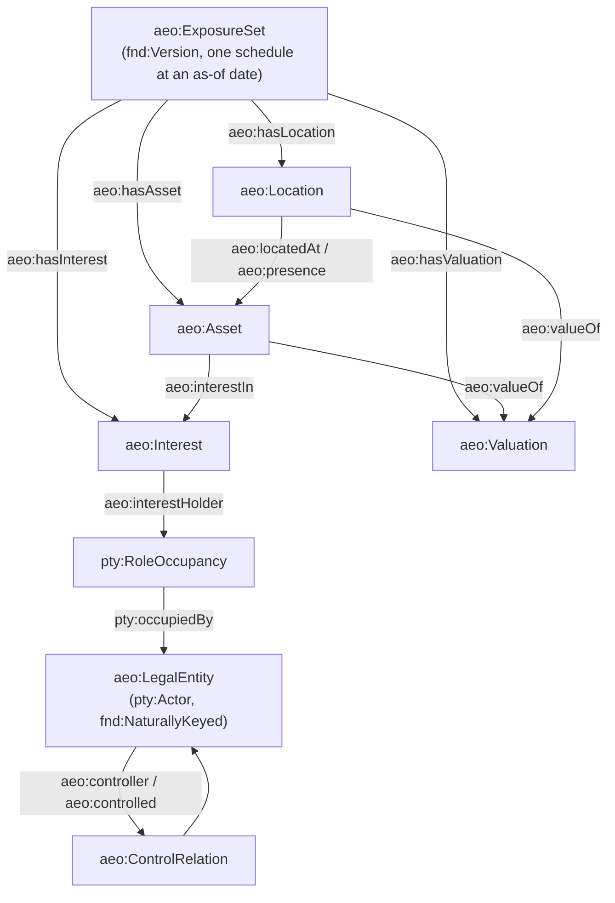

<!-- SPDX-License-Identifier: CC-BY-SA-4.0 -->

# Asset Exposure Ontology (`aeo:`)

Literate specification for the asset exposure ontology, built by the
[`applied-insurance-reference`](../../../../docs/developer/plans/applied-insurance-reference.md)
epic, Phase 4. See [ADR-A98](../../../../docs/architecture/decisions/ADR-A98-applied-insurance-domain-layout.md)
and the [asset exposure ontology sketch](../../../../docs/developer/sketches/asset-exposure-ontology.md)
for the design this module implements.

## 1. Purpose and scope

Exposure is facts about the world, not about cover: where a risk is, what it consists of, who
holds an interest in it, and what it is worth. No class here says what a contract insures — that
is the contract module's (Phase 5). This slice (AIR-4.1) builds the core: an exposure set's
schedule, locations, legal entities and the control between them, assets, interests and
valuations. Later slices of Phase 4 add to the same classes, each in its own region:

| Region | Slice | Adds |
|---|---|---|
| `core` | AIR-4.1 | exposure set, location, legal entity, control, asset, interest, valuation |
| `zones-attributes-assessments` | AIR-4.2 | hazard zones, pool participation, attribute assessments |
| `dependencies-metrics-units` | AIR-4.3 | dependencies, peril metrics, exposure units derived on demand |
| `losses-requirements-cover` | AIR-4.4 | loss history, coverage requirements, existing cover |
| `liability` | AIR-4.5 | liability exposure: counterparty populations, exposure bases |



Exposure imports Foundation, Vocabulary, Quantification, Party and `insurance/common` (which
brings `classification/`), all by exact version IRI. It does not import `insurance/peril`: AIR-4.3
adds that import with its first use (exposure units need peril characteristics). Imported in turn
by later Phase 4 slices and, eventually, the contract module (Phase 5).

## 2. Namespace and prefixes

```turtle-spec
@prefix aeo:  <https://www.nebularis.org/neuro-semantic/insurance/exposure#> .
@prefix fnd:  <https://www.nebularis.org/neuro-semantic/lattice/foundation#> .
@prefix qnt:  <https://www.nebularis.org/neuro-semantic/lattice/quantification#> .
@prefix pty:  <https://www.nebularis.org/neuro-semantic/lattice/party#> .
@prefix cls:  <https://www.nebularis.org/neuro-semantic/lattice/applied/classification#> .
@prefix icm:  <https://www.nebularis.org/neuro-semantic/insurance/common#> .
@prefix skos: <http://www.w3.org/2004/02/skos/core#> .
@prefix owl:  <http://www.w3.org/2002/07/owl#> .
@prefix rdf:  <http://www.w3.org/1999/02/22-rdf-syntax-ns#> .
@prefix rdfs: <http://www.w3.org/2000/01/rdf-schema#> .
@prefix xsd:  <http://www.w3.org/2001/XMLSchema#> .
```

## 3. Extraction contract

- `turtle-spec` blocks generate `spec/exposure.ttl`.
- `turtle-vocab` blocks generate `vocab/exposure-vocab.ttl`.
- `turtle-shapes` blocks generate, in order, `shapes/structural.ttl` and `shapes/constraints.ttl`.
- `turtle-example` blocks are illustrative only. The real fixture lives in
  [`examples/core.ttl`](examples/core.ttl).

```bash
python3 tools/literate_extract.py ontology/applied/insurance/exposure/README.md \
    --layer applied/insurance/exposure --root . \
    --shapes shapes/structural.ttl shapes/constraints.ttl --check
```

## 4. Core classes (AIR-4.1)

### 4.1 Legal entities and control

`aeo:LegalEntity` is an organisation with registration and tax numbers and, where it has one, a
Legal Entity Identifier (LEI, [ISO 17442](https://www.iso.org/standard/59771.html)). These are
[Foundation](../../../foundation/README.md)'s natural keys (`fnd:naturalKey`, Foundation README
§8), not a local identifier class: a company number and an LEI are keys issued by outside
authorities, exactly what `fnd:Key` and `fnd:KeyScheme` already model. `aeo:LegalEntity` carries
no version of its own (unlike `aeo:ExposureSet`, `aeo:Location` and `aeo:Asset`): its own natural
keys follow it across every exposure set that mentions it, as Foundation's own worked example
follows an unversioned company by its company number and LEI.

Control between legal entities is reified, because ownership has a share and a period:

```mermaid
classDiagram
    class LegalEntity["aeo:LegalEntity"] {
        pty:Actor
        fnd:NaturallyKeyed
        cls:industry 0..*
        aeo:domicile 0..1
        aeo:legalForm 0..1
    }
    class ControlRelation["aeo:ControlRelation"] {
        fnd:TemporallyScoped
        fnd:Evidenced
        aeo:controller 1
        aeo:controlled 1
        aeo:controlKind 1
        aeo:controlShare 0..1
    }
    LegalEntity "1" --> "0..*" ControlRelation : aeo:controller
    ControlRelation --> "1" LegalEntity : aeo:controlled
```

### 4.2 Exposure set, location, asset, interest and valuation

An `aeo:ExposureSet` is a versioned snapshot of one insured's schedule: the identity follows the
schedule across renewals, and each version is a schedule as of a date, with the record's own
governance state (Draft while being assembled, Active when submitted, Superseded by the next). A
member (a location, an asset, an interest or a valuation) belongs to exactly one exposure set
version, by an inverse-functional membership property, so unchanged locations and assets are
shared across versions by identity, not duplicated by node.

| Class | Mixins | Key properties |
|---|---|---|
| `aeo:ExposureSet` | `fnd:Version`, `fnd:Governable`, `fnd:TemporallyScoped`, `fnd:Evidenced` | `aeo:reportingUnit` (1, `qnt:Unit`) |
| `aeo:Location` | `fnd:Version` | `aeo:address` (0..1), `aeo:geometry` (0..1, GeoSPARQL optional), `aeo:geoPrecision` (0..1), `aeo:territory` (1..\*) |
| `aeo:Asset` | `fnd:Version` | `aeo:assetClass` (1), `aeo:locatedAt` (0..1, functional) xor `aeo:presence` (0..\*), `aeo:partOf` (asymmetric, irreflexive) |
| `aeo:Interest` | `fnd:TemporallyScoped`, `fnd:Evidenced` | `aeo:interestHolder` (1, `pty:RoleOccupancy`), `aeo:interestIn` (1, `aeo:Asset`), `aeo:interestKind` (1), `aeo:extent` (0..1) |
| `aeo:Valuation` | `fnd:Evidenced`, `fnd:TemporallyScoped` | `aeo:valueOf` (1, asset or location), `aeo:valueType` (1), `aeo:valuationBasis` (1), `aeo:valuationMethod` (0..1), `aeo:amount` xor (`aeo:rate` + `aeo:horizon`) |

Every one of `aeo:ExposureSet`, `aeo:Location` and `aeo:Asset` has its own identity class
(`aeo:ExposureIdentity`, `aeo:LocationIdentity`, `aeo:AssetIdentity`, each `⊑ fnd:PersistentIdentity`),
so a location's loss history and zone designations (AIR-4.2 onwards) follow its identity across
schedule versions, not one snapshot.

```turtle-spec
<https://www.nebularis.org/neuro-semantic/insurance/exposure>
    rdf:type owl:Ontology ;
    owl:versionIRI <https://www.nebularis.org/neuro-semantic/insurance/exposure/0.1.0> ;
    rdfs:label "LATTICE asset exposure ontology"@en ;
    rdfs:comment "Facts about the world a risk sits in: exposure sets, locations, legal entities and control, assets, interests and valuations (AIR-4.1), with zones, attributes, dependencies, losses, requirements, cover and liability arriving in later regions (AIR-4.2 to AIR-4.5). No class here says what a contract insures, which is the contract module's (Phase 5). See the asset exposure ontology sketch." ;
    owl:imports <https://www.nebularis.org/neuro-semantic/lattice/foundation/0.4.0> ,
                <https://www.nebularis.org/neuro-semantic/lattice/vocabulary/0.4.0> ,
                <https://www.nebularis.org/neuro-semantic/lattice/quantification/0.8.0> ,
                <https://www.nebularis.org/neuro-semantic/lattice/party/0.9.0> ,
                <https://www.nebularis.org/neuro-semantic/insurance/common/0.5.0> .

#################################################################
#    Identity classes (AIR-4.1). Each versioned class below has
#    its own, so a location's or asset's loss history and zone
#    designations (AIR-4.2 onwards) follow its identity across
#    exposure set versions, not one schedule snapshot.
#################################################################

aeo:ExposureIdentity a owl:Class ;
    rdfs:subClassOf fnd:PersistentIdentity ;
    rdfs:label "Exposure set identity"@en ;
    rdfs:comment "The identity an exposure set's schedule keeps across renewals." ;
    fnd:utility "Give every aeo:ExposureSet version fnd:hasIdentity an individual of this class." .

aeo:LocationIdentity a owl:Class ;
    rdfs:subClassOf fnd:PersistentIdentity ;
    rdfs:label "Location identity"@en ;
    rdfs:comment "The identity a location keeps across exposure set versions and address or geometry changes." ;
    fnd:utility "Give every aeo:Location version fnd:hasIdentity an individual of this class, so its loss history and zone designations (AIR-4.2 onwards) follow it." .

aeo:AssetIdentity a owl:Class ;
    rdfs:subClassOf fnd:PersistentIdentity ;
    rdfs:label "Asset identity"@en ;
    rdfs:comment "The identity an asset keeps across exposure set versions and valuation changes." ;
    fnd:utility "Give every aeo:Asset version fnd:hasIdentity an individual of this class." .

#################################################################
#    Exposure set (sketch §5.2)
#################################################################

aeo:ExposureSet a owl:Class ;
    rdfs:subClassOf fnd:Version , fnd:Governable , fnd:TemporallyScoped , fnd:Evidenced ,
        [ a owl:Restriction ; owl:onProperty aeo:reportingUnit ; owl:cardinality "1"^^xsd:nonNegativeInteger ] ;
    rdfs:label "Exposure set"@en ;
    rdfs:comment "A versioned snapshot of one insured's schedule, as of a date." ;
    fnd:utility "Subject: an exposure set version. Its identity (aeo:ExposureIdentity) follows the schedule across renewals. Governance state is Draft while assembled, Active when submitted, Superseded by the next version. Link members with aeo:hasLocation, aeo:hasAsset, aeo:hasInterest and aeo:hasValuation." .

aeo:reportingUnit a owl:ObjectProperty, owl:FunctionalProperty ;
    rdfs:domain aeo:ExposureSet ; rdfs:range qnt:Unit ;
    rdfs:label "reporting unit"@en ;
    rdfs:comment "The currency or unit an exposure set's values are reported in." ;
    fnd:utility "Subject: an exposure set. Value: the qnt:Unit its amounts are expressed in, before any per-valuation unit is read. Exactly one." .

aeo:hasLocation a owl:ObjectProperty, owl:InverseFunctionalProperty ;
    rdfs:domain aeo:ExposureSet ; rdfs:range aeo:Location ;
    rdfs:label "has location"@en ;
    rdfs:comment "A location belonging to this exposure set version." ;
    fnd:utility "Subject: an exposure set. Value: one of its locations. Inverse functional: a location version belongs to at most one exposure set version." .

aeo:hasAsset a owl:ObjectProperty, owl:InverseFunctionalProperty ;
    rdfs:domain aeo:ExposureSet ; rdfs:range aeo:Asset ;
    rdfs:label "has asset"@en ;
    rdfs:comment "An asset belonging to this exposure set version." ;
    fnd:utility "Subject: an exposure set. Value: one of its assets. Inverse functional, for the same reason as aeo:hasLocation." .

aeo:hasInterest a owl:ObjectProperty, owl:InverseFunctionalProperty ;
    rdfs:domain aeo:ExposureSet ; rdfs:range aeo:Interest ;
    rdfs:label "has interest"@en ;
    rdfs:comment "An interest belonging to this exposure set version." ;
    fnd:utility "Subject: an exposure set. Value: one of its interests. Inverse functional, for the same reason as aeo:hasLocation." .

aeo:hasValuation a owl:ObjectProperty, owl:InverseFunctionalProperty ;
    rdfs:domain aeo:ExposureSet ; rdfs:range aeo:Valuation ;
    rdfs:label "has valuation"@en ;
    rdfs:comment "A valuation belonging to this exposure set version." ;
    fnd:utility "Subject: an exposure set. Value: one of its valuations. Inverse functional, for the same reason as aeo:hasLocation." .

#################################################################
#    Location (sketch §5.3)
#################################################################

aeo:Location a owl:Class ;
    rdfs:subClassOf fnd:Version ;
    rdfs:label "Location"@en ;
    rdfs:comment "A place where exposure sits: a site, a building footprint, a pipeline segment, a port." ;
    fnd:utility "Subject: a location version. A version per change of address or geometry, one identity (aeo:LocationIdentity) across schedules, so loss history and zone designations (AIR-4.2 onwards) follow it." .

aeo:Address a owl:Class ;
    rdfs:label "Address"@en ;
    rdfs:comment "A structured address, a node so it can be versioned and geocoded as a unit." ;
    fnd:utility "Point aeo:address at one of these rather than a plain string, so an address can carry its own evidence and geocoding history independently of the location it describes." .

aeo:address a owl:ObjectProperty, owl:FunctionalProperty ;
    rdfs:domain aeo:Location ; rdfs:range aeo:Address ;
    rdfs:label "address"@en ;
    rdfs:comment "A location's structured address." ;
    fnd:utility "Subject: a location. Value: its address node. At most one." .

aeo:geometry a owl:ObjectProperty, owl:FunctionalProperty ;
    rdfs:domain aeo:Location ;
    rdfs:label "geometry"@en ;
    rdfs:comment "A location's geometry (point, footprint or line), for example via GeoSPARQL's geo:asWKT." ;
    fnd:utility "Subject: a location. Value: left open, so the core does not depend on GeoSPARQL. A deployment that aligns with GeoSPARQL points this at a geo:Geometry. At most one." .

aeo:geoPrecision a owl:ObjectProperty, owl:FunctionalProperty ;
    rdfs:domain aeo:Location ; rdfs:range skos:Concept ;
    rdfs:label "geographic precision"@en ;
    rdfs:comment "The coarsest location precision at which this location is known (rooftop, parcel, street, postcode, city, zone centroid)." ;
    fnd:utility "Subject: a location. Value: a concept bound by aeo-voc:GeoPrecisionContract. At most one." .

aeo:territory a owl:ObjectProperty ;
    rdfs:subPropertyOf cls:territory ;
    rdfs:domain aeo:Location ; rdfs:range skos:Concept ;
    rdfs:label "territory"@en ;
    rdfs:comment "The territory concepts a location falls in, at the finest level known." ;
    fnd:utility "Subject: a location. Value: one or more territory concepts. At least one. Specialises cls:territory (ADR-A98 decision 5)." .

#################################################################
#    Legal entities and control (sketch §5.1)
#################################################################

aeo:LegalEntity a owl:Class ;
    rdfs:subClassOf pty:Actor , fnd:NaturallyKeyed ;
    rdfs:label "Legal entity"@en ;
    rdfs:comment "An organisation, identified by registration and tax numbers and, where it has one, a Legal Entity Identifier." ;
    fnd:utility "Subject: an organisation. Registration and tax numbers and an LEI are fnd:naturalKeys, key nodes of declared fnd:KeySchemes (Foundation README §8), not a local identifier class. Unversioned: its natural keys follow it across every exposure set that mentions it. Trading names are skos:altLabels." .

aeo:industry a owl:ObjectProperty ;
    rdfs:subPropertyOf cls:industry ;
    rdfs:domain aeo:LegalEntity ; rdfs:range skos:Concept ;
    rdfs:label "industry"@en ;
    rdfs:comment "An industry or economic activity of a legal entity." ;
    fnd:utility "Subject: a legal entity. Value: one or more industry concepts. No primary industry is privileged by this property: a primary industry is an attribute of the entity's assessment (AIR-4.2), not asserted here. Specialises cls:industry." .

aeo:domicile a owl:ObjectProperty, owl:FunctionalProperty ;
    rdfs:subPropertyOf cls:territory ;
    rdfs:domain aeo:LegalEntity ; rdfs:range skos:Concept ;
    rdfs:label "domicile"@en ;
    rdfs:comment "The jurisdiction of incorporation or registration of a legal entity." ;
    fnd:utility "Subject: a legal entity. Value: a territory concept. At most one. Specialises cls:territory." .

aeo:legalForm a owl:ObjectProperty, owl:FunctionalProperty ;
    rdfs:domain aeo:LegalEntity ; rdfs:range skos:Concept ;
    rdfs:label "legal form"@en ;
    rdfs:comment "The generic legal form of a legal entity (corporation, partnership, trust, and others)." ;
    fnd:utility "Subject: a legal entity. Value: a concept bound by aeo-voc:LegalFormContract. At most one. A deployment binds ISO 20275 (Entity Legal Forms) codes by territory, crosswalked to these generic kinds by skos:broadMatch." .

aeo:ControlRelation a owl:Class ;
    rdfs:subClassOf fnd:TemporallyScoped , fnd:Evidenced ,
        [ a owl:Restriction ; owl:onProperty aeo:controller ; owl:cardinality "1"^^xsd:nonNegativeInteger ] ,
        [ a owl:Restriction ; owl:onProperty aeo:controlled ; owl:cardinality "1"^^xsd:nonNegativeInteger ] ,
        [ a owl:Restriction ; owl:onProperty aeo:controlKind ; owl:cardinality "1"^^xsd:nonNegativeInteger ] ;
    rdfs:label "Control relation"@en ;
    rdfs:comment "One legal entity's control of another, for a period, reified because ownership has a share and a time scope." ;
    fnd:utility "Subject: a control relation. Exactly one controller and one controlled legal entity, one control kind, an optional control share." .

aeo:controller a owl:ObjectProperty ;
    rdfs:domain aeo:ControlRelation ; rdfs:range aeo:LegalEntity ;
    rdfs:label "controller"@en ;
    rdfs:comment "The controlling legal entity in a control relation." ;
    fnd:utility "Subject: a control relation. Value: the entity that controls. Exactly one." .

aeo:controlled a owl:ObjectProperty ;
    rdfs:domain aeo:ControlRelation ; rdfs:range aeo:LegalEntity ;
    rdfs:label "controlled"@en ;
    rdfs:comment "The controlled legal entity in a control relation." ;
    fnd:utility "Subject: a control relation. Value: the entity that is controlled. Exactly one." .

aeo:controlKind a owl:ObjectProperty ;
    rdfs:domain aeo:ControlRelation ; rdfs:range skos:Concept ;
    rdfs:label "control kind"@en ;
    rdfs:comment "The kind of control (subsidiary, affiliate, joint venture, branch, franchise)." ;
    fnd:utility "Subject: a control relation. Value: a concept bound by aeo-voc:ControlKindContract. Exactly one." .

aeo:controlShare a owl:ObjectProperty, owl:FunctionalProperty ;
    rdfs:domain aeo:ControlRelation ; rdfs:range qnt:Quantity ;
    rdfs:label "control share"@en ;
    rdfs:comment "The controller's proportionate share of the controlled entity, where stated." ;
    fnd:utility "Subject: a control relation. Value: a qnt:Quantity on a proportion space. At most one. Not Party's pty:outwardShare/inwardShare (CCS slice C16c removes them): this is an exposure-ontology quantity, not a participation share." .

#################################################################
#    Asset and interest (sketch §5.5)
#################################################################

aeo:Asset a owl:Class ;
    rdfs:subClassOf fnd:Version ,
        [ a owl:Restriction ; owl:onProperty aeo:assetClass ; owl:cardinality "1"^^xsd:nonNegativeInteger ] ,
        [ a owl:Restriction ; owl:onProperty aeo:locatedAt ; owl:maxCardinality "1"^^xsd:nonNegativeInteger ] ;
    rdfs:label "Asset"@en ;
    rdfs:comment "Anything of value exposed to loss: a building, contents, stock, machinery, a vessel, a fleet, a crop, a data estate, an income stream." ;
    fnd:utility "Subject: an asset version. aeo:partOf composes assets (critical equipment in a building, a building in a campus): asymmetric, irreflexive. aeo:locatedAt is functional, for a fixed asset; a mobile asset uses aeo:presence nodes instead (a shape enforces one or the other, never both)." .

aeo:assetClass a owl:ObjectProperty ;
    rdfs:subPropertyOf cls:assetClass ;
    rdfs:domain aeo:Asset ; rdfs:range skos:Concept ;
    rdfs:label "asset class"@en ;
    rdfs:comment "The kind of asset (building, contents, stock, and others)." ;
    fnd:utility "Subject: an asset. Value: a concept bound by a reference asset-class scheme (AIR-4.6). Exactly one. Specialises cls:assetClass." .

aeo:locatedAt a owl:ObjectProperty, owl:FunctionalProperty ;
    rdfs:domain aeo:Asset ; rdfs:range aeo:Location ;
    rdfs:label "located at"@en ;
    rdfs:comment "The fixed location of an asset." ;
    fnd:utility "Subject: a fixed asset. Value: its location. At most one, and never together with aeo:presence (the asset-location shape)." .

aeo:partOf a owl:ObjectProperty, owl:AsymmetricProperty, owl:IrreflexiveProperty ;
    rdfs:domain aeo:Asset ; rdfs:range aeo:Asset ;
    rdfs:label "part of"@en ;
    rdfs:comment "This asset is a component of another (critical equipment in a building, a building in a campus)." ;
    fnd:utility "Subject: a component asset. Value: the asset it is part of. Asymmetric and irreflexive." .

aeo:Presence a owl:Class ;
    rdfs:subClassOf fnd:TemporallyScoped ,
        [ a owl:Restriction ; owl:onProperty aeo:presenceLocation ; owl:cardinality "1"^^xsd:nonNegativeInteger ] ;
    rdfs:label "Presence"@en ;
    rdfs:comment "One period a mobile asset spent at one location, optionally with its share of time or value there." ;
    fnd:utility "Subject: a presence. Use for a mobile asset (a vessel, a fleet vehicle) instead of a single aeo:locatedAt. Several presences may exist for one asset, each at a different location and period." .

aeo:presence a owl:ObjectProperty ;
    rdfs:domain aeo:Asset ; rdfs:range aeo:Presence ;
    rdfs:label "presence"@en ;
    rdfs:comment "A period a mobile asset spent at a location." ;
    fnd:utility "Subject: a mobile asset. Value: one of its presences. Several are permitted. Never together with aeo:locatedAt (the asset-location shape)." .

aeo:presenceLocation a owl:ObjectProperty, owl:FunctionalProperty ;
    rdfs:domain aeo:Presence ; rdfs:range aeo:Location ;
    rdfs:label "presence location"@en ;
    rdfs:comment "The location a presence records." ;
    fnd:utility "Subject: a presence. Value: the location. Exactly one." .

aeo:presenceShare a owl:ObjectProperty, owl:FunctionalProperty ;
    rdfs:domain aeo:Presence ; rdfs:range qnt:Quantity ;
    rdfs:label "presence share"@en ;
    rdfs:comment "The share of time or value a mobile asset held at this presence's location, where stated." ;
    fnd:utility "Subject: a presence. Value: a qnt:Quantity on a proportion space. At most one." .

aeo:Interest a owl:Class ;
    rdfs:subClassOf fnd:TemporallyScoped , fnd:Evidenced ,
        [ a owl:Restriction ; owl:onProperty aeo:interestHolder ; owl:cardinality "1"^^xsd:nonNegativeInteger ] ,
        [ a owl:Restriction ; owl:onProperty aeo:interestIn ; owl:cardinality "1"^^xsd:nonNegativeInteger ] ,
        [ a owl:Restriction ; owl:onProperty aeo:interestKind ; owl:cardinality "1"^^xsd:nonNegativeInteger ] ;
    rdfs:label "Interest"@en ;
    rdfs:comment "A party's stake in an asset: owner, lessee, lessor, secured lender, bailee or custodian, beneficiary." ;
    fnd:utility "Subject: an interest. Carries what a lender covenant turns on, and what property of others in care, custody or control means, without a new asset class." .

aeo:interestHolder a owl:ObjectProperty ;
    rdfs:domain aeo:Interest ; rdfs:range pty:RoleOccupancy ;
    rdfs:label "interest holder"@en ;
    rdfs:comment "The role occupancy holding an interest." ;
    fnd:utility "Subject: an interest. Value: a pty:RoleOccupancy, reified so the holder can be bound later and the interest can be evidenced. Exactly one." .

aeo:interestIn a owl:ObjectProperty ;
    rdfs:domain aeo:Interest ; rdfs:range aeo:Asset ;
    rdfs:label "interest in"@en ;
    rdfs:comment "The asset an interest is held in." ;
    fnd:utility "Subject: an interest. Value: the asset. Exactly one." .

aeo:interestKind a owl:ObjectProperty ;
    rdfs:domain aeo:Interest ; rdfs:range skos:Concept ;
    rdfs:label "interest kind"@en ;
    rdfs:comment "The kind of interest (owner, lessee, lessor, secured lender, bailee, beneficiary)." ;
    fnd:utility "Subject: an interest. Value: a concept bound by aeo-voc:InterestKindContract. Exactly one." .

aeo:extent a owl:ObjectProperty, owl:FunctionalProperty ;
    rdfs:domain aeo:Interest ; rdfs:range qnt:Quantity ;
    rdfs:label "extent"@en ;
    rdfs:comment "The extent of an interest, where stated (an allocated principal for a lender, a share for a co-owner)." ;
    fnd:utility "Subject: an interest. Value: a qnt:Quantity. At most one." .

#################################################################
#    Valuation (sketch §5.6)
#################################################################

aeo:Valuation a owl:Class ;
    rdfs:subClassOf fnd:Evidenced , fnd:TemporallyScoped ,
        [ a owl:Restriction ; owl:onProperty aeo:valueOf ; owl:cardinality "1"^^xsd:nonNegativeInteger ] ,
        [ a owl:Restriction ; owl:onProperty aeo:valueType ; owl:cardinality "1"^^xsd:nonNegativeInteger ] ,
        [ a owl:Restriction ; owl:onProperty aeo:valuationBasis ; owl:cardinality "1"^^xsd:nonNegativeInteger ] ;
    rdfs:label "Valuation"@en ;
    rdfs:comment "A value stated for an asset or a location, as an amount or as a rate over a horizon." ;
    fnd:utility "Subject: a valuation. Either exactly one aeo:amount, or exactly one aeo:rate with exactly one aeo:horizon, never both and never neither (the valuation-amount shape)." .

aeo:valueOf a owl:ObjectProperty ;
    rdfs:domain aeo:Valuation ;
    rdfs:label "value of"@en ;
    rdfs:comment "The asset or location a valuation states a value for." ;
    fnd:utility "Subject: a valuation. Value: an aeo:Asset or an aeo:Location. Exactly one." .

aeo:valueType a owl:ObjectProperty ;
    rdfs:domain aeo:Valuation ; rdfs:range skos:Concept ;
    rdfs:label "value type"@en ;
    rdfs:comment "What kind of value is stated (building, contents, stock, gross profit, revenue, rental, and others)." ;
    fnd:utility "Subject: a valuation. Value: a concept bound by aeo-voc:ValueTypeContract. Exactly one." .

aeo:valuationBasis a owl:ObjectProperty ;
    rdfs:domain aeo:Valuation ; rdfs:range skos:Concept ;
    rdfs:label "valuation basis"@en ;
    rdfs:comment "The basis the value is stated on (replacement cost, actual cash value, agreed value, and others)." ;
    fnd:utility "Subject: a valuation. Value: a concept bound by aeo-voc:ValuationBasisContract. Exactly one." .

aeo:valuationMethod a owl:ObjectProperty, owl:FunctionalProperty ;
    rdfs:domain aeo:Valuation ; rdfs:range skos:Concept ;
    rdfs:label "valuation method"@en ;
    rdfs:comment "How the value was arrived at (declared, appraised, indexed, modelled, audited)." ;
    fnd:utility "Subject: a valuation. Value: a concept bound by aeo-voc:ValuationMethodContract. At most one." .

aeo:amount a owl:ObjectProperty, owl:FunctionalProperty ;
    rdfs:domain aeo:Valuation ; rdfs:range qnt:Quantity ;
    rdfs:label "amount"@en ;
    rdfs:comment "A valuation's amount, where it is stated as a single figure." ;
    fnd:utility "Subject: a valuation. Value: a qnt:Quantity. At most one, and never together with aeo:rate (the valuation-amount shape)." .

aeo:rate a owl:ObjectProperty, owl:FunctionalProperty ;
    rdfs:domain aeo:Valuation ; rdfs:range qnt:Quantity ;
    rdfs:label "rate"@en ;
    rdfs:comment "A valuation's rate, where it is stated per unit of a horizon (for example a monthly rental)." ;
    fnd:utility "Subject: a valuation. Value: a qnt:Quantity. Needs aeo:horizon alongside it (the valuation-amount shape)." .

aeo:horizon a owl:ObjectProperty, owl:FunctionalProperty ;
    rdfs:domain aeo:Valuation ; rdfs:range qnt:Quantity ;
    rdfs:label "horizon"@en ;
    rdfs:comment "The period a rate valuation's figure runs over." ;
    fnd:utility "Subject: a rate valuation. Value: a qnt:Quantity (a duration). Required alongside aeo:rate." .

[] a owl:AllDisjointClasses ;
    owl:members ( aeo:ExposureSet aeo:Location aeo:Asset aeo:Interest aeo:Valuation
                  aeo:ControlRelation aeo:Presence aeo:Address ) .
aeo:LegalEntity owl:disjointWith aeo:ExposureSet , aeo:Location , aeo:Asset , aeo:Interest ,
    aeo:Valuation , aeo:ControlRelation , aeo:Presence , aeo:Address .
```

## 5. Vocabulary, `core` region

For each concept-valued property of this slice, a `voc:SchemeContract` and a flat reference scheme
bound as its `voc:boundScheme`, declared as `insurance/peril`'s contracts are.

| Contract, constrains | Reference concepts |
|---|---|
| `aeo-voc:GeoPrecisionContract`, `aeo:geoPrecision` | `Rooftop`, `Parcel`, `Street`, `Postcode`, `City`, `ZoneCentroid` |
| `aeo-voc:ControlKindContract`, `aeo:controlKind` | `Subsidiary`, `Affiliate`, `JointVenture`, `Branch`, `Franchise` |
| `aeo-voc:InterestKindContract`, `aeo:interestKind` | `Owner`, `Lessee`, `Lessor`, `SecuredLender`, `Bailee`, `Beneficiary` |
| `aeo-voc:ValueTypeContract`, `aeo:valueType` | `Building`, `Contents`, `Stock`, `Machinery`, `GrossProfit`, `Revenue`, `Rental`, `ExtraExpense`, `OtherValue` |
| `aeo-voc:ValuationBasisContract`, `aeo:valuationBasis` | `ReplacementCost`, `ActualCashValue`, `AgreedValue`, `MarketValue`, `FunctionalReplacement`, `Reinstatement` |
| `aeo-voc:ValuationMethodContract`, `aeo:valuationMethod` | `Declared`, `Appraised`, `Indexed`, `Modelled`, `Audited` |
| `aeo-voc:LegalFormContract`, `aeo:legalForm` | `Corporation`, `LimitedLiabilityCompany`, `Partnership`, `LimitedPartnership`, `SoleProprietorship`, `Trust`, `Mutual`, `Cooperative`, `PublicFoundation`, `PublicBody`, `UnincorporatedAssociation` |

`aeo:territory`, `aeo:domicile`, `aeo:assetClass` and `aeo:industry` use the `cls-voc:` contracts
through their super-properties, so no contract is declared for them here.

The value types cite the Open Exposure Data (OED) location fields they correspond to
(`Building`→`BuildingTIV`, `Contents`→`ContentsTIV`, `GrossProfit`/`Revenue`/`Rental`→`BITIV`,
`Machinery`/`Stock`/`OtherValue`→`OtherTIV`), noting where OED is coarser. The legal forms are
generic kinds: a deployment binds an ISO 20275 (Entity Legal Forms) edition by territory, mapped
to these kinds by `skos:broadMatch`, since ISO 20275's own codes are per-jurisdiction and run to
thousands.

```turtle-vocab
@prefix aeo:     <https://www.nebularis.org/neuro-semantic/insurance/exposure#> .
@prefix aeo-voc: <https://www.nebularis.org/neuro-semantic/insurance/exposure/vocab#> .
@prefix voc:     <https://www.nebularis.org/neuro-semantic/lattice/vocabulary#> .
@prefix fnd:     <https://www.nebularis.org/neuro-semantic/lattice/foundation#> .
@prefix pty:     <https://www.nebularis.org/neuro-semantic/lattice/party#> .
@prefix skos:    <http://www.w3.org/2004/02/skos/core#> .
@prefix owl:     <http://www.w3.org/2002/07/owl#> .
@prefix rdf:     <http://www.w3.org/1999/02/22-rdf-syntax-ns#> .
@prefix rdfs:    <http://www.w3.org/2000/01/rdf-schema#> .
@base <https://www.nebularis.org/neuro-semantic/insurance/exposure/vocab> .

<https://www.nebularis.org/neuro-semantic/insurance/exposure/vocab>
    rdf:type owl:Ontology ;
    owl:versionIRI <https://www.nebularis.org/neuro-semantic/insurance/exposure-vocab/0.1.0> ;
    owl:imports <https://www.nebularis.org/neuro-semantic/insurance/exposure/0.1.0> ,
                <https://www.nebularis.org/neuro-semantic/lattice/vocabulary/0.4.0> ,
                <https://www.nebularis.org/neuro-semantic/lattice/foundation/0.4.0> ,
                <https://www.nebularis.org/neuro-semantic/insurance/common-vocab/0.5.0> .

#################################################################
#    Reference schemes (AIR-4.1), each the unscoped fallback
#    (ADR-A99 decision 1).
#################################################################

aeo-voc:GeoPrecisionScheme a voc:ConceptScheme ;
    fnd:hasIdentity aeo-voc:GeoPrecisionScheme-identity ;
    fnd:hasGovernanceState fnd:Active ;
    skos:prefLabel "Reference geographic precision scheme"@en ;
    skos:editorialNote "Reference edition published by LATTICE. Not a market standard."@en .

aeo-voc:ControlKindScheme a voc:ConceptScheme ;
    fnd:hasIdentity aeo-voc:ControlKindScheme-identity ;
    fnd:hasGovernanceState fnd:Active ;
    skos:prefLabel "Reference control kind scheme"@en ;
    skos:editorialNote "Reference edition published by LATTICE. Not a market standard."@en .

aeo-voc:InterestKindScheme a voc:ConceptScheme ;
    fnd:hasIdentity aeo-voc:InterestKindScheme-identity ;
    fnd:hasGovernanceState fnd:Active ;
    skos:prefLabel "Reference interest kind scheme"@en ;
    skos:editorialNote "Reference edition published by LATTICE. Not a market standard."@en .

aeo-voc:ValueTypeScheme a voc:ConceptScheme ;
    fnd:hasIdentity aeo-voc:ValueTypeScheme-identity ;
    fnd:hasGovernanceState fnd:Active ;
    skos:prefLabel "Reference value type scheme"@en ;
    skos:editorialNote "Reference edition published by LATTICE. Not a market standard."@en .

aeo-voc:ValuationBasisScheme a voc:ConceptScheme ;
    fnd:hasIdentity aeo-voc:ValuationBasisScheme-identity ;
    fnd:hasGovernanceState fnd:Active ;
    skos:prefLabel "Reference valuation basis scheme"@en ;
    skos:editorialNote "Reference edition published by LATTICE. Not a market standard."@en .

aeo-voc:ValuationMethodScheme a voc:ConceptScheme ;
    fnd:hasIdentity aeo-voc:ValuationMethodScheme-identity ;
    fnd:hasGovernanceState fnd:Active ;
    skos:prefLabel "Reference valuation method scheme"@en ;
    skos:editorialNote "Reference edition published by LATTICE. Not a market standard."@en .

aeo-voc:LegalFormScheme a voc:ConceptScheme ;
    fnd:hasIdentity aeo-voc:LegalFormScheme-identity ;
    fnd:hasGovernanceState fnd:Active ;
    skos:prefLabel "Reference legal form scheme"@en ;
    skos:editorialNote "Reference edition published by LATTICE. Not a market standard."@en .

aeo-voc:ProgrammeRoleScheme a voc:ConceptScheme ;
    fnd:hasIdentity aeo-voc:ProgrammeRoleScheme-identity ;
    fnd:hasGovernanceState fnd:Active ;
    skos:prefLabel "Reference programme role scheme"@en ;
    skos:editorialNote "Reference edition published by LATTICE. Not a market standard."@en .

#################################################################
#    Reference bindings: one voc:SchemeContract per concept-valued
#    property of this slice, bound to its reference scheme as the
#    unscoped fallback (ADR-A99 decision 1), declared as
#    insurance/common's contracts are.
#################################################################

aeo-voc:GeoPrecisionContract a voc:SchemeContract ;
    fnd:hasIdentity aeo-voc:GeoPrecisionContract-identity ;
    fnd:hasGovernanceState fnd:Active ;
    skos:prefLabel "Geographic precision scheme contract"@en ;
    voc:constrainsProperty aeo:geoPrecision ;
    voc:boundScheme aeo-voc:GeoPrecisionScheme .

aeo-voc:ControlKindContract a voc:SchemeContract ;
    fnd:hasIdentity aeo-voc:ControlKindContract-identity ;
    fnd:hasGovernanceState fnd:Active ;
    skos:prefLabel "Control kind scheme contract"@en ;
    voc:constrainsProperty aeo:controlKind ;
    voc:boundScheme aeo-voc:ControlKindScheme .

aeo-voc:InterestKindContract a voc:SchemeContract ;
    fnd:hasIdentity aeo-voc:InterestKindContract-identity ;
    fnd:hasGovernanceState fnd:Active ;
    skos:prefLabel "Interest kind scheme contract"@en ;
    voc:constrainsProperty aeo:interestKind ;
    voc:boundScheme aeo-voc:InterestKindScheme .

aeo-voc:ValueTypeContract a voc:SchemeContract ;
    fnd:hasIdentity aeo-voc:ValueTypeContract-identity ;
    fnd:hasGovernanceState fnd:Active ;
    skos:prefLabel "Value type scheme contract"@en ;
    voc:constrainsProperty aeo:valueType ;
    voc:boundScheme aeo-voc:ValueTypeScheme .

aeo-voc:ValuationBasisContract a voc:SchemeContract ;
    fnd:hasIdentity aeo-voc:ValuationBasisContract-identity ;
    fnd:hasGovernanceState fnd:Active ;
    skos:prefLabel "Valuation basis scheme contract"@en ;
    voc:constrainsProperty aeo:valuationBasis ;
    voc:boundScheme aeo-voc:ValuationBasisScheme .

aeo-voc:ValuationMethodContract a voc:SchemeContract ;
    fnd:hasIdentity aeo-voc:ValuationMethodContract-identity ;
    fnd:hasGovernanceState fnd:Active ;
    skos:prefLabel "Valuation method scheme contract"@en ;
    voc:constrainsProperty aeo:valuationMethod ;
    voc:boundScheme aeo-voc:ValuationMethodScheme .

aeo-voc:LegalFormContract a voc:SchemeContract ;
    fnd:hasIdentity aeo-voc:LegalFormContract-identity ;
    fnd:hasGovernanceState fnd:Active ;
    skos:prefLabel "Legal form scheme contract"@en ;
    voc:constrainsProperty aeo:legalForm ;
    voc:boundScheme aeo-voc:LegalFormScheme .

#################################################################
#    Geographic precision
#################################################################

aeo-voc:Rooftop a skos:Concept ; skos:inScheme aeo-voc:GeoPrecisionScheme ; skos:topConceptOf aeo-voc:GeoPrecisionScheme ;
    skos:prefLabel "Rooftop"@en ; skos:definition "Located to the exact building footprint."@en ;
    skos:note "No single published standard names this axis. Follows common catastrophe-modelling geocoding precision levels."@en .
aeo-voc:Parcel a skos:Concept ; skos:inScheme aeo-voc:GeoPrecisionScheme ; skos:topConceptOf aeo-voc:GeoPrecisionScheme ;
    skos:prefLabel "Parcel"@en ; skos:definition "Located to the land parcel a building sits on."@en ;
    skos:note "Common catastrophe-modelling geocoding precision usage."@en .
aeo-voc:Street a skos:Concept ; skos:inScheme aeo-voc:GeoPrecisionScheme ; skos:topConceptOf aeo-voc:GeoPrecisionScheme ;
    skos:prefLabel "Street"@en ; skos:definition "Located to a point along a street, interpolated from an address range."@en ;
    skos:note "Common catastrophe-modelling geocoding precision usage."@en .
aeo-voc:Postcode a skos:Concept ; skos:inScheme aeo-voc:GeoPrecisionScheme ; skos:topConceptOf aeo-voc:GeoPrecisionScheme ;
    skos:prefLabel "Postcode"@en ; skos:definition "Located to the centroid of a postal code area."@en ;
    skos:note "Common catastrophe-modelling geocoding precision usage."@en .
aeo-voc:City a skos:Concept ; skos:inScheme aeo-voc:GeoPrecisionScheme ; skos:topConceptOf aeo-voc:GeoPrecisionScheme ;
    skos:prefLabel "City"@en ; skos:definition "Located to the centroid of a city or town."@en ;
    skos:note "Common catastrophe-modelling geocoding precision usage."@en .
aeo-voc:ZoneCentroid a skos:Concept ; skos:inScheme aeo-voc:GeoPrecisionScheme ; skos:topConceptOf aeo-voc:GeoPrecisionScheme ;
    skos:prefLabel "Zone centroid"@en ; skos:definition "Located to the centroid of the coarsest hazard or administrative zone known."@en ;
    skos:note "Common catastrophe-modelling geocoding precision usage, the coarsest level."@en .

aeo-voc:GeoPrecisionScheme skos:hasTopConcept aeo-voc:Rooftop , aeo-voc:Parcel , aeo-voc:Street ,
    aeo-voc:Postcode , aeo-voc:City , aeo-voc:ZoneCentroid .

#################################################################
#    Control kind
#################################################################

aeo-voc:Subsidiary a skos:Concept ; skos:inScheme aeo-voc:ControlKindScheme ; skos:topConceptOf aeo-voc:ControlKindScheme ;
    skos:prefLabel "Subsidiary"@en ; skos:definition "Controlled by majority ownership or voting power."@en ;
    skos:note "Common corporate usage."@en .
aeo-voc:Affiliate a skos:Concept ; skos:inScheme aeo-voc:ControlKindScheme ; skos:topConceptOf aeo-voc:ControlKindScheme ;
    skos:prefLabel "Affiliate"@en ; skos:definition "Related by common control or significant influence, without majority ownership."@en ;
    skos:note "Common corporate usage."@en .
aeo-voc:JointVenture a skos:Concept ; skos:inScheme aeo-voc:ControlKindScheme ; skos:topConceptOf aeo-voc:ControlKindScheme ;
    skos:prefLabel "Joint venture"@en ; skos:definition "Jointly controlled by two or more entities under a shared arrangement."@en ;
    skos:note "Common corporate usage."@en .
aeo-voc:Branch a skos:Concept ; skos:inScheme aeo-voc:ControlKindScheme ; skos:topConceptOf aeo-voc:ControlKindScheme ;
    skos:prefLabel "Branch"@en ; skos:definition "An establishment of an entity, without its own separate legal personality."@en ;
    skos:note "Common corporate usage."@en .
aeo-voc:Franchise a skos:Concept ; skos:inScheme aeo-voc:ControlKindScheme ; skos:topConceptOf aeo-voc:ControlKindScheme ;
    skos:prefLabel "Franchise"@en ; skos:definition "Operated under licence from another entity's brand and system, without ownership control."@en ;
    skos:note "Common commercial usage."@en .

aeo-voc:ControlKindScheme skos:hasTopConcept aeo-voc:Subsidiary , aeo-voc:Affiliate , aeo-voc:JointVenture ,
    aeo-voc:Branch , aeo-voc:Franchise .

#################################################################
#    Interest kind
#################################################################

aeo-voc:Owner a skos:Concept ; skos:inScheme aeo-voc:InterestKindScheme ; skos:topConceptOf aeo-voc:InterestKindScheme ;
    skos:prefLabel "Owner"@en ; skos:definition "Holds title to the asset."@en ;
    skos:note "Common property market usage."@en .
aeo-voc:Lessee a skos:Concept ; skos:inScheme aeo-voc:InterestKindScheme ; skos:topConceptOf aeo-voc:InterestKindScheme ;
    skos:prefLabel "Lessee"@en ; skos:definition "Holds a leasehold interest in the asset."@en ;
    skos:note "Common property market usage."@en .
aeo-voc:Lessor a skos:Concept ; skos:inScheme aeo-voc:InterestKindScheme ; skos:topConceptOf aeo-voc:InterestKindScheme ;
    skos:prefLabel "Lessor"@en ; skos:definition "Grants a leasehold interest in the asset to another."@en ;
    skos:note "Common property market usage. Distinct from the programme role aeo-voc:LessorRole, which names a claims programme role, not this interest."@en .
aeo-voc:SecuredLender a skos:Concept ; skos:inScheme aeo-voc:InterestKindScheme ; skos:topConceptOf aeo-voc:InterestKindScheme ;
    skos:prefLabel "Secured lender"@en ; skos:definition "Holds a security interest in the asset as collateral for a loan."@en ;
    skos:note "Common finance market usage. Carries what a lender covenant turns on."@en .
aeo-voc:Bailee a skos:Concept ; skos:inScheme aeo-voc:InterestKindScheme ; skos:topConceptOf aeo-voc:InterestKindScheme ;
    skos:prefLabel "Bailee"@en ; skos:definition "Holds lawful possession of another's asset without owning it, with a duty of care."@en ;
    skos:note "Follows the general legal meaning of bailment. Carries what 'property of others in care, custody or control' means, without a new asset class."@en .
aeo-voc:Beneficiary a skos:Concept ; skos:inScheme aeo-voc:InterestKindScheme ; skos:topConceptOf aeo-voc:InterestKindScheme ;
    skos:prefLabel "Beneficiary"@en ; skos:definition "Benefits from the asset without holding title, possession or a security interest in it."@en ;
    skos:note "Common usage for a residual interest not otherwise named."@en .

aeo-voc:InterestKindScheme skos:hasTopConcept aeo-voc:Owner , aeo-voc:Lessee , aeo-voc:Lessor ,
    aeo-voc:SecuredLender , aeo-voc:Bailee , aeo-voc:Beneficiary .

#################################################################
#    Value type
#################################################################

aeo-voc:Building a skos:Concept ; skos:inScheme aeo-voc:ValueTypeScheme ; skos:topConceptOf aeo-voc:ValueTypeScheme ;
    skos:prefLabel "Building"@en ; skos:definition "The value of a building structure."@en ;
    skos:note "Corresponds to the Open Exposure Data (OED) location field BuildingTIV."@en .
aeo-voc:Contents a skos:Concept ; skos:inScheme aeo-voc:ValueTypeScheme ; skos:topConceptOf aeo-voc:ValueTypeScheme ;
    skos:prefLabel "Contents"@en ; skos:definition "The value of movable contents within a building or location."@en ;
    skos:note "Corresponds to the OED location field ContentsTIV."@en .
aeo-voc:Stock a skos:Concept ; skos:inScheme aeo-voc:ValueTypeScheme ; skos:topConceptOf aeo-voc:ValueTypeScheme ;
    skos:prefLabel "Stock"@en ; skos:definition "The value of goods held for sale or use in production."@en ;
    skos:note "OED has no dedicated stock field: it falls within the coarser OtherTIV. This vocabulary gives it its own value type."@en .
aeo-voc:Machinery a skos:Concept ; skos:inScheme aeo-voc:ValueTypeScheme ; skos:topConceptOf aeo-voc:ValueTypeScheme ;
    skos:prefLabel "Machinery"@en ; skos:definition "The value of plant and machinery."@en ;
    skos:note "OED has no dedicated machinery field: it falls within the coarser OtherTIV. This vocabulary gives it its own value type."@en .
aeo-voc:GrossProfit a skos:Concept ; skos:inScheme aeo-voc:ValueTypeScheme ; skos:topConceptOf aeo-voc:ValueTypeScheme ;
    skos:prefLabel "Gross profit"@en ; skos:definition "The business interruption value measured as gross profit."@en ;
    skos:note "Corresponds to the OED location field BITIV (business interruption), which does not itself distinguish gross profit from revenue or rental."@en .
aeo-voc:Revenue a skos:Concept ; skos:inScheme aeo-voc:ValueTypeScheme ; skos:topConceptOf aeo-voc:ValueTypeScheme ;
    skos:prefLabel "Revenue"@en ; skos:definition "The business interruption value measured as revenue."@en ;
    skos:note "Corresponds to the OED location field BITIV, narrowed to the revenue basis."@en .
aeo-voc:Rental a skos:Concept ; skos:inScheme aeo-voc:ValueTypeScheme ; skos:topConceptOf aeo-voc:ValueTypeScheme ;
    skos:prefLabel "Rental"@en ; skos:definition "The business interruption value measured as rental income."@en ;
    skos:note "Corresponds to the OED location field BITIV, narrowed to the rental basis."@en .
aeo-voc:ExtraExpense a skos:Concept ; skos:inScheme aeo-voc:ValueTypeScheme ; skos:topConceptOf aeo-voc:ValueTypeScheme ;
    skos:prefLabel "Extra expense"@en ; skos:definition "The value of cost incurred to avoid or reduce a loss that would otherwise follow an interruption."@en ;
    skos:note "Corresponds to the OED location field BITIV, narrowed to the extra expense basis."@en .
aeo-voc:OtherValue a skos:Concept ; skos:inScheme aeo-voc:ValueTypeScheme ; skos:topConceptOf aeo-voc:ValueTypeScheme ;
    skos:prefLabel "Other value"@en ; skos:definition "A value not otherwise classified by this scheme."@en ;
    skos:note "Corresponds to the OED location field OtherTIV."@en .

aeo-voc:ValueTypeScheme skos:hasTopConcept aeo-voc:Building , aeo-voc:Contents , aeo-voc:Stock , aeo-voc:Machinery ,
    aeo-voc:GrossProfit , aeo-voc:Revenue , aeo-voc:Rental , aeo-voc:ExtraExpense , aeo-voc:OtherValue .

#################################################################
#    Valuation basis
#################################################################

aeo-voc:ReplacementCost a skos:Concept ; skos:inScheme aeo-voc:ValuationBasisScheme ; skos:topConceptOf aeo-voc:ValuationBasisScheme ;
    skos:prefLabel "Replacement cost"@en ; skos:definition "The cost of replacing the asset new, without deduction for depreciation."@en ;
    skos:note "Common property market usage."@en .
aeo-voc:ActualCashValue a skos:Concept ; skos:inScheme aeo-voc:ValuationBasisScheme ; skos:topConceptOf aeo-voc:ValuationBasisScheme ;
    skos:prefLabel "Actual cash value"@en ; skos:definition "Replacement cost less deduction for depreciation and wear."@en ;
    skos:note "Common property market usage."@en .
aeo-voc:AgreedValue a skos:Concept ; skos:inScheme aeo-voc:ValuationBasisScheme ; skos:topConceptOf aeo-voc:ValuationBasisScheme ;
    skos:prefLabel "Agreed value"@en ; skos:definition "A value fixed by agreement between the parties, not subject to later valuation dispute."@en ;
    skos:note "Common property market usage."@en .
aeo-voc:MarketValue a skos:Concept ; skos:inScheme aeo-voc:ValuationBasisScheme ; skos:topConceptOf aeo-voc:ValuationBasisScheme ;
    skos:prefLabel "Market value"@en ; skos:definition "The price the asset would command in an open market sale."@en ;
    skos:note "Common property market usage."@en .
aeo-voc:FunctionalReplacement a skos:Concept ; skos:inScheme aeo-voc:ValuationBasisScheme ; skos:topConceptOf aeo-voc:ValuationBasisScheme ;
    skos:prefLabel "Functional replacement"@en ; skos:definition "The cost of replacing the asset's function with a modern equivalent, not its exact original form."@en ;
    skos:note "Common property market usage for an asset whose like-for-like replacement is no longer practical."@en .
aeo-voc:Reinstatement a skos:Concept ; skos:inScheme aeo-voc:ValuationBasisScheme ; skos:topConceptOf aeo-voc:ValuationBasisScheme ;
    skos:prefLabel "Reinstatement"@en ; skos:definition "The cost of restoring the asset to its condition immediately before the loss."@en ;
    skos:note "Common property market usage."@en .

aeo-voc:ValuationBasisScheme skos:hasTopConcept aeo-voc:ReplacementCost , aeo-voc:ActualCashValue , aeo-voc:AgreedValue ,
    aeo-voc:MarketValue , aeo-voc:FunctionalReplacement , aeo-voc:Reinstatement .

#################################################################
#    Valuation method
#################################################################

aeo-voc:Declared a skos:Concept ; skos:inScheme aeo-voc:ValuationMethodScheme ; skos:topConceptOf aeo-voc:ValuationMethodScheme ;
    skos:prefLabel "Declared"@en ; skos:definition "Stated by the insured, without independent verification."@en ;
    skos:note "Common property market usage."@en .
aeo-voc:Appraised a skos:Concept ; skos:inScheme aeo-voc:ValuationMethodScheme ; skos:topConceptOf aeo-voc:ValuationMethodScheme ;
    skos:prefLabel "Appraised"@en ; skos:definition "Determined by an independent appraisal or survey."@en ;
    skos:note "Common property market usage."@en .
aeo-voc:Indexed a skos:Concept ; skos:inScheme aeo-voc:ValuationMethodScheme ; skos:topConceptOf aeo-voc:ValuationMethodScheme ;
    skos:prefLabel "Indexed"@en ; skos:definition "Derived from a prior value adjusted by a published index."@en ;
    skos:note "Common property market usage."@en .
aeo-voc:Modelled a skos:Concept ; skos:inScheme aeo-voc:ValuationMethodScheme ; skos:topConceptOf aeo-voc:ValuationMethodScheme ;
    skos:prefLabel "Modelled"@en ; skos:definition "Estimated by a statistical or engineering model from other known attributes."@en ;
    skos:note "Common catastrophe-modelling usage for exposure enrichment."@en .
aeo-voc:Audited a skos:Concept ; skos:inScheme aeo-voc:ValuationMethodScheme ; skos:topConceptOf aeo-voc:ValuationMethodScheme ;
    skos:prefLabel "Audited"@en ; skos:definition "Verified by an independent audit, such as a premium audit."@en ;
    skos:note "Common property and casualty market usage."@en .

aeo-voc:ValuationMethodScheme skos:hasTopConcept aeo-voc:Declared , aeo-voc:Appraised , aeo-voc:Indexed ,
    aeo-voc:Modelled , aeo-voc:Audited .

#################################################################
#    Legal form (ISO 20275 generic kinds)
#################################################################

aeo-voc:Corporation a skos:Concept ; skos:inScheme aeo-voc:LegalFormScheme ; skos:topConceptOf aeo-voc:LegalFormScheme ;
    skos:prefLabel "Corporation"@en ; skos:definition "A body corporate with legal personality separate from its members."@en ;
    skos:note "A generic kind. Follows ISO 20275 (Entity Legal Forms), whose own codes are per jurisdiction and run to thousands: a deployment binds an edition by territory, mapped to these kinds by skos:broadMatch."@en ;
    rdfs:seeAlso <https://www.gleif.org/en/about-lei/code-lists/iso-20275-entity-legal-forms-code-list> .
aeo-voc:LimitedLiabilityCompany a skos:Concept ; skos:inScheme aeo-voc:LegalFormScheme ; skos:topConceptOf aeo-voc:LegalFormScheme ;
    skos:prefLabel "Limited liability company"@en ; skos:definition "A company whose members' liability is limited to their investment, combining features of a corporation and a partnership."@en ;
    skos:note "A generic kind. Follows ISO 20275, per the Corporation entry's note."@en .
aeo-voc:Partnership a skos:Concept ; skos:inScheme aeo-voc:LegalFormScheme ; skos:topConceptOf aeo-voc:LegalFormScheme ;
    skos:prefLabel "Partnership"@en ; skos:definition "An association of two or more persons carrying on a business together, without limited liability."@en ;
    skos:note "A generic kind. Follows ISO 20275, per the Corporation entry's note."@en .
aeo-voc:LimitedPartnership a skos:Concept ; skos:inScheme aeo-voc:LegalFormScheme ; skos:topConceptOf aeo-voc:LegalFormScheme ;
    skos:prefLabel "Limited partnership"@en ; skos:definition "A partnership with at least one partner whose liability is limited to their contribution."@en ;
    skos:note "A generic kind. Follows ISO 20275, per the Corporation entry's note."@en .
aeo-voc:SoleProprietorship a skos:Concept ; skos:inScheme aeo-voc:LegalFormScheme ; skos:topConceptOf aeo-voc:LegalFormScheme ;
    skos:prefLabel "Sole proprietorship"@en ; skos:definition "A business owned and run by one natural person, with no separate legal personality."@en ;
    skos:note "A generic kind. Follows ISO 20275, per the Corporation entry's note."@en .
aeo-voc:Trust a skos:Concept ; skos:inScheme aeo-voc:LegalFormScheme ; skos:topConceptOf aeo-voc:LegalFormScheme ;
    skos:prefLabel "Trust"@en ; skos:definition "An arrangement in which a trustee holds property for the benefit of others."@en ;
    skos:note "A generic kind. Follows ISO 20275, per the Corporation entry's note."@en .
aeo-voc:Mutual a skos:Concept ; skos:inScheme aeo-voc:LegalFormScheme ; skos:topConceptOf aeo-voc:LegalFormScheme ;
    skos:prefLabel "Mutual"@en ; skos:definition "An organisation owned by its members, who are also its customers or policyholders."@en ;
    skos:note "A generic kind. Follows ISO 20275, per the Corporation entry's note."@en .
aeo-voc:Cooperative a skos:Concept ; skos:inScheme aeo-voc:LegalFormScheme ; skos:topConceptOf aeo-voc:LegalFormScheme ;
    skos:prefLabel "Cooperative"@en ; skos:definition "An organisation owned and democratically controlled by its members, for their mutual benefit."@en ;
    skos:note "A generic kind. Follows ISO 20275, per the Corporation entry's note."@en .
aeo-voc:PublicFoundation a skos:Concept ; skos:inScheme aeo-voc:LegalFormScheme ; skos:topConceptOf aeo-voc:LegalFormScheme ;
    skos:prefLabel "Foundation"@en ; skos:definition "A body established to hold and apply assets for a stated purpose, without members or shareholders."@en ;
    skos:note "A generic kind. Follows ISO 20275, per the Corporation entry's note. Named PublicFoundation to avoid a name clash with Vocabulary's own voc:ConceptScheme usage elsewhere in this README's prose."@en .
aeo-voc:PublicBody a skos:Concept ; skos:inScheme aeo-voc:LegalFormScheme ; skos:topConceptOf aeo-voc:LegalFormScheme ;
    skos:prefLabel "Public body"@en ; skos:definition "A body established by or under public law to carry out a public function."@en ;
    skos:note "A generic kind. Follows ISO 20275, per the Corporation entry's note."@en .
aeo-voc:UnincorporatedAssociation a skos:Concept ; skos:inScheme aeo-voc:LegalFormScheme ; skos:topConceptOf aeo-voc:LegalFormScheme ;
    skos:prefLabel "Unincorporated association"@en ; skos:definition "A group of persons acting together for a common purpose, without separate legal personality."@en ;
    skos:note "A generic kind. Follows ISO 20275, per the Corporation entry's note."@en .

aeo-voc:LegalFormScheme skos:hasTopConcept aeo-voc:Corporation , aeo-voc:LimitedLiabilityCompany , aeo-voc:Partnership ,
    aeo-voc:LimitedPartnership , aeo-voc:SoleProprietorship , aeo-voc:Trust , aeo-voc:Mutual , aeo-voc:Cooperative ,
    aeo-voc:PublicFoundation , aeo-voc:PublicBody , aeo-voc:UnincorporatedAssociation .

#################################################################
#    Programme roles (pty:Role individuals, declared as icm-voc:Claimant is)
#################################################################

aeo-voc:NamedInsured a owl:NamedIndividual , pty:Role ;
    rdfs:label "Named insured"@en ;
    rdfs:comment "A party named in the programme as an insured." ;
    skos:note "Common property and casualty market usage."@en ;
    fnd:utility "Type a pty:RoleOccupancy with this role for a named insured."@en .
aeo-voc:FirstNamedInsured a owl:NamedIndividual , pty:Role ;
    rdfs:label "First named insured"@en ;
    rdfs:comment "The named insured the policy designates first, typically for notice and premium purposes." ;
    skos:note "Common property and casualty market usage."@en ;
    fnd:utility "Type a pty:RoleOccupancy with this role for the first named insured."@en .
aeo-voc:AdditionalInsured a owl:NamedIndividual , pty:Role ;
    rdfs:label "Additional insured"@en ;
    rdfs:comment "A party added as an insured by endorsement, typically at a counterparty's request." ;
    skos:note "Common liability market usage. The additional-insured variants by ISO endorsement (CG 20 10, CG 20 37, CG 20 38) are conferred by the contract (Phase 5), not this role alone."@en ;
    fnd:utility "Type a pty:RoleOccupancy with this role for an additional insured."@en .
aeo-voc:LossPayee a owl:NamedIndividual , pty:Role ;
    rdfs:label "Loss payee"@en ;
    rdfs:comment "A party named to receive payment of a loss, without the broader rights of a mortgagee." ;
    skos:note "Common property market usage."@en ;
    fnd:utility "Type a pty:RoleOccupancy with this role for a simple loss payee."@en .
aeo-voc:LendersLossPayee a owl:NamedIndividual , pty:Role ;
    skos:broader aeo-voc:LossPayee ;
    rdfs:label "Lender's loss payee"@en ;
    rdfs:comment "A lender named to receive payment of a loss, with rights a simple loss payee lacks." ;
    skos:note "Narrower than aeo-voc:LossPayee. Follows the ISO commercial property loss payable provisions endorsement (CP 12 18), whose lender's loss payable clause gives a lender rights a simple loss payee lacks, and the London market's practice of noting a lender's interest with a loss payee clause."@en ;
    fnd:utility "Type a pty:RoleOccupancy with this role for a lender's loss payee."@en .
aeo-voc:Mortgagee a owl:NamedIndividual , pty:Role ;
    rdfs:label "Mortgagee"@en ;
    rdfs:comment "A party holding a mortgage over the insured property, with rights under a standard mortgage clause." ;
    skos:note "Common property market usage."@en ;
    fnd:utility "Type a pty:RoleOccupancy with this role for a mortgagee."@en .
aeo-voc:LessorRole a owl:NamedIndividual , pty:Role ;
    rdfs:label "Lessor (programme role)"@en ;
    rdfs:comment "A lessor named in the programme, distinct from the interest kind aeo-voc:Lessor." ;
    skos:note "No single published standard names this axis. Named distinctly from aeo-voc:Lessor (an interest kind) because a programme role and an interest are different things: a lessor may be named without an aeo:Interest being recorded, or vice versa."@en ;
    fnd:utility "Type a pty:RoleOccupancy with this role for a lessor named in the programme."@en .
aeo-voc:Bailor a owl:NamedIndividual , pty:Role ;
    rdfs:label "Bailor"@en ;
    rdfs:comment "A party who has bailed property to the insured bailee." ;
    skos:note "Follows the general legal meaning of bailment."@en ;
    fnd:utility "Type a pty:RoleOccupancy with this role for a bailor."@en .
aeo-voc:WaiverOfSubrogationBeneficiary a owl:NamedIndividual , pty:Role ;
    rdfs:label "Waiver of subrogation beneficiary"@en ;
    rdfs:comment "A party who benefits from a waiver of the insurer's subrogation rights against them." ;
    skos:note "Common liability market usage. The waiver itself is a contract term (Phase 5): this role only names who benefits."@en ;
    fnd:utility "Type a pty:RoleOccupancy with this role for a waiver beneficiary."@en .

# ==== BEGIN README SECTION zones-attributes-assessments (AIR-4.2) ====
# ==== END README SECTION zones-attributes-assessments ====

# ==== BEGIN README SECTION dependencies-metrics-units (AIR-4.3) ====
# ==== END README SECTION dependencies-metrics-units ====

# ==== BEGIN README SECTION losses-requirements-cover (AIR-4.4) ====
# ==== END README SECTION losses-requirements-cover ====

# ==== BEGIN README SECTION liability (AIR-4.5) ====
# ==== END README SECTION liability ====
```

## 6. Shapes, `core` region, `.version` 0.1.0

Every rule is SHACL-SPARQL (`sh:sparql`), following the house rules in
`.github/copilot-instructions.md` ("Authoring SHACL-SPARQL shapes"): counted patterns are
`OPTIONAL`, so a node with zero matches still produces a row, and `sh:sourceShape` always names
the shape itself since `sh:sparql`'s value is a constraint, not a nested property shape.

| Shape | Rule |
|---|---|
| `aeo:ExposureSetShape` | exactly one identity, one reporting unit, one temporal scope, one governance state |
| `aeo:LocationShape` | exactly one identity, at least one territory. A location with a geometry has a geo precision |
| `aeo:AssetShape` | exactly one identity and one asset class. Not both `aeo:locatedAt` and `aeo:presence` |
| `aeo:InterestShape` | exactly one holder, one asset and one kind |
| `aeo:ValuationShape` | exactly one `aeo:valueOf`, one value type and one basis. Either one amount, or one rate and one horizon, never both and never neither |
| `aeo:ControlRelationShape` | exactly one controller and one controlled, and no cycle through `aeo:controller` / `aeo:controlled` |
| `aeo:LegalEntityShape` | at most one domicile and one legal form |
| `aeo:MembershipShape` | a member belongs to at most one exposure set version |
| `aeo:DocumentationShape` | every concept in an `aeo-voc:` scheme has at least one `skos:note` in `@en` (AIR-2.0 documentation rule) |

```turtle-shapes
# Structural (per-node) shapes for the asset exposure ontology (ADR-A99-style
# well-formedness, applied-insurance-reference AIR-4.1). Cross-node and
# cycle shapes are in constraints.ttl. Every rule is SHACL-SPARQL (sh:sparql,
# never sh:property), so pySHACL's sh:sourceShape always names the shape
# itself rather than an anonymous nested property shape, validated with
# pySHACL advanced=True (tools/test_exposure_ontology.py).

@prefix sh:      <http://www.w3.org/ns/shacl#> .
@prefix skos:    <http://www.w3.org/2004/02/skos/core#> .
@prefix fnd:     <https://www.nebularis.org/neuro-semantic/lattice/foundation#> .
@prefix aeo:     <https://www.nebularis.org/neuro-semantic/insurance/exposure#> .
@prefix aeo-voc: <https://www.nebularis.org/neuro-semantic/insurance/exposure/vocab#> .

aeo:ExposureSetShape a sh:NodeShape ;
    sh:targetClass aeo:ExposureSet ;
    sh:sparql [
        sh:message "An exposure set needs exactly one identity, one reporting unit, one temporal scope and one governance state." ;
        sh:select """
            PREFIX aeo: <https://www.nebularis.org/neuro-semantic/insurance/exposure#>
            PREFIX fnd: <https://www.nebularis.org/neuro-semantic/lattice/foundation#>
            SELECT $this WHERE {
              {
                SELECT $this (COUNT(DISTINCT ?i) AS ?ni) (COUNT(DISTINCT ?u) AS ?nu)
                              (COUNT(DISTINCT ?t) AS ?nt) (COUNT(DISTINCT ?g) AS ?ng) WHERE {
                  $this a aeo:ExposureSet .
                  OPTIONAL { $this fnd:hasIdentity ?i }
                  OPTIONAL { $this aeo:reportingUnit ?u }
                  OPTIONAL { $this fnd:hasTemporalScope ?t }
                  OPTIONAL { $this fnd:hasGovernanceState ?g }
                } GROUP BY $this
              }
              FILTER (?ni != 1 || ?nu != 1 || ?nt != 1 || ?ng != 1)
            }
        """ ] .

aeo:LocationShape a sh:NodeShape ;
    sh:targetClass aeo:Location ;
    sh:sparql [
        sh:message "A location needs exactly one identity, and at least one territory." ;
        sh:select """
            PREFIX aeo: <https://www.nebularis.org/neuro-semantic/insurance/exposure#>
            PREFIX fnd: <https://www.nebularis.org/neuro-semantic/lattice/foundation#>
            SELECT $this WHERE {
              {
                SELECT $this (COUNT(DISTINCT ?i) AS ?ni) (COUNT(DISTINCT ?t) AS ?nt) WHERE {
                  $this a aeo:Location .
                  OPTIONAL { $this fnd:hasIdentity ?i }
                  OPTIONAL { $this aeo:territory ?t }
                } GROUP BY $this
              }
              FILTER (?ni != 1 || ?nt < 1)
            }
        """ ] ;
    sh:sparql [
        sh:message "A location with a geometry needs a geographic precision." ;
        sh:select """
            PREFIX aeo: <https://www.nebularis.org/neuro-semantic/insurance/exposure#>
            SELECT $this WHERE {
              $this aeo:geometry ?g .
              FILTER NOT EXISTS { $this aeo:geoPrecision ?p }
            }
        """ ] .

aeo:AssetShape a sh:NodeShape ;
    sh:targetClass aeo:Asset ;
    sh:sparql [
        sh:message "An asset needs exactly one identity and exactly one asset class." ;
        sh:select """
            PREFIX aeo: <https://www.nebularis.org/neuro-semantic/insurance/exposure#>
            PREFIX fnd: <https://www.nebularis.org/neuro-semantic/lattice/foundation#>
            SELECT $this WHERE {
              {
                SELECT $this (COUNT(DISTINCT ?i) AS ?ni) (COUNT(DISTINCT ?c) AS ?nc) WHERE {
                  $this a aeo:Asset .
                  OPTIONAL { $this fnd:hasIdentity ?i }
                  OPTIONAL { $this aeo:assetClass ?c }
                } GROUP BY $this
              }
              FILTER (?ni != 1 || ?nc != 1)
            }
        """ ] ;
    sh:sparql [
        sh:message "An asset must not have both aeo:locatedAt and aeo:presence." ;
        sh:select """
            PREFIX aeo: <https://www.nebularis.org/neuro-semantic/insurance/exposure#>
            SELECT $this WHERE {
              $this aeo:locatedAt ?l ; aeo:presence ?p .
            }
        """ ] .

aeo:InterestShape a sh:NodeShape ;
    sh:targetClass aeo:Interest ;
    sh:sparql [
        sh:message "An interest needs exactly one holder, one asset and one kind." ;
        sh:select """
            PREFIX aeo: <https://www.nebularis.org/neuro-semantic/insurance/exposure#>
            SELECT $this WHERE {
              {
                SELECT $this (COUNT(DISTINCT ?h) AS ?nh) (COUNT(DISTINCT ?a) AS ?na) (COUNT(DISTINCT ?k) AS ?nk) WHERE {
                  $this a aeo:Interest .
                  OPTIONAL { $this aeo:interestHolder ?h }
                  OPTIONAL { $this aeo:interestIn ?a }
                  OPTIONAL { $this aeo:interestKind ?k }
                } GROUP BY $this
              }
              FILTER (?nh != 1 || ?na != 1 || ?nk != 1)
            }
        """ ] .

aeo:ValuationShape a sh:NodeShape ;
    sh:targetClass aeo:Valuation ;
    sh:sparql [
        sh:message "A valuation needs exactly one aeo:valueOf, one value type and one valuation basis." ;
        sh:select """
            PREFIX aeo: <https://www.nebularis.org/neuro-semantic/insurance/exposure#>
            SELECT $this WHERE {
              {
                SELECT $this (COUNT(DISTINCT ?v) AS ?nv) (COUNT(DISTINCT ?t) AS ?nt) (COUNT(DISTINCT ?b) AS ?nb) WHERE {
                  $this a aeo:Valuation .
                  OPTIONAL { $this aeo:valueOf ?v }
                  OPTIONAL { $this aeo:valueType ?t }
                  OPTIONAL { $this aeo:valuationBasis ?b }
                } GROUP BY $this
              }
              FILTER (?nv != 1 || ?nt != 1 || ?nb != 1)
            }
        """ ] ;
    sh:sparql [
        sh:message "A valuation needs either exactly one aeo:amount, or exactly one aeo:rate with exactly one aeo:horizon, never both and never neither." ;
        sh:select """
            PREFIX aeo: <https://www.nebularis.org/neuro-semantic/insurance/exposure#>
            SELECT $this WHERE {
              {
                SELECT $this (COUNT(DISTINCT ?a) AS ?na) (COUNT(DISTINCT ?r) AS ?nr) (COUNT(DISTINCT ?h) AS ?nh) WHERE {
                  $this a aeo:Valuation .
                  OPTIONAL { $this aeo:amount ?a }
                  OPTIONAL { $this aeo:rate ?r }
                  OPTIONAL { $this aeo:horizon ?h }
                } GROUP BY $this
              }
              FILTER (!(
                (?na = 1 && ?nr = 0 && ?nh = 0) || (?na = 0 && ?nr = 1 && ?nh = 1)
              ))
            }
        """ ] .

aeo:LegalEntityShape a sh:NodeShape ;
    sh:targetClass aeo:LegalEntity ;
    sh:sparql [
        sh:message "A legal entity may have at most one domicile and at most one legal form." ;
        sh:select """
            PREFIX aeo: <https://www.nebularis.org/neuro-semantic/insurance/exposure#>
            SELECT $this WHERE {
              {
                SELECT $this (COUNT(DISTINCT ?d) AS ?nd) (COUNT(DISTINCT ?f) AS ?nf) WHERE {
                  $this a aeo:LegalEntity .
                  OPTIONAL { $this aeo:domicile ?d }
                  OPTIONAL { $this aeo:legalForm ?f }
                } GROUP BY $this
              }
              FILTER (?nd > 1 || ?nf > 1)
            }
        """ ] .

aeo:DocumentationShape a sh:NodeShape ;
    sh:targetClass skos:Concept ;
    sh:sparql [
        sh:message "A concept in a reference exposure scheme needs at least one skos:note in @en, naming the published standards, scales or sources it follows (AIR-2.0 documentation rule)." ;
        sh:select """
            PREFIX aeo-voc: <https://www.nebularis.org/neuro-semantic/insurance/exposure/vocab#>
            PREFIX skos: <http://www.w3.org/2004/02/skos/core#>
            SELECT $this WHERE {
              $this skos:inScheme ?scheme .
              FILTER (?scheme IN (aeo-voc:GeoPrecisionScheme, aeo-voc:ControlKindScheme, aeo-voc:InterestKindScheme,
                                  aeo-voc:ValueTypeScheme, aeo-voc:ValuationBasisScheme, aeo-voc:ValuationMethodScheme,
                                  aeo-voc:LegalFormScheme))
              OPTIONAL { $this skos:note ?n . FILTER (LANG(?n) = "en") }
            }
            GROUP BY $this
            HAVING (COUNT(DISTINCT ?n) < 1)
        """ ] .
```

```turtle-shapes
# Cross-node shapes for the asset exposure ontology: membership and cycles
# (applied-insurance-reference AIR-4.1). Per-node shapes are in
# structural.ttl.

@prefix sh:  <http://www.w3.org/ns/shacl#> .
@prefix aeo: <https://www.nebularis.org/neuro-semantic/insurance/exposure#> .

aeo:MembershipShape a sh:NodeShape ;
    sh:targetObjectsOf aeo:hasLocation , aeo:hasAsset , aeo:hasInterest , aeo:hasValuation ;
    sh:sparql [
        sh:message "A location, asset, interest or valuation must belong to at most one exposure set version." ;
        sh:select """
            PREFIX aeo: <https://www.nebularis.org/neuro-semantic/insurance/exposure#>
            SELECT $this WHERE {
              { $this ^aeo:hasLocation ?s1 . $this ^aeo:hasLocation ?s2 . FILTER (?s1 != ?s2) }
              UNION { $this ^aeo:hasAsset ?s1 . $this ^aeo:hasAsset ?s2 . FILTER (?s1 != ?s2) }
              UNION { $this ^aeo:hasInterest ?s1 . $this ^aeo:hasInterest ?s2 . FILTER (?s1 != ?s2) }
              UNION { $this ^aeo:hasValuation ?s1 . $this ^aeo:hasValuation ?s2 . FILTER (?s1 != ?s2) }
            }
        """ ] .

aeo:ControlRelationShape a sh:NodeShape ;
    sh:targetClass aeo:ControlRelation ;
    sh:sparql [
        sh:message "A control relation must not create a cycle through aeo:controller / aeo:controlled." ;
        sh:select """
            PREFIX aeo: <https://www.nebularis.org/neuro-semantic/insurance/exposure#>
            SELECT $this WHERE {
              $this aeo:controller ?a ; aeo:controlled ?b .
              ?b (^aeo:controller/aeo:controlled)+ ?a .
            }
        """ ] .
```

## 7. Documentation rule

Every concept this module's vocabulary publishes carries a `skos:note` per the
[AIR-2.0 documentation rule](../peril/README.md#7-documentation-rule): which published standards,
scales or sources it follows, how it follows them, and where it departs from them.

## 8. Sources consulted

- ISO 17442, Legal Entity Identifier (LEI)
- ISO 20275, Entity Legal Forms code list
- the Oasis Open Exposure Data (OED) location schema, for the value type notations
- the ISO commercial property loss payable provisions endorsement (CP 12 18), for the lender's
  loss payee role
- for geographic precision, control kind, interest kind, valuation basis and valuation method,
  which the above do not cover, common catastrophe-modelling and property market usage, stated
  neutrally

## 9. Fixture and tests

[`examples/core.ttl`](examples/core.ttl) is a small, real fragment of one insured's schedule: an
exposure set version with two locations, a building and its contents, an owner's interest and a
lender's, three valuations, and a parent controlling the insured, which has an industry, a
domicile and a legal form. [`tools/test_exposure_ontology.py`](../../../../tools/test_exposure_ontology.py)
validates it, plus one negative case per shape, with pySHACL (`advanced=True`, `inference="none"`),
modelled on `tools/test_peril_vocabulary.py`.

## 10. Release notes

| Version | Change |
|---|---|
| `0.1.0` | AIR-4.1: exposure set, location, legal entity, control relations, asset, interest, valuation. Seven scheme contracts, nine programme roles. Literate from the start |
