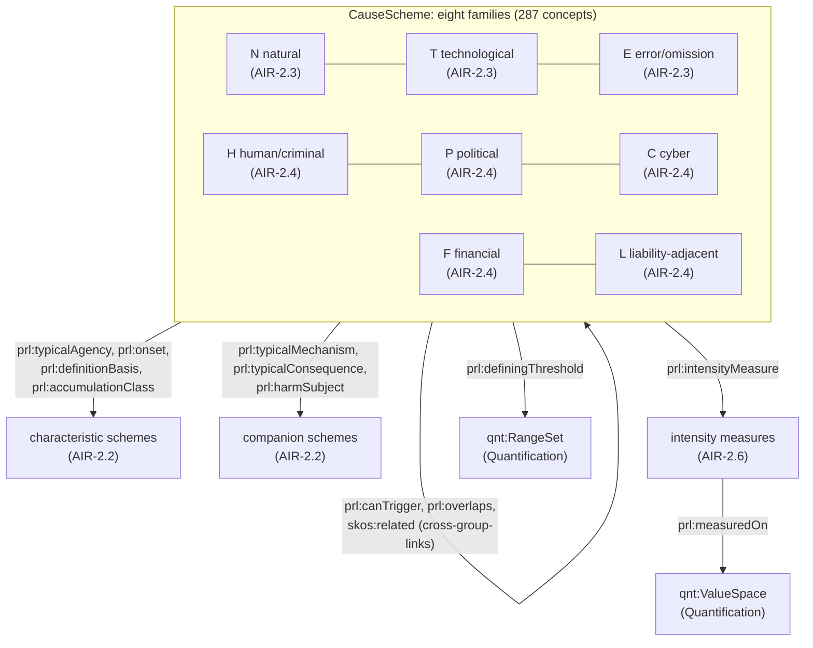
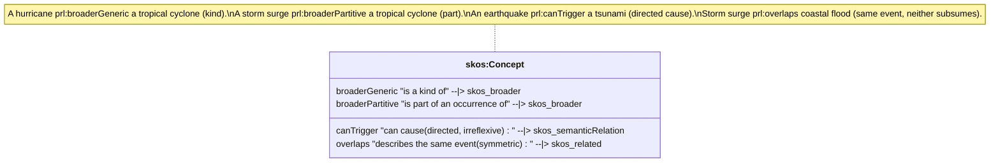
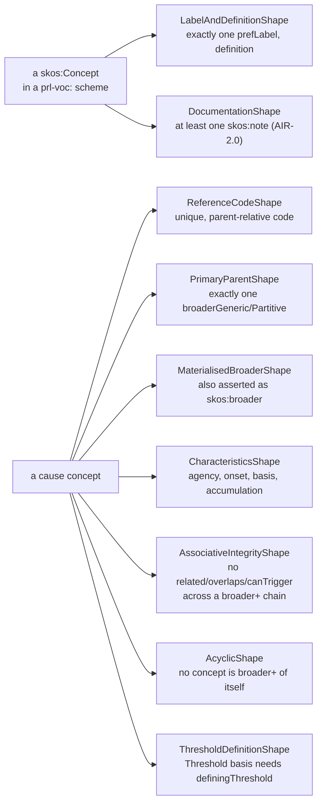

<!-- SPDX-License-Identifier: CC-BY-SA-4.0 -->

# Reference Peril Vocabulary (`prl:`)

Literate specification for the reference peril vocabulary, LATTICE's applied insurance domain's
default peril scheme ([ADR-A99](../../../../docs/architecture/decisions/ADR-A99-reference-vocabularies-and-peril-structure.md)),
built by the [`applied-insurance-reference`](../../../../docs/developer/plans/applied-insurance-reference.md)
epic, Phase 2. See ADR-A99 and the [peril vocabulary sketch](../../../../docs/developer/sketches/peril-vocabulary.md)
for the design this module implements.

## 1. Purpose and scope

A peril is what initiates a loss: an earthquake, a fire, a cyber attack, a trial of a drug. A
contract's drafter or its market is always free to define what a peril means for that contract
([ADR-A99](../../../../docs/architecture/decisions/ADR-A99-reference-vocabularies-and-peril-structure.md)
decision 1, mork-bridge sketch §2), so this module is a *reference*: the unscoped fallback a check
reaches when nothing more specific binds. It gives:

- a **cause scheme** (`prl-voc:CauseScheme`), a hierarchy of 287 reference perils in eight
  families (N natural, T technological/accidental, E error and omission, H human/criminal,
  P political, C cyber, F financial, L liability-adjacent), built region by region across
  AIR-2.2 to AIR-2.7
- seven **characteristic and companion schemes** (agency, mechanism, onset, definition basis,
  accumulation class, consequence, harm subject), one value per axis per cause concept
  (AIR-2.2)
- **kind and part** links aligned to [ISO 25964](http://purl.org/iso25964/skos-thes#)'s
  thesaurus relations, so the hierarchy distinguishes "is a kind of" from "is part of an
  occurrence of"
- **directed triggering** (`prl:canTrigger`) and **non-subsuming overlap** (`prl:overlaps`),
  for perils that cause each other or can describe the same physical event without either
  subsuming the other
- **intensity measures and thresholds** (AIR-2.6), linking a cause to the
  [Quantification](../../../quantification/README.md) value space its severity is measured on
- **collections** (AIR-2.5) and a small **example market edition** (AIR-2.7) for the precedence
  tests



## 2. Files and namespaces (ADR-A98 decision 6)

| File | Content | Namespace | Prefix | Version IRI |
|---|---|---|---|---|
| `spec/peril.ttl` | the `prl:` properties and datatypes only. No scheme, no concept | `https://www.nebularis.org/neuro-semantic/insurance/peril#` | `prl:` | `…/insurance/peril/0.5.0` |
| `vocab/peril-vocab.ttl` | the eight reference schemes, and the cause scheme's members | `https://www.nebularis.org/neuro-semantic/insurance/peril/vocab#` | `prl-voc:` | `…/insurance/peril-vocab/0.5.0` |
| `vocab/peril-intensity.ttl` | the intensity measure scheme and its `qnt:ValueSpace`s | as above | `prl-voc:` | AIR-2.6 |
| `vocab/peril-collections.ttl` | reference collections | as above | `prl-voc:` | AIR-2.5 |
| `crosswalk/*.ttl` | reviewed crosswalks from external code systems | — | — | AIR-3.4 |
| `shapes/` | well-formedness (§6), versioned by its own `.version` | — | — | `0.2.0` |

Sketches and this README write concept and scheme IRIs as `prl:` for brevity (for example
`prl:N.MET.TC`): read those as `prl-voc:`. Only properties and datatypes are `prl:`.

## 3. Namespace and prefixes

```turtle-spec
@prefix prl:     <https://www.nebularis.org/neuro-semantic/insurance/peril#> .
@prefix iso-thes: <http://purl.org/iso25964/skos-thes#> .
@prefix icm:     <https://www.nebularis.org/neuro-semantic/insurance/common#> .
@prefix fnd:     <https://www.nebularis.org/neuro-semantic/lattice/foundation#> .
@prefix qnt:     <https://www.nebularis.org/neuro-semantic/lattice/quantification#> .
@prefix skos:    <http://www.w3.org/2004/02/skos/core#> .
@prefix owl:     <http://www.w3.org/2002/07/owl#> .
@prefix rdf:     <http://www.w3.org/1999/02/22-rdf-syntax-ns#> .
@prefix rdfs:    <http://www.w3.org/2000/01/rdf-schema#> .
@prefix xsd:     <http://www.w3.org/2001/XMLSchema#> .
```

## 4. Extraction contract

- `turtle-spec` blocks generate `spec/peril.ttl`.
- `turtle-vocab` blocks generate `vocab/peril-vocab.ttl`, in document order: the ontology header
  and the eight scheme declarations, then one block per region of §5.2 and §5.3, in the order
  listed there. A region's block is empty until the slice that owns it fills it in place.
- `turtle-shapes` blocks generate, in order, `shapes/structural.ttl` (per-concept shapes) and
  `shapes/constraints.ttl` (cross-concept and hierarchy shapes, §6).
- `turtle-example` blocks are illustrative only. The real fixture lives in
  [`examples/well-formed.ttl`](examples/well-formed.ttl).

```bash
python3 tools/literate_extract.py ontology/applied/insurance/peril/README.md \
    --layer applied/insurance/peril --root . \
    --shapes shapes/structural.ttl shapes/constraints.ttl --check
```

## 5. The `prl:` properties

### 5.1 Kind and part, triggering, overlap, characteristics (ADR-A99 decision 4)

Two concepts in the cause scheme relate in one of four ways, each its own property so a reader
(and a shape) never has to guess which the plain `skos:broader`/`skos:related` hierarchy means:



`prl:broaderGeneric` and `prl:broaderPartitive` are each a `skos:broader` sub-property, aligned to
[ISO 25964](http://purl.org/iso25964/skos-thes#)'s SKOS-THES vocabulary (`iso-thes:broaderGeneric`,
`iso-thes:broaderPartitive`), declared locally since ISO 25964's own vocabulary is never
`owl:imports`'d (PV3). Every value asserted through either one must also be asserted as plain
`skos:broader`, so a consumer reading only SKOS still sees the hierarchy (`MaterialisedBroaderShape`,
§6). `prl:canTrigger` is directed and irreflexive: the secondary effect stays classified under its
own initiating family, and the causal link never becomes a second `skos:broader` (PV2). `prl:overlaps`
is symmetric and irreflexive, for two concepts that are not in a kind or part relation but can both
describe one real event (whitepaper §3.5).

Six more properties link a cause concept to its typical characteristics, each a concept in its own
scheme (§7, §8):

```turtle-spec
<https://www.nebularis.org/neuro-semantic/insurance/peril>
    rdf:type owl:Ontology ;
    owl:versionIRI <https://www.nebularis.org/neuro-semantic/insurance/peril/0.5.0> ;
    rdfs:label "LATTICE reference peril vocabulary properties"@en ;
    rdfs:comment "The prl: properties and datatypes the reference peril vocabulary uses to say more than plain SKOS: kind and part links, directed triggering, non-subsuming overlap, characteristic links (mechanism, agency, onset, definition basis, accumulation class), and links to Quantification for intensity thresholds and event windows. Schemes and concepts are declared in vocab/peril-vocab.ttl, in the prl-voc: namespace (ADR-A98 decision 6). This document declares no scheme and no concept. See ADR-A99 and docs/developer/sketches/peril-vocabulary.md." ;
    owl:imports <http://www.w3.org/2004/02/skos/core> ,
                <https://www.nebularis.org/neuro-semantic/lattice/foundation/0.4.0> ,
                <https://www.nebularis.org/neuro-semantic/lattice/quantification/0.8.0> ,
                <https://www.nebularis.org/neuro-semantic/insurance/common/0.5.0> .

#################################################################
#    Kind and part (ADR-A99 decision 4, PV3). iso-thes: terms are
#    declared locally, per ISO 25964's own SKOS-THES vocabulary, and
#    never owl:imports'd.
#################################################################

iso-thes:broaderGeneric a owl:ObjectProperty ;
    rdfs:isDefinedBy <http://purl.org/iso25964/skos-thes> ;
    rdfs:label "has broader generic"@en ;
    rdfs:comment "ISO 25964 generic (kind-of) relation." .

iso-thes:broaderPartitive a owl:ObjectProperty ;
    rdfs:isDefinedBy <http://purl.org/iso25964/skos-thes> ;
    rdfs:label "has broader partitive"@en ;
    rdfs:comment "ISO 25964 partitive (part-of) relation." .

prl:broaderGeneric a owl:ObjectProperty ;
    rdfs:subPropertyOf skos:broader ;
    owl:equivalentProperty iso-thes:broaderGeneric ;
    rdfs:label "has broader generic"@en ;
    rdfs:comment "This concept is a kind of its broader concept (a hurricane is a kind of tropical cyclone)." ;
    fnd:utility "Use for a kind link in the cause scheme (marked K in the sketch). Every value asserted here must also be asserted as skos:broader (the materialised-broader shape checks this), so a plain SKOS consumer still sees the hierarchy." .

prl:broaderPartitive a owl:ObjectProperty ;
    rdfs:subPropertyOf skos:broader ;
    owl:equivalentProperty iso-thes:broaderPartitive ;
    rdfs:label "has broader partitive"@en ;
    rdfs:comment "This concept is part of an occurrence of its broader concept (a storm surge is part of a tropical cyclone event)." ;
    fnd:utility "Use for a part link in the cause scheme (marked P in the sketch). Every value asserted here must also be asserted as skos:broader, for the same reason as prl:broaderGeneric." .

#################################################################
#    Triggering and overlap (ADR-A99 decision 4)
#################################################################

prl:canTrigger a owl:ObjectProperty , owl:IrreflexiveProperty ;
    rdfs:subPropertyOf skos:semanticRelation ;
    rdfs:label "can trigger"@en ;
    rdfs:comment "One peril's occurrence can cause another's (an earthquake can trigger a tsunami). Directed: not symmetric, not transitive. skos:related is symmetric and cannot carry this." ;
    fnd:utility "Use for cross-family causal links (PV2): the secondary effect stays classified under its own initiating family, and the causal link is this property, never a second skos:broader. Both ends must be checked by the associative-integrity shape for accidental hierarchy crossing." .

prl:overlaps a owl:ObjectProperty , owl:SymmetricProperty , owl:IrreflexiveProperty ;
    rdfs:subPropertyOf skos:related ;
    rdfs:label "overlaps"@en ;
    rdfs:comment "Two perils can describe the same physical occurrence without one subsuming the other (tropical cyclone storm surge and coastal flood). Symmetric and irreflexive." ;
    fnd:utility "Use where two concepts are not in a kind or part relation to each other, but a real event can satisfy both (whitepaper §3.5). Never use this to avoid deciding a real broader link." .

#################################################################
#    Characteristics (ADR-A99 decision 4, PV1): one scheme per axis,
#    linked from cause concepts for typical values. Four of these
#    specialise insurance/common's own classification properties
#    (AIR-2.2), so a check on a common/ property also reads the peril
#    vocabulary: prl:onset and prl:definitionBasis have no common/
#    counterpart, since only the peril vocabulary uses those axes.
#################################################################

prl:typicalAgency a owl:ObjectProperty ;
    rdfs:subPropertyOf icm:agency ;
    rdfs:domain skos:Concept ; rdfs:range skos:Concept ;
    rdfs:label "typical agency"@en ;
    rdfs:comment "A cause concept's typical agency (natural, accidental, negligent, malicious criminal, malicious political, sovereign, belligerent, undetermined), a concept in the agency scheme." ;
    fnd:utility "Link a cause concept to one or more agency values it is typically associated with. Several values are permitted (a peril is not always one agency); the characteristics shape requires at least one." .

prl:onset a owl:ObjectProperty ;
    rdfs:domain skos:Concept ; rdfs:range skos:Concept ;
    rdfs:label "onset"@en ;
    rdfs:comment "A cause concept's typical onset (sudden, gradual, latent, recurrent), a concept in the onset scheme." ;
    fnd:utility "Link a cause concept to exactly one onset value, the characteristics shape's own requirement." .

prl:definitionBasis a owl:ObjectProperty ;
    rdfs:domain skos:Concept ; rdfs:range skos:Concept ;
    rdfs:label "definition basis"@en ;
    rdfs:comment "What makes a cause concept exist as a distinct thing: physical, designation, threshold, wording-defined, statutory, or index (PV6), a concept in the definition-basis scheme." ;
    fnd:utility "Link a cause concept to exactly one definition-basis value. A value of prl-voc:Threshold requires prl:definingThreshold on the same concept (the threshold-definitions shape)." .

prl:typicalMechanism a owl:ObjectProperty ;
    rdfs:subPropertyOf icm:mechanism ;
    rdfs:domain skos:Concept ; rdfs:range skos:Concept ;
    rdfs:label "typical mechanism"@en ;
    rdfs:comment "A cause concept's typical mechanism of harm (shaking, inundation, wind load, fire, impact, contamination, electrical overstress, data encryption, and others), a concept in the mechanism scheme." ;
    fnd:utility "Link a cause concept to one or more mechanism values. Not required by the characteristics shape in this slice; the mechanism scheme itself is built in AIR-2.2." .

prl:accumulationClass a owl:ObjectProperty ;
    rdfs:domain skos:Concept ; rdfs:range skos:Concept ;
    rdfs:label "accumulation class"@en ;
    rdfs:comment "A cause concept's typical accumulation character (catastrophe, systemic, attritional), a concept in the accumulation-class scheme." ;
    fnd:utility "Link a cause concept to at most one accumulation-class value. Optional: many perils have no single typical accumulation character." .

prl:typicalConsequence a owl:ObjectProperty ;
    rdfs:subPropertyOf icm:consequence ;
    rdfs:domain skos:Concept ; rdfs:range skos:Concept ;
    rdfs:label "typical consequence"@en ;
    rdfs:comment "A cause concept's typical head of loss (direct physical damage, business interruption, and others), a concept in the consequence scheme." ;
    fnd:utility "Informative only (PV8): records what is customary, never what a contract covers. The consequence scheme itself is built in AIR-2.2." .

prl:harmSubject a owl:ObjectProperty ;
    rdfs:subPropertyOf icm:harmSubject ;
    rdfs:domain skos:Concept ; rdfs:range skos:Concept ;
    rdfs:label "harm subject"@en ;
    rdfs:comment "What is typically harmed by a cause concept (property, persons, financial interest, data and systems, environment, reputation), a concept in the harm-subject scheme." ;
    fnd:utility "Informative only (PV8). Liability direction is derived from party roles, never from this property (term-parameters sketch §7)." .

#################################################################
#    Intensity and collections links (§6.4, §7 of the sketch). The
#    intensity measure scheme itself, its qnt:ValueSpaces, and
#    collection classes are built in AIR-2.6 and AIR-2.5.
#################################################################

prl:intensityMeasure a owl:ObjectProperty ;
    rdfs:domain skos:Concept ; rdfs:range skos:Concept ;
    rdfs:label "intensity measure"@en ;
    rdfs:comment "A cause concept's typical intensity measure (PGA, sustained wind, flood depth, and others), a concept in the intensity-measure scheme (AIR-2.6)." ;
    fnd:utility "Link a cause concept to the measure that quantifies its severity, where one is customary." .

prl:relevantAttribute a owl:ObjectProperty ;
    rdfs:domain skos:Concept ; rdfs:range skos:Concept ;
    rdfs:label "relevant attribute"@en ;
    rdfs:comment "An exposure attribute typically relevant when assessing this cause's hazard at a location (asset exposure ontology)." ;
    fnd:utility "Used by the exposure ontology's attribute assessments (Phase 4), not by this module's own shapes." .

prl:minimumGeoPrecision a owl:ObjectProperty ;
    rdfs:domain skos:Concept ; rdfs:range skos:Concept ;
    rdfs:label "minimum geographic precision"@en ;
    rdfs:comment "The coarsest location precision at which this cause's hazard can be meaningfully assessed." ;
    fnd:utility "Used by the exposure ontology (Phase 4), not by this module's own shapes." .

prl:measuredOn a owl:ObjectProperty ;
    rdfs:domain skos:Concept ; rdfs:range qnt:ValueSpace ;
    rdfs:label "measured on"@en ;
    rdfs:comment "The Quantification value space an intensity measure concept's values are expressed in." ;
    fnd:utility "Link an intensity measure concept (AIR-2.6) to its qnt:ValueSpace." .

prl:definingThreshold a owl:ObjectProperty ;
    rdfs:domain skos:Concept ; rdfs:range qnt:RangeSet ;
    rdfs:label "defining threshold"@en ;
    rdfs:comment "The Quantification range set a threshold-defined cause concept must fall within to be that cause (PV6)." ;
    fnd:utility "Required whenever prl:definitionBasis is prl-voc:Threshold (the threshold-definitions shape). Point at a qnt:RangeSet over the relevant intensity measure's value space." .

prl:customaryEventWindow a owl:ObjectProperty ;
    rdfs:domain skos:Concept ; rdfs:range qnt:Quantity ;
    rdfs:label "customary event window"@en ;
    rdfs:comment "The typical time span over which occurrences of this cause are customarily grouped into one event (PV8, informative only)." ;
    fnd:utility "Records custom, never decides occurrence grouping for a contract, which is a statement matter (§8 of the sketch)." .

#################################################################
#    Datatypes (§5's reference codes and open cat-model codes)
#################################################################

prl:ReferenceCode a rdfs:Datatype ;
    owl:equivalentClass [
        a rdfs:Datatype ;
        owl:onDatatype xsd:string ;
        owl:withRestrictions ( [ xsd:pattern "[NTEHPCFL](\\.[A-Z]{2,4}){0,4}" ] )
    ] ;
    rdfs:label "Reference code"@en ;
    rdfs:comment "A dotted reference code for a cause concept: a family letter (N, T, E, H, P, C, F or L) optionally followed by up to four dot-separated segments (§5)." ;
    fnd:utility "Type every cause concept's skos:notation with this datatype. The reference-code shape checks the stronger, parent-relative rule (a segment appended to the concept's own primary parent's code), which this pattern alone cannot express." .

prl:CatModelCode a rdfs:Datatype ;
    owl:equivalentClass [
        a rdfs:Datatype ;
        owl:onDatatype xsd:string ;
        owl:withRestrictions ( [ xsd:pattern "[A-Z0-9]{2,5}" ] )
    ] ;
    rdfs:label "Open cat-model code"@en ;
    rdfs:comment "An open catastrophe-model peril code (for example QEQ, WTC), recorded informatively where the sketch's §5 tables give one. No shape in this slice requires it." ;
    fnd:utility "Attach with a domain-appropriate property once the cause scheme carries model-code annotations (AIR-2.3, AIR-2.4)." .
```

## 5.2 The eight reference schemes

Each is a `voc:ConceptScheme`, an unscoped-fallback reference edition (ADR-A99 decision 1), marked
by `skos:editorialNote "Reference edition published by LATTICE. Not a market standard."`.

| Scheme | Axis |
|---|---|
| `prl-voc:CauseScheme` | the peril backbone (§5 of the sketch) |
| `prl-voc:AgencyScheme` | natural, accidental, negligent, intentional, malicious, sovereign, belligerent, economic, undetermined |
| `prl-voc:MechanismScheme` | how harm is inflicted |
| `prl-voc:OnsetScheme` | sudden, gradual, latent, recurrent |
| `prl-voc:DefinitionBasisScheme` | physical, designation, threshold, wording-defined, statutory, index |
| `prl-voc:AccumulationClassScheme` | catastrophe, systemic, attritional |
| `prl-voc:ConsequenceScheme` | heads of loss |
| `prl-voc:HarmSubjectScheme` | what is typically harmed |

```turtle-vocab
@prefix prl:     <https://www.nebularis.org/neuro-semantic/insurance/peril#> .
@prefix prl-voc: <https://www.nebularis.org/neuro-semantic/insurance/peril/vocab#> .
@prefix icm-voc: <https://www.nebularis.org/neuro-semantic/insurance/common/vocab#> .
@prefix voc:     <https://www.nebularis.org/neuro-semantic/lattice/vocabulary#> .
@prefix fnd:     <https://www.nebularis.org/neuro-semantic/lattice/foundation#> .
@prefix skos:    <http://www.w3.org/2004/02/skos/core#> .
@prefix owl:     <http://www.w3.org/2002/07/owl#> .
@prefix rdf:     <http://www.w3.org/1999/02/22-rdf-syntax-ns#> .
@base <https://www.nebularis.org/neuro-semantic/insurance/peril/vocab> .

<https://www.nebularis.org/neuro-semantic/insurance/peril/vocab>
    rdf:type owl:Ontology ;
    owl:versionIRI <https://www.nebularis.org/neuro-semantic/insurance/peril-vocab/0.5.0> ;
    owl:imports <https://www.nebularis.org/neuro-semantic/insurance/peril/0.5.0> ,
                <https://www.nebularis.org/neuro-semantic/lattice/vocabulary/0.4.0> ,
                <https://www.nebularis.org/neuro-semantic/lattice/foundation/0.4.0> ,
                <https://www.nebularis.org/neuro-semantic/insurance/common-vocab/0.5.0> .

#################################################################
#    The eight reference schemes (ADR-A99 §5, §6). Each is an
#    unscoped-fallback reference edition (ADR-A99 decision 1): never
#    a market standard, always the default when nothing more specific
#    is bound. No concepts in this slice: the cause scheme's own
#    members are added region by region, AIR-2.2 to AIR-2.4, each in
#    its own README section below (§5.2, §5.3).
#################################################################

prl-voc:CauseScheme a voc:ConceptScheme ;
    fnd:hasIdentity prl-voc:CauseScheme-identity ;
    fnd:hasGovernanceState fnd:Active ;
    skos:prefLabel "Reference cause of loss scheme"@en ;
    skos:editorialNote "Reference edition published by LATTICE. Not a market standard."@en .

prl-voc:AgencyScheme a voc:ConceptScheme ;
    fnd:hasIdentity prl-voc:AgencyScheme-identity ;
    fnd:hasGovernanceState fnd:Active ;
    skos:prefLabel "Reference agency scheme"@en ;
    skos:editorialNote "Reference edition published by LATTICE. Not a market standard."@en .

prl-voc:MechanismScheme a voc:ConceptScheme ;
    fnd:hasIdentity prl-voc:MechanismScheme-identity ;
    fnd:hasGovernanceState fnd:Active ;
    skos:prefLabel "Reference mechanism scheme"@en ;
    skos:editorialNote "Reference edition published by LATTICE. Not a market standard."@en .

prl-voc:OnsetScheme a voc:ConceptScheme ;
    fnd:hasIdentity prl-voc:OnsetScheme-identity ;
    fnd:hasGovernanceState fnd:Active ;
    skos:prefLabel "Reference onset scheme"@en ;
    skos:editorialNote "Reference edition published by LATTICE. Not a market standard."@en .

prl-voc:DefinitionBasisScheme a voc:ConceptScheme ;
    fnd:hasIdentity prl-voc:DefinitionBasisScheme-identity ;
    fnd:hasGovernanceState fnd:Active ;
    skos:prefLabel "Reference definition-basis scheme"@en ;
    skos:editorialNote "Reference edition published by LATTICE. Not a market standard."@en .

prl-voc:AccumulationClassScheme a voc:ConceptScheme ;
    fnd:hasIdentity prl-voc:AccumulationClassScheme-identity ;
    fnd:hasGovernanceState fnd:Active ;
    skos:prefLabel "Reference accumulation-class scheme"@en ;
    skos:editorialNote "Reference edition published by LATTICE. Not a market standard."@en .

prl-voc:ConsequenceScheme a voc:ConceptScheme ;
    fnd:hasIdentity prl-voc:ConsequenceScheme-identity ;
    fnd:hasGovernanceState fnd:Active ;
    skos:prefLabel "Reference consequence scheme"@en ;
    skos:editorialNote "Reference edition published by LATTICE. Not a market standard."@en .

prl-voc:HarmSubjectScheme a voc:ConceptScheme ;
    fnd:hasIdentity prl-voc:HarmSubjectScheme-identity ;
    fnd:hasGovernanceState fnd:Active ;
    skos:prefLabel "Reference harm-subject scheme"@en ;
    skos:editorialNote "Reference edition published by LATTICE. Not a market standard."@en .

#################################################################
#    Reference bindings (AIR-2.2, ADR-A99 decision 1): the four
#    insurance/common contracts that have a reference scheme are
#    bound to it here, as the unscoped fallback. A deployment binds
#    its own editions by scope, which wins over this binding
#    (ADR-A99 §9, AIR-2.7's precedence tests).
#################################################################

icm-voc:AgencyContract voc:boundScheme prl-voc:AgencyScheme .
icm-voc:MechanismContract voc:boundScheme prl-voc:MechanismScheme .
icm-voc:ConsequenceContract voc:boundScheme prl-voc:ConsequenceScheme .
icm-voc:HarmSubjectContract voc:boundScheme prl-voc:HarmSubjectScheme .
```

## 5.3 Characteristic and companion schemes (AIR-2.2)

Each heading below is one README section, and the extraction contract (§4) concatenates its
`turtle-vocab` block into `vocab/peril-vocab.ttl` in the order the headings appear, after the
scheme declarations of §5.2. A block stays empty until the slice named fills it in place, in the
same position, so a later slice's diff is additive.

### Agency

Who or what is responsible for the event, independent of what kind of hazard it is. No single
published standard names an agency axis for perils as such: this scheme follows common
catastrophe-modelling and reinsurance practice, which separates a hazard's physical cause from
who or what is responsible for it.

```turtle-vocab
prl-voc:Natural a skos:Concept ;
    skos:inScheme prl-voc:AgencyScheme ;
    skos:topConceptOf prl-voc:AgencyScheme ;
    skos:prefLabel "Natural"@en ;
    skos:definition "Caused by a natural process, without human involvement."@en ;
    skos:note "No single published standard names an agency axis for perils. Follows common catastrophe-modelling usage, which separates a hazard's physical cause from who or what is responsible for it."@en .

prl-voc:Accidental a skos:Concept ;
    skos:inScheme prl-voc:AgencyScheme ;
    skos:topConceptOf prl-voc:AgencyScheme ;
    skos:prefLabel "Accidental"@en ;
    skos:definition "Caused unintentionally, without negligence or a deliberate act."@en ;
    skos:note "No single published standard names this value. Follows common market usage distinguishing a pure accident from a negligent or deliberate act."@en .

prl-voc:Negligent a skos:Concept ;
    skos:inScheme prl-voc:AgencyScheme ;
    skos:topConceptOf prl-voc:AgencyScheme ;
    skos:prefLabel "Negligent"@en ;
    skos:definition "Caused by a failure to take reasonable care, without intent to cause harm."@en ;
    skos:note "Follows the general legal meaning of negligence (a failure of a duty of care), not a jurisdiction-specific test."@en .

prl-voc:Intentional a skos:Concept ;
    skos:inScheme prl-voc:AgencyScheme ;
    skos:topConceptOf prl-voc:AgencyScheme ;
    skos:prefLabel "Intentional"@en ;
    skos:definition "Caused by a deliberate act that is not itself a crime, such as a lawful strike or an employment decision alleged wrongful."@en ;
    skos:note "Distinguishes a deliberate but lawful act from MaliciousCriminal and MaliciousPolitical, which are deliberate unlawful acts. No single published standard names this distinction."@en .

prl-voc:MaliciousCriminal a skos:Concept ;
    skos:inScheme prl-voc:AgencyScheme ;
    skos:topConceptOf prl-voc:AgencyScheme ;
    skos:prefLabel "Malicious criminal"@en ;
    skos:definition "Caused by a deliberate unlawful act of an individual or group acting outside public authority."@en ;
    skos:note "Follows common market usage distinguishing ordinary criminal malice from MaliciousPolitical and Belligerent agency, which the political violence and war markets treat separately."@en .

prl-voc:MaliciousPolitical a skos:Concept ;
    skos:inScheme prl-voc:AgencyScheme ;
    skos:topConceptOf prl-voc:AgencyScheme ;
    skos:prefLabel "Malicious political"@en ;
    skos:definition "Caused by a deliberate act done for a political, ideological or religious purpose."@en ;
    skos:note "Follows common usage in the terrorism and political violence markets. The event's own cause scheme (family P) is Phase 2's reference for named political perils."@en .

prl-voc:Sovereign a skos:Concept ;
    skos:inScheme prl-voc:AgencyScheme ;
    skos:topConceptOf prl-voc:AgencyScheme ;
    skos:prefLabel "Sovereign"@en ;
    skos:definition "Caused by the exercise of state power, such as expropriation, confiscation or nationalisation."@en ;
    skos:note "Follows common political risk market usage for acts of a state in its sovereign capacity."@en .

prl-voc:Belligerent a skos:Concept ;
    skos:inScheme prl-voc:AgencyScheme ;
    skos:topConceptOf prl-voc:AgencyScheme ;
    skos:prefLabel "Belligerent"@en ;
    skos:definition "Caused by an act of war or warlike operations between states or organised armed groups."@en ;
    skos:note "Follows common war risks market usage. Distinguished from MaliciousPolitical, which names a group's own political purpose rather than a state of war between parties."@en .

prl-voc:Economic a skos:Concept ;
    skos:inScheme prl-voc:AgencyScheme ;
    skos:topConceptOf prl-voc:AgencyScheme ;
    skos:prefLabel "Economic"@en ;
    skos:definition "Caused by the failure of a commercial counterparty, or by market forces, rather than by a physical event."@en ;
    skos:note "Added for the financial family (F) of the cause scheme, whose perils are not physical events. No single published standard names this value."@en .

prl-voc:UndeterminedAgency a skos:Concept ;
    skos:inScheme prl-voc:AgencyScheme ;
    skos:topConceptOf prl-voc:AgencyScheme ;
    skos:prefLabel "Undetermined agency"@en ;
    skos:definition "The agency behind the event has not been established."@en ;
    skos:note "Named 'UndeterminedAgency', not 'Undetermined', to avoid a name clash with Eligibility's elg:Undetermined (ADR-A99 §5)."@en .

prl-voc:AgencyScheme skos:hasTopConcept prl-voc:Natural , prl-voc:Accidental , prl-voc:Negligent ,
    prl-voc:Intentional , prl-voc:MaliciousCriminal , prl-voc:MaliciousPolitical , prl-voc:Sovereign ,
    prl-voc:Belligerent , prl-voc:Economic , prl-voc:UndeterminedAgency .
```

### Mechanism

How harm is physically done, independent of what hazard did it. Follows common catastrophe
engineering and loss-adjusting usage, which names a hazard's damage mechanism separately from the
hazard itself (a flood and a burst pipe both cause `WaterDamage`, by different mechanisms of
onset).

```turtle-vocab
prl-voc:Shaking a skos:Concept ;
    skos:inScheme prl-voc:MechanismScheme ;
    skos:topConceptOf prl-voc:MechanismScheme ;
    skos:prefLabel "Shaking"@en ;
    skos:definition "Harm from ground vibration transmitted through the earth."@en ;
    skos:note "Follows common seismic engineering usage for ground-motion damage, distinct from GroundFailure (a permanent change in the ground's state)."@en .

prl-voc:GroundFailure a skos:Concept ;
    skos:inScheme prl-voc:MechanismScheme ;
    skos:topConceptOf prl-voc:MechanismScheme ;
    skos:prefLabel "Ground failure"@en ;
    skos:definition "Harm from the ground losing its ability to bear or retain its position, such as by liquefaction or landslide."@en ;
    skos:note "Follows common geotechnical usage. Covers liquefaction, landslide and subsidence mechanisms alike, which the cause scheme's own concepts distinguish by cause, not by this shared mechanism."@en .

prl-voc:Inundation a skos:Concept ;
    skos:inScheme prl-voc:MechanismScheme ;
    skos:topConceptOf prl-voc:MechanismScheme ;
    skos:prefLabel "Inundation"@en ;
    skos:definition "Harm from water covering land or a structure that is normally dry."@en ;
    skos:note "Follows common flood engineering usage for standing or flowing surface water, distinct from WaterDamage (water escaping from or entering a structure other than by flood)."@en .

prl-voc:WaterDamage a skos:Concept ;
    skos:inScheme prl-voc:MechanismScheme ;
    skos:topConceptOf prl-voc:MechanismScheme ;
    skos:prefLabel "Water damage"@en ;
    skos:definition "Harm from water escaping from, or entering, a structure other than by flood."@en ;
    skos:note "Follows common property market usage distinguishing an escape of water (for example a burst pipe) from Inundation (flood)."@en .

prl-voc:WindLoad a skos:Concept ;
    skos:inScheme prl-voc:MechanismScheme ;
    skos:topConceptOf prl-voc:MechanismScheme ;
    skos:prefLabel "Wind load"@en ;
    skos:definition "Harm from the force wind exerts on a structure or object."@en ;
    skos:note "Follows common wind engineering usage for aerodynamic loading, distinct from Impact (a solid object striking another, which wind-borne debris also causes)."@en .

prl-voc:Load a skos:Concept ;
    skos:inScheme prl-voc:MechanismScheme ;
    skos:topConceptOf prl-voc:MechanismScheme ;
    skos:prefLabel "Load"@en ;
    skos:definition "Harm from the weight of material bearing on a structure or object beyond what it was built to carry."@en ;
    skos:note "Follows common structural engineering usage for static or accumulating weight, such as snow or ash load, distinct from Impact (a moving object striking another)."@en .

prl-voc:Fire a skos:Concept ;
    skos:inScheme prl-voc:MechanismScheme ;
    skos:topConceptOf prl-voc:MechanismScheme ;
    skos:prefLabel "Fire"@en ;
    skos:definition "Harm from uncontrolled combustion."@en ;
    skos:note "Common usage across every market that names fire as a peril."@en .

prl-voc:Smoke a skos:Concept ;
    skos:inScheme prl-voc:MechanismScheme ;
    skos:topConceptOf prl-voc:MechanismScheme ;
    skos:prefLabel "Smoke"@en ;
    skos:definition "Harm from the products of combustion carried away from a fire."@en ;
    skos:note "Follows common property market usage separating smoke damage from the fire itself, since smoke can harm property a fire never reaches."@en .

prl-voc:Heat a skos:Concept ;
    skos:inScheme prl-voc:MechanismScheme ;
    skos:topConceptOf prl-voc:MechanismScheme ;
    skos:prefLabel "Heat"@en ;
    skos:definition "Harm from elevated temperature, without combustion."@en ;
    skos:note "Distinguishes thermal harm without fire (such as a heatwave's effect on crops or people) from Fire itself."@en .

prl-voc:Freezing a skos:Concept ;
    skos:inScheme prl-voc:MechanismScheme ;
    skos:topConceptOf prl-voc:MechanismScheme ;
    skos:prefLabel "Freezing"@en ;
    skos:definition "Harm from a substance or structure being cooled below the freezing point of water."@en ;
    skos:note "Follows common property and agricultural market usage for frost and freeze damage."@en .

prl-voc:Explosion a skos:Concept ;
    skos:inScheme prl-voc:MechanismScheme ;
    skos:topConceptOf prl-voc:MechanismScheme ;
    skos:prefLabel "Explosion"@en ;
    skos:definition "Harm from a sudden, violent release of energy."@en ;
    skos:note "Common usage across every market that names explosion as a peril."@en .

prl-voc:Impact a skos:Concept ;
    skos:inScheme prl-voc:MechanismScheme ;
    skos:topConceptOf prl-voc:MechanismScheme ;
    skos:prefLabel "Impact"@en ;
    skos:definition "Harm from a solid object striking another."@en ;
    skos:note "Common usage. Covers hail, falling debris, vehicle impact and similar mechanisms, which the cause scheme's own concepts distinguish by cause."@en .

prl-voc:Collapse a skos:Concept ;
    skos:inScheme prl-voc:MechanismScheme ;
    skos:topConceptOf prl-voc:MechanismScheme ;
    skos:prefLabel "Collapse"@en ;
    skos:definition "The loss of a structure's ability to stand."@en ;
    skos:note "Follows common structural engineering usage, where collapse is the ultimate consequence a Load, GroundFailure or Shaking mechanism may bring about."@en .

prl-voc:Breakdown a skos:Concept ;
    skos:inScheme prl-voc:MechanismScheme ;
    skos:topConceptOf prl-voc:MechanismScheme ;
    skos:prefLabel "Breakdown"@en ;
    skos:definition "The internal failure of machinery or electrical equipment."@en ;
    skos:note "Follows common engineering insurance usage (machinery breakdown cover), distinguishing an internal failure from an external cause such as ElectricalOverstress."@en .

prl-voc:Corrosion a skos:Concept ;
    skos:inScheme prl-voc:MechanismScheme ;
    skos:topConceptOf prl-voc:MechanismScheme ;
    skos:prefLabel "Corrosion"@en ;
    skos:definition "Harm from the gradual chemical or electrochemical degradation of a material."@en ;
    skos:note "Follows common engineering usage. Always a Gradual-onset mechanism, named here for completeness though no family default binds it (AIR-2.3, AIR-2.4) in this edition."@en .

prl-voc:Erosion a skos:Concept ;
    skos:inScheme prl-voc:MechanismScheme ;
    skos:topConceptOf prl-voc:MechanismScheme ;
    skos:prefLabel "Erosion"@en ;
    skos:definition "Harm from the gradual removal of soil or rock by wind or water."@en ;
    skos:note "Follows common geotechnical usage for the gradual counterpart of Inundation and GroundFailure."@en .

prl-voc:Contamination a skos:Concept ;
    skos:inScheme prl-voc:MechanismScheme ;
    skos:topConceptOf prl-voc:MechanismScheme ;
    skos:prefLabel "Contamination"@en ;
    skos:definition "Harm from a substance rendering a person, place or thing impure or unsafe."@en ;
    skos:note "Common usage, covering chemical, biological and radiological contamination alike, which BiologicalAgent and Radiation further specialise where the agent itself is the relevant mechanism."@en .

prl-voc:BiologicalAgent a skos:Concept ;
    skos:inScheme prl-voc:MechanismScheme ;
    skos:topConceptOf prl-voc:MechanismScheme ;
    skos:prefLabel "Biological agent"@en ;
    skos:definition "Harm from a living organism or its toxin."@en ;
    skos:note "Follows the EM-DAT biological hazard usage, narrowed to the mechanism of harm rather than the hazard's classification."@en .

prl-voc:Radiation a skos:Concept ;
    skos:inScheme prl-voc:MechanismScheme ;
    skos:topConceptOf prl-voc:MechanismScheme ;
    skos:prefLabel "Radiation"@en ;
    skos:definition "Harm from the emission of ionising energy."@en ;
    skos:note "Common usage across the nuclear, war risks and extra-terrestrial (solar) perils that name it."@en .

prl-voc:ElectricalOverstress a skos:Concept ;
    skos:inScheme prl-voc:MechanismScheme ;
    skos:topConceptOf prl-voc:MechanismScheme ;
    skos:prefLabel "Electrical overstress"@en ;
    skos:definition "Harm from an electrical current or voltage beyond what equipment or a system was built to withstand."@en ;
    skos:note "Follows common engineering usage for a geomagnetic storm's or a lightning strike's effect on electrical systems."@en .

prl-voc:DataEncryption a skos:Concept ;
    skos:inScheme prl-voc:MechanismScheme ;
    skos:topConceptOf prl-voc:MechanismScheme ;
    skos:prefLabel "Data encryption"@en ;
    skos:definition "Harm from data being rendered unreadable without an authorised key."@en ;
    skos:note "Follows common cyber market usage for ransomware's mechanism of harm."@en .

prl-voc:Deprivation a skos:Concept ;
    skos:inScheme prl-voc:MechanismScheme ;
    skos:topConceptOf prl-voc:MechanismScheme ;
    skos:prefLabel "Deprivation"@en ;
    skos:definition "Harm from being permanently or temporarily deprived of property, a right or a person's liberty."@en ;
    skos:note "Follows common usage for theft, seizure, confiscation, kidnap and detention mechanisms alike, which the cause scheme's own concepts distinguish by cause."@en .

prl-voc:MechanismScheme skos:hasTopConcept prl-voc:Shaking , prl-voc:GroundFailure , prl-voc:Inundation ,
    prl-voc:WaterDamage , prl-voc:WindLoad , prl-voc:Load , prl-voc:Fire , prl-voc:Smoke , prl-voc:Heat ,
    prl-voc:Freezing , prl-voc:Explosion , prl-voc:Impact , prl-voc:Collapse , prl-voc:Breakdown ,
    prl-voc:Corrosion , prl-voc:Erosion , prl-voc:Contamination , prl-voc:BiologicalAgent ,
    prl-voc:Radiation , prl-voc:ElectricalOverstress , prl-voc:DataEncryption , prl-voc:Deprivation .
```

### Onset

How quickly a cause's harm manifests. No single published standard names this axis: it follows
the distinction the reinsurance market's "occurrence" and "aggregate" treaty forms already draw
in practice.

```turtle-vocab
prl-voc:Sudden a skos:Concept ;
    skos:inScheme prl-voc:OnsetScheme ;
    skos:topConceptOf prl-voc:OnsetScheme ;
    skos:prefLabel "Sudden"@en ;
    skos:definition "Onset within a short, identifiable period."@en ;
    skos:note "No single published standard names an onset axis for perils. Follows common catastrophe-modelling usage (the distinction behind 'occurrence' versus 'aggregate' treaty forms)."@en .

prl-voc:Gradual a skos:Concept ;
    skos:inScheme prl-voc:OnsetScheme ;
    skos:topConceptOf prl-voc:OnsetScheme ;
    skos:prefLabel "Gradual"@en ;
    skos:definition "Onset over an extended period, without one identifiable moment."@en ;
    skos:note "Follows common usage for a cause whose harm accumulates (for example corrosion or subsidence), as the opposite of Sudden onset."@en .

prl-voc:Latent a skos:Concept ;
    skos:inScheme prl-voc:OnsetScheme ;
    skos:topConceptOf prl-voc:OnsetScheme ;
    skos:prefLabel "Latent"@en ;
    skos:definition "A cause whose harm does not become apparent until long after the originating act or exposure."@en ;
    skos:note "Follows common liability market usage for a latent-defect or long-tail exposure (for example asbestos), distinct from Gradual (which is ongoing, not hidden)."@en .

prl-voc:Recurrent a skos:Concept ;
    skos:inScheme prl-voc:OnsetScheme ;
    skos:topConceptOf prl-voc:OnsetScheme ;
    skos:prefLabel "Recurrent"@en ;
    skos:definition "A cause whose occurrences repeat at intervals, each a fresh instance of the same kind of event."@en ;
    skos:note "Follows common usage for a peril that returns in distinct episodes (for example a seasonal hazard), distinct from Gradual (one continuing process)."@en .

prl-voc:OnsetScheme skos:hasTopConcept prl-voc:Sudden , prl-voc:Gradual , prl-voc:Latent , prl-voc:Recurrent .
```

### Definition basis

What makes a cause concept exist as a distinct thing (PV6), following ADR-A99 §10's own list.

```turtle-vocab
prl-voc:Physical a skos:Concept ;
    skos:inScheme prl-voc:DefinitionBasisScheme ;
    skos:topConceptOf prl-voc:DefinitionBasisScheme ;
    skos:prefLabel "Physical"@en ;
    skos:definition "Exists as a distinct thing by its own physical character, needing no external designation or threshold."@en ;
    skos:note "No single published standard names this axis. Introduced by this vocabulary (ADR-A99 §10, PV6) to separate what makes a peril a distinct thing from what it typically does."@en .

prl-voc:Designation a skos:Concept ;
    skos:inScheme prl-voc:DefinitionBasisScheme ;
    skos:topConceptOf prl-voc:DefinitionBasisScheme ;
    skos:prefLabel "Designation"@en ;
    skos:definition "Exists as a distinct thing only once a recognised authority names or designates an occurrence as such, such as a named storm."@en ;
    skos:note "Follows WMO practice of naming storms, and public-health practice of designating an outbreak a pandemic, generalised to a definition basis."@en .

prl-voc:Threshold a skos:Concept ;
    skos:inScheme prl-voc:DefinitionBasisScheme ;
    skos:topConceptOf prl-voc:DefinitionBasisScheme ;
    skos:prefLabel "Threshold"@en ;
    skos:definition "Exists as a distinct thing only once a measured intensity crosses a stated threshold."@en ;
    skos:note "No single published standard names this axis. A threshold-defined concept's own numeric threshold is recorded in peril-intensity.ttl (AIR-2.6), never here."@en .

prl-voc:WordingDefined a skos:Concept ;
    skos:inScheme prl-voc:DefinitionBasisScheme ;
    skos:topConceptOf prl-voc:DefinitionBasisScheme ;
    skos:prefLabel "Wording defined"@en ;
    skos:definition "Exists as a distinct thing only as the contract wording itself defines it."@en ;
    skos:note "Follows the epic's own principle E1: the contract's wording is always the operative definition, and the reference edition is the unscoped fallback. Family P (political) is wording-defined throughout."@en .

prl-voc:Statutory a skos:Concept ;
    skos:inScheme prl-voc:DefinitionBasisScheme ;
    skos:topConceptOf prl-voc:DefinitionBasisScheme ;
    skos:prefLabel "Statutory"@en ;
    skos:definition "Exists as a distinct thing only as a statute or regulation defines it."@en ;
    skos:note "Distinguishes a definition fixed by law (for example a notifiable disease, or a terrorism pool's statutory certification) from WordingDefined (fixed by the contract)."@en .

prl-voc:Index a skos:Concept ;
    skos:inScheme prl-voc:DefinitionBasisScheme ;
    skos:topConceptOf prl-voc:DefinitionBasisScheme ;
    skos:prefLabel "Index"@en ;
    skos:definition "Exists as a distinct thing only by reference to a published index value."@en ;
    skos:note "Follows common parametric market usage, where an index (for example a drought or market index) fixes whether, and how severely, the cause occurred."@en .

prl-voc:DefinitionBasisScheme skos:hasTopConcept prl-voc:Physical , prl-voc:Designation , prl-voc:Threshold ,
    prl-voc:WordingDefined , prl-voc:Statutory , prl-voc:Index .
```

### Accumulation class

How a cause tends to accumulate losses across many risks.

```turtle-vocab
prl-voc:Catastrophe a skos:Concept ;
    skos:inScheme prl-voc:AccumulationClassScheme ;
    skos:topConceptOf prl-voc:AccumulationClassScheme ;
    skos:prefLabel "Catastrophe"@en ;
    skos:definition "An accumulation character in which many risks in one area are affected by a single event."@en ;
    skos:note "No single published standard names this three-value axis, though the distinction itself is standard catastrophe-modelling and reinsurance practice."@en .

prl-voc:Systemic a skos:Concept ;
    skos:inScheme prl-voc:AccumulationClassScheme ;
    skos:topConceptOf prl-voc:AccumulationClassScheme ;
    skos:prefLabel "Systemic"@en ;
    skos:definition "An accumulation character in which many risks are affected together through a common dependency, without a single localised event."@en ;
    skos:note "Follows common usage for a pandemic, a utility failure or a cyber event propagating through shared infrastructure or a shared supplier, distinguishing it from a geographically localised Catastrophe."@en .

prl-voc:Attritional a skos:Concept ;
    skos:inScheme prl-voc:AccumulationClassScheme ;
    skos:topConceptOf prl-voc:AccumulationClassScheme ;
    skos:prefLabel "Attritional"@en ;
    skos:definition "An accumulation character of frequent, individually small losses, each affecting one risk."@en ;
    skos:note "Follows common reinsurance usage for day-to-day loss experience, as the opposite of Catastrophe and Systemic."@en .

prl-voc:AccumulationClassScheme skos:hasTopConcept prl-voc:Catastrophe , prl-voc:Systemic , prl-voc:Attritional .
```

### Consequence

Heads of loss: what a peril typically results in. Informative only (PV8): never what a contract
covers.

```turtle-vocab
prl-voc:DirectPhysicalDamage a skos:Concept ;
    skos:inScheme prl-voc:ConsequenceScheme ;
    skos:topConceptOf prl-voc:ConsequenceScheme ;
    skos:prefLabel "Direct physical damage"@en ;
    skos:definition "Physical harm to tangible property."@en ;
    skos:note "Common usage across every property market."@en .

prl-voc:BusinessInterruption a skos:Concept ;
    skos:inScheme prl-voc:ConsequenceScheme ;
    skos:topConceptOf prl-voc:ConsequenceScheme ;
    skos:prefLabel "Business interruption"@en ;
    skos:definition "Loss of income or increased cost of working following an interruption to a business's operations."@en ;
    skos:note "Common property and casualty market usage."@en .

prl-voc:ExtraExpense a skos:Concept ;
    skos:inScheme prl-voc:ConsequenceScheme ;
    skos:topConceptOf prl-voc:ConsequenceScheme ;
    skos:prefLabel "Extra expense"@en ;
    skos:definition "Cost incurred to avoid or reduce a loss that would otherwise follow an interruption."@en ;
    skos:note "Common property market usage, distinct from BusinessInterruption's own lost income or increased cost of working."@en .

prl-voc:Spoilage a skos:Concept ;
    skos:inScheme prl-voc:ConsequenceScheme ;
    skos:topConceptOf prl-voc:ConsequenceScheme ;
    skos:prefLabel "Spoilage"@en ;
    skos:definition "Loss of goods or stock that perish or deteriorate."@en ;
    skos:note "Common usage in the equipment breakdown and perishable-goods markets, typically following loss of power or refrigeration."@en .

prl-voc:DenialOfAccess a skos:Concept ;
    skos:inScheme prl-voc:ConsequenceScheme ;
    skos:topConceptOf prl-voc:ConsequenceScheme ;
    skos:prefLabel "Denial of access"@en ;
    skos:definition "Loss arising from being prevented from accessing a location or system, without physical damage to it."@en ;
    skos:note "Common usage in both the property market (for example a cordon following a nearby event) and the cyber market (for example a denial-of-service attack)."@en .

prl-voc:Recall a skos:Concept ;
    skos:inScheme prl-voc:ConsequenceScheme ;
    skos:topConceptOf prl-voc:ConsequenceScheme ;
    skos:prefLabel "Recall"@en ;
    skos:definition "Cost of withdrawing a product from the market or from use."@en ;
    skos:note "Common product liability and product recall market usage."@en .

prl-voc:CleanUp a skos:Concept ;
    skos:inScheme prl-voc:ConsequenceScheme ;
    skos:topConceptOf prl-voc:ConsequenceScheme ;
    skos:prefLabel "Clean-up"@en ;
    skos:definition "Cost of removing or remediating contamination or debris."@en ;
    skos:note "Common environmental and property market usage."@en .

prl-voc:DataRestoration a skos:Concept ;
    skos:inScheme prl-voc:ConsequenceScheme ;
    skos:topConceptOf prl-voc:ConsequenceScheme ;
    skos:prefLabel "Data restoration"@en ;
    skos:definition "Cost of restoring or recreating data or software."@en ;
    skos:note "Common cyber market usage."@en .

prl-voc:ExtortionPayment a skos:Concept ;
    skos:inScheme prl-voc:ConsequenceScheme ;
    skos:topConceptOf prl-voc:ConsequenceScheme ;
    skos:prefLabel "Extortion payment"@en ;
    skos:definition "Payment made in response to a threat."@en ;
    skos:note "Common usage across the kidnap and ransom and cyber markets, where a ransomware demand is a form of extortion."@en .

prl-voc:LiabilityToOthers a skos:Concept ;
    skos:inScheme prl-voc:ConsequenceScheme ;
    skos:topConceptOf prl-voc:ConsequenceScheme ;
    skos:prefLabel "Liability to others"@en ;
    skos:definition "A legal obligation to compensate a third party for harm."@en ;
    skos:note "Common liability market usage. Never states a direction of liability itself, which ADR-A102 derives from party roles, not from this characteristic."@en .

prl-voc:DefenceCosts a skos:Concept ;
    skos:inScheme prl-voc:ConsequenceScheme ;
    skos:topConceptOf prl-voc:ConsequenceScheme ;
    skos:prefLabel "Defence costs"@en ;
    skos:definition "Cost of investigating, defending or settling a claim or proceeding."@en ;
    skos:note "Common liability and directors' and officers' market usage."@en .

prl-voc:Delay a skos:Concept ;
    skos:inScheme prl-voc:ConsequenceScheme ;
    skos:topConceptOf prl-voc:ConsequenceScheme ;
    skos:prefLabel "Delay"@en ;
    skos:definition "Loss arising from a later start, or a longer transit, than planned."@en ;
    skos:note "Covers both delay in start-up (construction and project markets) and transit delay (marine and cargo markets), following each market's advance loss of profits and delay-in-start-up covers."@en .

prl-voc:ShortageOrNonDelivery a skos:Concept ;
    skos:inScheme prl-voc:ConsequenceScheme ;
    skos:topConceptOf prl-voc:ConsequenceScheme ;
    skos:prefLabel "Shortage or non-delivery"@en ;
    skos:definition "Loss of goods that do not arrive at their destination."@en ;
    skos:note "Common marine and cargo market usage."@en .

prl-voc:GeneralAverageContribution a skos:Concept ;
    skos:inScheme prl-voc:ConsequenceScheme ;
    skos:topConceptOf prl-voc:ConsequenceScheme ;
    skos:prefLabel "General average contribution"@en ;
    skos:definition "A cargo or hull owner's proportionate share of a loss voluntarily and reasonably incurred to save a maritime venture."@en ;
    skos:note "Follows the York-Antwerp Rules 2016, the market's own codification of general average."@en .

prl-voc:ReputationalHarm a skos:Concept ;
    skos:inScheme prl-voc:ConsequenceScheme ;
    skos:topConceptOf prl-voc:ConsequenceScheme ;
    skos:prefLabel "Reputational harm"@en ;
    skos:definition "Cost of responding to harm to reputation or standing."@en ;
    skos:note "Common crisis management and cyber market usage. Names a loss, not that cover for it is lawful, which is a matter of law."@en .

prl-voc:RegulatoryPenalty a skos:Concept ;
    skos:inScheme prl-voc:ConsequenceScheme ;
    skos:topConceptOf prl-voc:ConsequenceScheme ;
    skos:prefLabel "Regulatory penalty"@en ;
    skos:definition "A fine or penalty imposed by a regulator."@en ;
    skos:note "Follows the GDPR's Article 83 as a working example of a regulatory penalty regime a cyber or privacy event can trigger. Names a loss, not that cover for it is lawful, which is a matter of law and varies by jurisdiction."@en .

prl-voc:NotificationCosts a skos:Concept ;
    skos:inScheme prl-voc:ConsequenceScheme ;
    skos:topConceptOf prl-voc:ConsequenceScheme ;
    skos:prefLabel "Notification costs"@en ;
    skos:definition "Cost of notifying affected individuals or authorities of an event."@en ;
    skos:note "Follows the GDPR's Articles 33 and 34 as a working example of a notification duty a cyber or privacy event can trigger."@en .

prl-voc:ForensicCosts a skos:Concept ;
    skos:inScheme prl-voc:ConsequenceScheme ;
    skos:topConceptOf prl-voc:ConsequenceScheme ;
    skos:prefLabel "Forensic costs"@en ;
    skos:definition "Cost of investigating the cause and extent of an event."@en ;
    skos:note "Common cyber market usage, where a forensic investigation typically precedes notification and remediation."@en .

prl-voc:CancellationCosts a skos:Concept ;
    skos:inScheme prl-voc:ConsequenceScheme ;
    skos:topConceptOf prl-voc:ConsequenceScheme ;
    skos:prefLabel "Cancellation costs"@en ;
    skos:definition "Irrecoverable cost of a cancelled or abandoned event or journey."@en ;
    skos:note "Common event cancellation and travel market usage."@en .

prl-voc:ConsequenceScheme skos:hasTopConcept prl-voc:DirectPhysicalDamage , prl-voc:BusinessInterruption ,
    prl-voc:ExtraExpense , prl-voc:Spoilage , prl-voc:DenialOfAccess , prl-voc:Recall , prl-voc:CleanUp ,
    prl-voc:DataRestoration , prl-voc:ExtortionPayment , prl-voc:LiabilityToOthers , prl-voc:DefenceCosts ,
    prl-voc:Delay , prl-voc:ShortageOrNonDelivery , prl-voc:GeneralAverageContribution ,
    prl-voc:ReputationalHarm , prl-voc:RegulatoryPenalty , prl-voc:NotificationCosts , prl-voc:ForensicCosts ,
    prl-voc:CancellationCosts .
```

### Harm subject

What is typically harmed. Informative only (PV8): liability direction is never derived from this
property (ADR-A102 decision 4).

```turtle-vocab
prl-voc:Property a skos:Concept ;
    skos:inScheme prl-voc:HarmSubjectScheme ;
    skos:topConceptOf prl-voc:HarmSubjectScheme ;
    skos:prefLabel "Property"@en ;
    skos:definition "Tangible property."@en ;
    skos:note "Common usage across every property market."@en .

prl-voc:Persons a skos:Concept ;
    skos:inScheme prl-voc:HarmSubjectScheme ;
    skos:topConceptOf prl-voc:HarmSubjectScheme ;
    skos:prefLabel "Persons"@en ;
    skos:definition "A natural person's life, health or physical integrity."@en ;
    skos:note "Common usage across the life, health and liability markets."@en .

prl-voc:FinancialInterest a skos:Concept ;
    skos:inScheme prl-voc:HarmSubjectScheme ;
    skos:topConceptOf prl-voc:HarmSubjectScheme ;
    skos:prefLabel "Financial interest"@en ;
    skos:definition "A financial interest, such as an investment, a debt or an expected profit."@en ;
    skos:note "Common usage across the financial lines and trade credit markets."@en .

prl-voc:DataAndSystems a skos:Concept ;
    skos:inScheme prl-voc:HarmSubjectScheme ;
    skos:topConceptOf prl-voc:HarmSubjectScheme ;
    skos:prefLabel "Data and systems"@en ;
    skos:definition "Data, or the systems that store, process or transmit it."@en ;
    skos:note "Common cyber market usage."@en .

prl-voc:Environment a skos:Concept ;
    skos:inScheme prl-voc:HarmSubjectScheme ;
    skos:topConceptOf prl-voc:HarmSubjectScheme ;
    skos:prefLabel "Environment"@en ;
    skos:definition "The natural environment."@en ;
    skos:note "Common environmental liability market usage."@en .

prl-voc:Reputation a skos:Concept ;
    skos:inScheme prl-voc:HarmSubjectScheme ;
    skos:topConceptOf prl-voc:HarmSubjectScheme ;
    skos:prefLabel "Reputation"@en ;
    skos:definition "A person's or organisation's standing or reputation."@en ;
    skos:note "Common crisis management market usage."@en .

prl-voc:HarmSubjectScheme skos:hasTopConcept prl-voc:Property , prl-voc:Persons , prl-voc:FinancialInterest ,
    prl-voc:DataAndSystems , prl-voc:Environment , prl-voc:Reputation .
```

## 5.4 The cause scheme (AIR-2.3, AIR-2.4)

287 reference peril concepts in eight families, each region its own README section. See the
[peril vocabulary sketch](../../../../docs/developer/sketches/peril-vocabulary.md) §5 for the
full tables these regions implement, and the phase 2 plan's AIR-2.3/AIR-2.4 briefs for the
inheritance, mechanism and definition rules.

### Cause: N (natural hazards)

```turtle-vocab
# Filled by AIR-2.3: 90 concepts (geophysical, hydrological, meteorological, climatological,
# biological, extraterrestrial), sketch §5.1.
```

### Cause: T (technological and accidental events)

```turtle-vocab
# Filled by AIR-2.3: 71 concepts, sketch §5.2.
```

### Cause: E (error and omission)

```turtle-vocab
# Filled by AIR-2.3: 15 concepts, sketch §5.3.
```

### Cause: H (human and criminal acts)

```turtle-vocab
# Filled by AIR-2.4: 37 concepts, sketch §5.4.
```

### Cause: P (political)

```turtle-vocab
# Filled by AIR-2.4: 36 concepts, sketch §5.5.
```

### Cause: C (cyber)

```turtle-vocab
# Filled by AIR-2.4: 17 concepts, sketch §5.6.
```

### Cause: F (financial)

```turtle-vocab
# Filled by AIR-2.4: 10 concepts, sketch §5.7.
```

### Cause: L (liability-adjacent)

```turtle-vocab
# Filled by AIR-2.4: 11 concepts, sketch §5.8.
```

### Cross-group links

```turtle-vocab
# Filled by AIR-2.4: every prl:canTrigger, prl:overlaps or skos:related link with one end in
# N, T or E and the other in H, P, C, F or L, and every link within H to L (sketch §8.1).
```

## 6. Shapes (ADR-A99 §10)

"Cause concept" means a concept with `skos:inScheme prl-voc:CauseScheme`. All shapes are
`sh:Violation` severity (no discouraged-but-valid case here). Structural shapes (per concept) are
in `shapes/structural.ttl`; cross-concept and hierarchy shapes are in `shapes/constraints.ttl`.



| Shape | Rule |
|---|---|
| `prl:LabelAndDefinitionShape` | every concept in a `prl-voc:` scheme has exactly one `skos:prefLabel` and one `skos:definition`, each `@en` |
| `prl:DocumentationShape` | every concept in a `prl-voc:` scheme has at least one `skos:note` in `@en` (§7, AIR-2.0) |
| `prl:ReferenceCodeShape` | every cause concept has exactly one `skos:notation` typed `prl:ReferenceCode`, unique among cause concepts, equal to its primary parent's code plus one `.`-separated segment, or its family letter if it is a top concept |
| `prl:PrimaryParentShape` | every cause concept that is not a top concept has exactly one value across `prl:broaderGeneric` and `prl:broaderPartitive`. A second `skos:broader` needs a `skos:editorialNote` |
| `prl:MaterialisedBroaderShape` | every `prl:broaderGeneric` or `prl:broaderPartitive` link also appears as `skos:broader` |
| `prl:CharacteristicsShape` | every cause concept has at least one `prl:typicalAgency`, exactly one `prl:onset`, exactly one `prl:definitionBasis`, and at most one `prl:accumulationClass`, each in its own scheme |
| `prl:AssociativeIntegrityShape` | no `skos:related`, `prl:overlaps` or `prl:canTrigger`, in either direction, between two concepts one of which is `skos:broader+` of the other |
| `prl:AcyclicShape` | no concept is `skos:broader+` of itself |
| `prl:ThresholdDefinitionShape` | a concept whose `prl:definitionBasis` is `prl-voc:Threshold` has a `prl:definingThreshold` |

**Deferred, not built in this slice:** the collections shape (AIR-2.5) and the crosswalk shape
(AIR-3.4). The sketch's "overlap coverage on data" shape reads a consumer's wording statements,
so it is not LATTICE's and is not built.

```turtle-shapes
# Structural (per-concept) shapes for the reference peril vocabulary (ADR-A99
# §10, applied-insurance-reference AIR-2.1). Cross-concept and hierarchy
# shapes are in constraints.ttl. "Cause concept" means a concept with
# skos:inScheme prl-voc:CauseScheme. Every sh:sparql query is SHACL-SPARQL,
# validated with pySHACL advanced=True (tools/test_peril_vocabulary.py).

@prefix sh:      <http://www.w3.org/ns/shacl#> .
@prefix skos:    <http://www.w3.org/2004/02/skos/core#> .
@prefix prl:     <https://www.nebularis.org/neuro-semantic/insurance/peril#> .
@prefix prl-voc: <https://www.nebularis.org/neuro-semantic/insurance/peril/vocab#> .

prl:LabelAndDefinitionShape
    a sh:NodeShape ;
    sh:targetClass skos:Concept ;
    sh:sparql [
        sh:message "A concept in a reference peril scheme needs exactly one skos:prefLabel and exactly one skos:definition, each tagged @en (ADR-A99 §10)." ;
        sh:select """
            PREFIX prl: <https://www.nebularis.org/neuro-semantic/insurance/peril#>
            PREFIX prl-voc: <https://www.nebularis.org/neuro-semantic/insurance/peril/vocab#>
            PREFIX skos: <http://www.w3.org/2004/02/skos/core#>
            SELECT $this WHERE {
              $this skos:inScheme ?scheme .
              FILTER (?scheme IN (prl-voc:CauseScheme, prl-voc:AgencyScheme, prl-voc:MechanismScheme,
                                  prl-voc:OnsetScheme, prl-voc:DefinitionBasisScheme,
                                  prl-voc:AccumulationClassScheme, prl-voc:ConsequenceScheme,
                                  prl-voc:HarmSubjectScheme))
              OPTIONAL { $this skos:prefLabel ?l . FILTER (LANG(?l) = "en") }
              OPTIONAL { $this skos:definition ?d . FILTER (LANG(?d) = "en") }
            }
            GROUP BY $this
            HAVING (COUNT(DISTINCT ?l) != 1 || COUNT(DISTINCT ?d) != 1)
        """ ] .

prl:CharacteristicsShape
    a sh:NodeShape ;
    sh:targetClass skos:Concept ;
    sh:sparql [
        sh:message "A cause concept needs at least one prl:typicalAgency (in the agency scheme), exactly one prl:onset (in the onset scheme), exactly one prl:definitionBasis (in the definition-basis scheme), and at most one prl:accumulationClass (in the accumulation-class scheme) (ADR-A99 §10)." ;
        sh:select """
            PREFIX prl: <https://www.nebularis.org/neuro-semantic/insurance/peril#>
            PREFIX prl-voc: <https://www.nebularis.org/neuro-semantic/insurance/peril/vocab#>
            PREFIX skos: <http://www.w3.org/2004/02/skos/core#>
            SELECT $this WHERE {
              $this skos:inScheme prl-voc:CauseScheme .
              OPTIONAL { $this prl:typicalAgency ?ag . ?ag skos:inScheme prl-voc:AgencyScheme }
              OPTIONAL { $this prl:onset ?on . ?on skos:inScheme prl-voc:OnsetScheme }
              OPTIONAL { $this prl:definitionBasis ?db . ?db skos:inScheme prl-voc:DefinitionBasisScheme }
              OPTIONAL { $this prl:accumulationClass ?ac . ?ac skos:inScheme prl-voc:AccumulationClassScheme }
            }
            GROUP BY $this
            HAVING (COUNT(DISTINCT ?ag) < 1 || COUNT(DISTINCT ?on) != 1 || COUNT(DISTINCT ?db) != 1 || COUNT(DISTINCT ?ac) > 1)
        """ ] .
```

```turtle-shapes
# Cross-concept and hierarchy shapes for the reference peril vocabulary
# (ADR-A99 §10, applied-insurance-reference AIR-2.1). Per-concept shapes are
# in structural.ttl. "Cause concept" means a concept with skos:inScheme
# prl-voc:CauseScheme. Every sh:sparql query is SHACL-SPARQL, validated with
# pySHACL advanced=True (tools/test_peril_vocabulary.py).

@prefix sh:      <http://www.w3.org/ns/shacl#> .
@prefix skos:    <http://www.w3.org/2004/02/skos/core#> .
@prefix prl:     <https://www.nebularis.org/neuro-semantic/insurance/peril#> .
@prefix prl-voc: <https://www.nebularis.org/neuro-semantic/insurance/peril/vocab#> .

prl:DocumentationShape
    a sh:NodeShape ;
    sh:targetClass skos:Concept ;
    sh:sparql [
        sh:message "A concept in a reference peril scheme needs at least one skos:note in @en, naming the published standards, scales or sources it follows, and where it departs from them (AIR-2.0 documentation rule, §7)." ;
        sh:select """
            PREFIX prl-voc: <https://www.nebularis.org/neuro-semantic/insurance/peril/vocab#>
            PREFIX skos: <http://www.w3.org/2004/02/skos/core#>
            SELECT $this WHERE {
              $this skos:inScheme ?scheme .
              FILTER (?scheme IN (prl-voc:CauseScheme, prl-voc:AgencyScheme, prl-voc:MechanismScheme,
                                  prl-voc:OnsetScheme, prl-voc:DefinitionBasisScheme,
                                  prl-voc:AccumulationClassScheme, prl-voc:ConsequenceScheme,
                                  prl-voc:HarmSubjectScheme))
              OPTIONAL { $this skos:note ?n . FILTER (LANG(?n) = "en") }
            }
            GROUP BY $this
            HAVING (COUNT(DISTINCT ?n) < 1)
        """ ] .

prl:ReferenceCodeShape
    a sh:NodeShape ;
    sh:targetClass skos:Concept ;
    sh:sparql [
        sh:message "A cause concept needs exactly one skos:notation typed prl:ReferenceCode, unique among cause concepts, equal to its primary parent's code plus one '.'-separated segment, or to its family letter if it is a top concept (ADR-A99 §10, sketch §5)." ;
        sh:select """
            PREFIX prl: <https://www.nebularis.org/neuro-semantic/insurance/peril#>
            PREFIX prl-voc: <https://www.nebularis.org/neuro-semantic/insurance/peril/vocab#>
            PREFIX skos: <http://www.w3.org/2004/02/skos/core#>
            SELECT $this WHERE {
              $this skos:inScheme prl-voc:CauseScheme .
              OPTIONAL { $this skos:notation ?n . FILTER (DATATYPE(?n) = prl:ReferenceCode) }
            }
            GROUP BY $this
            HAVING (COUNT(DISTINCT ?n) != 1)
        """ ] ;
    sh:sparql [
        sh:message "A cause concept's reference code must be unique among cause concepts (ADR-A99 §10)." ;
        sh:select """
            PREFIX prl: <https://www.nebularis.org/neuro-semantic/insurance/peril#>
            PREFIX prl-voc: <https://www.nebularis.org/neuro-semantic/insurance/peril/vocab#>
            PREFIX skos: <http://www.w3.org/2004/02/skos/core#>
            SELECT $this WHERE {
              $this skos:inScheme prl-voc:CauseScheme ; skos:notation ?code .
              FILTER (DATATYPE(?code) = prl:ReferenceCode)
              ?other skos:inScheme prl-voc:CauseScheme ; skos:notation ?code .
              FILTER (DATATYPE(?code) = prl:ReferenceCode && ?other != $this)
            }
        """ ] ;
    sh:sparql [
        sh:message "A non-top cause concept's reference code must equal its primary parent's code plus exactly one '.'-separated segment (ADR-A99 §10, sketch §5)." ;
        sh:select """
            PREFIX prl: <https://www.nebularis.org/neuro-semantic/insurance/peril#>
            PREFIX prl-voc: <https://www.nebularis.org/neuro-semantic/insurance/peril/vocab#>
            PREFIX skos: <http://www.w3.org/2004/02/skos/core#>
            SELECT $this WHERE {
              $this skos:inScheme prl-voc:CauseScheme ; skos:notation ?code .
              FILTER (DATATYPE(?code) = prl:ReferenceCode)
              { $this prl:broaderGeneric ?parent } UNION { $this prl:broaderPartitive ?parent }
              ?parent skos:notation ?parentCode .
              FILTER (DATATYPE(?parentCode) = prl:ReferenceCode)
              FILTER (!STRSTARTS(STR(?code), CONCAT(STR(?parentCode), "."))
                      || CONTAINS(STRAFTER(STR(?code), CONCAT(STR(?parentCode), ".")), "."))
            }
        """ ] ;
    sh:sparql [
        sh:message "A top concept of the cause scheme's reference code must be exactly its family letter (N, T, E, H, P, C, F or L) (ADR-A99 §10, sketch §5)." ;
        sh:select """
            PREFIX prl: <https://www.nebularis.org/neuro-semantic/insurance/peril#>
            PREFIX prl-voc: <https://www.nebularis.org/neuro-semantic/insurance/peril/vocab#>
            PREFIX skos: <http://www.w3.org/2004/02/skos/core#>
            SELECT $this WHERE {
              $this skos:inScheme prl-voc:CauseScheme ; skos:notation ?code .
              FILTER (DATATYPE(?code) = prl:ReferenceCode)
              FILTER NOT EXISTS { $this prl:broaderGeneric ?p1 }
              FILTER NOT EXISTS { $this prl:broaderPartitive ?p2 }
              FILTER (!REGEX(STR(?code), "^[NTEHPCFL]$"))
            }
        """ ] .

prl:PrimaryParentShape
    a sh:NodeShape ;
    sh:targetClass skos:Concept ;
    sh:sparql [
        sh:message "A cause concept that is not a top concept of prl-voc:CauseScheme needs exactly one value across prl:broaderGeneric and prl:broaderPartitive together (ADR-A99 §10)." ;
        sh:select """
            PREFIX prl: <https://www.nebularis.org/neuro-semantic/insurance/peril#>
            PREFIX prl-voc: <https://www.nebularis.org/neuro-semantic/insurance/peril/vocab#>
            PREFIX skos: <http://www.w3.org/2004/02/skos/core#>
            SELECT $this WHERE {
              $this skos:inScheme prl-voc:CauseScheme .
              FILTER NOT EXISTS { prl-voc:CauseScheme skos:hasTopConcept $this }
              OPTIONAL { { $this prl:broaderGeneric ?p } UNION { $this prl:broaderPartitive ?p } }
            }
            GROUP BY $this
            HAVING (COUNT(DISTINCT ?p) != 1)
        """ ] ;
    sh:sparql [
        sh:message "A cause concept with more skos:broader values than its primary (broaderGeneric/broaderPartitive) values needs a skos:editorialNote explaining the extra one (ADR-A99 §10)." ;
        sh:select """
            PREFIX prl: <https://www.nebularis.org/neuro-semantic/insurance/peril#>
            PREFIX prl-voc: <https://www.nebularis.org/neuro-semantic/insurance/peril/vocab#>
            PREFIX skos: <http://www.w3.org/2004/02/skos/core#>
            SELECT $this WHERE {
              # Two independent counts, one sub-query each. Each anchors $this and makes
              # the counted pattern OPTIONAL, so a concept with none still gets a row (0).
              $this skos:inScheme prl-voc:CauseScheme .
              {
                SELECT $this (COUNT(DISTINCT ?b) AS ?nb) WHERE {
                  $this skos:inScheme prl-voc:CauseScheme .
                  OPTIONAL { $this skos:broader ?b }
                } GROUP BY $this
              }
              {
                SELECT $this (COUNT(DISTINCT ?p) AS ?np) WHERE {
                  $this skos:inScheme prl-voc:CauseScheme .
                  OPTIONAL { { $this prl:broaderGeneric ?p } UNION { $this prl:broaderPartitive ?p } }
                } GROUP BY $this
              }
              FILTER (?nb > ?np)
              FILTER NOT EXISTS { $this skos:editorialNote ?note }
            }
        """ ] .

prl:MaterialisedBroaderShape
    a sh:NodeShape ;
    sh:targetClass skos:Concept ;
    sh:sparql [
        sh:message "Every prl:broaderGeneric or prl:broaderPartitive link must also appear as skos:broader, so a plain SKOS consumer sees it (ADR-A99 §10)." ;
        sh:select """
            PREFIX prl: <https://www.nebularis.org/neuro-semantic/insurance/peril#>
            PREFIX skos: <http://www.w3.org/2004/02/skos/core#>
            SELECT $this WHERE {
              { $this prl:broaderGeneric ?p } UNION { $this prl:broaderPartitive ?p }
              FILTER NOT EXISTS { $this skos:broader ?p }
            }
        """ ] .

prl:AssociativeIntegrityShape
    a sh:NodeShape ;
    sh:targetClass skos:Concept ;
    sh:sparql [
        sh:message "skos:related, prl:overlaps and prl:canTrigger must never link two concepts where one is skos:broader+ of the other, in either direction (ADR-A99 §10)." ;
        sh:select """
            PREFIX prl: <https://www.nebularis.org/neuro-semantic/insurance/peril#>
            PREFIX skos: <http://www.w3.org/2004/02/skos/core#>
            SELECT $this WHERE {
              {
                { $this skos:related ?other } UNION { ?other skos:related $this }
                UNION { $this prl:overlaps ?other } UNION { ?other prl:overlaps $this }
                UNION { $this prl:canTrigger ?other } UNION { ?other prl:canTrigger $this }
              }
              { $this skos:broader+ ?other } UNION { ?other skos:broader+ $this }
            }
        """ ] .

prl:AcyclicShape
    a sh:NodeShape ;
    sh:targetClass skos:Concept ;
    sh:sparql [
        sh:message "No concept may be skos:broader+ of itself (ADR-A99 §10)." ;
        sh:select """
            PREFIX skos: <http://www.w3.org/2004/02/skos/core#>
            SELECT $this WHERE {
              $this skos:broader+ $this .
            }
        """ ] .

prl:ThresholdDefinitionShape
    a sh:NodeShape ;
    sh:targetClass skos:Concept ;
    sh:sparql [
        sh:message "A concept whose prl:definitionBasis is prl-voc:Threshold needs a prl:definingThreshold (ADR-A99 §10, PV6)." ;
        sh:select """
            PREFIX prl: <https://www.nebularis.org/neuro-semantic/insurance/peril#>
            PREFIX prl-voc: <https://www.nebularis.org/neuro-semantic/insurance/peril/vocab#>
            SELECT $this WHERE {
              $this prl:definitionBasis prl-voc:Threshold .
              FILTER NOT EXISTS { $this prl:definingThreshold ?t }
            }
        """ ] .
```

## 7. Documentation rule (AIR-2.0)

Every concept in a scheme this module publishes carries, beside its `skos:prefLabel` and
`skos:definition`:

| Property | Content |
|---|---|
| `skos:note` (`@en`, at least one, `prl:DocumentationShape` checks this) | which published standards, scales or sources the concept follows, how it follows them, and where it departs from them. For example: "Follows the IRDR Peril Classification's tropical cyclone. The basin names follow the WMO regional specialised meteorological centres. Unlike the IRDR entry, storm surge and rainfall flooding are parts of this concept, not separate hazards (PV2)." A concept no standard covers says so and names the usage it follows |
| `rdfs:seeAlso` | the IRI of a standard's own entry, where one is stable and public. Never a link to a paywalled or unofficial copy |
| `skos:scopeNote` | where the concept's boundary needs saying |
| `skos:exactMatch`, `skos:closeMatch` | to an external concept only where AIR-3.4's crosswalk rules allow, so not used by this module directly |

`skos:note` was chosen over `skos:editorialNote` because the alignment is for every reader of the
vocabulary, while an editorial note is for its maintainers.

## 8. Sources consulted

Filled as each region's concepts are drafted (AIR-2.2 to AIR-2.4), and cited by the `skos:note` on
each concept, never copied verbatim:

- the IRDR Peril Classification and Hazard Glossary (2014), whose natural-hazard families
  (geophysical, hydrological, meteorological, climatological, biological, extraterrestrial) are
  the N groups
- the UNDRR and ISC Hazard Information Profiles
- WMO definitions for tropical cyclone classes and the regional naming authorities
- the EM-DAT disaster classification
- the Oasis Open Exposure Data peril codes, for the model-code notations (`prl:CatModelCode`)
- the York-Antwerp Rules 2016, for general average
- the GDPR Articles 33, 34 and 83, for the first-party cyber and privacy heads of loss
- for T, E, H, P, C, F and L, which the sources above do not cover, common legal and market
  usage, stated neutrally

## 9. Fixture and tests

[`examples/well-formed.ttl`](examples/well-formed.ttl) is a small, real fragment of the cause
scheme (two family tops and a four-generation branch under `N.MET.TC`) that conforms to every
shape above. [`tools/test_peril_vocabulary.py`](../../../../tools/test_peril_vocabulary.py)
validates it, plus one negative case per shape by mutating a copy of the fixture, with pySHACL
(`advanced=True`, `inference="none"`), and checks the eight schemes conform to Vocabulary's own
shapes. Runs under `mise run check:ontology-catalog`, which runs every `tools/test_*.py`.

```turtle-example
prl-voc:N.MET.TC.HUR a skos:Concept ;
    skos:inScheme prl-voc:CauseScheme ;
    skos:prefLabel "Hurricane"@en ;
    skos:definition "A tropical cyclone at or above hurricane strength in the North Atlantic and eastern North Pacific basins."@en ;
    skos:notation "N.MET.TC.HUR"^^prl:ReferenceCode ;
    prl:broaderGeneric prl-voc:N.MET.TC ;
    skos:broader prl-voc:N.MET.TC ;
    prl:definitionBasis prl-voc:Threshold ;
    prl:definingThreshold ex:hurricane-wind-threshold .
```

## 10. PV-O3, PV-O4

Concept lifecycle across editions (PV-O3) and matching over generic links only (PV-O4) need
upstream changes (substrate track S1, S2). Neither blocks this module's first release.

## 11. Release notes

| Version | Change |
|---|---|
| `0.1.0` | AIR-2.1: the `prl:` properties, kind/part/trigger/overlap/characteristic links, the eight reference schemes, the well-formedness shapes |
| `0.4.0` | re-pinned by the computable-contract-substrate unit's Foundation and Quantification cascades (no content change). AIR-2.0 (this slice) converts the module to a literate README and adds `prl:DocumentationShape` to `shapes/constraints.ttl`, bumping the shapes `.version` to `0.2.0` only |
| `0.5.0` | AIR-2.2: imports `insurance/common`, specialises four characteristic properties as its sub-properties, fills the characteristic and companion scheme regions |
