<!-- SPDX-License-Identifier: CC-BY-SA-4.0 -->

# Eligibility Ontology — Conditions, Questions, and Admissibility Decisions

Literate specification for the Eligibility layer, in the layout of
[ADR-A126](../../docs/architecture/decisions/ADR-A126-literate-specification-layout-and-grammar.md).

---

## 1. Purpose and Scope

Eligibility models admissibility by declaring reusable conditions, collecting evaluation questions, and recording a three-valued decision (`Permitted`, `Denied`, `Undetermined`).

## 2. Namespace and Prefixes

| Document | Ontology IRI | Version IRI | Imports |
|---|---|---|---|
| `spec/eligibility.ttl` | <https://www.nebularis.org/neuro-semantic/eligibility> | <https://www.nebularis.org/neuro-semantic/lattice/eligibility/0.19.0> | <https://www.nebularis.org/neuro-semantic/lattice/foundation/0.19.0>, <https://www.nebularis.org/neuro-semantic/lattice/vocabulary/0.19.0>, <https://www.nebularis.org/neuro-semantic/lattice/quantification/0.19.0>, <https://www.nebularis.org/neuro-semantic/lattice/party/0.19.0> |
| `vocab/eligibility-vocab.ttl` | <https://www.nebularis.org/neuro-semantic/eligibility-vocab> | <https://www.nebularis.org/neuro-semantic/lattice/eligibility-vocab/0.19.0> | <https://www.nebularis.org/neuro-semantic/lattice/eligibility/0.19.0> |

| Prefix | Namespace |
|---|---|
| `elg:` | <https://www.nebularis.org/neuro-semantic/lattice/eligibility#> |
| `fnd:` | <https://www.nebularis.org/neuro-semantic/lattice/foundation#> |
| `voc:` | <https://www.nebularis.org/neuro-semantic/lattice/vocabulary#> |
| `qnt:` | <https://www.nebularis.org/neuro-semantic/lattice/quantification#> |
| `pty:` | <https://www.nebularis.org/neuro-semantic/lattice/party#> |
| `skos:` | <http://www.w3.org/2004/02/skos/core#> |

| Identifier | Role | Display name |
|---|---|---|
| <https://github.com/nebularis> | creator | Nebularis |

## 3. Extraction Contract

- Sections 1, 2 and 6 generate `spec/eligibility.ttl` and `vocab/eligibility-vocab.ttl`. Section 6's
  individuals tables and its `turtle-vocab` block go to the vocabulary document, and the rest of section 6
  to the spec document.
- The restriction rows of section 6 that are checked in SHACL generate `shapes/structural.ttl`.
- The two hidden blocks of section 7 generate `shapes/constraints.ttl` and `shapes/rules.ttl`, each naming
  its file.
- The `isabelle-spec` block (section 10) generates `tools/proofs/eligibility/Kernel.thy`'s closed datatype
  and the kernel connectives' defining equations (`or3`, `and3`, `neg3`), and is also rendered into
  `tools/reference/eligibility/src/reference_eligibility/_kernel_defs.py`. The theory's proofs, and
  `decision_leq`, are hand-written.
- Extraction rewrites the class diagram (section 4) and the Axiom Index (6.7), which are never edited by
  hand.
- `turtle-example` blocks are illustrative only.

```bash
mise exec -- python tools/literate_extract.py ontology/eligibility/README.md --layer eligibility --root . \
    --proofs-root tools/proofs --reference-root tools/reference --check
```

The module's entry in the [repository catalogue](../../repository-catalogue.md)
([ADR-A121](../../docs/architecture/decisions/ADR-A121-repository-catalogue.md)) follows.

```toml repository-catalogue
[module]
kind = "substrate"
roles = ["examples", "projection", "shapes", "spec", "test", "vocab"]
imports = ["foundation", "vocabulary", "quantification", "party"]

[module.extract]
spec = ["spec/eligibility.ttl"]
vocab = ["vocab/eligibility-vocab.ttl"]
shapes = ["shapes/structural.ttl", "shapes/constraints.ttl", "shapes/rules.ttl"]
```

## 4. Overview

The model has two layers, conditions that state what to match, and the evaluation records that pose and
answer the question. A profile composes conditions, a question offers a candidate to one condition, and a
decision binds a profile and its questions to one `elg:Decision`. A condition evaluated for a whole class of
subjects an applied ontology already describes may use an `elg:EvidenceBinding` instead of an authored
question (§5.6).

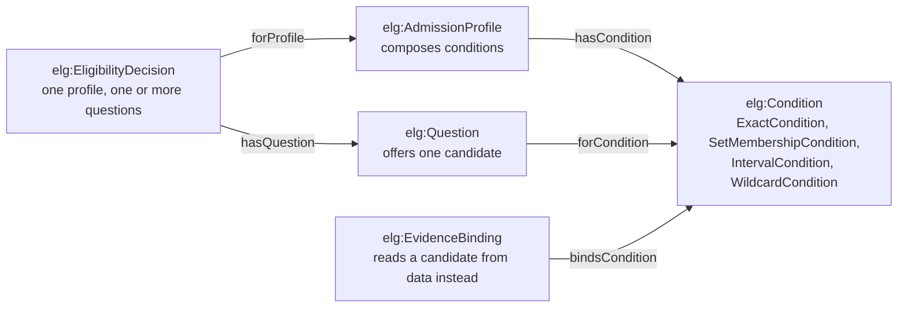

The class diagram below is generated from section 6.

<!-- start: {"generated": "class-diagram"} -->

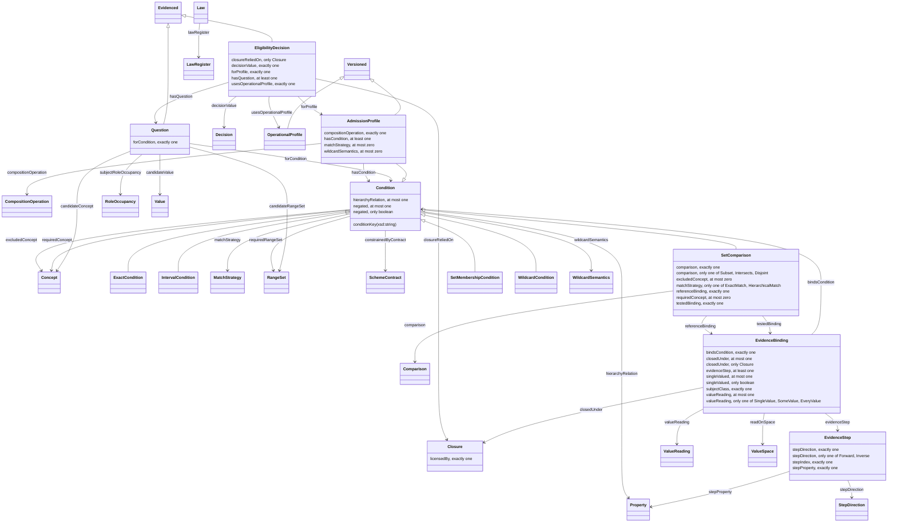

<!-- end -->

## 5. Detailed Design

### 5.1 Strategy algebra

- Included match strategies: `ExactMatch`, `SetMembership`, `IntervalContainment`, `HierarchicalMatch`, `Wildcard`.
- Excluded: `IntervalOverlap` as an admissibility strategy.
- Wildcard policies: `NoWildcard`, `SingleDimensionWildcard`, `MultiDimensionWildcard`.
- Composition operations, for admission profiles: `AllRequired`, `AnySufficient`.

A condition that is not an admission profile declares exactly one match strategy and one wildcard policy,
independently of each other (L1, L3). An admission profile declares neither, since it tests no candidate
itself. It declares exactly one composition operation, which says how it combines its conditions' outcomes
(L2, §5.2).

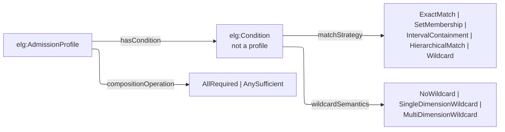

`HierarchicalMatch` is valid when a dimension is backed by a concept scheme whose membership is resolved against a well-founded hierarchy, the links of the condition's hierarchy relation (below). Evaluation may compute closure at query time or use a generated surface, provided closure is interpreted over the bound scheme. A scheme can reach a hierarchical condition without a hierarchy, because a contract resolves to different schemes in different contexts (ADR-A85). Where no member of the resolved scheme has a link of the condition's hierarchy relation to another member, the condition decides only the concepts it names (L14, ADR-A100).

A condition names the relation it walks with `elg:hierarchyRelation`, `skos:broader` or a property declared a sub-property of it (`rdfs:subPropertyOf`, however many steps). Absent, the relation is `skos:broader`, so a condition that names none keeps the meaning it had. A thesaurus may state several kinds of link between the same concepts, such as a kind link and a part link, each a sub-property of `skos:broader`. Which of them a clause relies on is the clause's own question. "A kind of tumour" walks kind links, and a tumour margin, which is part of a tumour and not a kind of one, is not admitted. "Part of Europe" walks part links, and a city that is part of a country that is part of Europe is. The walk follows the named property only. It does not read a link asserted under a sub-property of the named one, and it does not infer a link from a super-property, so a scheme that wants a plain `skos:broader` consumer to see the hierarchy asserts each link under both. Eligibility names no thesaurus standard's relations. The sub-property declaration is made where the relation is defined (§8.5).

Conditions matching by `ExactMatch`, `SetMembership`, or `HierarchicalMatch` state what they match against with `elg:requiredConcept` and `elg:excludedConcept`. A candidate *matches* a concept by equality under `ExactMatch` and `SetMembership`, and by standing at or below it in the bound scheme's ordering, the condition's hierarchy relation, under `HierarchicalMatch`. Several required concepts are alternatives to one another, and each excluded concept excludes independently. An admission profile declares no concepts of its own, since its conditions do. A layer above may place one of its defined words, itself a `skos:Concept`, in `elg:requiredConcept` or `elg:excludedConcept` ("a Site in the Territory"), and replace it for each instance by the concepts the word means, so that a condition it generates never names a word. Instrument does, and its shapes report a word that is also a concept of the scheme its condition is constrained by, and a word whose meaning is not a concept (Instrument README §15.1). A word's meaning may come from a variable or from another word, and must not loop back to itself (Instrument README §18.4). A question offers its candidate with `elg:candidateConcept`. `IntervalContainment` needs no exclusion construct, since a `qnt:RangeSet` is a union of ranges and already expresses gaps.

| Candidate | Decision | Law |
|---|---|---|
| absent, unresolved, or more than one per question, or the decision needs the bound scheme (hierarchical match, or exclusions only) and its contract's bindings resolve to no scheme at the resolution time, or the candidate is outside the scheme | `Undetermined` | L9, L12 for no scheme |
| matches an excluded concept | `Denied`, whether or not it also matches a required concept | L10 |
| under `HierarchicalMatch`, stands strictly above an excluded concept and is otherwise admitted | `Undetermined`, since its true value may fall under the exclusion | L11 |
| under `HierarchicalMatch`, is a member of a resolved scheme in which no member has a link of the condition's hierarchy relation to another member, and is neither a required nor an excluded concept | `Undetermined`, since the scheme cannot place it | L14 |
| matches a required concept, or the condition declares exclusions only and the candidate is a member of the bound scheme | `Permitted` | L12 for the second case |
| otherwise | `Denied` | |

The table reads as a decision flow, each row a condition on the way to a leaf.

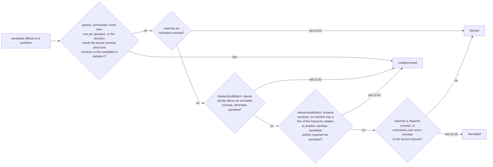

### 5.2 Conditions and profiles

Four condition classes each commit to one match strategy no other can use correctly. `ExactCondition` and
`SetMembershipCondition` commit to `ExactMatch` and `SetMembership`, `IntervalCondition` to
`IntervalContainment`, and `WildcardCondition` to `Wildcard`. `HierarchicalMatch` names no subclass of its
own. `elg:Condition` carries it directly, constrained by a scheme contract instead of its own type (§5.1). An
`elg:AdmissionProfile` is itself a condition, so profiles compose, and a profile can be one of another
profile's conditions.

A condition that is not a profile is one test. It takes one candidate, compares it with what it declares
under its match strategy, and gives Permitted, Denied or Undetermined. A profile tests no candidate itself. It
composes conditions (`elg:hasCondition`), and its outcome is theirs combined by its composition operation,
`AllRequired` as a strong Kleene conjunction or `AnySufficient` as a disjunction. A decision is made for one
profile. So a match strategy and a wildcard policy mean something only on a condition that is not a profile,
and a composition operation only on a profile, and the shapes report each declared in the wrong place (L1 to
L3). Several required concepts on one condition are alternatives whatever the profile around it composes.

```text
ex:relocation-benefit  (AdmissionProfile, AllRequired)
 ├─ ex:engineering-family   (HierarchicalMatch, required ex:engineering, excluded ex:contractor-engineering)
 └─ ex:minimum-tenure       (IntervalContainment, range set of two years or more)
```

### 5.3 Questions and decisions

A question is evidenced (`fnd:Evidenced`, Foundation) and names exactly one condition. A decision is
evidenced too, and names exactly one profile, at least one question, and exactly one decision value, so a
profile with several conditions can be answered by several questions under one decision record.

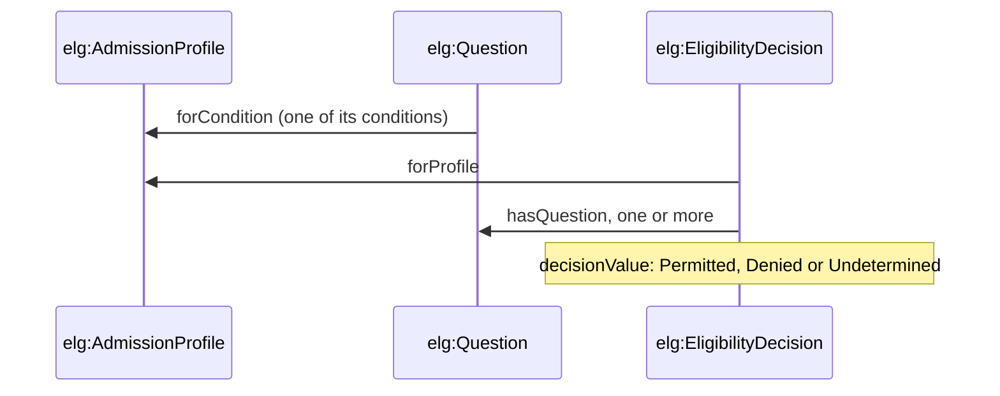

### 5.4 The mechanism types

Seven classes carry no properties of their own, and each is a closed set of named individuals (6.4), never
an open class a reader could extend without a new decision. `elg:MatchStrategy`,
`elg:WildcardSemantics` and `elg:CompositionOperation` are the three mechanisms of §5.1.
`elg:OperationalProfile` is versioned (`fnd:Versioned`), since the five reference profiles E1 to E5 are
themselves subject to change control. Each names one reference conformance profile that the differential
test harness (`tools/reference/eligibility/`) checks a compiler backend against, one per mechanism
combination worth testing in isolation. `elg:Law` and `elg:LawRegister` classify the laws by how each is
discharged (§5.8).

`elg:WildcardSemantics`'s three individuals govern a `WildcardCondition`. `NoWildcard` rules it out,
`SingleDimensionWildcard` lets the condition stand in for one dimension of a multi-dimension match, and
`MultiDimensionWildcard` lets it stand in for several at once. `elg:Decision`'s three individuals carry the
information order that section 10 formalises. `Undetermined` sits below both decided values, which are each
other's own fixed point only.

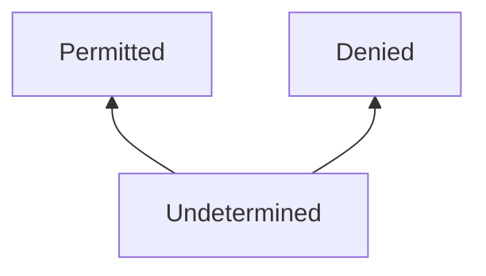

`elg:StepDirection`'s two individuals name which way an `elg:EvidenceStep` traverses its property (§5.6),
`Forward`, subject to object, as `ex:family-binding`'s steps do, or `Inverse`, object to subject, for a path
that reaches its candidate against the direction a property is normally read.

### 5.5 Condition, question and decision properties

Most of the properties of 6.2 and 6.3 appear, wired together, in the examples of section 8. For example,
`interval-containment.ttl` (§8.2) connects a condition's `requiredRangeSet` to a question's
`candidateRangeSet` of the same range set, and a decision's `hasQuestion` and `decisionValue` record the
outcome.

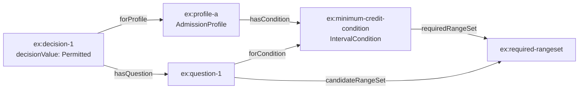

### 5.6 Evidence bindings

A condition reads its candidate from an `elg:Question` unless an `elg:EvidenceBinding` binds it. Where a
profile evaluates a whole class of subjects an applied ontology already describes (such as every
`ex:Employee`), a binding names that class (`elg:subjectClass`) and reaches each subject's candidate by an
ordered path of `elg:EvidenceStep`s over the applied ontology's own properties, instead of an authored
question (ADR-A91). The path ends at a `skos:Concept` for a concept condition. For an interval condition it
ends at a `qnt:Quantity` on the condition's value space, or at a literal where the binding reads on that
space (`elg:readOnSpace`). A subject with no value at the end of the path, or several, is `Undetermined`, as
is one whose value is on another space, unless the binding declares how several values are read
(`elg:valueReading`, ADR-A103). A profile evaluates either questions or one class of bound subjects. A binding
may claim that each step of its path yields at most one value (`elg:singleValued`). The design-time OWL
backend compiles only claimed paths (ADR-A90).

`evidence-binding.ttl` (§8.4) binds a hierarchical condition to `ex:Employee` by a two-step path, through a
role to its job family.

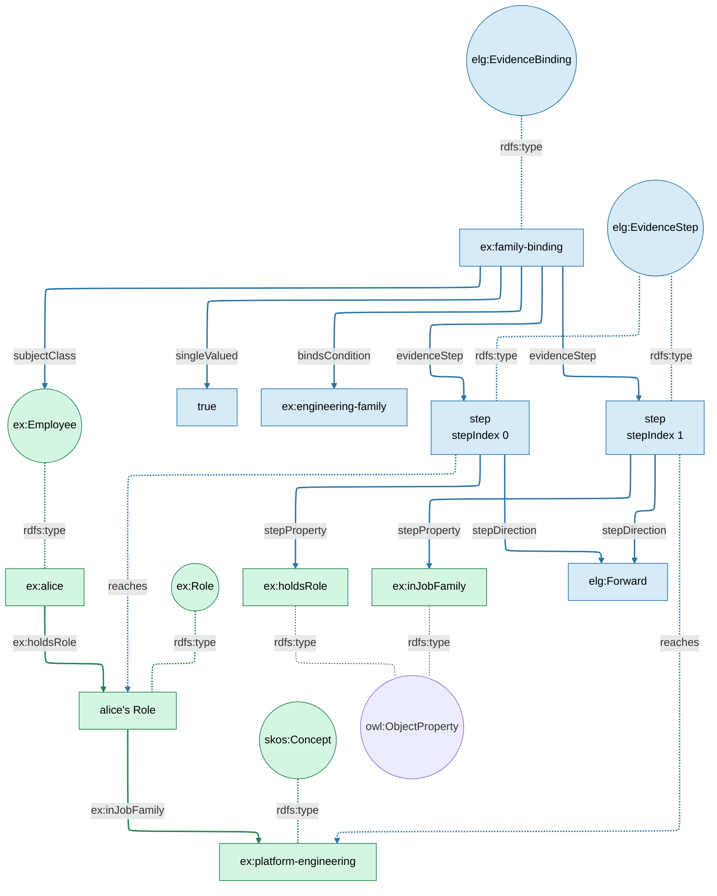

Green is the applied domain ontology (`ex:`) and the SKOS concept it uses. Blue is Eligibility
(`elg:`), including the binding and condition, which are Eligibility individuals named in the
example's namespace. Solid lines are asserted triples. Dotted lines are `rdfs:type`, or show what
each step reaches when a subject's path is followed. Each step is a node of its own, positioned by
`elg:stepIndex`, naming the property it traverses and its direction.

A path ending at a literal instead of a `skos:Concept` or `qnt:Quantity` names the value space it reads on
(`elg:readOnSpace`), as `ex:tenure-binding` does for `ex:tenureYears`. A binding that reads more than one
value states how they combine (`elg:valueReading`). `elg:SomeValue` and `elg:EveryValue` each decide every
value as a single candidate would be decided, then combine the outcomes by strong Kleene `or3` and `and3`
(L15, section 10). A subject with no value stays `Undetermined`. An outcome that relies on the values reached
being all there are, Denied under some value and Permitted under every value, needs a closure the binding
names (§5.7). Under a closure the empty case decides too, so no value is Denied under some value and
Permitted under every value.

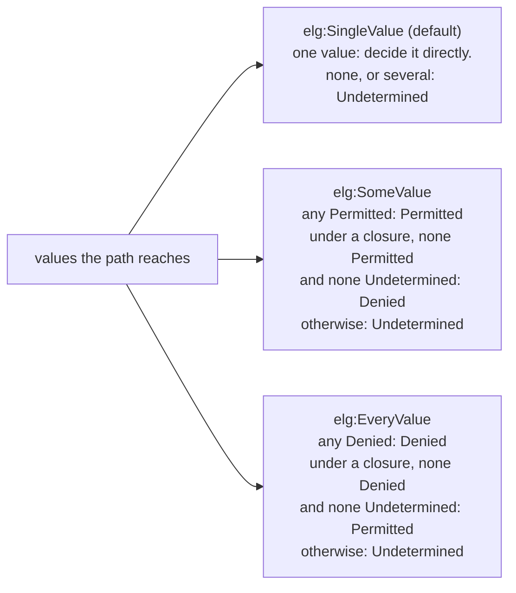

A condition may be negated (`elg:negated true`). It is evaluated as it stands, including its reading, and
Permitted and Denied are then swapped, while `Undetermined` stays `Undetermined` (L16).

### 5.7 Closures

A record proves what it shows. That something is absent, or that the values recorded are all there
are, follows only where a source vouches for the records, for example a deeming or another term of a
contract, a party whose register is authoritative, or a deployment that declares its records complete
through an operational profile. An `elg:Closure` states that source (`elg:licensedBy`), and an evidence
binding that relies on it names it (`elg:closedUnder`). A closure covers exactly the bindings that
name it. Several bindings share one closure by each naming it, and nothing infers which bindings a
closure is for (ADR-A105).

Under a closure, a binding read `elg:SomeValue` is Denied when no value it reaches is Permitted, the
empty case included, and one read `elg:EveryValue` is Permitted when no value is Denied. Without one,
a set reading decides only what a record proves (L15). The closure licenses the records as they
stand at the deciding record's recording time (`fnd:Evidenced`), which is the cut. A fact recorded
later can show the decision was made on incomplete records. A decision names the closures it relied
on (`elg:closureReliedOn`). A closure is in force from its source's effective time (L17).

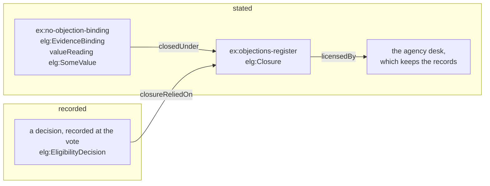

### 5.8 Laws

Each law of 6.4 and 6.6 is either a semantic law, discharged by the formal argument of section 10, or a
static constraint, discharged by one of the shapes of section 7.

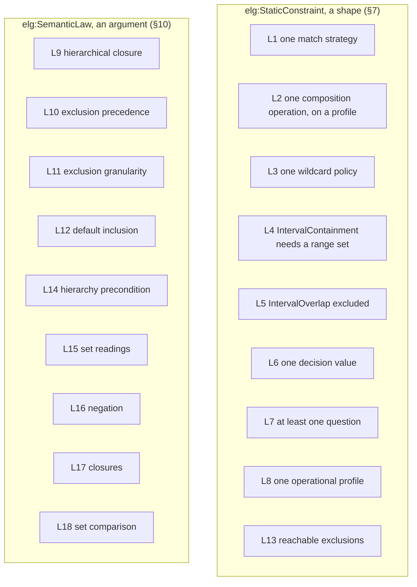

L9's last sentence makes a hierarchical condition with no resolved scheme Undetermined for every candidate, and L12's last sentence does the same for a condition with exclusions only. A compiler may refuse such a condition instead of compiling a plan that answers Undetermined everywhere. The compilers in `tools/mork_compilers/` compile a plan that answers Undetermined when a contract's bindings resolve to no scheme at the resolution time, and refuse a hierarchical condition with no `elg:constrainedByContract`, a contract with neither a `voc:SchemeBinding` nor a `voc:boundScheme`, and a contract whose applicable bindings conflict. The OWL and SWRL backends refuse a hierarchical plan that carries no scheme, since neither can state Undetermined. The SPARQL and SHACL backends refuse one that carries no scheme unless it was compiled as unresolved. A refusal decides no candidate, so it does not contradict L9. The reference semantics (`tools/reference/eligibility/`) answers Undetermined.

### 5.9 Set comparisons

A condition may relate two sets reached from one subject, where a binding on its own reads one set. An `elg:SetComparison` is an `elg:Condition` that names two evidence bindings, the one that reads the values to be tested (`elg:testedBinding`) and the one that reads the values they are looked for in (`elg:referenceBinding`), and one `elg:comparison`, `elg:Subset`, `elg:Intersects` or `elg:Disjoint`. Both bindings name the comparison (`elg:bindsCondition`) and the same subject class, and each keeps its own path and its own closure. A comparison fixes how the tested values combine, so neither binding declares a value reading. Its match strategy is `elg:ExactMatch` or `elg:HierarchicalMatch`, and it names no required or excluded concept, since the reference values take their place.

Each tested value is decided as a single candidate would be. It is Permitted when it matches a reference value, equal to it under exact match and at or below it by the condition's hierarchy relation under hierarchical match. It is Denied when it matches none and the reference binding names a closure in force, because only then are the reference values all there are. Otherwise it is Undetermined. The comparison then reads the outcomes as L15 reads a set (L18).

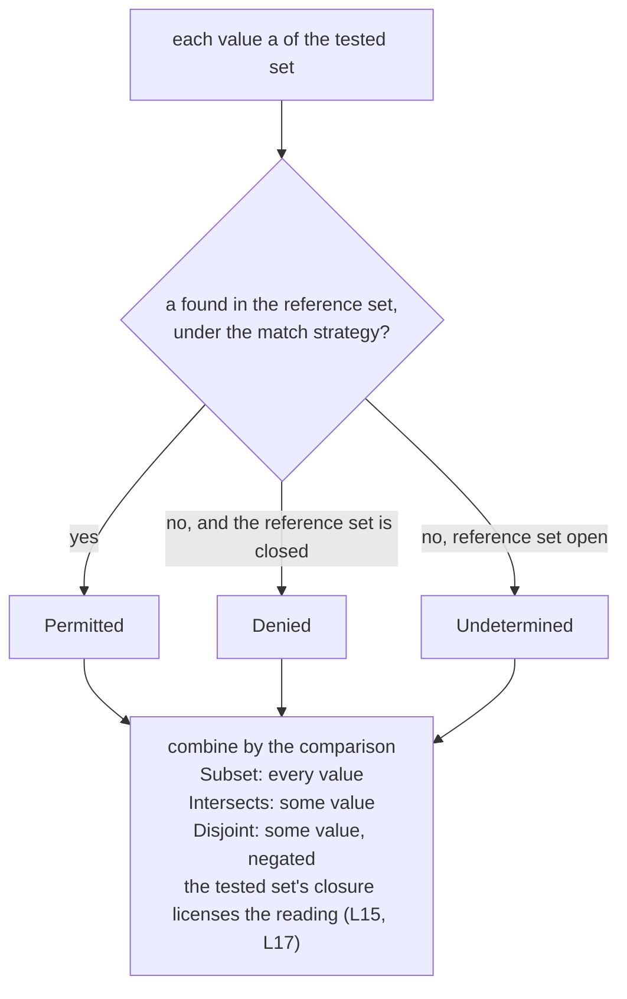

| Comparison | Permitted | Denied |
|---|---|---|
| `elg:Subset` | the tested set is closed and every tested value is found | a tested value is not found and the reference set is closed |
| `elg:Intersects` | a tested value is found | the tested set is closed and no tested value is found, the reference set being closed unless the tested set is empty |
| `elg:Disjoint` | the outcome of `elg:Intersects` is Denied | the outcome of `elg:Intersects` is Permitted |

An empty tested set is read as L15 reads it. Under a closure every value over no value is Permitted and some value over no value is Denied, so a subset holds of an empty set and an intersection does not. Whether a set has a member is not stated by a comparison. It is a count over the set's binding.

`set-comparison-licensing.ttl`, `set-comparison-trial.ttl` and `set-comparison-bonds.ttl` (§8.6) show one comparison each. A hierarchical comparison needs its contract's scheme as any hierarchical condition does (L9), and one whose contract has no binding that applies at the resolution time is Undetermined for every subject. A tested value the scheme cannot place is Undetermined, and over a scheme with no hierarchy only a value equal to a reference value is found (L18). The literal values a path may end at are not compared (§13).

## 6. Description Logic Encoding

### 6.1 Classes

#### `elg:Condition`

**Definition.** A declared admissibility condition.

**Restrictions.**

| Property | Values | Asserted in | Message |
|---|---|---|---|
| `elg:negated` | max 1 | SHACL |  |
| `elg:negated` | only `xsd:boolean` | SHACL |  |
| `elg:hierarchyRelation` | max 1 | SHACL |  |

#### `elg:ExactCondition`

**Definition.** A condition that admits a candidate equal to one of its required concepts (ExactMatch).

**Subclass of.** `elg:Condition`

#### `elg:SetMembershipCondition`

**Definition.** A condition that admits a candidate that is a member of the set of its required concepts (SetMembership).

**Subclass of.** `elg:Condition`

#### `elg:IntervalCondition`

**Definition.** A condition that admits a candidate whose value lies within its required range set (IntervalContainment).

**Subclass of.** `elg:Condition`

#### `elg:WildcardCondition`

**Definition.** A condition that stands in for one or more dimensions of a match, as its wildcard policy allows (Wildcard).

**Subclass of.** `elg:Condition`

#### `elg:SetComparison`

**Definition.** A condition that relates the values one evidence binding reads from a subject to the values another reads from the same subject, by one comparison. Each tested value is decided by whether it is found among the reference values, and the comparison combines the outcomes (L18).

**Subclass of.** `elg:Condition`

**Restrictions.**

| Property | Values | Asserted in | Message |
|---|---|---|---|
| `elg:comparison` | exactly 1 | SHACL | A set comparison declares exactly one comparison (L18). |
| `elg:comparison` | only { `elg:Subset`, `elg:Intersects`, `elg:Disjoint` } | SHACL | A set comparison declares exactly one comparison (L18). |
| `elg:testedBinding` | exactly 1 | SHACL | A set comparison names exactly one tested binding (L18). |
| `elg:referenceBinding` | exactly 1 | SHACL | A set comparison names exactly one reference binding (L18). |
| `elg:matchStrategy` | only { `elg:ExactMatch`, `elg:HierarchicalMatch` } | SHACL | A set comparison matches by ExactMatch or HierarchicalMatch (L18). |
| `elg:requiredConcept` | max 0 | SHACL | A set comparison names no required concept, since its reference binding supplies the values (L18). |
| `elg:excludedConcept` | max 0 | SHACL | A set comparison names no excluded concept, since its reference binding supplies the values (L18). |

#### `elg:AdmissionProfile`

**Definition.** A reusable admissibility profile that composes one or more conditions.

**Subclass of.** `elg:Condition`, `fnd:Versioned`

**Restrictions.**

| Property | Values | Asserted in | Message |
|---|---|---|---|
| `elg:hasCondition` | min 1 |  |  |
| `elg:compositionOperation` | exactly 1 | SHACL |  |
| `elg:matchStrategy` | max 0 | SHACL | An admission profile declares no match strategy, since its conditions do (L1). |
| `elg:wildcardSemantics` | max 0 | SHACL | An admission profile declares no wildcard policy, since its conditions do (L3). |

#### `elg:Question`

**Definition.** An evaluation question posed against one condition.

**Subclass of.** `fnd:Evidenced`

**Restrictions.**

| Property | Values | Asserted in | Message |
|---|---|---|---|
| `elg:forCondition` | exactly 1 | OWL |  |

#### `elg:EligibilityDecision`

**Definition.** A recorded admissibility decision for one profile and one or more questions.

**Subclass of.** `fnd:Evidenced`

**Restrictions.**

| Property | Values | Asserted in | Message |
|---|---|---|---|
| `elg:forProfile` | exactly 1 |  |  |
| `elg:hasQuestion` | min 1 |  |  |
| `elg:decisionValue` | exactly 1 |  |  |
| `elg:usesOperationalProfile` | exactly 1 | SHACL |  |
| `elg:closureReliedOn` | only `elg:Closure` | SHACL | A decision relies only on closures (ADR-A105). |

#### `elg:MatchStrategy`

**Definition.** How a condition matches its candidate, one of a closed set of named strategies.

#### `elg:CompositionOperation`

**Definition.** How an admission profile combines its conditions' outcomes, one of a closed set of named operations.

#### `elg:WildcardSemantics`

**Definition.** The wildcard policy a condition declares, one of a closed set of named policies.

#### `elg:Decision`

**Definition.** The three-valued outcome of an admissibility decision: Permitted, Denied or Undetermined.

#### `elg:OperationalProfile`

**Definition.** A reference conformance profile that a compiler backend is checked against. Versioned, since the profiles are themselves subject to change control.

**Subclass of.** `fnd:Versioned`

#### `elg:Law`

**Definition.** A logical law of the Eligibility layer, a property its declarations or decisions must satisfy, not a law in the legal sense. A law may name how it is discharged (`elg:lawRegister`).

#### `elg:LawRegister`

**Definition.** How a logical law of the Eligibility layer is discharged, by formal argument or by a static check of declarations.

#### `elg:EvidenceBinding`

**Definition.** Binds a condition to the class of subjects it evaluates and to the path that reaches each subject's candidate on the applied ontology's own properties (ADR-A91).

**Restrictions.**

| Property | Values | Asserted in | Message |
|---|---|---|---|
| `elg:bindsCondition` | exactly 1 | SHACL |  |
| `elg:subjectClass` | exactly 1 | SHACL |  |
| `elg:evidenceStep` | min 1 | SHACL |  |
| `elg:singleValued` | max 1 | SHACL |  |
| `elg:singleValued` | only `xsd:boolean` | SHACL |  |
| `elg:valueReading` | max 1 | SHACL |  |
| `elg:valueReading` | only { `elg:SingleValue`, `elg:SomeValue`, `elg:EveryValue` } | SHACL |  |
| `elg:closedUnder` | max 1 | SHACL | A binding names at most one closure, and what it names is an elg:Closure (ADR-A105). |
| `elg:closedUnder` | only `elg:Closure` | SHACL | A binding names at most one closure, and what it names is an elg:Closure (ADR-A105). |

#### `elg:EvidenceStep`

**Definition.** One positioned traversal within an evidence binding's path, in a stated direction. Shaped like srf:PathStep.

**Restrictions.**

| Property | Values | Asserted in | Message |
|---|---|---|---|
| `elg:stepIndex` | exactly 1 | SHACL |  |
| `elg:stepProperty` | exactly 1 | SHACL |  |
| `elg:stepDirection` | exactly 1 | SHACL |  |
| `elg:stepDirection` | only { `elg:Forward`, `elg:Inverse` } | SHACL |  |

#### `elg:StepDirection`

**Definition.** The direction in which an evidence step traverses its property.

#### `elg:ValueReading`

**Definition.** How a bound condition reads the values its binding's path reaches: one value, some value, or every value (ADR-A103, L15).

#### `elg:Comparison`

**Definition.** How a set comparison relates its tested values to its reference values, one of a closed set of named comparisons (L18).

#### `elg:Closure`

**Definition.** A source's warrant that the records an evidence binding reads are complete, so a set reading may decide on what is absent (ADR-A105, L15, L17). It covers exactly the bindings that name it.

**Restrictions.**

| Property | Values | Asserted in | Message |
|---|---|---|---|
| `elg:licensedBy` | exactly 1 |  | A closure names exactly one source (elg:licensedBy, ADR-A105). |

### 6.2 Object Properties

#### `elg:hasCondition`

**Definition.** A condition an admission profile composes.

**Utility.** An admission profile's meaning depends on its conditions, so a condition is never edited: a changed condition is a new node, content-addressed or minted under the profile, and a condition shared between profiles is immutable (Foundation section 4).

**Meaning bearing.** "true"^^xsd:boolean

**Domain.** `elg:AdmissionProfile`

**Range.** `elg:Condition`

#### `elg:forCondition`

**Definition.** The one condition a question is posed against.

**Domain.** `elg:Question`

**Range.** `elg:Condition`

**Characteristics.** functional

#### `elg:requiredRangeSet`

**Definition.** The range set a candidate's value must lie within, for a condition matching by IntervalContainment.

**Domain.** `elg:Condition`

**Range.** `qnt:RangeSet`

#### `elg:requiredConcept`

**Definition.** A concept a candidate must match, under the condition's match strategy. Several required concepts are alternatives to one another.

**Domain.** `elg:Condition`

**Range.** `skos:Concept`

#### `elg:excludedConcept`

**Definition.** A concept a candidate must not match, under the condition's match strategy. Each excluded concept excludes independently of the others.

**Domain.** `elg:Condition`

**Range.** `skos:Concept`

#### `elg:hierarchyRelation`

**Definition.** The relation a condition matching by HierarchicalMatch walks: `skos:broader` or a property declared a sub-property of it. Absent, `skos:broader`.

**Domain.** `elg:Condition`

**Range.** `rdf:Property`

**Characteristics.** functional

#### `elg:comparison`

**Definition.** The one comparison a set comparison makes between its tested values and its reference values.

**Domain.** `elg:SetComparison`

**Range.** `elg:Comparison`

**Characteristics.** functional

#### `elg:testedBinding`

**Definition.** The evidence binding that reads the values a set comparison tests. Each is looked for among the values the reference binding reads.

**Domain.** `elg:SetComparison`

**Range.** `elg:EvidenceBinding`

**Characteristics.** functional

#### `elg:referenceBinding`

**Definition.** The evidence binding that reads the values a set comparison looks for its tested values in.

**Domain.** `elg:SetComparison`

**Range.** `elg:EvidenceBinding`

**Characteristics.** functional

#### `elg:candidateRangeSet`

**Definition.** The range set a question offers as its candidate to a condition matching by IntervalContainment.

**Domain.** `elg:Question`

**Range.** `qnt:RangeSet`

#### `elg:candidateValue`

**Definition.** The value a question offers as its candidate.

**Domain.** `elg:Question`

**Range.** `qnt:Value`

#### `elg:candidateConcept`

**Definition.** The concept a question offers to a condition matching by ExactMatch, SetMembership or HierarchicalMatch.

**Domain.** `elg:Question`

**Range.** `skos:Concept`

#### `elg:matchStrategy`

**Definition.** The one match strategy a condition declares.

**Domain.** `elg:Condition`

**Range.** `elg:MatchStrategy`

**Characteristics.** functional

#### `elg:constrainedByContract`

**Definition.** The scheme contract whose resolved scheme a condition's candidates are matched against (ADR-A85).

**Domain.** `elg:Condition`

**Range.** `voc:SchemeContract`

#### `elg:compositionOperation`

**Definition.** The one composition operation an admission profile declares.

**Domain.** `elg:AdmissionProfile`

**Range.** `elg:CompositionOperation`

**Characteristics.** functional

#### `elg:wildcardSemantics`

**Definition.** The one wildcard policy a condition declares.

**Domain.** `elg:Condition`

**Range.** `elg:WildcardSemantics`

**Characteristics.** functional

#### `elg:forProfile`

**Definition.** The one admission profile a decision is for.

**Domain.** `elg:EligibilityDecision`

**Range.** `elg:AdmissionProfile`

**Characteristics.** functional

#### `elg:hasQuestion`

**Definition.** A question a decision answers.

**Domain.** `elg:EligibilityDecision`

**Range.** `elg:Question`

#### `elg:decisionValue`

**Definition.** The one outcome a decision records: Permitted, Denied or Undetermined.

**Domain.** `elg:EligibilityDecision`

**Range.** `elg:Decision`

**Characteristics.** functional

#### `elg:lawRegister`

**Definition.** How a logical law of the Eligibility layer is discharged.

**Domain.** `elg:Law`

**Range.** `elg:LawRegister`

**Characteristics.** functional

#### `elg:usesOperationalProfile`

**Definition.** The one operational profile a decision is made under.

**Domain.** `elg:EligibilityDecision`

**Range.** `elg:OperationalProfile`

**Characteristics.** functional

#### `elg:subjectRoleOccupancy`

**Definition.** The role occupancy of the subject a question is asked about.

**Domain.** `elg:Question`

**Range.** `pty:RoleOccupancy`

#### `elg:bindsCondition`

**Definition.** The one condition an evidence binding supplies candidates to.

**Domain.** `elg:EvidenceBinding`

**Range.** `elg:Condition`

**Characteristics.** functional

#### `elg:subjectClass`

**Definition.** The class whose instances the bound condition evaluates.

**Domain.** `elg:EvidenceBinding`

**Characteristics.** functional

#### `elg:evidenceStep`

**Definition.** A step of an evidence binding's path.

**Domain.** `elg:EvidenceBinding`

**Range.** `elg:EvidenceStep`

#### `elg:stepProperty`

**Definition.** The one property an evidence step traverses.

**Domain.** `elg:EvidenceStep`

**Range.** `rdf:Property`

**Characteristics.** functional

#### `elg:stepDirection`

**Definition.** The one direction in which an evidence step traverses its property.

**Domain.** `elg:EvidenceStep`

**Range.** `elg:StepDirection`

**Characteristics.** functional

#### `elg:readOnSpace`

**Definition.** The value space a literal at the end of an interval condition's path is read on. A qnt:Quantity at the end of the path states its own space.

**Domain.** `elg:EvidenceBinding`

**Range.** `qnt:ValueSpace`

**Characteristics.** functional

#### `elg:valueReading`

**Definition.** The binding's value reading. A binding without one reads a single value (elg:SingleValue).

**Domain.** `elg:EvidenceBinding`

**Range.** `elg:ValueReading`

**Characteristics.** functional

#### `elg:licensedBy`

**Definition.** The source that vouches for a closure: a deeming or another term, a party whose register is authoritative, or an operational profile by which a deployment declares its records complete. Deliberately has no range, so a layer above names its own source.

**Domain.** `elg:Closure`

**Characteristics.** functional

#### `elg:closedUnder`

**Definition.** The closure an evidence binding relies on. Only a binding read elg:SomeValue or elg:EveryValue, or a binding of a set comparison, names one.

**Domain.** `elg:EvidenceBinding`

**Range.** `elg:Closure`

**Characteristics.** functional

#### `elg:closureReliedOn`

**Definition.** A closure a decision relied on. The decision's own recording time is the cut: the closure licensed the records as they stood then.

**Domain.** `elg:EligibilityDecision`

**Range.** `elg:Closure`

### 6.3 Datatype Properties

#### `elg:conditionKey`

**Definition.** The canonical identifier of a condition declaration, for comparison, caching and replay.

**Domain.** `elg:Condition`

**Range.** `xsd:string`

**Characteristics.** functional

#### `elg:stepIndex`

**Definition.** Zero-based position of the step in traversal order.

**Domain.** `elg:EvidenceStep`

**Range.** `xsd:nonNegativeInteger`

**Characteristics.** functional

#### `elg:singleValued`

**Definition.** The author's claim that each step of the binding's path yields at most one value. The design-time OWL backend compiles only claimed paths, and checks the claim on data with a generated shape (ADR-A90 addendum, option B).

**Domain.** `elg:EvidenceBinding`

**Range.** `xsd:boolean`

**Characteristics.** functional

#### `elg:negated`

**Definition.** When true, the condition is evaluated as it stands, including its value reading, and then Permitted and Denied are swapped. Undetermined stays Undetermined (ADR-A103, L16).

**Domain.** `elg:Condition`

**Range.** `xsd:boolean`

**Characteristics.** functional

### 6.4 Individuals

The mechanisms, value readings, comparisons, decisions, step directions, reference profiles and law registers are each a closed set of named individuals, written to the vocabulary document. The laws, L1 to L18, each name their register, so they are in 6.6.

| Individual | Type | Definition |
|---|---|---|
| `elg:ExactMatch` | `elg:MatchStrategy` |  |
| `elg:SetMembership` | `elg:MatchStrategy` |  |
| `elg:IntervalContainment` | `elg:MatchStrategy` |  |
| `elg:HierarchicalMatch` | `elg:MatchStrategy` |  |
| `elg:Wildcard` | `elg:MatchStrategy` |  |

| Individual | Type | Definition |
|---|---|---|
| `elg:AllRequired` | `elg:CompositionOperation` | Denied when any condition is Denied, Permitted when every condition is Permitted, otherwise Undetermined, the strong Kleene conjunction. |
| `elg:AnySufficient` | `elg:CompositionOperation` | Permitted when any condition is Permitted, Denied when every condition is Denied, otherwise Undetermined, the strong Kleene disjunction. |

| Individual | Type | Definition |
|---|---|---|
| `elg:SingleValue` | `elg:ValueReading` | The path reaches one value. None, or several, leaves the condition undetermined. The default reading. |
| `elg:SomeValue` | `elg:ValueReading` | Permitted when any value is Permitted. Under a closure the binding names, Denied when every value is Denied, with no value included. Otherwise Undetermined (L15). |
| `elg:EveryValue` | `elg:ValueReading` | Denied when any value is Denied. Under a closure the binding names, Permitted when every value is Permitted, with no value included. Otherwise Undetermined (L15). |

| Individual | Type | Definition |
|---|---|---|
| `elg:Subset` | `elg:Comparison` | Every tested value is found among the reference values. Read as every value of the tested binding's set (L18). |
| `elg:Intersects` | `elg:Comparison` | Some tested value is found among the reference values. Read as some value of the tested binding's set (L18). |
| `elg:Disjoint` | `elg:Comparison` | No tested value is found among the reference values. Read as some value, negated (L18, L16). |

| Individual | Type | Definition |
|---|---|---|
| `elg:NoWildcard` | `elg:WildcardSemantics` |  |
| `elg:SingleDimensionWildcard` | `elg:WildcardSemantics` |  |
| `elg:MultiDimensionWildcard` | `elg:WildcardSemantics` |  |

| Individual | Type | Definition |
|---|---|---|
| `elg:Permitted` | `elg:Decision` |  |
| `elg:Denied` | `elg:Decision` |  |
| `elg:Undetermined` | `elg:Decision` |  |

| Individual | Type | Definition |
|---|---|---|
| `elg:Forward` | `elg:StepDirection` | Traversed from subject to object. |
| `elg:Inverse` | `elg:StepDirection` | Traversed from object to subject. |

| Individual | Type | Definition |
|---|---|---|
| `elg:E1` | `elg:OperationalProfile` | Exact-match profile |
| `elg:E2` | `elg:OperationalProfile` | Interval-containment profile |
| `elg:E3` | `elg:OperationalProfile` | Wildcard profile |
| `elg:E4` | `elg:OperationalProfile` | AnySufficient composition profile |
| `elg:E5` | `elg:OperationalProfile` | AllRequired composition profile |

| Individual | Type | Definition |
|---|---|---|
| `elg:SemanticLaw` | `elg:LawRegister` | Discharged by formal argument. |
| `elg:StaticConstraint` | `elg:LawRegister` | Discharged by SHACL, SPARQL, or other static analysis of declarations. |

### 6.5 Disjointness and Keys

**All disjoint.** `elg:Condition`, `elg:Question`, `elg:EligibilityDecision`, `elg:MatchStrategy`,
`elg:CompositionOperation`, `elg:WildcardSemantics`, `elg:Decision`, `elg:OperationalProfile`, `elg:Law`,
`elg:EvidenceBinding`, `elg:EvidenceStep`, `elg:StepDirection`, `elg:ValueReading`, `elg:Closure`, `elg:Comparison`

### 6.6 Other Axioms

The spec document declares `rdf:Property`, the range of `elg:stepProperty`, an `owl:Class`. It has no entry,
since an entry would give a term of RDF a definition of ours.

```turtle-spec
rdf:Property a owl:Class .
```

Every law names its register (`elg:lawRegister`), which the individuals table of 6.4 cannot state, so the laws
are written whole (§5.8).

```turtle-vocab
elg:L1 a elg:Law ;
	elg:lawRegister elg:StaticConstraint ;
	rdfs:comment "Each condition that is not an admission profile declares exactly one match strategy, and an admission profile declares none." .
elg:L2 a elg:Law ;
	elg:lawRegister elg:StaticConstraint ;
	rdfs:comment "Each admission profile declares exactly one composition operation, and no other condition declares one." .
elg:L3 a elg:Law ;
	elg:lawRegister elg:StaticConstraint ;
	rdfs:comment "Each condition that is not an admission profile declares exactly one wildcard policy, and an admission profile declares none." .
elg:L4 a elg:Law ;
	elg:lawRegister elg:StaticConstraint ;
	rdfs:comment "IntervalContainment requires declared requiredRangeSet." .
elg:L5 a elg:Law ;
	elg:lawRegister elg:StaticConstraint ;
	rdfs:comment "IntervalOverlap is excluded from admissibility decisions." .
elg:L6 a elg:Law ;
	elg:lawRegister elg:StaticConstraint ;
	rdfs:comment "EligibilityDecision has exactly one decision value." .
elg:L7 a elg:Law ;
	elg:lawRegister elg:StaticConstraint ;
	rdfs:comment "EligibilityDecision references at least one question." .
elg:L8 a elg:Law ;
	elg:lawRegister elg:StaticConstraint ;
	rdfs:comment "EligibilityDecision names one operational profile." .
elg:L9 a elg:Law ;
	elg:lawRegister elg:SemanticLaw ;
	rdfs:comment "Hierarchical match closure. A candidate value satisfies a condition under hierarchical match exactly when it stands in the reflexive-transitive closure of the condition's hierarchy relation, restricted to the bound scheme's members, below the asserted value. The relation is the condition's hierarchy relation, skos:broader when it names none, and it is acyclic over the bound scheme. A scheme carrying a cycle in that relation is not evaluable under hierarchical match. A condition under hierarchical match with no resolved scheme at all has no closure to test a candidate against, and is undetermined for every candidate, the same reasoning L14 applies once a scheme resolves but states nothing about the candidate's position within it." .
elg:L10 a elg:Law ;
	elg:lawRegister elg:SemanticLaw ;
	rdfs:comment "Exclusion precedence. A candidate that matches an excluded concept of a condition, under the condition's match strategy, does not satisfy the condition, whether or not it also matches a required concept." .
elg:L11 a elg:Law ;
	elg:lawRegister elg:SemanticLaw ;
	rdfs:comment "Exclusion granularity. Under hierarchical match, a candidate that stands strictly above an excluded concept in the condition's hierarchy relation, and is otherwise admitted, leaves the condition undetermined for that candidate. Its true value may or may not fall under the exclusion." .
elg:L12 a elg:Law ;
	elg:lawRegister elg:SemanticLaw ;
	rdfs:comment "Default inclusion. A condition that declares excluded concepts and no required concept requires every member of its bound scheme, so it admits any member not excluded. When its contract has scheme bindings and none of them applies at the resolution time it has no members to admit, and no answer other than undetermined holds under every scheme that could have resolved, so it is undetermined for every candidate, an excluded one included, as L9 states for hierarchical match." .
elg:L13 a elg:Law ;
	elg:lawRegister elg:StaticConstraint ;
	rdfs:comment "Reachable exclusions. Where a condition declares required concepts, each of its excluded concepts matches at least one of them under the condition's match strategy. An exclusion outside every inclusion excludes nothing." .
elg:L14 a elg:Law ;
	elg:lawRegister elg:SemanticLaw ;
	rdfs:comment "Hierarchy precondition. Under hierarchical match, when no member of the resolved scheme has a link of the condition's hierarchy relation to another member of it, a candidate that is a member and is neither a required nor an excluded concept leaves the condition undetermined. The scheme cannot say, by that relation, whether the candidate falls under a required or an excluded concept. This takes precedence over default inclusion (L12)." .
elg:L15 a elg:Law ;
	elg:lawRegister elg:SemanticLaw ;
	rdfs:comment "Set readings. A bound condition whose binding reads some or every value decides each value it reaches as a single candidate would be decided, then combines the outcomes by strong Kleene logic. Under some value it is Permitted if any value is Permitted. Under every value it is Denied if any value is Denied. An outcome that needs the values reached to be all there are, Denied under some value and Permitted under every value, follows only under a closure in force that the binding names (L17): then some value is Denied when every value is Denied, and every value Permitted when every value is Permitted, the empty case included. Otherwise the condition is Undetermined." .
elg:L16 a elg:Law ;
	elg:lawRegister elg:SemanticLaw ;
	rdfs:comment "Negation. A negated condition is evaluated as it stands, including its value reading, and its outcome is then swapped: Permitted becomes Denied and Denied becomes Permitted. Undetermined stays Undetermined, with its reason." .
elg:L17 a elg:Law ;
	elg:lawRegister elg:SemanticLaw ;
	rdfs:comment "Closures. A closure is in force from its source's effective time. In force, it licenses that the values a binding naming it reaches, as recorded up to the deciding record's recording time, are all there are. A closure covers only the bindings that name it." .
elg:L18 a elg:Law ;
	elg:lawRegister elg:SemanticLaw ;
	rdfs:comment "Set comparison. A set comparison relates the values its tested binding reads from a subject to the values its reference binding reads from the same subject. Each tested value is decided as a single candidate would be. It is Permitted when it matches a reference value under the comparison's match strategy, equal to it under exact match and at or below it by the condition's hierarchy relation under hierarchical match. It is Denied when it matches none and the reference binding names a closure in force, and undetermined otherwise. Under subset the outcomes are read as every value, under intersects as some value, and under disjoint as some value and then negated (L16), the tested binding's closure licensing the reading (L15, L17). Under hierarchical match the comparison needs its contract's scheme as any hierarchical condition does, and is undetermined for every subject when no binding of the contract applies (L9). A tested value outside the scheme is undetermined, as a single candidate would be (L9), and a reference value outside the scheme matches nothing. Over a scheme in which no member has a link of the condition's hierarchy relation to another, a tested value that is not equal to a reference value is undetermined whatever the reference binding's closure, as L14 leaves a single candidate that no required concept names." .

# The three decision values are distinct, so a reasoner never merges Permitted and Denied on one decision.
[ a owl:AllDifferent ; owl:distinctMembers ( elg:Permitted elg:Denied elg:Undetermined ) ] .
```

### 6.7 Axiom Index

<!-- start: {"generated": "axiom-index"} -->

| Term | Kind | Summary |
|---|---|---|
| `elg:AdmissionProfile` | Class | Subclass of `elg:Condition`, `fnd:Versioned`. Restrictions `elg:compositionOperation` exactly 1 (SHACL only), `elg:hasCondition` min 1, `elg:matchStrategy` max 0 (SHACL only), `elg:wildcardSemantics` max 0 (SHACL only). |
| `elg:Closure` | Class | Disjoint with `elg:Comparison`, `elg:CompositionOperation`, `elg:Condition`, `elg:Decision`, `elg:EligibilityDecision`, `elg:EvidenceBinding`, `elg:EvidenceStep`, `elg:Law`, `elg:MatchStrategy`, `elg:OperationalProfile`, `elg:Question`, `elg:StepDirection`, `elg:ValueReading`, `elg:WildcardSemantics`. Restrictions `elg:licensedBy` exactly 1. |
| `elg:Comparison` | Class | Disjoint with `elg:Closure`, `elg:CompositionOperation`, `elg:Condition`, `elg:Decision`, `elg:EligibilityDecision`, `elg:EvidenceBinding`, `elg:EvidenceStep`, `elg:Law`, `elg:MatchStrategy`, `elg:OperationalProfile`, `elg:Question`, `elg:StepDirection`, `elg:ValueReading`, `elg:WildcardSemantics`. |
| `elg:CompositionOperation` | Class | Disjoint with `elg:Closure`, `elg:Comparison`, `elg:Condition`, `elg:Decision`, `elg:EligibilityDecision`, `elg:EvidenceBinding`, `elg:EvidenceStep`, `elg:Law`, `elg:MatchStrategy`, `elg:OperationalProfile`, `elg:Question`, `elg:StepDirection`, `elg:ValueReading`, `elg:WildcardSemantics`. |
| `elg:Condition` | Class | Disjoint with `elg:Closure`, `elg:Comparison`, `elg:CompositionOperation`, `elg:Decision`, `elg:EligibilityDecision`, `elg:EvidenceBinding`, `elg:EvidenceStep`, `elg:Law`, `elg:MatchStrategy`, `elg:OperationalProfile`, `elg:Question`, `elg:StepDirection`, `elg:ValueReading`, `elg:WildcardSemantics`. Restrictions `elg:hierarchyRelation` max 1 (SHACL only), `elg:negated` max 1 (SHACL only), `elg:negated` only `xsd:boolean` (SHACL only). |
| `elg:Decision` | Class | Disjoint with `elg:Closure`, `elg:Comparison`, `elg:CompositionOperation`, `elg:Condition`, `elg:EligibilityDecision`, `elg:EvidenceBinding`, `elg:EvidenceStep`, `elg:Law`, `elg:MatchStrategy`, `elg:OperationalProfile`, `elg:Question`, `elg:StepDirection`, `elg:ValueReading`, `elg:WildcardSemantics`. |
| `elg:EligibilityDecision` | Class | Subclass of `fnd:Evidenced`. Disjoint with `elg:Closure`, `elg:Comparison`, `elg:CompositionOperation`, `elg:Condition`, `elg:Decision`, `elg:EvidenceBinding`, `elg:EvidenceStep`, `elg:Law`, `elg:MatchStrategy`, `elg:OperationalProfile`, `elg:Question`, `elg:StepDirection`, `elg:ValueReading`, `elg:WildcardSemantics`. Restrictions `elg:closureReliedOn` only `elg:Closure` (SHACL only), `elg:decisionValue` exactly 1, `elg:forProfile` exactly 1, `elg:hasQuestion` min 1, `elg:usesOperationalProfile` exactly 1 (SHACL only). |
| `elg:EvidenceBinding` | Class | Disjoint with `elg:Closure`, `elg:Comparison`, `elg:CompositionOperation`, `elg:Condition`, `elg:Decision`, `elg:EligibilityDecision`, `elg:EvidenceStep`, `elg:Law`, `elg:MatchStrategy`, `elg:OperationalProfile`, `elg:Question`, `elg:StepDirection`, `elg:ValueReading`, `elg:WildcardSemantics`. Restrictions `elg:bindsCondition` exactly 1 (SHACL only), `elg:closedUnder` max 1 (SHACL only), `elg:closedUnder` only `elg:Closure` (SHACL only), `elg:evidenceStep` min 1 (SHACL only), `elg:singleValued` max 1 (SHACL only), `elg:singleValued` only `xsd:boolean` (SHACL only), `elg:subjectClass` exactly 1 (SHACL only), `elg:valueReading` max 1 (SHACL only), `elg:valueReading` only {`elg:SingleValue`, `elg:SomeValue`, `elg:EveryValue`} (SHACL only). |
| `elg:EvidenceStep` | Class | Disjoint with `elg:Closure`, `elg:Comparison`, `elg:CompositionOperation`, `elg:Condition`, `elg:Decision`, `elg:EligibilityDecision`, `elg:EvidenceBinding`, `elg:Law`, `elg:MatchStrategy`, `elg:OperationalProfile`, `elg:Question`, `elg:StepDirection`, `elg:ValueReading`, `elg:WildcardSemantics`. Restrictions `elg:stepDirection` exactly 1 (SHACL only), `elg:stepDirection` only {`elg:Forward`, `elg:Inverse`} (SHACL only), `elg:stepIndex` exactly 1 (SHACL only), `elg:stepProperty` exactly 1 (SHACL only). |
| `elg:ExactCondition` | Class | Subclass of `elg:Condition`. |
| `elg:IntervalCondition` | Class | Subclass of `elg:Condition`. |
| `elg:Law` | Class | Disjoint with `elg:Closure`, `elg:Comparison`, `elg:CompositionOperation`, `elg:Condition`, `elg:Decision`, `elg:EligibilityDecision`, `elg:EvidenceBinding`, `elg:EvidenceStep`, `elg:MatchStrategy`, `elg:OperationalProfile`, `elg:Question`, `elg:StepDirection`, `elg:ValueReading`, `elg:WildcardSemantics`. |
| `elg:LawRegister` | Class |  |
| `elg:MatchStrategy` | Class | Disjoint with `elg:Closure`, `elg:Comparison`, `elg:CompositionOperation`, `elg:Condition`, `elg:Decision`, `elg:EligibilityDecision`, `elg:EvidenceBinding`, `elg:EvidenceStep`, `elg:Law`, `elg:OperationalProfile`, `elg:Question`, `elg:StepDirection`, `elg:ValueReading`, `elg:WildcardSemantics`. |
| `elg:OperationalProfile` | Class | Subclass of `fnd:Versioned`. Disjoint with `elg:Closure`, `elg:Comparison`, `elg:CompositionOperation`, `elg:Condition`, `elg:Decision`, `elg:EligibilityDecision`, `elg:EvidenceBinding`, `elg:EvidenceStep`, `elg:Law`, `elg:MatchStrategy`, `elg:Question`, `elg:StepDirection`, `elg:ValueReading`, `elg:WildcardSemantics`. |
| `elg:Question` | Class | Subclass of `fnd:Evidenced`. Disjoint with `elg:Closure`, `elg:Comparison`, `elg:CompositionOperation`, `elg:Condition`, `elg:Decision`, `elg:EligibilityDecision`, `elg:EvidenceBinding`, `elg:EvidenceStep`, `elg:Law`, `elg:MatchStrategy`, `elg:OperationalProfile`, `elg:StepDirection`, `elg:ValueReading`, `elg:WildcardSemantics`. Restrictions `elg:forCondition` exactly 1 (OWL only). |
| `elg:SetComparison` | Class | Subclass of `elg:Condition`. Restrictions `elg:comparison` exactly 1 (SHACL only), `elg:comparison` only {`elg:Subset`, `elg:Intersects`, `elg:Disjoint`} (SHACL only), `elg:excludedConcept` max 0 (SHACL only), `elg:matchStrategy` only {`elg:ExactMatch`, `elg:HierarchicalMatch`} (SHACL only), `elg:referenceBinding` exactly 1 (SHACL only), `elg:requiredConcept` max 0 (SHACL only), `elg:testedBinding` exactly 1 (SHACL only). |
| `elg:SetMembershipCondition` | Class | Subclass of `elg:Condition`. |
| `elg:StepDirection` | Class | Disjoint with `elg:Closure`, `elg:Comparison`, `elg:CompositionOperation`, `elg:Condition`, `elg:Decision`, `elg:EligibilityDecision`, `elg:EvidenceBinding`, `elg:EvidenceStep`, `elg:Law`, `elg:MatchStrategy`, `elg:OperationalProfile`, `elg:Question`, `elg:ValueReading`, `elg:WildcardSemantics`. |
| `elg:ValueReading` | Class | Disjoint with `elg:Closure`, `elg:Comparison`, `elg:CompositionOperation`, `elg:Condition`, `elg:Decision`, `elg:EligibilityDecision`, `elg:EvidenceBinding`, `elg:EvidenceStep`, `elg:Law`, `elg:MatchStrategy`, `elg:OperationalProfile`, `elg:Question`, `elg:StepDirection`, `elg:WildcardSemantics`. |
| `elg:WildcardCondition` | Class | Subclass of `elg:Condition`. |
| `elg:WildcardSemantics` | Class | Disjoint with `elg:Closure`, `elg:Comparison`, `elg:CompositionOperation`, `elg:Condition`, `elg:Decision`, `elg:EligibilityDecision`, `elg:EvidenceBinding`, `elg:EvidenceStep`, `elg:Law`, `elg:MatchStrategy`, `elg:OperationalProfile`, `elg:Question`, `elg:StepDirection`, `elg:ValueReading`. |
| `elg:bindsCondition` | Object property | Domain `elg:EvidenceBinding`. Range `elg:Condition`. Functional. |
| `elg:candidateConcept` | Object property | Domain `elg:Question`. Range `skos:Concept`. |
| `elg:candidateRangeSet` | Object property | Domain `elg:Question`. Range `qnt:RangeSet`. |
| `elg:candidateValue` | Object property | Domain `elg:Question`. Range `qnt:Value`. |
| `elg:closedUnder` | Object property | Domain `elg:EvidenceBinding`. Range `elg:Closure`. Functional. |
| `elg:closureReliedOn` | Object property | Domain `elg:EligibilityDecision`. Range `elg:Closure`. |
| `elg:comparison` | Object property | Domain `elg:SetComparison`. Range `elg:Comparison`. Functional. |
| `elg:compositionOperation` | Object property | Domain `elg:AdmissionProfile`. Range `elg:CompositionOperation`. Functional. |
| `elg:constrainedByContract` | Object property | Domain `elg:Condition`. Range `voc:SchemeContract`. |
| `elg:decisionValue` | Object property | Domain `elg:EligibilityDecision`. Range `elg:Decision`. Functional. |
| `elg:evidenceStep` | Object property | Domain `elg:EvidenceBinding`. Range `elg:EvidenceStep`. |
| `elg:excludedConcept` | Object property | Domain `elg:Condition`. Range `skos:Concept`. |
| `elg:forCondition` | Object property | Domain `elg:Question`. Range `elg:Condition`. Functional. |
| `elg:forProfile` | Object property | Domain `elg:EligibilityDecision`. Range `elg:AdmissionProfile`. Functional. |
| `elg:hasCondition` | Object property | Domain `elg:AdmissionProfile`. Range `elg:Condition`. |
| `elg:hasQuestion` | Object property | Domain `elg:EligibilityDecision`. Range `elg:Question`. |
| `elg:hierarchyRelation` | Object property | Domain `elg:Condition`. Range `rdf:Property`. Functional. |
| `elg:lawRegister` | Object property | Domain `elg:Law`. Range `elg:LawRegister`. Functional. |
| `elg:licensedBy` | Object property | Domain `elg:Closure`. Functional. |
| `elg:matchStrategy` | Object property | Domain `elg:Condition`. Range `elg:MatchStrategy`. Functional. |
| `elg:readOnSpace` | Object property | Domain `elg:EvidenceBinding`. Range `qnt:ValueSpace`. Functional. |
| `elg:referenceBinding` | Object property | Domain `elg:SetComparison`. Range `elg:EvidenceBinding`. Functional. |
| `elg:requiredConcept` | Object property | Domain `elg:Condition`. Range `skos:Concept`. |
| `elg:requiredRangeSet` | Object property | Domain `elg:Condition`. Range `qnt:RangeSet`. |
| `elg:stepDirection` | Object property | Domain `elg:EvidenceStep`. Range `elg:StepDirection`. Functional. |
| `elg:stepProperty` | Object property | Domain `elg:EvidenceStep`. Range `rdf:Property`. Functional. |
| `elg:subjectClass` | Object property | Domain `elg:EvidenceBinding`. Functional. |
| `elg:subjectRoleOccupancy` | Object property | Domain `elg:Question`. Range `pty:RoleOccupancy`. |
| `elg:testedBinding` | Object property | Domain `elg:SetComparison`. Range `elg:EvidenceBinding`. Functional. |
| `elg:usesOperationalProfile` | Object property | Domain `elg:EligibilityDecision`. Range `elg:OperationalProfile`. Functional. |
| `elg:valueReading` | Object property | Domain `elg:EvidenceBinding`. Range `elg:ValueReading`. Functional. |
| `elg:wildcardSemantics` | Object property | Domain `elg:Condition`. Range `elg:WildcardSemantics`. Functional. |
| `elg:conditionKey` | Datatype property | Domain `elg:Condition`. Range `xsd:string`. Functional. |
| `elg:negated` | Datatype property | Domain `elg:Condition`. Range `xsd:boolean`. Functional. |
| `elg:singleValued` | Datatype property | Domain `elg:EvidenceBinding`. Range `xsd:boolean`. Functional. |
| `elg:stepIndex` | Datatype property | Domain `elg:EvidenceStep`. Range `xsd:nonNegativeInteger`. Functional. |
| `elg:AllRequired` | Individual | Type `elg:CompositionOperation`. |
| `elg:AnySufficient` | Individual | Type `elg:CompositionOperation`. |
| `elg:Denied` | Individual | Type `elg:Decision`. |
| `elg:Disjoint` | Individual | Type `elg:Comparison`. |
| `elg:E1` | Individual | Type `elg:OperationalProfile`. |
| `elg:E2` | Individual | Type `elg:OperationalProfile`. |
| `elg:E3` | Individual | Type `elg:OperationalProfile`. |
| `elg:E4` | Individual | Type `elg:OperationalProfile`. |
| `elg:E5` | Individual | Type `elg:OperationalProfile`. |
| `elg:EveryValue` | Individual | Type `elg:ValueReading`. |
| `elg:ExactMatch` | Individual | Type `elg:MatchStrategy`. |
| `elg:Forward` | Individual | Type `elg:StepDirection`. |
| `elg:HierarchicalMatch` | Individual | Type `elg:MatchStrategy`. |
| `elg:Intersects` | Individual | Type `elg:Comparison`. |
| `elg:IntervalContainment` | Individual | Type `elg:MatchStrategy`. |
| `elg:Inverse` | Individual | Type `elg:StepDirection`. |
| `elg:MultiDimensionWildcard` | Individual | Type `elg:WildcardSemantics`. |
| `elg:NoWildcard` | Individual | Type `elg:WildcardSemantics`. |
| `elg:Permitted` | Individual | Type `elg:Decision`. |
| `elg:SemanticLaw` | Individual | Type `elg:LawRegister`. |
| `elg:SetMembership` | Individual | Type `elg:MatchStrategy`. |
| `elg:SingleDimensionWildcard` | Individual | Type `elg:WildcardSemantics`. |
| `elg:SingleValue` | Individual | Type `elg:ValueReading`. |
| `elg:SomeValue` | Individual | Type `elg:ValueReading`. |
| `elg:StaticConstraint` | Individual | Type `elg:LawRegister`. |
| `elg:Subset` | Individual | Type `elg:Comparison`. |
| `elg:Undetermined` | Individual | Type `elg:Decision`. |
| `elg:Wildcard` | Individual | Type `elg:MatchStrategy`. |

<!-- end -->

## 7. Shapes

A shape lives in one file only, so no violation is reported twice.

### 7.1 Structural shapes

`shapes/structural.ttl` is generated from the restriction rows of section 6 that are checked in SHACL. It
holds the cardinalities of conditions, profiles, decisions, evidence bindings, evidence steps and closures.
`elg:AdmissionProfileShape` discharges L2, and the profile's half of L1 and L3, and
`elg:EligibilityDecisionShape` L6 to L8. `elg:ClosureShape`
requires a closure's one source.

### 7.2 Constraints

`shapes/constraints.ttl` holds the other constraints.
`elg:SingleConditionMechanismShape` discharges L1 and L3 for a condition that is not a profile, and
`elg:CompositionOnProfileShape` the rest of L2, so only a profile declares a composition operation.
`elg:IntervalContainmentRequiresRangeSet` discharges L4 for an `elg:IntervalCondition`.
`elg:WildcardPolicyConsistency` reports a `Wildcard` match strategy under `NoWildcard` (ADR-A06).
`elg:ConceptConditionDeclarationShape` warns of a concept condition that states nothing to match
(ADR-A87), and `elg:ReachableExclusionShape` discharges L13. `elg:ClosureNeedsSetReadingShape` allows
a closure only on a binding read some or every value or a binding of a set comparison, and `elg:ClosureReliedOnNamedShape` allows a
decision to rely only on a closure a binding of its profile names (ADR-A105).

`elg:SetComparisonBindingsShape` checks the two bindings of a set comparison. They are two bindings, each names the comparison with `elg:bindsCondition`, they name the same subject class, and neither declares a value reading or a value space. `elg:SetComparisonBindingShape` requires a binding that binds a set comparison to be that comparison's tested or reference binding. The cardinalities of a comparison, its match strategy, and its having no required or excluded concept, are in the structural shapes (§7.1). A binding of a set comparison may name a closure without a value reading, since the comparison fixes the reading (L18).

`elg:HierarchyRelationShape` allows a condition one hierarchy relation, and only `skos:broader` or a property the graph declares a sub-property of it. `elg:HierarchyRelationNeedsHierarchicalMatchShape` warns of a condition that names one without matching hierarchically.

`elg:ReachableExclusionShape` and `elg:HierarchyWellFoundednessShape` (§7.3) read `skos:broader`, whichever relation a condition names. They are exact for a condition that names none. For one that names a relation they are conservative where the scheme asserts each link under `skos:broader` as well (§5.1), and silent about a link asserted only under the named property, because a SHACL-SPARQL constraint cannot take its property path from data. The compilers check the named relation itself (§5.8).

<!-- hidden: {"output-file": "shapes/constraints.ttl"}
```turtle-shapes
@prefix sh:   <http://www.w3.org/ns/shacl#> .
@prefix rdfs: <http://www.w3.org/2000/01/rdf-schema#> .
@prefix skos: <http://www.w3.org/2004/02/skos/core#> .
@prefix elg:  <https://www.nebularis.org/neuro-semantic/lattice/eligibility#> .

elg:SingleConditionMechanismShape a sh:NodeShape ;
	sh:targetClass elg:Condition ;
	sh:or (
		[ sh:class elg:AdmissionProfile ]
		[ sh:property [ sh:path elg:matchStrategy ; sh:minCount 1 ; sh:maxCount 1 ] ,
			[ sh:path elg:wildcardSemantics ; sh:minCount 1 ; sh:maxCount 1 ] ]
	) ;
	sh:message "A condition that is not an admission profile declares exactly one match strategy and one wildcard policy (L1, L3)." .

elg:CompositionOnProfileShape a sh:NodeShape ;
	sh:targetSubjectsOf elg:compositionOperation ;
	sh:class elg:AdmissionProfile ;
	sh:message "Only an admission profile declares a composition operation, which says how it combines its conditions' outcomes (L2)." .

elg:IntervalContainmentRequiresRangeSet a sh:NodeShape ;
	sh:targetClass elg:IntervalCondition ;
	sh:property [ sh:path elg:requiredRangeSet ; sh:minCount 1 ] .

elg:WildcardPolicyConsistency a sh:NodeShape ;
	sh:targetClass elg:Condition ;
	sh:sparql [
		sh:message "NoWildcard requires a non-Wildcard match strategy." ;
		sh:select """
			PREFIX elg: <https://www.nebularis.org/neuro-semantic/lattice/eligibility#>
			SELECT $this WHERE {
				$this elg:wildcardSemantics elg:NoWildcard ;
					  elg:matchStrategy elg:Wildcard .
			}
		"""
	] .

elg:ConceptConditionDeclarationShape a sh:NodeShape ;
	sh:targetClass elg:Condition ;
	sh:severity sh:Warning ;
	sh:sparql [
		sh:message "A condition matching by ExactMatch, SetMembership or HierarchicalMatch declares neither a required nor an excluded concept, so it states nothing to match against." ;
		sh:select """
			PREFIX elg: <https://www.nebularis.org/neuro-semantic/lattice/eligibility#>
			SELECT $this WHERE {
				$this elg:matchStrategy ?strategy .
				FILTER (?strategy IN (elg:ExactMatch, elg:SetMembership, elg:HierarchicalMatch))
				FILTER NOT EXISTS { $this elg:requiredConcept ?required }
				FILTER NOT EXISTS { $this elg:excludedConcept ?excluded }
				FILTER NOT EXISTS { $this elg:hasCondition ?member }
				FILTER NOT EXISTS { $this elg:comparison ?comparison }
			}
		"""
	] ;
	sh:sparql [
		sh:message "A required or excluded concept is declared on a condition whose match strategy does not match concepts. IntervalContainment expresses gaps through its range set instead." ;
		sh:select """
			PREFIX elg: <https://www.nebularis.org/neuro-semantic/lattice/eligibility#>
			SELECT $this WHERE {
				$this elg:matchStrategy ?strategy .
				FILTER (?strategy IN (elg:IntervalContainment, elg:Wildcard))
				{ $this elg:requiredConcept ?concept } UNION { $this elg:excludedConcept ?concept }
			}
		"""
	] .

elg:ReachableExclusionShape a sh:NodeShape ;
	sh:targetClass elg:Condition ;
	sh:severity sh:Warning ;
	sh:sparql [
		sh:message "An excluded concept matches none of the condition's required concepts, so it excludes nothing. Discharges elg:L13." ;
		sh:select """
			PREFIX elg: <https://www.nebularis.org/neuro-semantic/lattice/eligibility#>
			PREFIX skos: <http://www.w3.org/2004/02/skos/core#>
			SELECT $this ?value WHERE {
				$this elg:excludedConcept ?value ;
					  elg:requiredConcept ?anyRequired .
				FILTER NOT EXISTS {
					$this elg:requiredConcept ?required .
					FILTER (?value = ?required || EXISTS {
						$this elg:matchStrategy elg:HierarchicalMatch .
						?value skos:broader+ ?required .
					})
				}
			}
		"""
	] .

elg:ClosureNeedsSetReadingShape a sh:NodeShape ;
	sh:targetSubjectsOf elg:closedUnder ;
	sh:sparql [
		sh:message "Only a binding read elg:SomeValue or elg:EveryValue, or a binding of a set comparison, names a closure (ADR-A105, L15, L18)." ;
		sh:select """
			PREFIX elg: <https://www.nebularis.org/neuro-semantic/lattice/eligibility#>
			SELECT $this WHERE {
				FILTER NOT EXISTS { $this elg:valueReading ?reading . FILTER (?reading IN (elg:SomeValue, elg:EveryValue)) }
				FILTER NOT EXISTS { $this elg:bindsCondition ?comparison . ?comparison elg:comparison ?kind }
			}
		"""
	] .

elg:ClosureReliedOnNamedShape a sh:NodeShape ;
	sh:targetSubjectsOf elg:closureReliedOn ;
	sh:sparql [
		sh:message "A decision relies only on a closure that a binding of one of its profile's conditions names (ADR-A105)." ;
		sh:select """
			PREFIX elg: <https://www.nebularis.org/neuro-semantic/lattice/eligibility#>
			SELECT $this ?value WHERE {
				$this elg:closureReliedOn ?value .
				FILTER NOT EXISTS {
					$this elg:forProfile/elg:hasCondition+ ?condition .
					?binding elg:bindsCondition ?condition ; elg:closedUnder ?value .
				}
			}
		"""
	] .

elg:HierarchyRelationShape a sh:NodeShape ;
	sh:targetSubjectsOf elg:hierarchyRelation ;
	sh:property [
		sh:path elg:hierarchyRelation ;
		sh:maxCount 1 ;
		sh:or (
			[ sh:hasValue skos:broader ]
			[ sh:property [ sh:path [ sh:oneOrMorePath rdfs:subPropertyOf ] ; sh:hasValue skos:broader ] ]
		) ;
		sh:message "A hierarchy relation is skos:broader or a property declared a sub-property of it (rdfs:subPropertyOf)." ;
	] .

elg:HierarchyRelationNeedsHierarchicalMatchShape a sh:NodeShape ;
	sh:targetSubjectsOf elg:hierarchyRelation ;
	sh:severity sh:Warning ;
	sh:sparql [
		sh:message "Only a condition matching by HierarchicalMatch walks a hierarchy relation, so this one names a relation that decides nothing." ;
		sh:select """
			PREFIX elg: <https://www.nebularis.org/neuro-semantic/lattice/eligibility#>
			SELECT $this WHERE {
				FILTER NOT EXISTS { $this elg:matchStrategy elg:HierarchicalMatch }
			}
		"""
	] .

elg:SetComparisonBindingsShape a sh:NodeShape ;
	sh:targetClass elg:SetComparison ;
	sh:sparql [
		sh:message "A set comparison's tested binding and reference binding are two bindings (L18)." ;
		sh:select """
			PREFIX elg: <https://www.nebularis.org/neuro-semantic/lattice/eligibility#>
			SELECT $this ?binding WHERE {
				$this elg:testedBinding ?binding ; elg:referenceBinding ?binding .
			}
		"""
	] ;
	sh:sparql [
		sh:message "Each binding of a set comparison names the comparison with elg:bindsCondition (L18)." ;
		sh:select """
			PREFIX elg: <https://www.nebularis.org/neuro-semantic/lattice/eligibility#>
			SELECT $this ?binding WHERE {
				{ $this elg:testedBinding ?binding } UNION { $this elg:referenceBinding ?binding }
				FILTER NOT EXISTS { ?binding elg:bindsCondition $this }
			}
		"""
	] ;
	sh:sparql [
		sh:message "The two bindings of a set comparison name the same subject class, since both read from one subject (L18)." ;
		sh:select """
			PREFIX elg: <https://www.nebularis.org/neuro-semantic/lattice/eligibility#>
			SELECT $this WHERE {
				$this elg:testedBinding ?tested ; elg:referenceBinding ?reference .
				?tested elg:subjectClass ?testedClass .
				?reference elg:subjectClass ?referenceClass .
				FILTER (?testedClass != ?referenceClass)
			}
		"""
	] ;
	sh:sparql [
		sh:message "A binding of a set comparison declares no value reading and no value space. The comparison fixes the reading, and its values are IRIs (L18)." ;
		sh:select """
			PREFIX elg: <https://www.nebularis.org/neuro-semantic/lattice/eligibility#>
			SELECT $this ?binding WHERE {
				{ $this elg:testedBinding ?binding } UNION { $this elg:referenceBinding ?binding }
				?binding ?property ?value .
				FILTER (?property IN (elg:valueReading, elg:readOnSpace))
			}
		"""
	] .

elg:SetComparisonBindingShape a sh:NodeShape ;
	sh:targetSubjectsOf elg:bindsCondition ;
	sh:sparql [
		sh:message "A binding that binds a set comparison is that comparison's tested binding or its reference binding (L18)." ;
		sh:select """
			PREFIX elg: <https://www.nebularis.org/neuro-semantic/lattice/eligibility#>
			SELECT $this WHERE {
				$this elg:bindsCondition ?comparison .
				?comparison elg:comparison ?kind .
				FILTER NOT EXISTS { ?comparison elg:testedBinding $this }
				FILTER NOT EXISTS { ?comparison elg:referenceBinding $this }
			}
		"""
	] .
```
-->

### 7.3 Rules

`shapes/rules.ttl` holds `elg:HierarchyWellFoundednessShape`, which discharges L9 clause (a) by
reporting a cycle in any scheme a hierarchically matched condition's contract could resolve to, and
`elg:UndeterminedWhenNoCandidateInput`, a SHACL rule that infers `Undetermined` for a decision
whose questions offer no candidate.

<!-- hidden: {"output-file": "shapes/rules.ttl"}
```turtle-shapes
@prefix sh:   <http://www.w3.org/ns/shacl#> .
@prefix rdf:  <http://www.w3.org/1999/02/22-rdf-syntax-ns#> .
@prefix skos: <http://www.w3.org/2004/02/skos/core#> .
@prefix voc:  <https://www.nebularis.org/neuro-semantic/lattice/vocabulary#> .
@prefix elg:  <https://www.nebularis.org/neuro-semantic/lattice/eligibility#> .

elg:HierarchyWellFoundednessShape a sh:NodeShape ;
	sh:targetClass elg:Condition ;
	sh:sparql [
		sh:message "A scheme this hierarchically-matched condition's contract could resolve to, via boundScheme or a voc:SchemeBinding, contains a cycle in its ordering relation, so hierarchical match has no truth condition under that scheme. Discharges elg:L9 clause (a)." ;
		sh:select """
			PREFIX elg: <https://www.nebularis.org/neuro-semantic/lattice/eligibility#>
			PREFIX voc: <https://www.nebularis.org/neuro-semantic/lattice/vocabulary#>
			PREFIX skos: <http://www.w3.org/2004/02/skos/core#>
			SELECT $this WHERE {
				$this elg:matchStrategy elg:HierarchicalMatch ;
					  elg:constrainedByContract ?schemeContract .
				{
					?schemeContract voc:boundScheme ?scheme .
				} UNION {
					?binding voc:forContract ?schemeContract ;
							 voc:bindsScheme ?scheme .
				}
				?concept skos:inScheme ?scheme ;
						 skos:broader+ ?concept .
			}
		"""
	] .

elg:UndeterminedWhenNoCandidateInput a sh:NodeShape ;
	sh:targetClass elg:EligibilityDecision ;
	sh:rule [
		a sh:SPARQLRule ;
		sh:construct """
			PREFIX elg: <https://www.nebularis.org/neuro-semantic/lattice/eligibility#>
			CONSTRUCT {
				$this elg:decisionValue elg:Undetermined .
			}
			WHERE {
				$this elg:hasQuestion ?q .
				FILTER NOT EXISTS { ?q elg:candidateValue ?v }
				FILTER NOT EXISTS { ?q elg:candidateRangeSet ?r }
				FILTER NOT EXISTS { ?q elg:candidateConcept ?c }
			}
		"""
	] .
```
-->

## 8. Examples

Illustrative non-domain examples are authored in `ontology/eligibility/examples/`, each validated
against the shapes of §7, without a reasoner.

### 8.1 Condition taxonomy

[`condition-taxonomy.ttl`](examples/condition-taxonomy.ttl). One of each condition class, so every
match strategy appears with its own declared requirement.

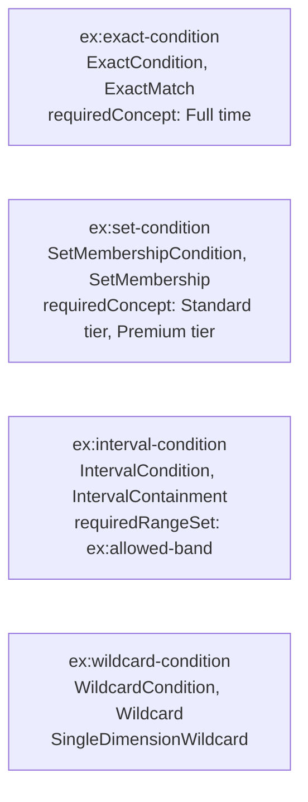

What it shows: a condition's class and its `matchStrategy` always agree (`ExactCondition` with
`ExactMatch`, and so on), and `elg:ConceptConditionDeclarationShape` (§7) would warn if
`ex:exact-condition` or `ex:set-condition` declared no `requiredConcept` at all, since a concept
condition with nothing to match against states nothing.

### 8.2 Interval containment

[`interval-containment.ttl`](examples/interval-containment.ttl). A minimum credit score band, 700
to 850 inclusive, checked by a question offering the same range set back.

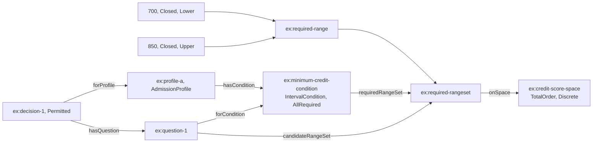

The question's candidate range set is the required range set itself, so the condition's
`AllRequired` composition operation is satisfied trivially:

```turtle-example
@prefix elg: <https://www.nebularis.org/neuro-semantic/lattice/eligibility#> .
@prefix ex:  <https://example.org/lattice/eligibility/> .

ex:decision-1 a elg:EligibilityDecision ;
	elg:decisionValue elg:Permitted .
```

What it shows: an interval condition needs no `requiredConcept`, and reads its candidate through
Quantification's own `qnt:Range`/`qnt:RangeSet`, never a bespoke numeric type.

### 8.3 Hierarchical match

[`hierarchical-match.ttl`](examples/hierarchical-match.ttl). A three-level hazard scheme (Peril,
broader than Fire, broader than Industrial Fire), constrained by a scheme contract, with a
condition requiring `Fire`.

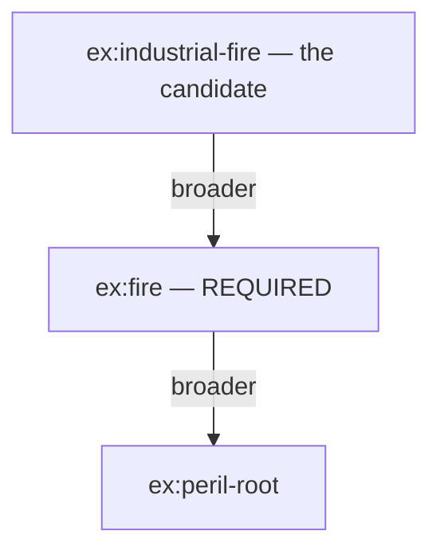

The candidate stands below the required concept in the scheme's closure (L9), so the condition is
satisfied although the question names `ex:industrial-fire`, never `ex:fire` itself:

| Candidate | Stands in closure of `ex:fire`? | Decision |
|---|---|---|
| `ex:industrial-fire` (this example) | yes, one `skos:broader` step | Permitted |
| `ex:fire` itself | yes, reflexively | Permitted |
| `ex:peril-root` | no, it is broader than `ex:fire`, not narrower (L11) | Undetermined |
| a concept outside `ex:hazard-scheme` | the scheme cannot place it | Undetermined |

What it shows: `elg:constrainedByContract` binds the condition to the scheme, not the concept
directly, so the same condition re-evaluates correctly if the contract is re-pinned to a revised
edition of the scheme (ADR-A85).

### 8.4 Evidence binding

[`evidence-binding.ttl`](examples/evidence-binding.ttl). A relocation benefit for engineering job
families, excluding contractor grades, with at least two years' tenure, evaluated directly over an
employment ontology's own data, with no `elg:Question` authored at all.

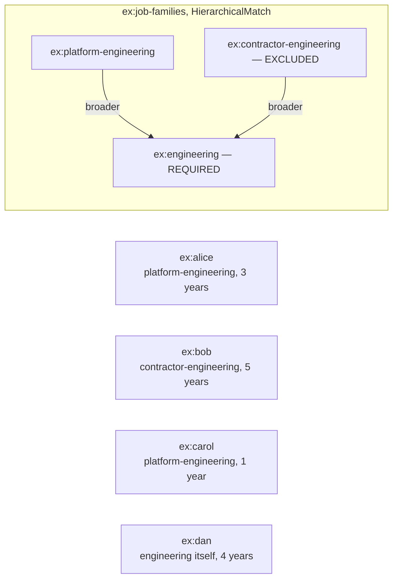

Two bindings reach each employee's candidates: `ex:family-binding` (through `holdsRole` then
`inJobFamily`, §5.6) and `ex:tenure-binding` (through `tenureYears`, read on `ex:tenure-space`).
Both conditions compose under the profile's `AllRequired`, so either one deciding `Denied` decides
the whole profile `Denied`, and either one `Undetermined` with the other `Permitted` leaves it
`Undetermined`:

| Employee | Family condition | Tenure condition | Decision |
|---|---|---|---|
| `ex:alice` | Permitted (platform-engineering, below engineering) | Permitted (3 ≥ 2) | **Permitted** |
| `ex:bob` | Denied (matches the exclusion) | Permitted (5 ≥ 2) | **Denied** |
| `ex:carol` | Permitted | Denied (1 < 2) | **Denied** |
| `ex:dan` | Undetermined (stands at `engineering` itself, above the exclusion, L11) | Permitted (4 ≥ 2) | **Undetermined** |

What it shows: an evidence binding lets a profile evaluate a whole class of subjects without
authoring one question per subject, and `ex:dan`'s row is L11 in practice, not merely a stated
rule: the scheme cannot yet say whether he is a platform engineer or a contractor, so the exclusion
is only possible, not certain.

### 8.5 Hierarchy relation

[`hierarchy-relation.ttl`](examples/hierarchy-relation.ttl). A diagnosis scheme whose links are of two kinds, each declared a sub-property of `skos:broader` and each also asserted as `skos:broader`. Three conditions require `ex:tumour` and differ only in the relation they walk.

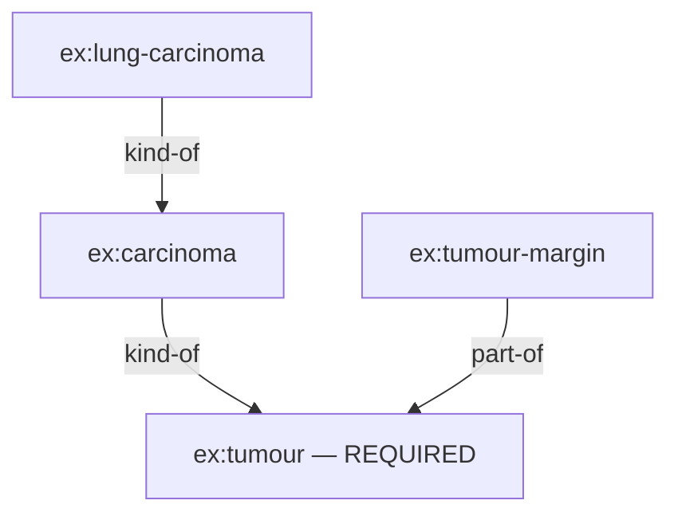

| Candidate | `ex:kind-of-tumour` | `ex:part-of-tumour` | `ex:any-link-to-tumour` (names none) |
|---|---|---|---|
| `ex:lung-carcinoma` | Permitted | Denied | Permitted |
| `ex:tumour-margin` | Denied | Permitted | Permitted |

A condition that names no relation walks `skos:broader` and admits the margin, which a clause asking for a kind of tumour does not mean to. Naming `ex:kind-of` stops the walk at kind links. The second scheme in the file states a licence for any territory that is part of Europe. A city in a country that is part of Europe is admitted by walking part links, two steps from the required concept.

What it shows: the clause, not the scheme, says which relation it relies on, and one scheme can answer both questions. The sub-property declaration travels with the graph, so `elg:HierarchyRelationShape` can refuse a relation that is not an ordering of the kind `skos:broader` states.

### 8.6 Set comparison

Three comparisons, one per file, each over two sets read from one subject (§5.9).

[`set-comparison-licensing.ttl`](examples/set-comparison-licensing.ttl). A trade mark licence is in order when the territories the licensee distributes in are a subset of the territories the grant covers. The match is hierarchical over `ex:part-of`, so Paris is inside a grant for France, and both sets are closed by the licence's clauses.

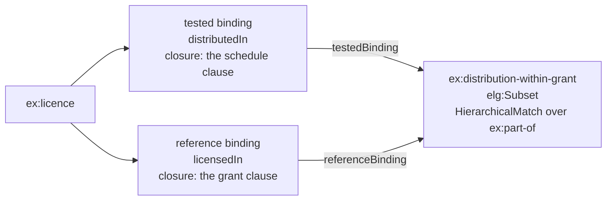

| Licence | Licensed in | Distributes in | Subset, grant closed | Subset, grant open |
|---|---|---|---|---|
| `ex:lic-1` | Europe | Paris, Germany | Permitted | Permitted |
| `ex:lic-2` | France | Paris, Germany | Denied | Undetermined |
| `ex:lic-3` | Europe | Paris, Canada | Denied | Undetermined |
| `ex:lic-4` | France | none | Permitted | Permitted |

[`set-comparison-trial.ttl`](examples/set-comparison-trial.ttl). A participant's concomitant medications are disjoint from the medications the protocol they are enrolled under prohibits, by exact match. The reference set is reached by a two-step path, from the participant through the protocol to its prohibited list.

| Participant | Takes | Disjoint |
|---|---|---|
| `ex:pat-1` | aspirin, metformin | Permitted |
| `ex:pat-2` | aspirin, warfarin | Denied |
| `ex:pat-3` | none | Permitted |

[`set-comparison-bonds.ttl`](examples/set-comparison-bonds.ttl). A written resolution passes when every holder on the record date has consented, which is a subset of the consenting holders, and a quorum test asks whether some holder has, an intersection. The holders are closed by the trustee's register. The consents are not, since they are still arriving, so a holder not found among them leaves the outcome Undetermined and never Denied.

| Bond | Holders | Consents | All consented | Some consented |
|---|---|---|---|---|
| `ex:bond-1` | h1, h2 | h1, h2, h3 | Permitted | Permitted |
| `ex:bond-2` | h1, h2 | h1 | Undetermined | Permitted |
| `ex:bond-3` | h1, h2 | none | Undetermined | Undetermined |
| `ex:bond-4` | none | h1 | Permitted | Denied |

What it shows: the two sets are read from the same subject by paths of their own, each closure licenses only the outcome that needs its set to be complete, and an open reference set leaves a missing value Undetermined. `ex:bond-4` has no holders, so the subset holds and the intersection does not (L15). That a bond has holders at all is a count, not a comparison.

## 9. Canonicalisation

Eligibility canonicalisation is declaration-first and profile-stable.

- `elg:conditionKey` is the canonical identifier of a condition declaration for comparison, caching, and replay.
- Canonicalisation never changes the declared strategy (`elg:matchStrategy`), wildcard semantics (`elg:wildcardSemantics`), or a profile's composition operation (`elg:compositionOperation`).
- Interval admissibility canonicalises through Quantification ranges and range sets only, using `elg:requiredRangeSet` and `elg:candidateRangeSet` with `qnt:Range` and `qnt:RangeSet`.

## 10. Formalisation

`elg:Decision`'s three named individuals (6.4) are a closed, three-valued type under Belnap and
Fitting's strong Kleene reading (L15, L16). `Undetermined` is below `Permitted` and `Denied` in
the information order, which are each other's own fixed point only.

The three connectives' truth tables follow, for a reader's reference.

**`or3`, strong Kleene disjunction (L15's `SomeValue` combinator)**

| or3 | Permitted | Denied | Undetermined |
|---|---|---|---|
| **Permitted** | Permitted | Permitted | Permitted |
| **Denied** | Permitted | Denied | Undetermined |
| **Undetermined** | Permitted | Undetermined | Undetermined |

**`and3`, strong Kleene conjunction (L15's `EveryValue` combinator)**

| and3 | Permitted | Denied | Undetermined |
|---|---|---|---|
| **Permitted** | Permitted | Denied | Undetermined |
| **Denied** | Denied | Denied | Denied |
| **Undetermined** | Undetermined | Denied | Undetermined |

**`neg3`, negation (L16)**

| neg3 | result |
|---|---|
| **Permitted** | Denied |
| **Denied** | Permitted |
| **Undetermined** | Undetermined |

The tables are for a reader. The clauses below are the one normative statement of the three connectives, and
the kernel's laws are proved against them. `decision_leq`, the information order, is a predicate over
equality rather than a finite case table, and is stated beside the laws.

L9 and L14 are stated over a hierarchy relation taken as a parameter, any relation from a concept to the concepts above it, so a proof about them holds for every relation a condition may name. The theory is hand-written in `tools/proofs/eligibility/Hierarchy.thy`, since only the three-valued kernel is generated.

A set comparison (L18) decides each tested value against the reference values by `member_decide`, then reads the outcomes with L15's readings. The per-value decision is a parameter of the theory, a match predicate, so what is proved holds for exact match and for hierarchical match over any relation. The theory is hand-written in `tools/proofs/eligibility/SetComparison.thy`.

L15's readings, `some_value` and `every_value`, each take whether the binding is closed (L17). Closed,
`some_value` folds `or3` from `Denied`, and `every_value` folds `and3` from `Permitted`. Each starts from its
connective's identity, so the empty case decides. Open, `some_value` is Permitted when a value is Permitted
and `every_value` Denied when a value is Denied, and each is otherwise Undetermined.

```isabelle-spec
theory Kernel
imports Main
begin

datatype decision = Permitted | Denied | Undetermined

fun or3 :: "decision \<Rightarrow> decision \<Rightarrow> decision" where
  "or3 Permitted _ = Permitted"
| "or3 Denied b = b"
| "or3 Undetermined Permitted = Permitted"
| "or3 Undetermined Denied = Undetermined"
| "or3 Undetermined Undetermined = Undetermined"

fun and3 :: "decision \<Rightarrow> decision \<Rightarrow> decision" where
  "and3 Permitted b = b"
| "and3 Denied _ = Denied"
| "and3 Undetermined Permitted = Undetermined"
| "and3 Undetermined Denied = Denied"
| "and3 Undetermined Undetermined = Undetermined"

fun neg3 :: "decision \<Rightarrow> decision" where
  "neg3 Permitted = Denied"
| "neg3 Denied = Permitted"
| "neg3 Undetermined = Undetermined"

end
```

## 11. Dependencies

Eligibility imports Foundation, Vocabulary, Quantification, and Party. Quantification is a direct dependency because interval admissibility uses declared `qnt:Range` and `qnt:RangeSet` semantics.

## 12. Release Notes

- **Next release** (additive). `elg:hasCondition` is `fnd:meaningBearing`, so a condition is never edited and a shared one is immutable (Foundation section 4), and the three decision values are `owl:AllDifferent`.

Earlier versions are listed in the [ontology release register](../../docs/architecture/ontology-releases.md).

- Next release. Re-pinned: a new substrate layer joins the release.
  - New `elg:SetComparison`, a condition that relates the values two evidence bindings read from one subject, with `elg:comparison`, `elg:testedBinding`, `elg:referenceBinding` and the closed class `elg:Comparison` of `elg:Subset`, `elg:Intersects` and `elg:Disjoint`. New law L18 (no effect on a graph that declares none).
  - A binding of a set comparison may name a closure without declaring a value reading, and `elg:ConceptConditionDeclarationShape` no longer warns of a set comparison that names no concept (no effect).
  - New shapes `elg:SetComparisonBindingsShape` and `elg:SetComparisonBindingShape`, and the structural shapes of `elg:SetComparison`. A graph that declares no set comparison is not affected.
  - New `elg:hierarchyRelation`, naming the relation a hierarchical condition walks. Absent, the relation is `skos:broader`, so every existing graph keeps its meaning (no effect).
  - L9, L11 and L14 are restated over the condition's hierarchy relation, and L9's acyclicity requirement is over that relation (no effect for a graph that names none).
  - New shapes `elg:HierarchyRelationShape` and `elg:HierarchyRelationNeedsHierarchicalMatchShape`. A graph that does not name a hierarchy relation is not affected. One that does and names a property that is not `skos:broader` and has no declared route to it is invalid (may invalidate).
  - A hierarchical condition, or one with exclusions only, whose contract has bindings that apply at no instant compiles to a plan that answers Undetermined for every candidate, where the compilers refused it before (changes meaning for a consumer of the compilers, not for a graph).
  - L12 states that a condition with exclusions only, whose contract has scheme bindings and none applies at the resolution time, is Undetermined for every candidate. A condition bound to no contract keeps its reading (changes meaning only where a contract's bindings leave a gap).
- 0.19.0. Every document takes the release's number and imports the other layers at it (no effect). No other change.
- 0.18.0, the first release of the substrate and standalone modules as one set
  ([ADR-A129](../../docs/architecture/decisions/ADR-A129-one-release-for-the-substrate.md)). Every
  document takes the release's number and imports the other layers at it (no effect).
  - The README follows the layout of
    [ADR-A126](../../docs/architecture/decisions/ADR-A126-literate-specification-layout-and-grammar.md), and
    generates its documents' headers, their terms and the structural shapes from sections 1, 2 and 6. Both
    documents gain a `dct:description` and a `dct:creator`, every class and property has a definition, 32 of them
    new, and `elg:AllRequired` and `elg:AnySufficient` gain definitions (no effect).
  - `elg:CompatibilityOperation` and `elg:compatibilityOperation` are renamed `elg:CompositionOperation` and
    `elg:compositionOperation`, declared by admission profiles only (changes meaning). A graph migrates by renaming
    the property on profiles and removing it from other conditions.
  - A profile declares no match strategy or wildcard policy, a condition that is not a profile declares exactly
    one of each, and only a profile declares a composition operation. L1 to L3 are restated, and new shapes report
    each in the wrong place (may invalidate).
  - `elg:DimensionConsistent`, which no compiler could evaluate, is removed with the operational profile `elg:E6`
    that tested it (changes meaning). A graph naming either has no evaluable meaning to migrate (ADR-A05, ADR-A03).
  - Laws L1 to L8 state their register, `elg:StaticConstraint`, as L9 to L17 already did (no effect).
  - The shapes and projection directories no longer carry a `.version`.
- `eligibility` 0.12.0 (breaking, ADR-A105). Closures (§5.7). New: `elg:Closure`, `elg:licensedBy`,
  `elg:closedUnder` and `elg:closureReliedOn`. `eligibility-vocab` 0.13.0 (breaking). L15 restated, so a set
  reading is Denied under some value, or Permitted under every value, only under a closure the binding names,
  the empty case included (ADR-A103's 2026-10-12 addendum). New law L17. Shapes 0.3.0 (breaking): a closure's
  one source, a closure only on a binding read some or every value, and a decision relying only on a closure
  its profile's bindings name.
- `eligibility` 0.11.0 (additive). Re-pinned to Quantification 0.8.0. No other change.
- `eligibility-vocab` 0.12.0 (additive). L9's comment adds that a hierarchical condition with no resolved
  scheme is undetermined for every candidate. The vocabulary's ontology header joins the README, which is
  again the source of every Eligibility spec, vocab and shapes file. Re-pinned to `eligibility` 0.11.0. The
  shapes, 0.2.0, are unchanged.

## 13. Open Issues

- **Eleven individuals have no definition**, the match strategies, the wildcard policies and the
  decisions. §5.1 and §5.4 describe them.
- **Literal-valued sets are not compared.** A set comparison compares IRIs. A shape refuses a binding of a set comparison that declares a value space, because the equality of literals depends on their datatype and differs between engines. A comparison of dates or amounts waits for a need.
- **A requirement that a set have a member** is not stated by a comparison, which reads an empty tested set as L15 does. It is a count over the set's binding, read by an interval condition from one.
- **A closure over a period**, such as "within 60 days of the request", is not yet declared (§5.7).
