<!-- SPDX-License-Identifier: CC-BY-SA-4.0 -->

# Eligibility Ontology — Conditions, Questions, and Admissibility Decisions

Literate specification for the Eligibility layer, in the layout of
[ADR-A126](../../docs/architecture/decisions/ADR-A126-literate-specification-layout-and-grammar.md).

---

## 1. Purpose and Scope

Eligibility models admissibility by declaring reusable conditions, collecting evaluation questions, and recording a three-valued decision (`Permitted`, `Denied`, `Undetermined`).

## 2. Namespace and Prefixes

| Document | Ontology IRI | Version IRI | Imports |
|---|---|---|---|
| `spec/eligibility.ttl` | <https://www.nebularis.org/neuro-semantic/eligibility> | <https://www.nebularis.org/neuro-semantic/lattice/eligibility/0.12.0> | <https://www.nebularis.org/neuro-semantic/lattice/foundation/0.4.0>, <https://www.nebularis.org/neuro-semantic/lattice/vocabulary/0.4.0>, <https://www.nebularis.org/neuro-semantic/lattice/quantification/0.8.0>, <https://www.nebularis.org/neuro-semantic/lattice/party/0.9.0> |
| `vocab/eligibility-vocab.ttl` | <https://www.nebularis.org/neuro-semantic/eligibility-vocab> | <https://www.nebularis.org/neuro-semantic/lattice/eligibility-vocab/0.13.0> | <https://www.nebularis.org/neuro-semantic/lattice/eligibility/0.12.0> |

| Prefix | Namespace |
|---|---|
| `elg:` | <https://www.nebularis.org/neuro-semantic/lattice/eligibility#> |
| `fnd:` | <https://www.nebularis.org/neuro-semantic/lattice/foundation#> |
| `voc:` | <https://www.nebularis.org/neuro-semantic/lattice/vocabulary#> |
| `qnt:` | <https://www.nebularis.org/neuro-semantic/lattice/quantification#> |
| `pty:` | <https://www.nebularis.org/neuro-semantic/lattice/party#> |
| `skos:` | <http://www.w3.org/2004/02/skos/core#> |

| Identifier | Role | Display name |
|---|---|---|
| <https://github.com/hyperthunk> | creator | T. R. Watson |

## 3. Extraction Contract

- Sections 1, 2 and 6 generate `spec/eligibility.ttl` and `vocab/eligibility-vocab.ttl`. Section 6's
  individuals tables and its `turtle-vocab` block go to the vocabulary document, and the rest of section 6
  to the spec document.
- The restriction rows of section 6 that are checked in SHACL generate `shapes/structural.ttl`.
- The two hidden blocks of section 7 generate `shapes/constraints.ttl` and `shapes/rules.ttl`, each naming
  its file.
- The `isabelle-spec` block (section 10) generates `tools/proofs/eligibility/Kernel.thy`'s closed datatype
  and the kernel connectives' defining equations (`or3`, `and3`, `neg3`), and is also rendered into
  `tools/reference/eligibility/src/reference_eligibility/_kernel_defs.py`. The theory's proofs, and
  `decision_leq`, are hand-written.
- Extraction rewrites the class diagram (section 4) and the Axiom Index (6.7), which are never edited by
  hand.
- `turtle-example` blocks are illustrative only.

```bash
mise exec -- python tools/literate_extract.py ontology/eligibility/README.md --layer eligibility --root . \
    --proofs-root tools/proofs --reference-root tools/reference --check
```

The module's entry in the [repository catalogue](../../repository-catalogue.md)
([ADR-A121](../../docs/architecture/decisions/ADR-A121-repository-catalogue.md)) follows.

```toml repository-catalogue
[module]
kind = "substrate"
roles = ["examples", "projection", "shapes", "spec", "test", "vocab"]
imports = ["foundation", "vocabulary", "quantification", "party"]

[module.extract]
spec = ["spec/eligibility.ttl"]
vocab = ["vocab/eligibility-vocab.ttl"]
shapes = ["shapes/structural.ttl", "shapes/constraints.ttl", "shapes/rules.ttl"]
```

## 4. Overview

The model has two layers, conditions that state what to match, and the evaluation records that pose and
answer the question. A profile composes conditions, a question offers a candidate to one condition, and a
decision binds a profile and its questions to one `elg:Decision`. A condition evaluated for a whole class of
subjects an applied ontology already describes may use an `elg:EvidenceBinding` instead of an authored
question (§5.6).

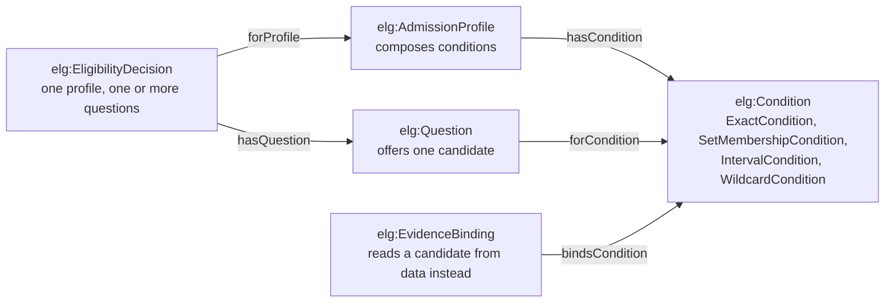

The class diagram below is generated from section 6.

<!-- start: {"generated": "class-diagram"} -->

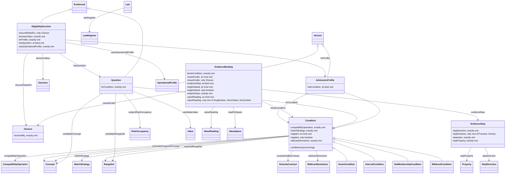

<!-- end -->

## 5. Detailed Design

### 5.1 Strategy algebra

- Included match strategies: `ExactMatch`, `SetMembership`, `IntervalContainment`, `HierarchicalMatch`, `Wildcard`.
- Excluded: `IntervalOverlap` as an admissibility strategy.
- Compatibility operations: `AllRequired`, `AnySufficient`, `DimensionConsistent`.
- Wildcard policies: `NoWildcard`, `SingleDimensionWildcard`, `MultiDimensionWildcard`.

Every condition declares exactly one of each mechanism, independently of the other two.

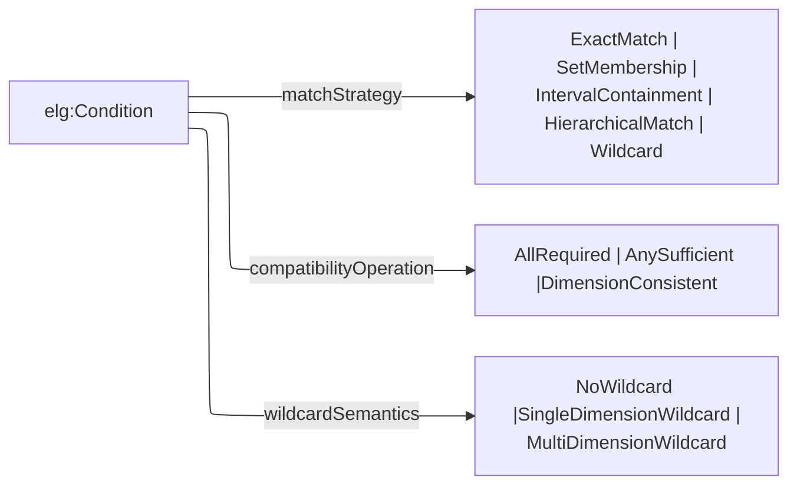

`HierarchicalMatch` is valid when a dimension is backed by a concept scheme whose membership is resolved against a well-founded `skos:broader` hierarchy. Evaluation may compute closure at query time or use a generated surface, provided closure is interpreted over the bound scheme. A scheme can reach a hierarchical condition without a hierarchy, because a contract resolves to different schemes in different contexts (ADR-A85). Where no member of the resolved scheme has a broader concept within it, the condition decides only the concepts it names (L14, ADR-A100).

Conditions matching by `ExactMatch`, `SetMembership`, or `HierarchicalMatch` state what they match against with `elg:requiredConcept` and `elg:excludedConcept`. A candidate *matches* a concept by equality under `ExactMatch` and `SetMembership`, and by standing at or below it in the bound scheme's ordering under `HierarchicalMatch`. Several required concepts are alternatives to one another, and each excluded concept excludes independently. Neither reading changes how the condition's compatibility operation is interpreted. An admission profile declares no concepts of its own, since its conditions do. A layer above may place one of its defined words, itself a `skos:Concept`, in `elg:requiredConcept` or `elg:excludedConcept` ("a Site in the Territory"), and replace it for each instance by the concepts the word means, so that a condition it generates never names a word. Instrument does, and its shapes report a word that is also a concept of the scheme its condition is constrained by, and a word whose meaning is not a concept (Instrument README §15.1). A word's meaning may come from a variable or from another word, and must not loop back to itself (Instrument README §18.4). A question offers its candidate with `elg:candidateConcept`. `IntervalContainment` needs no exclusion construct, since a `qnt:RangeSet` is a union of ranges and already expresses gaps.

| Candidate | Decision | Law |
|---|---|---|
| absent, unresolved, more than one per question, or outside the bound scheme where the decision needs that scheme | `Undetermined` | |
| matches an excluded concept | `Denied`, whether or not it also matches a required concept | L10 |
| under `HierarchicalMatch`, stands strictly above an excluded concept and is otherwise admitted | `Undetermined`, since its true value may fall under the exclusion | L11 |
| under `HierarchicalMatch`, is a member of a resolved scheme in which no member has a broader concept within the scheme, and is neither a required nor an excluded concept | `Undetermined`, since the scheme cannot place it | L14 |
| matches a required concept, or the condition declares exclusions only and the candidate is a member of the bound scheme | `Permitted` | L12 for the second case |
| otherwise | `Denied` | |

The table reads as a decision flow, each row a condition on the way to a leaf.

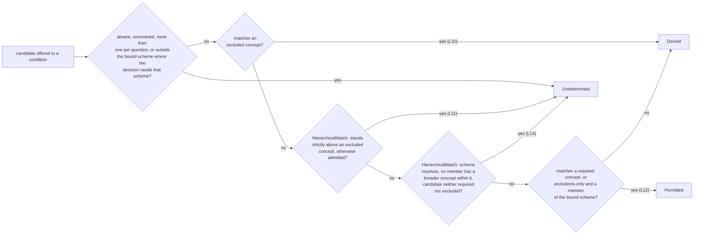

### 5.2 Conditions and profiles

Four condition classes each commit to one match strategy no other can use correctly. `ExactCondition` and
`SetMembershipCondition` commit to `ExactMatch` and `SetMembership`, `IntervalCondition` to
`IntervalContainment`, and `WildcardCondition` to `Wildcard`. `HierarchicalMatch` names no subclass of its
own. `elg:Condition` carries it directly, constrained by a scheme contract instead of its own type (§5.1). An
`elg:AdmissionProfile` is itself a condition, so profiles compose, and a profile can be one of another
profile's conditions.

### 5.3 Questions and decisions

A question is evidenced (`fnd:Evidenced`, Foundation) and names exactly one condition. A decision is
evidenced too, and names exactly one profile, at least one question, and exactly one decision value, so a
profile with several conditions can be answered by several questions under one decision record.

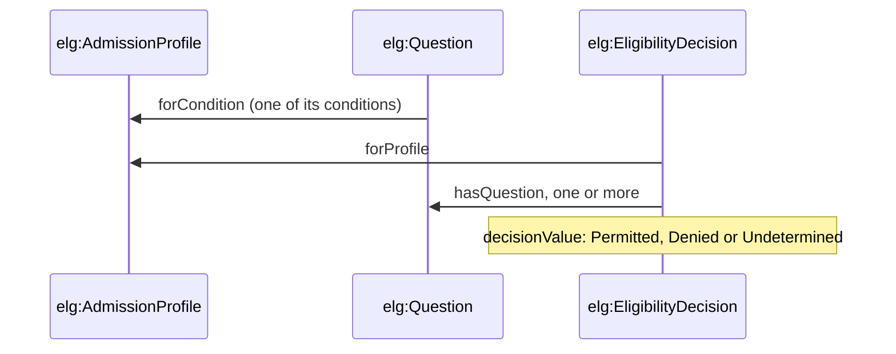

### 5.4 The mechanism types

Seven classes carry no properties of their own, and each is a closed set of named individuals (6.4), never
an open class a reader could extend without a new decision. `elg:MatchStrategy`,
`elg:CompatibilityOperation` and `elg:WildcardSemantics` are the three mechanisms of §5.1.
`elg:OperationalProfile` is versioned (`fnd:Version`), since the six reference profiles E1 to E6 are
themselves subject to change control. Each names one reference conformance profile that the differential
test harness (`tools/reference/eligibility/`) checks a compiler backend against, one per mechanism
combination worth testing in isolation. `elg:Law` and `elg:LawRegister` classify the laws by how each is
discharged (§5.8).

`elg:WildcardSemantics`'s three individuals govern a `WildcardCondition`. `NoWildcard` rules it out,
`SingleDimensionWildcard` lets the condition stand in for one dimension of a multi-dimension match, and
`MultiDimensionWildcard` lets it stand in for several at once. `elg:Decision`'s three individuals carry the
information order that section 10 formalises. `Undetermined` sits below both decided values, which are each
other's own fixed point only.

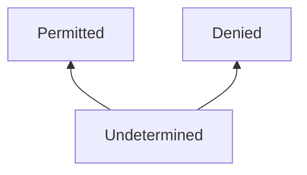

`elg:StepDirection`'s two individuals name which way an `elg:EvidenceStep` traverses its property (§5.6),
`Forward`, subject to object, as `ex:family-binding`'s steps do, or `Inverse`, object to subject, for a path
that reaches its candidate against the direction a property is normally read.

### 5.5 Condition, question and decision properties

Most of the properties of 6.2 and 6.3 appear, wired together, in the examples of section 8. For example,
`interval-containment.ttl` (§8.2) connects a condition's `requiredRangeSet` to a question's
`candidateRangeSet` of the same range set, and a decision's `hasQuestion` and `decisionValue` record the
outcome.

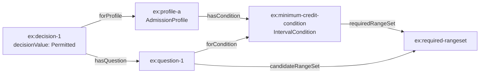

### 5.6 Evidence bindings

A condition reads its candidate from an `elg:Question` unless an `elg:EvidenceBinding` binds it. Where a
profile evaluates a whole class of subjects an applied ontology already describes (such as every
`ex:Employee`), a binding names that class (`elg:subjectClass`) and reaches each subject's candidate by an
ordered path of `elg:EvidenceStep`s over the applied ontology's own properties, instead of an authored
question (ADR-A91). The path ends at a `skos:Concept` for a concept condition. For an interval condition it
ends at a `qnt:Quantity` on the condition's value space, or at a literal where the binding reads on that
space (`elg:readOnSpace`). A subject with no value at the end of the path, or several, is `Undetermined`, as
is one whose value is on another space, unless the binding declares how several values are read
(`elg:valueReading`, ADR-A103). A profile evaluates either questions or one class of bound subjects. A binding
may claim that each step of its path yields at most one value (`elg:singleValued`). The design-time OWL
backend compiles only claimed paths (ADR-A90).

`evidence-binding.ttl` (§8.4) binds a hierarchical condition to `ex:Employee` by a two-step path, through a
role to its job family.

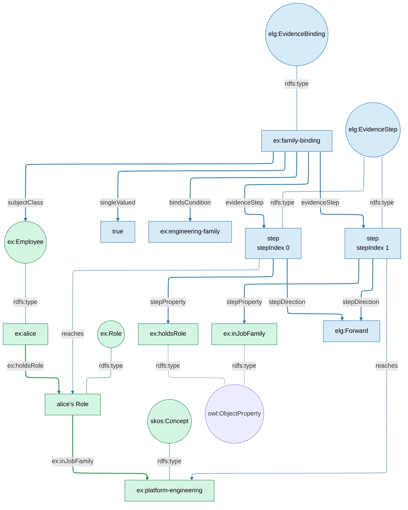

Green is the applied domain ontology (`ex:`) and the SKOS concept it uses. Blue is Eligibility
(`elg:`), including the binding and condition, which are Eligibility individuals named in the
example's namespace. Solid lines are asserted triples. Dotted lines are `rdfs:type`, or show what
each step reaches when a subject's path is followed. Each step is a node of its own, positioned by
`elg:stepIndex`, naming the property it traverses and its direction.

A path ending at a literal instead of a `skos:Concept` or `qnt:Quantity` names the value space it reads on
(`elg:readOnSpace`), as `ex:tenure-binding` does for `ex:tenureYears`. A binding that reads more than one
value states how they combine (`elg:valueReading`). `elg:SomeValue` and `elg:EveryValue` each decide every
value as a single candidate would be decided, then combine the outcomes by strong Kleene `or3` and `and3`
(L15, section 10). A subject with no value stays `Undetermined`. An outcome that relies on the values reached
being all there are, Denied under some value and Permitted under every value, needs a closure the binding
names (§5.7). Under a closure the empty case decides too, so no value is Denied under some value and
Permitted under every value.

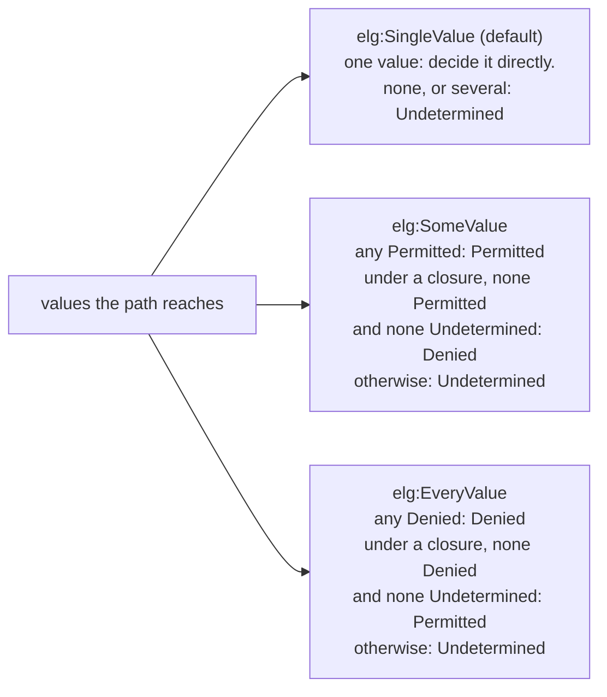

A condition may be negated (`elg:negated true`). It is evaluated as it stands, including its reading, and
Permitted and Denied are then swapped, while `Undetermined` stays `Undetermined` (L16).

### 5.7 Closures

A record proves what it shows. That something is absent, or that the values recorded are all there
are, follows only where a source vouches for the records, for example a deeming or another term of a
contract, a party whose register is authoritative, or a deployment that declares its records complete
through an operational profile. An `elg:Closure` states that source (`elg:licensedBy`), and an evidence
binding that relies on it names it (`elg:closedUnder`). A closure covers exactly the bindings that
name it. Several bindings share one closure by each naming it, and nothing infers which bindings a
closure is for (ADR-A105).

Under a closure, a binding read `elg:SomeValue` is Denied when no value it reaches is Permitted, the
empty case included, and one read `elg:EveryValue` is Permitted when no value is Denied. Without one,
a set reading decides only what a record proves (L15). The closure licenses the records as they
stand at the deciding record's recording time (`fnd:Evidenced`), which is the cut. A fact recorded
later can show the decision was made on incomplete records. A decision names the closures it relied
on (`elg:closureReliedOn`). A closure is in force from its source's effective time (L17).

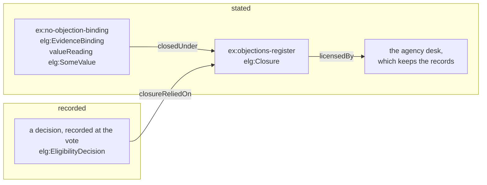

### 5.8 Laws

Each law of 6.4 and 6.6 is either a semantic law, discharged by the formal argument of section 10, or a
static constraint, discharged by one of the shapes of section 7.

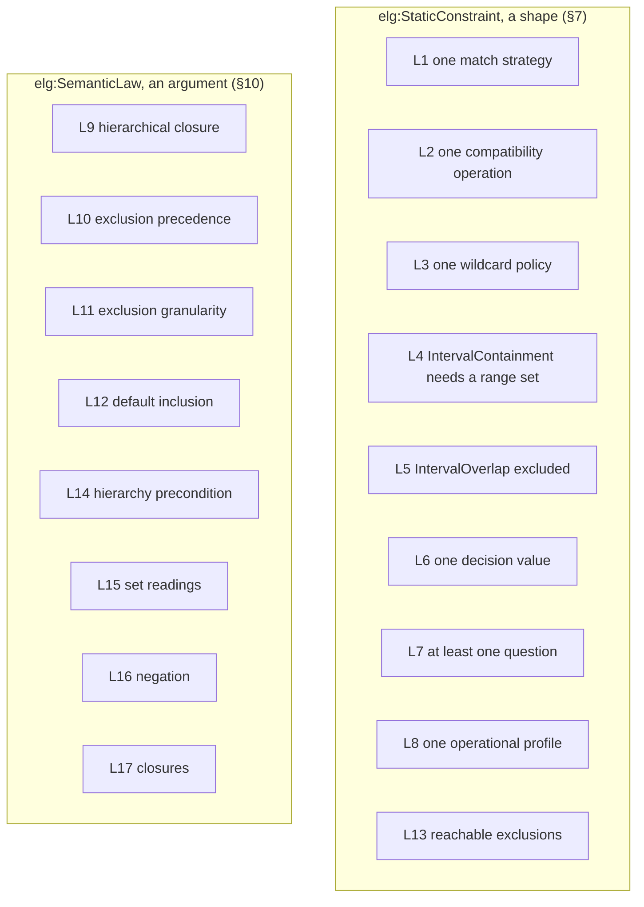

L9's last sentence makes a hierarchical condition with no resolved scheme Undetermined for every
candidate. A compiler may refuse such a condition instead of compiling a plan that answers
Undetermined everywhere, and the compilers in `tools/mork_compilers/` do. They refuse a hierarchical
condition with no `elg:constrainedByContract`, a contract with neither a `voc:SchemeBinding` nor a
`voc:boundScheme`, and a contract whose bindings resolve to no scheme at the resolution time. Their
SPARQL and SHACL backends also refuse a hierarchical plan that carries no scheme. A refusal decides
no candidate, so it does not contradict L9. The reference semantics (`tools/reference/eligibility/`)
answers Undetermined.

## 6. Description Logic Encoding

### 6.1 Classes

#### `elg:Condition`

**Definition.** A declared admissibility condition.

**Restrictions.**

| Property | Values | Asserted in | Message |
|---|---|---|---|
| `elg:matchStrategy` | exactly 1 | SHACL |  |
| `elg:compatibilityOperation` | exactly 1 | SHACL |  |
| `elg:wildcardSemantics` | exactly 1 | SHACL |  |
| `elg:negated` | max 1 | SHACL |  |
| `elg:negated` | only `xsd:boolean` | SHACL |  |

#### `elg:ExactCondition`

**Definition.** A condition that matches its candidate by equality with a required concept (ExactMatch).

**Subclass of.** `elg:Condition`

#### `elg:SetMembershipCondition`

**Definition.** A condition that matches its candidate by membership of the set of its required concepts (SetMembership).

**Subclass of.** `elg:Condition`

#### `elg:IntervalCondition`

**Definition.** A condition that admits a candidate whose value lies within its required range set (IntervalContainment).

**Subclass of.** `elg:Condition`

#### `elg:WildcardCondition`

**Definition.** A condition that stands in for one or more dimensions of a match, as its wildcard policy allows (Wildcard).

**Subclass of.** `elg:Condition`

#### `elg:AdmissionProfile`

**Definition.** A reusable admissibility profile that composes one or more conditions.

**Subclass of.** `elg:Condition`, `fnd:Version`

**Restrictions.**

| Property | Values | Asserted in | Message |
|---|---|---|---|
| `elg:hasCondition` | min 1 |  |  |

#### `elg:Question`

**Definition.** An evaluation question posed against one condition.

**Subclass of.** `fnd:Evidenced`

**Restrictions.**

| Property | Values | Asserted in | Message |
|---|---|---|---|
| `elg:forCondition` | exactly 1 | OWL |  |

#### `elg:EligibilityDecision`

**Definition.** A recorded admissibility decision for one profile and one or more questions.

**Subclass of.** `fnd:Evidenced`

**Restrictions.**

| Property | Values | Asserted in | Message |
|---|---|---|---|
| `elg:forProfile` | exactly 1 |  |  |
| `elg:hasQuestion` | min 1 |  |  |
| `elg:decisionValue` | exactly 1 |  |  |
| `elg:usesOperationalProfile` | exactly 1 | SHACL |  |
| `elg:closureReliedOn` | only `elg:Closure` | SHACL | A decision relies only on closures (ADR-A105). |

#### `elg:MatchStrategy`

**Definition.** How a condition matches its candidate, one of a closed set of named strategies.

#### `elg:CompatibilityOperation`

**Definition.** How a condition's requirements combine when it states several, one of a closed set of named operations.

#### `elg:WildcardSemantics`

**Definition.** The wildcard policy a condition declares, one of a closed set of named policies.

#### `elg:Decision`

**Definition.** The three-valued outcome of an admissibility decision: Permitted, Denied or Undetermined.

#### `elg:OperationalProfile`

**Definition.** A reference conformance profile that a compiler backend is checked against. Versioned, since the profiles are themselves subject to change control.

**Subclass of.** `fnd:Version`

#### `elg:Law`

**Definition.** A law of the Eligibility layer. A law may name how it is discharged (`elg:lawRegister`).

#### `elg:LawRegister`

**Definition.** How a law is discharged, by formal argument or by a static check of declarations.

#### `elg:EvidenceBinding`

**Definition.** Binds a condition to the class of subjects it evaluates and to the path that reaches each subject's candidate on the applied ontology's own properties (ADR-A91).

**Restrictions.**

| Property | Values | Asserted in | Message |
|---|---|---|---|
| `elg:bindsCondition` | exactly 1 | SHACL |  |
| `elg:subjectClass` | exactly 1 | SHACL |  |
| `elg:evidenceStep` | min 1 | SHACL |  |
| `elg:singleValued` | max 1 | SHACL |  |
| `elg:singleValued` | only `xsd:boolean` | SHACL |  |
| `elg:valueReading` | max 1 | SHACL |  |
| `elg:valueReading` | only { `elg:SingleValue`, `elg:SomeValue`, `elg:EveryValue` } | SHACL |  |
| `elg:closedUnder` | max 1 | SHACL | A binding names at most one closure, and what it names is an elg:Closure (ADR-A105). |
| `elg:closedUnder` | only `elg:Closure` | SHACL | A binding names at most one closure, and what it names is an elg:Closure (ADR-A105). |

#### `elg:EvidenceStep`

**Definition.** One positioned traversal within an evidence binding's path, in a stated direction. Shaped like srf:PathStep.

**Restrictions.**

| Property | Values | Asserted in | Message |
|---|---|---|---|
| `elg:stepIndex` | exactly 1 | SHACL |  |
| `elg:stepProperty` | exactly 1 | SHACL |  |
| `elg:stepDirection` | exactly 1 | SHACL |  |
| `elg:stepDirection` | only { `elg:Forward`, `elg:Inverse` } | SHACL |  |

#### `elg:StepDirection`

**Definition.** The direction in which an evidence step traverses its property.

#### `elg:ValueReading`

**Definition.** How a bound condition reads the values its binding's path reaches: one value, some value, or every value (ADR-A103, L15).

#### `elg:Closure`

**Definition.** A source's warrant that the records an evidence binding reads are complete, so a set reading may decide on what is absent (ADR-A105, L15, L17). It covers exactly the bindings that name it.

**Restrictions.**

| Property | Values | Asserted in | Message |
|---|---|---|---|
| `elg:licensedBy` | exactly 1 |  | A closure names exactly one source (elg:licensedBy, ADR-A105). |

### 6.2 Object Properties

#### `elg:hasCondition`

**Definition.** A condition an admission profile composes.

**Domain.** `elg:AdmissionProfile`

**Range.** `elg:Condition`

#### `elg:forCondition`

**Definition.** The one condition a question is posed against.

**Domain.** `elg:Question`

**Range.** `elg:Condition`

**Characteristics.** functional

#### `elg:requiredRangeSet`

**Definition.** The range set a candidate's value must lie within, for a condition matching by IntervalContainment.

**Domain.** `elg:Condition`

**Range.** `qnt:RangeSet`

#### `elg:requiredConcept`

**Definition.** A concept a candidate must match, under the condition's match strategy. Several required concepts are alternatives to one another.

**Domain.** `elg:Condition`

**Range.** `skos:Concept`

#### `elg:excludedConcept`

**Definition.** A concept a candidate must not match, under the condition's match strategy. Each excluded concept excludes independently of the others.

**Domain.** `elg:Condition`

**Range.** `skos:Concept`

#### `elg:candidateRangeSet`

**Definition.** The range set a question offers as its candidate to a condition matching by IntervalContainment.

**Domain.** `elg:Question`

**Range.** `qnt:RangeSet`

#### `elg:candidateValue`

**Definition.** The value a question offers as its candidate.

**Domain.** `elg:Question`

**Range.** `qnt:Value`

#### `elg:candidateConcept`

**Definition.** The concept a question offers to a condition matching by ExactMatch, SetMembership or HierarchicalMatch.

**Domain.** `elg:Question`

**Range.** `skos:Concept`

#### `elg:matchStrategy`

**Definition.** The one match strategy a condition declares.

**Domain.** `elg:Condition`

**Range.** `elg:MatchStrategy`

**Characteristics.** functional

#### `elg:constrainedByContract`

**Definition.** The scheme contract whose resolved scheme a condition's candidates are matched against (ADR-A85).

**Domain.** `elg:Condition`

**Range.** `voc:SchemeContract`

#### `elg:compatibilityOperation`

**Definition.** The one compatibility operation a condition declares.

**Domain.** `elg:Condition`

**Range.** `elg:CompatibilityOperation`

**Characteristics.** functional

#### `elg:wildcardSemantics`

**Definition.** The one wildcard policy a condition declares.

**Domain.** `elg:Condition`

**Range.** `elg:WildcardSemantics`

**Characteristics.** functional

#### `elg:forProfile`

**Definition.** The one admission profile a decision is for.

**Domain.** `elg:EligibilityDecision`

**Range.** `elg:AdmissionProfile`

**Characteristics.** functional

#### `elg:hasQuestion`

**Definition.** A question a decision answers.

**Domain.** `elg:EligibilityDecision`

**Range.** `elg:Question`

#### `elg:decisionValue`

**Definition.** The one outcome a decision records: Permitted, Denied or Undetermined.

**Domain.** `elg:EligibilityDecision`

**Range.** `elg:Decision`

**Characteristics.** functional

#### `elg:lawRegister`

**Definition.** How a law is discharged.

**Domain.** `elg:Law`

**Range.** `elg:LawRegister`

**Characteristics.** functional

#### `elg:usesOperationalProfile`

**Definition.** The one operational profile a decision is made under.

**Domain.** `elg:EligibilityDecision`

**Range.** `elg:OperationalProfile`

**Characteristics.** functional

#### `elg:subjectRoleOccupancy`

**Definition.** The role occupancy of the subject a question is asked about.

**Domain.** `elg:Question`

**Range.** `pty:RoleOccupancy`

#### `elg:bindsCondition`

**Definition.** The one condition an evidence binding supplies candidates to.

**Domain.** `elg:EvidenceBinding`

**Range.** `elg:Condition`

**Characteristics.** functional

#### `elg:subjectClass`

**Definition.** The class whose instances the bound condition evaluates.

**Domain.** `elg:EvidenceBinding`

**Characteristics.** functional

#### `elg:evidenceStep`

**Definition.** A step of an evidence binding's path.

**Domain.** `elg:EvidenceBinding`

**Range.** `elg:EvidenceStep`

#### `elg:stepProperty`

**Definition.** The one property an evidence step traverses.

**Domain.** `elg:EvidenceStep`

**Range.** `rdf:Property`

**Characteristics.** functional

#### `elg:stepDirection`

**Definition.** The one direction in which an evidence step traverses its property.

**Domain.** `elg:EvidenceStep`

**Range.** `elg:StepDirection`

**Characteristics.** functional

#### `elg:readOnSpace`

**Definition.** The value space a literal at the end of an interval condition's path is read on. A qnt:Quantity at the end of the path states its own space.

**Domain.** `elg:EvidenceBinding`

**Range.** `qnt:ValueSpace`

**Characteristics.** functional

#### `elg:valueReading`

**Definition.** The binding's value reading. A binding without one reads a single value (elg:SingleValue).

**Domain.** `elg:EvidenceBinding`

**Range.** `elg:ValueReading`

**Characteristics.** functional

#### `elg:licensedBy`

**Definition.** The source that vouches for a closure: a deeming or another term, a party whose register is authoritative, or an operational profile by which a deployment declares its records complete. Deliberately has no range, so a layer above names its own source.

**Domain.** `elg:Closure`

**Characteristics.** functional

#### `elg:closedUnder`

**Definition.** The closure an evidence binding relies on. Only a binding read elg:SomeValue or elg:EveryValue names one.

**Domain.** `elg:EvidenceBinding`

**Range.** `elg:Closure`

**Characteristics.** functional

#### `elg:closureReliedOn`

**Definition.** A closure a decision relied on. The decision's own recording time is the cut: the closure licensed the records as they stood then.

**Domain.** `elg:EligibilityDecision`

**Range.** `elg:Closure`

### 6.3 Datatype Properties

#### `elg:conditionKey`

**Definition.** The canonical identifier of a condition declaration, for comparison, caching and replay.

**Domain.** `elg:Condition`

**Range.** `xsd:string`

**Characteristics.** functional

#### `elg:stepIndex`

**Definition.** Zero-based position of the step in traversal order.

**Domain.** `elg:EvidenceStep`

**Range.** `xsd:nonNegativeInteger`

**Characteristics.** functional

#### `elg:singleValued`

**Definition.** The author's claim that each step of the binding's path yields at most one value. The design-time OWL backend compiles only claimed paths, and checks the claim on data with a generated shape (ADR-A90 addendum, option B).

**Domain.** `elg:EvidenceBinding`

**Range.** `xsd:boolean`

**Characteristics.** functional

#### `elg:negated`

**Definition.** When true, the condition is evaluated as it stands, including its value reading, and then Permitted and Denied are swapped. Undetermined stays Undetermined (ADR-A103, L16).

**Domain.** `elg:Condition`

**Range.** `xsd:boolean`

**Characteristics.** functional

### 6.4 Individuals

The mechanisms, value readings, decisions, step directions, reference profiles and law registers are each a
closed set of named individuals, written to the vocabulary document. Laws L1 to L8 are listed here. The laws
that also name their register, L9 to L17, are in 6.6.

| Individual | Type | Definition |
|---|---|---|
| `elg:ExactMatch` | `elg:MatchStrategy` |  |
| `elg:SetMembership` | `elg:MatchStrategy` |  |
| `elg:IntervalContainment` | `elg:MatchStrategy` |  |
| `elg:HierarchicalMatch` | `elg:MatchStrategy` |  |
| `elg:Wildcard` | `elg:MatchStrategy` |  |

| Individual | Type | Definition |
|---|---|---|
| `elg:AllRequired` | `elg:CompatibilityOperation` |  |
| `elg:AnySufficient` | `elg:CompatibilityOperation` |  |
| `elg:DimensionConsistent` | `elg:CompatibilityOperation` |  |

| Individual | Type | Definition |
|---|---|---|
| `elg:SingleValue` | `elg:ValueReading` | The path reaches one value. None, or several, leaves the condition undetermined. The default reading. |
| `elg:SomeValue` | `elg:ValueReading` | Permitted when any value is Permitted. Under a closure the binding names, Denied when every value is Denied, with no value included. Otherwise Undetermined (L15). |
| `elg:EveryValue` | `elg:ValueReading` | Denied when any value is Denied. Under a closure the binding names, Permitted when every value is Permitted, with no value included. Otherwise Undetermined (L15). |

| Individual | Type | Definition |
|---|---|---|
| `elg:NoWildcard` | `elg:WildcardSemantics` |  |
| `elg:SingleDimensionWildcard` | `elg:WildcardSemantics` |  |
| `elg:MultiDimensionWildcard` | `elg:WildcardSemantics` |  |

| Individual | Type | Definition |
|---|---|---|
| `elg:Permitted` | `elg:Decision` |  |
| `elg:Denied` | `elg:Decision` |  |
| `elg:Undetermined` | `elg:Decision` |  |

| Individual | Type | Definition |
|---|---|---|
| `elg:Forward` | `elg:StepDirection` | Traversed from subject to object. |
| `elg:Inverse` | `elg:StepDirection` | Traversed from object to subject. |

| Individual | Type | Definition |
|---|---|---|
| `elg:E1` | `elg:OperationalProfile` | Exact-match profile |
| `elg:E2` | `elg:OperationalProfile` | Interval-containment profile |
| `elg:E3` | `elg:OperationalProfile` | Wildcard profile |
| `elg:E4` | `elg:OperationalProfile` | Compatibility-any profile |
| `elg:E5` | `elg:OperationalProfile` | Compatibility-all profile |
| `elg:E6` | `elg:OperationalProfile` | Dimension-consistency profile |

| Individual | Type | Definition |
|---|---|---|
| `elg:SemanticLaw` | `elg:LawRegister` | Discharged by formal argument. |
| `elg:StaticConstraint` | `elg:LawRegister` | Discharged by SHACL, SPARQL, or other static analysis of declarations. |

| Individual | Type | Definition |
|---|---|---|
| `elg:L1` | `elg:Law` | Each condition declares exactly one match strategy. |
| `elg:L2` | `elg:Law` | Each condition declares exactly one compatibility operation. |
| `elg:L3` | `elg:Law` | Each condition declares exactly one wildcard policy. |
| `elg:L4` | `elg:Law` | IntervalContainment requires declared requiredRangeSet. |
| `elg:L5` | `elg:Law` | IntervalOverlap is excluded from admissibility decisions. |
| `elg:L6` | `elg:Law` | EligibilityDecision has exactly one decision value. |
| `elg:L7` | `elg:Law` | EligibilityDecision references at least one question. |
| `elg:L8` | `elg:Law` | EligibilityDecision names one operational profile. |

### 6.5 Disjointness and Keys

**All disjoint.** `elg:Condition`, `elg:Question`, `elg:EligibilityDecision`, `elg:MatchStrategy`,
`elg:CompatibilityOperation`, `elg:WildcardSemantics`, `elg:Decision`, `elg:OperationalProfile`, `elg:Law`,
`elg:EvidenceBinding`, `elg:EvidenceStep`, `elg:StepDirection`, `elg:ValueReading`, `elg:Closure`

### 6.6 Other Axioms

The spec document declares `rdf:Property`, the range of `elg:stepProperty`, an `owl:Class`. It has no entry,
since an entry would give a term of RDF a definition of ours.

```turtle-spec
rdf:Property a owl:Class .
```

Laws L9 to L17 name their register (`elg:lawRegister`), which the individuals table of 6.4 cannot state, so
they are written whole (§5.8).

```turtle-vocab
elg:L9 a elg:Law ;
	elg:lawRegister elg:SemanticLaw ;
	rdfs:comment "Hierarchical match closure. A candidate value satisfies a condition under hierarchical match exactly when it stands in the reflexive-transitive closure of the bound scheme's ordering relation, restricted to that scheme's members, below the asserted value. The ordering relation is acyclic over the bound scheme; a scheme carrying a cycle is not evaluable under hierarchical match. A condition under hierarchical match with no resolved scheme at all has no closure to test a candidate against, and is undetermined for every candidate, the same reasoning L14 applies once a scheme resolves but states nothing about the candidate's position within it." .
elg:L10 a elg:Law ;
	elg:lawRegister elg:SemanticLaw ;
	rdfs:comment "Exclusion precedence. A candidate that matches an excluded concept of a condition, under the condition's match strategy, does not satisfy the condition, whether or not it also matches a required concept." .
elg:L11 a elg:Law ;
	elg:lawRegister elg:SemanticLaw ;
	rdfs:comment "Exclusion granularity. Under hierarchical match, a candidate that stands strictly above an excluded concept in the bound scheme's ordering, and is otherwise admitted, leaves the condition undetermined for that candidate. Its true value may or may not fall under the exclusion." .
elg:L12 a elg:Law ;
	elg:lawRegister elg:SemanticLaw ;
	rdfs:comment "Default inclusion. A condition that declares excluded concepts and no required concept requires every member of its bound scheme, so it admits any member not excluded." .
elg:L13 a elg:Law ;
	elg:lawRegister elg:StaticConstraint ;
	rdfs:comment "Reachable exclusions. Where a condition declares required concepts, each of its excluded concepts matches at least one of them under the condition's match strategy. An exclusion outside every inclusion excludes nothing." .
elg:L14 a elg:Law ;
	elg:lawRegister elg:SemanticLaw ;
	rdfs:comment "Hierarchy precondition. Under hierarchical match, when no member of the resolved scheme has a broader concept within that scheme, a candidate that is a member and is neither a required nor an excluded concept leaves the condition undetermined. The scheme cannot say whether the candidate falls under a required or an excluded concept. This takes precedence over default inclusion (L12)." .
elg:L15 a elg:Law ;
	elg:lawRegister elg:SemanticLaw ;
	rdfs:comment "Set readings. A bound condition whose binding reads some or every value decides each value it reaches as a single candidate would be decided, then combines the outcomes by strong Kleene logic. Under some value it is Permitted if any value is Permitted. Under every value it is Denied if any value is Denied. An outcome that needs the values reached to be all there are, Denied under some value and Permitted under every value, follows only under a closure in force that the binding names (L17): then some value is Denied when every value is Denied, and every value Permitted when every value is Permitted, the empty case included. Otherwise the condition is Undetermined." .
elg:L16 a elg:Law ;
	elg:lawRegister elg:SemanticLaw ;
	rdfs:comment "Negation. A negated condition is evaluated as it stands, including its value reading, and its outcome is then swapped: Permitted becomes Denied and Denied becomes Permitted. Undetermined stays Undetermined, with its reason." .
elg:L17 a elg:Law ;
	elg:lawRegister elg:SemanticLaw ;
	rdfs:comment "Closures. A closure is in force from its source's effective time. In force, it licenses that the values a binding naming it reaches, as recorded up to the deciding record's recording time, are all there are. A closure covers only the bindings that name it." .
```

### 6.7 Axiom Index

<!-- start: {"generated": "axiom-index"} -->

| Term | Kind | Summary |
|---|---|---|
| `elg:AdmissionProfile` | Class | Subclass of `elg:Condition`, `fnd:Version`. Restrictions `elg:hasCondition` min 1. |
| `elg:Closure` | Class | Disjoint with `elg:CompatibilityOperation`, `elg:Condition`, `elg:Decision`, `elg:EligibilityDecision`, `elg:EvidenceBinding`, `elg:EvidenceStep`, `elg:Law`, `elg:MatchStrategy`, `elg:OperationalProfile`, `elg:Question`, `elg:StepDirection`, `elg:ValueReading`, `elg:WildcardSemantics`. Restrictions `elg:licensedBy` exactly 1. |
| `elg:CompatibilityOperation` | Class | Disjoint with `elg:Closure`, `elg:Condition`, `elg:Decision`, `elg:EligibilityDecision`, `elg:EvidenceBinding`, `elg:EvidenceStep`, `elg:Law`, `elg:MatchStrategy`, `elg:OperationalProfile`, `elg:Question`, `elg:StepDirection`, `elg:ValueReading`, `elg:WildcardSemantics`. |
| `elg:Condition` | Class | Disjoint with `elg:Closure`, `elg:CompatibilityOperation`, `elg:Decision`, `elg:EligibilityDecision`, `elg:EvidenceBinding`, `elg:EvidenceStep`, `elg:Law`, `elg:MatchStrategy`, `elg:OperationalProfile`, `elg:Question`, `elg:StepDirection`, `elg:ValueReading`, `elg:WildcardSemantics`. Restrictions `elg:compatibilityOperation` exactly 1 (SHACL only), `elg:matchStrategy` exactly 1 (SHACL only), `elg:negated` max 1 (SHACL only), `elg:negated` only `xsd:boolean` (SHACL only), `elg:wildcardSemantics` exactly 1 (SHACL only). |
| `elg:Decision` | Class | Disjoint with `elg:Closure`, `elg:CompatibilityOperation`, `elg:Condition`, `elg:EligibilityDecision`, `elg:EvidenceBinding`, `elg:EvidenceStep`, `elg:Law`, `elg:MatchStrategy`, `elg:OperationalProfile`, `elg:Question`, `elg:StepDirection`, `elg:ValueReading`, `elg:WildcardSemantics`. |
| `elg:EligibilityDecision` | Class | Subclass of `fnd:Evidenced`. Disjoint with `elg:Closure`, `elg:CompatibilityOperation`, `elg:Condition`, `elg:Decision`, `elg:EvidenceBinding`, `elg:EvidenceStep`, `elg:Law`, `elg:MatchStrategy`, `elg:OperationalProfile`, `elg:Question`, `elg:StepDirection`, `elg:ValueReading`, `elg:WildcardSemantics`. Restrictions `elg:closureReliedOn` only `elg:Closure` (SHACL only), `elg:decisionValue` exactly 1, `elg:forProfile` exactly 1, `elg:hasQuestion` min 1, `elg:usesOperationalProfile` exactly 1 (SHACL only). |
| `elg:EvidenceBinding` | Class | Disjoint with `elg:Closure`, `elg:CompatibilityOperation`, `elg:Condition`, `elg:Decision`, `elg:EligibilityDecision`, `elg:EvidenceStep`, `elg:Law`, `elg:MatchStrategy`, `elg:OperationalProfile`, `elg:Question`, `elg:StepDirection`, `elg:ValueReading`, `elg:WildcardSemantics`. Restrictions `elg:bindsCondition` exactly 1 (SHACL only), `elg:closedUnder` max 1 (SHACL only), `elg:closedUnder` only `elg:Closure` (SHACL only), `elg:evidenceStep` min 1 (SHACL only), `elg:singleValued` max 1 (SHACL only), `elg:singleValued` only `xsd:boolean` (SHACL only), `elg:subjectClass` exactly 1 (SHACL only), `elg:valueReading` max 1 (SHACL only), `elg:valueReading` only {`elg:SingleValue`, `elg:SomeValue`, `elg:EveryValue`} (SHACL only). |
| `elg:EvidenceStep` | Class | Disjoint with `elg:Closure`, `elg:CompatibilityOperation`, `elg:Condition`, `elg:Decision`, `elg:EligibilityDecision`, `elg:EvidenceBinding`, `elg:Law`, `elg:MatchStrategy`, `elg:OperationalProfile`, `elg:Question`, `elg:StepDirection`, `elg:ValueReading`, `elg:WildcardSemantics`. Restrictions `elg:stepDirection` exactly 1 (SHACL only), `elg:stepDirection` only {`elg:Forward`, `elg:Inverse`} (SHACL only), `elg:stepIndex` exactly 1 (SHACL only), `elg:stepProperty` exactly 1 (SHACL only). |
| `elg:ExactCondition` | Class | Subclass of `elg:Condition`. |
| `elg:IntervalCondition` | Class | Subclass of `elg:Condition`. |
| `elg:Law` | Class | Disjoint with `elg:Closure`, `elg:CompatibilityOperation`, `elg:Condition`, `elg:Decision`, `elg:EligibilityDecision`, `elg:EvidenceBinding`, `elg:EvidenceStep`, `elg:MatchStrategy`, `elg:OperationalProfile`, `elg:Question`, `elg:StepDirection`, `elg:ValueReading`, `elg:WildcardSemantics`. |
| `elg:LawRegister` | Class |  |
| `elg:MatchStrategy` | Class | Disjoint with `elg:Closure`, `elg:CompatibilityOperation`, `elg:Condition`, `elg:Decision`, `elg:EligibilityDecision`, `elg:EvidenceBinding`, `elg:EvidenceStep`, `elg:Law`, `elg:OperationalProfile`, `elg:Question`, `elg:StepDirection`, `elg:ValueReading`, `elg:WildcardSemantics`. |
| `elg:OperationalProfile` | Class | Subclass of `fnd:Version`. Disjoint with `elg:Closure`, `elg:CompatibilityOperation`, `elg:Condition`, `elg:Decision`, `elg:EligibilityDecision`, `elg:EvidenceBinding`, `elg:EvidenceStep`, `elg:Law`, `elg:MatchStrategy`, `elg:Question`, `elg:StepDirection`, `elg:ValueReading`, `elg:WildcardSemantics`. |
| `elg:Question` | Class | Subclass of `fnd:Evidenced`. Disjoint with `elg:Closure`, `elg:CompatibilityOperation`, `elg:Condition`, `elg:Decision`, `elg:EligibilityDecision`, `elg:EvidenceBinding`, `elg:EvidenceStep`, `elg:Law`, `elg:MatchStrategy`, `elg:OperationalProfile`, `elg:StepDirection`, `elg:ValueReading`, `elg:WildcardSemantics`. Restrictions `elg:forCondition` exactly 1 (OWL only). |
| `elg:SetMembershipCondition` | Class | Subclass of `elg:Condition`. |
| `elg:StepDirection` | Class | Disjoint with `elg:Closure`, `elg:CompatibilityOperation`, `elg:Condition`, `elg:Decision`, `elg:EligibilityDecision`, `elg:EvidenceBinding`, `elg:EvidenceStep`, `elg:Law`, `elg:MatchStrategy`, `elg:OperationalProfile`, `elg:Question`, `elg:ValueReading`, `elg:WildcardSemantics`. |
| `elg:ValueReading` | Class | Disjoint with `elg:Closure`, `elg:CompatibilityOperation`, `elg:Condition`, `elg:Decision`, `elg:EligibilityDecision`, `elg:EvidenceBinding`, `elg:EvidenceStep`, `elg:Law`, `elg:MatchStrategy`, `elg:OperationalProfile`, `elg:Question`, `elg:StepDirection`, `elg:WildcardSemantics`. |
| `elg:WildcardCondition` | Class | Subclass of `elg:Condition`. |
| `elg:WildcardSemantics` | Class | Disjoint with `elg:Closure`, `elg:CompatibilityOperation`, `elg:Condition`, `elg:Decision`, `elg:EligibilityDecision`, `elg:EvidenceBinding`, `elg:EvidenceStep`, `elg:Law`, `elg:MatchStrategy`, `elg:OperationalProfile`, `elg:Question`, `elg:StepDirection`, `elg:ValueReading`. |
| `elg:bindsCondition` | Object property | Domain `elg:EvidenceBinding`. Range `elg:Condition`. Functional. |
| `elg:candidateConcept` | Object property | Domain `elg:Question`. Range `skos:Concept`. |
| `elg:candidateRangeSet` | Object property | Domain `elg:Question`. Range `qnt:RangeSet`. |
| `elg:candidateValue` | Object property | Domain `elg:Question`. Range `qnt:Value`. |
| `elg:closedUnder` | Object property | Domain `elg:EvidenceBinding`. Range `elg:Closure`. Functional. |
| `elg:closureReliedOn` | Object property | Domain `elg:EligibilityDecision`. Range `elg:Closure`. |
| `elg:compatibilityOperation` | Object property | Domain `elg:Condition`. Range `elg:CompatibilityOperation`. Functional. |
| `elg:constrainedByContract` | Object property | Domain `elg:Condition`. Range `voc:SchemeContract`. |
| `elg:decisionValue` | Object property | Domain `elg:EligibilityDecision`. Range `elg:Decision`. Functional. |
| `elg:evidenceStep` | Object property | Domain `elg:EvidenceBinding`. Range `elg:EvidenceStep`. |
| `elg:excludedConcept` | Object property | Domain `elg:Condition`. Range `skos:Concept`. |
| `elg:forCondition` | Object property | Domain `elg:Question`. Range `elg:Condition`. Functional. |
| `elg:forProfile` | Object property | Domain `elg:EligibilityDecision`. Range `elg:AdmissionProfile`. Functional. |
| `elg:hasCondition` | Object property | Domain `elg:AdmissionProfile`. Range `elg:Condition`. |
| `elg:hasQuestion` | Object property | Domain `elg:EligibilityDecision`. Range `elg:Question`. |
| `elg:lawRegister` | Object property | Domain `elg:Law`. Range `elg:LawRegister`. Functional. |
| `elg:licensedBy` | Object property | Domain `elg:Closure`. Functional. |
| `elg:matchStrategy` | Object property | Domain `elg:Condition`. Range `elg:MatchStrategy`. Functional. |
| `elg:readOnSpace` | Object property | Domain `elg:EvidenceBinding`. Range `qnt:ValueSpace`. Functional. |
| `elg:requiredConcept` | Object property | Domain `elg:Condition`. Range `skos:Concept`. |
| `elg:requiredRangeSet` | Object property | Domain `elg:Condition`. Range `qnt:RangeSet`. |
| `elg:stepDirection` | Object property | Domain `elg:EvidenceStep`. Range `elg:StepDirection`. Functional. |
| `elg:stepProperty` | Object property | Domain `elg:EvidenceStep`. Range `rdf:Property`. Functional. |
| `elg:subjectClass` | Object property | Domain `elg:EvidenceBinding`. Functional. |
| `elg:subjectRoleOccupancy` | Object property | Domain `elg:Question`. Range `pty:RoleOccupancy`. |
| `elg:usesOperationalProfile` | Object property | Domain `elg:EligibilityDecision`. Range `elg:OperationalProfile`. Functional. |
| `elg:valueReading` | Object property | Domain `elg:EvidenceBinding`. Range `elg:ValueReading`. Functional. |
| `elg:wildcardSemantics` | Object property | Domain `elg:Condition`. Range `elg:WildcardSemantics`. Functional. |
| `elg:conditionKey` | Datatype property | Domain `elg:Condition`. Range `xsd:string`. Functional. |
| `elg:negated` | Datatype property | Domain `elg:Condition`. Range `xsd:boolean`. Functional. |
| `elg:singleValued` | Datatype property | Domain `elg:EvidenceBinding`. Range `xsd:boolean`. Functional. |
| `elg:stepIndex` | Datatype property | Domain `elg:EvidenceStep`. Range `xsd:nonNegativeInteger`. Functional. |
| `elg:AllRequired` | Individual | Type `elg:CompatibilityOperation`. |
| `elg:AnySufficient` | Individual | Type `elg:CompatibilityOperation`. |
| `elg:Denied` | Individual | Type `elg:Decision`. |
| `elg:DimensionConsistent` | Individual | Type `elg:CompatibilityOperation`. |
| `elg:E1` | Individual | Type `elg:OperationalProfile`. |
| `elg:E2` | Individual | Type `elg:OperationalProfile`. |
| `elg:E3` | Individual | Type `elg:OperationalProfile`. |
| `elg:E4` | Individual | Type `elg:OperationalProfile`. |
| `elg:E5` | Individual | Type `elg:OperationalProfile`. |
| `elg:E6` | Individual | Type `elg:OperationalProfile`. |
| `elg:EveryValue` | Individual | Type `elg:ValueReading`. |
| `elg:ExactMatch` | Individual | Type `elg:MatchStrategy`. |
| `elg:Forward` | Individual | Type `elg:StepDirection`. |
| `elg:HierarchicalMatch` | Individual | Type `elg:MatchStrategy`. |
| `elg:IntervalContainment` | Individual | Type `elg:MatchStrategy`. |
| `elg:Inverse` | Individual | Type `elg:StepDirection`. |
| `elg:L1` | Individual | Type `elg:Law`. |
| `elg:L2` | Individual | Type `elg:Law`. |
| `elg:L3` | Individual | Type `elg:Law`. |
| `elg:L4` | Individual | Type `elg:Law`. |
| `elg:L5` | Individual | Type `elg:Law`. |
| `elg:L6` | Individual | Type `elg:Law`. |
| `elg:L7` | Individual | Type `elg:Law`. |
| `elg:L8` | Individual | Type `elg:Law`. |
| `elg:MultiDimensionWildcard` | Individual | Type `elg:WildcardSemantics`. |
| `elg:NoWildcard` | Individual | Type `elg:WildcardSemantics`. |
| `elg:Permitted` | Individual | Type `elg:Decision`. |
| `elg:SemanticLaw` | Individual | Type `elg:LawRegister`. |
| `elg:SetMembership` | Individual | Type `elg:MatchStrategy`. |
| `elg:SingleDimensionWildcard` | Individual | Type `elg:WildcardSemantics`. |
| `elg:SingleValue` | Individual | Type `elg:ValueReading`. |
| `elg:SomeValue` | Individual | Type `elg:ValueReading`. |
| `elg:StaticConstraint` | Individual | Type `elg:LawRegister`. |
| `elg:Undetermined` | Individual | Type `elg:Decision`. |
| `elg:Wildcard` | Individual | Type `elg:MatchStrategy`. |

<!-- end -->

## 7. Shapes

A shape lives in one file only, so no violation is reported twice.

### 7.1 Structural shapes

`shapes/structural.ttl` is generated from the restriction rows of section 6 that are checked in SHACL. It
holds the cardinalities of conditions, profiles, decisions, evidence bindings, evidence steps and closures.
`elg:ConditionShape` discharges L1 to L3, and `elg:EligibilityDecisionShape` L6 to L8. `elg:ClosureShape`
requires a closure's one source.

### 7.2 Constraints

`shapes/constraints.ttl` holds the other constraints.
`elg:IntervalContainmentRequiresRangeSet` discharges L4 for an `elg:IntervalCondition`.
`elg:WildcardPolicyConsistency` reports a `Wildcard` match strategy under `NoWildcard` (ADR-A06).
`elg:ConceptConditionDeclarationShape` warns of a concept condition that states nothing to match
(ADR-A87), and `elg:ReachableExclusionShape` discharges L13. `elg:ClosureNeedsSetReadingShape` allows
a closure only on a binding read some or every value, and `elg:ClosureReliedOnNamedShape` allows a
decision to rely only on a closure a binding of its profile names (ADR-A105).

<!-- hidden: {"output-file": "shapes/constraints.ttl"}
```turtle-shapes
@prefix sh:   <http://www.w3.org/ns/shacl#> .
@prefix elg:  <https://www.nebularis.org/neuro-semantic/lattice/eligibility#> .

elg:IntervalContainmentRequiresRangeSet a sh:NodeShape ;
	sh:targetClass elg:IntervalCondition ;
	sh:property [ sh:path elg:requiredRangeSet ; sh:minCount 1 ] .

elg:WildcardPolicyConsistency a sh:NodeShape ;
	sh:targetClass elg:Condition ;
	sh:sparql [
		sh:message "NoWildcard requires a non-Wildcard match strategy." ;
		sh:select """
			PREFIX elg: <https://www.nebularis.org/neuro-semantic/lattice/eligibility#>
			SELECT $this WHERE {
				$this elg:wildcardSemantics elg:NoWildcard ;
					  elg:matchStrategy elg:Wildcard .
			}
		"""
	] .

elg:ConceptConditionDeclarationShape a sh:NodeShape ;
	sh:targetClass elg:Condition ;
	sh:severity sh:Warning ;
	sh:sparql [
		sh:message "A condition matching by ExactMatch, SetMembership or HierarchicalMatch declares neither a required nor an excluded concept, so it states nothing to match against." ;
		sh:select """
			PREFIX elg: <https://www.nebularis.org/neuro-semantic/lattice/eligibility#>
			SELECT $this WHERE {
				$this elg:matchStrategy ?strategy .
				FILTER (?strategy IN (elg:ExactMatch, elg:SetMembership, elg:HierarchicalMatch))
				FILTER NOT EXISTS { $this elg:requiredConcept ?required }
				FILTER NOT EXISTS { $this elg:excludedConcept ?excluded }
				FILTER NOT EXISTS { $this elg:hasCondition ?member }
			}
		"""
	] ;
	sh:sparql [
		sh:message "A required or excluded concept is declared on a condition whose match strategy does not match concepts. IntervalContainment expresses gaps through its range set instead." ;
		sh:select """
			PREFIX elg: <https://www.nebularis.org/neuro-semantic/lattice/eligibility#>
			SELECT $this WHERE {
				$this elg:matchStrategy ?strategy .
				FILTER (?strategy IN (elg:IntervalContainment, elg:Wildcard))
				{ $this elg:requiredConcept ?concept } UNION { $this elg:excludedConcept ?concept }
			}
		"""
	] .

elg:ReachableExclusionShape a sh:NodeShape ;
	sh:targetClass elg:Condition ;
	sh:severity sh:Warning ;
	sh:sparql [
		sh:message "An excluded concept matches none of the condition's required concepts, so it excludes nothing. Discharges elg:L13." ;
		sh:select """
			PREFIX elg: <https://www.nebularis.org/neuro-semantic/lattice/eligibility#>
			PREFIX skos: <http://www.w3.org/2004/02/skos/core#>
			SELECT $this ?value WHERE {
				$this elg:excludedConcept ?value ;
					  elg:requiredConcept ?anyRequired .
				FILTER NOT EXISTS {
					$this elg:requiredConcept ?required .
					FILTER (?value = ?required || EXISTS {
						$this elg:matchStrategy elg:HierarchicalMatch .
						?value skos:broader+ ?required .
					})
				}
			}
		"""
	] .

elg:ClosureNeedsSetReadingShape a sh:NodeShape ;
	sh:targetSubjectsOf elg:closedUnder ;
	sh:sparql [
		sh:message "Only a binding read elg:SomeValue or elg:EveryValue names a closure (ADR-A105, L15)." ;
		sh:select """
			PREFIX elg: <https://www.nebularis.org/neuro-semantic/lattice/eligibility#>
			SELECT $this WHERE {
				FILTER NOT EXISTS { $this elg:valueReading ?reading . FILTER (?reading IN (elg:SomeValue, elg:EveryValue)) }
			}
		"""
	] .

elg:ClosureReliedOnNamedShape a sh:NodeShape ;
	sh:targetSubjectsOf elg:closureReliedOn ;
	sh:sparql [
		sh:message "A decision relies only on a closure that a binding of one of its profile's conditions names (ADR-A105)." ;
		sh:select """
			PREFIX elg: <https://www.nebularis.org/neuro-semantic/lattice/eligibility#>
			SELECT $this ?value WHERE {
				$this elg:closureReliedOn ?value .
				FILTER NOT EXISTS {
					$this elg:forProfile/elg:hasCondition+ ?condition .
					?binding elg:bindsCondition ?condition ; elg:closedUnder ?value .
				}
			}
		"""
	] .
```
-->

### 7.3 Rules

`shapes/rules.ttl` holds `elg:HierarchyWellFoundednessShape`, which discharges L9 clause (a) by
reporting a cycle in any scheme a hierarchically matched condition's contract could resolve to, and
`elg:UndeterminedWhenNoCandidateInput`, a SHACL rule that infers `Undetermined` for a decision
whose questions offer no candidate.

<!-- hidden: {"output-file": "shapes/rules.ttl"}
```turtle-shapes
@prefix sh:   <http://www.w3.org/ns/shacl#> .
@prefix rdf:  <http://www.w3.org/1999/02/22-rdf-syntax-ns#> .
@prefix skos: <http://www.w3.org/2004/02/skos/core#> .
@prefix voc:  <https://www.nebularis.org/neuro-semantic/lattice/vocabulary#> .
@prefix elg:  <https://www.nebularis.org/neuro-semantic/lattice/eligibility#> .

elg:HierarchyWellFoundednessShape a sh:NodeShape ;
	sh:targetClass elg:Condition ;
	sh:sparql [
		sh:message "A scheme this hierarchically-matched condition's contract could resolve to, via boundScheme or a voc:SchemeBinding, contains a cycle in its ordering relation, so hierarchical match has no truth condition under that scheme. Discharges elg:L9 clause (a)." ;
		sh:select """
			PREFIX elg: <https://www.nebularis.org/neuro-semantic/lattice/eligibility#>
			PREFIX voc: <https://www.nebularis.org/neuro-semantic/lattice/vocabulary#>
			PREFIX skos: <http://www.w3.org/2004/02/skos/core#>
			SELECT $this WHERE {
				$this elg:matchStrategy elg:HierarchicalMatch ;
					  elg:constrainedByContract ?schemeContract .
				{
					?schemeContract voc:boundScheme ?scheme .
				} UNION {
					?binding voc:forContract ?schemeContract ;
							 voc:bindsScheme ?scheme .
				}
				?concept skos:inScheme ?scheme ;
						 skos:broader+ ?concept .
			}
		"""
	] .

elg:UndeterminedWhenNoCandidateInput a sh:NodeShape ;
	sh:targetClass elg:EligibilityDecision ;
	sh:rule [
		a sh:SPARQLRule ;
		sh:construct """
			PREFIX elg: <https://www.nebularis.org/neuro-semantic/lattice/eligibility#>
			CONSTRUCT {
				$this elg:decisionValue elg:Undetermined .
			}
			WHERE {
				$this elg:hasQuestion ?q .
				FILTER NOT EXISTS { ?q elg:candidateValue ?v }
				FILTER NOT EXISTS { ?q elg:candidateRangeSet ?r }
				FILTER NOT EXISTS { ?q elg:candidateConcept ?c }
			}
		"""
	] .
```
-->

## 8. Examples

Illustrative non-domain examples are authored in `ontology/eligibility/examples/`, each validated
against the shapes of §7, without a reasoner.

### 8.1 Condition taxonomy

[`condition-taxonomy.ttl`](examples/condition-taxonomy.ttl). One of each condition class, so every
match strategy appears with its own declared requirement.

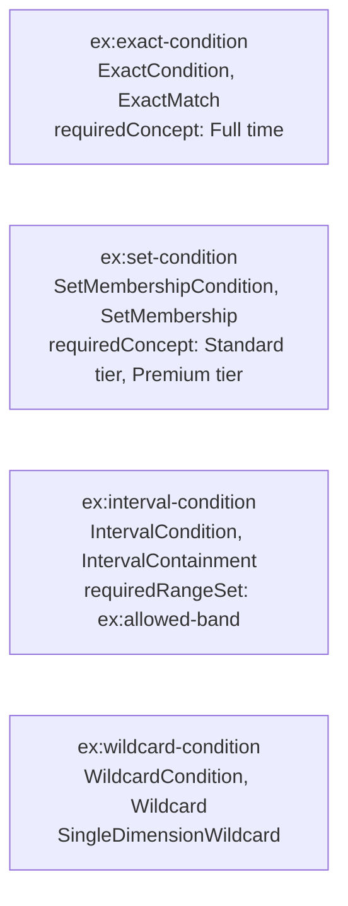

What it shows: a condition's class and its `matchStrategy` always agree (`ExactCondition` with
`ExactMatch`, and so on), and `elg:ConceptConditionDeclarationShape` (§7) would warn if
`ex:exact-condition` or `ex:set-condition` declared no `requiredConcept` at all, since a concept
condition with nothing to match against states nothing.

### 8.2 Interval containment

[`interval-containment.ttl`](examples/interval-containment.ttl). A minimum credit score band, 700
to 850 inclusive, checked by a question offering the same range set back.

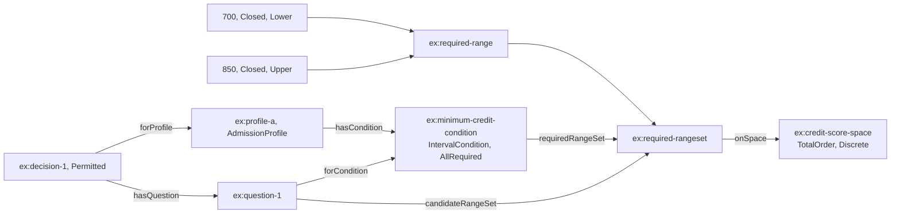

The question's candidate range set is the required range set itself, so the condition's
`AllRequired` compatibility operation is satisfied trivially:

```turtle-example
@prefix elg: <https://www.nebularis.org/neuro-semantic/lattice/eligibility#> .
@prefix ex:  <https://example.org/lattice/eligibility/> .

ex:decision-1 a elg:EligibilityDecision ;
	elg:decisionValue elg:Permitted .
```

What it shows: an interval condition needs no `requiredConcept`, and reads its candidate through
Quantification's own `qnt:Range`/`qnt:RangeSet`, never a bespoke numeric type.

### 8.3 Hierarchical match

[`hierarchical-match.ttl`](examples/hierarchical-match.ttl). A three-level hazard scheme (Peril,
broader than Fire, broader than Industrial Fire), constrained by a scheme contract, with a
condition requiring `Fire`.

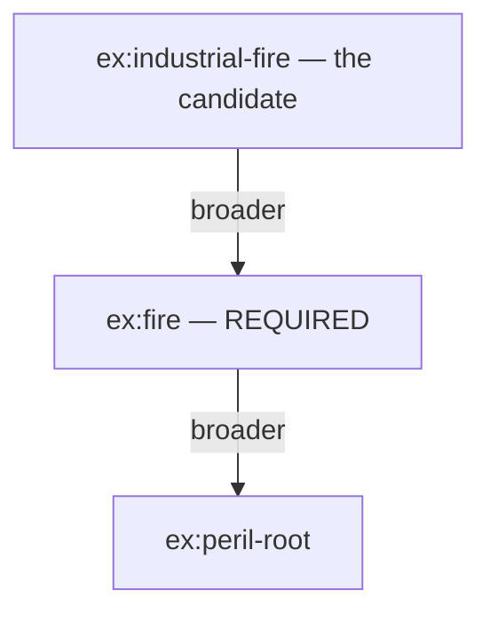

The candidate stands below the required concept in the scheme's closure (L9), so the condition is
satisfied although the question names `ex:industrial-fire`, never `ex:fire` itself:

| Candidate | Stands in closure of `ex:fire`? | Decision |
|---|---|---|
| `ex:industrial-fire` (this example) | yes, one `skos:broader` step | Permitted |
| `ex:fire` itself | yes, reflexively | Permitted |
| `ex:peril-root` | no, it is broader than `ex:fire`, not narrower (L11) | Undetermined |
| a concept outside `ex:hazard-scheme` | the scheme cannot place it | Undetermined |

What it shows: `elg:constrainedByContract` binds the condition to the scheme, not the concept
directly, so the same condition re-evaluates correctly if the contract is re-pinned to a revised
edition of the scheme (ADR-A85).

### 8.4 Evidence binding

[`evidence-binding.ttl`](examples/evidence-binding.ttl). A relocation benefit for engineering job
families, excluding contractor grades, with at least two years' tenure, evaluated directly over an
employment ontology's own data, with no `elg:Question` authored at all.

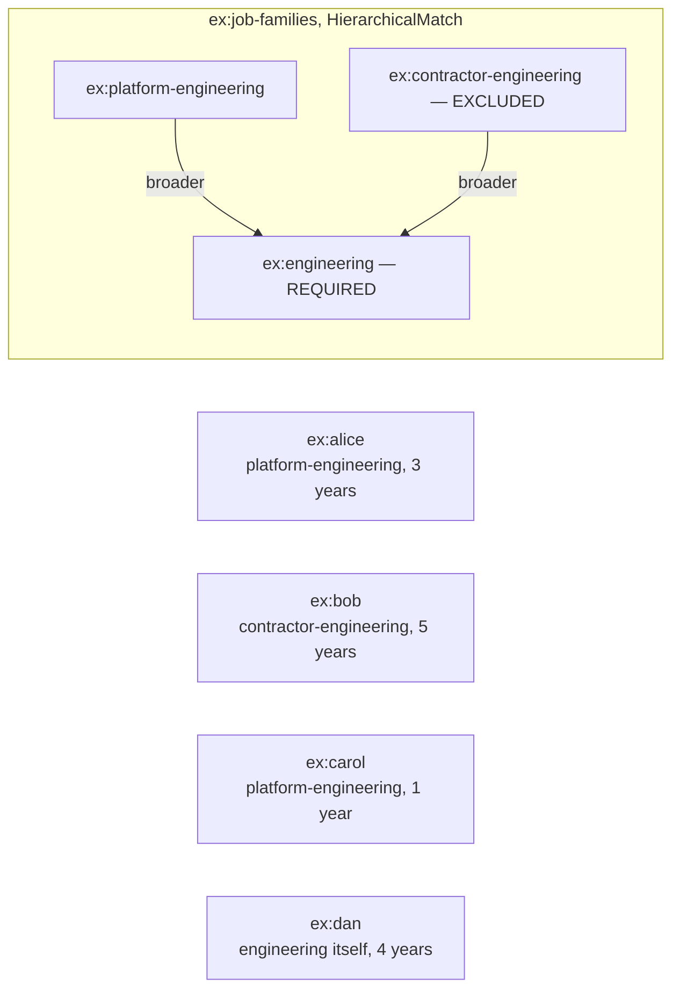

Two bindings reach each employee's candidates: `ex:family-binding` (through `holdsRole` then
`inJobFamily`, §5.6) and `ex:tenure-binding` (through `tenureYears`, read on `ex:tenure-space`).
Both conditions compose under the profile's `AllRequired`, so either one deciding `Denied` decides
the whole profile `Denied`, and either one `Undetermined` with the other `Permitted` leaves it
`Undetermined`:

| Employee | Family condition | Tenure condition | Decision |
|---|---|---|---|
| `ex:alice` | Permitted (platform-engineering, below engineering) | Permitted (3 ≥ 2) | **Permitted** |
| `ex:bob` | Denied (matches the exclusion) | Permitted (5 ≥ 2) | **Denied** |
| `ex:carol` | Permitted | Denied (1 < 2) | **Denied** |
| `ex:dan` | Undetermined (stands at `engineering` itself, above the exclusion, L11) | Permitted (4 ≥ 2) | **Undetermined** |

What it shows: an evidence binding lets a profile evaluate a whole class of subjects without
authoring one question per subject, and `ex:dan`'s row is L11 in practice, not merely a stated
rule: the scheme cannot yet say whether he is a platform engineer or a contractor, so the exclusion
is only possible, not certain.

## 9. Canonicalisation

Eligibility canonicalisation is declaration-first and profile-stable.

- `elg:conditionKey` is the canonical identifier of a condition declaration for comparison, caching, and replay.
- Canonicalisation never changes the declared strategy (`elg:matchStrategy`), compatibility operation (`elg:compatibilityOperation`), or wildcard semantics (`elg:wildcardSemantics`).
- Interval admissibility canonicalises through Quantification ranges and range sets only, using `elg:requiredRangeSet` and `elg:candidateRangeSet` with `qnt:Range` and `qnt:RangeSet`.

## 10. Formalisation

`elg:Decision`'s three named individuals (6.4) are a closed, three-valued type under Belnap and
Fitting's strong Kleene reading (L15, L16). `Undetermined` is below `Permitted` and `Denied` in
the information order, which are each other's own fixed point only.

The three connectives' truth tables follow, for a reader's reference.

**`or3`, strong Kleene disjunction (L15's `SomeValue` combinator)**

| or3 | Permitted | Denied | Undetermined |
|---|---|---|---|
| **Permitted** | Permitted | Permitted | Permitted |
| **Denied** | Permitted | Denied | Undetermined |
| **Undetermined** | Permitted | Undetermined | Undetermined |

**`and3`, strong Kleene conjunction (L15's `EveryValue` combinator)**

| and3 | Permitted | Denied | Undetermined |
|---|---|---|---|
| **Permitted** | Permitted | Denied | Undetermined |
| **Denied** | Denied | Denied | Denied |
| **Undetermined** | Undetermined | Denied | Undetermined |

**`neg3`, negation (L16)**

| neg3 | result |
|---|---|
| **Permitted** | Denied |
| **Denied** | Permitted |
| **Undetermined** | Undetermined |

The tables are for a reader. The clauses below are the one normative statement of the three connectives, and
the kernel's laws are proved against them. `decision_leq`, the information order, is a predicate over
equality rather than a finite case table, and is stated beside the laws.

L15's readings, `some_value` and `every_value`, each take whether the binding is closed (L17). Closed,
`some_value` folds `or3` from `Denied`, and `every_value` folds `and3` from `Permitted`. Each starts from its
connective's identity, so the empty case decides. Open, `some_value` is Permitted when a value is Permitted
and `every_value` Denied when a value is Denied, and each is otherwise Undetermined.

```isabelle-spec
theory Kernel
imports Main
begin

datatype decision = Permitted | Denied | Undetermined

fun or3 :: "decision \<Rightarrow> decision \<Rightarrow> decision" where
  "or3 Permitted _ = Permitted"
| "or3 Denied b = b"
| "or3 Undetermined Permitted = Permitted"
| "or3 Undetermined Denied = Undetermined"
| "or3 Undetermined Undetermined = Undetermined"

fun and3 :: "decision \<Rightarrow> decision \<Rightarrow> decision" where
  "and3 Permitted b = b"
| "and3 Denied _ = Denied"
| "and3 Undetermined Permitted = Undetermined"
| "and3 Undetermined Denied = Denied"
| "and3 Undetermined Undetermined = Undetermined"

fun neg3 :: "decision \<Rightarrow> decision" where
  "neg3 Permitted = Denied"
| "neg3 Denied = Permitted"
| "neg3 Undetermined = Undetermined"

end
```

## 11. Dependencies

Eligibility imports Foundation, Vocabulary, Quantification, and Party. Quantification is a direct dependency because interval admissibility uses declared `qnt:Range` and `qnt:RangeSet` semantics.

## 12. Release Notes

Earlier versions are listed in the [ontology release register](../../docs/architecture/ontology-releases.md).

- Not yet released. The README follows the layout of
  [ADR-A126](../../docs/architecture/decisions/ADR-A126-literate-specification-layout-and-grammar.md), and
  generates its documents' headers, their terms and the structural shapes from sections 1, 2 and 6. Both
  documents gain a `dct:description` and a `dct:creator`. Every class and property has a definition, 32 of them
  new. No axiom changes.
- `eligibility` 0.12.0 (breaking, ADR-A105). Closures (§5.7). New: `elg:Closure`, `elg:licensedBy`,
  `elg:closedUnder` and `elg:closureReliedOn`. `eligibility-vocab` 0.13.0 (breaking). L15 restated, so a set
  reading is Denied under some value, or Permitted under every value, only under a closure the binding names,
  the empty case included (ADR-A103's 2026-10-12 addendum). New law L17. Shapes 0.3.0 (breaking): a closure's
  one source, a closure only on a binding read some or every value, and a decision relying only on a closure
  its profile's bindings name.
- `eligibility` 0.11.0 (additive). Re-pinned to Quantification 0.8.0. No other change.
- `eligibility-vocab` 0.12.0 (additive). L9's comment adds that a hierarchical condition with no resolved
  scheme is undetermined for every candidate. The vocabulary's ontology header joins the README, which is
  again the source of every Eligibility spec, vocab and shapes file. Re-pinned to `eligibility` 0.11.0. The
  shapes, 0.2.0, are unchanged.

## 13. Open Issues

- **Laws L1 to L8 name no register.** §5.8 places them under `elg:StaticConstraint`, but only L9 to L17 state
  `elg:lawRegister`.
- **Fourteen individuals have no definition**, the match strategies, the compatibility operations, the
  wildcard policies and the decisions. §5.1 and §5.4 describe them.
- **A closure over a period**, such as "within 60 days of the request", is not yet declared (§5.7).
