<!-- SPDX-License-Identifier: CC-BY-SA-4.0 -->

# Ledger Ontology — Amounts Consumed and Restored Over Time

Literate specification for the Ledger layer, in the layout of
[ADR-A126](../../docs/architecture/decisions/ADR-A126-literate-specification-layout-and-grammar.md).

---

## 1. Purpose and Scope

Ledger holds amounts that can be consumed and restored, such as a limit, commitment, seat quota, carbon budget, and so on. These are represented by an "account", configured by how much it holds when fresh, what unit it's held in, and the rule for arbitrating several claims on it at once. Accounts form a tree by "part of and not in addition to", so a single draw or credit can affect several accounts at once, along one stated path. 

In order to keep a history of changes to an account, weigh several claims on it together, and let different implementations agree on a shared record, each draw or credit is recorded as a fact of its own: a claim against the account that leaves its stated amount untouched. A balance is always derived by folding an operation over those facts. Conservation then holds by construction, since no balance can disagree with the facts it is derived from. Recording a claim and applying it also become separate acts, so claims made together can be held unresolved and decided together by a stated merge rule.

Separate facts require two forms of ordering. A strict before and after ensures a balance can be read 'as of' a given point, and a mark of which facts belong together ensures they can be decided as one. Wall-clock time can supply neither (since clocks on different machines do not agree closely enough to order two claims), so an evaluator assigns the order deterministically, such that any two implementations given the same inputs will assign the same order.

Each fact carries a whole number placing it among the other facts on its account, called its **position**, and a second number for ordering facts that share a position, called its **micro-position**. The fact itself, containing one draw or credit with its account, owner, amount, direction and position, is referred to as a **posting**.

This one central law then, governs balances: each is a stated amount less what has been drawn, plus what has been restored, less what an account above the one restored had no room for, ensuring a balance is cheap to compute, but provable across properties checkable as a closed, mechanical law. 

Since the effect of a posting is exactly the account plus every ancestor reached by following the ldg:partOf property upward, one fixed edge at a time, the set of accounts a draw touches is always fully enumerable (by walking one chain and checking each link), with no ambiguity about which balances a draw changes.

A posting records the balance of its account after it, its running balance, so a reader of the current balance reads one value. That value is checked against the sum of the postings, so no path lets someone set a balance to a value the postings don't justify.

When disparate evaluations draw on the same account at the same position (being logically simultaneous, not "whoever runs first"), the model follows a fixed path, 'propose -> merge -> settle'. 

1. Propose - each evaluation states what it requires (e.g., a requested value)
2. Merge - the merge rule of the account's policy (priority order / proportionality / refusal) looks at the whole batch together and decides every grant in one pass, producing one merge record
3. Settle - each evaluation then posts whatever it was actually granted

Because the merge step is a pure function of the complete set of proposals, the result can't depend on what order the evaluations happened to run in. No evaluation's outcome therefore, depends on the order in which the others ran, so they may run in parallel. Given exact arithmetic in the account's unit, the account's stated rounding and residual rules, and ties broken by an order defined on the data rather than on arrival, two conforming implementations reach the same grants in any execution order, and the same bytes once their records are written in canonical form. Conformance cases check this.

Ledger accounts do not hold observed values such as prices or temperatures, which are intensive and carry no such law.

## 2. Namespace and Prefixes

| Document | Ontology IRI | Version IRI | Imports |
|---|---|---|---|
| `spec/ledger.ttl` | <https://www.nebularis.org/neuro-semantic/ledger> | <https://www.nebularis.org/neuro-semantic/lattice/ledger/0.22.0> | <https://www.nebularis.org/neuro-semantic/lattice/foundation/0.22.0>, <https://www.nebularis.org/neuro-semantic/lattice/vocabulary/0.22.0>, <https://www.nebularis.org/neuro-semantic/lattice/quantification/0.22.0> |
| `vocab/ledger-vocab.ttl` | <https://www.nebularis.org/neuro-semantic/ledger-vocab> | <https://www.nebularis.org/neuro-semantic/lattice/ledger-vocab/0.22.0> | <https://www.nebularis.org/neuro-semantic/lattice/ledger/0.22.0> |
| `spec/ledger-runtime.ttl` | <https://www.nebularis.org/neuro-semantic/ledger-runtime> | <https://www.nebularis.org/neuro-semantic/lattice/ledger-runtime/0.22.0> | <https://www.nebularis.org/neuro-semantic/lattice/ledger/0.22.0> |

| Prefix | Namespace |
|---|---|
| `ldg:` | <https://www.nebularis.org/neuro-semantic/lattice/ledger#> |
| `fnd:` | <https://www.nebularis.org/neuro-semantic/lattice/foundation#> |
| `voc:` | <https://www.nebularis.org/neuro-semantic/lattice/vocabulary#> |
| `qnt:` | <https://www.nebularis.org/neuro-semantic/lattice/quantification#> |
| `skos:` | <http://www.w3.org/2004/02/skos/core#> |

| Identifier | Role | Display name |
|---|---|---|
| <https://github.com/nebularis> | creator | Nebularis |

## 3. Extraction Contract

- Sections 1, 2 and 6 generate `spec/ledger.ttl`, the configuration document, except the entries inside section 6's `output-file` regions, which generate `spec/ledger-runtime.ttl`, the runtime document. The two share one version, and a design-time check reads only the configuration document.
- The restriction rows of section 6 that are checked in SHACL generate `shapes/structural.ttl`.
- The hidden blocks of section 7 generate `shapes/constraints.ttl`, for the configuration, and `shapes/runtime.ttl`, for the records, each naming its file.
- Extraction rewrites the class diagram (section 4) and the Axiom Index (6.7), which are never edited by
  hand.
- `turtle-example` blocks are illustrative only.

```bash
mise exec -- python tools/literate_extract.py ontology/ledger/README.md --layer ledger --root . --check
```

The module's entry in the [repository catalogue](../../repository-catalogue.md) follows.

```toml repository-catalogue
[module]
kind = "substrate"
roles = ["examples", "shapes", "spec", "vocab"]
imports = ["foundation", "vocabulary", "quantification"]

[module.extract]
spec = ["spec/ledger.ttl", "spec/ledger-runtime.ttl"]
vocab = ["vocab/ledger-vocab.ttl"]
shapes = ["shapes/structural.ttl", "shapes/constraints.ttl", "shapes/runtime.ttl"]
```

## 4. Overview

An `ldg:AccountDefinition` states an amount consumed and restored, in a unit of account that must be extensive, so disjoint parts add to the whole, and a draw along a path and an availability reading (the least remaining balance along it) both mean something. "Part of and not in addition to" is the parent edge, `ldg:partOf`, stated explicitly rather than inferred, so a sublimit sits inside a section inside an aggregate while a further limit for one class of beneficiary sits beside it, never drawn through it.

A key dimension derives one account per key value, on the first draw that names it (a seat quota per site, a sublimit per borrower). A merge rule arbitrates several proposals at one position: in priority order, proportionally (with a rounding method and a residual allocation, since an exact share need not round to a whole unit of account), whole or not at all for requests of no use in part, or by refusing the whole merge. A credit ceiling, defaulting to the stated amount, is how far a credit may restore a balance, which lets a reinstatement raise a layer's capacity above its first stated amount without inventing a second account for it. A purpose lets one draw debit a second account outside its path (a flood sub-aggregate, say). A draw arrives in its account's unit, and the ledger never converts one.

A credit carries a kind, a concept of `ldg:CreditKinds`, which an applied module fills, such as a recovery, a reinstatement or a repayment. An account definition names the kinds that restore it with `ldg:restoredBy`, and accepts every kind where it names none. A credit is posted to an account that accepts its kind, and is applied there up to the account's room below its ceiling. Each ancestor that accepts the kind takes the least of the amount applied and its own room, and where it takes less, the difference is a `ldg:Cut` at that ancestor. So an account's balance is its stated amount, less the debits in its subtree, plus the credits it accepts at the amount applied, less the cuts recorded at it. Each posting records that balance for the account it is on, as `ldg:runningBalance`, and a credit records the amount offered beside the amount applied.

An account definition is versioned, since every balance folds against it. It has a persistent identity, and a change of what it states is a new version beside the old. Its stated amount and its credit ceiling are minted under it, and its parent, its merge policy, its unit of account, its period recurrence and the edition of the credit kinds it names are each named by version, so nothing a past balance folded against changes under it.

A merge records every request it decides, as an `ldg:Request` that carries what was asked, its rank and its place where the policy orders requests, its purpose, and what it was granted where the merge granted. A refused merge keeps its requests with no granted value and states one reason, a concept of `ldg:RefusalReasons`. A credit refused because its account does not accept its kind is recorded the same way, with one request. A rule may leave part of the amount unplaced where the policy allows residuals, and the merge record then states the residual, which goes to the account the policy names, if it names one.

The accounts of one owner form one ledger, an `ldg:Ledger` that names the `ldg:LedgerProfile` the deployment gave it and holds its revision. A ledger has one writer at a time. Each pass, one evaluation's write of records, is written as one request that moves the revision by one, and records the revision it moved the ledger to. A pass's IRI is derived from its ledger and a key the caller gives for the evaluation, so the same evaluation written twice is one node. The profile says whether a credit ceiling above a stated amount is admitted, and holds the closing recurrence. At each close a checkpoint is written for each account that moved, with its balance, the debits and the credits it accepts at the amount offered.

The class diagram below is generated from section 6.

```mermaid
classDiagram
    class Account {
        accountKey, at most one
        forOwner, exactly one
        ofDefinition, exactly one
        partOfAccount, at most one
        periodKey, at most one
    }
    class AccountDefinition {
        admitsOwnerKind, at least one
        creditCeiling, at most one
        creditKindsEdition, at most one
        keyDimension, at most one
        mergePolicy, exactly one
        partOf, at most one
        periodRecurrence, at most one
        resetRecurrence, at most one
        statedAmount, exactly one
        unitOfAccount, exactly one
    }
    class Checkpoint {
        balanceValue, exactly one
        closePosition, exactly one
        creditsOfferedTotal, exactly one
        debitsTotal, exactly one
        onAccount, exactly one
    }
    class Class
    class Concept
    class ConceptScheme
    class Cut {
        cutAt, exactly one
        cutOf, exactly one
        cutValue, exactly one
    }
    class DerivedArtefact
    class Ledger {
        forOwner, exactly one
        ledgerProfile, exactly one
        revision, exactly one
    }
    class LedgerProfile {
        admitsCeilingAboveStated, at most one
        closingRecurrence, at most one
    }
    class MergePolicy {
        allowsResiduals, at most one
        excessRecovery, at most one
        mergeRule, exactly one
        rankCriterion, at most one
        requiresDistinctRanks, at most one
        requiresSamePurpose, at most one
        residualAccount, at most one
        residualAllocation, at most one
        roundingDifference, at most one
        roundingMethod, at most one
        unitOrderCriterion, at most one
    }
    class MergeRecord {
        availableBefore, at most one
        effectivePosition, exactly one
        inPass, exactly one
        onAccount, exactly one
        refusalReason, at most one
        request, at least one
        residualValue, at most one
    }
    class Pass {
        passPosition, exactly one
        passRevision, exactly one
    }
    class PersistentIdentity
    class Posting {
        amountValue, exactly one
        creditKind, at most one
        direction, exactly one
        effectivePosition, exactly one
        forPurpose, at most one
        inPass, exactly one
        microPosition, exactly one
        offeredValue, at most one
        onAccount, exactly one
        recordedPosition, exactly one
        runningBalance, exactly one
    }
    class Quantity
    class Recurrence
    class RecurrenceBin
    class Request {
        forProposal, exactly one
        forPurpose, at most one
        grantedValue, at most one
        proportionDenominator, at most one
        proportionNumerator, at most one
        rank, at most one
        requestedValue, exactly one
        unitOrderPlace, at most one
    }
    class ValueSpace
    class Versioned
    Account --> Account : partOfAccount
    Account --> AccountDefinition : ofDefinition
    Account --> RecurrenceBin : periodKey
    AccountDefinition --> AccountDefinition : partOf
    AccountDefinition --> Class : admitsOwnerKind
    AccountDefinition --> Concept : countsPurpose
    AccountDefinition --> Concept : restoredBy
    AccountDefinition --> ConceptScheme : creditKindsEdition
    AccountDefinition --> MergePolicy : mergePolicy
    AccountDefinition --> Quantity : creditCeiling
    AccountDefinition --> Quantity : statedAmount
    AccountDefinition --> Recurrence : periodRecurrence
    AccountDefinition --> Recurrence : resetRecurrence
    AccountDefinition --> ValueSpace : unitOfAccount
    Cut --> Account : cutAt
    Cut --> Posting : cutOf
    DerivedArtefact <|-- Checkpoint
    DerivedArtefact <|-- MergeRecord
    DerivedArtefact <|-- Posting
    Ledger --> LedgerProfile : ledgerProfile
    LedgerProfile --> Recurrence : closingRecurrence
    MergePolicy --> AccountDefinition : residualAccount
    MergePolicy --> Concept : excessRecovery
    MergePolicy --> Concept : mergeRule
    MergePolicy --> Concept : rankCriterion
    MergePolicy --> Concept : residualAllocation
    MergePolicy --> Concept : roundingDifference
    MergePolicy --> Concept : roundingMethod
    MergePolicy --> Concept : unitOrderCriterion
    MergeRecord --> Concept : refusalReason
    MergeRecord --> Request : request
    Posting --> Concept : creditKind
    Posting --> Concept : direction
    Versioned <|-- AccountDefinition
    Versioned <|-- LedgerProfile
    Versioned <|-- MergePolicy
    class DatatypeProperty_effectivePosition["Datatype Property - effectivePosition"]
    class ObjectProperty_forOwner["Object Property - forOwner"]
    class ObjectProperty_forPurpose["Object Property - forPurpose"]
    class ObjectProperty_inPass["Object Property - inPass"]
    class ObjectProperty_onAccount["Object Property - onAccount"]
```

<!-- start: {"generated": "class-diagram"} -->



<!-- end -->

## 5. Detailed Design

### 5.1 Design decisions

- **Configuration and records, in two documents.** Ledger states its configuration: the tree, owner kinds, merge rules and their parameters, the period recurrence, keys, purposes, the kinds of credit that restore an account, credit ceiling, and the ledger profile a deployment authors ([ADR-A131](../../docs/architecture/decisions/ADR-A131-ledger-layer.md)). Its runtime document states the records: the ledger of each owner, account instances, passes, postings with their running balances, cuts, merge records with their requests, and checkpoints with their totals. Computing them is the evaluator's, and Ledger checks what was recorded against its laws (section 7.3).
- **An account instance is named.** An account is a node with a minted IRI, identified by its definition, its owner, its key and its period, which stay its natural key ([ADR-A131](../../docs/architecture/decisions/ADR-A131-ledger-layer.md), its first addendum of 2026-10-27). A posting names that node rather than repeating the four values. An instance states the instance it is part of, so a fold over a subtree follows one edge.
- **A period is an account, not a reset.** Where a definition states `ldg:periodRecurrence`, one account is derived per period, its period key the recurrence bin the effective position falls in, computed at write and never supplied by a draw. One recurrence holds along a path, and a keyed child's instance is part of its parent's under the same bin. Nothing resets, so `ldg:resetRecurrence` is deprecated.
- **Two orderings.** A posting carries an effective position, where the fact sits in the arrangement and comparable across accounts, and a recorded position with a micro-position, where it sits in its own account's append-only sequence. The pass that wrote it carries the position at which it was recorded, on the effective axis, and a posting is never effective later than its pass. Running balances, closes and checkpoints follow the recorded axis, so a reading as of an effective position folds the postings. A position is a natural number on its axis, so the effective and the recorded position are typed `xsd:nonNegativeInteger`, as the shared formal statement of positions that this layer's proofs and the multi-store model use defines one.
- **A draw arrives in its account's unit.** The ledger never converts. A request in another value space is converted before it reaches the ledger, where the conversion is recorded with its rate, the rate's source and its date, and the draw is then made in the account's unit. A posting may cite that record by `prov:wasDerivedFrom`, as it cites a merge record, so the conversion stays traceable and the ledger states no term for it ([ADR-A131](../../docs/architecture/decisions/ADR-A131-ledger-layer.md), its addendum of 2026-11-09).
- **An account accepts a draw only in its own value space and unit, and only where its space can represent the amount.** A draw's amount is a literal in its account's unit of account, so a draw that read a quantity in another space or unit took an amount unconverted, or a proportion unresolved, and is refused. An amount that is not a value of its space's datatype, or on a discrete space not a whole multiple of its granularity floor, is refused and never rounded. Each refusal carries the reason Quantification gives, so a draw refused here and a comparison Quantification finds Undetermined say the same thing ([ADR-A131](../../docs/architecture/decisions/ADR-A131-ledger-layer.md), its second addendum of 2026-11-09).
- **Post at the drawn account only.** A draw writes one posting, on the account drawn, and an ancestor's balance is derived by a fold over its subtree. A purpose-counting account is outside the drawn account's subtree, so it keeps a posting of its own from the same draw. Where a purpose-counting account and the drawn account share an ancestor, that ancestor's fold would count the draw twice, and the rule that prevents it is open (section 13).
- **An exact share is two integers.** A request granted in proportion keeps its exact share as a numerator and a denominator, not as one `owl:rational`, because no store LATTICE runs compares that literal by value (TSD-70), and the merge shapes compare and sum granted values.
- **The running balance sits on the posting.** A posting records the balance of the account it is on after it, that account's subtree included, so the hot path reads one value. No record holds a balance for each account and pass, and a state the decision path does not read is answered from the history when it is asked for ([ADR-A131](../../docs/architecture/decisions/ADR-A131-ledger-layer.md), its first addendum of 2026-11-16). The order is the recorded one. On its own account a posting follows those recorded before it, and on an account below it those of an earlier pass, or of its own pass at a lower or equal micro-position.
- **A credit has a kind, and an account names the kinds that restore it.** The kind is a concept of `ldg:CreditKinds`, which Ledger declares with no member and an applied module fills, since what restores an amount belongs to a domain. An account accepts every kind unless it names some with `ldg:restoredBy`, and an ancestor counts a credit only where it accepts its kind. A credit posted to an account that does not accept its kind is refused, and so is a credit with no kind on a path where an account names its kinds ([ADR-A131](../../docs/architecture/decisions/ADR-A131-ledger-layer.md), its first and fourth addenda of 2026-11-16).
- **A balance is a sum less its cuts.** A credit is applied at the account it is posted to, up to that account's room below its ceiling, and records the amount offered beside the amount applied. `ldg:amountValue` is the amount applied for a credit, as it is the amount drawn for a debit, so a balance is read from one property. Each ancestor that accepts the kind takes the least of the amount applied and its own room, and where it takes less, the writer records the difference as a cut at that ancestor. An account's balance is then its stated amount, less the debits in its subtree, plus the credits it accepts at the amount applied, less the cuts recorded at it, which equals the balance stepped posting by posting, so no read needs an ordered scan to honour a ceiling ([ADR-A131](../../docs/architecture/decisions/ADR-A131-ledger-layer.md), its first addendum of 2026-11-16).
- **A cut is a node of its own, and states no position.** One credit can be cut at several ancestors, so a cut is a `ldg:Cut` that names its posting, the ancestor and its value. A read by position joins the cut to its posting, so a position is recorded once and cannot drift from a copy.
- **A merge policy is a node of its own, and it is versioned.** What a scope declares for competing requests is stated once, on a `ldg:MergePolicy`, and each account definition it governs names a version of it. A contract, a document it cites and a deployment can each state one, and which governs a definition is resolved when the definition is written, so the ledger reads exactly one ([ADR-A131](../../docs/architecture/decisions/ADR-A131-ledger-layer.md), its addendum of 2026-11-17).
- **A rounding difference is settled as the wording says, each direction stated apart.** Shares rounded to the nearest can sum to more than the amount or to less. A policy says whether the rounding is only for show or the difference is settled, and where it is settled, the residual allocation says where a unit short goes and the excess recovery says where a unit over is taken from. Neither is inferred from the other, and silence is refused ([ADR-A131](../../docs/architecture/decisions/ADR-A131-ledger-layer.md), its second addendum of 2026-11-17).
- **A merge records every request, and a refusal keeps them.** Each request on a merge is an `ldg:Request`, part of its merge record, which names the evaluation that made it and carries what it asked, its rank, its place among requests of one rank and its purpose. A request on a merge that granted carries what it was granted, and a request on a refused merge carries no granted value, since a refusal is never a grant of nothing. So a history shows what was refused and what decided the order. A credit refused because its account does not accept its kind is recorded the same way, as a merge record with one request and a reason, and no posting is written ([ADR-A131](../../docs/architecture/decisions/ADR-A131-ledger-layer.md), its third addendum of 2026-11-19).
- **A rank and a place are derived from the policy's criteria.** A request states its rank where its policy states `ldg:rankCriterion`, and its place among requests of one rank where the policy states `ldg:unitOrderCriterion`, each a natural number derived from that criterion. A lower rank is served first, and requests of one rank are a tie. A request states neither where its policy states no criterion, since an order is declared and never taken from identifiers ([ADR-A131](../../docs/architecture/decisions/ADR-A131-ledger-layer.md), its second addenda of 2026-11-09 and 2026-11-16).
- **A residual is stated on the merge, and the policy names its account.** A rule may grant parts that sum to less than the amount shared, each within its request, where the policy allows residuals, and the merge record states what is left as `ldg:residualValue`, so the granted values and the residual sum to the amount shared. Requests of no use in part are such a rule, `ldg:WholeOrNothing`. The policy may name the account definition that takes a residual with `ldg:residualAccount`, since what becomes of a residual is part of the treatment a scope states, and it names one only beside the permission. It names a version of that definition, by an edge that bears meaning, so a later version of the account that takes the residual reaches the policy only through a new version of the policy ([ADR-A131](../../docs/architecture/decisions/ADR-A131-ledger-layer.md), its second addendum of 2026-11-16 and its third addendum of 2026-11-19).
- **A ledger is a node, one for each owner.** The accounts of one owner are the unit a write must see unchanged, since a draw reads every account on its path and the law that none falls below zero spans them. That unit is an `ldg:Ledger`, minted from its owner, which one writer at a time writes and which holds the revision that writer moves. The revision is the one fact of a ledger that changes in place, so it sits on a node the ledger owns, and an account reaches its ledger through its owner and states nothing more ([ADR-A131](../../docs/architecture/decisions/ADR-A131-ledger-layer.md), its third addendum of 2026-11-16 and its addendum of 2026-11-18).
- **A ledger profile is the deployment's, and holds the closing recurrence.** A profile is one of the rules a deployment sets for every ledger it runs, a versioned node each ledger names by an edge that bears meaning. It says whether a credit ceiling above a stated amount is admitted, which is not admitted where it is unstated, and a definition with such a ceiling is refused at design time unless some profile in the same data admits it, and holds the settings that tune cost and change no meaning, the closing recurrence first. A close therefore belongs to a ledger, and no account definition states one ([ADR-A131](../../docs/architecture/decisions/ADR-A131-ledger-layer.md), its first addendum of 2026-11-16).
- **A pass moves its ledger's revision once, and is named from its ledger and its evaluation.** A pass is evaluated from one revision of a ledger and written as one request, which the writer accepts only while the ledger is at that revision, and which moves the revision by one. The pass records the revision it moved the ledger to, one triple a pass, so the replay order the writer is held to is in the records. An owner with no ledger is read as revision 0, so the first pass of a ledger records revision 1, and a later pass records a greater one. A pass's IRI is derived from its ledger and a key the caller gives for the evaluation, so the same evaluation written twice is one node, a runtime that stopped after its request finds whether the pass was written, and the ledger names no term of the layer that gave the key. A pass therefore states no edge to its ledger, which is the ledger of the owner of the accounts its records are on ([ADR-A131](../../docs/architecture/decisions/ADR-A131-ledger-layer.md), its addendum of 2026-11-18 and its second addendum of 2026-11-19).
- **A pass's position is the later of two.** It is the later of the position of the stimulus the pass was evaluated for and the position of its ledger's latest pass at the revision it was evaluated from, so a pass is never recorded before one already in its ledger. The evaluation reads that latest pass's position with the revision, and the request carries it. A record keeps its stimulus's position as its effective position, so a posting is never effective later than its pass and may be effective earlier ([ADR-A131](../../docs/architecture/decisions/ADR-A131-ledger-layer.md), its addendum proposed 2026-11-20).
- **A checkpoint is written for an account that moved, and carries two totals.** An account moved when a posting recorded since its last checkpoint changes its balance, its debits or the credits it accepts at the amount offered, so a credit cut in full at an account still moves it. An account that did not move is read from its last checkpoint. Beside the balance, a checkpoint states the debits and the accepted credits offered recorded by its close, so a reading of the flows by an effective day starts from the checkpoint at the last close before the day, as a reading of the recorded amounts does ([ADR-A131](../../docs/architecture/decisions/ADR-A131-ledger-layer.md), its first addendum of 2026-11-16 and its addendum of 2026-11-19).
- **A refusal states one of seven reasons.** The reasons are the concepts of `ldg:RefusalReasons`, each named for the condition that held: six refuse a merge, and the seventh refuses a credit posted to an account that does not accept its kind ([ADR-A131](../../docs/architecture/decisions/ADR-A131-ledger-layer.md), its second and fourth addenda of 2026-11-16).
- **An account definition is versioned, and nothing it names changes under it.** Every balance folds against the definition its account names, so `ldg:AccountDefinition` is a `fnd:Versioned`, with one persistent identity, and a change of its amount, ceiling, parent, policy, unit, period or kinds is a new version beside the old, never an edit. Its stated amount and its credit ceiling are parts of a version, minted under it, so no quantity is shared between definitions. Its parent, its merge policy, its unit of account, its period recurrence and the edition of its credit kinds are versioned things it names by version. Those edges, its amounts and the kinds that restore it bear meaning (`fnd:meaningBearing`), so Foundation's check warns where one leads to a node that is neither versioned, minted under the definition nor a published term, and a Persistence profile owns or pins it. A new version of a parent or a policy therefore reaches a definition only through a new version of the definition ([ADR-A142](../../docs/architecture/decisions/ADR-A142-meaning-bearing-edges.md), decisions 1 and 5).
- **A definition pins the edition of the credit kinds it names.** An applied module publishes its kinds of credit in editions, each a versioned scheme whose concepts are kinds of `ldg:CreditKinds`. A definition that names the kinds that restore it names, with `ldg:creditKindsEdition`, the edition they were resolved against, and each kind it names is a concept of that edition, so a historical read uses the kinds as they were. That is one reference for each version of a definition, rather than one for each credit ([ADR-A131](../../docs/architecture/decisions/ADR-A131-ledger-layer.md), its first addendum of 2026-11-16).
- **Three edges of a definition bear no meaning of their own.** An owner kind is a class, which the ontology that declares it versions by its release, and a purpose and a key are concepts a record names and the ledger compares by IRI. So `ldg:admitsOwnerKind`, `ldg:countsPurpose` and `ldg:keyDimension` are not marked, and whether the edition of a purpose's or a key's scheme is pinned as the credit kinds' is, is open (section 13).
- **Every concept scheme is declared now**, including `ldg:PostingDirections`, which only the runtime terms use. A concept scheme is a freestanding declaration, independent of which class first points at it.
- **Thirteen constraints** (no cycle, matching units, extensive additivity, a proportional rule's rounding and residual, a stated rounding difference, a stated source for a unit over, a residual account only beside the permission to leave a residual, a credit ceiling at or above the stated amount, a credit ceiling above the stated amount only where a profile admits it, a discrete unit of account's granularity floor, a key dimension's type, a closing recurrence only on a ledger profile, the kinds a definition names pinned in their edition) are SHACL-SPARQL, in section 7. Cardinalities are generated structural shapes from section 6's Restrictions table. The runtime laws are SHACL-SPARQL too, in section 7.3, each citing the theorem of section 10 it checks on one dataset.

### 5.2 Worked reading

A 10,000,000 aggregate has a section of 6,000,000 with a sublimit of 1,000,000, and a further limit of 2,000,000 for one class of beneficiary, in addition to the aggregate. The sublimit and the section each state `ldg:partOf` their parent, and the further limit states no `ldg:partOf` at all, so it is never debited by a draw on the sublimit. All four state the same unit of account, GBP, extensive, with `qnt:Sum` and `qnt:Difference` capabilities. The aggregate also sits `ldg:partOf` an annual cap of twice its amount, and states a `ldg:creditCeiling` equal to its own stated amount (the default), so a reinstatement credit can restore it in full without ever exceeding that ceiling. The annual cap is restored by recoveries alone, so a reinstatement restores the aggregate and leaves the cap the measure of capacity left across the original cover and the reinstatement. [`ontology/ledger/examples/insurance-aggregate.ttl`](examples/insurance-aggregate.ttl) carries this reading in full, with a hand-computed table of its postings and balances.

## 6. Description Logic Encoding

### 6.1 Classes

#### `ldg:AccountDefinition`

**Definition.** An amount consumed and restored, as the terms state it.

**Utility.** Declare one of these for each amount a contract states as a limit, commitment, quota or budget: a software licence's seat pool, a facility's commitment, a grant's budget, an aggregate or a sublimit. State its amount, its unit of account, the kinds of owner it admits and its merge policy always, and state a parent, a period recurrence, a key dimension, purposes it counts against, the kinds of credit that restore it or a credit ceiling only where the terms need them. A definition is versioned. Give it one persistent identity, mint its stated amount and its credit ceiling under its IRI, and name its parent, its policy, its unit of account, its period recurrence and the edition of the kinds that restore it by version. A change of any of them is a new version, which an account reaches only where it names it, so a past balance still folds against the version it was settled under.

**Subclass of.** `fnd:Versioned`

**Restrictions.**

| Property | Values | Asserted in | Message |
|---|---|---|---|
| `ldg:statedAmount` | exactly 1 |  |  |
| `ldg:unitOfAccount` | exactly 1 |  |  |
| `ldg:partOf` | max 1 |  |  |
| `ldg:admitsOwnerKind` | min 1 |  |  |
| `ldg:mergePolicy` | exactly 1 |  |  |
| `ldg:resetRecurrence` | max 1 |  |  |
| `ldg:keyDimension` | max 1 |  |  |
| `ldg:creditCeiling` | max 1 |  |  |
| `ldg:periodRecurrence` | max 1 |  |  |
| `ldg:creditKindsEdition` | max 1 |  |  |

#### `ldg:MergePolicy`

**Definition.** What a scope declares for requests that compete at one position.

**Utility.** State one for each scope that says how competing requests are treated, a contract, a document it cites or a deployment, and name it from every account definition it governs. It carries the merge rule always, a rounding method and a residual allocation where the rule shares in proportion, and the criteria, the permission, the residual account and the guards only where the terms state them. A policy is versioned. A change of treatment is a new version, and an account definition names the version that governs it, so what a past balance was settled under does not change. Where several accounts take part in one merge, the policy of the account the requests are made at governs.

**Subclass of.** `fnd:Versioned`

**Restrictions.**

| Property | Values | Asserted in | Message |
|---|---|---|---|
| `ldg:mergeRule` | exactly 1 |  |  |
| `ldg:roundingMethod` | max 1 |  |  |
| `ldg:residualAllocation` | max 1 |  |  |
| `ldg:roundingDifference` | max 1 |  |  |
| `ldg:excessRecovery` | max 1 |  |  |
| `ldg:rankCriterion` | max 1 |  |  |
| `ldg:unitOrderCriterion` | max 1 |  |  |
| `ldg:allowsResiduals` | max 1 |  |  |
| `ldg:residualAccount` | max 1 |  |  |
| `ldg:requiresDistinctRanks` | max 1 |  |  |
| `ldg:requiresSamePurpose` | max 1 |  |  |

#### `ldg:LedgerProfile`

**Definition.** The rules a deployment sets for every ledger it runs.

**Utility.** Author one for each set of rules a deployment states, and name it from every ledger it governs. It says whether a credit ceiling above a stated amount is admitted, and holds the settings that tune cost and change no meaning, the closing recurrence among them. A profile is versioned. A change of its rules is a new version, and a ledger names the version that governs it.

**Subclass of.** `fnd:Versioned`

**Restrictions.**

| Property | Values | Asserted in | Message |
|---|---|---|---|
| `ldg:closingRecurrence` | max 1 |  |  |
| `ldg:admitsCeilingAboveStated` | max 1 |  |  |

<!-- start: {"output-file": "spec/ledger-runtime.ttl"} -->

#### `ldg:Ledger`

**Definition.** The accounts of one owner, as the unit one writer at a time writes and a write sees unchanged.

**Utility.** Mint one for each owner, the first time a pass writes one of its accounts, and derive its IRI from the owner's, so every writer of that owner reaches one node. Name the profile the deployment gave it, and state its revision. The revision is the one fact of a ledger that changes in place. Its writer moves it by one with each pass, in the request that writes the pass, and only while the ledger is at the revision the pass was evaluated from. An owner with no ledger is read as revision 0, so the first pass of a ledger is evaluated from 0 and moves it to 1. An account reaches its ledger through its owner, so no account names it.

**Restrictions.**

| Property | Values | Asserted in | Message |
|---|---|---|---|
| `ldg:forOwner` | exactly 1 |  |  |
| `ldg:ledgerProfile` | exactly 1 |  |  |
| `ldg:revision` | exactly 1 |  |  |

#### `ldg:Account`

**Definition.** One account instance: an account definition held by one owner, for one key value and one period where the definition states them.

**Utility.** Mint one the first time a draw names its definition, owner, key and period, and name it from every posting, cut, merge record and checkpoint on it. The four values stay its natural key, so an adopter holding them still resolves it. State the instance it is part of where its definition is part of another.

**Restrictions.**

| Property | Values | Asserted in | Message |
|---|---|---|---|
| `ldg:ofDefinition` | exactly 1 |  |  |
| `ldg:forOwner` | exactly 1 |  |  |
| `ldg:accountKey` | max 1 |  |  |
| `ldg:periodKey` | max 1 |  |  |
| `ldg:partOfAccount` | max 1 |  |  |

#### `ldg:Pass`

**Definition.** One evaluation's write of records, recorded at one position.

**Utility.** What an evaluation records about itself beyond its postings. Every posting and merge record names the pass that wrote it. Derive its IRI from its ledger's and a key the caller gives for the evaluation that writes it. The layer gives the key no meaning, and the same evaluation made again gives the same key, so it is never taken from a clock or from a counter read when the request is made, and the same evaluation written twice is one node. A pass writes the records of one ledger, the ledger of the owner of the accounts its records are on, and writes at least one record. State the revision it moved that ledger to, which is one more than the revision it was evaluated from, so the first pass of a ledger records revision 1. A pass's position is on the effective axis, so the records it writes are effective no later than it, and it is the recorded axis's order across accounts. It is the later of the position of the stimulus the pass was evaluated for and the position of its ledger's latest pass at the revision it was evaluated from, and each record keeps its stimulus's position as its effective position. A speculative pass is written to a graph that can be dropped, never flagged.

**Restrictions.**

| Property | Values | Asserted in | Message |
|---|---|---|---|
| `ldg:passPosition` | exactly 1 |  |  |
| `ldg:passRevision` | exactly 1 |  |  |

#### `ldg:Posting`

**Definition.** One draw or credit on one account.

**Subclass of.** `fnd:DerivedArtefact`

**Utility.** Write one per draw or credit, on the account named, and one more on each account that counts the draw's purpose. An ancestor's balance is derived, never posted. State the running balance of the account posted to, after the posting. A credit states its kind, where it has one, and the amount offered beside the amount applied, and a cut for each ancestor that had less room. Its read set is `prov:wasDerivedFrom`, which names the merge record and the request a merged draw came from, and any record made before the ledger that the draw rests on, such as a conversion. A draw's read set names no quantity outside its account's value space and unit.

**Restrictions.**

| Property | Values | Asserted in | Message |
|---|---|---|---|
| `ldg:onAccount` | exactly 1 |  |  |
| `ldg:inPass` | exactly 1 |  |  |
| `ldg:effectivePosition` | exactly 1 |  |  |
| `ldg:recordedPosition` | exactly 1 |  |  |
| `ldg:microPosition` | exactly 1 |  |  |
| `ldg:direction` | exactly 1 |  |  |
| `ldg:amountValue` | exactly 1 |  |  |
| `ldg:runningBalance` | exactly 1 |  |  |
| `ldg:creditKind` | max 1 |  |  |
| `ldg:offeredValue` | max 1 |  |  |
| `ldg:forPurpose` | max 1 |  |  |

#### `ldg:Cut`

**Definition.** How much less an ancestor took of a credit than was applied at the account it was posted to.

**Utility.** Write one for each ancestor that accepts the credit's kind and had less room than the amount applied, with the room it lacked as its value. It is part of its credit's record, never a posting in the ancestor's book, and it states no position, since a read by position joins it to its posting.

**Restrictions.**

| Property | Values | Asserted in | Message |
|---|---|---|---|
| `ldg:cutOf` | exactly 1 |  |  |
| `ldg:cutAt` | exactly 1 |  |  |
| `ldg:cutValue` | exactly 1 |  |  |

#### `ldg:MergeRecord`

**Definition.** The merge of the requests at one account and one effective position, or a credit refused alone.

**Subclass of.** `fnd:DerivedArtefact`

**Utility.** Write one where requests at one position draw on one account, holding one request for each, whether the merge granted or refused. A merge that granted states no reason, and states the residual where its rule left one. A refused merge states one reason, grants no request and states no residual, and no posting cites it. Write one also for a credit refused because its account does not accept its kind, holding the credit as its one request, with that reason. State the availability the merge was given, so its granted values can be checked against it.

**Restrictions.**

| Property | Values | Asserted in | Message |
|---|---|---|---|
| `ldg:onAccount` | exactly 1 |  |  |
| `ldg:inPass` | exactly 1 |  |  |
| `ldg:effectivePosition` | exactly 1 |  |  |
| `ldg:request` | min 1 |  |  |
| `ldg:availableBefore` | max 1 |  |  |
| `ldg:residualValue` | max 1 |  |  |
| `ldg:refusalReason` | max 1 |  |  |

#### `ldg:Request`

**Definition.** One request on a merge: what one evaluation asked of an account at one position, and what it was granted where the merge granted.

**Utility.** Part of its merge record, never a record of its own. Write one for every request on every merge, granted or refused. State its rank where the policy states a rank criterion, its place among requests of one rank where the policy states a unit order criterion, and its purpose where it names one. State a granted value on every request of a merge that granted, zero included, and on no request of a merge that was refused. A share granted in proportion is two whole numbers, a numerator and a denominator, since no store measured compares an `owl:rational` by value (section 9).

**Restrictions.**

| Property | Values | Asserted in | Message |
|---|---|---|---|
| `ldg:forProposal` | exactly 1 |  |  |
| `ldg:requestedValue` | exactly 1 |  |  |
| `ldg:grantedValue` | max 1 |  |  |
| `ldg:rank` | max 1 |  |  |
| `ldg:unitOrderPlace` | max 1 |  |  |
| `ldg:forPurpose` | max 1 |  |  |
| `ldg:proportionNumerator` | max 1 |  |  |
| `ldg:proportionDenominator` | max 1 |  |  |

#### `ldg:Checkpoint`

**Definition.** An account's balance at a close, along the recorded axis.

**Subclass of.** `fnd:DerivedArtefact`

**Utility.** Write one at each close of the closing recurrence of the ledger's profile, for each account that moved since its last checkpoint. An account moved when a posting recorded since then changes its balance, its debits or the credits it accepts at the amount offered, so a credit cut in full at it still moves it. An account that did not move is read from its last checkpoint, or from its stated amount with nothing drawn or offered where it has none. A checkpoint counts the postings of passes recorded by the close, whatever their effective positions, so a posting recorded later and effective earlier never disturbs it. Beside the balance, state the debits and the credits offered that the account accepts, over the same postings. Derive its IRI from the account and the close position.

**Restrictions.**

| Property | Values | Asserted in | Message |
|---|---|---|---|
| `ldg:onAccount` | exactly 1 |  |  |
| `ldg:closePosition` | exactly 1 |  |  |
| `ldg:balanceValue` | exactly 1 |  |  |
| `ldg:debitsTotal` | exactly 1 |  |  |
| `ldg:creditsOfferedTotal` | exactly 1 |  |  |

<!-- end -->

### 6.2 Object Properties

#### `ldg:statedAmount`

**Definition.** The amount when fresh.

**Utility.** States an account definition's amount before any draw, in its unit of account. Point at a `qnt:Quantity` on the same space named by `ldg:unitOfAccount`, minted under the definition's IRI, so it is part of that version and never shared with another definition.

**Domain.** `ldg:AccountDefinition`

**Range.** `qnt:Quantity`

**Characteristics.** functional

**Meaning bearing.** "true"^^xsd:boolean

#### `ldg:unitOfAccount`

**Definition.** The value space every posting on this account is in.

**Utility.** Names the value space an account's amounts are stated and posted in. The space must be extensive (`qnt:additivity qnt:Extensive`) with `qnt:Sum` and `qnt:Difference` capabilities, since Ledger holds only amounts whose parts add to the whole (§1). A draw on the account is in this space, and in the unit its stated amount is in where the space has units.

**Domain.** `ldg:AccountDefinition`

**Range.** `qnt:ValueSpace`

**Characteristics.** functional

**Meaning bearing.** "true"^^xsd:boolean

#### `ldg:partOf`

**Definition.** "Part of and not in addition to": the parent edge of the account tree.

**Utility.** States that this account's balance is drawn from its parent's too, along the same path. An account outside another's subtree is in addition to it, never drawn through it, so state no `ldg:partOf` for a limit that sits beside another rather than inside it. The edge is stated, never inferred, and may not cycle. It names a version of the parent, so a later version of the parent reaches this definition only through a new version of it.

**Domain.** `ldg:AccountDefinition`

**Range.** `ldg:AccountDefinition`

**Characteristics.** functional

**Meaning bearing.** "true"^^xsd:boolean

#### `ldg:admitsOwnerKind`

**Definition.** The kinds of owner this account admits.

**Utility.** Names, by class, who may own this account: an instrument, an authority, an ensemble such as a
programme or a vehicle, or any other `fnd:PersistentIdentity`. State one value for each kind the terms
allow.

**Domain.** `ldg:AccountDefinition`

**Range.** `rdfs:Class`

#### `ldg:mergePolicy`

**Definition.** The merge policy that governs requests competing on this account.

**Utility.** Name the version of the policy in force for the account. Which policy governs is resolved when the definition is written, from the contract's clauses, then a document it cites, then the deployment's rules. A definition states exactly one, so nothing is looked up when requests are merged, and it names a version, so a later change to the policy does not reach it.

**Domain.** `ldg:AccountDefinition`

**Range.** `ldg:MergePolicy`

**Characteristics.** functional

**Meaning bearing.** "true"^^xsd:boolean

#### `ldg:mergeRule`

**Definition.** What happens when several draws at one position together exceed availability.

**Utility.** Selects the arbitration rule of this policy: `ldg:InPriorityOrder`, `ldg:Proportional` (also state `ldg:roundingMethod` and `ldg:residualAllocation`), `ldg:WholeOrNothing` (each request granted whole or not at all, which leaves a residual only where the policy allows residuals), or `ldg:Refuse` (the whole merge is refused, with no request granted, where proposals together overdraw the account).

**Domain.** `ldg:MergePolicy`

**Range.** `skos:Concept`

**Characteristics.** functional

#### `ldg:roundingMethod`

**Definition.** How a proportional merge's exact shares are rounded to the account's unit.

**Utility.** Required wherever `ldg:mergeRule` is `ldg:Proportional`. An exact proportional share need not be a whole unit of account, so state how it rounds: `ldg:HalfEven`, `ldg:HalfUp` or `ldg:TowardZero`.

**Domain.** `ldg:MergePolicy`

**Range.** `skos:Concept`

**Characteristics.** functional

#### `ldg:residualAllocation`

**Definition.** How the rounding residual is allocated so a proportional merge's grants still sum to availability.

**Utility.** Required wherever `ldg:mergeRule` is `ldg:Proportional`. Rounding every share independently can leave the sum short of, or over, availability by a unit or two, so state how that residual is allocated, `ldg:LargestRemainder` (ties taken in the order the policy declares, never by the proposals' identifiers) or `ldg:ToFirstInOrder`.

**Domain.** `ldg:MergePolicy`

**Range.** `skos:Concept`

**Characteristics.** functional

#### `ldg:roundingDifference`

**Definition.** How the difference left by rounding shares to the nearest is settled.

**Utility.** Required wherever `ldg:roundingMethod` is `ldg:HalfEven` or `ldg:HalfUp` beside a residual allocation, since shares rounded to the nearest can sum to more than the amount or to less. State `ldg:ShownOnly` where the wording rounds a share only to show it, so the split is the shares rounded down with the units short given as the residual allocation says. State `ldg:SettledToNearest` where each share is rounded to the nearest and the difference is settled a unit at a time, and state `ldg:excessRecovery` with it.

**Domain.** `ldg:MergePolicy`

**Range.** `skos:Concept`

**Characteristics.** functional

#### `ldg:excessRecovery`

**Definition.** Where a unit over is taken from when shares rounded to the nearest sum to more than the amount.

**Utility.** Required wherever `ldg:roundingDifference` is `ldg:SettledToNearest`. A unit short is given as `ldg:residualAllocation` says, and a unit over is taken back as this says, `ldg:FromFirstInOrder` or `ldg:FromMostRoundedUp`. The two are stated apart, since a wording may settle them differently.

**Domain.** `ldg:MergePolicy`

**Range.** `skos:Concept`

**Characteristics.** functional

#### `ldg:rankCriterion`

**Definition.** What a request's rank is derived from.

**Utility.** Name the criterion the terms order requests by, for example the order in which they were notified. Each request carries the rank derived from it, a lower rank is served first, and requests of one rank are a tie. Its value is a concept of `ldg:OrderCriteria`, which an applied module supplies.

**Domain.** `ldg:MergePolicy`

**Range.** `skos:Concept`

**Characteristics.** functional

#### `ldg:unitOrderCriterion`

**Definition.** What orders requests of one rank where a single unit is placed or taken back.

**Utility.** State it where a rule places units one at a time, as `ldg:ToFirstInOrder` does and as `ldg:LargestRemainder` does among equal remainders. The rank criterion cannot serve, since requests of one rank are tied under it. Where none is stated, a unit that needs an order is left where the policy permits a residual, and the merge is refused where it does not. Its value is a concept of `ldg:OrderCriteria`.

**Domain.** `ldg:MergePolicy`

**Range.** `skos:Concept`

**Characteristics.** functional

#### `ldg:residualAccount`

**Definition.** The account that takes what a merge under this policy leaves.

**Utility.** State it only beside `ldg:allowsResiduals` true, and only where the terms say where a residual goes. Its value is a version of an account definition, and the owner's instance of it takes the residual. That account's own policy says what becomes of it. Leave it unset where a residual is only stated on the merge record.

**Domain.** `ldg:MergePolicy`

**Range.** `ldg:AccountDefinition`

**Characteristics.** functional

**Meaning bearing.** "true"^^xsd:boolean

#### `ldg:resetRecurrence`

**Definition.** Deprecated: when the account was to return to its stated amount.

**Utility.** Use `ldg:periodRecurrence`. A reset credit restoring the account lets a draw effective in the old period but recorded after the reset be tested against the new period's amount, so a periodic amount is one account per period instead. Removed with Behaviour's allowance terms.

**Domain.** `ldg:AccountDefinition`

**Range.** `qnt:Recurrence`

**Characteristics.** functional

#### `ldg:periodRecurrence`

**Definition.** The recurrence whose periods each have an account of their own.

**Utility.** States that the amount applies once per period (an annual seat licence, a quarterly support-hours bundle). The period key of an account is the bin of this recurrence that a draw's effective position falls in, computed at write and never supplied by the draw, and a draw whose effective position cannot be binned is Undetermined. One recurrence holds along a path. Name a version of the recurrence, since its bins say which account a draw was on. Leave unset for an amount that never renews.

**Domain.** `ldg:AccountDefinition`

**Range.** `qnt:Recurrence`

**Characteristics.** functional

**Meaning bearing.** "true"^^xsd:boolean

#### `ldg:closingRecurrence`

**Definition.** The recurrence at whose boundaries the books of a ledger's accounts close and checkpoints are written.

**Utility.** Sets the trade between storage and read cost for the ledgers a profile governs: a ledger read often closes often and a quiet one seldom. A close is keyed on the recorded axis, so it seals the postings recorded by then, and it writes a checkpoint only for an account that moved. It changes no balance and no reading. Leave unset for a ledger whose history is folded whole.

**Domain.** `ldg:LedgerProfile`

**Range.** `qnt:Recurrence`

**Characteristics.** functional

#### `ldg:keyDimension`

**Definition.** The dimension that derives one account per key value.

**Utility.** States that this definition's amount applies once per key value (a site, a borrower), each
key's account derived independently on the first draw that names it. Point at a `skos:ConceptScheme`
naming the key values, or at a `qnt:ValueSpace` where the key is itself a quantity. Leave unset for an
account with no key.

**Domain.** `ldg:AccountDefinition`

**Range.** `skos:ConceptScheme or qnt:ValueSpace`

**Characteristics.** functional

#### `ldg:countsPurpose`

**Definition.** A purpose which, when a draw names it, also debits this account outside its path.

**Utility.** Lets an account outside the drawn path still be debited by a draw that names a purpose this
account counts, so a cross-cutting sub-aggregate (a flood aggregate beside a peril-neutral tree) still
erodes with the rest. State one value per purpose this account counts.

**Domain.** `ldg:AccountDefinition`

**Range.** `skos:Concept`

#### `ldg:creditCeiling`

**Definition.** The most a credit restores this account to.

**Utility.** States the ceiling a credit may never restore the balance above. Defaults to the stated amount where unset. State a ceiling above the stated amount for a reinstatement (the aggregate's own stated amount stays the per-layer limit, and the ceiling lets one reinstatement credit raise the balance to twice it, without a second account). Mint the quantity under the definition's IRI, as the stated amount is, even where the two are equal.

**Domain.** `ldg:AccountDefinition`

**Range.** `qnt:Quantity`

**Characteristics.** functional

**Meaning bearing.** "true"^^xsd:boolean

#### `ldg:restoredBy`

**Definition.** A kind of credit that restores this account.

**Utility.** State one value for each kind the terms say restores the account, a concept of `ldg:CreditKinds`. An account that states none accepts every kind. A credit is posted only to an account that accepts its kind, and an ancestor counts a credit only where it accepts the kind, so an annual cap that recoveries restore and a reinstatement does not states the recovery alone. Each kind is a concept of the edition the definition names with `ldg:creditKindsEdition`.

**Domain.** `ldg:AccountDefinition`

**Range.** `skos:Concept`

**Meaning bearing.** "true"^^xsd:boolean

#### `ldg:creditKindsEdition`

**Definition.** The edition of a scheme of credit kinds that a definition's restoring kinds were resolved against.

**Utility.** State it on every definition that names the kinds that restore it, and name the edition itself, a version of the scheme an applied module publishes its kinds in, never the scheme's identity. Each kind the definition names with `ldg:restoredBy` is a concept of that edition. A later edition reaches the definition only through a new version of it, so a historical read uses the kinds as they were. Leave it unset on a definition that accepts every kind.

**Domain.** `ldg:AccountDefinition`

**Range.** `skos:ConceptScheme`

**Characteristics.** functional

**Meaning bearing.** "true"^^xsd:boolean

<!-- start: {"output-file": "spec/ledger-runtime.ttl"} -->

#### `ldg:ledgerProfile`

**Definition.** The ledger profile that governs a ledger.

**Utility.** Name the version of the profile the deployment gave the ledger. The edge bears meaning, since the profile says whether a credit ceiling above a stated amount is admitted, so a later version of the profile reaches a ledger only where the ledger names it.

**Domain.** `ldg:Ledger`

**Range.** `ldg:LedgerProfile`

**Characteristics.** functional

**Meaning bearing.** "true"^^xsd:boolean

#### `ldg:ofDefinition`

**Definition.** The account definition an account instance holds.

**Domain.** `ldg:Account`

**Range.** `ldg:AccountDefinition`

**Characteristics.** functional

#### `ldg:forOwner`

**Definition.** The owner of an account instance or of a ledger.

**Utility.** Any persistent identity whose kind the definition admits, so the account outlives a new version of what owns it. An owner has at most one ledger, and every account it owns is in it.

**Domain.** `ldg:Account or ldg:Ledger`

**Range.** `fnd:PersistentIdentity`

**Characteristics.** functional

#### `ldg:accountKey`

**Definition.** The key value of an account instance, where its definition states a key dimension.

**Domain.** `ldg:Account`

**Range.** `skos:Concept or qnt:Value`

**Characteristics.** functional

#### `ldg:periodKey`

**Definition.** The period of an account instance, where its definition states a period recurrence.

**Utility.** The bin of the definition's `ldg:periodRecurrence` that the effective position of the draw which derived the account falls in. Computed at write, never supplied by a draw.

**Domain.** `ldg:Account`

**Range.** `qnt:RecurrenceBin`

**Characteristics.** functional

#### `ldg:partOfAccount`

**Definition.** The account instance this one is part of, following its definition's `ldg:partOf`.

**Utility.** State it when the instance is derived: the parent definition's instance for the same owner, under the same period key. A fold over an account's subtree follows this edge.

**Domain.** `ldg:Account`

**Range.** `ldg:Account`

**Characteristics.** functional

#### `ldg:onAccount`

**Definition.** The account instance a record is about.

**Domain.** `ldg:Posting or ldg:MergeRecord or ldg:Checkpoint`

**Range.** `ldg:Account`

**Characteristics.** functional

#### `ldg:inPass`

**Definition.** The pass that wrote a record.

**Domain.** `ldg:Posting or ldg:MergeRecord`

**Range.** `ldg:Pass`

**Characteristics.** functional

#### `ldg:direction`

**Definition.** Whether a posting debits or credits its account.

**Domain.** `ldg:Posting`

**Range.** `skos:Concept`

**Characteristics.** functional

#### `ldg:forPurpose`

**Definition.** The purpose a draw or a request names.

**Domain.** `ldg:Posting or ldg:Request`

**Range.** `skos:Concept`

**Characteristics.** functional

#### `ldg:creditKind`

**Definition.** The kind of a credit, a concept of `ldg:CreditKinds`.

**Utility.** State it on a credit where the terms give its kind. A credit with no kind is accepted only by accounts that state no kind, and is refused on a path where an account states its kinds.

**Domain.** `ldg:Posting`

**Range.** `skos:Concept`

**Characteristics.** functional

#### `ldg:cutOf`

**Definition.** The credit a cut belongs to.

**Domain.** `ldg:Cut`

**Range.** `ldg:Posting`

**Characteristics.** functional

#### `ldg:cutAt`

**Definition.** The ancestor at which a credit was cut.

**Utility.** An ancestor of the account the credit was posted to, which accepts its kind.

**Domain.** `ldg:Cut`

**Range.** `ldg:Account`

**Characteristics.** functional

#### `ldg:request`

**Definition.** A request a merge record holds.

**Utility.** One for every request on the merge, granted or refused.

**Domain.** `ldg:MergeRecord`

**Range.** `ldg:Request`

#### `ldg:forProposal`

**Definition.** The evaluation that made a request.

**Utility.** Deliberately has no range: the layer above names its evaluations.

**Domain.** `ldg:Request`

**Characteristics.** functional

#### `ldg:refusalReason`

**Definition.** Why a merge, or a credit refused alone, granted nothing.

**Utility.** A concept of `ldg:RefusalReasons`. State one on a refused merge, and none on a merge that granted.

**Domain.** `ldg:MergeRecord`

**Range.** `skos:Concept`

**Characteristics.** functional

<!-- end -->

### 6.3 Datatype Properties

The configuration declares four, a permission and two guards of a merge policy, and a ledger profile's admission of a ceiling above a stated amount. In the runtime document a posting's effective and recorded positions, a request's rank and place, and the revisions of a ledger and a pass are natural numbers, a posting's other positions whole numbers, and amounts decimals in the account's unit of account.

#### `ldg:allowsResiduals`

**Definition.** Whether a merge under this policy may grant less than is available where its rule cannot place every unit.

**Utility.** State true where the terms allow a part to stay unplaced, as where requests are of no use in part or equal remainders have no order to decide them. Unstated or false, a merge that would leave a unit is refused.

**Domain.** `ldg:MergePolicy`

**Range.** `xsd:boolean`

**Characteristics.** functional

#### `ldg:requiresDistinctRanks`

**Definition.** Whether the ranks of the requests at one position are checked to be distinct before any rule runs.

**Utility.** State true where the terms give every request a place of its own, so two requests of one rank are refused outright. Unstated or false, a tie is settled by the merge rule, and refused only where it arises and the rule cannot settle it.

**Domain.** `ldg:MergePolicy`

**Range.** `xsd:boolean`

**Characteristics.** functional

#### `ldg:requiresSamePurpose`

**Definition.** Whether the requests at one position must agree on purpose.

**Utility.** State true where the terms do not let requests of different purposes compete in one merge. Requests agree where all name the same purpose or all name none, and a position where they do not is refused before any rule runs. Unstated or false, each request is first cut to what the accounts counting its purpose hold, and then competes.

**Domain.** `ldg:MergePolicy`

**Range.** `xsd:boolean`

**Characteristics.** functional

#### `ldg:admitsCeilingAboveStated`

**Definition.** Whether the ledgers a profile governs admit a credit ceiling above an account's stated amount.

**Utility.** State true where the deployment runs terms that need a ceiling above a stated amount, such as a reinstatement that raises a layer's capacity above its first stated amount. Unstated or false, such a ceiling is not admitted.

**Domain.** `ldg:LedgerProfile`

**Range.** `xsd:boolean`

**Characteristics.** functional

<!-- start: {"output-file": "spec/ledger-runtime.ttl"} -->

#### `ldg:revision`

**Definition.** The revision of a ledger, which its writer moves by one with each pass.

**Utility.** Changes only when a pass is written, so it is the revision the ledger's latest pass recorded. An owner with no ledger is read as revision 0, so the first pass moves it to 1. A guard or a derivation outside the ledger reads a balance as of a revision, which never changes, and records that revision in its read set.

**Domain.** `ldg:Ledger`

**Range.** `xsd:nonNegativeInteger`

**Characteristics.** functional

#### `ldg:passPosition`

**Definition.** The position at which a pass was recorded, on the effective axis.

**Utility.** The later of the position of the stimulus the pass was evaluated for and the position of the latest pass of its ledger at the revision it was evaluated from. The evaluation reads that latest pass's position with the revision, and the request carries it. A record the pass writes keeps its stimulus's position as its effective position.

**Domain.** `ldg:Pass`

**Range.** `xsd:nonNegativeInteger`

**Characteristics.** functional

#### `ldg:passRevision`

**Definition.** The revision a pass moved its ledger to.

**Utility.** One more than the revision the pass was evaluated from, so the passes of one ledger record revisions one apart, in the order of their positions, and the first pass of a ledger records 1, since an owner with no ledger is read as revision 0. It is the pass's receipt. A replay finds the pass by its IRI and evaluates it again from the revision before this one.

**Domain.** `ldg:Pass`

**Range.** `xsd:nonNegativeInteger`

**Characteristics.** functional

#### `ldg:effectivePosition`

**Definition.** Where a fact sits in the arrangement the accounts describe.

**Utility.** Supplied by the domain and comparable across accounts. Never later than the position of the pass that recorded the fact.

**Domain.** `ldg:Posting or ldg:MergeRecord`

**Range.** `xsd:nonNegativeInteger`

**Characteristics.** functional

#### `ldg:recordedPosition`

**Definition.** Where a posting sits in its own account's append-only sequence.

**Utility.** Assigned by the account's writer and increasing, so it is total within one account and compares nothing across accounts.

**Domain.** `ldg:Posting`

**Range.** `xsd:nonNegativeInteger`

**Characteristics.** functional

#### `ldg:microPosition`

**Definition.** The order of postings that share a recorded position on one account, and of the postings of one pass across accounts.

**Utility.** Assigned by the evaluator from an order defined on the data, never on arrival. A running balance counts a posting of its own pass on another account of its subtree where that posting's micro-position is at or below its own.

**Domain.** `ldg:Posting`

**Range.** `xsd:nonNegativeInteger`

**Characteristics.** functional

#### `ldg:amountValue`

**Definition.** A posting's amount, in its account's unit of account: the amount drawn for a debit, and the amount applied for a credit.

**Utility.** The one amount a balance is summed from. A credit's amount applied is what restored the account it was posted to, up to that account's room below its ceiling. A debit's amount is representable in the account's value space, a value of its datatype and on a discrete space a whole multiple of its granularity floor, and is never rounded to be so.

**Domain.** `ldg:Posting`

**Range.** `xsd:decimal`

**Characteristics.** functional

#### `ldg:offeredValue`

**Definition.** The amount a credit offered, before it was applied.

**Utility.** State it on every credit, and on no debit. It is at least the amount applied, which is never below zero, and where it is more, the account posted to is at its ceiling after the credit. A reading of the flows counts it, and a balance does not.

**Domain.** `ldg:Posting`

**Range.** `xsd:decimal`

**Characteristics.** functional

#### `ldg:runningBalance`

**Definition.** The balance of a posting's account after the posting, its subtree included.

**Utility.** Written by the account's writer, which holds the balances along the path. It is the account's stated amount, less the debits in its subtree, plus the credits it accepts at the amount applied, less the cuts recorded at it, over the postings up to this one in recorded order.

**Domain.** `ldg:Posting`

**Range.** `xsd:decimal`

**Characteristics.** functional

#### `ldg:cutValue`

**Definition.** How much less an ancestor took of a credit than was applied.

**Utility.** Positive, and at most the credit's amount applied. The ancestor's balance after the credit is then at its ceiling.

**Domain.** `ldg:Cut`

**Range.** `xsd:decimal`

**Characteristics.** functional

#### `ldg:availableBefore`

**Definition.** The availability a merge was given.

**Domain.** `ldg:MergeRecord`

**Range.** `xsd:decimal`

**Characteristics.** functional

#### `ldg:residualValue`

**Definition.** What a merge left unplaced of the amount it shared, in the account's unit.

**Utility.** State it where the rule left part of the amount unplaced, which a policy permits only where it allows residuals. The granted values and the residual sum to the amount shared, the lesser of what the requests asked and the availability the merge was given. A refused merge states none.

**Domain.** `ldg:MergeRecord`

**Range.** `xsd:decimal`

**Characteristics.** functional

#### `ldg:requestedValue`

**Definition.** What a request asked, in the account's unit.

**Domain.** `ldg:Request`

**Range.** `xsd:decimal`

**Characteristics.** functional

#### `ldg:grantedValue`

**Definition.** What the merge granted a request, in the account's unit, after rounding and residual.

**Utility.** State it on every request of a merge that granted, zero included, and on no request of a merge that was refused.

**Domain.** `ldg:Request`

**Range.** `xsd:decimal`

**Characteristics.** functional

#### `ldg:rank`

**Definition.** A request's rank, derived from the criterion its policy states.

**Utility.** A lower rank is served first, and requests of one rank are a tie. State it exactly where the policy of the account the request is made at states `ldg:rankCriterion`.

**Domain.** `ldg:Request`

**Range.** `xsd:nonNegativeInteger`

**Characteristics.** functional

#### `ldg:unitOrderPlace`

**Definition.** A request's place among requests of one rank, derived from the policy's unit order criterion.

**Utility.** Orders requests of one rank where a single unit is placed or taken back, a lower place first. State it exactly where the policy of the account the request is made at states `ldg:unitOrderCriterion`.

**Domain.** `ldg:Request`

**Range.** `xsd:nonNegativeInteger`

**Characteristics.** functional

#### `ldg:proportionNumerator`

**Definition.** The numerator of the exact share of a request granted in proportion.

**Utility.** State it with `ldg:proportionDenominator`. The share is kept exact because other evaluations cite it, and the posting is rounded.

**Domain.** `ldg:Request`

**Range.** `xsd:integer`

**Characteristics.** functional

#### `ldg:proportionDenominator`

**Definition.** The denominator of the exact share of a request granted in proportion, positive.

**Domain.** `ldg:Request`

**Range.** `xsd:integer`

**Characteristics.** functional

#### `ldg:closePosition`

**Definition.** The position of the close a checkpoint was written at, on the axis of pass positions.

**Domain.** `ldg:Checkpoint`

**Range.** `xsd:nonNegativeInteger`

**Characteristics.** functional

#### `ldg:balanceValue`

**Definition.** An account's balance at a checkpoint's close.

**Domain.** `ldg:Checkpoint`

**Range.** `xsd:decimal`

**Characteristics.** functional

#### `ldg:debitsTotal`

**Definition.** The debits recorded by a checkpoint's close, in its account's subtree.

**Utility.** The sum of the amounts of the debits in the account's subtree, by passes at or before the close. Nothing is effective after it is recorded, so a reading of what was drawn by an effective day starts from the checkpoint at the last close before the day.

**Domain.** `ldg:Checkpoint`

**Range.** `xsd:decimal`

**Characteristics.** functional

#### `ldg:creditsOfferedTotal`

**Definition.** The credits an account accepts, at the amount offered, recorded by a checkpoint's close.

**Utility.** The sum of the amounts offered of the credits in the account's subtree whose kind it accepts, by passes at or before the close. A credit cut in full at the account counts here and leaves the balance where it was.

**Domain.** `ldg:Checkpoint`

**Range.** `xsd:decimal`

**Characteristics.** functional

<!-- end -->

### 6.4 Individuals

The merge rules, posting directions, rounding methods, residual allocations, rounding differences, excess recoveries and refusal reasons are each a `skos:Concept` in a scheme of its own. `ldg:PostingDirections` and `ldg:RefusalReasons` are used only by the runtime terms, and each refusal reason states its scheme, since a refusal's reason is checked to be one of them. `ldg:OrderCriteria` is declared with no member, since what requests are ordered by belongs to a domain, and an applied module adds its concepts to it. `ldg:CreditKinds` is declared with no member for the same reason, since what restores an amount, a recovery, a reinstatement or a repayment, belongs to a domain. An applied module publishes its kinds in editions, each a versioned scheme, and a kind is a concept of its edition and of `ldg:CreditKinds`.

**Concept schemes.**

| Individual | Type | Definition |
|---|---|---|
| `ldg:MergeRules` | `skos:ConceptScheme` | What happens when several draws at one position together exceed availability. |
| `ldg:PostingDirections` | `skos:ConceptScheme` | Whether a posting debits or credits its account. |
| `ldg:RoundingMethods` | `skos:ConceptScheme` | How a proportional merge's exact shares round to the account's unit. |
| `ldg:ResidualAllocations` | `skos:ConceptScheme` | How a proportional merge's rounding residual is allocated. |
| `ldg:RoundingDifferences` | `skos:ConceptScheme` | How the difference left by rounding shares to the nearest is settled. |
| `ldg:ExcessRecoveries` | `skos:ConceptScheme` | Where a unit over is taken from. |
| `ldg:OrderCriteria` | `skos:ConceptScheme` | What requests are ordered by, for their rank and for the placing of single units. |
| `ldg:CreditKinds` | `skos:ConceptScheme` | The kinds of credit, which an account names to say what restores it. |
| `ldg:RefusalReasons` | `skos:ConceptScheme` | Why a merge, or a credit refused alone, granted nothing. |

**`ldg:MergeRules`.**

| Individual | Type | Definition |
|---|---|---|
| `ldg:InPriorityOrder` | `skos:Concept` | Draws are granted in the priority order the merge policy declares until availability is exhausted. The order is the policy's declaration, never the order of the proposals' identifiers. |
| `ldg:Proportional` | `skos:Concept` | Draws are granted in proportion to the amounts requested, rounded and allocated per the policy's `ldg:roundingMethod` and `ldg:residualAllocation`. |
| `ldg:WholeOrNothing` | `skos:Concept` | Each request is of no use in part. In the order the merge policy declares, each is granted whole where it fits what is left and nothing otherwise, and what no request fitted is the residual. |
| `ldg:Refuse` | `skos:Concept` | Where proposals together exceed availability, the whole merge is refused: no request is granted, a reason is recorded, and no posting is written. |

**`ldg:PostingDirections`.**

| Individual | Type | Definition |
|---|---|---|
| `ldg:Debit` | `skos:Concept` | A draw, reducing the balance. |
| `ldg:Credit` | `skos:Concept` | A restoration, applied at the account it is posted to up to that account's room, and counted at each ancestor that accepts its kind. |

**`ldg:RoundingMethods`.**

| Individual | Type | Definition |
|---|---|---|
| `ldg:HalfEven` | `skos:Concept` | Rounds a tie to the nearest even value. |
| `ldg:HalfUp` | `skos:Concept` | Rounds a tie away from zero. |
| `ldg:TowardZero` | `skos:Concept` | Truncates toward zero. |

**`ldg:ResidualAllocations`.**

| Individual | Type | Definition |
|---|---|---|
| `ldg:LargestRemainder` | `skos:Concept` | The residual is allocated one unit at a time to the proposals with the largest rounding remainders, ties taken in the order the merge policy declares, never in the order of the proposals' identifiers. With no order declared, the units that equal remainders do not decide are left. |
| `ldg:ToFirstInOrder` | `skos:Concept` | The residual is allocated one unit at a time to the first proposals in the order the merge policy declares, never in the order of their identifiers. |

**`ldg:RoundingDifferences`.**

| Individual | Type | Definition |
|---|---|---|
| `ldg:ShownOnly` | `skos:Concept` | The rounding method governs only how a share is shown. The split is the shares rounded down, with the units short allocated as the residual allocation says. |
| `ldg:SettledToNearest` | `skos:Concept` | Each share is rounded to the nearest. A unit short goes to a share that was rounded down, as the residual allocation says, and a unit over is taken from a share that was rounded up, as the excess recovery says, so no share is a whole unit from its exact value. |

**`ldg:ExcessRecoveries`.**

| Individual | Type | Definition |
|---|---|---|
| `ldg:FromFirstInOrder` | `skos:Concept` | A unit over is taken, one at a time, from the first shares rounded up in the order the merge policy declares. |
| `ldg:FromMostRoundedUp` | `skos:Concept` | A unit over is taken, one at a time, from the shares rounded up by the most, ties taken in the order the merge policy declares. |

**`ldg:RefusalReasons`.**

| Individual | Type | Definition | `skos:inScheme` |
|---|---|---|---|
| `ldg:ExceedsAvailable` | `skos:Concept` | The requests exceed what is available, and the policy refuses that. | `ldg:RefusalReasons` |
| `ldg:RanksNotDistinct` | `skos:Concept` | The requests exceed what is available, the policy requires distinct ranks, and two requests share a rank. | `ldg:RefusalReasons` |
| `ldg:TieWithoutRule` | `skos:Concept` | A tie arises among requests of one rank, and the policy declares no rule for one. | `ldg:RefusalReasons` |
| `ldg:ResidualNotPermitted` | `skos:Concept` | The rule would leave part of the amount unplaced, and the policy does not allow residuals. | `ldg:RefusalReasons` |
| `ldg:MixedPurposes` | `skos:Concept` | The requests do not agree on purpose, and the policy requires that they do. | `ldg:RefusalReasons` |
| `ldg:CrossingSets` | `skos:Concept` | Two sets of requests, each limited by the accounts its requests reach, overlap with neither inside the other. | `ldg:RefusalReasons` |
| `ldg:KindNotAccepted` | `skos:Concept` | A credit is posted to an account that does not accept its kind. | `ldg:RefusalReasons` |

### 6.5 Disjointness and Keys

The runtime document's classes are pairwise disjoint, and disjoint from the account definition.

<!-- start: {"output-file": "spec/ledger-runtime.ttl"} -->

**All disjoint.** `ldg:AccountDefinition`, `ldg:Ledger`, `ldg:Account`, `ldg:Pass`, `ldg:Posting`, `ldg:Cut`, `ldg:MergeRecord`, `ldg:Request`, `ldg:Checkpoint`

<!-- end -->

### 6.6 Other Axioms

`ldg:resetRecurrence` is deprecated in favour of `ldg:periodRecurrence`, since a periodic amount is one account per period and nothing resets an account.

```turtle-spec
ldg:resetRecurrence owl:deprecated true .
```

### 6.7 Axiom Index

<!-- start: {"generated": "axiom-index"} -->

| Term | Kind | Summary |
|---|---|---|
| `ldg:Account` | Class | Disjoint with `ldg:AccountDefinition`, `ldg:Checkpoint`, `ldg:Cut`, `ldg:Ledger`, `ldg:MergeRecord`, `ldg:Pass`, `ldg:Posting`, `ldg:Request`. Restrictions `ldg:accountKey` max 1, `ldg:forOwner` exactly 1, `ldg:ofDefinition` exactly 1, `ldg:partOfAccount` max 1, `ldg:periodKey` max 1. |
| `ldg:AccountDefinition` | Class | Subclass of `fnd:Versioned`. Disjoint with `ldg:Account`, `ldg:Checkpoint`, `ldg:Cut`, `ldg:Ledger`, `ldg:MergeRecord`, `ldg:Pass`, `ldg:Posting`, `ldg:Request`. Restrictions `ldg:admitsOwnerKind` min 1, `ldg:creditCeiling` max 1, `ldg:creditKindsEdition` max 1, `ldg:keyDimension` max 1, `ldg:mergePolicy` exactly 1, `ldg:partOf` max 1, `ldg:periodRecurrence` max 1, `ldg:resetRecurrence` max 1, `ldg:statedAmount` exactly 1, `ldg:unitOfAccount` exactly 1. |
| `ldg:Checkpoint` | Class | Subclass of `fnd:DerivedArtefact`. Disjoint with `ldg:Account`, `ldg:AccountDefinition`, `ldg:Cut`, `ldg:Ledger`, `ldg:MergeRecord`, `ldg:Pass`, `ldg:Posting`, `ldg:Request`. Restrictions `ldg:balanceValue` exactly 1, `ldg:closePosition` exactly 1, `ldg:creditsOfferedTotal` exactly 1, `ldg:debitsTotal` exactly 1, `ldg:onAccount` exactly 1. |
| `ldg:Cut` | Class | Disjoint with `ldg:Account`, `ldg:AccountDefinition`, `ldg:Checkpoint`, `ldg:Ledger`, `ldg:MergeRecord`, `ldg:Pass`, `ldg:Posting`, `ldg:Request`. Restrictions `ldg:cutAt` exactly 1, `ldg:cutOf` exactly 1, `ldg:cutValue` exactly 1. |
| `ldg:Ledger` | Class | Disjoint with `ldg:Account`, `ldg:AccountDefinition`, `ldg:Checkpoint`, `ldg:Cut`, `ldg:MergeRecord`, `ldg:Pass`, `ldg:Posting`, `ldg:Request`. Restrictions `ldg:forOwner` exactly 1, `ldg:ledgerProfile` exactly 1, `ldg:revision` exactly 1. |
| `ldg:LedgerProfile` | Class | Subclass of `fnd:Versioned`. Restrictions `ldg:admitsCeilingAboveStated` max 1, `ldg:closingRecurrence` max 1. |
| `ldg:MergePolicy` | Class | Subclass of `fnd:Versioned`. Restrictions `ldg:allowsResiduals` max 1, `ldg:excessRecovery` max 1, `ldg:mergeRule` exactly 1, `ldg:rankCriterion` max 1, `ldg:requiresDistinctRanks` max 1, `ldg:requiresSamePurpose` max 1, `ldg:residualAccount` max 1, `ldg:residualAllocation` max 1, `ldg:roundingDifference` max 1, `ldg:roundingMethod` max 1, `ldg:unitOrderCriterion` max 1. |
| `ldg:MergeRecord` | Class | Subclass of `fnd:DerivedArtefact`. Disjoint with `ldg:Account`, `ldg:AccountDefinition`, `ldg:Checkpoint`, `ldg:Cut`, `ldg:Ledger`, `ldg:Pass`, `ldg:Posting`, `ldg:Request`. Restrictions `ldg:availableBefore` max 1, `ldg:effectivePosition` exactly 1, `ldg:inPass` exactly 1, `ldg:onAccount` exactly 1, `ldg:refusalReason` max 1, `ldg:request` min 1, `ldg:residualValue` max 1. |
| `ldg:Pass` | Class | Disjoint with `ldg:Account`, `ldg:AccountDefinition`, `ldg:Checkpoint`, `ldg:Cut`, `ldg:Ledger`, `ldg:MergeRecord`, `ldg:Posting`, `ldg:Request`. Restrictions `ldg:passPosition` exactly 1, `ldg:passRevision` exactly 1. |
| `ldg:Posting` | Class | Subclass of `fnd:DerivedArtefact`. Disjoint with `ldg:Account`, `ldg:AccountDefinition`, `ldg:Checkpoint`, `ldg:Cut`, `ldg:Ledger`, `ldg:MergeRecord`, `ldg:Pass`, `ldg:Request`. Restrictions `ldg:amountValue` exactly 1, `ldg:creditKind` max 1, `ldg:direction` exactly 1, `ldg:effectivePosition` exactly 1, `ldg:forPurpose` max 1, `ldg:inPass` exactly 1, `ldg:microPosition` exactly 1, `ldg:offeredValue` max 1, `ldg:onAccount` exactly 1, `ldg:recordedPosition` exactly 1, `ldg:runningBalance` exactly 1. |
| `ldg:Request` | Class | Disjoint with `ldg:Account`, `ldg:AccountDefinition`, `ldg:Checkpoint`, `ldg:Cut`, `ldg:Ledger`, `ldg:MergeRecord`, `ldg:Pass`, `ldg:Posting`. Restrictions `ldg:forProposal` exactly 1, `ldg:forPurpose` max 1, `ldg:grantedValue` max 1, `ldg:proportionDenominator` max 1, `ldg:proportionNumerator` max 1, `ldg:rank` max 1, `ldg:requestedValue` exactly 1, `ldg:unitOrderPlace` max 1. |
| `ldg:accountKey` | Object property | Domain `ldg:Account`. Range `skos:Concept` or `qnt:Value`. Functional. |
| `ldg:admitsOwnerKind` | Object property | Domain `ldg:AccountDefinition`. Range `rdfs:Class`. |
| `ldg:closingRecurrence` | Object property | Domain `ldg:LedgerProfile`. Range `qnt:Recurrence`. Functional. |
| `ldg:countsPurpose` | Object property | Domain `ldg:AccountDefinition`. Range `skos:Concept`. |
| `ldg:creditCeiling` | Object property | Domain `ldg:AccountDefinition`. Range `qnt:Quantity`. Functional. |
| `ldg:creditKind` | Object property | Domain `ldg:Posting`. Range `skos:Concept`. Functional. |
| `ldg:creditKindsEdition` | Object property | Domain `ldg:AccountDefinition`. Range `skos:ConceptScheme`. Functional. |
| `ldg:cutAt` | Object property | Domain `ldg:Cut`. Range `ldg:Account`. Functional. |
| `ldg:cutOf` | Object property | Domain `ldg:Cut`. Range `ldg:Posting`. Functional. |
| `ldg:direction` | Object property | Domain `ldg:Posting`. Range `skos:Concept`. Functional. |
| `ldg:excessRecovery` | Object property | Domain `ldg:MergePolicy`. Range `skos:Concept`. Functional. |
| `ldg:forOwner` | Object property | Domain `ldg:Account` or `ldg:Ledger`. Range `fnd:PersistentIdentity`. Functional. |
| `ldg:forProposal` | Object property | Domain `ldg:Request`. Functional. |
| `ldg:forPurpose` | Object property | Domain `ldg:Posting` or `ldg:Request`. Range `skos:Concept`. Functional. |
| `ldg:inPass` | Object property | Domain `ldg:Posting` or `ldg:MergeRecord`. Range `ldg:Pass`. Functional. |
| `ldg:keyDimension` | Object property | Domain `ldg:AccountDefinition`. Range `skos:ConceptScheme` or `qnt:ValueSpace`. Functional. |
| `ldg:ledgerProfile` | Object property | Domain `ldg:Ledger`. Range `ldg:LedgerProfile`. Functional. |
| `ldg:mergePolicy` | Object property | Domain `ldg:AccountDefinition`. Range `ldg:MergePolicy`. Functional. |
| `ldg:mergeRule` | Object property | Domain `ldg:MergePolicy`. Range `skos:Concept`. Functional. |
| `ldg:ofDefinition` | Object property | Domain `ldg:Account`. Range `ldg:AccountDefinition`. Functional. |
| `ldg:onAccount` | Object property | Domain `ldg:Posting` or `ldg:MergeRecord` or `ldg:Checkpoint`. Range `ldg:Account`. Functional. |
| `ldg:partOf` | Object property | Domain `ldg:AccountDefinition`. Range `ldg:AccountDefinition`. Functional. |
| `ldg:partOfAccount` | Object property | Domain `ldg:Account`. Range `ldg:Account`. Functional. |
| `ldg:periodKey` | Object property | Domain `ldg:Account`. Range `qnt:RecurrenceBin`. Functional. |
| `ldg:periodRecurrence` | Object property | Domain `ldg:AccountDefinition`. Range `qnt:Recurrence`. Functional. |
| `ldg:rankCriterion` | Object property | Domain `ldg:MergePolicy`. Range `skos:Concept`. Functional. |
| `ldg:refusalReason` | Object property | Domain `ldg:MergeRecord`. Range `skos:Concept`. Functional. |
| `ldg:request` | Object property | Domain `ldg:MergeRecord`. Range `ldg:Request`. |
| `ldg:resetRecurrence` | Object property | Domain `ldg:AccountDefinition`. Range `qnt:Recurrence`. Functional. |
| `ldg:residualAccount` | Object property | Domain `ldg:MergePolicy`. Range `ldg:AccountDefinition`. Functional. |
| `ldg:residualAllocation` | Object property | Domain `ldg:MergePolicy`. Range `skos:Concept`. Functional. |
| `ldg:restoredBy` | Object property | Domain `ldg:AccountDefinition`. Range `skos:Concept`. |
| `ldg:roundingDifference` | Object property | Domain `ldg:MergePolicy`. Range `skos:Concept`. Functional. |
| `ldg:roundingMethod` | Object property | Domain `ldg:MergePolicy`. Range `skos:Concept`. Functional. |
| `ldg:statedAmount` | Object property | Domain `ldg:AccountDefinition`. Range `qnt:Quantity`. Functional. |
| `ldg:unitOfAccount` | Object property | Domain `ldg:AccountDefinition`. Range `qnt:ValueSpace`. Functional. |
| `ldg:unitOrderCriterion` | Object property | Domain `ldg:MergePolicy`. Range `skos:Concept`. Functional. |
| `ldg:admitsCeilingAboveStated` | Datatype property | Domain `ldg:LedgerProfile`. Range `xsd:boolean`. Functional. |
| `ldg:allowsResiduals` | Datatype property | Domain `ldg:MergePolicy`. Range `xsd:boolean`. Functional. |
| `ldg:amountValue` | Datatype property | Domain `ldg:Posting`. Range `xsd:decimal`. Functional. |
| `ldg:availableBefore` | Datatype property | Domain `ldg:MergeRecord`. Range `xsd:decimal`. Functional. |
| `ldg:balanceValue` | Datatype property | Domain `ldg:Checkpoint`. Range `xsd:decimal`. Functional. |
| `ldg:closePosition` | Datatype property | Domain `ldg:Checkpoint`. Range `xsd:nonNegativeInteger`. Functional. |
| `ldg:creditsOfferedTotal` | Datatype property | Domain `ldg:Checkpoint`. Range `xsd:decimal`. Functional. |
| `ldg:cutValue` | Datatype property | Domain `ldg:Cut`. Range `xsd:decimal`. Functional. |
| `ldg:debitsTotal` | Datatype property | Domain `ldg:Checkpoint`. Range `xsd:decimal`. Functional. |
| `ldg:effectivePosition` | Datatype property | Domain `ldg:Posting` or `ldg:MergeRecord`. Range `xsd:nonNegativeInteger`. Functional. |
| `ldg:grantedValue` | Datatype property | Domain `ldg:Request`. Range `xsd:decimal`. Functional. |
| `ldg:microPosition` | Datatype property | Domain `ldg:Posting`. Range `xsd:nonNegativeInteger`. Functional. |
| `ldg:offeredValue` | Datatype property | Domain `ldg:Posting`. Range `xsd:decimal`. Functional. |
| `ldg:passPosition` | Datatype property | Domain `ldg:Pass`. Range `xsd:nonNegativeInteger`. Functional. |
| `ldg:passRevision` | Datatype property | Domain `ldg:Pass`. Range `xsd:nonNegativeInteger`. Functional. |
| `ldg:proportionDenominator` | Datatype property | Domain `ldg:Request`. Range `xsd:integer`. Functional. |
| `ldg:proportionNumerator` | Datatype property | Domain `ldg:Request`. Range `xsd:integer`. Functional. |
| `ldg:rank` | Datatype property | Domain `ldg:Request`. Range `xsd:nonNegativeInteger`. Functional. |
| `ldg:recordedPosition` | Datatype property | Domain `ldg:Posting`. Range `xsd:nonNegativeInteger`. Functional. |
| `ldg:requestedValue` | Datatype property | Domain `ldg:Request`. Range `xsd:decimal`. Functional. |
| `ldg:requiresDistinctRanks` | Datatype property | Domain `ldg:MergePolicy`. Range `xsd:boolean`. Functional. |
| `ldg:requiresSamePurpose` | Datatype property | Domain `ldg:MergePolicy`. Range `xsd:boolean`. Functional. |
| `ldg:residualValue` | Datatype property | Domain `ldg:MergeRecord`. Range `xsd:decimal`. Functional. |
| `ldg:revision` | Datatype property | Domain `ldg:Ledger`. Range `xsd:nonNegativeInteger`. Functional. |
| `ldg:runningBalance` | Datatype property | Domain `ldg:Posting`. Range `xsd:decimal`. Functional. |
| `ldg:unitOrderPlace` | Datatype property | Domain `ldg:Request`. Range `xsd:nonNegativeInteger`. Functional. |
| `ldg:Credit` | Individual | Type `skos:Concept`. |
| `ldg:CreditKinds` | Individual | Type `skos:ConceptScheme`. |
| `ldg:CrossingSets` | Individual | Type `skos:Concept`. |
| `ldg:Debit` | Individual | Type `skos:Concept`. |
| `ldg:ExceedsAvailable` | Individual | Type `skos:Concept`. |
| `ldg:ExcessRecoveries` | Individual | Type `skos:ConceptScheme`. |
| `ldg:FromFirstInOrder` | Individual | Type `skos:Concept`. |
| `ldg:FromMostRoundedUp` | Individual | Type `skos:Concept`. |
| `ldg:HalfEven` | Individual | Type `skos:Concept`. |
| `ldg:HalfUp` | Individual | Type `skos:Concept`. |
| `ldg:InPriorityOrder` | Individual | Type `skos:Concept`. |
| `ldg:KindNotAccepted` | Individual | Type `skos:Concept`. |
| `ldg:LargestRemainder` | Individual | Type `skos:Concept`. |
| `ldg:MergeRules` | Individual | Type `skos:ConceptScheme`. |
| `ldg:MixedPurposes` | Individual | Type `skos:Concept`. |
| `ldg:OrderCriteria` | Individual | Type `skos:ConceptScheme`. |
| `ldg:PostingDirections` | Individual | Type `skos:ConceptScheme`. |
| `ldg:Proportional` | Individual | Type `skos:Concept`. |
| `ldg:RanksNotDistinct` | Individual | Type `skos:Concept`. |
| `ldg:RefusalReasons` | Individual | Type `skos:ConceptScheme`. |
| `ldg:Refuse` | Individual | Type `skos:Concept`. |
| `ldg:ResidualAllocations` | Individual | Type `skos:ConceptScheme`. |
| `ldg:ResidualNotPermitted` | Individual | Type `skos:Concept`. |
| `ldg:RoundingDifferences` | Individual | Type `skos:ConceptScheme`. |
| `ldg:RoundingMethods` | Individual | Type `skos:ConceptScheme`. |
| `ldg:SettledToNearest` | Individual | Type `skos:Concept`. |
| `ldg:ShownOnly` | Individual | Type `skos:Concept`. |
| `ldg:TieWithoutRule` | Individual | Type `skos:Concept`. |
| `ldg:ToFirstInOrder` | Individual | Type `skos:Concept`. |
| `ldg:TowardZero` | Individual | Type `skos:Concept`. |
| `ldg:WholeOrNothing` | Individual | Type `skos:Concept`. |

<!-- end -->

## 7. Shapes

### 7.1 Structural shapes

`shapes/structural.ttl` is generated from the restriction rows of section 6.

### 7.2 Constraints

`shapes/constraints.ttl` holds thirteen SHACL-SPARQL constraints, for no cycle through `ldg:partOf`, a child's unit of account equal to its parent's, a unit of account that is extensive with `qnt:Sum` and `qnt:Difference` capabilities, a proportional rule with a rounding method and a residual allocation, rounding half-even or half-up beside a residual allocation only where the policy states how the difference is settled, a policy that settles to the nearest stating where a unit over is taken from, a residual account named only by a policy that allows residuals, a credit ceiling not below the stated amount, a credit ceiling above the stated amount only where some ledger profile in the data admits it, a unit of account on a discrete value space that states a granularity floor, a key dimension that is a concept scheme or a value space, a closing recurrence stated by a ledger profile and never by an account definition, and a definition that names the kinds that restore it pinning an edition each of them is a concept of. Rounding to the nearest can round the shares to more than the amount, which no residual rule takes back, so it is refused beside a residual rule unless the policy says how the difference is settled, with `ldg:roundingDifference`. Each targets its class as one node, `ldg:AccountDefinition` or `ldg:MergePolicy`, and reads every instance in one query, as the runtime laws of section 7.3 do, so a validator that runs a constraint once per focus node runs each once rather than once per instance. A violation's `sh:value` names the definition or the policy.

Whether a definition is versioned, and whether what its edges that bear meaning lead to is versioned, minted under it or a published term, is Foundation's to check, with `fnd:VersionedShape` and `fnd:MeaningBearingEdgeShape`, which read the marks of section 6.2. Validate a definition with Foundation's shapes as well as these, and with the ledger's ontology in the data graph.

<!-- hidden: {"output-file": "shapes/constraints.ttl"}
```turtle-shapes
# SHACL-SPARQL constraints for ldg:AccountDefinition: the tree has no cycle,
# units of account match and are extensive, a merge rule states what it needs,
# a residual account stands beside the permission to leave a residual,
# a credit ceiling is not below the stated amount and is above it only where a
# ledger profile admits it, a discrete unit of account states a granularity floor,
# a key dimension is typed,
# a closing recurrence is a ledger profile's, and the kinds a definition
# names are concepts of the edition it pins.
# Each targets the class as one node and reads every definition in one query,
# so a validator runs each once rather than once per definition.

@prefix sh:   <http://www.w3.org/ns/shacl#> .
@prefix ldg:  <https://www.nebularis.org/neuro-semantic/lattice/ledger#> .
@prefix qnt:  <https://www.nebularis.org/neuro-semantic/lattice/quantification#> .
@prefix skos: <http://www.w3.org/2004/02/skos/core#> .

ldg:NoCycleThroughPartOfShape a sh:NodeShape ;
	sh:targetNode ldg:AccountDefinition ;
	sh:sparql [
		sh:message "An account definition must not be its own ancestor through any chain of ldg:partOf edges." ;
		sh:select """
			PREFIX ldg: <https://www.nebularis.org/neuro-semantic/lattice/ledger#>
			SELECT $this ?value WHERE {
				?value a $this .
				?value ldg:partOf+ ?value .
			}
		"""
	] .

ldg:ChildUnitMatchesParentShape a sh:NodeShape ;
	sh:targetNode ldg:AccountDefinition ;
	sh:sparql [
		sh:message "An account definition's unit of account must equal its parent's." ;
		sh:select """
			PREFIX ldg: <https://www.nebularis.org/neuro-semantic/lattice/ledger#>
			SELECT $this ?value WHERE {
				?value a $this .
				?value ldg:partOf ?parent ;
					  ldg:unitOfAccount ?childSpace .
				?parent ldg:unitOfAccount ?parentSpace .
				FILTER (?childSpace != ?parentSpace)
			}
		"""
	] .

ldg:ExtensiveUnitOfAccountShape a sh:NodeShape ;
	sh:targetNode ldg:AccountDefinition ;
	sh:sparql [
		sh:message "An account definition's unit of account must be extensive, with Sum and Difference capabilities." ;
		sh:select """
			PREFIX ldg: <https://www.nebularis.org/neuro-semantic/lattice/ledger#>
			PREFIX qnt: <https://www.nebularis.org/neuro-semantic/lattice/quantification#>
			SELECT $this ?value WHERE {
				?value a $this .
				?value ldg:unitOfAccount ?space .
				OPTIONAL { ?space qnt:additivity qnt:Extensive . BIND(true AS ?extensive) }
				OPTIONAL { ?space qnt:hasOperationCapability ?sumCap . ?sumCap qnt:operationKind qnt:Sum . BIND(true AS ?sum) }
				OPTIONAL { ?space qnt:hasOperationCapability ?diffCap . ?diffCap qnt:operationKind qnt:Difference . BIND(true AS ?difference) }
				FILTER (!BOUND(?extensive) || !BOUND(?sum) || !BOUND(?difference))
			}
		"""
	] .

ldg:ProportionalNeedsRoundingShape a sh:NodeShape ;
	sh:targetNode ldg:MergePolicy ;
	sh:sparql [
		sh:message "A proportional merge rule must state a rounding method and a residual allocation." ;
		sh:select """
			PREFIX ldg: <https://www.nebularis.org/neuro-semantic/lattice/ledger#>
			SELECT $this ?value WHERE {
				?value a $this .
				?value ldg:mergeRule ldg:Proportional .
				OPTIONAL { ?value ldg:roundingMethod ?rounding }
				OPTIONAL { ?value ldg:residualAllocation ?residual }
				FILTER (!BOUND(?rounding) || !BOUND(?residual))
			}
		"""
	] .

ldg:NearestRoundingStatesTheDifferenceShape a sh:NodeShape ;
	sh:targetNode ldg:MergePolicy ;
	sh:sparql [
		sh:message "Rounding half-even or half-up beside a residual allocation must state how the difference is settled." ;
		sh:select """
			PREFIX ldg: <https://www.nebularis.org/neuro-semantic/lattice/ledger#>
			SELECT $this ?value WHERE {
				?value a $this .
				?value ldg:roundingMethod ?rounding ;
					  ldg:residualAllocation ?residual .
				FILTER (?rounding IN (ldg:HalfEven, ldg:HalfUp))
				FILTER NOT EXISTS { ?value ldg:roundingDifference ?settled }
			}
		"""
	] .

ldg:SettledToNearestStatesTheExcessShape a sh:NodeShape ;
	sh:targetNode ldg:MergePolicy ;
	sh:sparql [
		sh:message "A policy that settles a rounding difference to the nearest must state where a unit over is taken from." ;
		sh:select """
			PREFIX ldg: <https://www.nebularis.org/neuro-semantic/lattice/ledger#>
			SELECT $this ?value WHERE {
				?value a $this .
				?value ldg:roundingDifference ldg:SettledToNearest .
				FILTER NOT EXISTS { ?value ldg:excessRecovery ?from }
			}
		"""
	] .

ldg:ResidualAccountNeedsResidualsShape a sh:NodeShape ;
	sh:targetNode ldg:MergePolicy ;
	sh:sparql [
		sh:message "A merge policy may name a residual account only where it allows residuals." ;
		sh:select """
			PREFIX ldg: <https://www.nebularis.org/neuro-semantic/lattice/ledger#>
			SELECT $this ?value WHERE {
				?value a $this .
				?value ldg:residualAccount ?account .
				FILTER NOT EXISTS { ?value ldg:allowsResiduals true }
			}
		"""
	] .

ldg:CreditCeilingNotBelowStatedShape a sh:NodeShape ;
	sh:targetNode ldg:AccountDefinition ;
	sh:sparql [
		sh:message "A credit ceiling must not be below the account's stated amount." ;
		sh:select """
			PREFIX ldg: <https://www.nebularis.org/neuro-semantic/lattice/ledger#>
			PREFIX qnt: <https://www.nebularis.org/neuro-semantic/lattice/quantification#>
			SELECT $this ?value WHERE {
				?value a $this .
				?value ldg:statedAmount ?stated ;
					  ldg:creditCeiling ?ceiling .
				?stated qnt:numericValue ?statedValue .
				?ceiling qnt:numericValue ?ceilingValue .
				FILTER (?ceilingValue < ?statedValue)
			}
		"""
	] .

ldg:CreditCeilingAboveStatedAdmittedShape a sh:NodeShape ;
	sh:targetNode ldg:AccountDefinition ;
	sh:sparql [
		sh:message "A credit ceiling above the account's stated amount must be admitted by a ledger profile that states ldg:admitsCeilingAboveStated true." ;
		sh:select """
			PREFIX ldg: <https://www.nebularis.org/neuro-semantic/lattice/ledger#>
			PREFIX qnt: <https://www.nebularis.org/neuro-semantic/lattice/quantification#>
			SELECT $this ?value WHERE {
				?value a $this .
				?value ldg:statedAmount ?stated ;
					  ldg:creditCeiling ?ceiling .
				?stated qnt:numericValue ?statedValue .
				?ceiling qnt:numericValue ?ceilingValue .
				FILTER (?ceilingValue > ?statedValue)
				FILTER NOT EXISTS { ?profile a ldg:LedgerProfile ; ldg:admitsCeilingAboveStated true }
			}
		"""
	] .

ldg:DiscreteUnitStatesAFloorShape a sh:NodeShape ;
	sh:targetNode ldg:AccountDefinition ;
	sh:sparql [
		sh:message "An account definition whose unit of account is on a discrete value space must have that space state a granularity floor." ;
		sh:select """
			PREFIX ldg: <https://www.nebularis.org/neuro-semantic/lattice/ledger#>
			PREFIX qnt: <https://www.nebularis.org/neuro-semantic/lattice/quantification#>
			SELECT $this ?value WHERE {
				?value a $this .
				?value ldg:unitOfAccount ?space .
				?space qnt:densityKind qnt:Discrete .
				FILTER NOT EXISTS { ?space qnt:granularityFloor ?floor }
			}
		"""
	] .

ldg:KeyDimensionTypeShape a sh:NodeShape ;
	sh:targetNode ldg:AccountDefinition ;
	sh:sparql [
		sh:message "A key dimension must be a skos:ConceptScheme or a qnt:ValueSpace." ;
		sh:select """
			PREFIX ldg: <https://www.nebularis.org/neuro-semantic/lattice/ledger#>
			PREFIX qnt: <https://www.nebularis.org/neuro-semantic/lattice/quantification#>
			PREFIX skos: <http://www.w3.org/2004/02/skos/core#>
			SELECT $this ?value WHERE {
				?value a $this .
				?value ldg:keyDimension ?dim .
				FILTER NOT EXISTS { ?dim a skos:ConceptScheme }
				FILTER NOT EXISTS { ?dim a qnt:ValueSpace }
			}
		"""
	] .

ldg:ClosingRecurrenceOnProfileShape a sh:NodeShape ;
	sh:targetNode ldg:AccountDefinition ;
	sh:sparql [
		sh:message "An account definition must not state a closing recurrence, which a ledger profile holds." ;
		sh:select """
			PREFIX ldg: <https://www.nebularis.org/neuro-semantic/lattice/ledger#>
			SELECT $this ?value WHERE {
				?value a $this .
				?value ldg:closingRecurrence ?recurrence .
			}
		"""
	] .

ldg:RestoringKindsInTheirEditionShape a sh:NodeShape ;
	sh:targetNode ldg:AccountDefinition ;
	sh:sparql [
		sh:message "An account definition that names the kinds that restore it must pin the edition they were resolved against, and each kind must be a concept of that edition." ;
		sh:select """
			PREFIX ldg: <https://www.nebularis.org/neuro-semantic/lattice/ledger#>
			PREFIX skos: <http://www.w3.org/2004/02/skos/core#>
			SELECT DISTINCT $this ?value WHERE {
				?value a $this ;
					ldg:restoredBy ?kind .
				OPTIONAL { ?value ldg:creditKindsEdition ?edition }
				FILTER (!BOUND(?edition) || NOT EXISTS { ?kind skos:inScheme ?edition })
			}
		"""
	] .
```
-->

### 7.3 The runtime laws

`shapes/runtime.ttl` checks records against Ledger's laws, and a design-time check never reads it. The laws as tests cite the theorems of `tools/proofs/ledger/` (section 10), which prove them for every tree and every lawful rule, where these shapes check one dataset.

| Shape | Law | Theorem |
|---|---|---|
| `ldg:RunningBalanceShape` | a posting's running balance is its account's stated amount, less the debits, plus the credits the account accepts at the amount applied, less the cuts at it, over the postings in its subtree up to the posting in recorded order | LU1, LB1 |
| `ldg:CreditCeilingShape` | no running balance is above its account's credit ceiling, the stated amount where none is stated | LD3 |
| `ldg:CreditAmountsShape` | a credit states the amount offered and applies from zero to that amount, and where it applies less, its account is at its ceiling after it. A debit states no amount offered and no kind | LD3 |
| `ldg:CreditKindAcceptedShape` | a credit is posted to an account that accepts its kind, and a credit with no kind is posted on no path where an account names its kinds | LU3n |
| `ldg:CutWithinTheCreditShape` | a cut is of a credit, at an ancestor of its account that accepts its kind, positive and at most the amount applied, and a credit has at most one cut at an account | LU2 |
| `ldg:CutFillsTheAncestorShape` | an ancestor that accepts a credit is not above its ceiling after it, and is at its ceiling where a cut is recorded at it | LD3, LU1n |
| `ldg:CheckpointFoldShape` | a checkpoint's balance is the same sum less the cuts, over the passes recorded by its close | LU1 |
| `ldg:CheckpointTotalsShape` | a checkpoint's debits are the debits in its account's subtree, and its credits offered the amounts offered of the credits the account accepts, over the passes recorded by its close | LE3 |
| `ldg:CheckpointOnlyWhereMovedShape` | a checkpoint is written only for an account that moved: its balance or one of its totals differs from its account's previous checkpoint, or from the stated amount with nothing drawn or offered where it has none | |
| `ldg:MergeWithinAvailabilityShape` | a merge that granted gives its requests and its residual together the amount it shared, the lesser of what they asked and the availability it was given | LC3, LM2 |
| `ldg:GrantedWithinRequestShape` | no request is granted more than it asked or less than zero, and an exact share states its numerator and a positive denominator together | LA1, LA2 |
| `ldg:GrantedMergeShape` | a merge that states no reason gives every request a granted value | LM1 |
| `ldg:RefusedMergeShape` | a refused merge states a reason of `ldg:RefusalReasons`, grants no request, states no residual, and no posting cites it | LM1, LJ4 |
| `ldg:ResidualPermittedShape` | a residual is not below zero, and is above zero only where the merge's policy allows residuals | LM3 |
| `ldg:RanksAsDeclaredShape` | a request states a rank exactly where its merge's policy states a rank criterion, and a place exactly where it states a unit order criterion | |
| `ldg:MergeGuardsShape` | a merge that granted holds no two requests of one rank where its policy requires distinct ranks and the requests exceed the availability, and holds requests that agree on purpose where its policy requires that | LM1, LJ4 |
| `ldg:MergedPostingCitesMergeShape` | a posting from a request cites the request's merge record and posts what the request was granted | LO1 |
| `ldg:DrawInItsAccountsSpaceShape` | a draw reads no quantity outside its account's unit of account, and one that does is Undetermined with Quantification's `qnt:OutsideDeclaredSpace` | |
| `ldg:DrawInItsAccountsUnitShape` | a draw reads no quantity in another unit than its account's stated amount, and one that does is Undetermined with no permitted conversion, in Quantification's words | |
| `ldg:DrawRepresentableShape` | a draw's amount is a decimal, a value of its space's datatype, and on a discrete space a whole multiple of the granularity floor where one is stated, and one that is not is refused, never rounded, Undetermined with Quantification's `qnt:OutsideDeclaredSpace` | |
| `ldg:OwnerKindAdmittedShape` | an account's owner is of a kind its definition admits | |
| `ldg:AccountNaturalKeyShape` | no two account instances share a definition, owner, key and period | |
| `ldg:PeriodKeyFromRecurrenceShape` | an account has a period key exactly where its definition states a period recurrence, a bin of that recurrence | |
| `ldg:PartOfAccountFollowsDefinitionShape` | an instance is part of the instance of its definition's parent, under the same period key | |
| `ldg:PostingNaturalKeyShape` | no two postings on one account share a recorded position and a micro-position | |
| `ldg:RecordedOrderFollowsPassesShape` | an account's recorded order never runs against the order of the passes that wrote it | |
| `ldg:NotForwardDatedShape` | no posting or merge is effective later than the pass that recorded it | |
| `ldg:OneLedgerPerOwnerShape` | no two ledgers share an owner | |
| `ldg:PassWritesOneLedgerShape` | a pass writes at least one record, every record on an account of one owner, and that owner has a ledger | |
| `ldg:PassRevisionsInOrderShape` | no two passes of one ledger record one revision, a pass at a later position records a greater one, the least a ledger's passes record is 1, and each revision above it follows one a pass of it recorded | |
| `ldg:LedgerAtItsLatestPassShape` | a ledger's revision is the greatest revision its passes record | |

A draw is a debit posting, and a request on a merge, which states what was asked and what was granted. Its amount is a literal, in its account's unit of account and in the unit its account's stated amount is in, so the only thing a draw can bring in another value space or unit is a quantity it read, named in its `prov:wasDerivedFrom`. A draw that read one has taken an amount the ledger would have to convert, or a proportion it would have to resolve, and the ledger does neither. A record made before the ledger, such as a conversion or the resolution of a proportion, is not a quantity, so a draw may cite one. An amount is representable where it is a decimal, a value of the datatype the space declares, `xsd:decimal` where it declares none, and, on a discrete space that states a granularity floor, a whole multiple of the floor. So 33% of 10 licences, 3.3, is refused on a space of whole licences, and a count beyond `xsd:int` on a space whose datatype is `xsd:int`. Each refusal carries the reason Quantification gives for the same comparison. A value on another space, or not among the values its space declares, is `qnt:OutsideDeclaredSpace`. Quantification has no term for a unit with no permitted conversion, so that shape's message uses its words.

A checkpoint's totals are what a reading of the flows sums, so a reading from a close adds the postings recorded after it to the checkpoint's totals (LE3). Two checkpoints of one account whose balance and totals are equal have no posting between them that moved the account, since every posting that moves an account raises one of its totals, so the law that a checkpoint is written only where its account moved reads the checkpoints and no posting. The passes of a ledger are those that wrote a record on one of its owner's accounts, since a pass names its ledger by its IRI and states no edge to it.

The sums apply no ceiling. The writer settled each credit's amount applied and its cuts in recorded order, so the sum less the cuts equals the balance stepped posting by posting, and the laws on the ceiling check what was applied and what was cut. Every sum adds a value for each row it reads, zero for a row that is not a counted posting, so no term of a sum is an error and every engine reads the same result.

Each shape targets the class it checks as a node and reads every instance in one query, so a result's focus node is the class and its value is the record. A shape per record would run one query per record, which took over a minute and a half on 250 postings with rdflib, against a few seconds for 5,000 postings this way. Each inner pattern starts from a variable already bound, a record's account or its pass, so no query scans every record once per record.

<!-- hidden: {"output-file": "shapes/runtime.ttl"}
```turtle-shapes
# SHACL-SPARQL constraints over Ledger's records: a running balance is a sum
# less its cuts, a credit is applied within its room and cut where an ancestor
# had less, a merge records every request and shares within availability,
# a checkpoint states its totals and is written for an account that moved,
# a draw is in its account's value space and unit and representable there,
# account instances keep their
# natural keys and periods, a ledger's passes move its revision in order,
# and no record is effective after its pass. Each shape
# targets the class it checks and reads all its instances in one query, so a
# dataset's records are checked in one evaluation per law rather than one per
# record. A result's focus node is the class and its value the record. A sum
# adds zero for a row that is not a counted posting, so no term of it errors.

@prefix sh:   <http://www.w3.org/ns/shacl#> .
@prefix ldg:  <https://www.nebularis.org/neuro-semantic/lattice/ledger#> .

ldg:RunningBalanceShape a sh:NodeShape ;
        sh:targetNode ldg:Posting ;
        sh:sparql [
                sh:message "A posting's running balance must be its account's stated amount, less the debits, plus the credits the account accepts at the amount applied, less the cuts at it, over the postings in its subtree up to the posting in recorded order." ;
                sh:select """
                        PREFIX ldg: <https://www.nebularis.org/neuro-semantic/lattice/ledger#>
                        PREFIX qnt: <https://www.nebularis.org/neuro-semantic/lattice/quantification#>
                        SELECT $this ?value WHERE {
                                {
                                        SELECT $this ?value ?balance ?stated (SUM(?signed) AS ?moved) WHERE {
                                                ?value a $this ; ldg:onAccount ?account ; ldg:runningBalance ?balance ;
                                                        ldg:inPass/ldg:passPosition ?at ; ldg:recordedPosition ?recorded ; ldg:microPosition ?micro .
                                                ?account ldg:ofDefinition ?definition .
                                                ?definition ldg:statedAmount/qnt:numericValue ?stated .
                                                OPTIONAL {
                                                        ?earlier ldg:onAccount/ldg:partOfAccount* ?account .
                                                        OPTIONAL { ?earlier ldg:onAccount ?on ; ldg:inPass/ldg:passPosition ?earlierAt ;
                                                                ldg:recordedPosition ?earlierRecorded ; ldg:microPosition ?earlierMicro ;
                                                                ldg:direction ?direction ; ldg:amountValue ?amount }
                                                        OPTIONAL { ?cut ldg:cutOf ?earlier ; ldg:cutAt ?account ; ldg:cutValue ?cutValue }
                                                }
                                                BIND (COALESCE(IF(
                                                        IF(?on = ?account,
                                                                ?earlierRecorded < ?recorded || (?earlierRecorded = ?recorded && ?earlierMicro <= ?micro),
                                                                ?earlierAt < ?at || (?earlierAt = ?at && ?earlierMicro <= ?micro)),
                                                        IF(?direction = ldg:Credit,
                                                                IF(NOT EXISTS { ?definition ldg:restoredBy ?any }
                                                                        || EXISTS { ?earlier ldg:creditKind ?kind . ?definition ldg:restoredBy ?kind }, ?amount, 0)
                                                                        - COALESCE(?cutValue, 0),
                                                                -?amount),
                                                        0), 0) AS ?signed)
                                        } GROUP BY $this ?value ?balance ?stated
                                }
                                FILTER (?balance != ?stated + ?moved)
                        }
                """
        ] .

ldg:CreditCeilingShape a sh:NodeShape ;
        sh:targetNode ldg:Posting ;
        sh:sparql [
                sh:message "A running balance must not be above the account's credit ceiling, or its stated amount where no ceiling is stated." ;
                sh:select """
                        PREFIX ldg: <https://www.nebularis.org/neuro-semantic/lattice/ledger#>
                        PREFIX qnt: <https://www.nebularis.org/neuro-semantic/lattice/quantification#>
                        SELECT $this ?value WHERE {
                                ?value a $this ; ldg:onAccount ?account ; ldg:runningBalance ?balance .
                                ?account ldg:ofDefinition ?definition .
                                ?definition ldg:statedAmount ?statedQuantity .
                                ?statedQuantity qnt:numericValue ?stated .
                                OPTIONAL { ?definition ldg:creditCeiling ?ceilingQuantity . ?ceilingQuantity qnt:numericValue ?ceiling }
                                FILTER (?balance > COALESCE(?ceiling, ?stated))
                        }
                """
        ] .

ldg:CreditAmountsShape a sh:NodeShape ;
        sh:targetNode ldg:Posting ;
        sh:sparql [
                sh:message "A credit must state the amount offered and apply from zero to that amount, and where it applies less, its account must be at its ceiling after it. A debit states no amount offered and no kind." ;
                sh:select """
                        PREFIX ldg: <https://www.nebularis.org/neuro-semantic/lattice/ledger#>
                        PREFIX qnt: <https://www.nebularis.org/neuro-semantic/lattice/quantification#>
                        SELECT $this ?value WHERE {
                                {
                                        ?value a $this ; ldg:direction ldg:Credit ; ldg:amountValue ?applied ;
                                                ldg:onAccount ?account ; ldg:runningBalance ?balance .
                                        ?account ldg:ofDefinition ?definition .
                                        ?definition ldg:statedAmount/qnt:numericValue ?stated .
                                        OPTIONAL { ?definition ldg:creditCeiling/qnt:numericValue ?ceiling }
                                        OPTIONAL { ?value ldg:offeredValue ?offered }
                                        FILTER (!BOUND(?offered) || ?applied < 0 || ?applied > ?offered
                                                || (?applied < ?offered && ?balance != COALESCE(?ceiling, ?stated)))
                                } UNION {
                                        ?value a $this ; ldg:direction ldg:Debit .
                                        FILTER (EXISTS { ?value ldg:offeredValue ?offered } || EXISTS { ?value ldg:creditKind ?kind })
                                }
                        }
                """
        ] .

ldg:CreditKindAcceptedShape a sh:NodeShape ;
        sh:targetNode ldg:Posting ;
        sh:sparql [
                sh:message "A credit must be posted to an account that accepts its kind, and a credit with no kind must not be posted on a path where an account names its kinds." ;
                sh:select """
                        PREFIX ldg: <https://www.nebularis.org/neuro-semantic/lattice/ledger#>
                        SELECT $this ?value WHERE {
                                ?value a $this ; ldg:direction ldg:Credit ; ldg:onAccount ?account .
                                ?account ldg:ofDefinition ?definition .
                                FILTER (
                                        (EXISTS { ?definition ldg:restoredBy ?any }
                                                && NOT EXISTS { ?value ldg:creditKind ?kind . ?definition ldg:restoredBy ?kind })
                                        || (NOT EXISTS { ?value ldg:creditKind ?stated }
                                                && EXISTS { ?account ldg:partOfAccount*/ldg:ofDefinition/ldg:restoredBy ?named })
                                )
                        }
                """
        ] .

ldg:CutWithinTheCreditShape a sh:NodeShape ;
        sh:targetNode ldg:Cut ;
        sh:sparql [
                sh:message "A cut must be of a credit, at an ancestor of its account that accepts its kind, positive and at most the amount applied, and a credit has at most one cut at an account." ;
                sh:select """
                        PREFIX ldg: <https://www.nebularis.org/neuro-semantic/lattice/ledger#>
                        SELECT $this ?value WHERE {
                                ?value a $this ; ldg:cutOf ?posting ; ldg:cutAt ?ancestor ; ldg:cutValue ?cut .
                                OPTIONAL { ?posting ldg:direction ?direction ; ldg:amountValue ?applied ; ldg:onAccount ?account }
                                FILTER (!BOUND(?direction) || ?direction != ldg:Credit || ?cut <= 0 || ?cut > ?applied
                                        || NOT EXISTS { ?account ldg:partOfAccount+ ?ancestor }
                                        || (EXISTS { ?ancestor ldg:ofDefinition/ldg:restoredBy ?any }
                                                && NOT EXISTS { ?posting ldg:creditKind ?kind . ?ancestor ldg:ofDefinition/ldg:restoredBy ?kind })
                                        || EXISTS { ?other ldg:cutOf ?posting ; ldg:cutAt ?ancestor . FILTER (?other != ?value) })
                        }
                """
        ] .

ldg:CutFillsTheAncestorShape a sh:NodeShape ;
        sh:targetNode ldg:Posting ;
        sh:sparql [
                sh:message "An ancestor that accepts a credit must not be above its ceiling after it, and must be at its ceiling where a cut is recorded at it." ;
                sh:select """
                        PREFIX ldg: <https://www.nebularis.org/neuro-semantic/lattice/ledger#>
                        PREFIX qnt: <https://www.nebularis.org/neuro-semantic/lattice/quantification#>
                        SELECT $this ?value WHERE {
                                {
                                        SELECT $this ?value ?ancestor ?stated ?ceiling ?cutHere (SUM(?signed) AS ?moved) WHERE {
                                                ?value a $this ; ldg:direction ldg:Credit ; ldg:onAccount ?account ;
                                                        ldg:inPass/ldg:passPosition ?at ; ldg:recordedPosition ?recorded ; ldg:microPosition ?micro .
                                                ?account ldg:partOfAccount+ ?ancestor .
                                                ?ancestor ldg:ofDefinition ?definition .
                                                ?definition ldg:statedAmount/qnt:numericValue ?stated .
                                                FILTER (NOT EXISTS { ?definition ldg:restoredBy ?any }
                                                        || EXISTS { ?value ldg:creditKind ?creditKind . ?definition ldg:restoredBy ?creditKind })
                                                OPTIONAL { ?definition ldg:creditCeiling/qnt:numericValue ?statedCeiling }
                                                OPTIONAL {
                                                        ?earlier ldg:onAccount/ldg:partOfAccount* ?ancestor .
                                                        OPTIONAL { ?earlier ldg:onAccount ?on ; ldg:inPass/ldg:passPosition ?earlierAt ;
                                                                ldg:recordedPosition ?earlierRecorded ; ldg:microPosition ?earlierMicro ;
                                                                ldg:direction ?direction ; ldg:amountValue ?amount }
                                                        OPTIONAL { ?cut ldg:cutOf ?earlier ; ldg:cutAt ?ancestor ; ldg:cutValue ?cutValue }
                                                }
                                                BIND (COALESCE(?statedCeiling, ?stated) AS ?ceiling)
                                                BIND (EXISTS { ?here ldg:cutOf ?value ; ldg:cutAt ?ancestor } AS ?cutHere)
                                                BIND (COALESCE(IF(
                                                        IF(?on = ?account,
                                                                ?earlierRecorded < ?recorded || (?earlierRecorded = ?recorded && ?earlierMicro <= ?micro),
                                                                ?earlierAt < ?at || (?earlierAt = ?at && ?earlierMicro <= ?micro)),
                                                        IF(?direction = ldg:Credit,
                                                                IF(NOT EXISTS { ?definition ldg:restoredBy ?all }
                                                                        || EXISTS { ?earlier ldg:creditKind ?kind . ?definition ldg:restoredBy ?kind }, ?amount, 0)
                                                                        - COALESCE(?cutValue, 0),
                                                                -?amount),
                                                        0), 0) AS ?signed)
                                        } GROUP BY $this ?value ?ancestor ?stated ?ceiling ?cutHere
                                }
                                FILTER (?stated + ?moved > ?ceiling || (?cutHere && ?stated + ?moved != ?ceiling))
                        }
                """
        ] .

ldg:CheckpointFoldShape a sh:NodeShape ;
        sh:targetNode ldg:Checkpoint ;
        sh:sparql [
                sh:message "A checkpoint's balance must be its stated amount, less the debits, plus the credits the account accepts at the amount applied, less the cuts at it, over the postings in its subtree by passes at or before its close." ;
                sh:select """
                        PREFIX ldg: <https://www.nebularis.org/neuro-semantic/lattice/ledger#>
                        PREFIX qnt: <https://www.nebularis.org/neuro-semantic/lattice/quantification#>
                        SELECT $this ?value WHERE {
                                {
                                        SELECT $this ?value ?balance ?stated (SUM(?signed) AS ?moved) WHERE {
                                                ?value a $this ; ldg:onAccount ?account ; ldg:closePosition ?close ; ldg:balanceValue ?balance .
                                                ?account ldg:ofDefinition ?definition .
                                                ?definition ldg:statedAmount/qnt:numericValue ?stated .
                                                OPTIONAL {
                                                        ?posting ldg:onAccount/ldg:partOfAccount* ?account .
                                                        OPTIONAL { ?posting ldg:inPass/ldg:passPosition ?postedAt ; ldg:direction ?direction ; ldg:amountValue ?amount }
                                                        OPTIONAL { ?cut ldg:cutOf ?posting ; ldg:cutAt ?account ; ldg:cutValue ?cutValue }
                                                }
                                                BIND (COALESCE(IF(?postedAt <= ?close,
                                                        IF(?direction = ldg:Credit,
                                                                IF(NOT EXISTS { ?definition ldg:restoredBy ?any }
                                                                        || EXISTS { ?posting ldg:creditKind ?kind . ?definition ldg:restoredBy ?kind }, ?amount, 0)
                                                                        - COALESCE(?cutValue, 0),
                                                                -?amount),
                                                        0), 0) AS ?signed)
                                        } GROUP BY $this ?value ?balance ?stated
                                }
                                FILTER (?balance != ?stated + ?moved)
                        }
                """
        ] .

ldg:CheckpointTotalsShape a sh:NodeShape ;
        sh:targetNode ldg:Checkpoint ;
        sh:sparql [
                sh:message "A checkpoint's debits must be the debits in its account's subtree, and its credits offered the amounts offered of the credits the account accepts there, by passes at or before its close." ;
                sh:select """
                        PREFIX ldg: <https://www.nebularis.org/neuro-semantic/lattice/ledger#>
                        SELECT $this ?value WHERE {
                                {
                                        SELECT $this ?value ?debits ?offered (SUM(?drawn) AS ?drawnTotal) (SUM(?credited) AS ?offeredTotal) WHERE {
                                                ?value a $this ; ldg:onAccount ?account ; ldg:closePosition ?close ;
                                                        ldg:debitsTotal ?debits ; ldg:creditsOfferedTotal ?offered .
                                                ?account ldg:ofDefinition ?definition .
                                                OPTIONAL {
                                                        ?posting ldg:onAccount/ldg:partOfAccount* ?account .
                                                        OPTIONAL { ?posting ldg:inPass/ldg:passPosition ?postedAt ; ldg:direction ?direction ; ldg:amountValue ?amount }
                                                        OPTIONAL { ?posting ldg:offeredValue ?offeredValue }
                                                }
                                                BIND (COALESCE(IF(?postedAt <= ?close && ?direction = ldg:Debit, ?amount, 0), 0) AS ?drawn)
                                                BIND (COALESCE(IF(?postedAt <= ?close && ?direction = ldg:Credit
                                                        && (NOT EXISTS { ?definition ldg:restoredBy ?any }
                                                                || EXISTS { ?posting ldg:creditKind ?kind . ?definition ldg:restoredBy ?kind }),
                                                        ?offeredValue, 0), 0) AS ?credited)
                                        } GROUP BY $this ?value ?debits ?offered
                                }
                                FILTER (?debits != ?drawnTotal || ?offered != ?offeredTotal)
                        }
                """
        ] .

ldg:CheckpointOnlyWhereMovedShape a sh:NodeShape ;
        sh:targetNode ldg:Checkpoint ;
        sh:sparql [
                sh:message "A checkpoint must be written only for an account that moved: its balance or one of its totals must differ from its account's previous checkpoint, or from the stated amount with nothing drawn or offered where the account has none." ;
                sh:select """
                        PREFIX ldg: <https://www.nebularis.org/neuro-semantic/lattice/ledger#>
                        PREFIX qnt: <https://www.nebularis.org/neuro-semantic/lattice/quantification#>
                        SELECT $this ?value WHERE {
                                {
                                        SELECT $this ?value ?account ?balance ?debits ?offered (MAX(?earlierClose) AS ?lastClose) WHERE {
                                                ?value a $this ; ldg:onAccount ?account ; ldg:closePosition ?close ;
                                                        ldg:balanceValue ?balance ; ldg:debitsTotal ?debits ; ldg:creditsOfferedTotal ?offered .
                                                OPTIONAL { ?earlier ldg:onAccount ?account ; ldg:closePosition ?earlierClose . FILTER (?earlierClose < ?close) }
                                        } GROUP BY $this ?value ?account ?balance ?debits ?offered
                                }
                                ?account ldg:ofDefinition/ldg:statedAmount/qnt:numericValue ?stated .
                                OPTIONAL {
                                        ?previous ldg:onAccount ?account ; ldg:closePosition ?previousClose ; ldg:balanceValue ?previousBalance ;
                                                ldg:debitsTotal ?previousDebits ; ldg:creditsOfferedTotal ?previousOffered .
                                        FILTER (?previousClose = ?lastClose)
                                }
                                FILTER (?balance = COALESCE(?previousBalance, ?stated) && ?debits = COALESCE(?previousDebits, 0)
                                        && ?offered = COALESCE(?previousOffered, 0))
                        }
                """
        ] .

ldg:MergeWithinAvailabilityShape a sh:NodeShape ;
        sh:targetNode ldg:MergeRecord ;
        sh:sparql [
                sh:message "A merge that granted must give its requests and its residual together the amount it shared, the lesser of what they asked and the availability it was given." ;
                sh:select """
                        PREFIX ldg: <https://www.nebularis.org/neuro-semantic/lattice/ledger#>
                        SELECT $this ?value WHERE {
                                {
                                        SELECT $this ?value ?available (SUM(COALESCE(?granted, 0)) AS ?grantedTotal) (SUM(?requested) AS ?requestedTotal) WHERE {
                                                ?value a $this ; ldg:availableBefore ?available ; ldg:request ?request .
                                                ?request ldg:requestedValue ?requested .
                                                OPTIONAL { ?request ldg:grantedValue ?granted }
                                        } GROUP BY $this ?value ?available
                                }
                                FILTER NOT EXISTS { ?value ldg:refusalReason ?reason }
                                OPTIONAL { ?value ldg:residualValue ?residual }
                                BIND (IF(?available < 0, 0, ?available) AS ?room)
                                FILTER (?grantedTotal + COALESCE(?residual, 0) != IF(?requestedTotal < ?room, ?requestedTotal, ?room))
                        }
                """
        ] .

ldg:GrantedWithinRequestShape a sh:NodeShape ;
        sh:targetNode ldg:Request ;
        sh:sparql [
                sh:message "A request must not be granted more than it asked or less than zero, and an exact share states its numerator and a positive denominator together." ;
                sh:select """
                        PREFIX ldg: <https://www.nebularis.org/neuro-semantic/lattice/ledger#>
                        SELECT $this ?value WHERE {
                                ?value a $this ; ldg:requestedValue ?requested .
                                OPTIONAL { ?value ldg:grantedValue ?granted }
                                OPTIONAL { ?value ldg:proportionNumerator ?numerator }
                                OPTIONAL { ?value ldg:proportionDenominator ?denominator }
                                FILTER (COALESCE(?granted > ?requested || ?granted < 0, false)
                                        || BOUND(?numerator) != BOUND(?denominator)
                                        || (BOUND(?denominator) && ?denominator <= 0))
                        }
                """
        ] .

ldg:GrantedMergeShape a sh:NodeShape ;
        sh:targetNode ldg:MergeRecord ;
        sh:sparql [
                sh:message "A merge that states no reason must give every request a granted value." ;
                sh:select """
                        PREFIX ldg: <https://www.nebularis.org/neuro-semantic/lattice/ledger#>
                        SELECT $this ?value WHERE {
                                ?value a $this ; ldg:request ?request .
                                FILTER NOT EXISTS { ?value ldg:refusalReason ?reason }
                                FILTER NOT EXISTS { ?request ldg:grantedValue ?granted }
                        }
                """
        ] .

ldg:RefusedMergeShape a sh:NodeShape ;
        sh:targetNode ldg:MergeRecord ;
        sh:sparql [
                sh:message "A refused merge must state a reason of ldg:RefusalReasons, grant no request and state no residual, and no posting may cite it." ;
                sh:select """
                        PREFIX ldg: <https://www.nebularis.org/neuro-semantic/lattice/ledger#>
                        PREFIX prov: <http://www.w3.org/ns/prov#>
                        PREFIX skos: <http://www.w3.org/2004/02/skos/core#>
                        SELECT $this ?value WHERE {
                                ?value a $this ; ldg:refusalReason ?reason .
                                FILTER (NOT EXISTS { ?reason skos:inScheme ldg:RefusalReasons }
                                        || EXISTS { ?value ldg:request ?request . ?request ldg:grantedValue ?granted }
                                        || EXISTS { ?value ldg:residualValue ?residual }
                                        || EXISTS { ?posting prov:wasDerivedFrom ?value })
                        }
                """
        ] .

ldg:ResidualPermittedShape a sh:NodeShape ;
        sh:targetNode ldg:MergeRecord ;
        sh:sparql [
                sh:message "A merge's residual must not be below zero, and may be above zero only where its policy allows residuals." ;
                sh:select """
                        PREFIX ldg: <https://www.nebularis.org/neuro-semantic/lattice/ledger#>
                        SELECT $this ?value WHERE {
                                ?value a $this ; ldg:residualValue ?residual ; ldg:onAccount ?account .
                                ?account ldg:ofDefinition/ldg:mergePolicy ?policy .
                                FILTER (?residual < 0 || (?residual > 0 && NOT EXISTS { ?policy ldg:allowsResiduals true }))
                        }
                """
        ] .

ldg:RanksAsDeclaredShape a sh:NodeShape ;
        sh:targetNode ldg:Request ;
        sh:sparql [
                sh:message "A request must state a rank exactly where its merge's policy states a rank criterion, and a place exactly where it states a unit order criterion." ;
                sh:select """
                        PREFIX ldg: <https://www.nebularis.org/neuro-semantic/lattice/ledger#>
                        SELECT $this ?value WHERE {
                                ?value a $this .
                                ?merge ldg:request ?value ; ldg:onAccount ?account .
                                ?account ldg:ofDefinition/ldg:mergePolicy ?policy .
                                FILTER (EXISTS { ?policy ldg:rankCriterion ?rankCriterion } != EXISTS { ?value ldg:rank ?rank }
                                        || EXISTS { ?policy ldg:unitOrderCriterion ?unitCriterion } != EXISTS { ?value ldg:unitOrderPlace ?place })
                        }
                """
        ] .

ldg:MergeGuardsShape a sh:NodeShape ;
        sh:targetNode ldg:MergeRecord ;
        sh:sparql [
                sh:message "A merge that granted must hold no two requests of one rank where its policy requires distinct ranks and the requests exceed the availability, and must hold requests that agree on purpose where its policy requires that." ;
                sh:select """
                        PREFIX ldg: <https://www.nebularis.org/neuro-semantic/lattice/ledger#>
                        SELECT $this ?value WHERE {
                                {
                                        {
                                                SELECT $this ?value ?available (SUM(?requested) AS ?requestedTotal) WHERE {
                                                        ?value a $this ; ldg:availableBefore ?available ; ldg:request ?request .
                                                        ?request ldg:requestedValue ?requested .
                                                } GROUP BY $this ?value ?available
                                        }
                                        FILTER (?requestedTotal > ?available)
                                        FILTER NOT EXISTS { ?value ldg:refusalReason ?reason }
                                        ?value ldg:onAccount ?account .
                                        ?account ldg:ofDefinition/ldg:mergePolicy ?policy .
                                        ?policy ldg:requiresDistinctRanks true .
                                        FILTER EXISTS {
                                                ?value ldg:request ?one , ?other .
                                                OPTIONAL { ?one ldg:rank ?oneRank }
                                                OPTIONAL { ?other ldg:rank ?otherRank }
                                                FILTER (?one != ?other && COALESCE(?oneRank = ?otherRank, true))
                                        }
                                } UNION {
                                        ?value a $this ; ldg:onAccount ?account .
                                        ?account ldg:ofDefinition/ldg:mergePolicy ?policy .
                                        ?policy ldg:requiresSamePurpose true .
                                        FILTER NOT EXISTS { ?value ldg:refusalReason ?reason }
                                        FILTER EXISTS {
                                                ?value ldg:request ?one , ?other .
                                                OPTIONAL { ?one ldg:forPurpose ?onePurpose }
                                                OPTIONAL { ?other ldg:forPurpose ?otherPurpose }
                                                FILTER (?one != ?other
                                                        && COALESCE(?onePurpose != ?otherPurpose, BOUND(?onePurpose) != BOUND(?otherPurpose)))
                                        }
                                }
                        }
                """
        ] .

ldg:MergedPostingCitesMergeShape a sh:NodeShape ;
        sh:targetNode ldg:Posting ;
        sh:sparql [
                sh:message "A posting from a request must cite the request's merge record and post the value the request was granted." ;
                sh:select """
                        PREFIX ldg: <https://www.nebularis.org/neuro-semantic/lattice/ledger#>
                        PREFIX prov: <http://www.w3.org/ns/prov#>
                        SELECT $this ?value WHERE {
                                ?request a ldg:Request .
                                ?value prov:wasDerivedFrom ?request ; a $this ; ldg:amountValue ?amount .
                                ?merge ldg:request ?request .
                                OPTIONAL { ?request ldg:grantedValue ?granted }
                                FILTER (NOT EXISTS { ?value prov:wasDerivedFrom ?merge } || COALESCE(?amount != ?granted, true))
                        }
                """
        ] .

ldg:DrawInItsAccountsSpaceShape a sh:NodeShape ;
        sh:targetNode ldg:Posting , ldg:Request ;
        sh:sparql [
                sh:message "A draw must read no quantity outside its account's unit of account. A draw that does is Undetermined, with Quantification's reason qnt:OutsideDeclaredSpace." ;
                sh:select """
                        PREFIX ldg: <https://www.nebularis.org/neuro-semantic/lattice/ledger#>
                        PREFIX qnt: <https://www.nebularis.org/neuro-semantic/lattice/quantification#>
                        PREFIX prov: <http://www.w3.org/ns/prov#>
                        SELECT $this ?value WHERE {
                                ?value a $this ; prov:wasDerivedFrom ?quantity ; ldg:onAccount|^ldg:request/ldg:onAccount ?account .
                                ?account ldg:ofDefinition/ldg:unitOfAccount ?space .
                                FILTER EXISTS { ?quantity a qnt:Quantity }
                                FILTER NOT EXISTS { ?value ldg:direction ldg:Credit }
                                OPTIONAL { ?quantity qnt:onSpace ?on }
                                FILTER (COALESCE(?on != ?space, true))
                        }
                """
        ] .

ldg:DrawInItsAccountsUnitShape a sh:NodeShape ;
        sh:targetNode ldg:Posting , ldg:Request ;
        sh:sparql [
                sh:message "A draw must read no quantity in another unit than the one its account's stated amount is in, since the ledger converts nothing. A draw that does is Undetermined, with no permitted conversion, as Quantification words it." ;
                sh:select """
                        PREFIX ldg: <https://www.nebularis.org/neuro-semantic/lattice/ledger#>
                        PREFIX qnt: <https://www.nebularis.org/neuro-semantic/lattice/quantification#>
                        PREFIX prov: <http://www.w3.org/ns/prov#>
                        SELECT $this ?value WHERE {
                                ?value a $this ; prov:wasDerivedFrom ?quantity ; ldg:onAccount|^ldg:request/ldg:onAccount ?account .
                                ?account ldg:ofDefinition/ldg:unitOfAccount ?space .
                                FILTER EXISTS { ?quantity a qnt:Quantity ; qnt:onSpace ?space }
                                FILTER NOT EXISTS { ?value ldg:direction ldg:Credit }
                                OPTIONAL { ?quantity qnt:inUnit ?unit }
                                OPTIONAL { ?account ldg:ofDefinition/ldg:statedAmount/qnt:inUnit ?accountUnit }
                                FILTER (COALESCE(?unit != ?accountUnit, BOUND(?unit) || BOUND(?accountUnit)))
                        }
                """
        ] .

ldg:DrawRepresentableShape a sh:NodeShape ;
        sh:targetNode ldg:Posting , ldg:Request ;
        sh:sparql [
                sh:message "A draw's amount must be representable in its account's unit of account: a decimal, a value of the space's datatype, xsd:decimal where none is stated, and on a discrete space a whole multiple of the granularity floor where one is stated. An amount that is not is refused, never rounded, and is Undetermined, with Quantification's reason qnt:OutsideDeclaredSpace." ;
                sh:select """
                        PREFIX ldg: <https://www.nebularis.org/neuro-semantic/lattice/ledger#>
                        PREFIX qnt: <https://www.nebularis.org/neuro-semantic/lattice/quantification#>
                        PREFIX xsd: <http://www.w3.org/2001/XMLSchema#>
                        SELECT $this ?value WHERE {
                                ?value a $this ; ldg:amountValue|ldg:requestedValue|ldg:grantedValue ?amount ;
                                        ldg:onAccount|^ldg:request/ldg:onAccount ?account .
                                ?account ldg:ofDefinition/ldg:unitOfAccount ?space .
                                FILTER NOT EXISTS { ?value ldg:direction ldg:Credit }
                                OPTIONAL { ?space qnt:valueDatatype ?declared }
                                OPTIONAL { ?space qnt:densityKind qnt:Discrete ; qnt:granularityFloor/qnt:numericValue ?floor }
                                BIND (COALESCE(?declared, xsd:decimal) AS ?datatype)
                                FILTER (DATATYPE(?amount) NOT IN (xsd:decimal, xsd:integer, xsd:nonNegativeInteger, xsd:positiveInteger,
                                                xsd:nonPositiveInteger, xsd:negativeInteger, xsd:long, xsd:int, xsd:short, xsd:byte,
                                                xsd:unsignedLong, xsd:unsignedInt, xsd:unsignedShort, xsd:unsignedByte)
                                        || ?datatype NOT IN (xsd:decimal, xsd:integer, xsd:nonNegativeInteger, xsd:positiveInteger,
                                                xsd:nonPositiveInteger, xsd:negativeInteger, xsd:long, xsd:int, xsd:short, xsd:byte,
                                                xsd:unsignedLong, xsd:unsignedInt, xsd:unsignedShort, xsd:unsignedByte)
                                        || (?datatype != xsd:decimal && FLOOR(?amount) != ?amount)
                                        || (?datatype IN (xsd:nonNegativeInteger, xsd:unsignedLong, xsd:unsignedInt, xsd:unsignedShort,
                                                xsd:unsignedByte) && ?amount < 0)
                                        || (?datatype = xsd:positiveInteger && ?amount < 1)
                                        || (?datatype = xsd:nonPositiveInteger && ?amount > 0)
                                        || (?datatype = xsd:negativeInteger && ?amount > -1)
                                        || (?datatype = xsd:long && (?amount < -9223372036854775808.0 || ?amount > 9223372036854775807.0))
                                        || (?datatype = xsd:int && (?amount < -2147483648 || ?amount > 2147483647))
                                        || (?datatype = xsd:short && (?amount < -32768 || ?amount > 32767))
                                        || (?datatype = xsd:byte && (?amount < -128 || ?amount > 127))
                                        || (?datatype = xsd:unsignedLong && ?amount > 18446744073709551615.0)
                                        || (?datatype = xsd:unsignedInt && ?amount > 4294967295)
                                        || (?datatype = xsd:unsignedShort && ?amount > 65535)
                                        || (?datatype = xsd:unsignedByte && ?amount > 255)
                                        || COALESCE(?floor > 0 && FLOOR(?amount / ?floor) * ?floor != ?amount, false))
                        }
                """
        ] .

ldg:OwnerKindAdmittedShape a sh:NodeShape ;
        sh:targetNode ldg:Account ;
        sh:sparql [
                sh:message "An account's owner must be of a kind its definition admits." ;
                sh:select """
                        PREFIX ldg: <https://www.nebularis.org/neuro-semantic/lattice/ledger#>
                        SELECT $this ?value WHERE {
                                ?value a $this ; ldg:ofDefinition ?definition ; ldg:forOwner ?owner .
                                FILTER NOT EXISTS { ?definition ldg:admitsOwnerKind ?kind . ?owner a ?kind }
                        }
                """
        ] .

ldg:AccountNaturalKeyShape a sh:NodeShape ;
        sh:targetNode ldg:Account ;
        sh:sparql [
                sh:message "No two account instances may share a definition, an owner, a key and a period." ;
                sh:select """
                        PREFIX ldg: <https://www.nebularis.org/neuro-semantic/lattice/ledger#>
                        SELECT $this ?value WHERE {
                                ?value a $this ; ldg:ofDefinition ?definition ; ldg:forOwner ?owner .
                                FILTER EXISTS {
                                        ?definition ^ldg:ofDefinition ?other .
                                        FILTER (?other != ?value)
                                        FILTER EXISTS { ?other ldg:forOwner ?owner }
                                        FILTER NOT EXISTS { ?value ldg:accountKey ?key . FILTER NOT EXISTS { ?other ldg:accountKey ?key } }
                                        FILTER NOT EXISTS { ?other ldg:accountKey ?otherKey . FILTER NOT EXISTS { ?value ldg:accountKey ?otherKey } }
                                        FILTER NOT EXISTS { ?value ldg:periodKey ?period . FILTER NOT EXISTS { ?other ldg:periodKey ?period } }
                                        FILTER NOT EXISTS { ?other ldg:periodKey ?otherPeriod . FILTER NOT EXISTS { ?value ldg:periodKey ?otherPeriod } }
                                }
                        }
                """
        ] .

ldg:PeriodKeyFromRecurrenceShape a sh:NodeShape ;
        sh:targetNode ldg:Account ;
        sh:sparql [
                sh:message "An account must have a period key exactly where its definition states a period recurrence, and the key must be a bin of that recurrence." ;
                sh:select """
                        PREFIX ldg: <https://www.nebularis.org/neuro-semantic/lattice/ledger#>
                        PREFIX qnt: <https://www.nebularis.org/neuro-semantic/lattice/quantification#>
                        SELECT $this ?value WHERE {
                                {
                                        ?definition ldg:periodRecurrence ?recurrence .
                                        ?value ldg:ofDefinition ?definition ; a $this .
                                        FILTER NOT EXISTS { ?value ldg:periodKey ?bin . ?bin qnt:generatedByRecurrence ?recurrence }
                                } UNION {
                                        ?value ldg:periodKey ?unwanted ; a $this ; ldg:ofDefinition ?keyed .
                                        FILTER NOT EXISTS { ?keyed ldg:periodRecurrence ?any }
                                }
                        }
                """
        ] .

ldg:PartOfAccountFollowsDefinitionShape a sh:NodeShape ;
        sh:targetNode ldg:Account ;
        sh:sparql [
                sh:message "An account instance must be part of an instance of its definition's parent, exactly where its definition has one, under the same period key." ;
                sh:select """
                        PREFIX ldg: <https://www.nebularis.org/neuro-semantic/lattice/ledger#>
                        SELECT $this ?value WHERE {
                                {
                                        ?value ldg:partOfAccount ?parent ; a $this ; ldg:ofDefinition ?definition .
                                        ?parent ldg:ofDefinition ?parentDefinition .
                                        FILTER NOT EXISTS { ?definition ldg:partOf ?parentDefinition }
                                } UNION {
                                        ?child ldg:partOf ?stated .
                                        ?value ldg:ofDefinition ?child ; a $this .
                                        FILTER NOT EXISTS { ?value ldg:partOfAccount ?any }
                                } UNION {
                                        ?value ldg:partOfAccount ?keyedParent ; ldg:periodKey ?period ; a $this .
                                        ?keyedParent ldg:periodKey ?parentPeriod .
                                        FILTER (?period != ?parentPeriod)
                                }
                        }
                """
        ] .

ldg:PostingNaturalKeyShape a sh:NodeShape ;
        sh:targetNode ldg:Posting ;
        sh:sparql [
                sh:message "No two postings on one account may share a recorded position and a micro-position." ;
                sh:select """
                        PREFIX ldg: <https://www.nebularis.org/neuro-semantic/lattice/ledger#>
                        SELECT $this ?value WHERE {
                                ?value a $this ; ldg:onAccount ?account ; ldg:recordedPosition ?recorded ; ldg:microPosition ?micro .
                                FILTER EXISTS {
                                        ?account ^ldg:onAccount ?other .
                                        FILTER (?other != ?value)
                                        FILTER EXISTS { ?other ldg:recordedPosition ?recorded ; ldg:microPosition ?micro }
                                }
                        }
                """
        ] .

ldg:RecordedOrderFollowsPassesShape a sh:NodeShape ;
        sh:targetNode ldg:Posting ;
        sh:sparql [
                sh:message "A posting recorded later on its account must not come from a pass recorded earlier." ;
                sh:select """
                        PREFIX ldg: <https://www.nebularis.org/neuro-semantic/lattice/ledger#>
                        SELECT $this ?value WHERE {
                                ?value a $this ; ldg:onAccount ?account ; ldg:recordedPosition ?recorded ; ldg:inPass/ldg:passPosition ?at .
                                FILTER EXISTS {
                                        ?account ^ldg:onAccount ?earlier .
                                        FILTER EXISTS { ?earlier ldg:recordedPosition ?earlierRecorded ; ldg:inPass/ldg:passPosition ?earlierAt .
                                                FILTER (?earlierRecorded < ?recorded && ?earlierAt > ?at) }
                                }
                        }
                """
        ] .

ldg:NotForwardDatedShape a sh:NodeShape ;
        sh:targetNode ldg:Posting , ldg:MergeRecord ;
        sh:sparql [
                sh:message "A record must not be effective later than the pass that recorded it." ;
                sh:select """
                        PREFIX ldg: <https://www.nebularis.org/neuro-semantic/lattice/ledger#>
                        SELECT $this ?value WHERE {
                                ?value a $this ; ldg:effectivePosition ?effective ; ldg:inPass ?pass .
                                ?pass ldg:passPosition ?at .
                                FILTER (?effective > ?at)
                        }
                """
        ] .

ldg:OneLedgerPerOwnerShape a sh:NodeShape ;
        sh:targetNode ldg:Ledger ;
        sh:sparql [
                sh:message "No two ledgers may share an owner." ;
                sh:select """
                        PREFIX ldg: <https://www.nebularis.org/neuro-semantic/lattice/ledger#>
                        SELECT $this ?value WHERE {
                                ?value a $this ; ldg:forOwner ?owner .
                                FILTER EXISTS { ?other ldg:forOwner ?owner ; a $this . FILTER (?other != ?value) }
                        }
                """
        ] .

ldg:PassWritesOneLedgerShape a sh:NodeShape ;
        sh:targetNode ldg:Pass ;
        sh:sparql [
                sh:message "A pass must write at least one record, every record on an account of one owner, and that owner must have a ledger." ;
                sh:select """
                        PREFIX ldg: <https://www.nebularis.org/neuro-semantic/lattice/ledger#>
                        SELECT $this ?value WHERE {
                                {
                                        SELECT $this ?value (COUNT(DISTINCT ?owner) AS ?owners) (SAMPLE(?owner) AS ?anOwner) WHERE {
                                                ?value a $this .
                                                OPTIONAL { ?record ldg:inPass ?value . ?record ldg:onAccount ?account . ?account ldg:forOwner ?owner }
                                        } GROUP BY $this ?value
                                }
                                FILTER (?owners != 1 || NOT EXISTS { ?ledger ldg:forOwner ?anOwner ; a ldg:Ledger })
                        }
                """
        ] .

ldg:PassRevisionsInOrderShape a sh:NodeShape ;
        sh:targetNode ldg:Pass ;
        sh:sparql [
                sh:message "No two passes of one ledger may record one revision, a pass at a later position must record a greater one, the least a ledger's passes record must be 1, and each revision above it must follow one a pass of it recorded." ;
                sh:select """
                        PREFIX ldg: <https://www.nebularis.org/neuro-semantic/lattice/ledger#>
                        SELECT $this ?value WHERE {
                                {
                                        SELECT $this ?value (SAMPLE(?revision) AS ?mine) (SUM(?clash) AS ?clashes) (SUM(?below) AS ?lower) (SUM(?justBelow) AS ?previous) WHERE {
                                                {
                                                        SELECT $this ?value ?owner ?at ?revision WHERE {
                                                                ?value a $this ; ldg:passPosition ?at ; ldg:passRevision ?revision .
                                                                ?record ldg:inPass ?value . ?record ldg:onAccount ?account . ?account ldg:forOwner ?owner .
                                                        } GROUP BY $this ?value ?owner ?at ?revision
                                                }
                                                {
                                                        SELECT DISTINCT ?other ?owner ?otherAt ?otherRevision WHERE {
                                                                ?other ldg:passPosition ?otherAt ; ldg:passRevision ?otherRevision .
                                                                ?otherRecord ldg:inPass ?other . ?otherRecord ldg:onAccount ?otherAccount .
                                                                ?otherAccount ldg:forOwner ?owner .
                                                        }
                                                }
                                                BIND (IF(?other != ?value && (?otherRevision = ?revision || (?otherAt < ?at && ?otherRevision > ?revision)), 1, 0) AS ?clash)
                                                BIND (IF(?otherRevision < ?revision, 1, 0) AS ?below)
                                                BIND (IF(?otherRevision = ?revision - 1, 1, 0) AS ?justBelow)
                                        } GROUP BY $this ?value
                                }
                                FILTER (?clashes > 0 || (?lower > 0 && ?previous = 0) || (?lower = 0 && ?mine != 1))
                        }
                """
        ] .

ldg:LedgerAtItsLatestPassShape a sh:NodeShape ;
        sh:targetNode ldg:Ledger ;
        sh:sparql [
                sh:message "A ledger's revision must be the greatest revision its passes record." ;
                sh:select """
                        PREFIX ldg: <https://www.nebularis.org/neuro-semantic/lattice/ledger#>
                        SELECT $this ?value WHERE {
                                {
                                        SELECT $this ?value ?revision (MAX(?passRevision) AS ?latest) WHERE {
                                                ?value a $this ; ldg:forOwner ?owner ; ldg:revision ?revision .
                                                ?account ldg:forOwner ?owner ; a ldg:Account .
                                                ?record ldg:onAccount ?account ; ldg:inPass/ldg:passRevision ?passRevision .
                                        } GROUP BY $this ?value ?revision
                                }
                                FILTER (?revision != ?latest)
                        }
                """
        ] .
```
-->

## 8. Examples

The examples in [`examples/`](examples/) are seven accepted arrangements (licensing, lending, grants, delegated authority, insurance, a credit cut at a parent, and requests of no use in part) a policy that rounds to the nearest and settles the difference, and twelve refusals (cycle, unit mismatch, overdraw under `ldg:Refuse`, a credit posted to an account that does not accept its kind, an unrounded proportional rule, an intensive unit of account, rounding to the nearest beside a residual allocation with no difference stated, a difference settled with no excess recovery stated, an account definition that names no merge policy, a merge policy with no merge rule, a credit ceiling above the stated amount that no ledger profile admits, a discrete unit of account with no granularity floor), validated against the structural shapes and the constraints of section 7, and two draws the runtime laws refuse (a draw that read an amount in another unit or another value space, and a draw of an amount its space cannot represent). §5.2 walks through one of them.

Every discrete unit of account in an example states its granularity floor, except in the refusal for a discrete unit that states none. Every example's configuration is versioned as Foundation asks. Its tests run `fnd:MeaningBearingEdgeShape` on it, and `fnd:VersionedShape` on its account definitions, merge policies and ledger profiles, and neither finds anything. Each of those, and each value space and recurrence an edge that bears meaning leads to, has one persistent identity. Each definition's stated amount and credit ceiling are minted under its IRI, written relative to the example's base, so a ceiling equal to the stated amount is a quantity of its own. Each example with a credit declares an edition of its kinds, a versioned scheme with an identity, and each kind is a concept of that edition and of `ldg:CreditKinds`, defined by the edition. A definition that names the kinds that restore it pins that edition.

The accepted examples other than the policy that rounds to the nearest, which holds no records, and the two refusals that are recorded, the overdraw and the credit, carry their records too: the owner's ledger, the account instances, the passes, and the postings with their running balances, cuts and merge records with their requests each position writes, which the runtime laws of section 7.3 check. Each owner's ledger names the example's ledger profile and states the revision its last pass recorded. Each pass is named from the ledger and a key for its evaluation, under a prefix that holds the ledger's IRI, and records the revision it moved the ledger to, one more than the pass before it. A refused merge is a record its pass writes, so that pass moves the revision as any other does. Each example with a credit gives it a kind of its own, a member of `ldg:CreditKinds` and of the example's edition, in the example's namespace. The licensing example keeps one account per site and licence year, with no reset credit. The example of a credit cut at a parent is the case of a cut at an ancestor: a parent and a child each stated at 10, a debit of 5 at the child, a credit of 4 at the parent, then a credit of 4 at the child, which is applied at 4 and cut by 3 at the parent, whose balance is then 10. With no cut the sum would be 13, above the parent's ceiling. A last credit of 1 at the child is cut in full at the parent. Its profile closes the ledger after positions 3 and 4, and both accounts have a checkpoint at both closes with their balances and totals. The parent's balance is 10 at both, and it still moved, since its credits offered rose from 8 to 9. The example of requests of no use in part has requests of 5 and 4, ranked in that order, share 7 each whole or not at all: the first is granted 5 and the second 0, and the merge states a residual of 2, which its policy allows and sends to a residual account. The refused overdraw keeps both its requests with no granted value and states `ldg:ExceedsAvailable`. The refused credit is a merge record with one request and `ldg:KindNotAccepted`, and no posting.

The two refused draws carry records too, whole except for the draws the runtime laws refuse. In the draw in another unit, a sterling facility takes a first draw asked for in euros, converted before the ledger and citing its conversion record, which conforms. A second draw cites the euros it was asked for, with no conversion record, and a third cites a sum in dollars, a value space of its own, and the laws refuse the two. In the unrepresentable draw, a pool of 10 licences, on a discrete space whose granularity floor is one licence, takes a draw of half the pool, resolved to 5 before the ledger, which conforms, and a draw of 33%, resolved to 3.3, which the laws refuse with its request.

## 9. Canonicalisation

Not applicable.

## 10. Formalisation

Ledger's laws are proved in one Isabelle/HOL session, [`tools/proofs/ledger/`](../../tools/proofs/ledger/README.md), from the definitions in the blocks below, which `tools/literate_extract.py` writes, in order and unchanged, to `tools/proofs/ledger/Kernel.thy`. Each law's theorem carries a claim record under the proof gate, and the session's README says what is proved, what is assumed and where the proofs came from. The definitions are grouped by what they define, from amounts to readings, each group after the prose that says what it is for.

The definitions name no domain. Every definition that only adds, subtracts and compares is stated once, over any ordered ring, so it serves whole minor units (`int`) and exact amounts (`rat`) alike, and only a rule names its number type. No rule reads anything of a key but what the account declares of it, so no allocation depends on how the keys are named.

```isabelle-spec
theory Kernel
imports Complex_Main
begin
```

**Amounts.** An amount vector gives an amount to each key, the shape a posting per key needs, and its `total` over a key set is the sum of its amounts there. `nothing` gives every key zero, `less` subtracts one vector from another key by key, `fits_in` says no key's amount exceeds another vector's, and `nonneg_on` says every amount is non-negative and none is held off the key set.

```isabelle-spec
type_synonym ('k, 'n) amounts = "'k \<Rightarrow> 'n"

definition total :: "'k set \<Rightarrow> ('k, 'n::linordered_idom) amounts \<Rightarrow> 'n" where
  "total K v = (\<Sum>k\<in>K. v k)"

definition nothing :: "('k, 'n::linordered_idom) amounts" where
  "nothing = (\<lambda>_. 0)"

definition less :: "('k, 'n::linordered_idom) amounts \<Rightarrow> ('k, 'n) amounts \<Rightarrow> ('k, 'n) amounts" where
  "less v w = (\<lambda>k. v k - w k)"

definition fits_in :: "('k, 'n::linordered_idom) amounts \<Rightarrow> ('k, 'n) amounts \<Rightarrow> bool" where
  "fits_in v w \<longleftrightarrow> (\<forall>k. v k \<le> w k)"

definition nonneg_on :: "'k set \<Rightarrow> ('k, 'n::linordered_idom) amounts \<Rightarrow> bool" where
  "nonneg_on K v \<longleftrightarrow> (\<forall>k. 0 \<le> v k) \<and> (\<forall>k. k \<notin> K \<longrightarrow> v k = 0)"
```

**What a rule must do.** A rule takes an amount vector and an amount to split, and there are two kinds of split. Rationing divides what is available among claims that together exceed it. Under `rations` no part is negative or above its claim, the parts sum to no more than the amount shared, and splitting the whole returns the whole. What the parts leave of the amount is the rule's `residual`, and a rule is `exact` where it leaves none. `lawful` is rationing with no residual, so the parts sum to the amount, no part exceeds its claim, no part is negative, and the whole returns the whole. Apportionment divides an amount into proper shares by a stated basis, with no part bounded by its basis, and under `apportions` the shares are non-negative and sum to the amount, and the whole basis returns itself.

```isabelle-spec
type_synonym ('k, 'n) rule = "('k, 'n) amounts \<Rightarrow> 'n \<Rightarrow> ('k, 'n) amounts"

definition rations :: "'k set \<Rightarrow> ('k, 'n::linordered_idom) rule \<Rightarrow> bool" where
  "rations K R \<longleftrightarrow>
     (\<forall>v x. nonneg_on K v \<and> 0 \<le> x \<and> x \<le> total K v \<longrightarrow>
        nonneg_on K (R v x) \<and> fits_in (R v x) v \<and> total K (R v x) \<le> x)
     \<and> (\<forall>v. nonneg_on K v \<longrightarrow> R v (total K v) = v)"

definition residual :: "'k set \<Rightarrow> ('k, 'n::linordered_idom) rule \<Rightarrow> ('k, 'n) amounts \<Rightarrow> 'n \<Rightarrow> 'n" where
  "residual K R v x = x - total K (R v x)"

definition exact :: "'k set \<Rightarrow> ('k, 'n::linordered_idom) rule \<Rightarrow> bool" where
  "exact K R \<longleftrightarrow> (\<forall>v x. nonneg_on K v \<and> 0 \<le> x \<and> x \<le> total K v \<longrightarrow> residual K R v x = 0)"

definition lawful :: "'k set \<Rightarrow> ('k, 'n::linordered_idom) rule \<Rightarrow> bool" where
  "lawful K R \<longleftrightarrow> rations K R \<and> exact K R"

definition apportions :: "'k set \<Rightarrow> ('k, 'n::linordered_idom) rule \<Rightarrow> bool" where
  "apportions K R \<longleftrightarrow>
     (\<forall>w x. nonneg_on K w \<and> 0 < total K w \<and> 0 \<le> x \<longrightarrow> nonneg_on K (R w x) \<and> total K (R w x) = x)
     \<and> (\<forall>w. nonneg_on K w \<longrightarrow> R w (total K w) = w)"
```

**A rule over exact amounts.** `proportional`, `ldg:Proportional` over exact amounts, gives each key the amount in proportion to its claim, over an ordered field, and gives nothing where the claims total zero.

```isabelle-spec
definition proportional :: "'k set \<Rightarrow> ('k, 'n::linordered_field) rule" where
  "proportional K v x = (\<lambda>k. if k \<notin> K \<or> total K v = 0 then 0 else x * v k / total K v)"
```

**Ranks.** An order reaches a rule as a rank on each request, derived from the criterion its account declares, and a lower rank is served first. No rule reads anything else of a key. `ahead` is what the requests of a lower rank ask, and `beside` is the requests of the same rank. Under `by_rank` the ranks are served in order. A rank whose requests fit what is left is granted whole, the first that does not fit shares what is left by the rule the account declares for a tie, and what that rule cannot place reaches no later rank. With a rank injective on the keys it is priority, `ldg:InPriorityOrder`. `tie_arises` says where the rank that does not fit holds more than one request. `whole_each` is `ldg:WholeOrNothing`, for requests that are of no use in part, such as blocks. In the declared order, given as a list, each request is granted whole where it fits what is left and nothing otherwise, and what no request fitted is the residual.

```isabelle-spec
definition ahead :: "'k set \<Rightarrow> ('k \<Rightarrow> nat) \<Rightarrow> ('k, 'n::linordered_idom) amounts \<Rightarrow> 'k \<Rightarrow> 'n" where
  "ahead K rank v k = (\<Sum>j\<in>{j\<in>K. rank j < rank k}. v j)"

definition beside :: "'k set \<Rightarrow> ('k \<Rightarrow> nat) \<Rightarrow> 'k \<Rightarrow> 'k set" where
  "beside K rank k = {j\<in>K. rank j = rank k}"

definition by_rank ::
  "('k \<Rightarrow> nat) \<Rightarrow> ('k set \<Rightarrow> ('k, 'n::linordered_idom) rule) \<Rightarrow> 'k set \<Rightarrow> ('k, 'n) rule" where
  "by_rank rank tie K v x = (\<lambda>k.
     if k \<notin> K then 0
     else (let left = x - ahead K rank v k; G = beside K rank k in
           if total G v \<le> left then v k
           else if left \<le> 0 then 0
           else if G = {k} then left
           else tie G (\<lambda>j. if j \<in> G then v j else 0) left k))"

definition tie_arises :: "'k set \<Rightarrow> ('k \<Rightarrow> nat) \<Rightarrow> ('k, 'n::linordered_idom) amounts \<Rightarrow> 'n \<Rightarrow> bool" where
  "tie_arises K rank v x \<longleftrightarrow>
     (\<exists>k\<in>K. 0 < x - ahead K rank v k \<and> x - ahead K rank v k < total (beside K rank k) v \<and> beside K rank k \<noteq> {k})"

fun whole_each :: "'k list \<Rightarrow> ('k, 'n::linordered_idom) amounts \<Rightarrow> 'n \<Rightarrow> ('k, 'n) amounts" where
  "whole_each [] v x = nothing"
| "whole_each (k # ks) v x =
     (if v k \<le> x then (whole_each ks v (x - v k))(k := v k) else whole_each ks v x)"
```

**Rules over whole units.** Rounding is over whole minor units, as integers. `floor_part` is a key's share of a total by weights rounded down, `half_up_part` and `half_even_part` round it to the nearest, and `remainder` is what the floor division leaves. `short` is what a base of parts leaves short of the total, and is negative where the base is over.

```isabelle-spec
definition floor_part :: "int \<Rightarrow> 'k set \<Rightarrow> ('k \<Rightarrow> int) \<Rightarrow> 'k \<Rightarrow> int" where
  "floor_part t K w k = (if k \<in> K then (t * w k) div (\<Sum>j\<in>K. w j) else 0)"

definition half_up_part :: "int \<Rightarrow> 'k set \<Rightarrow> ('k \<Rightarrow> int) \<Rightarrow> 'k \<Rightarrow> int" where
  "half_up_part t K w k = (if k \<in> K then (2 * t * w k + (\<Sum>j\<in>K. w j)) div (2 * (\<Sum>j\<in>K. w j)) else 0)"

definition remainder :: "int \<Rightarrow> 'k set \<Rightarrow> ('k \<Rightarrow> int) \<Rightarrow> 'k \<Rightarrow> int" where
  "remainder t K w k = (t * w k) mod (\<Sum>j\<in>K. w j)"

definition half_even_part :: "int \<Rightarrow> 'k set \<Rightarrow> ('k \<Rightarrow> int) \<Rightarrow> 'k \<Rightarrow> int" where
  "half_even_part t K w k =
     (if k \<notin> K then 0
      else (let T = (\<Sum>j\<in>K. w j); q = (t * w k) div T; r = 2 * remainder t K w k in
            if r < T then q else if T < r then q + 1 else if even q then q else q + 1))"

definition short :: "int \<Rightarrow> 'k set \<Rightarrow> ('k \<Rightarrow> int) \<Rightarrow> int" where
  "short t K base = t - (\<Sum>k\<in>K. base k)"
```

A preference says which key takes a unit before which. `placed` puts a key among the first n of a set where it and every key it is not preferred to number n or fewer, so keys the preference leaves level are placed together or not at all, and no key decides between them. `units` is the one rule for whole units. Its parts are a base, a unit short goes to the keys placed by one preference, a unit over is taken from the keys placed by another, and what the preferences do not decide is left, as the residual. `first_in` prefers the key first in a declared order, `larger_remainder` the key with the larger remainder, `then_by` breaks the ties of one preference by another, and `no_order` prefers no key to any.

```isabelle-spec
definition placed :: "'k set \<Rightarrow> ('k \<Rightarrow> 'k \<Rightarrow> bool) \<Rightarrow> int \<Rightarrow> 'k \<Rightarrow> bool" where
  "placed E pref n k \<longleftrightarrow> k \<in> E \<and> int (card {j\<in>E. \<not> pref k j}) \<le> n"

definition units ::
  "('k \<Rightarrow> int) \<Rightarrow> int \<Rightarrow> 'k set \<Rightarrow> ('k \<Rightarrow> 'k \<Rightarrow> bool) \<Rightarrow> 'k set \<Rightarrow> ('k \<Rightarrow> 'k \<Rightarrow> bool) \<Rightarrow> 'k \<Rightarrow> int" where
  "units base n E gain L lose k =
     base k + (if 0 < n \<and> placed E gain n k then 1 else 0) - (if n < 0 \<and> placed L lose (- n) k then 1 else 0)"

definition first_in :: "('k \<Rightarrow> nat) \<Rightarrow> 'k \<Rightarrow> 'k \<Rightarrow> bool" where
  "first_in order j k \<longleftrightarrow> order j < order k"

definition larger_remainder :: "int \<Rightarrow> 'k set \<Rightarrow> ('k \<Rightarrow> int) \<Rightarrow> 'k \<Rightarrow> 'k \<Rightarrow> bool" where
  "larger_remainder t K w j k \<longleftrightarrow> remainder t K w k < remainder t K w j"

definition then_by :: "('k \<Rightarrow> 'k \<Rightarrow> bool) \<Rightarrow> ('k \<Rightarrow> 'k \<Rightarrow> bool) \<Rightarrow> 'k \<Rightarrow> 'k \<Rightarrow> bool" where
  "then_by p q j k \<longleftrightarrow> p j k \<or> (\<not> p k j \<and> q j k)"

definition no_order :: "'k \<Rightarrow> 'k \<Rightarrow> bool" where
  "no_order j k \<longleftrightarrow> False"
```

The two residual rules the vocabulary names each take the keys that may take a unit and the order the account declares for odd units. `to_first` is `ldg:ToFirstInOrder`, the floor parts with each unit short given to the first keys in the declared order. `largest_remainder` is `ldg:LargestRemainder`, the floor parts with each unit short given to the largest remainders, ties taken in the declared order, and with no order declared it leaves the units that equal remainders do not decide. `to_nearest` rounds each share to the nearest, for a wording that says how the difference is settled. The rounded shares can sum to more than the amount or to less, a unit over is taken from a share rounded up and a unit short goes to a share rounded down, so no share strays a whole unit from its exact value. Where the wording does not say how the difference is settled, rounding to the nearest beside a residual rule is refused. In rationing a unit goes only to a claim not yet met in full, `unmet`, which is what `ration` gives the rule, and in apportionment every key the wording names may take one, which is what `apportion` gives it.

```isabelle-spec
definition to_first :: "('k \<Rightarrow> nat) \<Rightarrow> 'k set \<Rightarrow> int \<Rightarrow> 'k set \<Rightarrow> ('k \<Rightarrow> int) \<Rightarrow> 'k \<Rightarrow> int" where
  "to_first order E t K w = units (floor_part t K w) (short t K (floor_part t K w)) E (first_in order) {} no_order"

definition largest_remainder :: "('k \<Rightarrow> 'k \<Rightarrow> bool) \<Rightarrow> 'k set \<Rightarrow> int \<Rightarrow> 'k set \<Rightarrow> ('k \<Rightarrow> int) \<Rightarrow> 'k \<Rightarrow> int" where
  "largest_remainder tiebreak E t K w =
     units (floor_part t K w) (short t K (floor_part t K w)) E (then_by (larger_remainder t K w) tiebreak) {} no_order"

definition to_nearest ::
  "(int \<Rightarrow> 'k set \<Rightarrow> ('k \<Rightarrow> int) \<Rightarrow> 'k \<Rightarrow> int) \<Rightarrow> ('k \<Rightarrow> 'k \<Rightarrow> bool) \<Rightarrow> ('k \<Rightarrow> 'k \<Rightarrow> bool) \<Rightarrow> int \<Rightarrow> 'k set \<Rightarrow> ('k \<Rightarrow> int) \<Rightarrow> 'k \<Rightarrow> int" where
  "to_nearest part gain lose t K w =
     units (part t K w) (short t K (part t K w))
       {k\<in>K. part t K w k = floor_part t K w k \<and> 0 < remainder t K w k} gain
       {k\<in>K. floor_part t K w k < part t K w k} lose"

definition unmet :: "int \<Rightarrow> 'k set \<Rightarrow> ('k \<Rightarrow> int) \<Rightarrow> 'k set" where
  "unmet t K w = {k\<in>K. floor_part t K w k < w k}"

definition ration :: "('k set \<Rightarrow> int \<Rightarrow> 'k set \<Rightarrow> ('k \<Rightarrow> int) \<Rightarrow> 'k \<Rightarrow> int) \<Rightarrow> 'k set \<Rightarrow> ('k, int) rule" where
  "ration U K v x = U (unmet x K v) x K v"

definition apportion :: "('k set \<Rightarrow> int \<Rightarrow> 'k set \<Rightarrow> ('k \<Rightarrow> int) \<Rightarrow> 'k \<Rightarrow> int) \<Rightarrow> 'k set \<Rightarrow> ('k, int) rule" where
  "apportion U K w x = U K x K w"
```

What a merge policy states selects one of these rules. The order is the one `ldg:unitOrderCriterion` gives.

| Rounding method | Rounding difference | Rule |
|---|---|---|
| `ldg:TowardZero` | none | the residual allocation's rule, `to_first` or `largest_remainder` |
| `ldg:HalfUp` or `ldg:HalfEven` | `ldg:ShownOnly` | the same, since the rounding is only for show |
| `ldg:HalfUp` or `ldg:HalfEven` | `ldg:SettledToNearest` | `to_nearest`, with `part` the method's `half_up_part` or `half_even_part`, `gain` from the residual allocation and `lose` from the excess recovery |

| Stated | Preference |
|---|---|
| `ldg:ToFirstInOrder`, for `gain` | `first_in` of the order |
| `ldg:LargestRemainder`, for `gain` | `larger_remainder`, `then_by` `first_in` of the order |
| `ldg:FromFirstInOrder`, for `lose` | `first_in` of the order |
| `ldg:FromMostRoundedUp`, for `lose` | `larger_remainder` with its two keys exchanged, `then_by` `first_in` of the order, since the share rounded up by the most has the smallest remainder |

Each of these preferences is a strict order on the shares it chooses among wherever the declared order is injective on the keys. So under every pair a policy can state, the rounded shares settle to the amount exactly, and each grant stays within one unit of its exact share.

**Accounts.** The account tree is a parent function over a finite set of accounts, closed under the parent and with no cycle, `tree`. An account's `path` is the account and every ancestor, and `chain` lists it by following the parent at most a given number of times, so what reads a path evaluates. `reach` is the path of an account together with, for a purpose, the path of every account that counts it. `least` is the least balance over a set of accounts, the path of one or the reach of a purpose, and an account's availability is the least along its path. `debit` takes an amount from every account of a set, and `draw_on` does so only where the amount is non-negative and within every balance of the set, as one operation that succeeds whole or changes nothing. A `draw` debits the reach of the account it names.

```isabelle-spec
type_synonym ('a, 'n) balances = "'a \<Rightarrow> 'n"

definition up :: "('a \<Rightarrow> 'a option) \<Rightarrow> ('a \<times> 'a) set" where
  "up parent = {(a, b). parent a = Some b}"

definition path :: "('a \<Rightarrow> 'a option) \<Rightarrow> 'a \<Rightarrow> 'a set" where
  "path parent a = {b. (a, b) \<in> (up parent)\<^sup>*}"

definition tree :: "'a set \<Rightarrow> ('a \<Rightarrow> 'a option) \<Rightarrow> bool" where
  "tree A parent \<longleftrightarrow> finite A \<and> (\<forall>a\<in>A. \<forall>b. parent a = Some b \<longrightarrow> b \<in> A) \<and> acyclic (up parent)"

fun chain :: "nat \<Rightarrow> ('a \<Rightarrow> 'a option) \<Rightarrow> 'a \<Rightarrow> 'a list" where
  "chain 0 parent a = [a]"
| "chain (Suc n) parent a = (case parent a of None \<Rightarrow> [a] | Some b \<Rightarrow> a # chain n parent b)"

definition reach :: "('a \<Rightarrow> 'a option) \<Rightarrow> ('p \<Rightarrow> 'a set) \<Rightarrow> 'a \<Rightarrow> 'p option \<Rightarrow> 'a set" where
  "reach parent counts a purpose =
     path parent a \<union> (case purpose of None \<Rightarrow> {} | Some p \<Rightarrow> (\<Union>c\<in>counts p. path parent c))"

definition least :: "('a, 'n::linordered_idom) balances \<Rightarrow> 'a set \<Rightarrow> 'n" where
  "least bal S = Min (bal ` S)"

definition available :: "('a \<Rightarrow> 'a option) \<Rightarrow> ('a, 'n::linordered_idom) balances \<Rightarrow> 'a \<Rightarrow> 'n" where
  "available parent bal a = least bal (path parent a)"

definition debit :: "'a set \<Rightarrow> 'n::linordered_idom \<Rightarrow> ('a, 'n) balances \<Rightarrow> ('a, 'n) balances" where
  "debit S x bal = (\<lambda>b. if b \<in> S then bal b - x else bal b)"

definition draw_on :: "'a set \<Rightarrow> 'n::linordered_idom \<Rightarrow> ('a, 'n) balances \<Rightarrow> ('a, 'n) balances \<times> bool" where
  "draw_on S x bal = (if 0 \<le> x \<and> (\<forall>b\<in>S. x \<le> bal b) then (debit S x bal, True) else (bal, False))"

definition draw ::
  "('a \<Rightarrow> 'a option) \<Rightarrow> ('p \<Rightarrow> 'a set) \<Rightarrow> 'a \<Rightarrow> 'p option \<Rightarrow> 'n::linordered_idom \<Rightarrow> ('a, 'n) balances \<Rightarrow> ('a, 'n) balances \<times> bool" where
  "draw parent counts a purpose x bal = draw_on (reach parent counts a purpose) x bal"
```

**A merge at one position.** Draws proposed at one position are merged from the requests taken together, which `requested` sums by key and whose keys `proposers` collects. What an account declares for a merge is its `policy`. It says whether requests beyond what is available are refused whole, whether the rank is checked to be injective before any rule runs, the rule for requests of one rank if any, whether a residual may be left, which is off by default, and whether requests of different purposes are refused together. A merge's `outcome` is the grants with the residual, or a refusal with its `reason`. `Exceeds` refuses requests beyond what is available, `Unranked` a rank that is not injective where one is declared, `Tied` a tie where no rule for one is declared, `Undecided` a residual where none may be left, `Mixed` requests of different purposes where they are refused together, and `Crossing` requests whose sets of accounts cross. Requests that fit are granted as asked, whatever the policy. `settle` merges at an account by what is available on its path and charges the path what was granted, and on a refusal changes nothing.

The runtime document records a merge on an `ldg:MergeRecord`. Each proposer's request is an `ldg:Request` with its `ldg:requestedValue`, and with its `ldg:rank` where the policy states a rank criterion. On `Granted g r` each request states `g` at its key as its `ldg:grantedValue`, and the record states `r` as its `ldg:residualValue` where `r` is not zero. On `Refused why` no request states a granted value, and the record states `why` as its `ldg:refusalReason`: `Exceeds` is `ldg:ExceedsAvailable`, `Unranked` is `ldg:RanksNotDistinct`, `Tied` is `ldg:TieWithoutRule`, `Undecided` is `ldg:ResidualNotPermitted`, `Mixed` is `ldg:MixedPurposes`, and `Crossing` is `ldg:CrossingSets`. The seventh reason, `ldg:KindNotAccepted`, is a credit that `post` refuses, as the paragraph on credits below says.

```isabelle-spec
definition requested :: "('k \<times> 'n::linordered_idom) list \<Rightarrow> ('k, 'n) amounts" where
  "requested ps = (\<lambda>k. sum_list (map snd (filter (\<lambda>q. fst q = k) ps)))"

definition proposers :: "('k \<times> 'n) list \<Rightarrow> 'k set" where
  "proposers ps = fst ` set ps"

record ('k, 'n) policy =
  refuses :: bool
  ranked :: bool
  tie :: "('k set \<Rightarrow> ('k, 'n) rule) option"
  leaves :: bool
  unmixed :: bool

datatype reason = Exceeds | Unranked | Tied | Undecided | Mixed | Crossing

datatype ('k, 'n) outcome = Granted "('k, 'n) amounts" 'n | Refused reason

definition merge_of ::
  "('k, 'n::linordered_idom) policy \<Rightarrow> ('k \<Rightarrow> nat) \<Rightarrow> 'n \<Rightarrow> 'k set \<Rightarrow> ('k, 'n) amounts \<Rightarrow> ('k, 'n) outcome" where
  "merge_of pol rank av K v =
     (let x = max 0 av in
      if total K v \<le> av then Granted v 0
      else if refuses pol then Refused Exceeds
      else if ranked pol \<and> \<not> inj_on rank K then Refused Unranked
      else (case tie pol of
              None \<Rightarrow>
                if tie_arises K rank v x then Refused Tied
                else (let g = by_rank rank (\<lambda>_ _ _. nothing) K v x in Granted g (x - total K g))
            | Some t \<Rightarrow>
                (let g = by_rank rank t K v x; r = x - total K g in
                 if r = 0 \<or> leaves pol then Granted g r else Refused Undecided)))"

definition merge ::
  "('k, 'n::linordered_idom) policy \<Rightarrow> ('k \<Rightarrow> nat) \<Rightarrow> 'n \<Rightarrow> ('k \<times> 'n) list \<Rightarrow> ('k, 'n) outcome" where
  "merge pol rank av ps = merge_of pol rank av (proposers ps) (requested ps)"

definition settle ::
  "('k, 'n::linordered_idom) policy \<Rightarrow> ('k \<Rightarrow> nat) \<Rightarrow> ('a \<Rightarrow> 'a option) \<Rightarrow> 'a \<Rightarrow> ('k \<times> 'n) list \<Rightarrow> ('a, 'n) balances
     \<Rightarrow> ('k, 'n) outcome \<times> ('a, 'n) balances" where
  "settle pol rank parent a ps bal =
     (case merge pol rank (available parent bal a) ps of
        Granted g r \<Rightarrow> (Granted g r, debit (path parent a) (total (proposers ps) g) bal)
      | Refused why \<Rightarrow> (Refused why, bal))"
```

**Requests with a purpose at one position.** A request may carry a purpose that accounts off the path count. Each account a request reaches limits the set of requests that reach it, `limited`, and what is available to a set is the least its accounts hold, `room`. The sets are settled from the narrowest to the widest, `narrowest_first`, each a merge of its requests as they then stand, so a request is cut to its own limits before it competes. The widest set is the path of the account drawn on, which every request reaches, and a refusal at any set refuses the position, `admit`. Two sets that overlap with neither inside the other have no such order, and the position is refused, `crossing`, as it is where the wording refuses a position of more than one purpose, `mixed`.

```isabelle-spec
definition limited :: "'k set \<Rightarrow> ('k \<Rightarrow> 'a set) \<Rightarrow> 'a \<Rightarrow> 'k set" where
  "limited K R b = {k\<in>K. b \<in> R k}"

definition room :: "'k set \<Rightarrow> ('k \<Rightarrow> 'a set) \<Rightarrow> ('a, 'n::linordered_idom) balances \<Rightarrow> 'k set \<Rightarrow> 'n" where
  "room K R bal G = least bal {b. limited K R b = G}"

definition crossing :: "'k set \<Rightarrow> ('k \<Rightarrow> 'a set) \<Rightarrow> bool" where
  "crossing K R \<longleftrightarrow>
     (\<exists>b c. limited K R b \<inter> limited K R c \<noteq> {}
            \<and> \<not> limited K R b \<subseteq> limited K R c \<and> \<not> limited K R c \<subseteq> limited K R b)"

definition mixed :: "'k set \<Rightarrow> ('k \<Rightarrow> 'p option) \<Rightarrow> bool" where
  "mixed K purpose \<longleftrightarrow> (\<exists>j\<in>K. \<exists>k\<in>K. purpose j \<noteq> purpose k)"

definition narrowest_first :: "'k set list \<Rightarrow> bool" where
  "narrowest_first Gs \<longleftrightarrow> distinct Gs \<and> (\<forall>i<length Gs. \<forall>j<length Gs. Gs ! i \<subset> Gs ! j \<longrightarrow> i < j)"

fun admit ::
  "('k, 'n::linordered_idom) policy \<Rightarrow> ('k \<Rightarrow> nat) \<Rightarrow> ('k set \<times> 'n) list \<Rightarrow> ('k, 'n) amounts \<Rightarrow> 'n \<Rightarrow> ('k, 'n) outcome" where
  "admit pol rank [] v r = Granted v r"
| "admit pol rank ((G, x) # rest) v r =
     (case merge_of pol rank x G (\<lambda>k. if k \<in> G then v k else 0) of
        Refused why \<Rightarrow> Refused why
      | Granted g s \<Rightarrow> admit pol rank rest (\<lambda>k. if k \<in> G then g k else v k) (r + s))"

definition settle_purposes ::
  "('k, 'n::linordered_idom) policy \<Rightarrow> ('k \<Rightarrow> nat) \<Rightarrow> ('a \<Rightarrow> 'a option) \<Rightarrow> ('p \<Rightarrow> 'a set) \<Rightarrow> 'a \<Rightarrow> ('k \<Rightarrow> 'p option)
     \<Rightarrow> 'k set list \<Rightarrow> ('k \<times> 'n) list \<Rightarrow> ('a, 'n) balances \<Rightarrow> ('k, 'n) outcome \<times> ('a, 'n) balances" where
  "settle_purposes pol rank parent counts a purpose Gs ps bal =
     (let K = proposers ps; R = (\<lambda>k. reach parent counts a (purpose k)) in
      if unmixed pol \<and> mixed K purpose then (Refused Mixed, bal)
      else if crossing K R then (Refused Crossing, bal)
      else (case admit pol rank (map (\<lambda>G. (G, room K R bal G)) Gs) (requested ps) 0 of
              Refused why \<Rightarrow> (Refused why, bal)
            | Granted g r \<Rightarrow> (Granted g r, (\<lambda>b. bal b - total (limited K R b) g))))"
```

**Ranks that hold an amount of their own.** `pots` settles pots under one fund in rank order. What a pot could not place is carried down the list and withheld from what the later pots see of the fund and of every account above it, since any of them may be the one that binds, and a refusal at any pot refuses them all.

```isabelle-spec
fun pots ::
  "('k, 'n::linordered_idom) policy \<Rightarrow> ('k \<Rightarrow> nat) \<Rightarrow> ('a \<Rightarrow> 'a option) \<Rightarrow> 'a \<Rightarrow> ('a \<times> ('k \<times> 'n) list) list \<Rightarrow> 'n
     \<Rightarrow> ('a, 'n) balances \<Rightarrow> (('k, 'n) amounts list \<times> 'n \<times> ('a, 'n) balances) option" where
  "pots pol rank parent fund [] held bal = Some ([], held, bal)"
| "pots pol rank parent fund ((a, ps) # rest) held bal =
     (case merge pol rank (available parent (debit (path parent fund) held bal) a) ps of
        Refused why \<Rightarrow> None
      | Granted g r \<Rightarrow>
          (case pots pol rank parent fund rest (held + r) (debit (path parent a) (total (proposers ps) g) bal) of
             None \<Rightarrow> None
           | Some (gs, h, bal') \<Rightarrow> Some (g # gs, h, bal')))"
```

**One amount allocated across accounts.** `spread` charges each account in turn what its rule grants of what is still asked, and what no account takes is the residual. The accounts charged for an account are its path, or the reach of the amount's purpose. Where the wording refuses a shortfall, `spread_whole` is the allocation whole or changes nothing. An attribution splits the total of each part among parties by a basis for that part and a rule that apportions, and `shares_ok` says each basis is non-negative with a positive total. A share matrix whose rows sum to one is the case of the proportional rule with the rows as the bases.

```isabelle-spec
fun spread ::
  "'k set \<Rightarrow> ('k, 'n::linordered_idom) rule \<Rightarrow> ('a \<Rightarrow> 'a set) \<Rightarrow> 'a list \<Rightarrow> ('a, 'n) balances \<Rightarrow> ('k, 'n) amounts
     \<Rightarrow> ('k, 'n) amounts list \<times> ('k, 'n) amounts \<times> ('a, 'n) balances" where
  "spread K R charged [] bal v = ([], v, bal)"
| "spread K R charged (a # rest) bal v =
     (let p = R v (min (total K v) (max 0 (least bal (charged a))))
      in case spread K R charged rest (debit (charged a) (total K p) bal) (less v p) of
           (ps, r, bal') \<Rightarrow> (p # ps, r, bal'))"

definition spread_whole ::
  "'k set \<Rightarrow> ('k, 'n::linordered_idom) rule \<Rightarrow> ('a \<Rightarrow> 'a set) \<Rightarrow> 'a list \<Rightarrow> ('a, 'n) balances \<Rightarrow> ('k, 'n) amounts
     \<Rightarrow> (('k, 'n) amounts list \<times> ('a, 'n) balances) option" where
  "spread_whole K R charged as bal v =
     (case spread K R charged as bal v of (ps, r, bal') \<Rightarrow> if total K r = 0 then Some (ps, bal') else None)"

definition shares_ok :: "'q set \<Rightarrow> nat \<Rightarrow> (nat \<Rightarrow> ('q, 'n::linordered_idom) amounts) \<Rightarrow> bool" where
  "shares_ok Q n basis \<longleftrightarrow> (\<forall>i<n. nonneg_on Q (basis i) \<and> 0 < total Q (basis i))"

definition attributed ::
  "'k set \<Rightarrow> ('q, 'n::linordered_idom) rule \<Rightarrow> (nat \<Rightarrow> ('q, 'n) amounts) \<Rightarrow> ('k, 'n) amounts list \<Rightarrow> 'q \<Rightarrow> 'n" where
  "attributed K R basis ps q = (\<Sum>i<length ps. R (basis i) (total K (ps ! i)) q)"
```

**Credits, and what a posting records.** A `credit` is applied at the account it is posted to, up to that account's room under its ceiling. Each ancestor that accepts its kind takes the least of the amount applied and its own room, and where it takes less the difference is a cut at that ancestor. A `book` states each account's parent, its stated amount, its ceiling, the kinds of credit it accepts and whether it refuses a debit that no longer fits. A `request` is a draw or a restoration, and a posting keeps what was offered, what was applied and the cuts. `post` applies one request and `run` a list of them in turn. A credit posted to an account that does not accept its kind is refused, so nothing is posted and no balance moves, while `credit` itself stays total. `moved` is what one posting moves an account by, read from what the posting records, and `summed` is a balance as a sum, the stated amount less the debits, plus the credits applied, less the cuts.

The runtime document records the same things. `Restored a c x applied cuts` is a posting whose `ldg:direction` is `ldg:Credit`, with `c` its `ldg:creditKind`, `x` its `ldg:offeredValue`, `applied` its `ldg:amountValue`, and a `ldg:Cut` at each account `b` where `cuts b` is positive. `restores` is what `ldg:restoredBy` states, every kind where an account states none, and a posting's `ldg:runningBalance` is `summed` over the postings up to it, at the account it is on. A credit that `post` refuses is a `ldg:MergeRecord` on the account it was posted to, with the credit as its one `ldg:Request` and `ldg:KindNotAccepted` as its reason, and no posting.

```isabelle-spec
definition credit ::
  "('a \<Rightarrow> 'a option) \<Rightarrow> ('a, 'n::linordered_idom) balances \<Rightarrow> ('a \<Rightarrow> bool) \<Rightarrow> 'a \<Rightarrow> 'n \<Rightarrow> ('a, 'n) balances
     \<Rightarrow> 'n \<times> ('a, 'n) amounts \<times> ('a, 'n) balances" where
  "credit parent cap accepts a x bal =
     (let applied = max 0 (min x (cap a - bal a));
          take = (\<lambda>b. if b \<in> path parent a \<and> accepts b then min applied (cap b - bal b) else 0)
      in (applied,
          (\<lambda>b. if b \<in> path parent a \<and> accepts b then applied - take b else 0),
          (\<lambda>b. bal b + take b)))"

record ('a, 'c, 'n) book =
  parent_of :: "'a \<Rightarrow> 'a option"
  stated :: "'a \<Rightarrow> 'n"
  ceiling :: "'a \<Rightarrow> 'n"
  restores :: "'a \<Rightarrow> 'c option \<Rightarrow> bool"
  refusing :: "'a \<Rightarrow> bool"

datatype ('a, 'c, 'n) request = Draw 'a 'n | Restore 'a "'c option" 'n

datatype ('a, 'c, 'n) posted = Drawn 'a 'n | Restored 'a "'c option" 'n 'n "('a, 'n) amounts"

definition post ::
  "('a, 'c, 'n::linordered_idom) book \<Rightarrow> ('a, 'c, 'n) request \<Rightarrow> ('a, 'n) balances
     \<Rightarrow> ('a, 'c, 'n) posted option \<times> ('a, 'n) balances" where
  "post B q bal =
     (case q of
        Draw a x \<Rightarrow>
          (case draw_on (path (parent_of B) a) x bal of (bal', ok) \<Rightarrow> (if ok then Some (Drawn a x) else None, bal'))
      | Restore a c x \<Rightarrow>
          (if restores B a c then
             (case credit (parent_of B) (ceiling B) (\<lambda>b. restores B b c) a x bal of
                (applied, cuts, bal') \<Rightarrow> (Some (Restored a c x applied cuts), bal'))
           else (None, bal)))"

fun run ::
  "('a, 'c, 'n::linordered_idom) book \<Rightarrow> ('a, 'c, 'n) request list \<Rightarrow> ('a, 'n) balances
     \<Rightarrow> ('a, 'c, 'n) posted list \<times> ('a, 'n) balances" where
  "run B [] bal = ([], bal)"
| "run B (q # qs) bal =
     (case post B q bal of
        (p, bal') \<Rightarrow> (case run B qs bal' of (ps, bal'') \<Rightarrow> ((case p of None \<Rightarrow> ps | Some e \<Rightarrow> e # ps), bal'')))"

definition moved :: "('a, 'c, 'n::linordered_idom) book \<Rightarrow> ('a, 'c, 'n) posted \<Rightarrow> 'a \<Rightarrow> 'n" where
  "moved B p b =
     (case p of
        Drawn a x \<Rightarrow> (if b \<in> path (parent_of B) a then - x else 0)
      | Restored a c x applied cuts \<Rightarrow> (if b \<in> path (parent_of B) a \<and> restores B b c then applied - cuts b else 0))"

definition summed :: "('a, 'c, 'n::linordered_idom) book \<Rightarrow> ('a, 'c, 'n) posted list \<Rightarrow> 'a \<Rightarrow> 'n" where
  "summed B ps b = stated B b + sum_list (map (\<lambda>p. moved B p b) ps)"
```

**Readings by effective day.** A history is the postings in recorded order, each with its effective day, and a recording is a length of that list. The postings `counted` for a day and a recording are those recorded by the recording and effective by the day. Reading A, `reading_a`, places the recorded amounts on their effective days. Reading B, `reading_b`, settles the same postings again in effective order, by each account's own policy, `replay`, so a debit that no longer fits is refused where its account refuses and cut to what is available where it rations, and the reading never shows a balance an account could not hold. Reading C, `flows`, is what was drawn and what was offered in credits the account accepts.

```isabelle-spec
definition counted :: "nat \<Rightarrow> nat \<Rightarrow> (nat \<times> 'e) list \<Rightarrow> (nat \<times> 'e) list" where
  "counted day recording es = filter (\<lambda>e. fst e \<le> day) (take recording es)"

definition reading_a ::
  "('a, 'c, 'n::linordered_idom) book \<Rightarrow> nat \<Rightarrow> nat \<Rightarrow> (nat \<times> ('a, 'c, 'n) posted) list \<Rightarrow> 'a \<Rightarrow> 'n" where
  "reading_a B day recording es b = summed B (map snd (counted day recording es)) b"

definition asked :: "('a, 'c, 'n) posted \<Rightarrow> ('a, 'c, 'n) request" where
  "asked p = (case p of Drawn a x \<Rightarrow> Draw a x | Restored a c x applied cuts \<Rightarrow> Restore a c x)"

fun replay ::
  "('a, 'c, 'n::linordered_idom) book \<Rightarrow> ('a, 'c, 'n) request list \<Rightarrow> ('a, 'n) balances \<Rightarrow> ('a, 'n) balances" where
  "replay B [] bal = bal"
| "replay B (Draw a x # qs) bal =
     replay B qs
       (if x \<le> available (parent_of B) bal a then debit (path (parent_of B) a) x bal
        else if refusing B a then bal
        else debit (path (parent_of B) a) (max 0 (available (parent_of B) bal a)) bal)"
| "replay B (Restore a c x # qs) bal =
     replay B qs (snd (snd (credit (parent_of B) (ceiling B) (\<lambda>b. restores B b c) a x bal)))"

definition reading_b ::
  "('a, 'c, 'n::linordered_idom) book \<Rightarrow> nat \<Rightarrow> nat \<Rightarrow> (nat \<times> ('a, 'c, 'n) posted) list \<Rightarrow> 'a \<Rightarrow> 'n" where
  "reading_b B day recording es b =
     replay B (map (asked \<circ> snd) (sort_key fst (counted day recording es))) (stated B) b"

definition flows ::
  "('a, 'c, 'n::linordered_idom) book \<Rightarrow> nat \<Rightarrow> nat \<Rightarrow> (nat \<times> ('a, 'c, 'n) posted) list \<Rightarrow> 'a \<Rightarrow> 'n \<times> 'n" where
  "flows B day recording es b =
     (let ps = map snd (counted day recording es) in
      (sum_list (map (\<lambda>p. case p of Drawn a x \<Rightarrow> (if b \<in> path (parent_of B) a then x else 0) | Restored a c x applied cuts \<Rightarrow> 0) ps),
       sum_list (map (\<lambda>p. case p of Drawn a x \<Rightarrow> 0
                              | Restored a c x applied cuts \<Rightarrow> (if b \<in> path (parent_of B) a \<and> restores B b c then x else 0)) ps)))"

end
```

## 11. Dependencies

Ledger imports Foundation, for persistent identity, and Quantification, for value spaces, quantities and recurrences. It imports Vocabulary only transitively, through Quantification, and declares no term of its own as a subclass of a Vocabulary term. Ledger names no term of Party, Eligibility, Wording, Instrument or Behaviour, so a lower layer never depends on a higher one.

## 12. Release Notes

Earlier versions are listed in the [ontology release register](../../docs/architecture/ontology-releases.md).

- **Unreleased**.
  - changes meaning. Conversion leaves the ledger ([ADR-A131](../../docs/architecture/decisions/ADR-A131-ledger-layer.md), its addendum of 2026-11-09). `ldg:conversionMethod` on an account definition, `ldg:amountAsDrawn` and `ldg:conversionUsed` on a posting, and `ldg:ConversionTogetherShape` are removed, and every draw is made in its account's unit. A document that states them names terms the ledger no longer declares, and no shape reads them. To move it, convert the amount before the ledger, record the conversion there with its rate, the rate's source and its date, post the converted amount, and cite the conversion record from the posting by `prov:wasDerivedFrom`.
  - changes meaning. The balance record leaves the runtime document, and the running balance sits on the posting ([ADR-A131](../../docs/architecture/decisions/ADR-A131-ledger-layer.md), its first addendum of 2026-11-16). `ldg:BalanceRecord`, `ldg:remainingValue`, `ldg:availableValue`, `ldg:BalanceFoldShape` and `ldg:AvailableIsLeastAlongPathShape` are removed. A document that states them names terms the ledger no longer declares, and no shape reads them. To move it, drop its balance records and state on each posting the balance of its account after it.
  - may invalidate. A posting states `ldg:runningBalance`, exactly one, and `ldg:RunningBalanceShape` refuses one that is not its account's stated amount, less the debits, plus the credits the account accepts at the amount applied, less the cuts at it, over the postings in its subtree up to it in recorded order. On its own account that order is the recorded position and micro-position, and across accounts the pass position and micro-position, so `ldg:microPosition` also orders the postings of one pass across accounts.
  - no effect. New terms for credits ([ADR-A131](../../docs/architecture/decisions/ADR-A131-ledger-layer.md), its first and fourth addenda of 2026-11-16): the scheme `ldg:CreditKinds`, declared with no member for an applied module to fill, `ldg:restoredBy` on an account definition, any number, `ldg:creditKind` and `ldg:offeredValue` on a posting, each at most one, and the class `ldg:Cut`, with `ldg:cutOf`, `ldg:cutAt` and `ldg:cutValue`.
  - changes meaning. A credit's `ldg:amountValue` is the amount applied at the account it is posted to, and an ancestor counts a credit only where it accepts its kind, less any cut recorded at it. `ldg:Credit`'s definition says so. `ldg:CheckpointFoldShape` sums the same way and applies no ceiling, and `ldg:CreditCeilingShape` reads a posting's running balance.
  - may invalidate. `ldg:CreditAmountsShape`, `ldg:CreditKindAcceptedShape`, `ldg:CutWithinTheCreditShape` and `ldg:CutFillsTheAncestorShape` are new. A credit with no amount offered, or posted to an account that does not accept its kind, is refused, and so is a cut that is not within its credit or leaves its ancestor below its ceiling.
  - changes meaning. `ldg:effectivePosition` and `ldg:recordedPosition` have the range `xsd:nonNegativeInteger`, since a position is a natural number. A document that states a negative position states one outside the range.
  - changes meaning. A merge records every request, and a refusal keeps them ([ADR-A131](../../docs/architecture/decisions/ADR-A131-ledger-layer.md), its third addendum of 2026-11-19). `ldg:Grant` and `ldg:grant` are removed. A merge record holds an `ldg:Request` for every request with the new `ldg:request`, at least one, and `ldg:forProposal`, `ldg:requestedValue`, `ldg:grantedValue`, `ldg:proportionNumerator` and `ldg:proportionDenominator` have the domain `ldg:Request`. `ldg:grantedValue` is at most one, stated on every request of a merge that granted and on none of a merge that was refused. `ldg:MergeRecord`'s definition also covers a credit refused alone, and `ldg:refusalReason`'s says why a merge or such a credit granted nothing. To move a document, type each grant as a request and hold it with `ldg:request`, and give each refused merge a request for every proposal, with no granted value.
  - no effect. New terms for merges ([ADR-A131](../../docs/architecture/decisions/ADR-A131-ledger-layer.md), its second and fourth addenda of 2026-11-16 and its third addendum of 2026-11-19): `ldg:rank` and `ldg:unitOrderPlace` on a request, each at most one, `ldg:residualValue` on a merge record and `ldg:residualAccount` on a merge policy, each at most one, `ldg:WholeOrNothing` in `ldg:MergeRules`, and the scheme `ldg:RefusalReasons` with `ldg:ExceedsAvailable`, `ldg:RanksNotDistinct`, `ldg:TieWithoutRule`, `ldg:ResidualNotPermitted`, `ldg:MixedPurposes`, `ldg:CrossingSets` and `ldg:KindNotAccepted`.
  - changes meaning. `ldg:forPurpose` has the domain `ldg:Posting` or `ldg:Request`, so a request states the purpose it names. `ldg:Refuse`'s definition says no request is granted.
  - may invalidate. `ldg:MergeWithinAvailabilityShape` holds every merge that granted, whatever its rule, to granted values and a residual that sum to the lesser of what its requests asked and its availability. `ldg:RefusedMergeShape` refuses a refused merge whose reason is not a concept of `ldg:RefusalReasons`, or that grants a request or states a residual. `ldg:GrantWithinRequestShape` is now `ldg:GrantedWithinRequestShape`, on a request. `ldg:GrantedMergeShape`, `ldg:ResidualPermittedShape`, `ldg:RanksAsDeclaredShape` and `ldg:MergeGuardsShape` are new, and so is the constraint `ldg:ResidualAccountNeedsResidualsShape`, which refuses a residual account on a policy that does not allow residuals. A merge record with no request, a merge that granted with a request that states no granted value, a residual above zero where residuals are not allowed, and a rank stated where no rank criterion is, or missing where one is, no longer conform.
  - may invalidate. A closing recurrence is the ledger profile's ([ADR-A131](../../docs/architecture/decisions/ADR-A131-ledger-layer.md), its first addendum of 2026-11-16). `ldg:closingRecurrence` has the domain `ldg:LedgerProfile`, `ldg:AccountDefinition` no longer restricts it, and the constraint `ldg:ClosingRecurrenceOnProfileShape` refuses an account definition that states one. To move a document, state the closing recurrence on the profile the owner's ledger names, and remove it from the definition.
  - no effect. New terms for the ledger ([ADR-A131](../../docs/architecture/decisions/ADR-A131-ledger-layer.md), its addendum of 2026-11-18 and its second addendum of 2026-11-19): `ldg:LedgerProfile`, a versioned class, with `ldg:closingRecurrence` and `ldg:admitsCeilingAboveStated`, each at most one, and `ldg:Ledger`, disjoint with the other runtime classes, with `ldg:ledgerProfile`, which bears meaning, and `ldg:revision`, each exactly one. `ldg:forOwner` has the domain `ldg:Account` or `ldg:Ledger`.
  - may invalidate. A pass states `ldg:passRevision`, exactly one, the revision it moved its ledger to, and its IRI is derived from its ledger and a key the caller gives for the evaluation. `ldg:OneLedgerPerOwnerShape`, `ldg:PassWritesOneLedgerShape`, `ldg:PassRevisionsInOrderShape` and `ldg:LedgerAtItsLatestPassShape` are new. A pass with no revision, with no record, or with records on the accounts of two owners or of an owner with no ledger, two ledgers for one owner, and revisions out of the order of the passes or apart by more than one no longer conform. To move a document, mint each owner's ledger with its profile, give its passes the revisions 1, 2 and so on in the order of their positions, and state the last as the ledger's revision.
  - may invalidate. A checkpoint states `ldg:debitsTotal` and `ldg:creditsOfferedTotal`, each exactly one ([ADR-A131](../../docs/architecture/decisions/ADR-A131-ledger-layer.md), its first addendum of 2026-11-16 and its addendum of 2026-11-19). `ldg:CheckpointTotalsShape` refuses totals that are not the debits and the accepted credits offered in the account's subtree by the close, and `ldg:CheckpointOnlyWhereMovedShape` refuses a checkpoint whose balance and totals are those of its account's previous checkpoint. `ldg:Checkpoint`'s utility says an account moved where a posting changes its balance or one of the totals, so a credit cut in full at it moves it.
  - may invalidate. An account definition is versioned ([ADR-A142](../../docs/architecture/decisions/ADR-A142-meaning-bearing-edges.md), decisions 1 and 5, and [ADR-A131](../../docs/architecture/decisions/ADR-A131-ledger-layer.md), its first addendum of 2026-11-16). `ldg:AccountDefinition` is a subclass of `fnd:Versioned`, so Foundation's `fnd:VersionedShape` refuses a definition with no persistent identity. `ldg:statedAmount`, `ldg:creditCeiling`, `ldg:unitOfAccount`, `ldg:partOf`, `ldg:periodRecurrence`, `ldg:restoredBy` and `ldg:residualAccount` bear meaning, as `ldg:mergePolicy` did already, so `fnd:MeaningBearingEdgeShape` warns where one leads to a node that is neither versioned, minted under its subject nor a published term, and a Persistence profile that takes one of them as a reference by identity no longer compiles. To move a document, give each definition an identity, mint its stated amount and its ceiling under its IRI rather than sharing a quantity, give its value space and its recurrence an identity, and state a change of a definition as a new version.
  - no effect. New on an account definition, at most one: `ldg:creditKindsEdition`, the edition of a scheme of credit kinds that the kinds it names were resolved against, which bears meaning. `ldg:CreditKinds`'s description says an applied module publishes its kinds in editions.
  - may invalidate. The constraint `ldg:RestoringKindsInTheirEditionShape` is new. A definition that names the kinds that restore it and pins no edition, or names a kind that is not a concept of the edition it pins, no longer conforms. To move it, name with `ldg:creditKindsEdition` the edition the kinds were resolved against.
  - may invalidate. An account accepts a draw only in its own value space and unit, with an amount its space can represent ([ADR-A131](../../docs/architecture/decisions/ADR-A131-ledger-layer.md), its second addendum of 2026-11-09). `ldg:DrawInItsAccountsSpaceShape`, `ldg:DrawInItsAccountsUnitShape` and `ldg:DrawRepresentableShape` are new, on a debit posting and on a request. A draw that names in its `prov:wasDerivedFrom` a quantity on another value space, or in another unit than its account's stated amount, no longer conforms, and nor does a draw whose amount is not a decimal, is not a value of its space's datatype, or on a discrete space is not a whole multiple of the granularity floor the space states. To move a document, convert the amount or resolve the proportion before the ledger and cite the record of it, and refuse an amount the space cannot represent rather than round it.
  - changes meaning. `ldg:unitOfAccount`'s utility says a draw is in the unit the stated amount is in, `ldg:Posting`'s that a draw's read set names no quantity outside its account's value space and unit, and `ldg:amountValue`'s that a debit's amount is representable in its space and never rounded to be so.
  - changes meaning. `ldg:passPosition`, `ldg:closePosition` and `ldg:microPosition` have the range `xsd:nonNegativeInteger`, as `ldg:effectivePosition` and `ldg:recordedPosition` do. A document that states a negative one states a value outside the range, and a value typed `xsd:integer` should be typed `xsd:nonNegativeInteger`.
  - changes meaning. `ldg:CrossingLimits` is now `ldg:CrossingSets`, since its definition speaks of sets of requests. A document that names the old term names one the ledger no longer declares. To move it, name `ldg:CrossingSets`.
  - may invalidate. The first pass of a ledger records revision 1, since an owner with no ledger is read as revision 0 and a pass moves it by one ([ADR-A131](../../docs/architecture/decisions/ADR-A131-ledger-layer.md), its addendum of 2026-11-18). `ldg:PassRevisionsInOrderShape` also refuses a ledger whose least pass revision is not 1, and the definitions of `ldg:Ledger`, `ldg:Pass`, `ldg:revision` and `ldg:passRevision` say so. To move a document, renumber the revisions of a ledger's passes from 1.
  - changes meaning. A pass's position is the later of the position of the stimulus it was evaluated for and the position of its ledger's latest pass at the revision it was evaluated from, and a record keeps its stimulus's position as its effective position ([ADR-A131](../../docs/architecture/decisions/ADR-A131-ledger-layer.md), its addendum proposed 2026-11-20). The definitions of `ldg:Pass` and `ldg:passPosition` say so, and no shape reads it.
  - may invalidate. The constraint `ldg:CreditCeilingAboveStatedAdmittedShape` is new. An account definition whose `ldg:creditCeiling` is above its `ldg:statedAmount` no longer conforms unless some `ldg:LedgerProfile` in the same data states `ldg:admitsCeilingAboveStated` true. To move a document, state it on the profile the owner's ledger names, or lower the ceiling.
  - may invalidate. The constraint `ldg:DiscreteUnitStatesAFloorShape` is new. An account definition whose `ldg:unitOfAccount` is a value space with `qnt:densityKind` `qnt:Discrete` and no `qnt:granularityFloor` no longer conforms. To move a document, state the floor on the space.
- **0.22.0**.
  - changes meaning. What an account declares for a merge moves to a merge policy ([ADR-A131](../../docs/architecture/decisions/ADR-A131-ledger-layer.md), its addendum of 2026-11-17). `ldg:mergeRule`, `ldg:roundingMethod` and `ldg:residualAllocation` have the domain `ldg:MergePolicy`, a new versioned class, and an account definition names its policy with the new `ldg:mergePolicy`, exactly one. A definition that states the three properties itself no longer conforms. To move it, state them on a policy and name the policy from the definition. `ldg:ProportionalNeedsRoundingShape` and `ldg:NearestRoundingStatesTheDifferenceShape` now target the policy.
  - no effect. New on a merge policy, each at most one: `ldg:rankCriterion` and `ldg:unitOrderCriterion`, whose values are concepts of the new scheme `ldg:OrderCriteria` that an applied module fills, and the booleans `ldg:allowsResiduals`, `ldg:requiresDistinctRanks` and `ldg:requiresSamePurpose`.
  - changes meaning. `ldg:InPriorityOrder`, `ldg:LargestRemainder` and `ldg:ToFirstInOrder` say the order they read is declared and never the order of the proposals' identifiers, and that with no order declared the units equal remainders do not decide are left.
  - no effect. New on a merge policy, each at most one: `ldg:roundingDifference`, with `ldg:ShownOnly` and `ldg:SettledToNearest`, and `ldg:excessRecovery`, with `ldg:FromFirstInOrder` and `ldg:FromMostRoundedUp` ([ADR-A131](../../docs/architecture/decisions/ADR-A131-ledger-layer.md), its second addendum of 2026-11-17).
  - may invalidate. `ldg:SettledToNearestStatesTheExcessShape` is new. A policy that settles a rounding difference to the nearest is refused unless it states where a unit over is taken from.
  - may invalidate. `ldg:NearestRoundingStatesTheDifferenceShape` is new. Rounding half-even or half-up beside a residual allocation is refused unless the policy states how the difference is settled.
- **0.21.2**.
  - changes meaning. `ldg:ToFirstInOrder`'s definition says the residual is allocated one unit at a time to the first proposals in order. It said the whole residual went to the first proposal, which the rule never did, so no allocation changes and a reader of the definition is no longer misled.
- **0.21.1**.
  - no effect. The runtime document, `ledger-runtime`: `ldg:Account`, `ldg:Pass`, `ldg:Posting`, `ldg:BalanceRecord`, `ldg:MergeRecord`, `ldg:Grant` and `ldg:Checkpoint`, their properties, and the runtime laws of section 7.3 in `shapes/runtime.ttl`. Every term is new, so no record stated before is read differently.
  - no effect. New `ldg:periodRecurrence` and `ldg:closingRecurrence` on `ldg:AccountDefinition`, each at most one, so a periodic amount is one account per period, closed on its own recurrence.
  - changes meaning. `ldg:resetRecurrence` is deprecated. A definition that states it still conforms, but nothing resets an account any more, so a periodic amount is one account per period under `ldg:periodRecurrence`.
  - changes meaning. `ldg:keyDimension`'s range is `skos:ConceptScheme` or `qnt:ValueSpace`, which its prose and its shape already said. A reasoner no longer infers a value space named as a key dimension to be a concept scheme, and no shape result changes.

- 0.18.0, the first release of Ledger, joining the substrate's release at its number, one version for every layer. The configuration document:
  `ldg:AccountDefinition`, the account tree (`ldg:partOf`), owner kinds, merge rules and their rounding and
  residual parameters, reset, key dimension, purposes, credit ceiling and conversion method. The vocabulary
  document: `ldg:MergeRules`, `ldg:PostingDirections`, `ldg:RoundingMethods`, `ldg:ResidualAllocations` and
  their concepts. Structural shapes generated from section 6, and six SHACL-SPARQL constraints (§7.2). The
  runtime terms (postings, balance records, merge records, grants) are not yet released.

## 13. Open Issues

- **A purpose under a shared ancestor.** A draw naming a purpose writes a posting at the purpose-counting account too, and an ancestor of both would fold the draw twice. No example has such an ancestor, and the rule that prevents the double count is not yet decided.
- **A close is not checked to write every account that moved.** The law of section 7.3 refuses a checkpoint for an account that did not move, and nothing yet refuses a close that leaves out one that did, since the records name a close only by its checkpoints.
- **Which version of a definition an account folds against after a new version is written.** An account names the version of its definition it was derived under, and that version is part of its natural key. How a later version reaches an account that already has postings, whether as the same account from a stated position or as a new one, is not yet decided, and no example writes a second version.
- **The edition of a purpose's or a key's scheme is not pinned.** A definition pins the edition of the credit kinds it names. A purpose it counts and the key dimension it states are concepts or schemes of their own, and whether a version of a definition pins their editions too is not yet decided.
- **A credit's amount is not checked for representability.** The shapes of section 7.3 hold a draw to its account's value space, unit and representable amounts, and no shape yet holds a credit, a cut or a residual to them.
- **Persistence's record families** for postings, cuts and merge records, append-only, are not yet declared. The storage shape they take is not yet measured.
- **Behaviour's use of Ledger.** Behaviour's allowance terms are to give way to accounts, with its effects and threshold regimes drawing on and reading them.
- **Allocation with conservation**, one amount split across several accounts by a merge rule, is not yet specified.
- **A benchmark** under `benchmark/ledger/`, at realistic volumes of accounts and draws, is not yet written.
