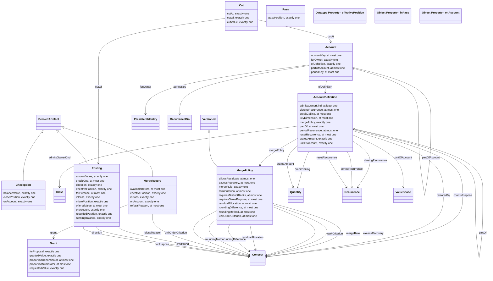

<!-- SPDX-License-Identifier: CC-BY-SA-4.0 -->

# Ledger Ontology — Amounts Consumed and Restored Over Time

Literate specification for the Ledger layer, in the layout of
[ADR-A126](../../docs/architecture/decisions/ADR-A126-literate-specification-layout-and-grammar.md).

---

## 1. Purpose and Scope

Ledger holds amounts that can be consumed and restored, such as a limit, commitment, seat quota, carbon budget, and so on. These are represented by an "account", configured by how much it holds when fresh, what unit it's held in, and the rule for arbitrating several claims on it at once. Accounts form a tree by "part of and not in addition to", so a single draw or credit can affect several accounts at once, along one stated path. 

In order to keep a history of changes to an account, weigh several claims on it together, and let different implementations agree on a shared record, each draw or credit is recorded as a fact of its own: a claim against the account that leaves its stated amount untouched. A balance is always derived by folding an operation over those facts. Conservation then holds by construction, since no balance can disagree with the facts it is derived from. Recording a claim and applying it also become separate acts, so claims made together can be held unresolved and decided together by a stated merge rule.

Separate facts require two forms of ordering. A strict before and after ensures a balance can be read 'as of' a given point, and a mark of which facts belong together ensures they can be decided as one. Wall-clock time can supply neither (since clocks on different machines do not agree closely enough to order two claims), so an evaluator assigns the order deterministically, such that any two implementations given the same inputs will assign the same order.

Each fact carries a whole number placing it among the other facts on its account, called its **position**, and a second number for ordering facts that share a position, called its **micro-position**. The fact itself, containing one draw or credit with its account, owner, amount, direction and position, is referred to as a **posting**.

This one central law then, governs balances: each is a stated amount less what has been drawn, plus what has been restored, less what an account above the one restored had no room for, ensuring a balance is cheap to compute, but provable across properties checkable as a closed, mechanical law. 

Since the effect of a posting is exactly the account plus every ancestor reached by following the ldg:partOf property upward, one fixed edge at a time, the set of accounts a draw touches is always fully enumerable (by walking one chain and checking each link), with no ambiguity about which balances a draw changes.

A posting records the balance of its account after it, its running balance, so a reader of the current balance reads one value. That value is checked against the sum of the postings, so no path lets someone set a balance to a value the postings don't justify.

When disparate evaluations draw on the same account at the same position (being logically simultaneous, not "whoever runs first"), the model follows a fixed path, 'propose -> merge -> settle'. 

1. Propose - each evaluation states what it requires (e.g., a requested value)
2. Merge - the merge rule of the account's policy (priority order / proportionality / refusal) looks at the whole batch together and decides every grant in one pass, producing one merge record
3. Settle - each evaluation then posts whatever it was actually granted

Because the merge step is a pure function of the complete set of proposals, the result can't depend on what order the evaluations happened to run in. No evaluation's outcome therefore, depends on the order in which the others ran, so they may run in parallel. Given exact arithmetic in the account's unit, the account's stated rounding and residual rules, and ties broken by an order defined on the data rather than on arrival, two conforming implementations reach the same grants in any execution order, and the same bytes once their records are written in canonical form. Conformance cases check this.

Ledger accounts do not hold observed values such as prices or temperatures, which are intensive and carry no such law.

## 2. Namespace and Prefixes

| Document | Ontology IRI | Version IRI | Imports |
|---|---|---|---|
| `spec/ledger.ttl` | <https://www.nebularis.org/neuro-semantic/ledger> | <https://www.nebularis.org/neuro-semantic/lattice/ledger/0.22.0> | <https://www.nebularis.org/neuro-semantic/lattice/foundation/0.22.0>, <https://www.nebularis.org/neuro-semantic/lattice/vocabulary/0.22.0>, <https://www.nebularis.org/neuro-semantic/lattice/quantification/0.22.0> |
| `vocab/ledger-vocab.ttl` | <https://www.nebularis.org/neuro-semantic/ledger-vocab> | <https://www.nebularis.org/neuro-semantic/lattice/ledger-vocab/0.22.0> | <https://www.nebularis.org/neuro-semantic/lattice/ledger/0.22.0> |
| `spec/ledger-runtime.ttl` | <https://www.nebularis.org/neuro-semantic/ledger-runtime> | <https://www.nebularis.org/neuro-semantic/lattice/ledger-runtime/0.22.0> | <https://www.nebularis.org/neuro-semantic/lattice/ledger/0.22.0> |

| Prefix | Namespace |
|---|---|
| `ldg:` | <https://www.nebularis.org/neuro-semantic/lattice/ledger#> |
| `fnd:` | <https://www.nebularis.org/neuro-semantic/lattice/foundation#> |
| `voc:` | <https://www.nebularis.org/neuro-semantic/lattice/vocabulary#> |
| `qnt:` | <https://www.nebularis.org/neuro-semantic/lattice/quantification#> |
| `skos:` | <http://www.w3.org/2004/02/skos/core#> |

| Identifier | Role | Display name |
|---|---|---|
| <https://github.com/nebularis> | creator | Nebularis |

## 3. Extraction Contract

- Sections 1, 2 and 6 generate `spec/ledger.ttl`, the configuration document, except the entries inside section 6's `output-file` regions, which generate `spec/ledger-runtime.ttl`, the runtime document. The two share one version, and a design-time check reads only the configuration document.
- The restriction rows of section 6 that are checked in SHACL generate `shapes/structural.ttl`.
- The hidden blocks of section 7 generate `shapes/constraints.ttl`, for the configuration, and `shapes/runtime.ttl`, for the records, each naming its file.
- Extraction rewrites the class diagram (section 4) and the Axiom Index (6.7), which are never edited by
  hand.
- `turtle-example` blocks are illustrative only.

```bash
mise exec -- python tools/literate_extract.py ontology/ledger/README.md --layer ledger --root . --check
```

The module's entry in the [repository catalogue](../../repository-catalogue.md) follows.

```toml repository-catalogue
[module]
kind = "substrate"
roles = ["examples", "shapes", "spec", "vocab"]
imports = ["foundation", "vocabulary", "quantification"]

[module.extract]
spec = ["spec/ledger.ttl", "spec/ledger-runtime.ttl"]
vocab = ["vocab/ledger-vocab.ttl"]
shapes = ["shapes/structural.ttl", "shapes/constraints.ttl", "shapes/runtime.ttl"]
```

## 4. Overview

An `ldg:AccountDefinition` states an amount consumed and restored, in a unit of account that must be extensive, so disjoint parts add to the whole, and a draw along a path and an availability reading (the least remaining balance along it) both mean something. "Part of and not in addition to" is the parent edge, `ldg:partOf`, stated explicitly rather than inferred, so a sublimit sits inside a section inside an aggregate while a further limit for one class of beneficiary sits beside it, never drawn through it.

A key dimension derives one account per key value, on the first draw that names it (a seat quota per site, a sublimit per borrower). A merge rule arbitrates several proposals at one position: in priority order, proportionally (with a rounding method and a residual allocation, since an exact share need not round to a whole unit of account), or by refusing the whole merge. A credit ceiling, defaulting to the stated amount, is how far a credit may restore a balance, which lets a reinstatement raise a layer's capacity above its first stated amount without inventing a second account for it. A purpose lets one draw debit a second account outside its path (a flood sub-aggregate, say). A draw arrives in its account's unit, and the ledger never converts one.

A credit carries a kind, a concept of `ldg:CreditKinds`, which an applied module fills, such as a recovery, a reinstatement or a repayment. An account definition names the kinds that restore it with `ldg:restoredBy`, and accepts every kind where it names none. A credit is posted to an account that accepts its kind, and is applied there up to the account's room below its ceiling. Each ancestor that accepts the kind takes the least of the amount applied and its own room, and where it takes less, the difference is a `ldg:Cut` at that ancestor. So an account's balance is its stated amount, less the debits in its subtree, plus the credits it accepts at the amount applied, less the cuts recorded at it. Each posting records that balance for the account it is on, as `ldg:runningBalance`, and a credit records the amount offered beside the amount applied.

The class diagram below is generated from section 6.

<!-- start: {"generated": "class-diagram"} -->



<!-- end -->

## 5. Detailed Design

### 5.1 Design decisions

- **Configuration and records, in two documents.** Ledger states its configuration: the tree, owner kinds, merge rules and their parameters, the period and closing recurrences, keys, purposes, the kinds of credit that restore an account and credit ceiling ([ADR-A131](../../docs/architecture/decisions/ADR-A131-ledger-layer.md)). Its runtime document states the records: account instances, passes, postings with their running balances, cuts, merge records with their grants, and checkpoints. Computing them is the evaluator's, and Ledger checks what was recorded against its laws (section 7.3).
- **An account instance is named.** An account is a node with a minted IRI, identified by its definition, its owner, its key and its period, which stay its natural key ([ADR-A131](../../docs/architecture/decisions/ADR-A131-ledger-layer.md), its first addendum of 2026-10-27). A posting names that node rather than repeating the four values. An instance states the instance it is part of, so a fold over a subtree follows one edge.
- **A period is an account, not a reset.** Where a definition states `ldg:periodRecurrence`, one account is derived per period, its period key the recurrence bin the effective position falls in, computed at write and never supplied by a draw. One recurrence holds along a path, and a keyed child's instance is part of its parent's under the same bin. Nothing resets, so `ldg:resetRecurrence` is deprecated.
- **Two orderings.** A posting carries an effective position, where the fact sits in the arrangement and comparable across accounts, and a recorded position with a micro-position, where it sits in its own account's append-only sequence. The pass that wrote it carries the position at which it was recorded, on the effective axis, and a posting is never effective later than its pass. Running balances, closes and checkpoints follow the recorded axis, so a reading as of an effective position folds the postings. A position is a natural number on its axis, so the effective and the recorded position are typed `xsd:nonNegativeInteger`, as the shared formal statement of positions that this layer's proofs and the multi-store model use defines one.
- **A draw arrives in its account's unit.** The ledger never converts. A request in another value space is converted before it reaches the ledger, where the conversion is recorded with its rate, the rate's source and its date, and the draw is then made in the account's unit. A posting may cite that record by `prov:wasDerivedFrom`, as it cites a merge record, so the conversion stays traceable and the ledger states no term for it ([ADR-A131](../../docs/architecture/decisions/ADR-A131-ledger-layer.md), its addendum of 2026-11-09).
- **Post at the drawn account only.** A draw writes one posting, on the account drawn, and an ancestor's balance is derived by a fold over its subtree. A purpose-counting account is outside the drawn account's subtree, so it keeps a posting of its own from the same draw. Where a purpose-counting account and the drawn account share an ancestor, that ancestor's fold would count the draw twice, and the rule that prevents it is open (section 13).
- **An exact share is two integers.** A proportional grant keeps its exact share as a numerator and a denominator, not as one `owl:rational`, because no store LATTICE runs compares that literal by value (TSD-70), and the merge shapes compare and sum grants.
- **The running balance sits on the posting.** A posting records the balance of the account it is on after it, that account's subtree included, so the hot path reads one value. No record holds a balance for each account and pass, and a state the decision path does not read is answered from the history when it is asked for ([ADR-A131](../../docs/architecture/decisions/ADR-A131-ledger-layer.md), its first addendum of 2026-11-16). The order is the recorded one. On its own account a posting follows those recorded before it, and on an account below it those of an earlier pass, or of its own pass at a lower or equal micro-position.
- **A credit has a kind, and an account names the kinds that restore it.** The kind is a concept of `ldg:CreditKinds`, which Ledger declares with no member and an applied module fills, since what restores an amount belongs to a domain. An account accepts every kind unless it names some with `ldg:restoredBy`, and an ancestor counts a credit only where it accepts its kind. A credit posted to an account that does not accept its kind is refused, and so is a credit with no kind on a path where an account names its kinds ([ADR-A131](../../docs/architecture/decisions/ADR-A131-ledger-layer.md), its first and fourth addenda of 2026-11-16).
- **A balance is a sum less its cuts.** A credit is applied at the account it is posted to, up to that account's room below its ceiling, and records the amount offered beside the amount applied. `ldg:amountValue` is the amount applied for a credit, as it is the amount drawn for a debit, so a balance is read from one property. Each ancestor that accepts the kind takes the least of the amount applied and its own room, and where it takes less, the writer records the difference as a cut at that ancestor. An account's balance is then its stated amount, less the debits in its subtree, plus the credits it accepts at the amount applied, less the cuts recorded at it, which equals the balance stepped posting by posting, so no read needs an ordered scan to honour a ceiling ([ADR-A131](../../docs/architecture/decisions/ADR-A131-ledger-layer.md), its first addendum of 2026-11-16).
- **A cut is a node of its own, and states no position.** One credit can be cut at several ancestors, so a cut is a `ldg:Cut` that names its posting, the ancestor and its value. A read by position joins the cut to its posting, so a position is recorded once and cannot drift from a copy.
- **A merge policy is a node of its own, and it is versioned.** What a scope declares for competing requests is stated once, on a `ldg:MergePolicy`, and each account definition it governs names a version of it. A contract, a document it cites and a deployment can each state one, and which governs a definition is resolved when the definition is written, so the ledger reads exactly one ([ADR-A131](../../docs/architecture/decisions/ADR-A131-ledger-layer.md), its addendum of 2026-11-17).
- **A rounding difference is settled as the wording says, each direction stated apart.** Shares rounded to the nearest can sum to more than the amount or to less. A policy says whether the rounding is only for show or the difference is settled, and where it is settled, the residual allocation says where a unit short goes and the excess recovery says where a unit over is taken from. Neither is inferred from the other, and silence is refused ([ADR-A131](../../docs/architecture/decisions/ADR-A131-ledger-layer.md), its second addendum of 2026-11-17).
- **`ldg:AccountDefinition` is a plain class.** It is part of the terms that state it and changes only with them, as Behaviour's allowance definition is, so it needs no superclass from Foundation.
  `ldg:AccountDefinition` is a plain `owl:Class` until then. See Open Issues.
- **Every concept scheme is declared now**, including `ldg:PostingDirections`, which only the runtime terms use. A concept scheme is a freestanding declaration, independent of which class first points at it.
- **Eight constraints** (no cycle, matching units, extensive additivity, a proportional rule's rounding and residual, a stated rounding difference, a stated source for a unit over, a credit ceiling at or above the stated amount, a key dimension's type) are SHACL-SPARQL, in section 7. Cardinalities are generated structural shapes from section 6's Restrictions table. The runtime laws are SHACL-SPARQL too, in section 7.3, each citing the theorem of section 10 it checks on one dataset.

### 5.2 Worked reading

A 10,000,000 aggregate has a section of 6,000,000 with a sublimit of 1,000,000, and a further limit of 2,000,000 for one class of beneficiary, in addition to the aggregate. The sublimit and the section each state `ldg:partOf` their parent, and the further limit states no `ldg:partOf` at all, so it is never debited by a draw on the sublimit. All four state the same unit of account, GBP, extensive, with `qnt:Sum` and `qnt:Difference` capabilities. The aggregate also sits `ldg:partOf` an annual cap of twice its amount, and states a `ldg:creditCeiling` equal to its own stated amount (the default), so a reinstatement credit can restore it in full without ever exceeding that ceiling. The annual cap is restored by recoveries alone, so a reinstatement restores the aggregate and leaves the cap the measure of capacity left across the original cover and the reinstatement. [`ontology/ledger/examples/insurance-aggregate.ttl`](examples/insurance-aggregate.ttl) carries this reading in full, with a hand-computed table of its postings and balances.

## 6. Description Logic Encoding

### 6.1 Classes

#### `ldg:AccountDefinition`

**Definition.** An amount consumed and restored, as the terms state it.

**Utility.** Declare one of these for each amount a contract states as a limit, commitment, quota or budget: a software licence's seat pool, a facility's commitment, a grant's budget, an aggregate or a sublimit. State its amount, its unit of account, the kinds of owner it admits and its merge policy always, and state a parent, a period recurrence, a key dimension, purposes it counts against, the kinds of credit that restore it or a credit ceiling only where the terms need them.

**Restrictions.**

| Property | Values | Asserted in | Message |
|---|---|---|---|
| `ldg:statedAmount` | exactly 1 |  |  |
| `ldg:unitOfAccount` | exactly 1 |  |  |
| `ldg:partOf` | max 1 |  |  |
| `ldg:admitsOwnerKind` | min 1 |  |  |
| `ldg:mergePolicy` | exactly 1 |  |  |
| `ldg:resetRecurrence` | max 1 |  |  |
| `ldg:keyDimension` | max 1 |  |  |
| `ldg:creditCeiling` | max 1 |  |  |
| `ldg:periodRecurrence` | max 1 |  |  |
| `ldg:closingRecurrence` | max 1 |  |  |

#### `ldg:MergePolicy`

**Definition.** What a scope declares for requests that compete at one position.

**Utility.** State one for each scope that says how competing requests are treated, a contract, a document it cites or a deployment, and name it from every account definition it governs. It carries the merge rule always, a rounding method and a residual allocation where the rule shares in proportion, and the criteria, the permission and the guards only where the terms state them. A policy is versioned. A change of treatment is a new version, and an account definition names the version that governs it, so what a past balance was settled under does not change. Where several accounts take part in one merge, the policy of the account the requests are made at governs.

**Subclass of.** `fnd:Versioned`

**Restrictions.**

| Property | Values | Asserted in | Message |
|---|---|---|---|
| `ldg:mergeRule` | exactly 1 |  |  |
| `ldg:roundingMethod` | max 1 |  |  |
| `ldg:residualAllocation` | max 1 |  |  |
| `ldg:roundingDifference` | max 1 |  |  |
| `ldg:excessRecovery` | max 1 |  |  |
| `ldg:rankCriterion` | max 1 |  |  |
| `ldg:unitOrderCriterion` | max 1 |  |  |
| `ldg:allowsResiduals` | max 1 |  |  |
| `ldg:requiresDistinctRanks` | max 1 |  |  |
| `ldg:requiresSamePurpose` | max 1 |  |  |

<!-- start: {"output-file": "spec/ledger-runtime.ttl"} -->

#### `ldg:Account`

**Definition.** One account instance: an account definition held by one owner, for one key value and one period where the definition states them.

**Utility.** Mint one the first time a draw names its definition, owner, key and period, and name it from every posting, cut, merge record and checkpoint on it. The four values stay its natural key, so an adopter holding them still resolves it. State the instance it is part of where its definition is part of another.

**Restrictions.**

| Property | Values | Asserted in | Message |
|---|---|---|---|
| `ldg:ofDefinition` | exactly 1 |  |  |
| `ldg:forOwner` | exactly 1 |  |  |
| `ldg:accountKey` | max 1 |  |  |
| `ldg:periodKey` | max 1 |  |  |
| `ldg:partOfAccount` | max 1 |  |  |

#### `ldg:Pass`

**Definition.** One evaluation's write of records, recorded at one position.

**Utility.** What an evaluation records about itself beyond its postings. Every posting, merge record and checkpoint names the pass that wrote it. A pass's position is on the effective axis, so the records it writes are effective no later than it, and it is the recorded axis's order across accounts. A speculative pass is written to a graph that can be dropped, never flagged.

**Restrictions.**

| Property | Values | Asserted in | Message |
|---|---|---|---|
| `ldg:passPosition` | exactly 1 |  |  |

#### `ldg:Posting`

**Definition.** One draw or credit on one account.

**Subclass of.** `fnd:DerivedArtefact`

**Utility.** Write one per draw or credit, on the account named, and one more on each account that counts the draw's purpose. An ancestor's balance is derived, never posted. State the running balance of the account posted to, after the posting. A credit states its kind, where it has one, and the amount offered beside the amount applied, and a cut for each ancestor that had less room. Its read set is `prov:wasDerivedFrom`, which names the merge record and grant a merged draw came from, and any record made before the ledger that the draw rests on, such as a conversion.

**Restrictions.**

| Property | Values | Asserted in | Message |
|---|---|---|---|
| `ldg:onAccount` | exactly 1 |  |  |
| `ldg:inPass` | exactly 1 |  |  |
| `ldg:effectivePosition` | exactly 1 |  |  |
| `ldg:recordedPosition` | exactly 1 |  |  |
| `ldg:microPosition` | exactly 1 |  |  |
| `ldg:direction` | exactly 1 |  |  |
| `ldg:amountValue` | exactly 1 |  |  |
| `ldg:runningBalance` | exactly 1 |  |  |
| `ldg:creditKind` | max 1 |  |  |
| `ldg:offeredValue` | max 1 |  |  |
| `ldg:forPurpose` | max 1 |  |  |

#### `ldg:Cut`

**Definition.** How much less an ancestor took of a credit than was applied at the account it was posted to.

**Utility.** Write one for each ancestor that accepts the credit's kind and had less room than the amount applied, with the room it lacked as its value. It is part of its credit's record, never a posting in the ancestor's book, and it states no position, since a read by position joins it to its posting.

**Restrictions.**

| Property | Values | Asserted in | Message |
|---|---|---|---|
| `ldg:cutOf` | exactly 1 |  |  |
| `ldg:cutAt` | exactly 1 |  |  |
| `ldg:cutValue` | exactly 1 |  |  |

#### `ldg:MergeRecord`

**Definition.** The merge of the proposals at one account and one effective position.

**Subclass of.** `fnd:DerivedArtefact`

**Utility.** Write one where proposals at one position draw on one account, holding one grant per proposal granted. Under `ldg:Refuse` an overdrawing merge holds no grant and states its reason. State the availability the merge was given, so its grants can be checked against it.

**Restrictions.**

| Property | Values | Asserted in | Message |
|---|---|---|---|
| `ldg:onAccount` | exactly 1 |  |  |
| `ldg:inPass` | exactly 1 |  |  |
| `ldg:effectivePosition` | exactly 1 |  |  |
| `ldg:availableBefore` | max 1 |  |  |
| `ldg:refusalReason` | max 1 |  |  |

#### `ldg:Grant`

**Definition.** One proposal's request and what the merge granted it.

**Utility.** Part of its merge record, never a record of its own. A proportional merge's exact share is two whole numbers, a numerator and a denominator, since no store measured compares an `owl:rational` by value (section 9).

**Restrictions.**

| Property | Values | Asserted in | Message |
|---|---|---|---|
| `ldg:forProposal` | exactly 1 |  |  |
| `ldg:requestedValue` | exactly 1 |  |  |
| `ldg:grantedValue` | exactly 1 |  |  |
| `ldg:proportionNumerator` | max 1 |  |  |
| `ldg:proportionDenominator` | max 1 |  |  |

#### `ldg:Checkpoint`

**Definition.** An account's balance at a close, along the recorded axis.

**Subclass of.** `fnd:DerivedArtefact`

**Utility.** Write one at each close of `ldg:closingRecurrence` for each account whose balance moved since its last checkpoint. It counts the postings of passes recorded by the close, whatever their effective positions, so a posting recorded later and effective earlier never disturbs it. Derive its IRI from the account and the close position.

**Restrictions.**

| Property | Values | Asserted in | Message |
|---|---|---|---|
| `ldg:onAccount` | exactly 1 |  |  |
| `ldg:closePosition` | exactly 1 |  |  |
| `ldg:balanceValue` | exactly 1 |  |  |

<!-- end -->

### 6.2 Object Properties

#### `ldg:statedAmount`

**Definition.** The amount when fresh.

**Utility.** States an account definition's amount before any draw, in its unit of account. Point at a
`qnt:Quantity` on the same space named by `ldg:unitOfAccount`.

**Domain.** `ldg:AccountDefinition`

**Range.** `qnt:Quantity`

**Characteristics.** functional

#### `ldg:unitOfAccount`

**Definition.** The value space every posting on this account is in.

**Utility.** Names the value space an account's amounts are stated and posted in. The space must be
extensive (`qnt:additivity qnt:Extensive`) with `qnt:Sum` and `qnt:Difference` capabilities, since Ledger
holds only amounts whose parts add to the whole (§1).

**Domain.** `ldg:AccountDefinition`

**Range.** `qnt:ValueSpace`

**Characteristics.** functional

#### `ldg:partOf`

**Definition.** "Part of and not in addition to": the parent edge of the account tree.

**Utility.** States that this account's balance is drawn from its parent's too, along the same path. An
account outside another's subtree is in addition to it, never drawn through it, so state no `ldg:partOf`
for a limit that sits beside another rather than inside it. The edge is stated, never inferred, and may
not cycle.

**Domain.** `ldg:AccountDefinition`

**Range.** `ldg:AccountDefinition`

**Characteristics.** functional

#### `ldg:admitsOwnerKind`

**Definition.** The kinds of owner this account admits.

**Utility.** Names, by class, who may own this account: an instrument, an authority, an ensemble such as a
programme or a vehicle, or any other `fnd:PersistentIdentity`. State one value for each kind the terms
allow.

**Domain.** `ldg:AccountDefinition`

**Range.** `rdfs:Class`

#### `ldg:mergePolicy`

**Definition.** The merge policy that governs requests competing on this account.

**Utility.** Name the version of the policy in force for the account. Which policy governs is resolved when the definition is written, from the contract's clauses, then a document it cites, then the deployment's rules. A definition states exactly one, so nothing is looked up when requests are merged, and it names a version, so a later change to the policy does not reach it.

**Domain.** `ldg:AccountDefinition`

**Range.** `ldg:MergePolicy`

**Characteristics.** functional

#### `ldg:mergeRule`

**Definition.** What happens when several draws at one position together exceed availability.

**Utility.** Selects the arbitration rule of this policy: `ldg:InPriorityOrder`, `ldg:Proportional` (also state `ldg:roundingMethod` and `ldg:residualAllocation`), or `ldg:Refuse` (the whole merge is refused, with no grant, where proposals together overdraw the account).

**Domain.** `ldg:MergePolicy`

**Range.** `skos:Concept`

**Characteristics.** functional

#### `ldg:roundingMethod`

**Definition.** How a proportional merge's exact shares are rounded to the account's unit.

**Utility.** Required wherever `ldg:mergeRule` is `ldg:Proportional`. An exact proportional share need not be a whole unit of account, so state how it rounds: `ldg:HalfEven`, `ldg:HalfUp` or `ldg:TowardZero`.

**Domain.** `ldg:MergePolicy`

**Range.** `skos:Concept`

**Characteristics.** functional

#### `ldg:residualAllocation`

**Definition.** How the rounding residual is allocated so a proportional merge's grants still sum to availability.

**Utility.** Required wherever `ldg:mergeRule` is `ldg:Proportional`. Rounding every share independently can leave the sum short of, or over, availability by a unit or two, so state how that residual is allocated, `ldg:LargestRemainder` (ties taken in the order the policy declares, never by the proposals' identifiers) or `ldg:ToFirstInOrder`.

**Domain.** `ldg:MergePolicy`

**Range.** `skos:Concept`

**Characteristics.** functional

#### `ldg:roundingDifference`

**Definition.** How the difference left by rounding shares to the nearest is settled.

**Utility.** Required wherever `ldg:roundingMethod` is `ldg:HalfEven` or `ldg:HalfUp` beside a residual allocation, since shares rounded to the nearest can sum to more than the amount or to less. State `ldg:ShownOnly` where the wording rounds a share only to show it, so the split is the shares rounded down with the units short given as the residual allocation says. State `ldg:SettledToNearest` where each share is rounded to the nearest and the difference is settled a unit at a time, and state `ldg:excessRecovery` with it.

**Domain.** `ldg:MergePolicy`

**Range.** `skos:Concept`

**Characteristics.** functional

#### `ldg:excessRecovery`

**Definition.** Where a unit over is taken from when shares rounded to the nearest sum to more than the amount.

**Utility.** Required wherever `ldg:roundingDifference` is `ldg:SettledToNearest`. A unit short is given as `ldg:residualAllocation` says, and a unit over is taken back as this says, `ldg:FromFirstInOrder` or `ldg:FromMostRoundedUp`. The two are stated apart, since a wording may settle them differently.

**Domain.** `ldg:MergePolicy`

**Range.** `skos:Concept`

**Characteristics.** functional

#### `ldg:rankCriterion`

**Definition.** What a request's rank is derived from.

**Utility.** Name the criterion the terms order requests by, for example the order in which they were notified. Each request carries the rank derived from it, a lower rank is served first, and requests of one rank are a tie. Its value is a concept of `ldg:OrderCriteria`, which an applied module supplies.

**Domain.** `ldg:MergePolicy`

**Range.** `skos:Concept`

**Characteristics.** functional

#### `ldg:unitOrderCriterion`

**Definition.** What orders requests of one rank where a single unit is placed or taken back.

**Utility.** State it where a rule places units one at a time, as `ldg:ToFirstInOrder` does and as `ldg:LargestRemainder` does among equal remainders. The rank criterion cannot serve, since requests of one rank are tied under it. Where none is stated, a unit that needs an order is left where the policy permits a residual, and the merge is refused where it does not. Its value is a concept of `ldg:OrderCriteria`.

**Domain.** `ldg:MergePolicy`

**Range.** `skos:Concept`

**Characteristics.** functional

#### `ldg:resetRecurrence`

**Definition.** Deprecated: when the account was to return to its stated amount.

**Utility.** Use `ldg:periodRecurrence`. A reset credit restoring the account lets a draw effective in the old period but recorded after the reset be tested against the new period's amount, so a periodic amount is one account per period instead. Removed with Behaviour's allowance terms.

**Domain.** `ldg:AccountDefinition`

**Range.** `qnt:Recurrence`

**Characteristics.** functional

#### `ldg:periodRecurrence`

**Definition.** The recurrence whose periods each have an account of their own.

**Utility.** States that the amount applies once per period (an annual seat licence, a quarterly support-hours bundle). The period key of an account is the bin of this recurrence that a draw's effective position falls in, computed at write and never supplied by the draw, and a draw whose effective position cannot be binned is Undetermined. One recurrence holds along a path. Leave unset for an amount that never renews.

**Domain.** `ldg:AccountDefinition`

**Range.** `qnt:Recurrence`

**Characteristics.** functional

#### `ldg:closingRecurrence`

**Definition.** The recurrence at whose boundaries the account's book closes and a checkpoint is written.

**Utility.** Sets the trade between storage and read cost per account: a heavily drawn aggregate closes often and a quiet one seldom. A close is keyed on the recorded axis, so it seals the postings recorded by then. Leave unset for an account whose history is folded whole.

**Domain.** `ldg:AccountDefinition`

**Range.** `qnt:Recurrence`

**Characteristics.** functional

#### `ldg:keyDimension`

**Definition.** The dimension that derives one account per key value.

**Utility.** States that this definition's amount applies once per key value (a site, a borrower), each
key's account derived independently on the first draw that names it. Point at a `skos:ConceptScheme`
naming the key values, or at a `qnt:ValueSpace` where the key is itself a quantity. Leave unset for an
account with no key.

**Domain.** `ldg:AccountDefinition`

**Range.** `skos:ConceptScheme or qnt:ValueSpace`

**Characteristics.** functional

#### `ldg:countsPurpose`

**Definition.** A purpose which, when a draw names it, also debits this account outside its path.

**Utility.** Lets an account outside the drawn path still be debited by a draw that names a purpose this
account counts, so a cross-cutting sub-aggregate (a flood aggregate beside a peril-neutral tree) still
erodes with the rest. State one value per purpose this account counts.

**Domain.** `ldg:AccountDefinition`

**Range.** `skos:Concept`

#### `ldg:creditCeiling`

**Definition.** The most a credit restores this account to.

**Utility.** States the ceiling a credit may never restore the balance above. Defaults to the stated
amount where unset. State a ceiling above the stated amount for a reinstatement (the aggregate's own
stated amount stays the per-layer limit, and the ceiling lets one reinstatement credit raise the balance
to twice it, without a second account).

**Domain.** `ldg:AccountDefinition`

**Range.** `qnt:Quantity`

**Characteristics.** functional

#### `ldg:restoredBy`

**Definition.** A kind of credit that restores this account.

**Utility.** State one value for each kind the terms say restores the account, a concept of `ldg:CreditKinds`. An account that states none accepts every kind. A credit is posted only to an account that accepts its kind, and an ancestor counts a credit only where it accepts the kind, so an annual cap that recoveries restore and a reinstatement does not states the recovery alone.

**Domain.** `ldg:AccountDefinition`

**Range.** `skos:Concept`

<!-- start: {"output-file": "spec/ledger-runtime.ttl"} -->

#### `ldg:ofDefinition`

**Definition.** The account definition an account instance holds.

**Domain.** `ldg:Account`

**Range.** `ldg:AccountDefinition`

**Characteristics.** functional

#### `ldg:forOwner`

**Definition.** The owner of an account instance.

**Utility.** Any persistent identity whose kind the definition admits, so the account outlives a new version of what owns it.

**Domain.** `ldg:Account`

**Range.** `fnd:PersistentIdentity`

**Characteristics.** functional

#### `ldg:accountKey`

**Definition.** The key value of an account instance, where its definition states a key dimension.

**Domain.** `ldg:Account`

**Range.** `skos:Concept or qnt:Value`

**Characteristics.** functional

#### `ldg:periodKey`

**Definition.** The period of an account instance, where its definition states a period recurrence.

**Utility.** The bin of the definition's `ldg:periodRecurrence` that the effective position of the draw which derived the account falls in. Computed at write, never supplied by a draw.

**Domain.** `ldg:Account`

**Range.** `qnt:RecurrenceBin`

**Characteristics.** functional

#### `ldg:partOfAccount`

**Definition.** The account instance this one is part of, following its definition's `ldg:partOf`.

**Utility.** State it when the instance is derived: the parent definition's instance for the same owner, under the same period key. A fold over an account's subtree follows this edge.

**Domain.** `ldg:Account`

**Range.** `ldg:Account`

**Characteristics.** functional

#### `ldg:onAccount`

**Definition.** The account instance a record is about.

**Domain.** `ldg:Posting or ldg:MergeRecord or ldg:Checkpoint`

**Range.** `ldg:Account`

**Characteristics.** functional

#### `ldg:inPass`

**Definition.** The pass that wrote a record.

**Domain.** `ldg:Posting or ldg:MergeRecord`

**Range.** `ldg:Pass`

**Characteristics.** functional

#### `ldg:direction`

**Definition.** Whether a posting debits or credits its account.

**Domain.** `ldg:Posting`

**Range.** `skos:Concept`

**Characteristics.** functional

#### `ldg:forPurpose`

**Definition.** The purpose a draw names.

**Domain.** `ldg:Posting`

**Range.** `skos:Concept`

**Characteristics.** functional

#### `ldg:creditKind`

**Definition.** The kind of a credit, a concept of `ldg:CreditKinds`.

**Utility.** State it on a credit where the terms give its kind. A credit with no kind is accepted only by accounts that state no kind, and is refused on a path where an account states its kinds.

**Domain.** `ldg:Posting`

**Range.** `skos:Concept`

**Characteristics.** functional

#### `ldg:cutOf`

**Definition.** The credit a cut belongs to.

**Domain.** `ldg:Cut`

**Range.** `ldg:Posting`

**Characteristics.** functional

#### `ldg:cutAt`

**Definition.** The ancestor at which a credit was cut.

**Utility.** An ancestor of the account the credit was posted to, which accepts its kind.

**Domain.** `ldg:Cut`

**Range.** `ldg:Account`

**Characteristics.** functional

#### `ldg:grant`

**Definition.** A grant a merge record holds.

**Domain.** `ldg:MergeRecord`

**Range.** `ldg:Grant`

#### `ldg:forProposal`

**Definition.** The evaluation that proposed a grant's draw.

**Utility.** Deliberately has no range: the layer above names its evaluations.

**Domain.** `ldg:Grant`

**Characteristics.** functional

#### `ldg:refusalReason`

**Definition.** Why a merge under `ldg:Refuse` granted nothing.

**Domain.** `ldg:MergeRecord`

**Range.** `skos:Concept`

**Characteristics.** functional

<!-- end -->

### 6.3 Datatype Properties

The configuration declares three, a permission and two guards of a merge policy. In the runtime document a posting's effective and recorded positions are natural numbers, its other positions whole numbers, and its amounts decimals in the account's unit of account.

#### `ldg:allowsResiduals`

**Definition.** Whether a merge under this policy may grant less than is available where its rule cannot place every unit.

**Utility.** State true where the terms allow a part to stay unplaced, as where requests are of no use in part or equal remainders have no order to decide them. Unstated or false, a merge that would leave a unit is refused.

**Domain.** `ldg:MergePolicy`

**Range.** `xsd:boolean`

**Characteristics.** functional

#### `ldg:requiresDistinctRanks`

**Definition.** Whether the ranks of the requests at one position are checked to be distinct before any rule runs.

**Utility.** State true where the terms give every request a place of its own, so two requests of one rank are refused outright. Unstated or false, a tie is settled by the merge rule, and refused only where it arises and the rule cannot settle it.

**Domain.** `ldg:MergePolicy`

**Range.** `xsd:boolean`

**Characteristics.** functional

#### `ldg:requiresSamePurpose`

**Definition.** Whether the requests at one position must agree on purpose.

**Utility.** State true where the terms do not let requests of different purposes compete in one merge. Requests agree where all name the same purpose or all name none, and a position where they do not is refused before any rule runs. Unstated or false, each request is first cut to what the accounts counting its purpose hold, and then competes.

**Domain.** `ldg:MergePolicy`

**Range.** `xsd:boolean`

**Characteristics.** functional

<!-- start: {"output-file": "spec/ledger-runtime.ttl"} -->

#### `ldg:passPosition`

**Definition.** The position at which a pass was recorded, on the effective axis.

**Domain.** `ldg:Pass`

**Range.** `xsd:integer`

**Characteristics.** functional

#### `ldg:effectivePosition`

**Definition.** Where a fact sits in the arrangement the accounts describe.

**Utility.** Supplied by the domain and comparable across accounts. Never later than the position of the pass that recorded the fact.

**Domain.** `ldg:Posting or ldg:MergeRecord`

**Range.** `xsd:nonNegativeInteger`

**Characteristics.** functional

#### `ldg:recordedPosition`

**Definition.** Where a posting sits in its own account's append-only sequence.

**Utility.** Assigned by the account's writer and increasing, so it is total within one account and compares nothing across accounts.

**Domain.** `ldg:Posting`

**Range.** `xsd:nonNegativeInteger`

**Characteristics.** functional

#### `ldg:microPosition`

**Definition.** The order of postings that share a recorded position on one account, and of the postings of one pass across accounts.

**Utility.** Assigned by the evaluator from an order defined on the data, never on arrival. A running balance counts a posting of its own pass on another account of its subtree where that posting's micro-position is at or below its own.

**Domain.** `ldg:Posting`

**Range.** `xsd:integer`

**Characteristics.** functional

#### `ldg:amountValue`

**Definition.** A posting's amount, in its account's unit of account: the amount drawn for a debit, and the amount applied for a credit.

**Utility.** The one amount a balance is summed from. A credit's amount applied is what restored the account it was posted to, up to that account's room below its ceiling.

**Domain.** `ldg:Posting`

**Range.** `xsd:decimal`

**Characteristics.** functional

#### `ldg:offeredValue`

**Definition.** The amount a credit offered, before it was applied.

**Utility.** State it on every credit, and on no debit. It is at least the amount applied, which is never below zero, and where it is more, the account posted to is at its ceiling after the credit. A reading of the flows counts it, and a balance does not.

**Domain.** `ldg:Posting`

**Range.** `xsd:decimal`

**Characteristics.** functional

#### `ldg:runningBalance`

**Definition.** The balance of a posting's account after the posting, its subtree included.

**Utility.** Written by the account's writer, which holds the balances along the path. It is the account's stated amount, less the debits in its subtree, plus the credits it accepts at the amount applied, less the cuts recorded at it, over the postings up to this one in recorded order.

**Domain.** `ldg:Posting`

**Range.** `xsd:decimal`

**Characteristics.** functional

#### `ldg:cutValue`

**Definition.** How much less an ancestor took of a credit than was applied.

**Utility.** Positive, and at most the credit's amount applied. The ancestor's balance after the credit is then at its ceiling.

**Domain.** `ldg:Cut`

**Range.** `xsd:decimal`

**Characteristics.** functional

#### `ldg:availableBefore`

**Definition.** The availability a merge was given.

**Domain.** `ldg:MergeRecord`

**Range.** `xsd:decimal`

**Characteristics.** functional

#### `ldg:requestedValue`

**Definition.** What a proposal requested, in the account's unit.

**Domain.** `ldg:Grant`

**Range.** `xsd:decimal`

**Characteristics.** functional

#### `ldg:grantedValue`

**Definition.** What the merge granted a proposal, in the account's unit, after rounding and residual.

**Domain.** `ldg:Grant`

**Range.** `xsd:decimal`

**Characteristics.** functional

#### `ldg:proportionNumerator`

**Definition.** The numerator of a proportional grant's exact share.

**Utility.** State it with `ldg:proportionDenominator`. The share is kept exact because other evaluations cite it, and the posting is rounded.

**Domain.** `ldg:Grant`

**Range.** `xsd:integer`

**Characteristics.** functional

#### `ldg:proportionDenominator`

**Definition.** The denominator of a proportional grant's exact share, positive.

**Domain.** `ldg:Grant`

**Range.** `xsd:integer`

**Characteristics.** functional

#### `ldg:closePosition`

**Definition.** The position of the close a checkpoint was written at, on the axis of pass positions.

**Domain.** `ldg:Checkpoint`

**Range.** `xsd:integer`

**Characteristics.** functional

#### `ldg:balanceValue`

**Definition.** An account's balance at a checkpoint's close.

**Domain.** `ldg:Checkpoint`

**Range.** `xsd:decimal`

**Characteristics.** functional

<!-- end -->

### 6.4 Individuals

The merge rules, posting directions, rounding methods, residual allocations, rounding differences and excess recoveries are each a `skos:Concept` in a scheme of its own. `ldg:PostingDirections` is used only by the runtime terms. `ldg:OrderCriteria` is declared with no member, since what requests are ordered by belongs to a domain, and an applied module adds its concepts to it. `ldg:CreditKinds` is declared with no member for the same reason, since what restores an amount, a recovery, a reinstatement or a repayment, belongs to a domain.

**Concept schemes.**

| Individual | Type | Definition |
|---|---|---|
| `ldg:MergeRules` | `skos:ConceptScheme` | What happens when several draws at one position together exceed availability. |
| `ldg:PostingDirections` | `skos:ConceptScheme` | Whether a posting debits or credits its account. |
| `ldg:RoundingMethods` | `skos:ConceptScheme` | How a proportional merge's exact shares round to the account's unit. |
| `ldg:ResidualAllocations` | `skos:ConceptScheme` | How a proportional merge's rounding residual is allocated. |
| `ldg:RoundingDifferences` | `skos:ConceptScheme` | How the difference left by rounding shares to the nearest is settled. |
| `ldg:ExcessRecoveries` | `skos:ConceptScheme` | Where a unit over is taken from. |
| `ldg:OrderCriteria` | `skos:ConceptScheme` | What requests are ordered by, for their rank and for the placing of single units. |
| `ldg:CreditKinds` | `skos:ConceptScheme` | The kinds of credit, which an account names to say what restores it. |

**`ldg:MergeRules`.**

| Individual | Type | Definition |
|---|---|---|
| `ldg:InPriorityOrder` | `skos:Concept` | Draws are granted in the priority order the merge policy declares until availability is exhausted. The order is the policy's declaration, never the order of the proposals' identifiers. |
| `ldg:Proportional` | `skos:Concept` | Draws are granted in proportion to the amounts requested, rounded and allocated per the policy's `ldg:roundingMethod` and `ldg:residualAllocation`. |
| `ldg:Refuse` | `skos:Concept` | Where proposals together exceed availability, the whole merge is refused: no grant, a reason recorded, no posting. |

**`ldg:PostingDirections`.**

| Individual | Type | Definition |
|---|---|---|
| `ldg:Debit` | `skos:Concept` | A draw, reducing the balance. |
| `ldg:Credit` | `skos:Concept` | A restoration, applied at the account it is posted to up to that account's room, and counted at each ancestor that accepts its kind. |

**`ldg:RoundingMethods`.**

| Individual | Type | Definition |
|---|---|---|
| `ldg:HalfEven` | `skos:Concept` | Rounds a tie to the nearest even value. |
| `ldg:HalfUp` | `skos:Concept` | Rounds a tie away from zero. |
| `ldg:TowardZero` | `skos:Concept` | Truncates toward zero. |

**`ldg:ResidualAllocations`.**

| Individual | Type | Definition |
|---|---|---|
| `ldg:LargestRemainder` | `skos:Concept` | The residual is allocated one unit at a time to the proposals with the largest rounding remainders, ties taken in the order the merge policy declares, never in the order of the proposals' identifiers. With no order declared, the units that equal remainders do not decide are left. |
| `ldg:ToFirstInOrder` | `skos:Concept` | The residual is allocated one unit at a time to the first proposals in the order the merge policy declares, never in the order of their identifiers. |

**`ldg:RoundingDifferences`.**

| Individual | Type | Definition |
|---|---|---|
| `ldg:ShownOnly` | `skos:Concept` | The rounding method governs only how a share is shown. The split is the shares rounded down, with the units short allocated as the residual allocation says. |
| `ldg:SettledToNearest` | `skos:Concept` | Each share is rounded to the nearest. A unit short goes to a share that was rounded down, as the residual allocation says, and a unit over is taken from a share that was rounded up, as the excess recovery says, so no share is a whole unit from its exact value. |

**`ldg:ExcessRecoveries`.**

| Individual | Type | Definition |
|---|---|---|
| `ldg:FromFirstInOrder` | `skos:Concept` | A unit over is taken, one at a time, from the first shares rounded up in the order the merge policy declares. |
| `ldg:FromMostRoundedUp` | `skos:Concept` | A unit over is taken, one at a time, from the shares rounded up by the most, ties taken in the order the merge policy declares. |

### 6.5 Disjointness and Keys

The runtime document's classes are pairwise disjoint, and disjoint from the account definition.

<!-- start: {"output-file": "spec/ledger-runtime.ttl"} -->

**All disjoint.** `ldg:AccountDefinition`, `ldg:Account`, `ldg:Pass`, `ldg:Posting`, `ldg:Cut`, `ldg:MergeRecord`, `ldg:Grant`, `ldg:Checkpoint`

<!-- end -->

### 6.6 Other Axioms

`ldg:resetRecurrence` is deprecated in favour of `ldg:periodRecurrence`, since a periodic amount is one account per period and nothing resets an account.

```turtle-spec
ldg:resetRecurrence owl:deprecated true .
```

`ldg:mergePolicy` bears meaning, since every balance on an account is settled under the policy its definition names.

```turtle-spec
ldg:mergePolicy fnd:meaningBearing true .
```

### 6.7 Axiom Index

<!-- start: {"generated": "axiom-index"} -->

| Term | Kind | Summary |
|---|---|---|
| `ldg:Account` | Class | Disjoint with `ldg:AccountDefinition`, `ldg:Checkpoint`, `ldg:Cut`, `ldg:Grant`, `ldg:MergeRecord`, `ldg:Pass`, `ldg:Posting`. Restrictions `ldg:accountKey` max 1, `ldg:forOwner` exactly 1, `ldg:ofDefinition` exactly 1, `ldg:partOfAccount` max 1, `ldg:periodKey` max 1. |
| `ldg:AccountDefinition` | Class | Disjoint with `ldg:Account`, `ldg:Checkpoint`, `ldg:Cut`, `ldg:Grant`, `ldg:MergeRecord`, `ldg:Pass`, `ldg:Posting`. Restrictions `ldg:admitsOwnerKind` min 1, `ldg:closingRecurrence` max 1, `ldg:creditCeiling` max 1, `ldg:keyDimension` max 1, `ldg:mergePolicy` exactly 1, `ldg:partOf` max 1, `ldg:periodRecurrence` max 1, `ldg:resetRecurrence` max 1, `ldg:statedAmount` exactly 1, `ldg:unitOfAccount` exactly 1. |
| `ldg:Checkpoint` | Class | Subclass of `fnd:DerivedArtefact`. Disjoint with `ldg:Account`, `ldg:AccountDefinition`, `ldg:Cut`, `ldg:Grant`, `ldg:MergeRecord`, `ldg:Pass`, `ldg:Posting`. Restrictions `ldg:balanceValue` exactly 1, `ldg:closePosition` exactly 1, `ldg:onAccount` exactly 1. |
| `ldg:Cut` | Class | Disjoint with `ldg:Account`, `ldg:AccountDefinition`, `ldg:Checkpoint`, `ldg:Grant`, `ldg:MergeRecord`, `ldg:Pass`, `ldg:Posting`. Restrictions `ldg:cutAt` exactly 1, `ldg:cutOf` exactly 1, `ldg:cutValue` exactly 1. |
| `ldg:Grant` | Class | Disjoint with `ldg:Account`, `ldg:AccountDefinition`, `ldg:Checkpoint`, `ldg:Cut`, `ldg:MergeRecord`, `ldg:Pass`, `ldg:Posting`. Restrictions `ldg:forProposal` exactly 1, `ldg:grantedValue` exactly 1, `ldg:proportionDenominator` max 1, `ldg:proportionNumerator` max 1, `ldg:requestedValue` exactly 1. |
| `ldg:MergePolicy` | Class | Subclass of `fnd:Versioned`. Restrictions `ldg:allowsResiduals` max 1, `ldg:excessRecovery` max 1, `ldg:mergeRule` exactly 1, `ldg:rankCriterion` max 1, `ldg:requiresDistinctRanks` max 1, `ldg:requiresSamePurpose` max 1, `ldg:residualAllocation` max 1, `ldg:roundingDifference` max 1, `ldg:roundingMethod` max 1, `ldg:unitOrderCriterion` max 1. |
| `ldg:MergeRecord` | Class | Subclass of `fnd:DerivedArtefact`. Disjoint with `ldg:Account`, `ldg:AccountDefinition`, `ldg:Checkpoint`, `ldg:Cut`, `ldg:Grant`, `ldg:Pass`, `ldg:Posting`. Restrictions `ldg:availableBefore` max 1, `ldg:effectivePosition` exactly 1, `ldg:inPass` exactly 1, `ldg:onAccount` exactly 1, `ldg:refusalReason` max 1. |
| `ldg:Pass` | Class | Disjoint with `ldg:Account`, `ldg:AccountDefinition`, `ldg:Checkpoint`, `ldg:Cut`, `ldg:Grant`, `ldg:MergeRecord`, `ldg:Posting`. Restrictions `ldg:passPosition` exactly 1. |
| `ldg:Posting` | Class | Subclass of `fnd:DerivedArtefact`. Disjoint with `ldg:Account`, `ldg:AccountDefinition`, `ldg:Checkpoint`, `ldg:Cut`, `ldg:Grant`, `ldg:MergeRecord`, `ldg:Pass`. Restrictions `ldg:amountValue` exactly 1, `ldg:creditKind` max 1, `ldg:direction` exactly 1, `ldg:effectivePosition` exactly 1, `ldg:forPurpose` max 1, `ldg:inPass` exactly 1, `ldg:microPosition` exactly 1, `ldg:offeredValue` max 1, `ldg:onAccount` exactly 1, `ldg:recordedPosition` exactly 1, `ldg:runningBalance` exactly 1. |
| `ldg:accountKey` | Object property | Domain `ldg:Account`. Range `skos:Concept` or `qnt:Value`. Functional. |
| `ldg:admitsOwnerKind` | Object property | Domain `ldg:AccountDefinition`. Range `rdfs:Class`. |
| `ldg:closingRecurrence` | Object property | Domain `ldg:AccountDefinition`. Range `qnt:Recurrence`. Functional. |
| `ldg:countsPurpose` | Object property | Domain `ldg:AccountDefinition`. Range `skos:Concept`. |
| `ldg:creditCeiling` | Object property | Domain `ldg:AccountDefinition`. Range `qnt:Quantity`. Functional. |
| `ldg:creditKind` | Object property | Domain `ldg:Posting`. Range `skos:Concept`. Functional. |
| `ldg:cutAt` | Object property | Domain `ldg:Cut`. Range `ldg:Account`. Functional. |
| `ldg:cutOf` | Object property | Domain `ldg:Cut`. Range `ldg:Posting`. Functional. |
| `ldg:direction` | Object property | Domain `ldg:Posting`. Range `skos:Concept`. Functional. |
| `ldg:excessRecovery` | Object property | Domain `ldg:MergePolicy`. Range `skos:Concept`. Functional. |
| `ldg:forOwner` | Object property | Domain `ldg:Account`. Range `fnd:PersistentIdentity`. Functional. |
| `ldg:forProposal` | Object property | Domain `ldg:Grant`. Functional. |
| `ldg:forPurpose` | Object property | Domain `ldg:Posting`. Range `skos:Concept`. Functional. |
| `ldg:grant` | Object property | Domain `ldg:MergeRecord`. Range `ldg:Grant`. |
| `ldg:inPass` | Object property | Domain `ldg:Posting` or `ldg:MergeRecord`. Range `ldg:Pass`. Functional. |
| `ldg:keyDimension` | Object property | Domain `ldg:AccountDefinition`. Range `skos:ConceptScheme` or `qnt:ValueSpace`. Functional. |
| `ldg:mergePolicy` | Object property | Domain `ldg:AccountDefinition`. Range `ldg:MergePolicy`. Functional. |
| `ldg:mergeRule` | Object property | Domain `ldg:MergePolicy`. Range `skos:Concept`. Functional. |
| `ldg:ofDefinition` | Object property | Domain `ldg:Account`. Range `ldg:AccountDefinition`. Functional. |
| `ldg:onAccount` | Object property | Domain `ldg:Posting` or `ldg:MergeRecord` or `ldg:Checkpoint`. Range `ldg:Account`. Functional. |
| `ldg:partOf` | Object property | Domain `ldg:AccountDefinition`. Range `ldg:AccountDefinition`. Functional. |
| `ldg:partOfAccount` | Object property | Domain `ldg:Account`. Range `ldg:Account`. Functional. |
| `ldg:periodKey` | Object property | Domain `ldg:Account`. Range `qnt:RecurrenceBin`. Functional. |
| `ldg:periodRecurrence` | Object property | Domain `ldg:AccountDefinition`. Range `qnt:Recurrence`. Functional. |
| `ldg:rankCriterion` | Object property | Domain `ldg:MergePolicy`. Range `skos:Concept`. Functional. |
| `ldg:refusalReason` | Object property | Domain `ldg:MergeRecord`. Range `skos:Concept`. Functional. |
| `ldg:resetRecurrence` | Object property | Domain `ldg:AccountDefinition`. Range `qnt:Recurrence`. Functional. |
| `ldg:residualAllocation` | Object property | Domain `ldg:MergePolicy`. Range `skos:Concept`. Functional. |
| `ldg:restoredBy` | Object property | Domain `ldg:AccountDefinition`. Range `skos:Concept`. |
| `ldg:roundingDifference` | Object property | Domain `ldg:MergePolicy`. Range `skos:Concept`. Functional. |
| `ldg:roundingMethod` | Object property | Domain `ldg:MergePolicy`. Range `skos:Concept`. Functional. |
| `ldg:statedAmount` | Object property | Domain `ldg:AccountDefinition`. Range `qnt:Quantity`. Functional. |
| `ldg:unitOfAccount` | Object property | Domain `ldg:AccountDefinition`. Range `qnt:ValueSpace`. Functional. |
| `ldg:unitOrderCriterion` | Object property | Domain `ldg:MergePolicy`. Range `skos:Concept`. Functional. |
| `ldg:allowsResiduals` | Datatype property | Domain `ldg:MergePolicy`. Range `xsd:boolean`. Functional. |
| `ldg:amountValue` | Datatype property | Domain `ldg:Posting`. Range `xsd:decimal`. Functional. |
| `ldg:availableBefore` | Datatype property | Domain `ldg:MergeRecord`. Range `xsd:decimal`. Functional. |
| `ldg:balanceValue` | Datatype property | Domain `ldg:Checkpoint`. Range `xsd:decimal`. Functional. |
| `ldg:closePosition` | Datatype property | Domain `ldg:Checkpoint`. Range `xsd:integer`. Functional. |
| `ldg:cutValue` | Datatype property | Domain `ldg:Cut`. Range `xsd:decimal`. Functional. |
| `ldg:effectivePosition` | Datatype property | Domain `ldg:Posting` or `ldg:MergeRecord`. Range `xsd:nonNegativeInteger`. Functional. |
| `ldg:grantedValue` | Datatype property | Domain `ldg:Grant`. Range `xsd:decimal`. Functional. |
| `ldg:microPosition` | Datatype property | Domain `ldg:Posting`. Range `xsd:integer`. Functional. |
| `ldg:offeredValue` | Datatype property | Domain `ldg:Posting`. Range `xsd:decimal`. Functional. |
| `ldg:passPosition` | Datatype property | Domain `ldg:Pass`. Range `xsd:integer`. Functional. |
| `ldg:proportionDenominator` | Datatype property | Domain `ldg:Grant`. Range `xsd:integer`. Functional. |
| `ldg:proportionNumerator` | Datatype property | Domain `ldg:Grant`. Range `xsd:integer`. Functional. |
| `ldg:recordedPosition` | Datatype property | Domain `ldg:Posting`. Range `xsd:nonNegativeInteger`. Functional. |
| `ldg:requestedValue` | Datatype property | Domain `ldg:Grant`. Range `xsd:decimal`. Functional. |
| `ldg:requiresDistinctRanks` | Datatype property | Domain `ldg:MergePolicy`. Range `xsd:boolean`. Functional. |
| `ldg:requiresSamePurpose` | Datatype property | Domain `ldg:MergePolicy`. Range `xsd:boolean`. Functional. |
| `ldg:runningBalance` | Datatype property | Domain `ldg:Posting`. Range `xsd:decimal`. Functional. |
| `ldg:Credit` | Individual | Type `skos:Concept`. |
| `ldg:CreditKinds` | Individual | Type `skos:ConceptScheme`. |
| `ldg:Debit` | Individual | Type `skos:Concept`. |
| `ldg:ExcessRecoveries` | Individual | Type `skos:ConceptScheme`. |
| `ldg:FromFirstInOrder` | Individual | Type `skos:Concept`. |
| `ldg:FromMostRoundedUp` | Individual | Type `skos:Concept`. |
| `ldg:HalfEven` | Individual | Type `skos:Concept`. |
| `ldg:HalfUp` | Individual | Type `skos:Concept`. |
| `ldg:InPriorityOrder` | Individual | Type `skos:Concept`. |
| `ldg:LargestRemainder` | Individual | Type `skos:Concept`. |
| `ldg:MergeRules` | Individual | Type `skos:ConceptScheme`. |
| `ldg:OrderCriteria` | Individual | Type `skos:ConceptScheme`. |
| `ldg:PostingDirections` | Individual | Type `skos:ConceptScheme`. |
| `ldg:Proportional` | Individual | Type `skos:Concept`. |
| `ldg:Refuse` | Individual | Type `skos:Concept`. |
| `ldg:ResidualAllocations` | Individual | Type `skos:ConceptScheme`. |
| `ldg:RoundingDifferences` | Individual | Type `skos:ConceptScheme`. |
| `ldg:RoundingMethods` | Individual | Type `skos:ConceptScheme`. |
| `ldg:SettledToNearest` | Individual | Type `skos:Concept`. |
| `ldg:ShownOnly` | Individual | Type `skos:Concept`. |
| `ldg:ToFirstInOrder` | Individual | Type `skos:Concept`. |
| `ldg:TowardZero` | Individual | Type `skos:Concept`. |

<!-- end -->

## 7. Shapes

### 7.1 Structural shapes

`shapes/structural.ttl` is generated from the restriction rows of section 6.

### 7.2 Constraints

`shapes/constraints.ttl` holds eight SHACL-SPARQL constraints, for no cycle through `ldg:partOf`, a child's unit of account equal to its parent's, a unit of account that is extensive with `qnt:Sum` and `qnt:Difference` capabilities, a proportional rule with a rounding method and a residual allocation, rounding half-even or half-up beside a residual allocation only where the policy states how the difference is settled, a policy that settles to the nearest stating where a unit over is taken from, a credit ceiling not below the stated amount, and a key dimension that is a concept scheme or a value space. Rounding to the nearest can round the shares to more than the amount, which no residual rule takes back, so it is refused beside a residual rule unless the policy says how the difference is settled, with `ldg:roundingDifference`. Each targets its class as one node, `ldg:AccountDefinition` or `ldg:MergePolicy`, and reads every instance in one query, as the runtime laws of section 7.3 do, so a validator that runs a constraint once per focus node runs each once rather than once per instance. A violation's `sh:value` names the definition or the policy.

<!-- hidden: {"output-file": "shapes/constraints.ttl"}
```turtle-shapes
# SHACL-SPARQL constraints for ldg:AccountDefinition: the tree has no cycle,
# units of account match and are extensive, a merge rule states what it needs,
# a credit ceiling is not below the stated amount, and a key dimension is typed.
# Each targets the class as one node and reads every definition in one query,
# so a validator runs each once rather than once per definition.

@prefix sh:   <http://www.w3.org/ns/shacl#> .
@prefix ldg:  <https://www.nebularis.org/neuro-semantic/lattice/ledger#> .
@prefix qnt:  <https://www.nebularis.org/neuro-semantic/lattice/quantification#> .
@prefix skos: <http://www.w3.org/2004/02/skos/core#> .

ldg:NoCycleThroughPartOfShape a sh:NodeShape ;
	sh:targetNode ldg:AccountDefinition ;
	sh:sparql [
		sh:message "An account definition must not be its own ancestor through any chain of ldg:partOf edges." ;
		sh:select """
			PREFIX ldg: <https://www.nebularis.org/neuro-semantic/lattice/ledger#>
			SELECT $this ?value WHERE {
				?value a $this .
				?value ldg:partOf+ ?value .
			}
		"""
	] .

ldg:ChildUnitMatchesParentShape a sh:NodeShape ;
	sh:targetNode ldg:AccountDefinition ;
	sh:sparql [
		sh:message "An account definition's unit of account must equal its parent's." ;
		sh:select """
			PREFIX ldg: <https://www.nebularis.org/neuro-semantic/lattice/ledger#>
			SELECT $this ?value WHERE {
				?value a $this .
				?value ldg:partOf ?parent ;
					  ldg:unitOfAccount ?childSpace .
				?parent ldg:unitOfAccount ?parentSpace .
				FILTER (?childSpace != ?parentSpace)
			}
		"""
	] .

ldg:ExtensiveUnitOfAccountShape a sh:NodeShape ;
	sh:targetNode ldg:AccountDefinition ;
	sh:sparql [
		sh:message "An account definition's unit of account must be extensive, with Sum and Difference capabilities." ;
		sh:select """
			PREFIX ldg: <https://www.nebularis.org/neuro-semantic/lattice/ledger#>
			PREFIX qnt: <https://www.nebularis.org/neuro-semantic/lattice/quantification#>
			SELECT $this ?value WHERE {
				?value a $this .
				?value ldg:unitOfAccount ?space .
				OPTIONAL { ?space qnt:additivity qnt:Extensive . BIND(true AS ?extensive) }
				OPTIONAL { ?space qnt:hasOperationCapability ?sumCap . ?sumCap qnt:operationKind qnt:Sum . BIND(true AS ?sum) }
				OPTIONAL { ?space qnt:hasOperationCapability ?diffCap . ?diffCap qnt:operationKind qnt:Difference . BIND(true AS ?difference) }
				FILTER (!BOUND(?extensive) || !BOUND(?sum) || !BOUND(?difference))
			}
		"""
	] .

ldg:ProportionalNeedsRoundingShape a sh:NodeShape ;
	sh:targetNode ldg:MergePolicy ;
	sh:sparql [
		sh:message "A proportional merge rule must state a rounding method and a residual allocation." ;
		sh:select """
			PREFIX ldg: <https://www.nebularis.org/neuro-semantic/lattice/ledger#>
			SELECT $this ?value WHERE {
				?value a $this .
				?value ldg:mergeRule ldg:Proportional .
				OPTIONAL { ?value ldg:roundingMethod ?rounding }
				OPTIONAL { ?value ldg:residualAllocation ?residual }
				FILTER (!BOUND(?rounding) || !BOUND(?residual))
			}
		"""
	] .

ldg:NearestRoundingStatesTheDifferenceShape a sh:NodeShape ;
	sh:targetNode ldg:MergePolicy ;
	sh:sparql [
		sh:message "Rounding half-even or half-up beside a residual allocation must state how the difference is settled." ;
		sh:select """
			PREFIX ldg: <https://www.nebularis.org/neuro-semantic/lattice/ledger#>
			SELECT $this ?value WHERE {
				?value a $this .
				?value ldg:roundingMethod ?rounding ;
					  ldg:residualAllocation ?residual .
				FILTER (?rounding IN (ldg:HalfEven, ldg:HalfUp))
				FILTER NOT EXISTS { ?value ldg:roundingDifference ?settled }
			}
		"""
	] .

ldg:SettledToNearestStatesTheExcessShape a sh:NodeShape ;
	sh:targetNode ldg:MergePolicy ;
	sh:sparql [
		sh:message "A policy that settles a rounding difference to the nearest must state where a unit over is taken from." ;
		sh:select """
			PREFIX ldg: <https://www.nebularis.org/neuro-semantic/lattice/ledger#>
			SELECT $this ?value WHERE {
				?value a $this .
				?value ldg:roundingDifference ldg:SettledToNearest .
				FILTER NOT EXISTS { ?value ldg:excessRecovery ?from }
			}
		"""
	] .

ldg:CreditCeilingNotBelowStatedShape a sh:NodeShape ;
	sh:targetNode ldg:AccountDefinition ;
	sh:sparql [
		sh:message "A credit ceiling must not be below the account's stated amount." ;
		sh:select """
			PREFIX ldg: <https://www.nebularis.org/neuro-semantic/lattice/ledger#>
			PREFIX qnt: <https://www.nebularis.org/neuro-semantic/lattice/quantification#>
			SELECT $this ?value WHERE {
				?value a $this .
				?value ldg:statedAmount ?stated ;
					  ldg:creditCeiling ?ceiling .
				?stated qnt:numericValue ?statedValue .
				?ceiling qnt:numericValue ?ceilingValue .
				FILTER (?ceilingValue < ?statedValue)
			}
		"""
	] .

ldg:KeyDimensionTypeShape a sh:NodeShape ;
	sh:targetNode ldg:AccountDefinition ;
	sh:sparql [
		sh:message "A key dimension must be a skos:ConceptScheme or a qnt:ValueSpace." ;
		sh:select """
			PREFIX ldg: <https://www.nebularis.org/neuro-semantic/lattice/ledger#>
			PREFIX qnt: <https://www.nebularis.org/neuro-semantic/lattice/quantification#>
			PREFIX skos: <http://www.w3.org/2004/02/skos/core#>
			SELECT $this ?value WHERE {
				?value a $this .
				?value ldg:keyDimension ?dim .
				FILTER NOT EXISTS { ?dim a skos:ConceptScheme }
				FILTER NOT EXISTS { ?dim a qnt:ValueSpace }
			}
		"""
	] .
```
-->

### 7.3 The runtime laws

`shapes/runtime.ttl` checks records against Ledger's laws, and a design-time check never reads it. The laws as tests cite the theorems of `tools/proofs/ledger/` (section 10), which prove them for every tree and every lawful rule, where these shapes check one dataset.

| Shape | Law | Theorem |
|---|---|---|
| `ldg:RunningBalanceShape` | a posting's running balance is its account's stated amount, less the debits, plus the credits the account accepts at the amount applied, less the cuts at it, over the postings in its subtree up to the posting in recorded order | LU1, LB1 |
| `ldg:CreditCeilingShape` | no running balance is above its account's credit ceiling, the stated amount where none is stated | LD3 |
| `ldg:CreditAmountsShape` | a credit states the amount offered and applies from zero to that amount, and where it applies less, its account is at its ceiling after it. A debit states no amount offered and no kind | LD3 |
| `ldg:CreditKindAcceptedShape` | a credit is posted to an account that accepts its kind, and a credit with no kind is posted on no path where an account names its kinds | LU3n |
| `ldg:CutWithinTheCreditShape` | a cut is of a credit, at an ancestor of its account that accepts its kind, positive and at most the amount applied, and a credit has at most one cut at an account | LU2 |
| `ldg:CutFillsTheAncestorShape` | an ancestor that accepts a credit is not above its ceiling after it, and is at its ceiling where a cut is recorded at it | LD3, LU1n |
| `ldg:CheckpointFoldShape` | a checkpoint's balance is the same sum less the cuts, over the passes recorded by its close | LU1 |
| `ldg:MergeWithinAvailabilityShape` | a merge's grants sum to no more than the availability it was given, and under a proportional rule whose requests exceed it, to exactly that availability | LC3, LA1 |
| `ldg:GrantWithinRequestShape` | no grant is above its request, and an exact share states its numerator and a positive denominator together | LA1, LA2 |
| `ldg:RefusedMergeShape` | a refused merge holds no grant and no posting cites it | LD1 |
| `ldg:MergedPostingCitesMergeShape` | a posting from a grant cites the grant's merge record and posts what was granted | LO1 |
| `ldg:OwnerKindAdmittedShape` | an account's owner is of a kind its definition admits | |
| `ldg:AccountNaturalKeyShape` | no two account instances share a definition, owner, key and period | |
| `ldg:PeriodKeyFromRecurrenceShape` | an account has a period key exactly where its definition states a period recurrence, a bin of that recurrence | |
| `ldg:PartOfAccountFollowsDefinitionShape` | an instance is part of the instance of its definition's parent, under the same period key | |
| `ldg:PostingNaturalKeyShape` | no two postings on one account share a recorded position and a micro-position | |
| `ldg:RecordedOrderFollowsPassesShape` | an account's recorded order never runs against the order of the passes that wrote it | |
| `ldg:NotForwardDatedShape` | no posting or merge is effective later than the pass that recorded it | |

The sums apply no ceiling. The writer settled each credit's amount applied and its cuts in recorded order, so the sum less the cuts equals the balance stepped posting by posting, and the laws on the ceiling check what was applied and what was cut. Every sum adds a value for each row it reads, zero for a row that is not a counted posting, so no term of a sum is an error and every engine reads the same result.

Each shape targets the class it checks as a node and reads every instance in one query, so a result's focus node is the class and its value is the record. A shape per record would run one query per record, which took over a minute and a half on 250 postings with rdflib, against a few seconds for 5,000 postings this way. Each inner pattern starts from a variable already bound, a record's account or its pass, so no query scans every record once per record.

<!-- hidden: {"output-file": "shapes/runtime.ttl"}
```turtle-shapes
# SHACL-SPARQL constraints over Ledger's records: a running balance is a sum
# less its cuts, a credit is applied within its room and cut where an ancestor
# had less, a merge stays within availability, account instances keep their
# natural keys and periods, and no record is effective after its pass. Each shape
# targets the class it checks and reads all its instances in one query, so a
# dataset's records are checked in one evaluation per law rather than one per
# record. A result's focus node is the class and its value the record. A sum
# adds zero for a row that is not a counted posting, so no term of it errors.

@prefix sh:   <http://www.w3.org/ns/shacl#> .
@prefix ldg:  <https://www.nebularis.org/neuro-semantic/lattice/ledger#> .

ldg:RunningBalanceShape a sh:NodeShape ;
        sh:targetNode ldg:Posting ;
        sh:sparql [
                sh:message "A posting's running balance must be its account's stated amount, less the debits, plus the credits the account accepts at the amount applied, less the cuts at it, over the postings in its subtree up to the posting in recorded order." ;
                sh:select """
                        PREFIX ldg: <https://www.nebularis.org/neuro-semantic/lattice/ledger#>
                        PREFIX qnt: <https://www.nebularis.org/neuro-semantic/lattice/quantification#>
                        SELECT $this ?value WHERE {
                                {
                                        SELECT $this ?value ?balance ?stated (SUM(?signed) AS ?moved) WHERE {
                                                ?value a $this ; ldg:onAccount ?account ; ldg:runningBalance ?balance ;
                                                        ldg:inPass/ldg:passPosition ?at ; ldg:recordedPosition ?recorded ; ldg:microPosition ?micro .
                                                ?account ldg:ofDefinition ?definition .
                                                ?definition ldg:statedAmount/qnt:numericValue ?stated .
                                                OPTIONAL {
                                                        ?earlier ldg:onAccount/ldg:partOfAccount* ?account .
                                                        OPTIONAL { ?earlier ldg:onAccount ?on ; ldg:inPass/ldg:passPosition ?earlierAt ;
                                                                ldg:recordedPosition ?earlierRecorded ; ldg:microPosition ?earlierMicro ;
                                                                ldg:direction ?direction ; ldg:amountValue ?amount }
                                                        OPTIONAL { ?cut ldg:cutOf ?earlier ; ldg:cutAt ?account ; ldg:cutValue ?cutValue }
                                                }
                                                BIND (COALESCE(IF(
                                                        IF(?on = ?account,
                                                                ?earlierRecorded < ?recorded || (?earlierRecorded = ?recorded && ?earlierMicro <= ?micro),
                                                                ?earlierAt < ?at || (?earlierAt = ?at && ?earlierMicro <= ?micro)),
                                                        IF(?direction = ldg:Credit,
                                                                IF(NOT EXISTS { ?definition ldg:restoredBy ?any }
                                                                        || EXISTS { ?earlier ldg:creditKind ?kind . ?definition ldg:restoredBy ?kind }, ?amount, 0)
                                                                        - COALESCE(?cutValue, 0),
                                                                -?amount),
                                                        0), 0) AS ?signed)
                                        } GROUP BY $this ?value ?balance ?stated
                                }
                                FILTER (?balance != ?stated + ?moved)
                        }
                """
        ] .

ldg:CreditCeilingShape a sh:NodeShape ;
        sh:targetNode ldg:Posting ;
        sh:sparql [
                sh:message "A running balance must not be above the account's credit ceiling, or its stated amount where no ceiling is stated." ;
                sh:select """
                        PREFIX ldg: <https://www.nebularis.org/neuro-semantic/lattice/ledger#>
                        PREFIX qnt: <https://www.nebularis.org/neuro-semantic/lattice/quantification#>
                        SELECT $this ?value WHERE {
                                ?value a $this ; ldg:onAccount ?account ; ldg:runningBalance ?balance .
                                ?account ldg:ofDefinition ?definition .
                                ?definition ldg:statedAmount ?statedQuantity .
                                ?statedQuantity qnt:numericValue ?stated .
                                OPTIONAL { ?definition ldg:creditCeiling ?ceilingQuantity . ?ceilingQuantity qnt:numericValue ?ceiling }
                                FILTER (?balance > COALESCE(?ceiling, ?stated))
                        }
                """
        ] .

ldg:CreditAmountsShape a sh:NodeShape ;
        sh:targetNode ldg:Posting ;
        sh:sparql [
                sh:message "A credit must state the amount offered and apply from zero to that amount, and where it applies less, its account must be at its ceiling after it. A debit states no amount offered and no kind." ;
                sh:select """
                        PREFIX ldg: <https://www.nebularis.org/neuro-semantic/lattice/ledger#>
                        PREFIX qnt: <https://www.nebularis.org/neuro-semantic/lattice/quantification#>
                        SELECT $this ?value WHERE {
                                {
                                        ?value a $this ; ldg:direction ldg:Credit ; ldg:amountValue ?applied ;
                                                ldg:onAccount ?account ; ldg:runningBalance ?balance .
                                        ?account ldg:ofDefinition ?definition .
                                        ?definition ldg:statedAmount/qnt:numericValue ?stated .
                                        OPTIONAL { ?definition ldg:creditCeiling/qnt:numericValue ?ceiling }
                                        OPTIONAL { ?value ldg:offeredValue ?offered }
                                        FILTER (!BOUND(?offered) || ?applied < 0 || ?applied > ?offered
                                                || (?applied < ?offered && ?balance != COALESCE(?ceiling, ?stated)))
                                } UNION {
                                        ?value a $this ; ldg:direction ldg:Debit .
                                        FILTER (EXISTS { ?value ldg:offeredValue ?offered } || EXISTS { ?value ldg:creditKind ?kind })
                                }
                        }
                """
        ] .

ldg:CreditKindAcceptedShape a sh:NodeShape ;
        sh:targetNode ldg:Posting ;
        sh:sparql [
                sh:message "A credit must be posted to an account that accepts its kind, and a credit with no kind must not be posted on a path where an account names its kinds." ;
                sh:select """
                        PREFIX ldg: <https://www.nebularis.org/neuro-semantic/lattice/ledger#>
                        SELECT $this ?value WHERE {
                                ?value a $this ; ldg:direction ldg:Credit ; ldg:onAccount ?account .
                                ?account ldg:ofDefinition ?definition .
                                FILTER (
                                        (EXISTS { ?definition ldg:restoredBy ?any }
                                                && NOT EXISTS { ?value ldg:creditKind ?kind . ?definition ldg:restoredBy ?kind })
                                        || (NOT EXISTS { ?value ldg:creditKind ?stated }
                                                && EXISTS { ?account ldg:partOfAccount*/ldg:ofDefinition/ldg:restoredBy ?named })
                                )
                        }
                """
        ] .

ldg:CutWithinTheCreditShape a sh:NodeShape ;
        sh:targetNode ldg:Cut ;
        sh:sparql [
                sh:message "A cut must be of a credit, at an ancestor of its account that accepts its kind, positive and at most the amount applied, and a credit has at most one cut at an account." ;
                sh:select """
                        PREFIX ldg: <https://www.nebularis.org/neuro-semantic/lattice/ledger#>
                        SELECT $this ?value WHERE {
                                ?value a $this ; ldg:cutOf ?posting ; ldg:cutAt ?ancestor ; ldg:cutValue ?cut .
                                OPTIONAL { ?posting ldg:direction ?direction ; ldg:amountValue ?applied ; ldg:onAccount ?account }
                                FILTER (!BOUND(?direction) || ?direction != ldg:Credit || ?cut <= 0 || ?cut > ?applied
                                        || NOT EXISTS { ?account ldg:partOfAccount+ ?ancestor }
                                        || (EXISTS { ?ancestor ldg:ofDefinition/ldg:restoredBy ?any }
                                                && NOT EXISTS { ?posting ldg:creditKind ?kind . ?ancestor ldg:ofDefinition/ldg:restoredBy ?kind })
                                        || EXISTS { ?other ldg:cutOf ?posting ; ldg:cutAt ?ancestor . FILTER (?other != ?value) })
                        }
                """
        ] .

ldg:CutFillsTheAncestorShape a sh:NodeShape ;
        sh:targetNode ldg:Posting ;
        sh:sparql [
                sh:message "An ancestor that accepts a credit must not be above its ceiling after it, and must be at its ceiling where a cut is recorded at it." ;
                sh:select """
                        PREFIX ldg: <https://www.nebularis.org/neuro-semantic/lattice/ledger#>
                        PREFIX qnt: <https://www.nebularis.org/neuro-semantic/lattice/quantification#>
                        SELECT $this ?value WHERE {
                                {
                                        SELECT $this ?value ?ancestor ?stated ?ceiling ?cutHere (SUM(?signed) AS ?moved) WHERE {
                                                ?value a $this ; ldg:direction ldg:Credit ; ldg:onAccount ?account ;
                                                        ldg:inPass/ldg:passPosition ?at ; ldg:recordedPosition ?recorded ; ldg:microPosition ?micro .
                                                ?account ldg:partOfAccount+ ?ancestor .
                                                ?ancestor ldg:ofDefinition ?definition .
                                                ?definition ldg:statedAmount/qnt:numericValue ?stated .
                                                FILTER (NOT EXISTS { ?definition ldg:restoredBy ?any }
                                                        || EXISTS { ?value ldg:creditKind ?creditKind . ?definition ldg:restoredBy ?creditKind })
                                                OPTIONAL { ?definition ldg:creditCeiling/qnt:numericValue ?statedCeiling }
                                                OPTIONAL {
                                                        ?earlier ldg:onAccount/ldg:partOfAccount* ?ancestor .
                                                        OPTIONAL { ?earlier ldg:onAccount ?on ; ldg:inPass/ldg:passPosition ?earlierAt ;
                                                                ldg:recordedPosition ?earlierRecorded ; ldg:microPosition ?earlierMicro ;
                                                                ldg:direction ?direction ; ldg:amountValue ?amount }
                                                        OPTIONAL { ?cut ldg:cutOf ?earlier ; ldg:cutAt ?ancestor ; ldg:cutValue ?cutValue }
                                                }
                                                BIND (COALESCE(?statedCeiling, ?stated) AS ?ceiling)
                                                BIND (EXISTS { ?here ldg:cutOf ?value ; ldg:cutAt ?ancestor } AS ?cutHere)
                                                BIND (COALESCE(IF(
                                                        IF(?on = ?account,
                                                                ?earlierRecorded < ?recorded || (?earlierRecorded = ?recorded && ?earlierMicro <= ?micro),
                                                                ?earlierAt < ?at || (?earlierAt = ?at && ?earlierMicro <= ?micro)),
                                                        IF(?direction = ldg:Credit,
                                                                IF(NOT EXISTS { ?definition ldg:restoredBy ?all }
                                                                        || EXISTS { ?earlier ldg:creditKind ?kind . ?definition ldg:restoredBy ?kind }, ?amount, 0)
                                                                        - COALESCE(?cutValue, 0),
                                                                -?amount),
                                                        0), 0) AS ?signed)
                                        } GROUP BY $this ?value ?ancestor ?stated ?ceiling ?cutHere
                                }
                                FILTER (?stated + ?moved > ?ceiling || (?cutHere && ?stated + ?moved != ?ceiling))
                        }
                """
        ] .

ldg:CheckpointFoldShape a sh:NodeShape ;
        sh:targetNode ldg:Checkpoint ;
        sh:sparql [
                sh:message "A checkpoint's balance must be its stated amount, less the debits, plus the credits the account accepts at the amount applied, less the cuts at it, over the postings in its subtree by passes at or before its close." ;
                sh:select """
                        PREFIX ldg: <https://www.nebularis.org/neuro-semantic/lattice/ledger#>
                        PREFIX qnt: <https://www.nebularis.org/neuro-semantic/lattice/quantification#>
                        SELECT $this ?value WHERE {
                                {
                                        SELECT $this ?value ?balance ?stated (SUM(?signed) AS ?moved) WHERE {
                                                ?value a $this ; ldg:onAccount ?account ; ldg:closePosition ?close ; ldg:balanceValue ?balance .
                                                ?account ldg:ofDefinition ?definition .
                                                ?definition ldg:statedAmount/qnt:numericValue ?stated .
                                                OPTIONAL {
                                                        ?posting ldg:onAccount/ldg:partOfAccount* ?account .
                                                        OPTIONAL { ?posting ldg:inPass/ldg:passPosition ?postedAt ; ldg:direction ?direction ; ldg:amountValue ?amount }
                                                        OPTIONAL { ?cut ldg:cutOf ?posting ; ldg:cutAt ?account ; ldg:cutValue ?cutValue }
                                                }
                                                BIND (COALESCE(IF(?postedAt <= ?close,
                                                        IF(?direction = ldg:Credit,
                                                                IF(NOT EXISTS { ?definition ldg:restoredBy ?any }
                                                                        || EXISTS { ?posting ldg:creditKind ?kind . ?definition ldg:restoredBy ?kind }, ?amount, 0)
                                                                        - COALESCE(?cutValue, 0),
                                                                -?amount),
                                                        0), 0) AS ?signed)
                                        } GROUP BY $this ?value ?balance ?stated
                                }
                                FILTER (?balance != ?stated + ?moved)
                        }
                """
        ] .

ldg:MergeWithinAvailabilityShape a sh:NodeShape ;
        sh:targetNode ldg:MergeRecord ;
        sh:sparql [
                sh:message "A merge's grants must sum to no more than the availability it was given, and under a proportional rule whose requests exceed it, to exactly that availability." ;
                sh:select """
                        PREFIX ldg: <https://www.nebularis.org/neuro-semantic/lattice/ledger#>
                        SELECT $this ?value WHERE {
                                {
                                        SELECT $this ?value ?available (SUM(?granted) AS ?grantedTotal) (SUM(?requested) AS ?requestedTotal) WHERE {
                                                ?value a $this ; ldg:availableBefore ?available ; ldg:grant ?grant .
                                                ?grant ldg:grantedValue ?granted ; ldg:requestedValue ?requested .
                                        } GROUP BY $this ?value ?available
                                }
                                ?value ldg:onAccount ?account .
                                ?account ldg:ofDefinition ?definition .
                                ?definition ldg:mergePolicy ?policy .
                                ?policy ldg:mergeRule ?rule .
                                FILTER (?grantedTotal > ?available
                                        || (?rule = ldg:Proportional && ?requestedTotal > ?available && ?grantedTotal != ?available))
                        }
                """
        ] .

ldg:GrantWithinRequestShape a sh:NodeShape ;
        sh:targetNode ldg:Grant ;
        sh:sparql [
                sh:message "A grant must not be above its request, and an exact share states its numerator and a positive denominator together." ;
                sh:select """
                        PREFIX ldg: <https://www.nebularis.org/neuro-semantic/lattice/ledger#>
                        SELECT $this ?value WHERE {
                                ?value a $this ; ldg:grantedValue ?granted ; ldg:requestedValue ?requested .
                                OPTIONAL { ?value ldg:proportionNumerator ?numerator }
                                OPTIONAL { ?value ldg:proportionDenominator ?denominator }
                                FILTER (?granted > ?requested || ?granted < 0
                                        || BOUND(?numerator) != BOUND(?denominator)
                                        || (BOUND(?denominator) && ?denominator <= 0))
                        }
                """
        ] .

ldg:RefusedMergeShape a sh:NodeShape ;
        sh:targetNode ldg:MergeRecord ;
        sh:sparql [
                sh:message "A refused merge must hold no grant, and no posting may cite it." ;
                sh:select """
                        PREFIX ldg: <https://www.nebularis.org/neuro-semantic/lattice/ledger#>
                        PREFIX prov: <http://www.w3.org/ns/prov#>
                        SELECT $this ?value WHERE {
                                ?value a $this ; ldg:refusalReason ?reason .
                                FILTER (EXISTS { ?value ldg:grant ?grant } || EXISTS { ?posting prov:wasDerivedFrom ?value })
                        }
                """
        ] .

ldg:MergedPostingCitesMergeShape a sh:NodeShape ;
        sh:targetNode ldg:Posting ;
        sh:sparql [
                sh:message "A posting from a grant must cite the grant's merge record and post the amount granted." ;
                sh:select """
                        PREFIX ldg: <https://www.nebularis.org/neuro-semantic/lattice/ledger#>
                        PREFIX prov: <http://www.w3.org/ns/prov#>
                        SELECT $this ?value WHERE {
                                ?grant a ldg:Grant ; ldg:grantedValue ?granted .
                                ?value prov:wasDerivedFrom ?grant ; a $this ; ldg:amountValue ?amount .
                                ?merge ldg:grant ?grant .
                                FILTER (NOT EXISTS { ?value prov:wasDerivedFrom ?merge } || ?amount != ?granted)
                        }
                """
        ] .

ldg:OwnerKindAdmittedShape a sh:NodeShape ;
        sh:targetNode ldg:Account ;
        sh:sparql [
                sh:message "An account's owner must be of a kind its definition admits." ;
                sh:select """
                        PREFIX ldg: <https://www.nebularis.org/neuro-semantic/lattice/ledger#>
                        SELECT $this ?value WHERE {
                                ?value a $this ; ldg:ofDefinition ?definition ; ldg:forOwner ?owner .
                                FILTER NOT EXISTS { ?definition ldg:admitsOwnerKind ?kind . ?owner a ?kind }
                        }
                """
        ] .

ldg:AccountNaturalKeyShape a sh:NodeShape ;
        sh:targetNode ldg:Account ;
        sh:sparql [
                sh:message "No two account instances may share a definition, an owner, a key and a period." ;
                sh:select """
                        PREFIX ldg: <https://www.nebularis.org/neuro-semantic/lattice/ledger#>
                        SELECT $this ?value WHERE {
                                ?value a $this ; ldg:ofDefinition ?definition ; ldg:forOwner ?owner .
                                FILTER EXISTS {
                                        ?definition ^ldg:ofDefinition ?other .
                                        FILTER (?other != ?value)
                                        FILTER EXISTS { ?other ldg:forOwner ?owner }
                                        FILTER NOT EXISTS { ?value ldg:accountKey ?key . FILTER NOT EXISTS { ?other ldg:accountKey ?key } }
                                        FILTER NOT EXISTS { ?other ldg:accountKey ?otherKey . FILTER NOT EXISTS { ?value ldg:accountKey ?otherKey } }
                                        FILTER NOT EXISTS { ?value ldg:periodKey ?period . FILTER NOT EXISTS { ?other ldg:periodKey ?period } }
                                        FILTER NOT EXISTS { ?other ldg:periodKey ?otherPeriod . FILTER NOT EXISTS { ?value ldg:periodKey ?otherPeriod } }
                                }
                        }
                """
        ] .

ldg:PeriodKeyFromRecurrenceShape a sh:NodeShape ;
        sh:targetNode ldg:Account ;
        sh:sparql [
                sh:message "An account must have a period key exactly where its definition states a period recurrence, and the key must be a bin of that recurrence." ;
                sh:select """
                        PREFIX ldg: <https://www.nebularis.org/neuro-semantic/lattice/ledger#>
                        PREFIX qnt: <https://www.nebularis.org/neuro-semantic/lattice/quantification#>
                        SELECT $this ?value WHERE {
                                {
                                        ?definition ldg:periodRecurrence ?recurrence .
                                        ?value ldg:ofDefinition ?definition ; a $this .
                                        FILTER NOT EXISTS { ?value ldg:periodKey ?bin . ?bin qnt:generatedByRecurrence ?recurrence }
                                } UNION {
                                        ?value ldg:periodKey ?unwanted ; a $this ; ldg:ofDefinition ?keyed .
                                        FILTER NOT EXISTS { ?keyed ldg:periodRecurrence ?any }
                                }
                        }
                """
        ] .

ldg:PartOfAccountFollowsDefinitionShape a sh:NodeShape ;
        sh:targetNode ldg:Account ;
        sh:sparql [
                sh:message "An account instance must be part of an instance of its definition's parent, exactly where its definition has one, under the same period key." ;
                sh:select """
                        PREFIX ldg: <https://www.nebularis.org/neuro-semantic/lattice/ledger#>
                        SELECT $this ?value WHERE {
                                {
                                        ?value ldg:partOfAccount ?parent ; a $this ; ldg:ofDefinition ?definition .
                                        ?parent ldg:ofDefinition ?parentDefinition .
                                        FILTER NOT EXISTS { ?definition ldg:partOf ?parentDefinition }
                                } UNION {
                                        ?child ldg:partOf ?stated .
                                        ?value ldg:ofDefinition ?child ; a $this .
                                        FILTER NOT EXISTS { ?value ldg:partOfAccount ?any }
                                } UNION {
                                        ?value ldg:partOfAccount ?keyedParent ; ldg:periodKey ?period ; a $this .
                                        ?keyedParent ldg:periodKey ?parentPeriod .
                                        FILTER (?period != ?parentPeriod)
                                }
                        }
                """
        ] .

ldg:PostingNaturalKeyShape a sh:NodeShape ;
        sh:targetNode ldg:Posting ;
        sh:sparql [
                sh:message "No two postings on one account may share a recorded position and a micro-position." ;
                sh:select """
                        PREFIX ldg: <https://www.nebularis.org/neuro-semantic/lattice/ledger#>
                        SELECT $this ?value WHERE {
                                ?value a $this ; ldg:onAccount ?account ; ldg:recordedPosition ?recorded ; ldg:microPosition ?micro .
                                FILTER EXISTS {
                                        ?account ^ldg:onAccount ?other .
                                        FILTER (?other != ?value)
                                        FILTER EXISTS { ?other ldg:recordedPosition ?recorded ; ldg:microPosition ?micro }
                                }
                        }
                """
        ] .

ldg:RecordedOrderFollowsPassesShape a sh:NodeShape ;
        sh:targetNode ldg:Posting ;
        sh:sparql [
                sh:message "A posting recorded later on its account must not come from a pass recorded earlier." ;
                sh:select """
                        PREFIX ldg: <https://www.nebularis.org/neuro-semantic/lattice/ledger#>
                        SELECT $this ?value WHERE {
                                ?value a $this ; ldg:onAccount ?account ; ldg:recordedPosition ?recorded ; ldg:inPass/ldg:passPosition ?at .
                                FILTER EXISTS {
                                        ?account ^ldg:onAccount ?earlier .
                                        FILTER EXISTS { ?earlier ldg:recordedPosition ?earlierRecorded ; ldg:inPass/ldg:passPosition ?earlierAt .
                                                FILTER (?earlierRecorded < ?recorded && ?earlierAt > ?at) }
                                }
                        }
                """
        ] .

ldg:NotForwardDatedShape a sh:NodeShape ;
        sh:targetNode ldg:Posting , ldg:MergeRecord ;
        sh:sparql [
                sh:message "A record must not be effective later than the pass that recorded it." ;
                sh:select """
                        PREFIX ldg: <https://www.nebularis.org/neuro-semantic/lattice/ledger#>
                        SELECT $this ?value WHERE {
                                ?value a $this ; ldg:effectivePosition ?effective ; ldg:inPass ?pass .
                                ?pass ldg:passPosition ?at .
                                FILTER (?effective > ?at)
                        }
                """
        ] .
```
-->

## 8. Examples

The examples in [`examples/`](examples/) are six accepted arrangements (licensing, lending, grants, delegated authority, insurance, and a credit cut at a parent) a policy that rounds to the nearest and settles the difference, and nine refusals (cycle, unit mismatch, overdraw under `ldg:Refuse`, an unrounded proportional rule, an intensive unit of account, rounding to the nearest beside a residual allocation with no difference stated, a difference settled with no excess recovery stated, an account definition that names no merge policy, a merge policy with no merge rule), validated against the structural shapes and the constraints of section 7. §5.2 walks through one of them.

The accepted examples and the refusal under `ldg:Refuse` carry their records too: the account instances, the passes, and the postings with their running balances, cuts and merge records each position writes, which the runtime laws of section 7.3 check. Each example with a credit gives it a kind of its own, a member of `ldg:CreditKinds` in the example's namespace. The licensing example keeps one account per site and licence year, with no reset credit. The example of a credit cut at a parent is the case of a cut at an ancestor: a parent and a child each stated at 10, a debit of 5 at the child, a credit of 4 at the parent, then a credit of 4 at the child, which is applied at 4 and cut by 3 at the parent, whose balance is then 10. With no cut the sum would be 13, above the parent's ceiling.

## 9. Canonicalisation

Not applicable.

## 10. Formalisation

Ledger's laws are proved in one Isabelle/HOL session, [`tools/proofs/ledger/`](../../tools/proofs/ledger/README.md), from the definitions in the blocks below, which `tools/literate_extract.py` writes, in order and unchanged, to `tools/proofs/ledger/Kernel.thy`. Each law's theorem carries a claim record under the proof gate, and the session's README says what is proved, what is assumed and where the proofs came from. The definitions are grouped by what they define, from amounts to readings, each group after the prose that says what it is for.

The definitions name no domain. Every definition that only adds, subtracts and compares is stated once, over any ordered ring, so it serves whole minor units (`int`) and exact amounts (`rat`) alike, and only a rule names its number type. No rule reads anything of a key but what the account declares of it, so no allocation depends on how the keys are named.

```isabelle-spec
theory Kernel
imports Complex_Main
begin
```

**Amounts.** An amount vector gives an amount to each key, the shape a posting per key needs, and its `total` over a key set is the sum of its amounts there. `nothing` gives every key zero, `less` subtracts one vector from another key by key, `fits_in` says no key's amount exceeds another vector's, and `nonneg_on` says every amount is non-negative and none is held off the key set.

```isabelle-spec
type_synonym ('k, 'n) amounts = "'k \<Rightarrow> 'n"

definition total :: "'k set \<Rightarrow> ('k, 'n::linordered_idom) amounts \<Rightarrow> 'n" where
  "total K v = (\<Sum>k\<in>K. v k)"

definition nothing :: "('k, 'n::linordered_idom) amounts" where
  "nothing = (\<lambda>_. 0)"

definition less :: "('k, 'n::linordered_idom) amounts \<Rightarrow> ('k, 'n) amounts \<Rightarrow> ('k, 'n) amounts" where
  "less v w = (\<lambda>k. v k - w k)"

definition fits_in :: "('k, 'n::linordered_idom) amounts \<Rightarrow> ('k, 'n) amounts \<Rightarrow> bool" where
  "fits_in v w \<longleftrightarrow> (\<forall>k. v k \<le> w k)"

definition nonneg_on :: "'k set \<Rightarrow> ('k, 'n::linordered_idom) amounts \<Rightarrow> bool" where
  "nonneg_on K v \<longleftrightarrow> (\<forall>k. 0 \<le> v k) \<and> (\<forall>k. k \<notin> K \<longrightarrow> v k = 0)"
```

**What a rule must do.** A rule takes an amount vector and an amount to split, and there are two kinds of split. Rationing divides what is available among claims that together exceed it. Under `rations` no part is negative or above its claim, the parts sum to no more than the amount shared, and splitting the whole returns the whole. What the parts leave of the amount is the rule's `residual`, and a rule is `exact` where it leaves none. `lawful` is rationing with no residual, so the parts sum to the amount, no part exceeds its claim, no part is negative, and the whole returns the whole. Apportionment divides an amount into proper shares by a stated basis, with no part bounded by its basis, and under `apportions` the shares are non-negative and sum to the amount, and the whole basis returns itself.

```isabelle-spec
type_synonym ('k, 'n) rule = "('k, 'n) amounts \<Rightarrow> 'n \<Rightarrow> ('k, 'n) amounts"

definition rations :: "'k set \<Rightarrow> ('k, 'n::linordered_idom) rule \<Rightarrow> bool" where
  "rations K R \<longleftrightarrow>
     (\<forall>v x. nonneg_on K v \<and> 0 \<le> x \<and> x \<le> total K v \<longrightarrow>
        nonneg_on K (R v x) \<and> fits_in (R v x) v \<and> total K (R v x) \<le> x)
     \<and> (\<forall>v. nonneg_on K v \<longrightarrow> R v (total K v) = v)"

definition residual :: "'k set \<Rightarrow> ('k, 'n::linordered_idom) rule \<Rightarrow> ('k, 'n) amounts \<Rightarrow> 'n \<Rightarrow> 'n" where
  "residual K R v x = x - total K (R v x)"

definition exact :: "'k set \<Rightarrow> ('k, 'n::linordered_idom) rule \<Rightarrow> bool" where
  "exact K R \<longleftrightarrow> (\<forall>v x. nonneg_on K v \<and> 0 \<le> x \<and> x \<le> total K v \<longrightarrow> residual K R v x = 0)"

definition lawful :: "'k set \<Rightarrow> ('k, 'n::linordered_idom) rule \<Rightarrow> bool" where
  "lawful K R \<longleftrightarrow> rations K R \<and> exact K R"

definition apportions :: "'k set \<Rightarrow> ('k, 'n::linordered_idom) rule \<Rightarrow> bool" where
  "apportions K R \<longleftrightarrow>
     (\<forall>w x. nonneg_on K w \<and> 0 < total K w \<and> 0 \<le> x \<longrightarrow> nonneg_on K (R w x) \<and> total K (R w x) = x)
     \<and> (\<forall>w. nonneg_on K w \<longrightarrow> R w (total K w) = w)"
```

**A rule over exact amounts.** `proportional`, `ldg:Proportional` over exact amounts, gives each key the amount in proportion to its claim, over an ordered field, and gives nothing where the claims total zero.

```isabelle-spec
definition proportional :: "'k set \<Rightarrow> ('k, 'n::linordered_field) rule" where
  "proportional K v x = (\<lambda>k. if k \<notin> K \<or> total K v = 0 then 0 else x * v k / total K v)"
```

**Ranks.** An order reaches a rule as a rank on each request, derived from the criterion its account declares, and a lower rank is served first. No rule reads anything else of a key. `ahead` is what the requests of a lower rank ask, and `beside` is the requests of the same rank. Under `by_rank` the ranks are served in order. A rank whose requests fit what is left is granted whole, the first that does not fit shares what is left by the rule the account declares for a tie, and what that rule cannot place reaches no later rank. With a rank injective on the keys it is priority, `ldg:InPriorityOrder`. `tie_arises` says where the rank that does not fit holds more than one request. `whole_each` serves requests that are of no use in part, such as blocks. In the declared order, given as a list, each request is granted whole where it fits what is left and nothing otherwise, and what no request fitted is the residual.

```isabelle-spec
definition ahead :: "'k set \<Rightarrow> ('k \<Rightarrow> nat) \<Rightarrow> ('k, 'n::linordered_idom) amounts \<Rightarrow> 'k \<Rightarrow> 'n" where
  "ahead K rank v k = (\<Sum>j\<in>{j\<in>K. rank j < rank k}. v j)"

definition beside :: "'k set \<Rightarrow> ('k \<Rightarrow> nat) \<Rightarrow> 'k \<Rightarrow> 'k set" where
  "beside K rank k = {j\<in>K. rank j = rank k}"

definition by_rank ::
  "('k \<Rightarrow> nat) \<Rightarrow> ('k set \<Rightarrow> ('k, 'n::linordered_idom) rule) \<Rightarrow> 'k set \<Rightarrow> ('k, 'n) rule" where
  "by_rank rank tie K v x = (\<lambda>k.
     if k \<notin> K then 0
     else (let left = x - ahead K rank v k; G = beside K rank k in
           if total G v \<le> left then v k
           else if left \<le> 0 then 0
           else if G = {k} then left
           else tie G (\<lambda>j. if j \<in> G then v j else 0) left k))"

definition tie_arises :: "'k set \<Rightarrow> ('k \<Rightarrow> nat) \<Rightarrow> ('k, 'n::linordered_idom) amounts \<Rightarrow> 'n \<Rightarrow> bool" where
  "tie_arises K rank v x \<longleftrightarrow>
     (\<exists>k\<in>K. 0 < x - ahead K rank v k \<and> x - ahead K rank v k < total (beside K rank k) v \<and> beside K rank k \<noteq> {k})"

fun whole_each :: "'k list \<Rightarrow> ('k, 'n::linordered_idom) amounts \<Rightarrow> 'n \<Rightarrow> ('k, 'n) amounts" where
  "whole_each [] v x = nothing"
| "whole_each (k # ks) v x =
     (if v k \<le> x then (whole_each ks v (x - v k))(k := v k) else whole_each ks v x)"
```

**Rules over whole units.** Rounding is over whole minor units, as integers. `floor_part` is a key's share of a total by weights rounded down, `half_up_part` and `half_even_part` round it to the nearest, and `remainder` is what the floor division leaves. `short` is what a base of parts leaves short of the total, and is negative where the base is over.

```isabelle-spec
definition floor_part :: "int \<Rightarrow> 'k set \<Rightarrow> ('k \<Rightarrow> int) \<Rightarrow> 'k \<Rightarrow> int" where
  "floor_part t K w k = (if k \<in> K then (t * w k) div (\<Sum>j\<in>K. w j) else 0)"

definition half_up_part :: "int \<Rightarrow> 'k set \<Rightarrow> ('k \<Rightarrow> int) \<Rightarrow> 'k \<Rightarrow> int" where
  "half_up_part t K w k = (if k \<in> K then (2 * t * w k + (\<Sum>j\<in>K. w j)) div (2 * (\<Sum>j\<in>K. w j)) else 0)"

definition remainder :: "int \<Rightarrow> 'k set \<Rightarrow> ('k \<Rightarrow> int) \<Rightarrow> 'k \<Rightarrow> int" where
  "remainder t K w k = (t * w k) mod (\<Sum>j\<in>K. w j)"

definition half_even_part :: "int \<Rightarrow> 'k set \<Rightarrow> ('k \<Rightarrow> int) \<Rightarrow> 'k \<Rightarrow> int" where
  "half_even_part t K w k =
     (if k \<notin> K then 0
      else (let T = (\<Sum>j\<in>K. w j); q = (t * w k) div T; r = 2 * remainder t K w k in
            if r < T then q else if T < r then q + 1 else if even q then q else q + 1))"

definition short :: "int \<Rightarrow> 'k set \<Rightarrow> ('k \<Rightarrow> int) \<Rightarrow> int" where
  "short t K base = t - (\<Sum>k\<in>K. base k)"
```

A preference says which key takes a unit before which. `placed` puts a key among the first n of a set where it and every key it is not preferred to number n or fewer, so keys the preference leaves level are placed together or not at all, and no key decides between them. `units` is the one rule for whole units. Its parts are a base, a unit short goes to the keys placed by one preference, a unit over is taken from the keys placed by another, and what the preferences do not decide is left, as the residual. `first_in` prefers the key first in a declared order, `larger_remainder` the key with the larger remainder, `then_by` breaks the ties of one preference by another, and `no_order` prefers no key to any.

```isabelle-spec
definition placed :: "'k set \<Rightarrow> ('k \<Rightarrow> 'k \<Rightarrow> bool) \<Rightarrow> int \<Rightarrow> 'k \<Rightarrow> bool" where
  "placed E pref n k \<longleftrightarrow> k \<in> E \<and> int (card {j\<in>E. \<not> pref k j}) \<le> n"

definition units ::
  "('k \<Rightarrow> int) \<Rightarrow> int \<Rightarrow> 'k set \<Rightarrow> ('k \<Rightarrow> 'k \<Rightarrow> bool) \<Rightarrow> 'k set \<Rightarrow> ('k \<Rightarrow> 'k \<Rightarrow> bool) \<Rightarrow> 'k \<Rightarrow> int" where
  "units base n E gain L lose k =
     base k + (if 0 < n \<and> placed E gain n k then 1 else 0) - (if n < 0 \<and> placed L lose (- n) k then 1 else 0)"

definition first_in :: "('k \<Rightarrow> nat) \<Rightarrow> 'k \<Rightarrow> 'k \<Rightarrow> bool" where
  "first_in order j k \<longleftrightarrow> order j < order k"

definition larger_remainder :: "int \<Rightarrow> 'k set \<Rightarrow> ('k \<Rightarrow> int) \<Rightarrow> 'k \<Rightarrow> 'k \<Rightarrow> bool" where
  "larger_remainder t K w j k \<longleftrightarrow> remainder t K w k < remainder t K w j"

definition then_by :: "('k \<Rightarrow> 'k \<Rightarrow> bool) \<Rightarrow> ('k \<Rightarrow> 'k \<Rightarrow> bool) \<Rightarrow> 'k \<Rightarrow> 'k \<Rightarrow> bool" where
  "then_by p q j k \<longleftrightarrow> p j k \<or> (\<not> p k j \<and> q j k)"

definition no_order :: "'k \<Rightarrow> 'k \<Rightarrow> bool" where
  "no_order j k \<longleftrightarrow> False"
```

The two residual rules the vocabulary names each take the keys that may take a unit and the order the account declares for odd units. `to_first` is `ldg:ToFirstInOrder`, the floor parts with each unit short given to the first keys in the declared order. `largest_remainder` is `ldg:LargestRemainder`, the floor parts with each unit short given to the largest remainders, ties taken in the declared order, and with no order declared it leaves the units that equal remainders do not decide. `to_nearest` rounds each share to the nearest, for a wording that says how the difference is settled. The rounded shares can sum to more than the amount or to less, a unit over is taken from a share rounded up and a unit short goes to a share rounded down, so no share strays a whole unit from its exact value. Where the wording does not say how the difference is settled, rounding to the nearest beside a residual rule is refused. In rationing a unit goes only to a claim not yet met in full, `unmet`, which is what `ration` gives the rule, and in apportionment every key the wording names may take one, which is what `apportion` gives it.

```isabelle-spec
definition to_first :: "('k \<Rightarrow> nat) \<Rightarrow> 'k set \<Rightarrow> int \<Rightarrow> 'k set \<Rightarrow> ('k \<Rightarrow> int) \<Rightarrow> 'k \<Rightarrow> int" where
  "to_first order E t K w = units (floor_part t K w) (short t K (floor_part t K w)) E (first_in order) {} no_order"

definition largest_remainder :: "('k \<Rightarrow> 'k \<Rightarrow> bool) \<Rightarrow> 'k set \<Rightarrow> int \<Rightarrow> 'k set \<Rightarrow> ('k \<Rightarrow> int) \<Rightarrow> 'k \<Rightarrow> int" where
  "largest_remainder tiebreak E t K w =
     units (floor_part t K w) (short t K (floor_part t K w)) E (then_by (larger_remainder t K w) tiebreak) {} no_order"

definition to_nearest ::
  "(int \<Rightarrow> 'k set \<Rightarrow> ('k \<Rightarrow> int) \<Rightarrow> 'k \<Rightarrow> int) \<Rightarrow> ('k \<Rightarrow> 'k \<Rightarrow> bool) \<Rightarrow> ('k \<Rightarrow> 'k \<Rightarrow> bool) \<Rightarrow> int \<Rightarrow> 'k set \<Rightarrow> ('k \<Rightarrow> int) \<Rightarrow> 'k \<Rightarrow> int" where
  "to_nearest part gain lose t K w =
     units (part t K w) (short t K (part t K w))
       {k\<in>K. part t K w k = floor_part t K w k \<and> 0 < remainder t K w k} gain
       {k\<in>K. floor_part t K w k < part t K w k} lose"

definition unmet :: "int \<Rightarrow> 'k set \<Rightarrow> ('k \<Rightarrow> int) \<Rightarrow> 'k set" where
  "unmet t K w = {k\<in>K. floor_part t K w k < w k}"

definition ration :: "('k set \<Rightarrow> int \<Rightarrow> 'k set \<Rightarrow> ('k \<Rightarrow> int) \<Rightarrow> 'k \<Rightarrow> int) \<Rightarrow> 'k set \<Rightarrow> ('k, int) rule" where
  "ration U K v x = U (unmet x K v) x K v"

definition apportion :: "('k set \<Rightarrow> int \<Rightarrow> 'k set \<Rightarrow> ('k \<Rightarrow> int) \<Rightarrow> 'k \<Rightarrow> int) \<Rightarrow> 'k set \<Rightarrow> ('k, int) rule" where
  "apportion U K w x = U K x K w"
```

What a merge policy states selects one of these rules. The order is the one `ldg:unitOrderCriterion` gives.

| Rounding method | Rounding difference | Rule |
|---|---|---|
| `ldg:TowardZero` | none | the residual allocation's rule, `to_first` or `largest_remainder` |
| `ldg:HalfUp` or `ldg:HalfEven` | `ldg:ShownOnly` | the same, since the rounding is only for show |
| `ldg:HalfUp` or `ldg:HalfEven` | `ldg:SettledToNearest` | `to_nearest`, with `part` the method's `half_up_part` or `half_even_part`, `gain` from the residual allocation and `lose` from the excess recovery |

| Stated | Preference |
|---|---|
| `ldg:ToFirstInOrder`, for `gain` | `first_in` of the order |
| `ldg:LargestRemainder`, for `gain` | `larger_remainder`, `then_by` `first_in` of the order |
| `ldg:FromFirstInOrder`, for `lose` | `first_in` of the order |
| `ldg:FromMostRoundedUp`, for `lose` | `larger_remainder` with its two keys exchanged, `then_by` `first_in` of the order, since the share rounded up by the most has the smallest remainder |

Each of these preferences is a strict order on the shares it chooses among wherever the declared order is injective on the keys. So under every pair a policy can state, the rounded shares settle to the amount exactly, and each grant stays within one unit of its exact share.

**Accounts.** The account tree is a parent function over a finite set of accounts, closed under the parent and with no cycle, `tree`. An account's `path` is the account and every ancestor, and `chain` lists it by following the parent at most a given number of times, so what reads a path evaluates. `reach` is the path of an account together with, for a purpose, the path of every account that counts it. `least` is the least balance over a set of accounts, the path of one or the reach of a purpose, and an account's availability is the least along its path. `debit` takes an amount from every account of a set, and `draw_on` does so only where the amount is non-negative and within every balance of the set, as one operation that succeeds whole or changes nothing. A `draw` debits the reach of the account it names.

```isabelle-spec
type_synonym ('a, 'n) balances = "'a \<Rightarrow> 'n"

definition up :: "('a \<Rightarrow> 'a option) \<Rightarrow> ('a \<times> 'a) set" where
  "up parent = {(a, b). parent a = Some b}"

definition path :: "('a \<Rightarrow> 'a option) \<Rightarrow> 'a \<Rightarrow> 'a set" where
  "path parent a = {b. (a, b) \<in> (up parent)\<^sup>*}"

definition tree :: "'a set \<Rightarrow> ('a \<Rightarrow> 'a option) \<Rightarrow> bool" where
  "tree A parent \<longleftrightarrow> finite A \<and> (\<forall>a\<in>A. \<forall>b. parent a = Some b \<longrightarrow> b \<in> A) \<and> acyclic (up parent)"

fun chain :: "nat \<Rightarrow> ('a \<Rightarrow> 'a option) \<Rightarrow> 'a \<Rightarrow> 'a list" where
  "chain 0 parent a = [a]"
| "chain (Suc n) parent a = (case parent a of None \<Rightarrow> [a] | Some b \<Rightarrow> a # chain n parent b)"

definition reach :: "('a \<Rightarrow> 'a option) \<Rightarrow> ('p \<Rightarrow> 'a set) \<Rightarrow> 'a \<Rightarrow> 'p option \<Rightarrow> 'a set" where
  "reach parent counts a purpose =
     path parent a \<union> (case purpose of None \<Rightarrow> {} | Some p \<Rightarrow> (\<Union>c\<in>counts p. path parent c))"

definition least :: "('a, 'n::linordered_idom) balances \<Rightarrow> 'a set \<Rightarrow> 'n" where
  "least bal S = Min (bal ` S)"

definition available :: "('a \<Rightarrow> 'a option) \<Rightarrow> ('a, 'n::linordered_idom) balances \<Rightarrow> 'a \<Rightarrow> 'n" where
  "available parent bal a = least bal (path parent a)"

definition debit :: "'a set \<Rightarrow> 'n::linordered_idom \<Rightarrow> ('a, 'n) balances \<Rightarrow> ('a, 'n) balances" where
  "debit S x bal = (\<lambda>b. if b \<in> S then bal b - x else bal b)"

definition draw_on :: "'a set \<Rightarrow> 'n::linordered_idom \<Rightarrow> ('a, 'n) balances \<Rightarrow> ('a, 'n) balances \<times> bool" where
  "draw_on S x bal = (if 0 \<le> x \<and> (\<forall>b\<in>S. x \<le> bal b) then (debit S x bal, True) else (bal, False))"

definition draw ::
  "('a \<Rightarrow> 'a option) \<Rightarrow> ('p \<Rightarrow> 'a set) \<Rightarrow> 'a \<Rightarrow> 'p option \<Rightarrow> 'n::linordered_idom \<Rightarrow> ('a, 'n) balances \<Rightarrow> ('a, 'n) balances \<times> bool" where
  "draw parent counts a purpose x bal = draw_on (reach parent counts a purpose) x bal"
```

**A merge at one position.** Draws proposed at one position are merged from the requests taken together, which `requested` sums by key and whose keys `proposers` collects. What an account declares for a merge is its `policy`. It says whether requests beyond what is available are refused whole, whether the rank is checked to be injective before any rule runs, the rule for requests of one rank if any, whether a residual may be left, which is off by default, and whether requests of different purposes are refused together. A merge's `outcome` is the grants with the residual, or a refusal with its `reason`. `Exceeds` refuses requests beyond what is available, `Unranked` a rank that is not injective where one is declared, `Tied` a tie where no rule for one is declared, `Undecided` a residual where none may be left, `Mixed` requests of different purposes where they are refused together, and `Crossing` requests whose sets of accounts cross. Requests that fit are granted as asked, whatever the policy. `settle` merges at an account by what is available on its path and charges the path what was granted, and on a refusal changes nothing.

```isabelle-spec
definition requested :: "('k \<times> 'n::linordered_idom) list \<Rightarrow> ('k, 'n) amounts" where
  "requested ps = (\<lambda>k. sum_list (map snd (filter (\<lambda>q. fst q = k) ps)))"

definition proposers :: "('k \<times> 'n) list \<Rightarrow> 'k set" where
  "proposers ps = fst ` set ps"

record ('k, 'n) policy =
  refuses :: bool
  ranked :: bool
  tie :: "('k set \<Rightarrow> ('k, 'n) rule) option"
  leaves :: bool
  unmixed :: bool

datatype reason = Exceeds | Unranked | Tied | Undecided | Mixed | Crossing

datatype ('k, 'n) outcome = Granted "('k, 'n) amounts" 'n | Refused reason

definition merge_of ::
  "('k, 'n::linordered_idom) policy \<Rightarrow> ('k \<Rightarrow> nat) \<Rightarrow> 'n \<Rightarrow> 'k set \<Rightarrow> ('k, 'n) amounts \<Rightarrow> ('k, 'n) outcome" where
  "merge_of pol rank av K v =
     (let x = max 0 av in
      if total K v \<le> av then Granted v 0
      else if refuses pol then Refused Exceeds
      else if ranked pol \<and> \<not> inj_on rank K then Refused Unranked
      else (case tie pol of
              None \<Rightarrow>
                if tie_arises K rank v x then Refused Tied
                else (let g = by_rank rank (\<lambda>_ _ _. nothing) K v x in Granted g (x - total K g))
            | Some t \<Rightarrow>
                (let g = by_rank rank t K v x; r = x - total K g in
                 if r = 0 \<or> leaves pol then Granted g r else Refused Undecided)))"

definition merge ::
  "('k, 'n::linordered_idom) policy \<Rightarrow> ('k \<Rightarrow> nat) \<Rightarrow> 'n \<Rightarrow> ('k \<times> 'n) list \<Rightarrow> ('k, 'n) outcome" where
  "merge pol rank av ps = merge_of pol rank av (proposers ps) (requested ps)"

definition settle ::
  "('k, 'n::linordered_idom) policy \<Rightarrow> ('k \<Rightarrow> nat) \<Rightarrow> ('a \<Rightarrow> 'a option) \<Rightarrow> 'a \<Rightarrow> ('k \<times> 'n) list \<Rightarrow> ('a, 'n) balances
     \<Rightarrow> ('k, 'n) outcome \<times> ('a, 'n) balances" where
  "settle pol rank parent a ps bal =
     (case merge pol rank (available parent bal a) ps of
        Granted g r \<Rightarrow> (Granted g r, debit (path parent a) (total (proposers ps) g) bal)
      | Refused why \<Rightarrow> (Refused why, bal))"
```

**Requests with a purpose at one position.** A request may carry a purpose that accounts off the path count. Each account a request reaches limits the set of requests that reach it, `limited`, and what is available to a set is the least its accounts hold, `room`. The sets are settled from the narrowest to the widest, `narrowest_first`, each a merge of its requests as they then stand, so a request is cut to its own limits before it competes. The widest set is the path of the account drawn on, which every request reaches, and a refusal at any set refuses the position, `admit`. Two sets that overlap with neither inside the other have no such order, and the position is refused, `crossing`, as it is where the wording refuses a position of more than one purpose, `mixed`.

```isabelle-spec
definition limited :: "'k set \<Rightarrow> ('k \<Rightarrow> 'a set) \<Rightarrow> 'a \<Rightarrow> 'k set" where
  "limited K R b = {k\<in>K. b \<in> R k}"

definition room :: "'k set \<Rightarrow> ('k \<Rightarrow> 'a set) \<Rightarrow> ('a, 'n::linordered_idom) balances \<Rightarrow> 'k set \<Rightarrow> 'n" where
  "room K R bal G = least bal {b. limited K R b = G}"

definition crossing :: "'k set \<Rightarrow> ('k \<Rightarrow> 'a set) \<Rightarrow> bool" where
  "crossing K R \<longleftrightarrow>
     (\<exists>b c. limited K R b \<inter> limited K R c \<noteq> {}
            \<and> \<not> limited K R b \<subseteq> limited K R c \<and> \<not> limited K R c \<subseteq> limited K R b)"

definition mixed :: "'k set \<Rightarrow> ('k \<Rightarrow> 'p option) \<Rightarrow> bool" where
  "mixed K purpose \<longleftrightarrow> (\<exists>j\<in>K. \<exists>k\<in>K. purpose j \<noteq> purpose k)"

definition narrowest_first :: "'k set list \<Rightarrow> bool" where
  "narrowest_first Gs \<longleftrightarrow> distinct Gs \<and> (\<forall>i<length Gs. \<forall>j<length Gs. Gs ! i \<subset> Gs ! j \<longrightarrow> i < j)"

fun admit ::
  "('k, 'n::linordered_idom) policy \<Rightarrow> ('k \<Rightarrow> nat) \<Rightarrow> ('k set \<times> 'n) list \<Rightarrow> ('k, 'n) amounts \<Rightarrow> 'n \<Rightarrow> ('k, 'n) outcome" where
  "admit pol rank [] v r = Granted v r"
| "admit pol rank ((G, x) # rest) v r =
     (case merge_of pol rank x G (\<lambda>k. if k \<in> G then v k else 0) of
        Refused why \<Rightarrow> Refused why
      | Granted g s \<Rightarrow> admit pol rank rest (\<lambda>k. if k \<in> G then g k else v k) (r + s))"

definition settle_purposes ::
  "('k, 'n::linordered_idom) policy \<Rightarrow> ('k \<Rightarrow> nat) \<Rightarrow> ('a \<Rightarrow> 'a option) \<Rightarrow> ('p \<Rightarrow> 'a set) \<Rightarrow> 'a \<Rightarrow> ('k \<Rightarrow> 'p option)
     \<Rightarrow> 'k set list \<Rightarrow> ('k \<times> 'n) list \<Rightarrow> ('a, 'n) balances \<Rightarrow> ('k, 'n) outcome \<times> ('a, 'n) balances" where
  "settle_purposes pol rank parent counts a purpose Gs ps bal =
     (let K = proposers ps; R = (\<lambda>k. reach parent counts a (purpose k)) in
      if unmixed pol \<and> mixed K purpose then (Refused Mixed, bal)
      else if crossing K R then (Refused Crossing, bal)
      else (case admit pol rank (map (\<lambda>G. (G, room K R bal G)) Gs) (requested ps) 0 of
              Refused why \<Rightarrow> (Refused why, bal)
            | Granted g r \<Rightarrow> (Granted g r, (\<lambda>b. bal b - total (limited K R b) g))))"
```

**Ranks that hold an amount of their own.** `pots` settles pots under one fund in rank order. What a pot could not place is carried down the list and withheld from what the later pots see of the fund and of every account above it, since any of them may be the one that binds, and a refusal at any pot refuses them all.

```isabelle-spec
fun pots ::
  "('k, 'n::linordered_idom) policy \<Rightarrow> ('k \<Rightarrow> nat) \<Rightarrow> ('a \<Rightarrow> 'a option) \<Rightarrow> 'a \<Rightarrow> ('a \<times> ('k \<times> 'n) list) list \<Rightarrow> 'n
     \<Rightarrow> ('a, 'n) balances \<Rightarrow> (('k, 'n) amounts list \<times> 'n \<times> ('a, 'n) balances) option" where
  "pots pol rank parent fund [] held bal = Some ([], held, bal)"
| "pots pol rank parent fund ((a, ps) # rest) held bal =
     (case merge pol rank (available parent (debit (path parent fund) held bal) a) ps of
        Refused why \<Rightarrow> None
      | Granted g r \<Rightarrow>
          (case pots pol rank parent fund rest (held + r) (debit (path parent a) (total (proposers ps) g) bal) of
             None \<Rightarrow> None
           | Some (gs, h, bal') \<Rightarrow> Some (g # gs, h, bal')))"
```

**One amount allocated across accounts.** `spread` charges each account in turn what its rule grants of what is still asked, and what no account takes is the residual. The accounts charged for an account are its path, or the reach of the amount's purpose. Where the wording refuses a shortfall, `spread_whole` is the allocation whole or changes nothing. An attribution splits the total of each part among parties by a basis for that part and a rule that apportions, and `shares_ok` says each basis is non-negative with a positive total. A share matrix whose rows sum to one is the case of the proportional rule with the rows as the bases.

```isabelle-spec
fun spread ::
  "'k set \<Rightarrow> ('k, 'n::linordered_idom) rule \<Rightarrow> ('a \<Rightarrow> 'a set) \<Rightarrow> 'a list \<Rightarrow> ('a, 'n) balances \<Rightarrow> ('k, 'n) amounts
     \<Rightarrow> ('k, 'n) amounts list \<times> ('k, 'n) amounts \<times> ('a, 'n) balances" where
  "spread K R charged [] bal v = ([], v, bal)"
| "spread K R charged (a # rest) bal v =
     (let p = R v (min (total K v) (max 0 (least bal (charged a))))
      in case spread K R charged rest (debit (charged a) (total K p) bal) (less v p) of
           (ps, r, bal') \<Rightarrow> (p # ps, r, bal'))"

definition spread_whole ::
  "'k set \<Rightarrow> ('k, 'n::linordered_idom) rule \<Rightarrow> ('a \<Rightarrow> 'a set) \<Rightarrow> 'a list \<Rightarrow> ('a, 'n) balances \<Rightarrow> ('k, 'n) amounts
     \<Rightarrow> (('k, 'n) amounts list \<times> ('a, 'n) balances) option" where
  "spread_whole K R charged as bal v =
     (case spread K R charged as bal v of (ps, r, bal') \<Rightarrow> if total K r = 0 then Some (ps, bal') else None)"

definition shares_ok :: "'q set \<Rightarrow> nat \<Rightarrow> (nat \<Rightarrow> ('q, 'n::linordered_idom) amounts) \<Rightarrow> bool" where
  "shares_ok Q n basis \<longleftrightarrow> (\<forall>i<n. nonneg_on Q (basis i) \<and> 0 < total Q (basis i))"

definition attributed ::
  "'k set \<Rightarrow> ('q, 'n::linordered_idom) rule \<Rightarrow> (nat \<Rightarrow> ('q, 'n) amounts) \<Rightarrow> ('k, 'n) amounts list \<Rightarrow> 'q \<Rightarrow> 'n" where
  "attributed K R basis ps q = (\<Sum>i<length ps. R (basis i) (total K (ps ! i)) q)"
```

**Credits, and what a posting records.** A `credit` is applied at the account it is posted to, up to that account's room under its ceiling. Each ancestor that accepts its kind takes the least of the amount applied and its own room, and where it takes less the difference is a cut at that ancestor. A `book` states each account's parent, its stated amount, its ceiling, the kinds of credit it accepts and whether it refuses a debit that no longer fits. A `request` is a draw or a restoration, and a posting keeps what was offered, what was applied and the cuts. `post` applies one request and `run` a list of them in turn. A credit posted to an account that does not accept its kind is refused, so nothing is posted and no balance moves, while `credit` itself stays total. `moved` is what one posting moves an account by, read from what the posting records, and `summed` is a balance as a sum, the stated amount less the debits, plus the credits applied, less the cuts.

The runtime document records the same things. `Restored a c x applied cuts` is a posting whose `ldg:direction` is `ldg:Credit`, with `c` its `ldg:creditKind`, `x` its `ldg:offeredValue`, `applied` its `ldg:amountValue`, and a `ldg:Cut` at each account `b` where `cuts b` is positive. `restores` is what `ldg:restoredBy` states, every kind where an account states none, and a posting's `ldg:runningBalance` is `summed` over the postings up to it, at the account it is on.

```isabelle-spec
definition credit ::
  "('a \<Rightarrow> 'a option) \<Rightarrow> ('a, 'n::linordered_idom) balances \<Rightarrow> ('a \<Rightarrow> bool) \<Rightarrow> 'a \<Rightarrow> 'n \<Rightarrow> ('a, 'n) balances
     \<Rightarrow> 'n \<times> ('a, 'n) amounts \<times> ('a, 'n) balances" where
  "credit parent cap accepts a x bal =
     (let applied = max 0 (min x (cap a - bal a));
          take = (\<lambda>b. if b \<in> path parent a \<and> accepts b then min applied (cap b - bal b) else 0)
      in (applied,
          (\<lambda>b. if b \<in> path parent a \<and> accepts b then applied - take b else 0),
          (\<lambda>b. bal b + take b)))"

record ('a, 'c, 'n) book =
  parent_of :: "'a \<Rightarrow> 'a option"
  stated :: "'a \<Rightarrow> 'n"
  ceiling :: "'a \<Rightarrow> 'n"
  restores :: "'a \<Rightarrow> 'c option \<Rightarrow> bool"
  refusing :: "'a \<Rightarrow> bool"

datatype ('a, 'c, 'n) request = Draw 'a 'n | Restore 'a "'c option" 'n

datatype ('a, 'c, 'n) posted = Drawn 'a 'n | Restored 'a "'c option" 'n 'n "('a, 'n) amounts"

definition post ::
  "('a, 'c, 'n::linordered_idom) book \<Rightarrow> ('a, 'c, 'n) request \<Rightarrow> ('a, 'n) balances
     \<Rightarrow> ('a, 'c, 'n) posted option \<times> ('a, 'n) balances" where
  "post B q bal =
     (case q of
        Draw a x \<Rightarrow>
          (case draw_on (path (parent_of B) a) x bal of (bal', ok) \<Rightarrow> (if ok then Some (Drawn a x) else None, bal'))
      | Restore a c x \<Rightarrow>
          (if restores B a c then
             (case credit (parent_of B) (ceiling B) (\<lambda>b. restores B b c) a x bal of
                (applied, cuts, bal') \<Rightarrow> (Some (Restored a c x applied cuts), bal'))
           else (None, bal)))"

fun run ::
  "('a, 'c, 'n::linordered_idom) book \<Rightarrow> ('a, 'c, 'n) request list \<Rightarrow> ('a, 'n) balances
     \<Rightarrow> ('a, 'c, 'n) posted list \<times> ('a, 'n) balances" where
  "run B [] bal = ([], bal)"
| "run B (q # qs) bal =
     (case post B q bal of
        (p, bal') \<Rightarrow> (case run B qs bal' of (ps, bal'') \<Rightarrow> ((case p of None \<Rightarrow> ps | Some e \<Rightarrow> e # ps), bal'')))"

definition moved :: "('a, 'c, 'n::linordered_idom) book \<Rightarrow> ('a, 'c, 'n) posted \<Rightarrow> 'a \<Rightarrow> 'n" where
  "moved B p b =
     (case p of
        Drawn a x \<Rightarrow> (if b \<in> path (parent_of B) a then - x else 0)
      | Restored a c x applied cuts \<Rightarrow> (if b \<in> path (parent_of B) a \<and> restores B b c then applied - cuts b else 0))"

definition summed :: "('a, 'c, 'n::linordered_idom) book \<Rightarrow> ('a, 'c, 'n) posted list \<Rightarrow> 'a \<Rightarrow> 'n" where
  "summed B ps b = stated B b + sum_list (map (\<lambda>p. moved B p b) ps)"
```

**Readings by effective day.** A history is the postings in recorded order, each with its effective day, and a recording is a length of that list. The postings `counted` for a day and a recording are those recorded by the recording and effective by the day. Reading A, `reading_a`, places the recorded amounts on their effective days. Reading B, `reading_b`, settles the same postings again in effective order, by each account's own policy, `replay`, so a debit that no longer fits is refused where its account refuses and cut to what is available where it rations, and the reading never shows a balance an account could not hold. Reading C, `flows`, is what was drawn and what was offered in credits the account accepts.

```isabelle-spec
definition counted :: "nat \<Rightarrow> nat \<Rightarrow> (nat \<times> 'e) list \<Rightarrow> (nat \<times> 'e) list" where
  "counted day recording es = filter (\<lambda>e. fst e \<le> day) (take recording es)"

definition reading_a ::
  "('a, 'c, 'n::linordered_idom) book \<Rightarrow> nat \<Rightarrow> nat \<Rightarrow> (nat \<times> ('a, 'c, 'n) posted) list \<Rightarrow> 'a \<Rightarrow> 'n" where
  "reading_a B day recording es b = summed B (map snd (counted day recording es)) b"

definition asked :: "('a, 'c, 'n) posted \<Rightarrow> ('a, 'c, 'n) request" where
  "asked p = (case p of Drawn a x \<Rightarrow> Draw a x | Restored a c x applied cuts \<Rightarrow> Restore a c x)"

fun replay ::
  "('a, 'c, 'n::linordered_idom) book \<Rightarrow> ('a, 'c, 'n) request list \<Rightarrow> ('a, 'n) balances \<Rightarrow> ('a, 'n) balances" where
  "replay B [] bal = bal"
| "replay B (Draw a x # qs) bal =
     replay B qs
       (if x \<le> available (parent_of B) bal a then debit (path (parent_of B) a) x bal
        else if refusing B a then bal
        else debit (path (parent_of B) a) (max 0 (available (parent_of B) bal a)) bal)"
| "replay B (Restore a c x # qs) bal =
     replay B qs (snd (snd (credit (parent_of B) (ceiling B) (\<lambda>b. restores B b c) a x bal)))"

definition reading_b ::
  "('a, 'c, 'n::linordered_idom) book \<Rightarrow> nat \<Rightarrow> nat \<Rightarrow> (nat \<times> ('a, 'c, 'n) posted) list \<Rightarrow> 'a \<Rightarrow> 'n" where
  "reading_b B day recording es b =
     replay B (map (asked \<circ> snd) (sort_key fst (counted day recording es))) (stated B) b"

definition flows ::
  "('a, 'c, 'n::linordered_idom) book \<Rightarrow> nat \<Rightarrow> nat \<Rightarrow> (nat \<times> ('a, 'c, 'n) posted) list \<Rightarrow> 'a \<Rightarrow> 'n \<times> 'n" where
  "flows B day recording es b =
     (let ps = map snd (counted day recording es) in
      (sum_list (map (\<lambda>p. case p of Drawn a x \<Rightarrow> (if b \<in> path (parent_of B) a then x else 0) | Restored a c x applied cuts \<Rightarrow> 0) ps),
       sum_list (map (\<lambda>p. case p of Drawn a x \<Rightarrow> 0
                              | Restored a c x applied cuts \<Rightarrow> (if b \<in> path (parent_of B) a \<and> restores B b c then x else 0)) ps)))"

end
```

## 11. Dependencies

Ledger imports Foundation, for persistent identity, and Quantification, for value spaces, quantities and recurrences. It imports Vocabulary only transitively, through Quantification, and declares no term of its own as a subclass of a Vocabulary term. Ledger names no term of Party, Eligibility, Wording, Instrument or Behaviour, so a lower layer never depends on a higher one.

## 12. Release Notes

Earlier versions are listed in the [ontology release register](../../docs/architecture/ontology-releases.md).

- **Unreleased**.
  - changes meaning. Conversion leaves the ledger ([ADR-A131](../../docs/architecture/decisions/ADR-A131-ledger-layer.md), its addendum of 2026-11-09). `ldg:conversionMethod` on an account definition, `ldg:amountAsDrawn` and `ldg:conversionUsed` on a posting, and `ldg:ConversionTogetherShape` are removed, and every draw is made in its account's unit. A document that states them names terms the ledger no longer declares, and no shape reads them. To move it, convert the amount before the ledger, record the conversion there with its rate, the rate's source and its date, post the converted amount, and cite the conversion record from the posting by `prov:wasDerivedFrom`.
  - changes meaning. The balance record leaves the runtime document, and the running balance sits on the posting ([ADR-A131](../../docs/architecture/decisions/ADR-A131-ledger-layer.md), its first addendum of 2026-11-16). `ldg:BalanceRecord`, `ldg:remainingValue`, `ldg:availableValue`, `ldg:BalanceFoldShape` and `ldg:AvailableIsLeastAlongPathShape` are removed. A document that states them names terms the ledger no longer declares, and no shape reads them. To move it, drop its balance records and state on each posting the balance of its account after it.
  - may invalidate. A posting states `ldg:runningBalance`, exactly one, and `ldg:RunningBalanceShape` refuses one that is not its account's stated amount, less the debits, plus the credits the account accepts at the amount applied, less the cuts at it, over the postings in its subtree up to it in recorded order. On its own account that order is the recorded position and micro-position, and across accounts the pass position and micro-position, so `ldg:microPosition` also orders the postings of one pass across accounts.
  - no effect. New terms for credits ([ADR-A131](../../docs/architecture/decisions/ADR-A131-ledger-layer.md), its first and fourth addenda of 2026-11-16): the scheme `ldg:CreditKinds`, declared with no member for an applied module to fill, `ldg:restoredBy` on an account definition, any number, `ldg:creditKind` and `ldg:offeredValue` on a posting, each at most one, and the class `ldg:Cut`, with `ldg:cutOf`, `ldg:cutAt` and `ldg:cutValue`.
  - changes meaning. A credit's `ldg:amountValue` is the amount applied at the account it is posted to, and an ancestor counts a credit only where it accepts its kind, less any cut recorded at it. `ldg:Credit`'s definition says so. `ldg:CheckpointFoldShape` sums the same way and applies no ceiling, and `ldg:CreditCeilingShape` reads a posting's running balance.
  - may invalidate. `ldg:CreditAmountsShape`, `ldg:CreditKindAcceptedShape`, `ldg:CutWithinTheCreditShape` and `ldg:CutFillsTheAncestorShape` are new. A credit with no amount offered, or posted to an account that does not accept its kind, is refused, and so is a cut that is not within its credit or leaves its ancestor below its ceiling.
  - changes meaning. `ldg:effectivePosition` and `ldg:recordedPosition` have the range `xsd:nonNegativeInteger`, since a position is a natural number. A document that states a negative position states one outside the range.
- **0.22.0**.
  - changes meaning. What an account declares for a merge moves to a merge policy ([ADR-A131](../../docs/architecture/decisions/ADR-A131-ledger-layer.md), its addendum of 2026-11-17). `ldg:mergeRule`, `ldg:roundingMethod` and `ldg:residualAllocation` have the domain `ldg:MergePolicy`, a new versioned class, and an account definition names its policy with the new `ldg:mergePolicy`, exactly one. A definition that states the three properties itself no longer conforms. To move it, state them on a policy and name the policy from the definition. `ldg:ProportionalNeedsRoundingShape` and `ldg:NearestRoundingStatesTheDifferenceShape` now target the policy.
  - no effect. New on a merge policy, each at most one: `ldg:rankCriterion` and `ldg:unitOrderCriterion`, whose values are concepts of the new scheme `ldg:OrderCriteria` that an applied module fills, and the booleans `ldg:allowsResiduals`, `ldg:requiresDistinctRanks` and `ldg:requiresSamePurpose`.
  - changes meaning. `ldg:InPriorityOrder`, `ldg:LargestRemainder` and `ldg:ToFirstInOrder` say the order they read is declared and never the order of the proposals' identifiers, and that with no order declared the units equal remainders do not decide are left.
  - no effect. New on a merge policy, each at most one: `ldg:roundingDifference`, with `ldg:ShownOnly` and `ldg:SettledToNearest`, and `ldg:excessRecovery`, with `ldg:FromFirstInOrder` and `ldg:FromMostRoundedUp` ([ADR-A131](../../docs/architecture/decisions/ADR-A131-ledger-layer.md), its second addendum of 2026-11-17).
  - may invalidate. `ldg:SettledToNearestStatesTheExcessShape` is new. A policy that settles a rounding difference to the nearest is refused unless it states where a unit over is taken from.
  - may invalidate. `ldg:NearestRoundingStatesTheDifferenceShape` is new. Rounding half-even or half-up beside a residual allocation is refused unless the policy states how the difference is settled.
- **0.21.2**.
  - changes meaning. `ldg:ToFirstInOrder`'s definition says the residual is allocated one unit at a time to the first proposals in order. It said the whole residual went to the first proposal, which the rule never did, so no allocation changes and a reader of the definition is no longer misled.
- **0.21.1**.
  - no effect. The runtime document, `ledger-runtime`: `ldg:Account`, `ldg:Pass`, `ldg:Posting`, `ldg:BalanceRecord`, `ldg:MergeRecord`, `ldg:Grant` and `ldg:Checkpoint`, their properties, and the runtime laws of section 7.3 in `shapes/runtime.ttl`. Every term is new, so no record stated before is read differently.
  - no effect. New `ldg:periodRecurrence` and `ldg:closingRecurrence` on `ldg:AccountDefinition`, each at most one, so a periodic amount is one account per period, closed on its own recurrence.
  - changes meaning. `ldg:resetRecurrence` is deprecated. A definition that states it still conforms, but nothing resets an account any more, so a periodic amount is one account per period under `ldg:periodRecurrence`.
  - changes meaning. `ldg:keyDimension`'s range is `skos:ConceptScheme` or `qnt:ValueSpace`, which its prose and its shape already said. A reasoner no longer infers a value space named as a key dimension to be a concept scheme, and no shape result changes.

- 0.18.0, the first release of Ledger, joining the substrate's release at its number, one version for every layer. The configuration document:
  `ldg:AccountDefinition`, the account tree (`ldg:partOf`), owner kinds, merge rules and their rounding and
  residual parameters, reset, key dimension, purposes, credit ceiling and conversion method. The vocabulary
  document: `ldg:MergeRules`, `ldg:PostingDirections`, `ldg:RoundingMethods`, `ldg:ResidualAllocations` and
  their concepts. Structural shapes generated from section 6, and six SHACL-SPARQL constraints (§7.2). The
  runtime terms (postings, balance records, merge records, grants) are not yet released.

## 13. Open Issues

- **A purpose under a shared ancestor.** A draw naming a purpose writes a posting at the purpose-counting account too, and an ancestor of both would fold the draw twice. No example has such an ancestor, and the rule that prevents the double count is not yet decided.
- **Persistence's record families** for postings, cuts and merge records, append-only, are not yet declared. The storage shape they take is not yet measured.
- **Behaviour's use of Ledger.** Behaviour's allowance terms are to give way to accounts, with its effects and threshold regimes drawing on and reading them.
- **A term proposed for review.** The definitions of section 10 name one thing the README has no term for yet, proposed here and not yet declared.
  - The reasons a merge is refused, a concept scheme `ldg:RefusalReasons`, the range of `ldg:refusalReason`, with `ldg:Exceeds`, `ldg:Unranked`, `ldg:Tied`, `ldg:Undecided`, `ldg:Mixed` and `ldg:Crossing`, each as `reason` defines it in section 10.
- **Allocation with conservation**, one amount split across several accounts by a merge rule, is not yet specified.
- **A benchmark** under `benchmark/ledger/`, at realistic volumes of accounts and draws, is not yet written.
