<!-- SPDX-License-Identifier: CC-BY-SA-4.0 -->

# Ledger Ontology — Amounts Consumed and Restored Over Time

Literate specification for the Ledger layer, in the layout of
[ADR-A126](../../docs/architecture/decisions/ADR-A126-literate-specification-layout-and-grammar.md).

---

## 1. Purpose and Scope

Ledger holds amounts that can be consumed and restored, such as a limit, commitment, seat quota, carbon budget, and so on. These are represented by an "account", configured by how much it holds when fresh, what unit it's held in, and the rule for arbitrating several claims on it at once. Accounts form a tree by "part of and not in addition to", so a single draw or credit can affect several accounts at once, along one stated path. 

In order to keep a history of changes to an account, weigh several claims on it together, and let different implementations agree on a shared record, each draw or credit is recorded as a fact of its own: a claim against the account that leaves its stated amount untouched. A balance is always derived by folding an operation over those facts. Conservation then holds by construction, since no balance can disagree with the facts it is derived from. Recording a claim and applying it also become separate acts, so claims made together can be held unresolved and decided together by a stated merge rule.

Separate facts require two forms of ordering. A strict before and after ensures a balance can be read 'as of' a given point, and a mark of which facts belong together ensures they can be decided as one. Wall-clock time can supply neither (since clocks on different machines do not agree closely enough to order two claims), so an evaluator assigns the order deterministically, such that any two implementations given the same inputs will assign the same order.

Each fact carries a whole number placing it among the other facts on its account, called its **position**, and a second number for ordering facts that share a position, called its **micro-position**. The fact itself, containing one draw or credit with its account, owner, amount, direction and position, is referred to as a **posting**.

This one central law then, governs balances: each is a stated amount less what has been drawn, plus what has been restored, ensuring a balance is cheap to compute, but provable across properties checkable as a closed, mechanical law. 

Since the effect of a posting is exactly the account plus every ancestor reached by following the ldg:partOf property upward, one fixed edge at a time, the set of accounts a draw touches is always fully enumerable (by walking one chain and checking each link), with no ambiguity about which balances a draw changes.

Avoiding storing a balance also ensures that a balance agrees with its posting history by construction, with no path by which someone might set a balance to a value the postings don't justify.

When disparate evaluations draw on the same account at the same position (being logically simultaneous, not "whoever runs first"), the model follows a fixed path, 'propose -> merge -> settle'. 

1. Propose - each evaluation states what it requires (e.g., a requested value)
2. Merge - the account's own merge rule (priority order / proportionality / refusal) looks at the whole batch together and decides every grant in one pass, producing one merge record
3. Settle - each evaluation then posts whatever it was actually granted

Because the merge step is a pure function of the complete set of proposals, the result can't depend on what order the evaluations happened to run in. No evaluation's outcome therefore, depends on the order in which the others ran, so they may run in parallel. Given exact arithmetic in the account's unit, the account's stated rounding and residual rules, and ties broken by an order defined on the data rather than on arrival, two conforming implementations reach the same grants in any execution order, and the same bytes once their records are written in canonical form. Conformance cases check this.

Ledger accounts do not hold observed values such as prices or temperatures, which are intensive and carry no such law.

## 2. Namespace and Prefixes

| Document | Ontology IRI | Version IRI | Imports |
|---|---|---|---|
| `spec/ledger.ttl` | <https://www.nebularis.org/neuro-semantic/ledger> | <https://www.nebularis.org/neuro-semantic/lattice/ledger/0.21.1> | <https://www.nebularis.org/neuro-semantic/lattice/foundation/0.21.1>, <https://www.nebularis.org/neuro-semantic/lattice/vocabulary/0.21.1>, <https://www.nebularis.org/neuro-semantic/lattice/quantification/0.21.1> |
| `vocab/ledger-vocab.ttl` | <https://www.nebularis.org/neuro-semantic/ledger-vocab> | <https://www.nebularis.org/neuro-semantic/lattice/ledger-vocab/0.21.1> | <https://www.nebularis.org/neuro-semantic/lattice/ledger/0.21.1> |
| `spec/ledger-runtime.ttl` | <https://www.nebularis.org/neuro-semantic/ledger-runtime> | <https://www.nebularis.org/neuro-semantic/lattice/ledger-runtime/0.21.1> | <https://www.nebularis.org/neuro-semantic/lattice/ledger/0.21.1> |

| Prefix | Namespace |
|---|---|
| `ldg:` | <https://www.nebularis.org/neuro-semantic/lattice/ledger#> |
| `fnd:` | <https://www.nebularis.org/neuro-semantic/lattice/foundation#> |
| `voc:` | <https://www.nebularis.org/neuro-semantic/lattice/vocabulary#> |
| `qnt:` | <https://www.nebularis.org/neuro-semantic/lattice/quantification#> |
| `skos:` | <http://www.w3.org/2004/02/skos/core#> |

| Identifier | Role | Display name |
|---|---|---|
| <https://github.com/nebularis> | creator | Nebularis |

## 3. Extraction Contract

- Sections 1, 2 and 6 generate `spec/ledger.ttl`, the configuration document, except the entries inside section 6's `output-file` regions, which generate `spec/ledger-runtime.ttl`, the runtime document. The two share one version, and a design-time check reads only the configuration document (ADR-A131 decision 2).
- The restriction rows of section 6 that are checked in SHACL generate `shapes/structural.ttl`.
- The hidden blocks of section 7 generate `shapes/constraints.ttl`, for the configuration, and `shapes/runtime.ttl`, for the records, each naming its file.
- Extraction rewrites the class diagram (section 4) and the Axiom Index (6.7), which are never edited by
  hand.
- `turtle-example` blocks are illustrative only.

```bash
mise exec -- python tools/literate_extract.py ontology/ledger/README.md --layer ledger --root . --check
```

The module's entry in the [repository catalogue](../../repository-catalogue.md)
([ADR-A121](../../docs/architecture/decisions/ADR-A121-repository-catalogue.md)) follows.

```toml repository-catalogue
[module]
kind = "substrate"
roles = ["examples", "shapes", "spec", "vocab"]
imports = ["foundation", "vocabulary", "quantification"]

[module.extract]
spec = ["spec/ledger.ttl", "spec/ledger-runtime.ttl"]
vocab = ["vocab/ledger-vocab.ttl"]
shapes = ["shapes/structural.ttl", "shapes/constraints.ttl", "shapes/runtime.ttl"]
```

## 4. Overview

An `ldg:AccountDefinition` states an amount consumed and restored, in a unit of account that must be
extensive (ADR-A131, "What Ledger is for"): disjoint parts add to the whole, so a draw along a path and an availability reading (the least remaining balance along it) both mean something. "Part of and not in addition to" is the parent edge, `ldg:partOf`, stated explicitly rather than inferred, so a sublimit sits inside a section inside an aggregate while a further limit for one class of beneficiary sits beside it, never drawn through it.

A key dimension derives one account per key value, on the first draw that names it (a seat quota per site, a sublimit per borrower). A merge rule arbitrates several proposals at one position: in priority order, proportionally (with a rounding method and a residual allocation, since an exact share need not round to a whole unit of account), or by refusing the whole merge. A credit ceiling, defaulting to the stated amount, is how far a credit may restore a balance, which lets a reinstatement raise a layer's capacity above its first stated amount without inventing a second account for it. A purpose lets one draw debit a second account outside its path (a flood sub-aggregate, say), and a conversion method states how a draw in another value space is converted.

The class diagram below is generated from section 6.

```mermaid
classDiagram
    class Account {
        accountKey, at most one
        forOwner, exactly one
        ofDefinition, exactly one
        partOfAccount, at most one
        periodKey, at most one
    }
    class AccountDefinition {
        admitsOwnerKind, at least one
        closingRecurrence, at most one
        conversionMethod, at most one
        creditCeiling, at most one
        keyDimension, at most one
        mergeRule, exactly one
        partOf, at most one
        periodRecurrence, at most one
        resetRecurrence, at most one
        residualAllocation, at most one
        roundingMethod, at most one
        statedAmount, exactly one
        unitOfAccount, exactly one
    }
    class BalanceRecord {
        availableValue, exactly one
        inPass, exactly one
        onAccount, exactly one
        remainingValue, exactly one
    }
    class Checkpoint {
        balanceValue, exactly one
        closePosition, exactly one
        onAccount, exactly one
    }
    class Class
    class Concept
    class ConversionContext
    class DerivedArtefact
    class Grant {
        forProposal, exactly one
        grantedValue, exactly one
        proportionDenominator, at most one
        proportionNumerator, at most one
        requestedValue, exactly one
    }
    class MergeRecord {
        availableBefore, at most one
        effectivePosition, exactly one
        inPass, exactly one
        onAccount, exactly one
        refusalReason, at most one
    }
    class Pass {
        passPosition, exactly one
    }
    class PersistentIdentity
    class Posting {
        amountAsDrawn, at most one
        amountValue, exactly one
        conversionUsed, at most one
        direction, exactly one
        effectivePosition, exactly one
        forPurpose, at most one
        inPass, exactly one
        microPosition, exactly one
        onAccount, exactly one
        recordedPosition, exactly one
    }
    class Quantity
    class Recurrence
    class RecurrenceBin
    class ValueSpace
    Account --> Account : partOfAccount
    Account --> AccountDefinition : ofDefinition
    Account --> PersistentIdentity : forOwner
    Account --> RecurrenceBin : periodKey
    AccountDefinition --> AccountDefinition : partOf
    AccountDefinition --> Class : admitsOwnerKind
    AccountDefinition --> Concept : countsPurpose
    AccountDefinition --> Concept : mergeRule
    AccountDefinition --> Concept : residualAllocation
    AccountDefinition --> Concept : roundingMethod
    AccountDefinition --> ConversionContext : conversionMethod
    AccountDefinition --> Quantity : creditCeiling
    AccountDefinition --> Quantity : statedAmount
    AccountDefinition --> Recurrence : closingRecurrence
    AccountDefinition --> Recurrence : periodRecurrence
    AccountDefinition --> Recurrence : resetRecurrence
    AccountDefinition --> ValueSpace : unitOfAccount
    DerivedArtefact <|-- BalanceRecord
    DerivedArtefact <|-- Checkpoint
    DerivedArtefact <|-- MergeRecord
    DerivedArtefact <|-- Posting
    MergeRecord --> Concept : refusalReason
    MergeRecord --> Grant : grant
    Posting --> Concept : direction
    Posting --> Concept : forPurpose
    Posting --> ConversionContext : conversionUsed
    Posting --> Quantity : amountAsDrawn
    class DatatypeProperty_effectivePosition["Datatype Property - effectivePosition"]
    class ObjectProperty_inPass["Object Property - inPass"]
    class ObjectProperty_onAccount["Object Property - onAccount"]
```

<!-- start: {"generated": "class-diagram"} -->



<!-- end -->

## 5. Detailed Design

### 5.1 Design decisions

- **Configuration and records, in two documents.** Ledger states its configuration: the tree, owner kinds, merge rules and their parameters, the period and closing recurrences, keys, purposes, credit ceiling and conversion (ADR-A131 decisions 1 to 3, 5, 6 and 8). Its runtime document states the records: account instances, passes, postings, balance records, merge records with their grants, and checkpoints. Computing them is the evaluator's, and Ledger checks what was recorded against its laws (section 7.3).
- **An account instance is named.** An account is a node with a minted IRI, identified by its definition, its owner, its key and its period, which stay its natural key (ADR-A131's first addendum of 2026-10-27, which narrows decision 4). A posting names that node rather than repeating the four values. An instance states the instance it is part of, so a fold over a subtree follows one edge.
- **A period is an account, not a reset.** Where a definition states `ldg:periodRecurrence`, one account is derived per period, its period key the recurrence bin the effective position falls in, computed at write and never supplied by a draw. One recurrence holds along a path, and a keyed child's instance is part of its parent's under the same bin. Nothing resets, so `ldg:resetRecurrence` is deprecated (PDD-15).
- **Two orderings.** A posting carries an effective position, where the fact sits in the arrangement and comparable across accounts, and a recorded position with a micro-position, where it sits in its own account's append-only sequence. The pass that wrote it carries the position at which it was recorded, on the effective axis, and a posting is never effective later than its pass (STD-294). Balance records, closes and checkpoints are keyed on the recorded axis (STD-277), so a reading as of an effective position folds the postings (STD-278).
- **Post at the drawn account only.** A draw writes one posting, on the account drawn, and an ancestor's balance is derived by a fold over its subtree. A purpose-counting account is outside the drawn account's subtree, so it keeps a posting of its own from the same draw. Where a purpose-counting account and the drawn account share an ancestor, that ancestor's fold would count the draw twice, and the rule that prevents it is open (section 13).
- **An exact share is two integers.** A proportional grant keeps its exact share as a numerator and a denominator, not as one `owl:rational`, because no store LATTICE runs compares that literal by value (TSD-70), and the merge shapes compare and sum grants.
- **The running balance waits.** A balance record states what remains and what is available after a pass, for each account the pass moved. A running balance on each posting (LF-Q17) is not stated, since with postings at the drawn account only, a posting's running balance is ambiguous for an ancestor (LG-Q9).
- **`ldg:AccountDefinition` is a plain class.** It is part of the terms that state it and changes only with them, as Behaviour's allowance definition is, so it needs no superclass from Foundation.
  `ldg:AccountDefinition` is a plain `owl:Class` until then. See Open Issues.
- **All four concept schemes are declared now**, including `ldg:PostingDirections`, which only the runtime terms use. A concept scheme is a freestanding declaration, independent of which class first points at it.
- **Six constraints** (no cycle, matching units, extensive additivity, a proportional rule's rounding and residual, a credit ceiling at or above the stated amount, a key dimension's type) are SHACL-SPARQL, in section 7. Cardinalities are generated structural shapes from section 6's Restrictions table. The runtime laws are SHACL-SPARQL too, in section 7.3, each citing the theorem of section 10 it checks on one dataset.

### 5.2 Worked reading

A 10,000,000 aggregate has a section of 6,000,000 with a sublimit of 1,000,000, and a further limit of 2,000,000 for one class of beneficiary, in addition to the aggregate. The sublimit and the section each state `ldg:partOf` their parent, and the further limit states no `ldg:partOf` at all, so it is never debited by a draw on the sublimit. All four state the same unit of account, GBP, extensive, with `qnt:Sum` and `qnt:Difference` capabilities. The aggregate also sits `ldg:partOf` an annual cap of twice its amount, and states a `ldg:creditCeiling` equal to its own stated amount (the default), so a reinstatement credit can restore it in full without ever exceeding that ceiling. The credit rolls up to the pool, so the example also debits the reinstatement at the pool, which keeps the pool the measure of capacity left (LG-Q10). [`ontology/ledger/examples/insurance-aggregate.ttl`](examples/insurance-aggregate.ttl) carries this reading in full, with a hand-computed table of its postings and balances.

## 6. Description Logic Encoding

### 6.1 Classes

#### `ldg:AccountDefinition`

**Definition.** An amount consumed and restored, as the terms state it.

**Utility.** Declare one of these for each amount a contract states as a limit, commitment, quota or budget: a software licence's seat pool, a facility's commitment, a grant's budget, an aggregate or a sublimit. State its amount, its unit of account, the kinds of owner it admits and its merge rule always, and state a parent, a period recurrence, a key dimension, purposes it counts against, a credit ceiling or a conversion method only where the terms need them.

**Restrictions.**

| Property | Values | Asserted in | Message |
|---|---|---|---|
| `ldg:statedAmount` | exactly 1 |  |  |
| `ldg:unitOfAccount` | exactly 1 |  |  |
| `ldg:partOf` | max 1 |  |  |
| `ldg:admitsOwnerKind` | min 1 |  |  |
| `ldg:mergeRule` | exactly 1 |  |  |
| `ldg:roundingMethod` | max 1 |  |  |
| `ldg:residualAllocation` | max 1 |  |  |
| `ldg:resetRecurrence` | max 1 |  |  |
| `ldg:keyDimension` | max 1 |  |  |
| `ldg:creditCeiling` | max 1 |  |  |
| `ldg:conversionMethod` | max 1 |  |  |
| `ldg:periodRecurrence` | max 1 |  |  |
| `ldg:closingRecurrence` | max 1 |  |  |

<!-- start: {"output-file": "spec/ledger-runtime.ttl"} -->

#### `ldg:Account`

**Definition.** One account instance: an account definition held by one owner, for one key value and one period where the definition states them.

**Utility.** Mint one the first time a draw names its definition, owner, key and period, and name it from every posting, balance record, merge record and checkpoint on it. The four values stay its natural key, so an adopter holding them still resolves it. State the instance it is part of where its definition is part of another.

**Restrictions.**

| Property | Values | Asserted in | Message |
|---|---|---|---|
| `ldg:ofDefinition` | exactly 1 |  |  |
| `ldg:forOwner` | exactly 1 |  |  |
| `ldg:accountKey` | max 1 |  |  |
| `ldg:periodKey` | max 1 |  |  |
| `ldg:partOfAccount` | max 1 |  |  |

#### `ldg:Pass`

**Definition.** One evaluation's write of records, recorded at one position.

**Utility.** What an evaluation records about itself beyond its postings. Every posting, balance record, merge record and checkpoint names the pass that wrote it. A pass's position is on the effective axis, so the records it writes are effective no later than it (STD-294), and it is the recorded axis's order across accounts. A speculative pass is written to a graph that can be dropped, never flagged.

**Restrictions.**

| Property | Values | Asserted in | Message |
|---|---|---|---|
| `ldg:passPosition` | exactly 1 |  |  |

#### `ldg:Posting`

**Definition.** One draw or credit on one account.

**Subclass of.** `fnd:DerivedArtefact`

**Utility.** Write one per draw, on the account drawn, and one more on each account that counts the draw's purpose. An ancestor's balance is derived, never posted. Its read set is `prov:wasDerivedFrom`, which names the merge record and grant a merged draw came from.

**Restrictions.**

| Property | Values | Asserted in | Message |
|---|---|---|---|
| `ldg:onAccount` | exactly 1 |  |  |
| `ldg:inPass` | exactly 1 |  |  |
| `ldg:effectivePosition` | exactly 1 |  |  |
| `ldg:recordedPosition` | exactly 1 |  |  |
| `ldg:microPosition` | exactly 1 |  |  |
| `ldg:direction` | exactly 1 |  |  |
| `ldg:amountValue` | exactly 1 |  |  |
| `ldg:forPurpose` | max 1 |  |  |
| `ldg:amountAsDrawn` | max 1 |  |  |
| `ldg:conversionUsed` | max 1 |  |  |

#### `ldg:BalanceRecord`

**Definition.** An account's remaining balance and availability after one pass.

**Subclass of.** `fnd:DerivedArtefact`

**Utility.** Materialise one per account a pass moved, and for its ancestors where a reader needs them. It is keyed by the account and the pass, so it reads along the recorded axis. A reading as of an effective position folds the postings instead (STD-278).

**Restrictions.**

| Property | Values | Asserted in | Message |
|---|---|---|---|
| `ldg:onAccount` | exactly 1 |  |  |
| `ldg:inPass` | exactly 1 |  |  |
| `ldg:remainingValue` | exactly 1 |  |  |
| `ldg:availableValue` | exactly 1 |  |  |

#### `ldg:MergeRecord`

**Definition.** The merge of the proposals at one account and one effective position.

**Subclass of.** `fnd:DerivedArtefact`

**Utility.** Write one where proposals at one position draw on one account, holding one grant per proposal granted. Under `ldg:Refuse` an overdrawing merge holds no grant and states its reason. State the availability the merge was given, so its grants can be checked against it.

**Restrictions.**

| Property | Values | Asserted in | Message |
|---|---|---|---|
| `ldg:onAccount` | exactly 1 |  |  |
| `ldg:inPass` | exactly 1 |  |  |
| `ldg:effectivePosition` | exactly 1 |  |  |
| `ldg:availableBefore` | max 1 |  |  |
| `ldg:refusalReason` | max 1 |  |  |

#### `ldg:Grant`

**Definition.** One proposal's request and what the merge granted it.

**Utility.** Part of its merge record, never a record of its own. A proportional merge's exact share is two whole numbers, a numerator and a denominator, since no store measured compares an `owl:rational` by value (section 9).

**Restrictions.**

| Property | Values | Asserted in | Message |
|---|---|---|---|
| `ldg:forProposal` | exactly 1 |  |  |
| `ldg:requestedValue` | exactly 1 |  |  |
| `ldg:grantedValue` | exactly 1 |  |  |
| `ldg:proportionNumerator` | max 1 |  |  |
| `ldg:proportionDenominator` | max 1 |  |  |

#### `ldg:Checkpoint`

**Definition.** An account's balance at a close, along the recorded axis.

**Subclass of.** `fnd:DerivedArtefact`

**Utility.** Write one at each close of `ldg:closingRecurrence` for each account whose balance moved since its last checkpoint. It counts the postings of passes recorded by the close, whatever their effective positions, so a posting recorded later and effective earlier never disturbs it. Derive its IRI from the account and the close position.

**Restrictions.**

| Property | Values | Asserted in | Message |
|---|---|---|---|
| `ldg:onAccount` | exactly 1 |  |  |
| `ldg:closePosition` | exactly 1 |  |  |
| `ldg:balanceValue` | exactly 1 |  |  |

<!-- end -->

### 6.2 Object Properties

#### `ldg:statedAmount`

**Definition.** The amount when fresh.

**Utility.** States an account definition's amount before any draw, in its unit of account. Point at a
`qnt:Quantity` on the same space named by `ldg:unitOfAccount`.

**Domain.** `ldg:AccountDefinition`

**Range.** `qnt:Quantity`

**Characteristics.** functional

#### `ldg:unitOfAccount`

**Definition.** The value space every posting on this account is in.

**Utility.** Names the value space an account's amounts are stated and posted in. The space must be
extensive (`qnt:additivity qnt:Extensive`) with `qnt:Sum` and `qnt:Difference` capabilities, since Ledger
holds only amounts whose parts add to the whole (§1).

**Domain.** `ldg:AccountDefinition`

**Range.** `qnt:ValueSpace`

**Characteristics.** functional

#### `ldg:partOf`

**Definition.** "Part of and not in addition to": the parent edge of the account tree.

**Utility.** States that this account's balance is drawn from its parent's too, along the same path. An
account outside another's subtree is in addition to it, never drawn through it, so state no `ldg:partOf`
for a limit that sits beside another rather than inside it. The edge is stated, never inferred, and may
not cycle.

**Domain.** `ldg:AccountDefinition`

**Range.** `ldg:AccountDefinition`

**Characteristics.** functional

#### `ldg:admitsOwnerKind`

**Definition.** The kinds of owner this account admits.

**Utility.** Names, by class, who may own this account: an instrument, an authority, an ensemble such as a
programme or a vehicle, or any other `fnd:PersistentIdentity`. State one value for each kind the terms
allow.

**Domain.** `ldg:AccountDefinition`

**Range.** `rdfs:Class`

#### `ldg:mergeRule`

**Definition.** What happens when several draws at one position together exceed availability.

**Utility.** Selects the arbitration rule for this account: `ldg:InPriorityOrder`, `ldg:Proportional` (also
state `ldg:roundingMethod` and `ldg:residualAllocation`), or `ldg:Refuse` (the whole merge is refused, with
no grant, where proposals together overdraw the account).

**Domain.** `ldg:AccountDefinition`

**Range.** `skos:Concept`

**Characteristics.** functional

#### `ldg:roundingMethod`

**Definition.** How a proportional merge's exact shares are rounded to the account's unit.

**Utility.** Required wherever `ldg:mergeRule` is `ldg:Proportional`. An exact proportional share need not
be a whole unit of account, so state how it rounds: `ldg:HalfEven`, `ldg:HalfUp` or `ldg:TowardZero`.

**Domain.** `ldg:AccountDefinition`

**Range.** `skos:Concept`

**Characteristics.** functional

#### `ldg:residualAllocation`

**Definition.** How the rounding residual is allocated so a proportional merge's grants still sum to
availability.

**Utility.** Required wherever `ldg:mergeRule` is `ldg:Proportional`. Rounding every share independently
can leave the sum short of, or over, availability by a unit or two; state how that residual is allocated:
`ldg:LargestRemainder` (ties broken by the total order of the proposals) or `ldg:ToFirstInOrder`.

**Domain.** `ldg:AccountDefinition`

**Range.** `skos:Concept`

**Characteristics.** functional

#### `ldg:resetRecurrence`

**Definition.** Deprecated: when the account was to return to its stated amount.

**Utility.** Use `ldg:periodRecurrence`. A reset credit restoring the account lets a draw effective in the old period but recorded after the reset be tested against the new period's amount, so a periodic amount is one account per period instead (PDD-15). Removed with Behaviour's allowance terms (LG-3).

**Domain.** `ldg:AccountDefinition`

**Range.** `qnt:Recurrence`

**Characteristics.** functional

#### `ldg:periodRecurrence`

**Definition.** The recurrence whose periods each have an account of their own.

**Utility.** States that the amount applies once per period (an annual seat licence, a quarterly support-hours bundle). The period key of an account is the bin of this recurrence that a draw's effective position falls in, computed at write and never supplied by the draw, and a draw whose effective position cannot be binned is Undetermined. One recurrence holds along a path. Leave unset for an amount that never renews.

**Domain.** `ldg:AccountDefinition`

**Range.** `qnt:Recurrence`

**Characteristics.** functional

#### `ldg:closingRecurrence`

**Definition.** The recurrence at whose boundaries the account's book closes and a checkpoint is written.

**Utility.** Sets the trade between storage and read cost per account: a heavily drawn aggregate closes often and a quiet one seldom. A close is keyed on the recorded axis, so it seals the postings recorded by then. Leave unset for an account whose history is folded whole.

**Domain.** `ldg:AccountDefinition`

**Range.** `qnt:Recurrence`

**Characteristics.** functional

#### `ldg:keyDimension`

**Definition.** The dimension that derives one account per key value.

**Utility.** States that this definition's amount applies once per key value (a site, a borrower), each
key's account derived independently on the first draw that names it. Point at a `skos:ConceptScheme`
naming the key values, or at a `qnt:ValueSpace` where the key is itself a quantity. Leave unset for an
account with no key.

**Domain.** `ldg:AccountDefinition`

**Range.** `skos:ConceptScheme or qnt:ValueSpace`

**Characteristics.** functional

#### `ldg:countsPurpose`

**Definition.** A purpose which, when a draw names it, also debits this account outside its path.

**Utility.** Lets an account outside the drawn path still be debited by a draw that names a purpose this
account counts, so a cross-cutting sub-aggregate (a flood aggregate beside a peril-neutral tree) still
erodes with the rest. State one value per purpose this account counts.

**Domain.** `ldg:AccountDefinition`

**Range.** `skos:Concept`

#### `ldg:creditCeiling`

**Definition.** The most a credit restores this account to.

**Utility.** States the ceiling a credit may never restore the balance above. Defaults to the stated
amount where unset. State a ceiling above the stated amount for a reinstatement (the aggregate's own
stated amount stays the per-layer limit, and the ceiling lets one reinstatement credit raise the balance
to twice it, without a second account).

**Domain.** `ldg:AccountDefinition`

**Range.** `qnt:Quantity`

**Characteristics.** functional

#### `ldg:conversionMethod`

**Definition.** How a draw in another value space than the account's is converted.

**Utility.** States the standing conversion arrangement for a draw made in a different value space from
the account's own (a sterling commitment drawn in euros). The conversion context a specific draw used,
which may differ by date, is recorded with that draw.

**Domain.** `ldg:AccountDefinition`

**Range.** `qnt:ConversionContext`

**Characteristics.** functional

<!-- start: {"output-file": "spec/ledger-runtime.ttl"} -->

#### `ldg:ofDefinition`

**Definition.** The account definition an account instance holds.

**Domain.** `ldg:Account`

**Range.** `ldg:AccountDefinition`

**Characteristics.** functional

#### `ldg:forOwner`

**Definition.** The owner of an account instance.

**Utility.** Any persistent identity whose kind the definition admits, so the account outlives a new version of what owns it.

**Domain.** `ldg:Account`

**Range.** `fnd:PersistentIdentity`

**Characteristics.** functional

#### `ldg:accountKey`

**Definition.** The key value of an account instance, where its definition states a key dimension.

**Domain.** `ldg:Account`

**Range.** `skos:Concept or qnt:Value`

**Characteristics.** functional

#### `ldg:periodKey`

**Definition.** The period of an account instance, where its definition states a period recurrence.

**Utility.** The bin of the definition's `ldg:periodRecurrence` that the effective position of the draw which derived the account falls in. Computed at write, never supplied by a draw.

**Domain.** `ldg:Account`

**Range.** `qnt:RecurrenceBin`

**Characteristics.** functional

#### `ldg:partOfAccount`

**Definition.** The account instance this one is part of, following its definition's `ldg:partOf`.

**Utility.** State it when the instance is derived: the parent definition's instance for the same owner, under the same period key. A fold over an account's subtree follows this edge.

**Domain.** `ldg:Account`

**Range.** `ldg:Account`

**Characteristics.** functional

#### `ldg:onAccount`

**Definition.** The account instance a record is about.

**Domain.** `ldg:Posting or ldg:BalanceRecord or ldg:MergeRecord or ldg:Checkpoint`

**Range.** `ldg:Account`

**Characteristics.** functional

#### `ldg:inPass`

**Definition.** The pass that wrote a record.

**Domain.** `ldg:Posting or ldg:BalanceRecord or ldg:MergeRecord`

**Range.** `ldg:Pass`

**Characteristics.** functional

#### `ldg:direction`

**Definition.** Whether a posting debits or credits its account.

**Domain.** `ldg:Posting`

**Range.** `skos:Concept`

**Characteristics.** functional

#### `ldg:forPurpose`

**Definition.** The purpose a draw names (LG-Q2).

**Domain.** `ldg:Posting`

**Range.** `skos:Concept`

**Characteristics.** functional

#### `ldg:amountAsDrawn`

**Definition.** The amount as drawn, in another value space than the account's (LG-Q8).

**Utility.** State it with `ldg:conversionUsed`, both or neither.

**Domain.** `ldg:Posting`

**Range.** `qnt:Quantity`

**Characteristics.** functional

#### `ldg:conversionUsed`

**Definition.** The conversion a draw in another value space used, with its rate's source and date (LG-Q8).

**Domain.** `ldg:Posting`

**Range.** `qnt:ConversionContext`

**Characteristics.** functional

#### `ldg:grant`

**Definition.** A grant a merge record holds.

**Domain.** `ldg:MergeRecord`

**Range.** `ldg:Grant`

#### `ldg:forProposal`

**Definition.** The evaluation that proposed a grant's draw.

**Utility.** Deliberately has no range: the layer above names its evaluations (LG-4).

**Domain.** `ldg:Grant`

**Characteristics.** functional

#### `ldg:refusalReason`

**Definition.** Why a merge under `ldg:Refuse` granted nothing.

**Domain.** `ldg:MergeRecord`

**Range.** `skos:Concept`

**Characteristics.** functional

<!-- end -->

### 6.3 Datatype Properties

The configuration declares none. The runtime document's positions are whole numbers and its amounts decimals in the account's unit of account.

<!-- start: {"output-file": "spec/ledger-runtime.ttl"} -->

#### `ldg:passPosition`

**Definition.** The position at which a pass was recorded, on the effective axis.

**Domain.** `ldg:Pass`

**Range.** `xsd:integer`

**Characteristics.** functional

#### `ldg:effectivePosition`

**Definition.** Where a fact sits in the arrangement the accounts describe.

**Utility.** Supplied by the domain and comparable across accounts. Never later than the position of the pass that recorded the fact (STD-294).

**Domain.** `ldg:Posting or ldg:MergeRecord`

**Range.** `xsd:integer`

**Characteristics.** functional

#### `ldg:recordedPosition`

**Definition.** Where a posting sits in its own account's append-only sequence.

**Utility.** Assigned by the account's writer and increasing, so it is total within one account and compares nothing across accounts.

**Domain.** `ldg:Posting`

**Range.** `xsd:integer`

**Characteristics.** functional

#### `ldg:microPosition`

**Definition.** The order of postings that share a recorded position on one account.

**Utility.** Assigned by the evaluator from an order defined on the data, never on arrival.

**Domain.** `ldg:Posting`

**Range.** `xsd:integer`

**Characteristics.** functional

#### `ldg:amountValue`

**Definition.** A posting's amount, in its account's unit of account.

**Domain.** `ldg:Posting`

**Range.** `xsd:decimal`

**Characteristics.** functional

#### `ldg:remainingValue`

**Definition.** An account's remaining balance after a pass.

**Domain.** `ldg:BalanceRecord`

**Range.** `xsd:decimal`

**Characteristics.** functional

#### `ldg:availableValue`

**Definition.** The least remaining balance along an account's path after a pass.

**Domain.** `ldg:BalanceRecord`

**Range.** `xsd:decimal`

**Characteristics.** functional

#### `ldg:availableBefore`

**Definition.** The availability a merge was given.

**Domain.** `ldg:MergeRecord`

**Range.** `xsd:decimal`

**Characteristics.** functional

#### `ldg:requestedValue`

**Definition.** What a proposal requested, in the account's unit.

**Domain.** `ldg:Grant`

**Range.** `xsd:decimal`

**Characteristics.** functional

#### `ldg:grantedValue`

**Definition.** What the merge granted a proposal, in the account's unit, after rounding and residual.

**Domain.** `ldg:Grant`

**Range.** `xsd:decimal`

**Characteristics.** functional

#### `ldg:proportionNumerator`

**Definition.** The numerator of a proportional grant's exact share.

**Utility.** State it with `ldg:proportionDenominator`. The share is kept exact because other evaluations cite it, and the posting is rounded (LG-Q6).

**Domain.** `ldg:Grant`

**Range.** `xsd:integer`

**Characteristics.** functional

#### `ldg:proportionDenominator`

**Definition.** The denominator of a proportional grant's exact share, positive.

**Domain.** `ldg:Grant`

**Range.** `xsd:integer`

**Characteristics.** functional

#### `ldg:closePosition`

**Definition.** The position of the close a checkpoint was written at, on the axis of pass positions.

**Domain.** `ldg:Checkpoint`

**Range.** `xsd:integer`

**Characteristics.** functional

#### `ldg:balanceValue`

**Definition.** An account's balance at a checkpoint's close.

**Domain.** `ldg:Checkpoint`

**Range.** `xsd:decimal`

**Characteristics.** functional

<!-- end -->

### 6.4 Individuals

The merge rules, posting directions, rounding methods and residual allocations are each a `skos:Concept`
in a scheme of its own. `ldg:PostingDirections` is used only by the runtime terms, not yet specified
(§5.1).

**Concept schemes.**

| Individual | Type | Definition |
|---|---|---|
| `ldg:MergeRules` | `skos:ConceptScheme` | What happens when several draws at one position together exceed availability. |
| `ldg:PostingDirections` | `skos:ConceptScheme` | Whether a posting debits or credits its account. |
| `ldg:RoundingMethods` | `skos:ConceptScheme` | How a proportional merge's exact shares round to the account's unit. |
| `ldg:ResidualAllocations` | `skos:ConceptScheme` | How a proportional merge's rounding residual is allocated. |

**`ldg:MergeRules`.**

| Individual | Type | Definition |
|---|---|---|
| `ldg:InPriorityOrder` | `skos:Concept` | Draws are granted in a stated priority order until availability is exhausted. |
| `ldg:Proportional` | `skos:Concept` | Draws are granted in proportion to the amounts requested, rounded and allocated per the account's `ldg:roundingMethod` and `ldg:residualAllocation`. |
| `ldg:Refuse` | `skos:Concept` | Where proposals together exceed availability, the whole merge is refused: no grant, a reason recorded, no posting. |

**`ldg:PostingDirections`.**

| Individual | Type | Definition |
|---|---|---|
| `ldg:Debit` | `skos:Concept` | A draw, reducing the balance. |
| `ldg:Credit` | `skos:Concept` | The inverse of a draw along the same path, reducing it. |

**`ldg:RoundingMethods`.**

| Individual | Type | Definition |
|---|---|---|
| `ldg:HalfEven` | `skos:Concept` | Rounds a tie to the nearest even value. |
| `ldg:HalfUp` | `skos:Concept` | Rounds a tie away from zero. |
| `ldg:TowardZero` | `skos:Concept` | Truncates toward zero. |

**`ldg:ResidualAllocations`.**

| Individual | Type | Definition |
|---|---|---|
| `ldg:LargestRemainder` | `skos:Concept` | The residual is allocated to the proposal(s) with the largest rounding remainder, ties broken by the total order of the proposals. |
| `ldg:ToFirstInOrder` | `skos:Concept` | The residual is allocated one unit at a time to the first proposals in order. |

### 6.5 Disjointness and Keys

The runtime document's classes are pairwise disjoint, and disjoint from the account definition.

<!-- start: {"output-file": "spec/ledger-runtime.ttl"} -->

**All disjoint.** `ldg:AccountDefinition`, `ldg:Account`, `ldg:Pass`, `ldg:Posting`, `ldg:BalanceRecord`, `ldg:MergeRecord`, `ldg:Grant`, `ldg:Checkpoint`

<!-- end -->

### 6.6 Other Axioms

`ldg:resetRecurrence` is deprecated in favour of `ldg:periodRecurrence` (PDD-15).

```turtle-spec
ldg:resetRecurrence owl:deprecated true .
```

### 6.7 Axiom Index

<!-- start: {"generated": "axiom-index"} -->

| Term | Kind | Summary |
|---|---|---|
| `ldg:Account` | Class | Disjoint with `ldg:AccountDefinition`, `ldg:BalanceRecord`, `ldg:Checkpoint`, `ldg:Grant`, `ldg:MergeRecord`, `ldg:Pass`, `ldg:Posting`. Restrictions `ldg:accountKey` max 1, `ldg:forOwner` exactly 1, `ldg:ofDefinition` exactly 1, `ldg:partOfAccount` max 1, `ldg:periodKey` max 1. |
| `ldg:AccountDefinition` | Class | Disjoint with `ldg:Account`, `ldg:BalanceRecord`, `ldg:Checkpoint`, `ldg:Grant`, `ldg:MergeRecord`, `ldg:Pass`, `ldg:Posting`. Restrictions `ldg:admitsOwnerKind` min 1, `ldg:closingRecurrence` max 1, `ldg:conversionMethod` max 1, `ldg:creditCeiling` max 1, `ldg:keyDimension` max 1, `ldg:mergeRule` exactly 1, `ldg:partOf` max 1, `ldg:periodRecurrence` max 1, `ldg:resetRecurrence` max 1, `ldg:residualAllocation` max 1, `ldg:roundingMethod` max 1, `ldg:statedAmount` exactly 1, `ldg:unitOfAccount` exactly 1. |
| `ldg:BalanceRecord` | Class | Subclass of `fnd:DerivedArtefact`. Disjoint with `ldg:Account`, `ldg:AccountDefinition`, `ldg:Checkpoint`, `ldg:Grant`, `ldg:MergeRecord`, `ldg:Pass`, `ldg:Posting`. Restrictions `ldg:availableValue` exactly 1, `ldg:inPass` exactly 1, `ldg:onAccount` exactly 1, `ldg:remainingValue` exactly 1. |
| `ldg:Checkpoint` | Class | Subclass of `fnd:DerivedArtefact`. Disjoint with `ldg:Account`, `ldg:AccountDefinition`, `ldg:BalanceRecord`, `ldg:Grant`, `ldg:MergeRecord`, `ldg:Pass`, `ldg:Posting`. Restrictions `ldg:balanceValue` exactly 1, `ldg:closePosition` exactly 1, `ldg:onAccount` exactly 1. |
| `ldg:Grant` | Class | Disjoint with `ldg:Account`, `ldg:AccountDefinition`, `ldg:BalanceRecord`, `ldg:Checkpoint`, `ldg:MergeRecord`, `ldg:Pass`, `ldg:Posting`. Restrictions `ldg:forProposal` exactly 1, `ldg:grantedValue` exactly 1, `ldg:proportionDenominator` max 1, `ldg:proportionNumerator` max 1, `ldg:requestedValue` exactly 1. |
| `ldg:MergeRecord` | Class | Subclass of `fnd:DerivedArtefact`. Disjoint with `ldg:Account`, `ldg:AccountDefinition`, `ldg:BalanceRecord`, `ldg:Checkpoint`, `ldg:Grant`, `ldg:Pass`, `ldg:Posting`. Restrictions `ldg:availableBefore` max 1, `ldg:effectivePosition` exactly 1, `ldg:inPass` exactly 1, `ldg:onAccount` exactly 1, `ldg:refusalReason` max 1. |
| `ldg:Pass` | Class | Disjoint with `ldg:Account`, `ldg:AccountDefinition`, `ldg:BalanceRecord`, `ldg:Checkpoint`, `ldg:Grant`, `ldg:MergeRecord`, `ldg:Posting`. Restrictions `ldg:passPosition` exactly 1. |
| `ldg:Posting` | Class | Subclass of `fnd:DerivedArtefact`. Disjoint with `ldg:Account`, `ldg:AccountDefinition`, `ldg:BalanceRecord`, `ldg:Checkpoint`, `ldg:Grant`, `ldg:MergeRecord`, `ldg:Pass`. Restrictions `ldg:amountAsDrawn` max 1, `ldg:amountValue` exactly 1, `ldg:conversionUsed` max 1, `ldg:direction` exactly 1, `ldg:effectivePosition` exactly 1, `ldg:forPurpose` max 1, `ldg:inPass` exactly 1, `ldg:microPosition` exactly 1, `ldg:onAccount` exactly 1, `ldg:recordedPosition` exactly 1. |
| `ldg:accountKey` | Object property | Domain `ldg:Account`. Range `skos:Concept` or `qnt:Value`. Functional. |
| `ldg:admitsOwnerKind` | Object property | Domain `ldg:AccountDefinition`. Range `rdfs:Class`. |
| `ldg:amountAsDrawn` | Object property | Domain `ldg:Posting`. Range `qnt:Quantity`. Functional. |
| `ldg:closingRecurrence` | Object property | Domain `ldg:AccountDefinition`. Range `qnt:Recurrence`. Functional. |
| `ldg:conversionMethod` | Object property | Domain `ldg:AccountDefinition`. Range `qnt:ConversionContext`. Functional. |
| `ldg:conversionUsed` | Object property | Domain `ldg:Posting`. Range `qnt:ConversionContext`. Functional. |
| `ldg:countsPurpose` | Object property | Domain `ldg:AccountDefinition`. Range `skos:Concept`. |
| `ldg:creditCeiling` | Object property | Domain `ldg:AccountDefinition`. Range `qnt:Quantity`. Functional. |
| `ldg:direction` | Object property | Domain `ldg:Posting`. Range `skos:Concept`. Functional. |
| `ldg:forOwner` | Object property | Domain `ldg:Account`. Range `fnd:PersistentIdentity`. Functional. |
| `ldg:forProposal` | Object property | Domain `ldg:Grant`. Functional. |
| `ldg:forPurpose` | Object property | Domain `ldg:Posting`. Range `skos:Concept`. Functional. |
| `ldg:grant` | Object property | Domain `ldg:MergeRecord`. Range `ldg:Grant`. |
| `ldg:inPass` | Object property | Domain `ldg:Posting` or `ldg:BalanceRecord` or `ldg:MergeRecord`. Range `ldg:Pass`. Functional. |
| `ldg:keyDimension` | Object property | Domain `ldg:AccountDefinition`. Range `skos:ConceptScheme` or `qnt:ValueSpace`. Functional. |
| `ldg:mergeRule` | Object property | Domain `ldg:AccountDefinition`. Range `skos:Concept`. Functional. |
| `ldg:ofDefinition` | Object property | Domain `ldg:Account`. Range `ldg:AccountDefinition`. Functional. |
| `ldg:onAccount` | Object property | Domain `ldg:Posting` or `ldg:BalanceRecord` or `ldg:MergeRecord` or `ldg:Checkpoint`. Range `ldg:Account`. Functional. |
| `ldg:partOf` | Object property | Domain `ldg:AccountDefinition`. Range `ldg:AccountDefinition`. Functional. |
| `ldg:partOfAccount` | Object property | Domain `ldg:Account`. Range `ldg:Account`. Functional. |
| `ldg:periodKey` | Object property | Domain `ldg:Account`. Range `qnt:RecurrenceBin`. Functional. |
| `ldg:periodRecurrence` | Object property | Domain `ldg:AccountDefinition`. Range `qnt:Recurrence`. Functional. |
| `ldg:refusalReason` | Object property | Domain `ldg:MergeRecord`. Range `skos:Concept`. Functional. |
| `ldg:resetRecurrence` | Object property | Domain `ldg:AccountDefinition`. Range `qnt:Recurrence`. Functional. |
| `ldg:residualAllocation` | Object property | Domain `ldg:AccountDefinition`. Range `skos:Concept`. Functional. |
| `ldg:roundingMethod` | Object property | Domain `ldg:AccountDefinition`. Range `skos:Concept`. Functional. |
| `ldg:statedAmount` | Object property | Domain `ldg:AccountDefinition`. Range `qnt:Quantity`. Functional. |
| `ldg:unitOfAccount` | Object property | Domain `ldg:AccountDefinition`. Range `qnt:ValueSpace`. Functional. |
| `ldg:amountValue` | Datatype property | Domain `ldg:Posting`. Range `xsd:decimal`. Functional. |
| `ldg:availableBefore` | Datatype property | Domain `ldg:MergeRecord`. Range `xsd:decimal`. Functional. |
| `ldg:availableValue` | Datatype property | Domain `ldg:BalanceRecord`. Range `xsd:decimal`. Functional. |
| `ldg:balanceValue` | Datatype property | Domain `ldg:Checkpoint`. Range `xsd:decimal`. Functional. |
| `ldg:closePosition` | Datatype property | Domain `ldg:Checkpoint`. Range `xsd:integer`. Functional. |
| `ldg:effectivePosition` | Datatype property | Domain `ldg:Posting` or `ldg:MergeRecord`. Range `xsd:integer`. Functional. |
| `ldg:grantedValue` | Datatype property | Domain `ldg:Grant`. Range `xsd:decimal`. Functional. |
| `ldg:microPosition` | Datatype property | Domain `ldg:Posting`. Range `xsd:integer`. Functional. |
| `ldg:passPosition` | Datatype property | Domain `ldg:Pass`. Range `xsd:integer`. Functional. |
| `ldg:proportionDenominator` | Datatype property | Domain `ldg:Grant`. Range `xsd:integer`. Functional. |
| `ldg:proportionNumerator` | Datatype property | Domain `ldg:Grant`. Range `xsd:integer`. Functional. |
| `ldg:recordedPosition` | Datatype property | Domain `ldg:Posting`. Range `xsd:integer`. Functional. |
| `ldg:remainingValue` | Datatype property | Domain `ldg:BalanceRecord`. Range `xsd:decimal`. Functional. |
| `ldg:requestedValue` | Datatype property | Domain `ldg:Grant`. Range `xsd:decimal`. Functional. |
| `ldg:Credit` | Individual | Type `skos:Concept`. |
| `ldg:Debit` | Individual | Type `skos:Concept`. |
| `ldg:HalfEven` | Individual | Type `skos:Concept`. |
| `ldg:HalfUp` | Individual | Type `skos:Concept`. |
| `ldg:InPriorityOrder` | Individual | Type `skos:Concept`. |
| `ldg:LargestRemainder` | Individual | Type `skos:Concept`. |
| `ldg:MergeRules` | Individual | Type `skos:ConceptScheme`. |
| `ldg:PostingDirections` | Individual | Type `skos:ConceptScheme`. |
| `ldg:Proportional` | Individual | Type `skos:Concept`. |
| `ldg:Refuse` | Individual | Type `skos:Concept`. |
| `ldg:ResidualAllocations` | Individual | Type `skos:ConceptScheme`. |
| `ldg:RoundingMethods` | Individual | Type `skos:ConceptScheme`. |
| `ldg:ToFirstInOrder` | Individual | Type `skos:Concept`. |
| `ldg:TowardZero` | Individual | Type `skos:Concept`. |

<!-- end -->

## 7. Shapes

### 7.1 Structural shapes

`shapes/structural.ttl` is generated from the restriction rows of section 6.

### 7.2 Constraints

`shapes/constraints.ttl` holds six SHACL-SPARQL constraints, for no cycle through `ldg:partOf`, a child's unit of account equal to its parent's, a unit of account that is extensive with `qnt:Sum` and `qnt:Difference` capabilities, a proportional rule with a rounding method and a residual allocation, a credit ceiling not below the stated amount, and a key dimension that is a concept scheme or a value space. Each targets the class as one node (`sh:targetNode ldg:AccountDefinition`) and reads every definition in one query, as the runtime laws of section 7.3 do, so a validator that runs a constraint once per focus node runs each once rather than once per definition (TSD-23). A violation's `sh:value` names the definition.

<!-- hidden: {"output-file": "shapes/constraints.ttl"}
```turtle-shapes
# SHACL-SPARQL constraints for ldg:AccountDefinition (ADR-A131 decisions 2
# and 3).
# Each targets the class as one node and reads every definition in one query (TSD-23).

@prefix sh:   <http://www.w3.org/ns/shacl#> .
@prefix ldg:  <https://www.nebularis.org/neuro-semantic/lattice/ledger#> .
@prefix qnt:  <https://www.nebularis.org/neuro-semantic/lattice/quantification#> .
@prefix skos: <http://www.w3.org/2004/02/skos/core#> .

ldg:NoCycleThroughPartOfShape a sh:NodeShape ;
	sh:targetNode ldg:AccountDefinition ;
	sh:sparql [
		sh:message "An account definition must not be its own ancestor through any chain of ldg:partOf edges." ;
		sh:select """
			PREFIX ldg: <https://www.nebularis.org/neuro-semantic/lattice/ledger#>
			SELECT $this ?value WHERE {
				?value a $this .
				?value ldg:partOf+ ?value .
			}
		"""
	] .

ldg:ChildUnitMatchesParentShape a sh:NodeShape ;
	sh:targetNode ldg:AccountDefinition ;
	sh:sparql [
		sh:message "An account definition's unit of account must equal its parent's." ;
		sh:select """
			PREFIX ldg: <https://www.nebularis.org/neuro-semantic/lattice/ledger#>
			SELECT $this ?value WHERE {
				?value a $this .
				?value ldg:partOf ?parent ;
					  ldg:unitOfAccount ?childSpace .
				?parent ldg:unitOfAccount ?parentSpace .
				FILTER (?childSpace != ?parentSpace)
			}
		"""
	] .

ldg:ExtensiveUnitOfAccountShape a sh:NodeShape ;
	sh:targetNode ldg:AccountDefinition ;
	sh:sparql [
		sh:message "An account definition's unit of account must be extensive, with Sum and Difference capabilities." ;
		sh:select """
			PREFIX ldg: <https://www.nebularis.org/neuro-semantic/lattice/ledger#>
			PREFIX qnt: <https://www.nebularis.org/neuro-semantic/lattice/quantification#>
			SELECT $this ?value WHERE {
				?value a $this .
				?value ldg:unitOfAccount ?space .
				OPTIONAL { ?space qnt:additivity qnt:Extensive . BIND(true AS ?extensive) }
				OPTIONAL { ?space qnt:hasOperationCapability ?sumCap . ?sumCap qnt:operationKind qnt:Sum . BIND(true AS ?sum) }
				OPTIONAL { ?space qnt:hasOperationCapability ?diffCap . ?diffCap qnt:operationKind qnt:Difference . BIND(true AS ?difference) }
				FILTER (!BOUND(?extensive) || !BOUND(?sum) || !BOUND(?difference))
			}
		"""
	] .

ldg:ProportionalNeedsRoundingShape a sh:NodeShape ;
	sh:targetNode ldg:AccountDefinition ;
	sh:sparql [
		sh:message "A proportional merge rule must state a rounding method and a residual allocation." ;
		sh:select """
			PREFIX ldg: <https://www.nebularis.org/neuro-semantic/lattice/ledger#>
			SELECT $this ?value WHERE {
				?value a $this .
				?value ldg:mergeRule ldg:Proportional .
				OPTIONAL { ?value ldg:roundingMethod ?rounding }
				OPTIONAL { ?value ldg:residualAllocation ?residual }
				FILTER (!BOUND(?rounding) || !BOUND(?residual))
			}
		"""
	] .

ldg:CreditCeilingNotBelowStatedShape a sh:NodeShape ;
	sh:targetNode ldg:AccountDefinition ;
	sh:sparql [
		sh:message "A credit ceiling must not be below the account's stated amount." ;
		sh:select """
			PREFIX ldg: <https://www.nebularis.org/neuro-semantic/lattice/ledger#>
			PREFIX qnt: <https://www.nebularis.org/neuro-semantic/lattice/quantification#>
			SELECT $this ?value WHERE {
				?value a $this .
				?value ldg:statedAmount ?stated ;
					  ldg:creditCeiling ?ceiling .
				?stated qnt:numericValue ?statedValue .
				?ceiling qnt:numericValue ?ceilingValue .
				FILTER (?ceilingValue < ?statedValue)
			}
		"""
	] .

ldg:KeyDimensionTypeShape a sh:NodeShape ;
	sh:targetNode ldg:AccountDefinition ;
	sh:sparql [
		sh:message "A key dimension must be a skos:ConceptScheme or a qnt:ValueSpace." ;
		sh:select """
			PREFIX ldg: <https://www.nebularis.org/neuro-semantic/lattice/ledger#>
			PREFIX qnt: <https://www.nebularis.org/neuro-semantic/lattice/quantification#>
			PREFIX skos: <http://www.w3.org/2004/02/skos/core#>
			SELECT $this ?value WHERE {
				?value a $this .
				?value ldg:keyDimension ?dim .
				FILTER NOT EXISTS { ?dim a skos:ConceptScheme }
				FILTER NOT EXISTS { ?dim a qnt:ValueSpace }
			}
		"""
	] .
```
-->

### 7.3 The runtime laws

`shapes/runtime.ttl` checks records against Ledger's laws, and a design-time check never reads it. The laws as tests cite the theorems of `tools/proofs/ledger/` (section 10), which prove them for every tree and every lawful rule, where these shapes check one dataset.

| Shape | Law | Theorem |
|---|---|---|
| `ldg:BalanceFoldShape` | a balance record's remaining value is the stated amount less the debits plus the credits posted in its account's subtree by passes at or before its own, never above the credit ceiling | LC2, LD3 |
| `ldg:AvailableIsLeastAlongPathShape` | a balance record's available value is the least remaining value along its account's path in the same pass | LD2 |
| `ldg:CreditCeilingShape` | no remaining value is above the credit ceiling, the stated amount where none is stated | LD3 |
| `ldg:CheckpointFoldShape` | a checkpoint's balance is the same fold, over the passes recorded by its close | LC2 |
| `ldg:MergeWithinAvailabilityShape` | a merge's grants sum to no more than the availability it was given, and under a proportional rule whose requests exceed it, to exactly that availability | LC3, LA1 |
| `ldg:GrantWithinRequestShape` | no grant is above its request, and an exact share states its numerator and a positive denominator together | LA1, LA2 |
| `ldg:RefusedMergeShape` | a refused merge holds no grant and no posting cites it | LD1 |
| `ldg:MergedPostingCitesMergeShape` | a posting from a grant cites the grant's merge record and posts what was granted | LO1 |
| `ldg:OwnerKindAdmittedShape` | an account's owner is of a kind its definition admits | |
| `ldg:AccountNaturalKeyShape` | no two account instances share a definition, owner, key and period | |
| `ldg:PeriodKeyFromRecurrenceShape` | an account has a period key exactly where its definition states a period recurrence, a bin of that recurrence | |
| `ldg:PartOfAccountFollowsDefinitionShape` | an instance is part of the instance of its definition's parent, under the same period key | |
| `ldg:PostingNaturalKeyShape` | no two postings on one account share a recorded position and a micro-position | |
| `ldg:RecordedOrderFollowsPassesShape` | an account's recorded order never runs against the order of the passes that wrote it | |
| `ldg:NotForwardDatedShape` | no posting or merge is effective later than the pass that recorded it (STD-294) | |
| `ldg:ConversionTogetherShape` | a posting states the amount as drawn and the conversion used both or neither | |

The fold applies a ceiling once, to the total. That is exact where no credit was cut by a ceiling before a later debit in the same subtree, which every example meets, and a history where one was needs the recorded running balance of LG-Q9 to be checked.

Each shape targets the class it checks as a node and reads every instance in one query, so a result's focus node is the class and its value is the record. A shape per record would run one query per record, which took over a minute and a half on 250 postings with rdflib, against a few seconds for the 5,000 postings of LG2-10 this way. Each inner pattern starts from a variable already bound, a record's account or its pass, so no query scans every record once per record.

<!-- hidden: {"output-file": "shapes/runtime.ttl"}
```turtle-shapes
# SHACL-SPARQL constraints over Ledger's records (ADR-A131 decisions 3, 4 and
# 6, its two addenda of 2026-10-27, PDD-15, STD-277, STD-294). Each shape
# targets the class it checks and reads all its instances in one query, so a
# dataset's records are checked in one evaluation per law rather than one per
# record. A result's focus node is the class and its value the record.

@prefix sh:   <http://www.w3.org/ns/shacl#> .
@prefix ldg:  <https://www.nebularis.org/neuro-semantic/lattice/ledger#> .

ldg:BalanceFoldShape a sh:NodeShape ;
        sh:targetNode ldg:BalanceRecord ;
        sh:sparql [
                sh:message "A balance record's remaining value must be its stated amount less the debits plus the credits posted in its account's subtree by passes at or before its own, capped at the credit ceiling." ;
                sh:select """
                        PREFIX ldg: <https://www.nebularis.org/neuro-semantic/lattice/ledger#>
                        PREFIX qnt: <https://www.nebularis.org/neuro-semantic/lattice/quantification#>
                        SELECT $this ?value WHERE {
                                {
                                        SELECT $this ?value ?remaining ?stated ?ceiling (SUM(?signed) AS ?moved) WHERE {
                                                ?value a $this ; ldg:onAccount ?account ; ldg:inPass/ldg:passPosition ?at ; ldg:remainingValue ?remaining .
                                                ?account ldg:ofDefinition/ldg:statedAmount/qnt:numericValue ?stated .
                                                OPTIONAL { ?account ldg:ofDefinition/ldg:creditCeiling/qnt:numericValue ?statedCeiling }
                                                OPTIONAL {
                                                        ?posting ldg:onAccount/ldg:partOfAccount* ?account .
                                                        OPTIONAL { ?posting ldg:inPass/ldg:passPosition ?postedAt ; ldg:direction ?direction ; ldg:amountValue ?amount }
                                                }
                                                BIND (COALESCE(?statedCeiling, ?stated) AS ?ceiling)
                                                BIND (IF(BOUND(?posting) && ?postedAt <= ?at, IF(?direction = ldg:Credit, ?amount, -?amount), 0) AS ?signed)
                                        } GROUP BY $this ?value ?remaining ?stated ?ceiling
                                }
                                FILTER (?remaining != IF(?stated + ?moved > ?ceiling, ?ceiling, ?stated + ?moved))
                        }
                """
        ] .

ldg:CheckpointFoldShape a sh:NodeShape ;
        sh:targetNode ldg:Checkpoint ;
        sh:sparql [
                sh:message "A checkpoint's balance must be its stated amount less the debits plus the credits posted in its account's subtree by passes at or before its close, capped at the credit ceiling." ;
                sh:select """
                        PREFIX ldg: <https://www.nebularis.org/neuro-semantic/lattice/ledger#>
                        PREFIX qnt: <https://www.nebularis.org/neuro-semantic/lattice/quantification#>
                        SELECT $this ?value WHERE {
                                {
                                        SELECT $this ?value ?balance ?stated ?ceiling (SUM(?signed) AS ?moved) WHERE {
                                                ?value a $this ; ldg:onAccount ?account ; ldg:closePosition ?at ; ldg:balanceValue ?balance .
                                                ?account ldg:ofDefinition/ldg:statedAmount/qnt:numericValue ?stated .
                                                OPTIONAL { ?account ldg:ofDefinition/ldg:creditCeiling/qnt:numericValue ?statedCeiling }
                                                OPTIONAL {
                                                        ?posting ldg:onAccount/ldg:partOfAccount* ?account .
                                                        OPTIONAL { ?posting ldg:inPass/ldg:passPosition ?postedAt ; ldg:direction ?direction ; ldg:amountValue ?amount }
                                                }
                                                BIND (COALESCE(?statedCeiling, ?stated) AS ?ceiling)
                                                BIND (IF(BOUND(?posting) && ?postedAt <= ?at, IF(?direction = ldg:Credit, ?amount, -?amount), 0) AS ?signed)
                                        } GROUP BY $this ?value ?balance ?stated ?ceiling
                                }
                                FILTER (?balance != IF(?stated + ?moved > ?ceiling, ?ceiling, ?stated + ?moved))
                        }
                """
        ] .

ldg:AvailableIsLeastAlongPathShape a sh:NodeShape ;
        sh:targetNode ldg:BalanceRecord ;
        sh:sparql [
                sh:message "A balance record's available value must be the least remaining value along its account's path in the same pass." ;
                sh:select """
                        PREFIX ldg: <https://www.nebularis.org/neuro-semantic/lattice/ledger#>
                        SELECT $this ?value WHERE {
                                ?value a $this ; ldg:onAccount ?account ; ldg:inPass ?pass ;
                                        ldg:availableValue ?available ; ldg:remainingValue ?remaining .
                                FILTER (
                                        ?available > ?remaining
                                        || EXISTS {
                                                ?account ldg:partOfAccount+/^ldg:onAccount ?above .
                                                FILTER EXISTS { ?above ldg:inPass ?pass ; ldg:remainingValue ?aboveRemaining . FILTER (?available > ?aboveRemaining) }
                                        }
                                        || (?available != ?remaining && NOT EXISTS {
                                                ?account ldg:partOfAccount+/^ldg:onAccount ?least .
                                                FILTER EXISTS { ?least ldg:inPass ?pass ; ldg:remainingValue ?available }
                                        })
                                )
                        }
                """
        ] .

ldg:CreditCeilingShape a sh:NodeShape ;
        sh:targetNode ldg:BalanceRecord ;
        sh:sparql [
                sh:message "A remaining value must not be above the account's credit ceiling, or its stated amount where no ceiling is stated." ;
                sh:select """
                        PREFIX ldg: <https://www.nebularis.org/neuro-semantic/lattice/ledger#>
                        PREFIX qnt: <https://www.nebularis.org/neuro-semantic/lattice/quantification#>
                        SELECT $this ?value WHERE {
                                ?value a $this ; ldg:onAccount ?account ; ldg:remainingValue ?remaining .
                                ?account ldg:ofDefinition ?definition .
                                ?definition ldg:statedAmount ?statedQuantity .
                                ?statedQuantity qnt:numericValue ?stated .
                                OPTIONAL { ?definition ldg:creditCeiling ?ceilingQuantity . ?ceilingQuantity qnt:numericValue ?stated0 }
                                FILTER (?remaining > COALESCE(?stated0, ?stated))
                        }
                """
        ] .

ldg:MergeWithinAvailabilityShape a sh:NodeShape ;
        sh:targetNode ldg:MergeRecord ;
        sh:sparql [
                sh:message "A merge's grants must sum to no more than the availability it was given, and under a proportional rule whose requests exceed it, to exactly that availability." ;
                sh:select """
                        PREFIX ldg: <https://www.nebularis.org/neuro-semantic/lattice/ledger#>
                        SELECT $this ?value WHERE {
                                {
                                        SELECT $this ?value ?available (SUM(?granted) AS ?grantedTotal) (SUM(?requested) AS ?requestedTotal) WHERE {
                                                ?value a $this ; ldg:availableBefore ?available ; ldg:grant ?grant .
                                                ?grant ldg:grantedValue ?granted ; ldg:requestedValue ?requested .
                                        } GROUP BY $this ?value ?available
                                }
                                ?value ldg:onAccount ?account .
                                ?account ldg:ofDefinition ?definition .
                                ?definition ldg:mergeRule ?rule .
                                FILTER (?grantedTotal > ?available
                                        || (?rule = ldg:Proportional && ?requestedTotal > ?available && ?grantedTotal != ?available))
                        }
                """
        ] .

ldg:GrantWithinRequestShape a sh:NodeShape ;
        sh:targetNode ldg:Grant ;
        sh:sparql [
                sh:message "A grant must not be above its request, and an exact share states its numerator and a positive denominator together." ;
                sh:select """
                        PREFIX ldg: <https://www.nebularis.org/neuro-semantic/lattice/ledger#>
                        SELECT $this ?value WHERE {
                                ?value a $this ; ldg:grantedValue ?granted ; ldg:requestedValue ?requested .
                                OPTIONAL { ?value ldg:proportionNumerator ?numerator }
                                OPTIONAL { ?value ldg:proportionDenominator ?denominator }
                                FILTER (?granted > ?requested || ?granted < 0
                                        || BOUND(?numerator) != BOUND(?denominator)
                                        || (BOUND(?denominator) && ?denominator <= 0))
                        }
                """
        ] .

ldg:RefusedMergeShape a sh:NodeShape ;
        sh:targetNode ldg:MergeRecord ;
        sh:sparql [
                sh:message "A refused merge must hold no grant, and no posting may cite it." ;
                sh:select """
                        PREFIX ldg: <https://www.nebularis.org/neuro-semantic/lattice/ledger#>
                        PREFIX prov: <http://www.w3.org/ns/prov#>
                        SELECT $this ?value WHERE {
                                ?value a $this ; ldg:refusalReason ?reason .
                                FILTER (EXISTS { ?value ldg:grant ?grant } || EXISTS { ?posting prov:wasDerivedFrom ?value })
                        }
                """
        ] .

ldg:MergedPostingCitesMergeShape a sh:NodeShape ;
        sh:targetNode ldg:Posting ;
        sh:sparql [
                sh:message "A posting from a grant must cite the grant's merge record and post the amount granted." ;
                sh:select """
                        PREFIX ldg: <https://www.nebularis.org/neuro-semantic/lattice/ledger#>
                        PREFIX prov: <http://www.w3.org/ns/prov#>
                        SELECT $this ?value WHERE {
                                ?grant a ldg:Grant ; ldg:grantedValue ?granted .
                                ?value prov:wasDerivedFrom ?grant ; a $this ; ldg:amountValue ?amount .
                                ?merge ldg:grant ?grant .
                                FILTER (NOT EXISTS { ?value prov:wasDerivedFrom ?merge } || ?amount != ?granted)
                        }
                """
        ] .

ldg:OwnerKindAdmittedShape a sh:NodeShape ;
        sh:targetNode ldg:Account ;
        sh:sparql [
                sh:message "An account's owner must be of a kind its definition admits." ;
                sh:select """
                        PREFIX ldg: <https://www.nebularis.org/neuro-semantic/lattice/ledger#>
                        SELECT $this ?value WHERE {
                                ?value a $this ; ldg:ofDefinition ?definition ; ldg:forOwner ?owner .
                                FILTER NOT EXISTS { ?definition ldg:admitsOwnerKind ?kind . ?owner a ?kind }
                        }
                """
        ] .

ldg:AccountNaturalKeyShape a sh:NodeShape ;
        sh:targetNode ldg:Account ;
        sh:sparql [
                sh:message "No two account instances may share a definition, an owner, a key and a period." ;
                sh:select """
                        PREFIX ldg: <https://www.nebularis.org/neuro-semantic/lattice/ledger#>
                        SELECT $this ?value WHERE {
                                ?value a $this ; ldg:ofDefinition ?definition ; ldg:forOwner ?owner .
                                FILTER EXISTS {
                                        ?definition ^ldg:ofDefinition ?other .
                                        FILTER (?other != ?value)
                                        FILTER EXISTS { ?other ldg:forOwner ?owner }
                                        FILTER NOT EXISTS { ?value ldg:accountKey ?key . FILTER NOT EXISTS { ?other ldg:accountKey ?key } }
                                        FILTER NOT EXISTS { ?other ldg:accountKey ?otherKey . FILTER NOT EXISTS { ?value ldg:accountKey ?otherKey } }
                                        FILTER NOT EXISTS { ?value ldg:periodKey ?period . FILTER NOT EXISTS { ?other ldg:periodKey ?period } }
                                        FILTER NOT EXISTS { ?other ldg:periodKey ?otherPeriod . FILTER NOT EXISTS { ?value ldg:periodKey ?otherPeriod } }
                                }
                        }
                """
        ] .

ldg:PeriodKeyFromRecurrenceShape a sh:NodeShape ;
        sh:targetNode ldg:Account ;
        sh:sparql [
                sh:message "An account must have a period key exactly where its definition states a period recurrence, and the key must be a bin of that recurrence." ;
                sh:select """
                        PREFIX ldg: <https://www.nebularis.org/neuro-semantic/lattice/ledger#>
                        PREFIX qnt: <https://www.nebularis.org/neuro-semantic/lattice/quantification#>
                        SELECT $this ?value WHERE {
                                {
                                        ?definition ldg:periodRecurrence ?recurrence .
                                        ?value ldg:ofDefinition ?definition ; a $this .
                                        FILTER NOT EXISTS { ?value ldg:periodKey ?bin . ?bin qnt:generatedByRecurrence ?recurrence }
                                } UNION {
                                        ?value ldg:periodKey ?unwanted ; a $this ; ldg:ofDefinition ?keyed .
                                        FILTER NOT EXISTS { ?keyed ldg:periodRecurrence ?any }
                                }
                        }
                """
        ] .

ldg:PartOfAccountFollowsDefinitionShape a sh:NodeShape ;
        sh:targetNode ldg:Account ;
        sh:sparql [
                sh:message "An account instance must be part of an instance of its definition's parent, exactly where its definition has one, under the same period key." ;
                sh:select """
                        PREFIX ldg: <https://www.nebularis.org/neuro-semantic/lattice/ledger#>
                        SELECT $this ?value WHERE {
                                {
                                        ?value ldg:partOfAccount ?parent ; a $this ; ldg:ofDefinition ?definition .
                                        ?parent ldg:ofDefinition ?parentDefinition .
                                        FILTER NOT EXISTS { ?definition ldg:partOf ?parentDefinition }
                                } UNION {
                                        ?child ldg:partOf ?stated .
                                        ?value ldg:ofDefinition ?child ; a $this .
                                        FILTER NOT EXISTS { ?value ldg:partOfAccount ?any }
                                } UNION {
                                        ?value ldg:partOfAccount ?keyedParent ; ldg:periodKey ?period ; a $this .
                                        ?keyedParent ldg:periodKey ?parentPeriod .
                                        FILTER (?period != ?parentPeriod)
                                }
                        }
                """
        ] .

ldg:PostingNaturalKeyShape a sh:NodeShape ;
        sh:targetNode ldg:Posting ;
        sh:sparql [
                sh:message "No two postings on one account may share a recorded position and a micro-position." ;
                sh:select """
                        PREFIX ldg: <https://www.nebularis.org/neuro-semantic/lattice/ledger#>
                        SELECT $this ?value WHERE {
                                ?value a $this ; ldg:onAccount ?account ; ldg:recordedPosition ?recorded ; ldg:microPosition ?micro .
                                FILTER EXISTS {
                                        ?account ^ldg:onAccount ?other .
                                        FILTER (?other != ?value)
                                        FILTER EXISTS { ?other ldg:recordedPosition ?recorded ; ldg:microPosition ?micro }
                                }
                        }
                """
        ] .

ldg:RecordedOrderFollowsPassesShape a sh:NodeShape ;
        sh:targetNode ldg:Posting ;
        sh:sparql [
                sh:message "A posting recorded later on its account must not come from a pass recorded earlier." ;
                sh:select """
                        PREFIX ldg: <https://www.nebularis.org/neuro-semantic/lattice/ledger#>
                        SELECT $this ?value WHERE {
                                ?value a $this ; ldg:onAccount ?account ; ldg:recordedPosition ?recorded ; ldg:inPass/ldg:passPosition ?at .
                                FILTER EXISTS {
                                        ?account ^ldg:onAccount ?earlier .
                                        FILTER EXISTS { ?earlier ldg:recordedPosition ?earlierRecorded ; ldg:inPass/ldg:passPosition ?earlierAt .
                                                FILTER (?earlierRecorded < ?recorded && ?earlierAt > ?at) }
                                }
                        }
                """
        ] .

ldg:NotForwardDatedShape a sh:NodeShape ;
        sh:targetNode ldg:Posting , ldg:MergeRecord ;
        sh:sparql [
                sh:message "A record must not be effective later than the pass that recorded it (STD-294)." ;
                sh:select """
                        PREFIX ldg: <https://www.nebularis.org/neuro-semantic/lattice/ledger#>
                        SELECT $this ?value WHERE {
                                ?value a $this ; ldg:effectivePosition ?effective ; ldg:inPass ?pass .
                                ?pass ldg:passPosition ?at .
                                FILTER (?effective > ?at)
                        }
                """
        ] .

ldg:ConversionTogetherShape a sh:NodeShape ;
        sh:targetNode ldg:Posting ;
        sh:sparql [
                sh:message "A posting must state the amount as drawn and the conversion used both or neither." ;
                sh:select """
                        PREFIX ldg: <https://www.nebularis.org/neuro-semantic/lattice/ledger#>
                        SELECT $this ?value WHERE {
                                {
                                        ?value ldg:amountAsDrawn ?drawn ; a $this .
                                        FILTER NOT EXISTS { ?value ldg:conversionUsed ?conversion }
                                } UNION {
                                        ?value ldg:conversionUsed ?used ; a $this .
                                        FILTER NOT EXISTS { ?value ldg:amountAsDrawn ?amount }
                                }
                        }
                """
        ] .
```
-->

## 8. Examples

The examples in [`examples/`](examples/) are five accepted arrangements (licensing, lending, grants,
delegated authority, insurance) and five refusals (cycle, unit mismatch, overdraw under
`ldg:Refuse`, an unrounded proportional rule, an intensive unit of account), validated against the
structural shapes and the constraints of section 7. §5.2 walks through one of them.

The accepted examples and the refusal under `ldg:Refuse` carry their records too: the account instances, the passes, and the postings, balance records and merge records each position writes, which the runtime laws of section 7.3 check. The licensing example keeps one account per site and licence year (PDD-15), with no reset credit.

## 9. Canonicalisation

Not applicable.

## 10. Formalisation

Ledger's laws are proved in one Isabelle/HOL session, [`tools/proofs/ledger/`](../../tools/proofs/ledger/README.md), from the definitions in the block below, which `tools/literate_extract.py` writes to `tools/proofs/ledger/Kernel.thy` unchanged. Each law's theorem carries a claim record under the proof gate, and the session's README says what is proved, what is assumed and where the proofs came from.

The definitions name no domain. An amount is an exact rational, as decision 6's exactness asks. An amount vector gives an amount to each key of a finite key set, the shape a posting per key needs. A merge rule takes an amount vector and an amount to split, and it is lawful when it satisfies four axioms: the parts sum to the amount, no part exceeds its own key's amount, no part is negative, and splitting the whole returns the whole. A split of zero giving zero parts follows from these and is not assumed, and monotonicity is not an axiom, since no law below needs it. Two lawful rules are defined, proportional and in priority order, and they split one arrangement differently, which is why an account declares its rule rather than taking a default.

The account tree is a parent function over a finite set of accounts. An account's path is the account and every ancestor, and its availability is the least remaining balance along that path. A draw debits every account on its path, and every account on the path of an account that counts the draw's purpose, as one operation that succeeds whole or changes nothing. A credit restores along the path and stops at each account's ceiling. Draws proposed at one position are merged by the account's rule from the requests taken together, and settled in the order of their keys. An amount drawn across several accounts in turn is split at each one by the rule, and what no account takes is the residual. A position is a pair of whole numbers, the position and the micro-position, ordered by the first and then the second.

Rounding is over whole minor units, as integers. Floor division of a total by weights leaves a residual below the number of parts, and allocating that residual one unit at a time to the first parts in key order, `ldg:ToFirstInOrder`, makes the parts sum exactly to the total. `ldg:LargestRemainder` allocates it one unit at a time to the parts whose floor division left the largest remainders instead, taking ties in key order. The same split of an amount drawn across several accounts in turn is stated over whole minor units too, with a rounding rule in place of an exact one, so that the rounded split can be compared with the exact one account by account.

```isabelle-spec
theory Kernel
imports Complex_Main
begin

type_synonym amount = rat

type_synonym 'k amounts = "'k \<Rightarrow> amount"

definition total :: "'k set \<Rightarrow> 'k amounts \<Rightarrow> amount" where
  "total K v = (\<Sum>k\<in>K. v k)"

definition nothing :: "'k amounts" where
  "nothing = (\<lambda>_. 0)"

definition less :: "'k amounts \<Rightarrow> 'k amounts \<Rightarrow> 'k amounts" where
  "less v w = (\<lambda>k. v k - w k)"

definition fits_in :: "'k amounts \<Rightarrow> 'k amounts \<Rightarrow> bool" where
  "fits_in v w \<longleftrightarrow> (\<forall>k. v k \<le> w k)"

definition nonneg_on :: "'k set \<Rightarrow> 'k amounts \<Rightarrow> bool" where
  "nonneg_on K v \<longleftrightarrow> (\<forall>k. 0 \<le> v k) \<and> (\<forall>k. k \<notin> K \<longrightarrow> v k = 0)"

type_synonym 'k rule = "'k amounts \<Rightarrow> amount \<Rightarrow> 'k amounts"

definition lawful :: "'k set \<Rightarrow> 'k rule \<Rightarrow> bool" where
  "lawful K R \<longleftrightarrow>
     (\<forall>v x. nonneg_on K v \<and> 0 \<le> x \<and> x \<le> total K v \<longrightarrow>
        total K (R v x) = x \<and> fits_in (R v x) v \<and> nonneg_on K (R v x))
     \<and> (\<forall>v. nonneg_on K v \<longrightarrow> R v (total K v) = v)"

definition proportional :: "'k set \<Rightarrow> 'k rule" where
  "proportional K v x = (\<lambda>k. if k \<notin> K \<or> total K v = 0 then 0 else x * v k / total K v)"

definition ahead :: "'k::linorder set \<Rightarrow> 'k amounts \<Rightarrow> 'k \<Rightarrow> amount" where
  "ahead K v k = (\<Sum>j\<in>{j\<in>K. j < k}. v j)"

definition in_priority :: "'k::linorder set \<Rightarrow> 'k rule" where
  "in_priority K v x = (\<lambda>k. if k \<in> K then max 0 (min (v k) (x - ahead K v k)) else 0)"

type_synonym 'a balances = "'a \<Rightarrow> amount"

definition up :: "('a \<Rightarrow> 'a option) \<Rightarrow> ('a \<times> 'a) set" where
  "up parent = {(a, b). parent a = Some b}"

definition path :: "('a \<Rightarrow> 'a option) \<Rightarrow> 'a \<Rightarrow> 'a set" where
  "path parent a = {b. (a, b) \<in> (up parent)\<^sup>*}"

definition tree :: "'a set \<Rightarrow> ('a \<Rightarrow> 'a option) \<Rightarrow> bool" where
  "tree A parent \<longleftrightarrow> finite A \<and> (\<forall>a\<in>A. \<forall>b. parent a = Some b \<longrightarrow> b \<in> A) \<and> acyclic (up parent)"

definition available :: "('a \<Rightarrow> 'a option) \<Rightarrow> 'a balances \<Rightarrow> 'a \<Rightarrow> amount" where
  "available parent bal a = Min (bal ` path parent a)"

definition debit :: "'a set \<Rightarrow> amount \<Rightarrow> 'a balances \<Rightarrow> 'a balances" where
  "debit S x bal = (\<lambda>b. if b \<in> S then bal b - x else bal b)"

definition draw_on :: "'a set \<Rightarrow> amount \<Rightarrow> 'a balances \<Rightarrow> 'a balances \<times> bool" where
  "draw_on S x bal = (if 0 \<le> x \<and> (\<forall>b\<in>S. x \<le> bal b) then (debit S x bal, True) else (bal, False))"

definition reach :: "('a \<Rightarrow> 'a option) \<Rightarrow> ('p \<Rightarrow> 'a set) \<Rightarrow> 'a \<Rightarrow> 'p option \<Rightarrow> 'a set" where
  "reach parent counts a purpose =
     path parent a \<union> (case purpose of None \<Rightarrow> {} | Some p \<Rightarrow> (\<Union>c\<in>counts p. path parent c))"

definition draw :: "('a \<Rightarrow> 'a option) \<Rightarrow> ('p \<Rightarrow> 'a set) \<Rightarrow> 'a \<Rightarrow> 'p option \<Rightarrow> amount \<Rightarrow> 'a balances \<Rightarrow> 'a balances \<times> bool" where
  "draw parent counts a purpose x bal = draw_on (reach parent counts a purpose) x bal"

definition credit :: "('a \<Rightarrow> 'a option) \<Rightarrow> 'a balances \<Rightarrow> 'a \<Rightarrow> amount \<Rightarrow> 'a balances \<Rightarrow> 'a balances" where
  "credit parent cap a x bal = (\<lambda>b. if b \<in> path parent a then min (cap b) (bal b + x) else bal b)"

type_synonym position = "nat \<times> nat"

definition before :: "position \<Rightarrow> position \<Rightarrow> bool" where
  "before p q \<longleftrightarrow> fst p < fst q \<or> (fst p = fst q \<and> snd p < snd q)"

definition requested :: "('k \<times> amount) list \<Rightarrow> 'k amounts" where
  "requested ps = (\<lambda>k. sum_list (map snd (filter (\<lambda>q. fst q = k) ps)))"

definition proposers :: "('k \<times> amount) list \<Rightarrow> 'k set" where
  "proposers ps = fst ` set ps"

definition merge :: "('k set \<Rightarrow> 'k rule) \<Rightarrow> amount \<Rightarrow> ('k \<times> amount) list \<Rightarrow> 'k amounts" where
  "merge rule av ps =
     (if total (proposers ps) (requested ps) \<le> av then requested ps
      else rule (proposers ps) (requested ps) (max 0 av))"

definition settle_at ::
  "('k::linorder set \<Rightarrow> 'k rule) \<Rightarrow> ('a \<Rightarrow> 'a option) \<Rightarrow> 'a \<Rightarrow> ('k \<times> amount) list \<Rightarrow> 'a balances
     \<Rightarrow> ('k \<times> amount) list \<times> 'a balances" where
  "settle_at rule parent a ps bal =
     (let g = merge rule (available parent bal a) ps
      in (map (\<lambda>k. (k, g k)) (sorted_list_of_set (proposers ps)),
          debit (path parent a) (total (proposers ps) g) bal))"

fun spread ::
  "'k set \<Rightarrow> 'k rule \<Rightarrow> ('a \<Rightarrow> 'a option) \<Rightarrow> 'a list \<Rightarrow> 'a balances \<Rightarrow> 'k amounts
     \<Rightarrow> 'k amounts list \<times> 'k amounts \<times> 'a balances" where
  "spread K R parent [] bal v = ([], v, bal)"
| "spread K R parent (a # rest) bal v =
     (let x = min (total K v) (max 0 (available parent bal a)); p = R v x
      in case spread K R parent rest (debit (path parent a) x bal) (less v p) of
           (ps, r, bal') \<Rightarrow> (p # ps, r, bal'))"

definition shares_ok :: "'q set \<Rightarrow> nat \<Rightarrow> (nat \<Rightarrow> 'q \<Rightarrow> rat) \<Rightarrow> bool" where
  "shares_ok Q n S \<longleftrightarrow> (\<forall>i<n. (\<Sum>q\<in>Q. S i q) = 1) \<and> (\<forall>i q. 0 \<le> S i q)"

definition attributed :: "'k set \<Rightarrow> (nat \<Rightarrow> 'q \<Rightarrow> rat) \<Rightarrow> 'k amounts list \<Rightarrow> 'q \<Rightarrow> amount" where
  "attributed K S ps q = (\<Sum>i<length ps. S i q * total K (ps ! i))"

definition floor_part :: "int \<Rightarrow> 'k set \<Rightarrow> ('k \<Rightarrow> int) \<Rightarrow> 'k \<Rightarrow> int" where
  "floor_part t K w k = (if k \<in> K then (t * w k) div (\<Sum>j\<in>K. w j) else 0)"

definition leftover :: "int \<Rightarrow> 'k set \<Rightarrow> ('k \<Rightarrow> int) \<Rightarrow> int" where
  "leftover t K w = t - (\<Sum>k\<in>K. floor_part t K w k)"

definition to_first :: "int \<Rightarrow> 'k::linorder set \<Rightarrow> ('k \<Rightarrow> int) \<Rightarrow> 'k \<Rightarrow> int" where
  "to_first t K w k =
     floor_part t K w k
     + (if k \<in> set (take (nat (leftover t K w)) (sorted_list_of_set K)) then 1 else 0)"

definition weights :: "('k \<times> int) list \<Rightarrow> 'k \<Rightarrow> int" where
  "weights ps = (\<lambda>k. sum_list (map snd (filter (\<lambda>q. fst q = k) ps)))"

definition remainder :: "int \<Rightarrow> 'k set \<Rightarrow> ('k \<Rightarrow> int) \<Rightarrow> 'k \<Rightarrow> int" where
  "remainder t K w k = (t * w k) mod (\<Sum>j\<in>K. w j)"

definition largest_remainder :: "int \<Rightarrow> 'k::linorder set \<Rightarrow> ('k \<Rightarrow> int) \<Rightarrow> 'k \<Rightarrow> int" where
  "largest_remainder t K w k =
     floor_part t K w k
     + (if k \<in> set (take (nat (leftover t K w))
                       (sort_key (\<lambda>j. - remainder t K w j) (sorted_list_of_set K))) then 1 else 0)"

fun spread_int ::
  "'k set \<Rightarrow> (int \<Rightarrow> 'k set \<Rightarrow> ('k \<Rightarrow> int) \<Rightarrow> 'k \<Rightarrow> int) \<Rightarrow> ('a \<Rightarrow> 'a option) \<Rightarrow> 'a list
     \<Rightarrow> ('a \<Rightarrow> int) \<Rightarrow> ('k \<Rightarrow> int) \<Rightarrow> ('k \<Rightarrow> int) list \<times> ('k \<Rightarrow> int) \<times> ('a \<Rightarrow> int)" where
  "spread_int K R parent [] bal v = ([], v, bal)"
| "spread_int K R parent (a # rest) bal v =
     (let x = min (\<Sum>k\<in>K. v k) (max 0 (Min (bal ` path parent a))); p = R x K v
      in case spread_int K R parent rest (\<lambda>b. if b \<in> path parent a then bal b - x else bal b)
                (\<lambda>k. v k - p k) of
           (ps, r, bal') \<Rightarrow> (p # ps, r, bal'))"

end
```

## 11. Dependencies

Ledger imports Foundation, for persistent identity, and Quantification, for value spaces, quantities and
recurrences. It imports Vocabulary only transitively, through Quantification, and declares no term of its
own as a subclass of a Vocabulary term. Ledger names no term of Party, Eligibility, Wording, Instrument or
Behaviour (ADR-A131 decision 1).

## 12. Release Notes

Earlier versions are listed in the [ontology release register](../../docs/architecture/ontology-releases.md).

- **0.21.1**.
  - no effect. The runtime document, `ledger-runtime`: `ldg:Account`, `ldg:Pass`, `ldg:Posting`, `ldg:BalanceRecord`, `ldg:MergeRecord`, `ldg:Grant` and `ldg:Checkpoint`, their properties, and the runtime laws of section 7.3 in `shapes/runtime.ttl`. Every term is new, so no record stated before is read differently.
  - no effect. New `ldg:periodRecurrence` and `ldg:closingRecurrence` on `ldg:AccountDefinition` (PDD-15), each at most one.
  - changes meaning (PDD-15). `ldg:resetRecurrence` is deprecated. A definition that states it still conforms, but nothing resets an account any more, so a periodic amount is one account per period under `ldg:periodRecurrence`.
  - changes meaning (TD-98). `ldg:keyDimension`'s range is `skos:ConceptScheme` or `qnt:ValueSpace`, which its prose and its shape already said. A reasoner no longer infers a value space named as a key dimension to be a concept scheme, and no shape result changes.

- 0.18.0, the first release of Ledger, joining the substrate's release at its number
  ([ADR-A129](../../docs/architecture/decisions/ADR-A129-one-release-for-the-substrate.md),
  [ADR-A131](../../docs/architecture/decisions/ADR-A131-ledger-layer.md)). The configuration document:
  `ldg:AccountDefinition`, the account tree (`ldg:partOf`), owner kinds, merge rules and their rounding and
  residual parameters, reset, key dimension, purposes, credit ceiling and conversion method. The vocabulary
  document: `ldg:MergeRules`, `ldg:PostingDirections`, `ldg:RoundingMethods`, `ldg:ResidualAllocations` and
  their concepts. Structural shapes generated from section 6, and six SHACL-SPARQL constraints (§7.2). The
  runtime terms (postings, balance records, merge records, grants) are not yet released.

## 13. Open Issues

- **The running balance on a posting (LG-Q9).** With postings at the drawn account only, which account's running balance a posting would carry is ambiguous where its account has an ancestor. Balance records state the balance per account per pass instead.
- **A ceiling cut before a later debit.** The fold of section 7.3 applies the credit ceiling once, to the total, which is exact unless a credit was cut by the ceiling before a later debit in the same subtree. Checking such a history needs the running balance of LG-Q9.
- **A purpose under a shared ancestor.** A draw naming a purpose writes a posting at the purpose-counting account too, and an ancestor of both would fold the draw twice. No example has such an ancestor, and the rule that prevents the double count is open (LF-Q18).
- **A reinstatement under a capacity pool (LG-Q10).** A credit rolls up, so restoring an aggregate also restores the pool above it, and the insurance example debits the reinstatement at the pool to keep the pool the measure of capacity left. Whether a reinstatement is built that way, or the pool is stated otherwise, is the maintainer's.
- **Persistence's record families** for postings, balance records and merge records, append-only, are not yet declared. The storage shape they take is what LG-6's fold investigation measures.
- **Behaviour's use of Ledger.** Behaviour's allowance terms are to give way to accounts, with its effects and threshold regimes drawing on and reading them (ADR-A131 decision 7).
- **Allocation with conservation**, one amount split across several accounts by a merge rule, is not yet specified.
- **A benchmark** under `benchmark/ledger/`, at realistic volumes of accounts and draws, is not yet written.
