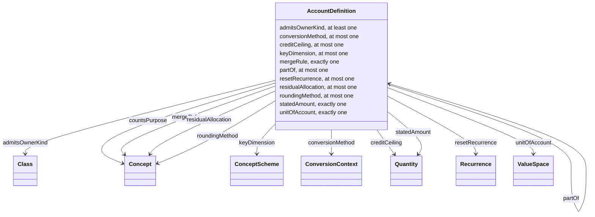

<!-- SPDX-License-Identifier: CC-BY-SA-4.0 -->

# Ledger Ontology — Amounts Consumed and Restored Over Time

Literate specification for the Ledger layer, in the layout of
[ADR-A126](../../docs/architecture/decisions/ADR-A126-literate-specification-layout-and-grammar.md).

---

## 1. Purpose and Scope

Ledger holds amounts that can be consumed and restored, such as a limit, commitment, seat quota, carbon budget, and so on. These are represented by an "account", configured by how much it holds when fresh, what unit it's held in, and the rule for arbitrating several claims on it at once. Accounts form a tree by "part of and not in addition to", so a single draw or credit can affect several accounts at once, along one stated path. 

In order to keep a history of changes to an account, weigh several claims on it together, and let different implementations agree on a shared record, each draw or credit is recorded as a fact of its own: a claim against the account that leaves its stated amount untouched. A balance is always derived by folding an operation over those facts. Conservation then holds by construction, since no balance can disagree with the facts it is derived from. Recording a claim and applying it also become separate acts, so claims made together can be held unresolved and decided together by a stated merge rule.

Separate facts require two forms of ordering. A strict before and after ensures a balance can be read 'as of' a given point, and a mark of which facts belong together ensures they can be decided as one. Wall-clock time can supply neither (since clocks on different machines do not agree closely enough to order two claims), so an evaluator assigns the order deterministically, such that any two implementations given the same inputs will assign the same order.

Each fact carries a whole number placing it among the other facts on its account, called its **position**, and a second number for ordering facts that share a position, called its **micro-position**. The fact itself, containing one draw or credit with its account, owner, amount, direction and position, is referred to as a **posting**.

This one central law then, governs balances: each is a stated amount less what has been drawn, plus what has been restored, ensuring a balance is cheap to compute, but provable across properties checkable as a closed, mechanical law. 

Since the effect of a posting is exactly the account plus every ancestor reached by following the ldg:partOf property upward, one fixed edge at a time, the set of accounts a draw touches is always fully enumerable (by walking one chain and checking each link), with no ambiguity about which balances a draw changes.

Avoiding storing a balance also ensures that a balance agrees with its posting history by construction, with no path by which someone might set a balance to a value the postings don't justify.

When disparate evaluations draw on the same account at the same position (being logically simultaneous, not "whoever runs first"), the model follows a fixed path, 'propose -> merge -> settle'. 

1. Propose - each evaluation states what it requires (e.g., a requested value)
2. Merge - the account's own merge rule (priority order / proportionality / refusal) looks at the whole batch together and decides every grant in one pass, producing one merge record
3. Settle - each evaluation then posts whatever it was actually granted

Because the merge step is a pure function of the complete set of proposals, the result can't depend on what order the evaluations happened to run in. No evaluation's outcome therefore, depends on the order in which the others ran, so they may run in parallel. Given exact arithmetic in the account's unit, the account's stated rounding and residual rules, and ties broken by an order defined on the data rather than on arrival, two conforming implementations reach the same grants in any execution order, and the same bytes once their records are written in canonical form. Conformance cases check this.

Ledger accounts do not hold observed values such as prices or temperatures, which are intensive and carry no such law.

## 2. Namespace and Prefixes

| Document | Ontology IRI | Version IRI | Imports |
|---|---|---|---|
| `spec/ledger.ttl` | <https://www.nebularis.org/neuro-semantic/ledger> | <https://www.nebularis.org/neuro-semantic/lattice/ledger/0.19.0> | <https://www.nebularis.org/neuro-semantic/lattice/foundation/0.19.0>, <https://www.nebularis.org/neuro-semantic/lattice/vocabulary/0.19.0>, <https://www.nebularis.org/neuro-semantic/lattice/quantification/0.19.0> |
| `vocab/ledger-vocab.ttl` | <https://www.nebularis.org/neuro-semantic/ledger-vocab> | <https://www.nebularis.org/neuro-semantic/lattice/ledger-vocab/0.19.0> | <https://www.nebularis.org/neuro-semantic/lattice/ledger/0.19.0> |

| Prefix | Namespace |
|---|---|
| `ldg:` | <https://www.nebularis.org/neuro-semantic/lattice/ledger#> |
| `fnd:` | <https://www.nebularis.org/neuro-semantic/lattice/foundation#> |
| `voc:` | <https://www.nebularis.org/neuro-semantic/lattice/vocabulary#> |
| `qnt:` | <https://www.nebularis.org/neuro-semantic/lattice/quantification#> |
| `skos:` | <http://www.w3.org/2004/02/skos/core#> |

| Identifier | Role | Display name |
|---|---|---|
| <https://github.com/hyperthunk> | creator | T. R. Watson |

## 3. Extraction Contract

- Sections 1, 2 and 6 generate `spec/ledger.ttl`.
- The restriction rows of section 6 that are checked in SHACL generate `shapes/structural.ttl`.
- The hidden block of section 7 generates `shapes/constraints.ttl`, naming its file.
- Extraction rewrites the class diagram (section 4) and the Axiom Index (6.7), which are never edited by
  hand.
- `turtle-example` blocks are illustrative only.

```bash
mise exec -- python tools/literate_extract.py ontology/ledger/README.md --layer ledger --root . --check
```

The module's entry in the [repository catalogue](../../repository-catalogue.md)
([ADR-A121](../../docs/architecture/decisions/ADR-A121-repository-catalogue.md)) follows.

```toml repository-catalogue
[module]
kind = "substrate"
roles = ["examples", "shapes", "spec", "vocab"]
imports = ["foundation", "vocabulary", "quantification"]

[module.extract]
spec = ["spec/ledger.ttl"]
vocab = ["vocab/ledger-vocab.ttl"]
shapes = ["shapes/structural.ttl", "shapes/constraints.ttl"]
```

## 4. Overview

An `ldg:AccountDefinition` states an amount consumed and restored, in a unit of account that must be
extensive (ADR-A131, "What Ledger is for"): disjoint parts add to the whole, so a draw along a path and an availability reading (the least remaining balance along it) both mean something. "Part of and not in addition to" is the parent edge, `ldg:partOf`, stated explicitly rather than inferred, so a sublimit sits inside a section inside an aggregate while a further limit for one class of beneficiary sits beside it, never drawn through it.

A key dimension derives one account per key value, on the first draw that names it (a seat quota per site, a sublimit per borrower). A merge rule arbitrates several proposals at one position: in priority order, proportionally (with a rounding method and a residual allocation, since an exact share need not round to a whole unit of account), or by refusing the whole merge. A credit ceiling, defaulting to the stated amount, is how far a credit may restore a balance, which lets a reinstatement raise a layer's capacity above its first stated amount without inventing a second account for it. A purpose lets one draw debit a second account outside its path (a flood sub-aggregate, say), and a conversion method states how a draw in another value space is converted.

The class diagram below is generated from section 6.

<!-- start: {"generated": "class-diagram"} -->



<!-- end -->

## 5. Detailed Design

### 5.1 Design decisions

- **Configuration only, so far.** Ledger states its configuration: the tree, owner kinds, merge rules and
  their parameters, reset, keys, purposes, credit ceiling and conversion (ADR-A131 decisions 1 to 3, 5, 6
  and 8). Its runtime terms (postings, balance records, merge records and grants) are not yet specified.
- **No account node.** An account is identified by its definition, its owner and its key, with no node of
  its own (ADR-A131 decision 4). That identification is used only by the runtime terms.
- **`ldg:AccountDefinition` is a plain class.** It is part of the terms that state it and changes only with them, as Behaviour's allowance definition is, so it needs no superclass from Foundation.
  `ldg:AccountDefinition` is a plain `owl:Class` until then. See Open Issues.
- **All four concept schemes are declared now**, including `ldg:PostingDirections`, which only the runtime
  terms will use. A concept scheme is a freestanding declaration, independent of which class first points
  at it.
- **Six constraints** (no cycle, matching units, extensive additivity, a proportional rule's rounding and
  residual, a credit ceiling at or above the stated amount, a key dimension's type) are SHACL-SPARQL, in
  section 7. Cardinalities are generated structural shapes from section 6's Restrictions table.

### 5.2 Worked reading

A 10,000,000 aggregate has a section of 6,000,000 with a sublimit of 1,000,000, and a further limit of
2,000,000 for one class of beneficiary, in addition to the aggregate. The sublimit and the section each
state `ldg:partOf` their parent; the further limit states no `ldg:partOf` at all, so it is never debited by
a draw on the sublimit. All four state the same unit of account, GBP, extensive, with `qnt:Sum` and
`qnt:Difference` capabilities. The aggregate also sits `ldg:partOf` a reinstatement pool of twice its
amount, and states a `ldg:creditCeiling` equal to its own stated amount (the default), so a reinstatement
credit can restore it in full without ever exceeding that ceiling. [`ontology/ledger/examples/insurance-aggregate.ttl`](examples/insurance-aggregate.ttl)
carries this reading in full, with a hand-computed table of its postings and balances.

## 6. Description Logic Encoding

### 6.1 Classes

#### `ldg:AccountDefinition`

**Definition.** An amount consumed and restored, as the terms state it.

**Utility.** Declare one of these for each amount a contract states as a limit, commitment, quota or
budget: a software licence's seat pool, a facility's commitment, a grant's budget, an aggregate or a
sublimit. State its amount, its unit of account, the kinds of owner it admits and its merge rule always;
state a parent, a reset, a key dimension, purposes it counts against, a credit ceiling or a conversion
method only where the terms need them.

**Restrictions.**

| Property | Values | Asserted in | Message |
|---|---|---|---|
| `ldg:statedAmount` | exactly 1 |  |  |
| `ldg:unitOfAccount` | exactly 1 |  |  |
| `ldg:partOf` | max 1 |  |  |
| `ldg:admitsOwnerKind` | min 1 |  |  |
| `ldg:mergeRule` | exactly 1 |  |  |
| `ldg:roundingMethod` | max 1 |  |  |
| `ldg:residualAllocation` | max 1 |  |  |
| `ldg:resetRecurrence` | max 1 |  |  |
| `ldg:keyDimension` | max 1 |  |  |
| `ldg:creditCeiling` | max 1 |  |  |
| `ldg:conversionMethod` | max 1 |  |  |

### 6.2 Object Properties

#### `ldg:statedAmount`

**Definition.** The amount when fresh.

**Utility.** States an account definition's amount before any draw, in its unit of account. Point at a
`qnt:Quantity` on the same space named by `ldg:unitOfAccount`.

**Domain.** `ldg:AccountDefinition`

**Range.** `qnt:Quantity`

**Characteristics.** functional

#### `ldg:unitOfAccount`

**Definition.** The value space every posting on this account is in.

**Utility.** Names the value space an account's amounts are stated and posted in. The space must be
extensive (`qnt:additivity qnt:Extensive`) with `qnt:Sum` and `qnt:Difference` capabilities, since Ledger
holds only amounts whose parts add to the whole (§1).

**Domain.** `ldg:AccountDefinition`

**Range.** `qnt:ValueSpace`

**Characteristics.** functional

#### `ldg:partOf`

**Definition.** "Part of and not in addition to": the parent edge of the account tree.

**Utility.** States that this account's balance is drawn from its parent's too, along the same path. An
account outside another's subtree is in addition to it, never drawn through it, so state no `ldg:partOf`
for a limit that sits beside another rather than inside it. The edge is stated, never inferred, and may
not cycle.

**Domain.** `ldg:AccountDefinition`

**Range.** `ldg:AccountDefinition`

**Characteristics.** functional

#### `ldg:admitsOwnerKind`

**Definition.** The kinds of owner this account admits.

**Utility.** Names, by class, who may own this account: an instrument, an authority, an ensemble such as a
programme or a vehicle, or any other `fnd:PersistentIdentity`. State one value for each kind the terms
allow.

**Domain.** `ldg:AccountDefinition`

**Range.** `rdfs:Class`

#### `ldg:mergeRule`

**Definition.** What happens when several draws at one position together exceed availability.

**Utility.** Selects the arbitration rule for this account: `ldg:InPriorityOrder`, `ldg:Proportional` (also
state `ldg:roundingMethod` and `ldg:residualAllocation`), or `ldg:Refuse` (the whole merge is refused, with
no grant, where proposals together overdraw the account).

**Domain.** `ldg:AccountDefinition`

**Range.** `skos:Concept`

**Characteristics.** functional

#### `ldg:roundingMethod`

**Definition.** How a proportional merge's exact shares are rounded to the account's unit.

**Utility.** Required wherever `ldg:mergeRule` is `ldg:Proportional`. An exact proportional share need not
be a whole unit of account, so state how it rounds: `ldg:HalfEven`, `ldg:HalfUp` or `ldg:TowardZero`.

**Domain.** `ldg:AccountDefinition`

**Range.** `skos:Concept`

**Characteristics.** functional

#### `ldg:residualAllocation`

**Definition.** How the rounding residual is allocated so a proportional merge's grants still sum to
availability.

**Utility.** Required wherever `ldg:mergeRule` is `ldg:Proportional`. Rounding every share independently
can leave the sum short of, or over, availability by a unit or two; state how that residual is allocated:
`ldg:LargestRemainder` (ties broken by the total order of the proposals) or `ldg:ToFirstInOrder`.

**Domain.** `ldg:AccountDefinition`

**Range.** `skos:Concept`

**Characteristics.** functional

#### `ldg:resetRecurrence`

**Definition.** When the account returns to its stated amount.

**Utility.** States a recurrence (an annual seat licence, a quarterly support-hours bundle) at whose
boundary the account resets. Leave unset for an account that never resets.

**Domain.** `ldg:AccountDefinition`

**Range.** `qnt:Recurrence`

**Characteristics.** functional

#### `ldg:keyDimension`

**Definition.** The dimension that derives one account per key value.

**Utility.** States that this definition's amount applies once per key value (a site, a borrower), each
key's account derived independently on the first draw that names it. Point at a `skos:ConceptScheme`
naming the key values, or at a `qnt:ValueSpace` where the key is itself a quantity. Leave unset for an
account with no key.

**Domain.** `ldg:AccountDefinition`

**Range.** `skos:ConceptScheme`

**Characteristics.** functional

#### `ldg:countsPurpose`

**Definition.** A purpose which, when a draw names it, also debits this account outside its path.

**Utility.** Lets an account outside the drawn path still be debited by a draw that names a purpose this
account counts, so a cross-cutting sub-aggregate (a flood aggregate beside a peril-neutral tree) still
erodes with the rest. State one value per purpose this account counts.

**Domain.** `ldg:AccountDefinition`

**Range.** `skos:Concept`

#### `ldg:creditCeiling`

**Definition.** The most a credit restores this account to.

**Utility.** States the ceiling a credit may never restore the balance above. Defaults to the stated
amount where unset. State a ceiling above the stated amount for a reinstatement (the aggregate's own
stated amount stays the per-layer limit, and the ceiling lets one reinstatement credit raise the balance
to twice it, without a second account).

**Domain.** `ldg:AccountDefinition`

**Range.** `qnt:Quantity`

**Characteristics.** functional

#### `ldg:conversionMethod`

**Definition.** How a draw in another value space than the account's is converted.

**Utility.** States the standing conversion arrangement for a draw made in a different value space from
the account's own (a sterling commitment drawn in euros). The conversion context a specific draw used,
which may differ by date, is recorded with that draw.

**Domain.** `ldg:AccountDefinition`

**Range.** `qnt:ConversionContext`

**Characteristics.** functional

### 6.3 Datatype Properties

None.

### 6.4 Individuals

The merge rules, posting directions, rounding methods and residual allocations are each a `skos:Concept`
in a scheme of its own. `ldg:PostingDirections` is used only by the runtime terms, not yet specified
(§5.1).

**Concept schemes.**

| Individual | Type | Definition |
|---|---|---|
| `ldg:MergeRules` | `skos:ConceptScheme` | What happens when several draws at one position together exceed availability. |
| `ldg:PostingDirections` | `skos:ConceptScheme` | Whether a posting debits or credits its account. |
| `ldg:RoundingMethods` | `skos:ConceptScheme` | How a proportional merge's exact shares round to the account's unit. |
| `ldg:ResidualAllocations` | `skos:ConceptScheme` | How a proportional merge's rounding residual is allocated. |

**`ldg:MergeRules`.**

| Individual | Type | Definition |
|---|---|---|
| `ldg:InPriorityOrder` | `skos:Concept` | Draws are granted in a stated priority order until availability is exhausted. |
| `ldg:Proportional` | `skos:Concept` | Draws are granted in proportion to the amounts requested, rounded and allocated per the account's `ldg:roundingMethod` and `ldg:residualAllocation`. |
| `ldg:Refuse` | `skos:Concept` | Where proposals together exceed availability, the whole merge is refused: no grant, a reason recorded, no posting. |

**`ldg:PostingDirections`.**

| Individual | Type | Definition |
|---|---|---|
| `ldg:Debit` | `skos:Concept` | A draw, reducing the balance. |
| `ldg:Credit` | `skos:Concept` | The inverse of a draw along the same path, reducing it. |

**`ldg:RoundingMethods`.**

| Individual | Type | Definition |
|---|---|---|
| `ldg:HalfEven` | `skos:Concept` | Rounds a tie to the nearest even value. |
| `ldg:HalfUp` | `skos:Concept` | Rounds a tie away from zero. |
| `ldg:TowardZero` | `skos:Concept` | Truncates toward zero. |

**`ldg:ResidualAllocations`.**

| Individual | Type | Definition |
|---|---|---|
| `ldg:LargestRemainder` | `skos:Concept` | The residual is allocated to the proposal(s) with the largest rounding remainder, ties broken by the total order of the proposals. |
| `ldg:ToFirstInOrder` | `skos:Concept` | The residual is allocated to the first proposal in order. |

### 6.5 Disjointness and Keys

None. Ledger declares one class so far.

### 6.6 Other Axioms

None.

### 6.7 Axiom Index

<!-- start: {"generated": "axiom-index"} -->

| Term | Kind | Summary |
|---|---|---|
| `ldg:AccountDefinition` | Class | Restrictions `ldg:admitsOwnerKind` min 1, `ldg:conversionMethod` max 1, `ldg:creditCeiling` max 1, `ldg:keyDimension` max 1, `ldg:mergeRule` exactly 1, `ldg:partOf` max 1, `ldg:resetRecurrence` max 1, `ldg:residualAllocation` max 1, `ldg:roundingMethod` max 1, `ldg:statedAmount` exactly 1, `ldg:unitOfAccount` exactly 1. |
| `ldg:admitsOwnerKind` | Object property | Domain `ldg:AccountDefinition`. Range `rdfs:Class`. |
| `ldg:conversionMethod` | Object property | Domain `ldg:AccountDefinition`. Range `qnt:ConversionContext`. Functional. |
| `ldg:countsPurpose` | Object property | Domain `ldg:AccountDefinition`. Range `skos:Concept`. |
| `ldg:creditCeiling` | Object property | Domain `ldg:AccountDefinition`. Range `qnt:Quantity`. Functional. |
| `ldg:keyDimension` | Object property | Domain `ldg:AccountDefinition`. Range `skos:ConceptScheme`. Functional. |
| `ldg:mergeRule` | Object property | Domain `ldg:AccountDefinition`. Range `skos:Concept`. Functional. |
| `ldg:partOf` | Object property | Domain `ldg:AccountDefinition`. Range `ldg:AccountDefinition`. Functional. |
| `ldg:resetRecurrence` | Object property | Domain `ldg:AccountDefinition`. Range `qnt:Recurrence`. Functional. |
| `ldg:residualAllocation` | Object property | Domain `ldg:AccountDefinition`. Range `skos:Concept`. Functional. |
| `ldg:roundingMethod` | Object property | Domain `ldg:AccountDefinition`. Range `skos:Concept`. Functional. |
| `ldg:statedAmount` | Object property | Domain `ldg:AccountDefinition`. Range `qnt:Quantity`. Functional. |
| `ldg:unitOfAccount` | Object property | Domain `ldg:AccountDefinition`. Range `qnt:ValueSpace`. Functional. |
| `ldg:Credit` | Individual | Type `skos:Concept`. |
| `ldg:Debit` | Individual | Type `skos:Concept`. |
| `ldg:HalfEven` | Individual | Type `skos:Concept`. |
| `ldg:HalfUp` | Individual | Type `skos:Concept`. |
| `ldg:InPriorityOrder` | Individual | Type `skos:Concept`. |
| `ldg:LargestRemainder` | Individual | Type `skos:Concept`. |
| `ldg:MergeRules` | Individual | Type `skos:ConceptScheme`. |
| `ldg:PostingDirections` | Individual | Type `skos:ConceptScheme`. |
| `ldg:Proportional` | Individual | Type `skos:Concept`. |
| `ldg:Refuse` | Individual | Type `skos:Concept`. |
| `ldg:ResidualAllocations` | Individual | Type `skos:ConceptScheme`. |
| `ldg:RoundingMethods` | Individual | Type `skos:ConceptScheme`. |
| `ldg:ToFirstInOrder` | Individual | Type `skos:Concept`. |
| `ldg:TowardZero` | Individual | Type `skos:Concept`. |

<!-- end -->

## 7. Shapes

### 7.1 Structural shapes

`shapes/structural.ttl` is generated from the restriction rows of section 6.

### 7.2 Constraints

`shapes/constraints.ttl` holds six SHACL-SPARQL constraints, for no cycle through `ldg:partOf`, a child's
unit of account equal to its parent's, a unit of account that is extensive with `qnt:Sum` and
`qnt:Difference` capabilities, a proportional rule with a rounding method and a residual allocation, a
credit ceiling not below the stated amount, and a key dimension that is a concept scheme or a value space.

<!-- hidden: {"output-file": "shapes/constraints.ttl"}
```turtle-shapes
# SHACL-SPARQL constraints for ldg:AccountDefinition (ADR-A131 decisions 2
# and 3).

@prefix sh:   <http://www.w3.org/ns/shacl#> .
@prefix ldg:  <https://www.nebularis.org/neuro-semantic/lattice/ledger#> .
@prefix qnt:  <https://www.nebularis.org/neuro-semantic/lattice/quantification#> .
@prefix skos: <http://www.w3.org/2004/02/skos/core#> .

ldg:NoCycleThroughPartOfShape a sh:NodeShape ;
	sh:targetClass ldg:AccountDefinition ;
	sh:sparql [
		sh:message "An account definition must not be its own ancestor through any chain of ldg:partOf edges." ;
		sh:select """
			PREFIX ldg: <https://www.nebularis.org/neuro-semantic/lattice/ledger#>
			SELECT $this WHERE {
				$this ldg:partOf+ $this .
			}
		"""
	] .

ldg:ChildUnitMatchesParentShape a sh:NodeShape ;
	sh:targetClass ldg:AccountDefinition ;
	sh:sparql [
		sh:message "An account definition's unit of account must equal its parent's." ;
		sh:select """
			PREFIX ldg: <https://www.nebularis.org/neuro-semantic/lattice/ledger#>
			SELECT $this WHERE {
				$this ldg:partOf ?parent ;
					  ldg:unitOfAccount ?childSpace .
				?parent ldg:unitOfAccount ?parentSpace .
				FILTER (?childSpace != ?parentSpace)
			}
		"""
	] .

ldg:ExtensiveUnitOfAccountShape a sh:NodeShape ;
	sh:targetClass ldg:AccountDefinition ;
	sh:sparql [
		sh:message "An account definition's unit of account must be extensive, with Sum and Difference capabilities." ;
		sh:select """
			PREFIX ldg: <https://www.nebularis.org/neuro-semantic/lattice/ledger#>
			PREFIX qnt: <https://www.nebularis.org/neuro-semantic/lattice/quantification#>
			SELECT $this WHERE {
				$this ldg:unitOfAccount ?space .
				OPTIONAL { ?space qnt:additivity qnt:Extensive . BIND(true AS ?extensive) }
				OPTIONAL { ?space qnt:hasOperationCapability ?sumCap . ?sumCap qnt:operationKind qnt:Sum . BIND(true AS ?sum) }
				OPTIONAL { ?space qnt:hasOperationCapability ?diffCap . ?diffCap qnt:operationKind qnt:Difference . BIND(true AS ?difference) }
				FILTER (!BOUND(?extensive) || !BOUND(?sum) || !BOUND(?difference))
			}
		"""
	] .

ldg:ProportionalNeedsRoundingShape a sh:NodeShape ;
	sh:targetClass ldg:AccountDefinition ;
	sh:sparql [
		sh:message "A proportional merge rule must state a rounding method and a residual allocation." ;
		sh:select """
			PREFIX ldg: <https://www.nebularis.org/neuro-semantic/lattice/ledger#>
			SELECT $this WHERE {
				$this ldg:mergeRule ldg:Proportional .
				OPTIONAL { $this ldg:roundingMethod ?rounding }
				OPTIONAL { $this ldg:residualAllocation ?residual }
				FILTER (!BOUND(?rounding) || !BOUND(?residual))
			}
		"""
	] .

ldg:CreditCeilingNotBelowStatedShape a sh:NodeShape ;
	sh:targetClass ldg:AccountDefinition ;
	sh:sparql [
		sh:message "A credit ceiling must not be below the account's stated amount." ;
		sh:select """
			PREFIX ldg: <https://www.nebularis.org/neuro-semantic/lattice/ledger#>
			PREFIX qnt: <https://www.nebularis.org/neuro-semantic/lattice/quantification#>
			SELECT $this WHERE {
				$this ldg:statedAmount ?stated ;
					  ldg:creditCeiling ?ceiling .
				?stated qnt:numericValue ?statedValue .
				?ceiling qnt:numericValue ?ceilingValue .
				FILTER (?ceilingValue < ?statedValue)
			}
		"""
	] .

ldg:KeyDimensionTypeShape a sh:NodeShape ;
	sh:targetClass ldg:AccountDefinition ;
	sh:sparql [
		sh:message "A key dimension must be a skos:ConceptScheme or a qnt:ValueSpace." ;
		sh:select """
			PREFIX ldg: <https://www.nebularis.org/neuro-semantic/lattice/ledger#>
			PREFIX qnt: <https://www.nebularis.org/neuro-semantic/lattice/quantification#>
			PREFIX skos: <http://www.w3.org/2004/02/skos/core#>
			SELECT $this WHERE {
				$this ldg:keyDimension ?dim .
				FILTER NOT EXISTS { ?dim a skos:ConceptScheme }
				FILTER NOT EXISTS { ?dim a qnt:ValueSpace }
			}
		"""
	] .
```
-->

## 8. Examples

The examples in [`examples/`](examples/) are five accepted arrangements (licensing, lending, grants,
delegated authority, insurance) and five refusals (cycle, unit mismatch, overdraw under
`ldg:Refuse`, an unrounded proportional rule, an intensive unit of account), validated against the
structural shapes and the constraints of section 7. §5.2 walks through one of them.

## 9. Canonicalisation

Not applicable.

## 10. Formalisation

Not applicable.

## 11. Dependencies

Ledger imports Foundation, for persistent identity, and Quantification, for value spaces, quantities and
recurrences. It imports Vocabulary only transitively, through Quantification, and declares no term of its
own as a subclass of a Vocabulary term. Ledger names no term of Party, Eligibility, Wording, Instrument or
Behaviour (ADR-A01, 2026-10-19 addendum; ADR-A131 decision 1).

## 12. Release Notes

Earlier versions are listed in the [ontology release register](../../docs/architecture/ontology-releases.md).

- 0.18.0, the first release of Ledger, joining the substrate's release at its number
  ([ADR-A129](../../docs/architecture/decisions/ADR-A129-one-release-for-the-substrate.md),
  [ADR-A131](../../docs/architecture/decisions/ADR-A131-ledger-layer.md)). The configuration document:
  `ldg:AccountDefinition`, the account tree (`ldg:partOf`), owner kinds, merge rules and their rounding and
  residual parameters, reset, key dimension, purposes, credit ceiling and conversion method. The vocabulary
  document: `ldg:MergeRules`, `ldg:PostingDirections`, `ldg:RoundingMethods`, `ldg:ResidualAllocations` and
  their concepts. Structural shapes generated from section 6, and six SHACL-SPARQL constraints (§7.2). The
  runtime terms (postings, balance records, merge records, grants) are not yet released.

## 13. Open Issues

- **Runtime terms.** Postings, balance records, merge records and grants are not yet specified.
- **Behaviour's use of Ledger.** Behaviour's allowance terms are to give way to accounts, with its effects
  and threshold regimes drawing on and reading them (ADR-A131 decision 7).
- **Allocation with conservation**, one amount split across several accounts by a merge rule, is not yet
  specified.
- **A benchmark** under `benchmark/ledger/`, at realistic volumes of accounts and draws, is not yet
  written.
