<!-- SPDX-License-Identifier: CC-BY-SA-4.0 -->

# MORK: Mapping Ontological and Representational Knowledge

Literate specification for MORK, in the layout of [ADR-A126](../../docs/architecture/decisions/ADR-A126-literate-specification-layout-and-grammar.md).

---

## 1. Purpose and Scope

MORK states a mapping between a source and a target ontology as data. A mapping is a node in a graph that says which source element corresponds to which target element, in which stratum of the target (its classes, its properties or its individuals), how closely, how confidently and under what governance. Mappings compose into a directed acyclic graph, so that the order in which they must run is derived and never written down.

A compiler reads the mapping graph and writes executable artefacts, such as RML mappings, SPARQL queries, SHACL shapes and SWRL rules. A language model may propose the graph, and a validator and a person then check it before anything compiles. The module also holds Executable, the vocabulary for the plans, artefacts and diagnostics that MORK's Eligibility backends produce.

## 2. Namespace and Prefixes

| Document | Ontology IRI | Version IRI | Imports |
|---|---|---|---|
| `spec/Mork.ttl` | <http://www.nebularis.org/ontologies/Mork> | <http://www.nebularis.org/ontologies/Mork/0.19.0> | <http://www.w3.org/2004/02/skos/core>, <http://www.w3.org/ns/shacl>, <http://www.w3.org/2003/11/swrl>, <https://www.nebularis.org/neuro-semantic/lattice/foundation/0.19.0> |
| `spec/Executable.ttl` | <https://www.nebularis.org/neuro-semantic/lattice/executable> | <https://www.nebularis.org/neuro-semantic/lattice/executable/0.19.0> | <http://www.nebularis.org/ontologies/Mork>, <http://www.w3.org/ns/prov-o-20130430>, <https://www.nebularis.org/neuro-semantic/lattice/eligibility/0.19.0> |

| Prefix | Namespace |
|---|---|
| `mork:` | <http://www.nebularis.org/ontologies/Mork#> |
| `exe:` | <https://www.nebularis.org/neuro-semantic/lattice/executable#> |
| `fnd:` | <https://www.nebularis.org/neuro-semantic/lattice/foundation#> |
| `elg:` | <https://www.nebularis.org/neuro-semantic/lattice/eligibility#> |
| `skos:` | <http://www.w3.org/2004/02/skos/core#> |
| `sh:` | <http://www.w3.org/ns/shacl#> |
| `swrl:` | <http://www.w3.org/2003/11/swrl#> |
| `swrlb:` | <http://www.w3.org/2003/11/swrlb#> |
| `rr:` | <http://www.w3.org/ns/r2rml#> |
| `prov:` | <http://www.w3.org/ns/prov#> |

| Identifier | Role | Display name |
|---|---|---|
| <https://github.com/nebularis> | creator | Nebularis |

## 3. Extraction Contract

- Sections 1, 2 and 6 generate `spec/Mork.ttl` and `spec/Executable.ttl`. Neither module document has a vocabulary document, so section 6 sends every entry, individuals table and disjointness paragraph to one of the two spec documents with an `output-file` region. The two documents share one version.
- Section 6 states each class's superclasses and restrictions in **Subclass of.** and **Equivalent to.**, and writes no restriction table. MORK's restrictions are OWL axioms for the reasoner, and its closed-world checks are the shapes of section 7, so no `shapes/structural.ttl` is generated.
- The hidden block of section 7 generates `shapes/constraints.ttl`.
- The statements the grammar cannot state, such as `owl:Axiom` annotations, general class inclusions, property chains over inverse properties and the annotations beyond a label and a scope note, are `turtle-spec` blocks in 6.6.
- Extraction rewrites the class diagram parts of sections 4 and 5 and the Axiom Index (6.7), which are never edited by hand.
- `turtle-example` blocks are illustrative only.
- `spec/Mork.owl` is an OWL/XML copy that nothing generates (section 13).

```bash
mise exec -- python tools/literate_extract.py ontology/mork/README.md --layer mork --root . --check
```

The module's entry in the [repository catalogue](../../repository-catalogue.md) ([ADR-A121](../../docs/architecture/decisions/ADR-A121-repository-catalogue.md)) follows.

```toml repository-catalogue
[module]
kind = "standalone"
roles = ["examples", "mtp", "shapes", "spec", "targets", "test"]
imports = ["foundation", "eligibility"]

[module.extract]
spec = ["spec/Mork.ttl", "spec/Executable.ttl"]
shapes = ["shapes/constraints.ttl"]
```

## 4. Overview

### 4.1 What MORK is for

Data arrives in many shapes. A broker's file, a standard's JSON, an ODRL policy in Turtle and a regulator's XML all say overlapping things in different words. The usual answer is a translation layer for each source, and the cost of that grows with every source and every change to the target. A flexible graph removes the storage problem and leaves the meaning problem, because data held without a known type or context can be stored but not queried, reasoned over or acted on.

MORK is three things.

1. **A vocabulary.** It says "this source element means this concept of the target, connected this way, with this confidence, under this governance". A mapping is a first-class node that can be reviewed, versioned, compared and queried.
2. **A calculus.** Mappings compose along a few relations. The order in which they must run, and which of them depend on the output of others, is derived from the graph and never written down.
3. **An architecture.** A model or a person proposes mappings, a validator checks them against the target ontology, compilers turn the checked graph into executable artefacts, and a person approves the result. No language model runs when a mapping executes.

Two kinds of intent meet in a mapping. Source data carries implicit intent in its names, its position beside other fields and its datatypes. A target ontology carries explicit intent in its classes, restrictions and disjointness axioms. Mapping aligns the two, and MORK makes the alignment explicit, so that it can be checked and compiled.

### 4.2 The shape of a mapping

A mapping scheme holds the mappings. Each mapping node says which source concept it is for, which element of the target ontology it matches and in which stratum, and what it composes with. The source side is described by a representation scheme, whose concepts and representations say where each value lives in the source. The target side is an ontological scheme, which names the target's classes, properties and individuals.

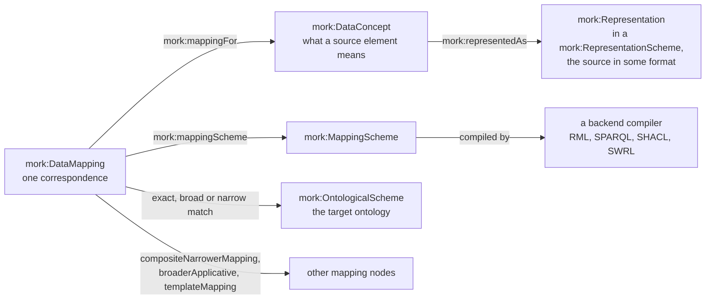

The class diagram below shows the core of the vocabulary. The other parts are in section 5, next to the explanation of the terms they draw.

<!-- start: {"generated": "class-diagram", "part": "Schemes and mappings", "classes": ["mork:MappingScheme", "mork:RepresentationScheme", "mork:OntologicalScheme", "mork:TaxonomyScheme", "mork:DataConcept", "mork:DataMapping", "mork:Datum", "mork:Hypothesis", "mork:UncertainMapping", "mork:WeightedMatch", "mork:IndexedMapping", "mork:Digraph", "mork:Objectification", "mork:DeferredContext"]} -->

**Schemes and mappings**

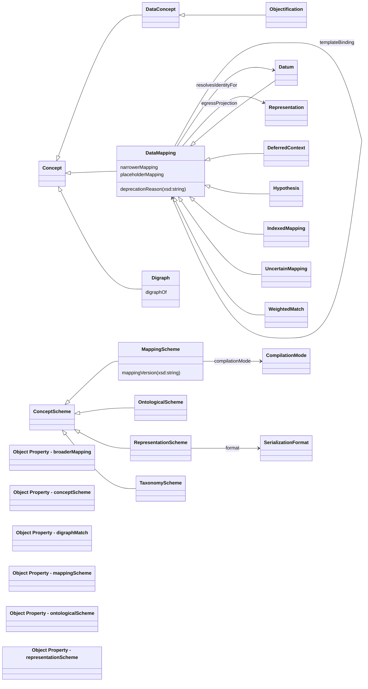

<!-- end -->

A small mapping in Turtle shows the pieces together. It maps a library catalogue into a works vocabulary. `mm:Map_Item` is a root datum that makes one target node for each book or pamphlet, identified by the ISBN. `mm:Map_Title` is a child that asserts the title on that node. The catalogue example is the one the RDF-to-RDF compiler's tests run, and its [package README](../../tools/mork_rdf/README.md) follows every construct to the SPARQL it compiles to.

```turtle-example
mm:Catalogue a mork:MappingScheme ;
    mork:compilationMode mork:DraftMode .

mm:Concept_Item a mork:DataConcept ;
    mork:representedAs src:Book , src:Pamphlet .

mm:Map_Item a mork:DataMapping , mork:Datum ;
    mork:mappingScheme mm:Catalogue ;
    mork:mappingFor mm:Concept_Item ;
    mork:identityTemplateMapping mm:ItemIri ;
    mork:weighting 90 ;
    mork:compositeNarrowerMapping mm:Map_Title .

mm:Map_Title a mork:DataMapping ;
    mork:mappingScheme mm:Catalogue ;
    mork:exactRBoxMatch tgt:title ;
    mork:dataRef "src:title" ;
    mork:weighting 80 .
```

### 4.3 Three layers, and where a model may act

MORK separates the work into three layers that change at different rates and for different reasons.

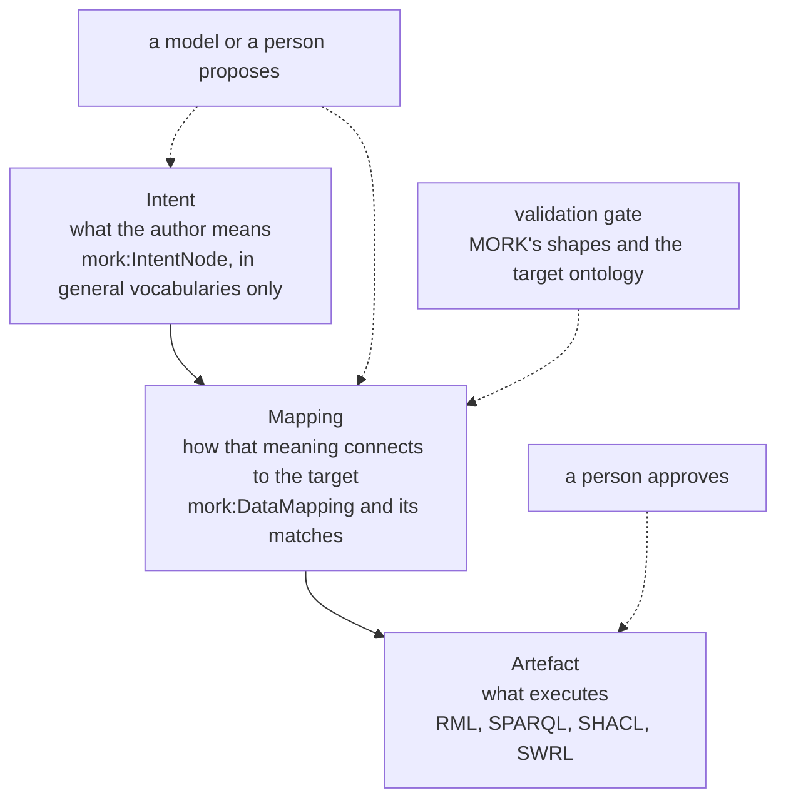

A change to the target ontology touches the mapping layer and the artefacts. A change to a compiler touches only the artefacts. New natural-language input starts at the intent layer. A change flows down and never up, so the record of what an author meant survives a refactoring of the target. Intent nodes name no term of the target ontology, which keeps them portable.

Language models take part by proposing intent nodes and mapping nodes. Nothing a model proposes compiles until it passes the validation gate, and a compiler is a deterministic function of the validated graph, so the same graph always produces the same artefacts. Every artefact traces back through its mapping and its intent to the text or schema that began it. The compact notation of 5.15 and the Teaching Pack of 5.16 exist to make that proposal step cheap and checkable.

## 5. Detailed Design

### 5.1 Schemes, concepts and representations

MORK keeps four kinds of scheme apart, all of them `skos:ConceptScheme`s.

| Scheme | Holds | Joined to its members by |
|---|---|---|
| `mork:RepresentationScheme` | the representations of a source, such as a record, a field or a file | `mork:representationScheme` |
| `mork:TaxonomyScheme` | the data concepts, the meanings a source's elements stand for | `mork:conceptScheme` |
| `mork:OntologicalScheme` | the target ontology's classes, properties and individuals, as `mork:OwlAxiom` individuals | `mork:ontologicalScheme` |
| `mork:MappingScheme` | the mappings between the other three | `mork:mappingScheme` |

A `mork:DataConcept` is an abstract description of something to map. It is derived from a representation scheme and mapped to an ontological scheme, and an individual may be a concept and a representation at once. `mork:representedAs` says how a concept appears in a source, and `mork:mappingFor` says which concept or representation a mapping is about.

A representation is a `mork:Representation`, and the subclasses say how it is built. An `mork:Entity` or an `mork:Attribute` is identifiable, so it carries a `mork:identifier` in the source's own scheme. A `mork:Composition` contains other representations, a `mork:Collection` is a composition of like elements, and a `mork:Referencing` points to another element and does not contain it. A collection is ordered or unordered, and a set listing has unique items. `mork:path` locates a representation within a source by an expression the source's format defines, such as a JSON path or, for an RDF source, a SPARQL property path.

<!-- start: {"generated": "class-diagram", "part": "Representations", "classes": ["mork:Representation", "mork:Association", "mork:Composition", "mork:Collection", "mork:Chaining", "mork:Referencing", "mork:Membership", "mork:CollectionElement", "mork:AnonymousElement", "mork:ScalarValueElement", "mork:IdentifiableElement", "mork:Entity", "mork:Attribute", "mork:OrderedCollection", "mork:UnorderedCollection", "mork:SetListing", "mork:Array"]} -->

**Representations**

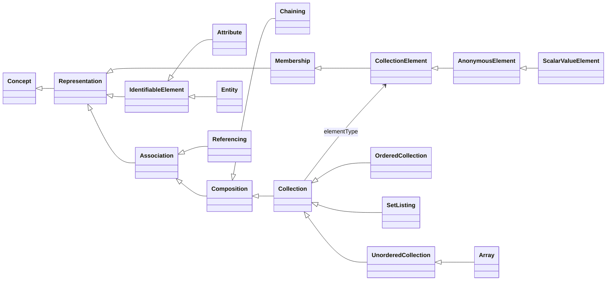

<!-- end -->

The source's format is part of the scheme. `mork:format` relates a representation scheme to a `mork:SerializationFormat`, and MORK names four, `mork:JSON`, `mork:XML`, `mork:YAML` and `mork:RDF`. The format decides which backend compiles the scheme's mappings. A source that is RDF in every serialisation needs no description of its structure, since its vocabulary already names its classes and properties, so a concept of an `mork:RDF` scheme is represented by the source's own terms, each declared an `mork:Entity`.

<!-- start: {"generated": "class-diagram", "part": "Enumerations", "classes": ["mork:SerializationFormat", "mork:CompilationMode", "mork:AxiomForm", "mork:ClassCombination", "mork:LookupComparison"]} -->

**Enumerations**

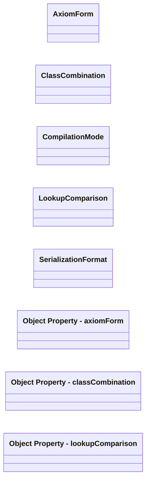

<!-- end -->

### 5.2 Strata and matches

An OWL ontology has three strata, and a mapping must say which one it writes to, because they have an order. The classes (the T-Box) must exist before individuals (the A-Box) can be typed by them, and an individual must exist before a property (the R-Box) can relate it to anything.

| Stratum | Contains | Example |
|---|---|---|
| T-Box | classes and class axioms | "Work is a class" |
| A-Box | individuals and their types | "the book in this record is a Work" |
| R-Box | properties and property axioms | "this work has this title" |

A mapping states its stratum through the match property it uses. Each match comes in a few strengths, and the strength says what the compiler may claim.

| Strength | T-Box | R-Box | A-Box |
|---|---|---|---|
| exact | `mork:exactTBoxMatch` | `mork:exactRBoxMatch` | `mork:exactABoxMatch` |
| inverse | | `mork:inverseRBoxMatch` | |
| broad | `mork:broadTBoxCategoryMatch` | `mork:broadRBoxCategoryMatch` | `mork:broadABoxCategoryMatch` |
| narrow | `mork:narrowTBoxCategoryMatch` | `mork:narrowRBoxCategoryMatch` | `mork:narrowABoxCategoryMatch` |
| generic | `mork:intransitiveExactMatch`, `mork:broadCategoryMatch` and `mork:narrowCategoryMatch` name no stratum, which is read from the target vocabulary's typing of the target term | | |

An exact match says that the source and the target term mean the same. A broad match says that the source is the more specific, so the target is a hypernym, and in the T-Box it makes the source a subclass of the target. A narrow match says that the target is narrower than the source, which over-claims, so the RDF-to-RDF compiler refuses it (5.14). An inverse match names the target property read from object to subject. `mork:intransitiveExactMatch` is an exact match that stops short of `skos:exactMatch`, so that chains of box matches do not infer across schemes.

Matches may be annotated, and the vocabulary uses an `owl:Axiom` annotation for that. For example, a mapping note on the exact match of one mapping says why it was chosen without attaching to the mapping as a whole. The property `mork:mappingNote` is the annotation property for it.

### 5.3 The DAG of mappings

Real mappings are rarely one to one. A source record may create a class, create an individual of it, assert five properties of the individual, link it to a parent made by another mapping, look a value up in reference data and apply a pattern used two hundred times before. MORK composes mapping nodes into a directed acyclic graph with a small set of relations.

| Relation | Reads as |
|---|---|
| `mork:compositeNarrowerMapping` | the object mapping is a component part of the subject mapping |
| `mork:compositeBroaderMapping` | the subject is a component part of the object, its inverse |
| `mork:broaderApplicative` | the subject's component mappings are applied within the context, which is to say the outcome, of the object |
| `mork:templateMapping` | the object is a template that supplies part of the subject's semantics |
| `mork:deferredMapping` | the subject depends on the outcome of the object |
| `mork:dependentMapping` | the object must run first, but its output is not the subject's context |
| `mork:hypothesisMapping` | the object is a hypothesis in support of the subject's postulated match |

Each relation implies an order, and the vocabulary derives it. `mork:precedes` is the derived relation and means that one mapping must be evaluated before another in any valid schedule. `mork:softPrecedes` is advisory. A mapping that supplies an identity to another is `mork:resolvesIdentityFor` it. The derived relations are transitive, which OWL 2 DL forbids from also being irreflexive or asymmetric, so the vocabulary does not say that a mapping cannot precede itself. The shapes of section 7 check that instead, following the relation and the properties it is derived from, so that a cycle is found whether or not the relation has been materialised.

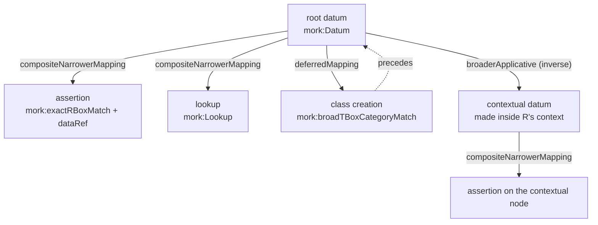

A node beneath several parents is compiled once in each parent's context, so each path from a root is a context of its own. Declaring an edge both ways, with a relation and its inverse, counts once.

### 5.4 Data references, paths and identity

A mapping reads a value from its source with `mork:dataRef`, a reference whose syntax belongs to the source's format. For a JSON source it is a JSON path, for a table a column, and for an RDF source a SPARQL 1.1 property path from the mapping's focus node to the value. `mork:dataInline` gives a constant written in the mapping, such as a status that every record receives. A contextual mapping's concept has a `mork:path` from its parent's focus node to its own, for example from a book to its author.

A datum makes a target node, and the node needs an identity. The mapping states it in one of these ways, and the first that applies is used.

| Statement | Target node |
|---|---|
| `mork:individualIRI` | that IRI, for every record |
| an A-Box match | the named individual |
| `mork:identityTemplateMapping` to a template expression, or an expression that `mork:resolvesIdentityFor` the datum | the IRI the expression forms |
| `mork:conceptFQNameTemplate` or `mork:conceptNameTemplate` | the base IRI and the template filled from the source |
| `mork:conceptName` | the base IRI and the name, with the value the mapping reads or a hash of the source node |

A template expression is a small algebra over strings, and the identity of a datum is usually one. A `mork:LiteralExpression` is a constant, a `mork:RefExpression` reads a source value, a `mork:ConcatExpression` joins two expressions, a `mork:InterpolationExpression` fills the placeholders of a template string and a `mork:LookupExpression` finds a concept of a scheme whose property equals a source value. The expressions form a monoid under concatenation, so any two compose.

<!-- start: {"generated": "class-diagram", "part": "Lookups and template expressions", "classes": ["mork:Lookup", "mork:TemplateExpression", "mork:LiteralExpression", "mork:RefExpression", "mork:ConcatExpression", "mork:InterpolationExpression", "mork:Interpolation", "mork:LookupExpression", "mork:TemplateBinding"]} -->

**Lookups and template expressions**

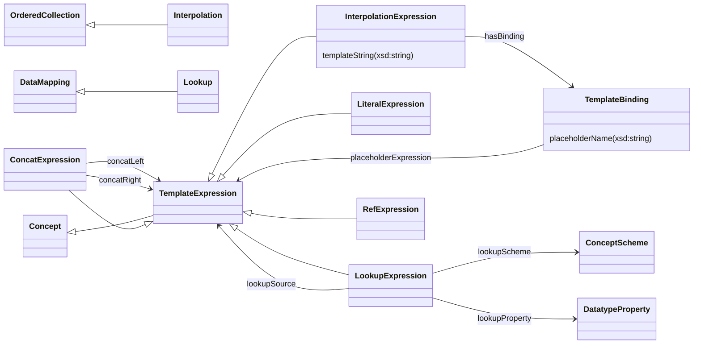

<!-- end -->

```turtle-example
mm:ItemIri a mork:ConcatExpression ;
    mork:concatLeft mm:ItemIri_l ;
    mork:concatRight mm:ItemIri_r .
mm:ItemIri_l a mork:LiteralExpression ;
    mork:dataInline "http://example.org/work/" .
mm:ItemIri_r a mork:RefExpression ;
    mork:dataRef "src:isbn" .
```

### 5.5 Templates

A source with two hundred entity types, most of which follow one pattern, should not need two hundred mapping graphs. `mork:templateMapping` joins a mapping, the instantiation, to a template. The template supplies the skeleton, which is to say the matches and the children the pattern shares, and the instantiation gives the details. The two are taken as a whole when the mapping is read, the instantiation's own values first and the template's where it gives none. `mork:templateBinding` correlates a template's child with an instantiation's child, so that the instantiation's child stands in for the template's and is not added beside it. `mork:referenceDataMapping` is a sub-property of `mork:templateMapping` for the template that does a lookup (5.6).

```turtle-example
mm:LabelTemplate a mork:DataMapping ;
    mork:mappingScheme mm:Catalogue ;
    mork:exactRBoxMatch tgt:title .

mm:Map_Title a mork:DataMapping ;
    mork:mappingScheme mm:Catalogue ;
    mork:templateMapping mm:LabelTemplate ;
    mork:dataRef "src:title" .
```

A template saves work for the proposer as well as for the maintainer. A model asked for one template and a hundred light instantiations writes far less than one asked for a hundred complete mappings.

### 5.6 Lookups

A lookup finds a target value in reference data by matching a source value against a property of the reference nodes. A source's controlled codes become a target's concepts this way, with every row of the table a node that can be reviewed.

```turtle-example
mm:Map_Genre a mork:DataMapping , mork:Lookup ;
    mork:mappingScheme mm:Catalogue ;
    mork:exactRBoxMatch tgt:genre ;        # the property asserted
    mork:exactTBoxMatch skos:Concept ;     # the class of the reference nodes
    mork:referenceDataPath skos:notation ; # the property matched
    mork:dataRef "src:genre" .             # the source value
```

A parent names its lookup as a child with `mork:compositeNarrowerMapping`, or with `mork:referenceDataMapping`. The lookup matches the source value in one of three ways. With `mork:referenceDataPath` it matches the reference node's value of that property. With none it matches the reference node's own `mork:dataInline`. With `mork:dataInline ""` it matches the reference node's name, the part of its IRI after the last `/` or `#`.

`mork:lookupComparison` says how the source value and the reference value are compared, and `mork:lookupDatatype` names the reference data's datatype for the one comparison that needs it.

| Comparison | The match |
|---|---|
| `mork:CastComparison`, the default | the source value is cast to `mork:lookupDatatype` and joined as the same term, which an index can serve |
| `mork:LexicalComparison` | the lexical forms are equal whatever the datatypes, which compares every source value with every reference value |
| `mork:TermComparison` | the same term with no cast, so a string never matches an integer |

The choice belongs to the author because it trades cost against tidiness of the data. A cast comparison with no datatype is read as lexical, since a compiler never sees the reference data and cannot guess its type.

### 5.7 Deferred references

A mapping sometimes refers to something that another mapping creates, before it exists. A record that makes a class and a member of that class is the common case. MORK names the thing that does not yet exist and resolves the name when the creating mapping runs.

| Term | Role |
|---|---|
| `mork:DeferredContext` | a placeholder for the axiom that some mapping proposes to create, so that a related mapping can refer to it |
| `mork:yieldConcept` | says what the context yields, a `mork:DeferredConceptIRI` or a mapping, to a broader-scoped mapping |
| `mork:DeferredConceptIRI` | stands for the IRI that a mapping's own `mork:conceptName`, `mork:conceptIRI` or `mork:individualName` forms |
| `mork:DeferredClassDefinition`, `mork:DeferredDataPropertyDefinition`, `mork:DeferredObjectPropertyDefinition`, `mork:DeferredIndividualDefinition` | stand for the class, property or individual that the mapping `mork:deferredMapping` names creates |
| `mork:deferredMapping` | the subject depends on the outcome of the object |
| `mork:dependentMapping` | the object must run before the subject, which may not use its output as context |

The zoo example in `ontology/mork/examples/Zoo/PropertyGeneration.ttl` defines a class `#Species` and a property `#isSpeciesOf` in the target ontology, and asserts that an owl is a species of a bird. `Map_Gen_Species_Class` creates the class. `Map_Yield_Species` is a deferred context that yields it by name, and other mappings refer to the context without knowing the class's IRI.

```turtle-example
:Map_Gen_Species_Class a mork:DataMapping ;
    mork:mappingScheme :Mappings ;
    mork:conceptName "#Species" ;           # a name under the output ontology's base IRI
    mork:broadTBoxCategoryMatch owl:Thing . # a new class, below owl:Thing

:Map_Yield_Species a mork:DeferredContext ;
    mork:mappingScheme :Mappings ;
    mork:conceptName "#Species" ;
    mork:yieldConcept mork:DeferredConceptIRI .

:Map_Gen_IsSpeciesOf a mork:DataMapping ;
    mork:mappingScheme :Mappings ;
    mork:conceptName "#isSpeciesOf" ;
    mork:broadRBoxCategoryMatch owl:topObjectProperty ; # a new property
    mork:assertsPropertyDomains :Map_Yield_Species ;    # whose domain is the class above
    mork:assertsPropertyRanges zoo:Animal .
```

The RDF-to-RDF compiler resolves a deferred reference by the mapping's outcome. The outcome of a named class or property creation is its IRI. The outcome of a creation whose name reads source data is evaluated over the referrer's own record, which gives the same class when the record carries the same values. A reference to a mapping that is not on the referrer's chain of contexts is refused, since nothing states the join, and a lookup reaches such a class instead, by naming the creation in its `mork:exactTBoxMatch`.

### 5.8 Creating properties, and the axioms they carry

A mapping with a broad R-Box match and no parent, value or children creates a property, a subproperty of the broad match. `mork:assertsPropertyDomains` and `mork:assertsPropertyRanges` ask for its domain and range, which a deferred mapping can name before the classes exist. A mapping whose R-Box match names an existing property may not ask, since an axiom about another vocabulary's property would change that vocabulary.

Two properties say what is written, and both default so that a mapping that names neither means what it always did.

`mork:axiomForm` names the form, and may be given more than once.

| Form | Writes, for domains D and ranges R |
|---|---|
| `mork:GlobalAxioms`, the default | `p rdfs:domain D` and `p rdfs:range R` |
| `mork:UniversalRestriction` | D is a subclass of "p only R" |
| `mork:ExistentialRestriction` | D is a subclass of "p some R", so every member of D has such a value |
| `mork:DefiningRestriction` | D is equivalent to "p some R", so anything with such a value is classified into D |

`mork:classCombination` says how several domains, or several ranges, combine, as `mork:UnionOfClasses` (the default) or `mork:IntersectionOfClasses`.

Under OWL's open-world semantics every form entails and none constrains. Whether data observes a domain or a range is a closed-world question, which a `mork:ShapeMapping` answers (5.11).

<!-- start: {"generated": "class-diagram", "part": "Target axioms and deferred references", "classes": ["mork:OwlAxiom", "mork:OwlClass", "mork:OwlDataProperty", "mork:OwlObjectProperty", "mork:DeferredConceptIRI", "mork:AxiomForm", "mork:ClassCombination"]} -->

**Target axioms and deferred references**

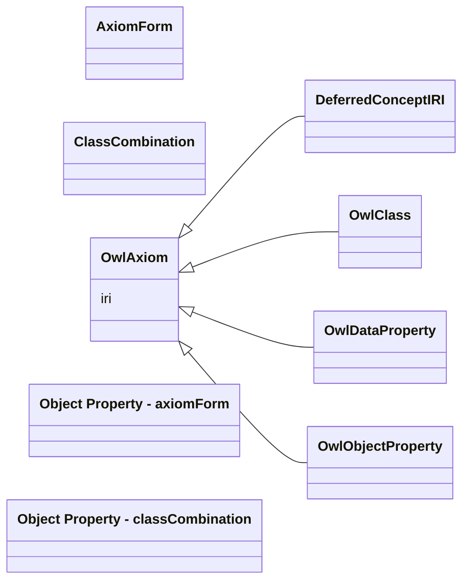

<!-- end -->

### 5.9 Uncertainty, hypotheses, weighting and confidence

Not every proposal is a decision. A mapping that is a question for review says so, and a compiler does not compile it, because compiling would make its answer look decided.

- `mork:UncertainMapping` marks a mapping whose target is missing, incomplete, uncertain or undefined. `mork:incompleteMapping true` says the same of any mapping.
- The possible matches, `mork:possibleMatch`, `mork:lexicalMatch`, `mork:semanticMatch`, `mork:structuralMatch`, `mork:partialMatch` and `mork:pathMatch`, link a source to a candidate target without claiming an exact, broad or A-Box match.
- `mork:hypothesisMapping` gives a mapping that supports a postulated match, or that hypothesises a target for an uncertain mapping. `mork:softPrecedes` orders it softly, so that the postulating mapping may proceed with reduced confidence when the hypothesis is unavailable.
- `mork:mappingRecommendation` records, in text, what a reviewer is advised to do, such as to create a new datatype property in the output ontology.

The second zoo example, `ontology/mork/examples/Zoo/UncertainMappings.ttl`, holds such a case. `Map_EggSize` is an uncertain mapping with a lexical match, a weighting of 40 and a hypothesis that creates the property it would need.

```turtle-example
:Map_EggSize a mork:UncertainMapping ;
    mork:mappingScheme :Mappings ;
    mork:hypothesisMapping :Map_EggSize_Hypothesis ;
    mork:lexicalMatch zoo:laysEggs ;
    mork:mappingRecommendation "Create a new datatype property in the output ontology to represent the size of Eggs." ;
    mork:weighting 40 .
```

`mork:weighting` is a confidence out of 100. A mapping's effective confidence is its own weighting as a fraction of 100, times the least of its children's effective confidences, with an unweighted mapping counting as certain. A chain is only as strong as its weakest link, and uncertainty compounds through the graph, so a reviewer can be shown the least confident mappings first. The `mork:weightedBroader` and `mork:weightedNarrower` relations order matches by weighting.

### 5.10 Time, supersession, governance and compilation modes

A mapping has a life. `mork:effectiveFrom` and `mork:effectiveUntil` bound the instants at which it is in force. `mork:supersedes` chains a newer mapping to the one it replaces, and a mapping that supersedes another must have an effective-from date. A mapping that one in force supersedes is out of force, and so are its descendants, so compiling the same graph at two instants gives each instant's mappings.

Governance follows Foundation's model. A `mork:GenerativeMapping` is `fnd:Governable` and `fnd:Versioned`, so it carries a governance state, one of Foundation's four named individuals, and a persistent identity. `mork:reviewStatus`, `mork:mappingVersion` and `mork:supersedes` predate that model and stay for compatibility.

`mork:compilationMode` on a mapping scheme chooses how strict a compiler is.

| Mode | Behaviour |
|---|---|
| `mork:DraftMode`, the default | a compiler reports what it cannot compile and compiles the rest |
| `mork:ReviewMode` | the same, for a scheme under review |
| `mork:ProductionMode` | the whole scheme compiles or none of it does, and a generative mapping must have progressed beyond draft and declare a persistent identity |

Production gating is conditional. A generative mapping with no governance state is incomplete and not inconsistent, unless its scheme is in production mode. The shapes of section 7 enforce this.

### 5.11 Generative mappings

An ordinary mapping moves data. A `mork:GenerativeMapping` produces an artefact instead, and there is one subclass for each kind.

| Mapping | Generates | Carried by |
|---|---|---|
| `mork:ShapeMapping` | a SHACL shape, a closed-world check | `mork:generatesShapeDefinition` |
| `mork:RuleMapping` | a SWRL rule, an inference | `mork:generatesRuleDefinition` |
| `mork:TransformMapping` | an RML triples map, a data transformation | `mork:generatesTransformDefinition` |
| `mork:ProjectionMapping` | a class and its projection records | `mork:generatesClassDefinition` |

A generative mapping is built from a targeting specification (`mork:TargetingSpec`, which says which nodes the artefact applies to), parameter bindings (`mork:ParameterBinding`) and a template (`mork:ShapeTemplate`, `mork:RuleTemplate` or `mork:QueryTemplate`). It carries provenance (`mork:ConstraintProvenance`, `mork:RuleProvenance`, `mork:TransformProvenance` and `mork:ProjectionProvenance`), a jurisdiction and a scope. A mapping may not be a shape mapping and a rule mapping at once. If a criterion needs both validation and inference, it is two mappings.

<!-- start: {"generated": "class-diagram", "part": "Generative mappings", "classes": ["mork:GenerativeMapping", "mork:ShapeMapping", "mork:RuleMapping", "mork:TransformMapping", "mork:ProjectionMapping", "mork:TargetingSpec", "mork:ParameterBinding", "mork:QueryTemplate", "mork:ShapeTemplate", "mork:RuleTemplate", "mork:ConstraintProvenance", "mork:ProjectionProvenance", "mork:RuleProvenance", "mork:TransformProvenance", "mork:ConstraintScheme", "mork:RuleScheme"]} -->

**Generative mappings**

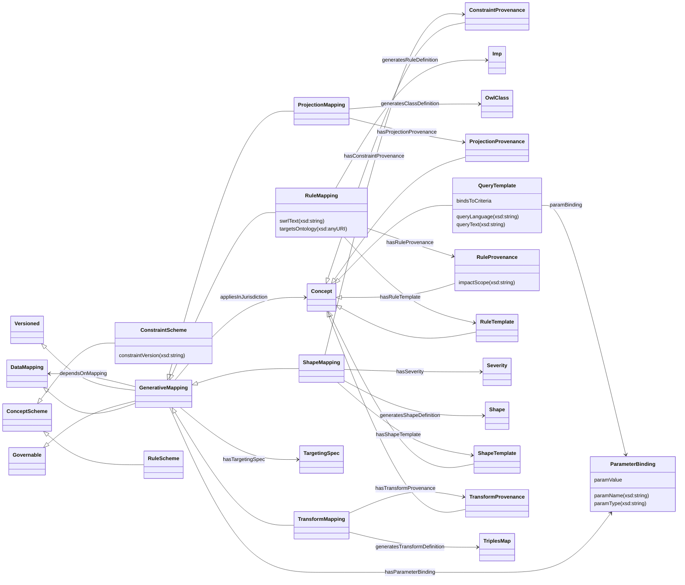

<!-- end -->

### 5.12 Intent

Below the mappings sits an optional layer for what an author meant. A `mork:IntentNode` states an intent in general vocabularies, with no term of the target ontology, so that it can be mapped to more than one target. Its subclasses cover the principal kinds, `mork:QualitativeIntent`, `mork:QuantitativeConstraint`, `mork:SpatialScope`, `mork:TemporalScope`, `mork:ExclusionIntent` and `mork:InclusionIntent`, which are not mutually disjoint. `mork:hasNaturalLanguageSource` keeps the text an intent was read from, `mork:refinesIntent` orders intents by refinement and is acyclic, and `mork:intentMapping` links an intent to the mapping that realises it in the target. An intent also records the confidence of the model that proposed it.

<!-- start: {"generated": "class-diagram", "part": "Intent", "classes": ["mork:IntentNode", "mork:IntentScheme", "mork:QualitativeIntent", "mork:QuantitativeConstraint", "mork:SpatialScope", "mork:TemporalScope", "mork:ExclusionIntent", "mork:InclusionIntent", "mork:NormativeReferenceItent"]} -->

**Intent**

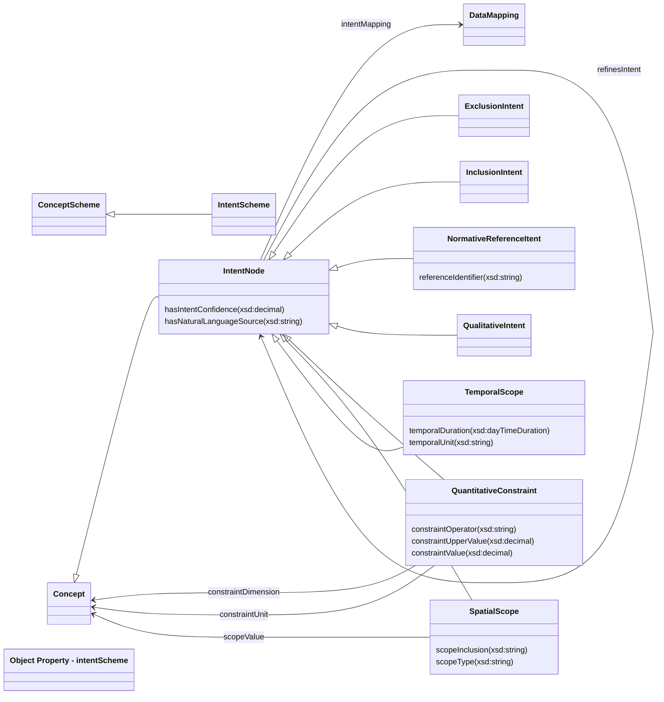

<!-- end -->

### 5.13 Executable, the compiled plans

`spec/Executable.ttl` is a second vocabulary in this module. It describes what MORK's Eligibility backends produce, and not what mapping graphs say. An `exe:ExecutablePlan` is a deterministic, implementation-neutral representation compiled from an Eligibility declaration. A condition plan covers one condition and a profile plan aggregates the condition plans of a profile by strong Kleene logic. A generated artefact is the SPARQL, SHACL, SWRL or OWL text compiled from a plan. A diagnostic is the reason an artefact gives for an `Undetermined` outcome, a closed set of named individuals. A design-time check records a reasoner's answer about the classes of an OWL artefact.

Executable names Eligibility terms and does not import Eligibility into MORK, so adding the compilers never makes Eligibility or Quantification depend on MORK. The vocabulary describes compiled artefacts and does not record runs ([ADR-A90](../../docs/architecture/decisions/ADR-A90-eligibility-design-time-owl-class-backend.md)).

<!-- start: {"generated": "class-diagram", "part": "Executable plans, artefacts and checks", "classes": ["exe:ExecutablePlan", "exe:ConditionPlan", "exe:ProfilePlan", "exe:IntervalContainmentPlan", "exe:ConceptMatchPlan", "exe:GeneratedArtefact", "exe:SparqlArtefact", "exe:ShaclArtefact", "exe:SwrlArtefact", "exe:OwlArtefact", "exe:DesignTimeCheck", "exe:SubsumptionCheck", "exe:SatisfiabilityCheck", "exe:OverlapCheck", "exe:Diagnostic"]} -->

**Executable plans, artefacts and checks**

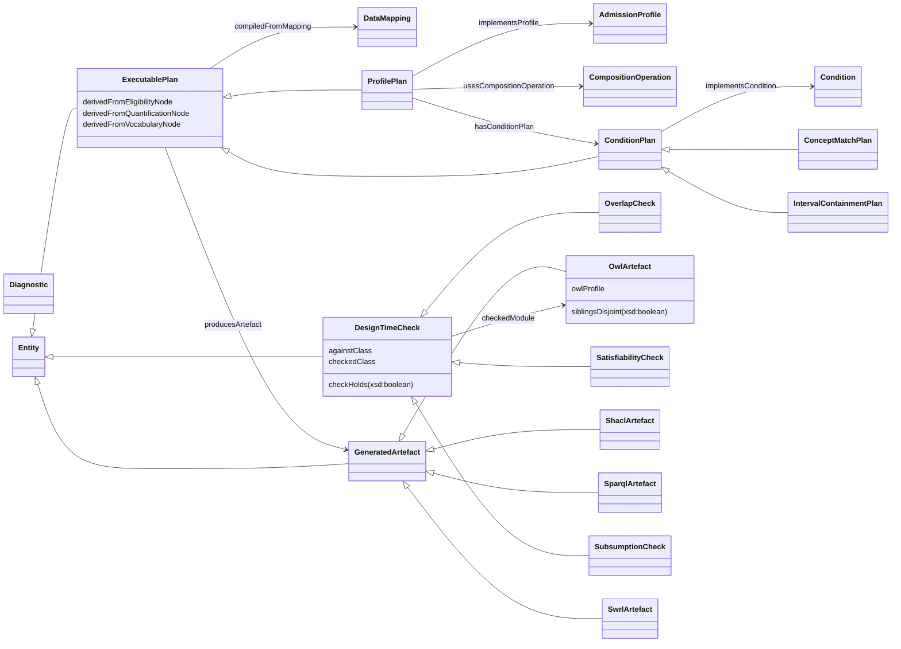

<!-- end -->

### 5.14 How the compilers read the vocabulary

One mapping graph serves several backends, and the backend is chosen by the source. The backends share one reading of the vocabulary, a staged pipeline of validation, normalisation, lowering and emission, so that a backend is an adapter and not a second reading.

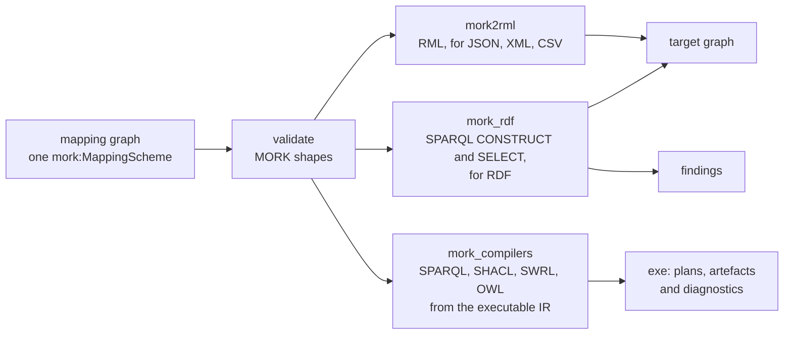

**`tools/mork`, mork2rml.** The RML backend compiles a mapping graph to an RML document for sources that are not RDF. It implements the catamorphism over the mapping DAG of the MORK foundations, with the case analysis of Definition 10.7, so each node is classified as a class creation or reference, a datum, an assertion, a contextual datum or a lookup, and becomes a triples map or one of its parts. It recognises generative mappings only to skip them. A node that fits no case is emitted as a best-effort triples map, which the RDF-to-RDF backend refuses as an error. See the [package README](../../tools/mork/README.md) and the module itself, `tools/mork/src/mork2rml.py`.

**`tools/mork_rdf`, the RDF-to-RDF backend.** It compiles one `mork:MappingScheme` whose source is RDF to SPARQL 1.1. Each mapping node that writes triples becomes one `CONSTRUCT` whose `WHERE` clause is the chain of contexts from the root, and each way a mapping can fail on real data becomes a check `SELECT` that names the focus nodes it could not map. Its package README is the most detailed account of the vocabulary's runtime meaning, and the sections it treats are these.

| Vocabulary | How `mork_rdf` reads it |
|---|---|
| strata and matches | classifies each node by the same case analysis, and refuses a node that fits none. A narrow match is refused. A broad match compiles with a warning. A generic match takes its stratum from a target vocabulary |
| the DAG | a node's parent is the node that lists it with `compositeNarrowerMapping` or that it names with `compositeBroaderMapping` or `broaderApplicative`, and a node beneath several parents is compiled in each context |
| identity and values | the identity rules of 5.4, a value kept as its RDF term with no coercion, and correspondences between source and target individuals as a table |
| lookups | read only from a separate reference graph, so a source cannot forge a code, with the comparison of 5.6 |
| deferred references | the resolution of 5.7, with the run divided into strata by what each query reads, so a query that reads another mapping's output runs later |
| domain and range axioms | each form and combination of 5.8, written into a T-Box graph returned apart, and for created properties only |
| time and governance | a mapping is compiled only if in force at the instant the caller gives, and in production mode any error refuses the whole compilation |
| uncertainty | an uncertain or incomplete mapping is an error, a hypothesis with no target is information |
| confidence | the effective confidence of 5.9 is in the output, and a floor drops a mapping and its descendants |

It does not compile generative mappings, `mork:egressProjection`, `mork:templateClassMapping`, or an abstract `mork:propertyMappingAssertions` used directly. Mapping properties that carry no meaning for instance data, such as `mork:siblingMapping`, are kept in the graph for reviewers and change no query.

`mork_rdf` can describe what it compiled as RDF, so a deployment keeps a compiled mapping beside its mapping graph, under version control or in its graph store, and another component reads what will run. A `mork:CompiledMapping` names its scheme with `prov:wasDerivedFrom`, records the mapping graph's digest, the instant it read the mappings at, its base and its mode, and holds a `mork:CompiledQuery` for each query, a `mork:CompileFinding` for each finding and an entry for each mapping's effective confidence. A query's text is a SHACL-AF executable's `sh:construct` or `sh:select`, and it records the mapping it comes from, its path through the DAG, its stratum, whether it writes instance data or terminology, and the mappings whose output it reads. The description is named by the digest of the compiled text, and none of `mork:TransformMapping`'s properties describe it, since `mork:generatesTransformDefinition` would classify it as a transform mapping.

<!-- start: {"generated": "class-diagram", "part": "Compiled mappings", "classes": ["mork:CompiledMapping", "mork:CompiledQuery", "mork:CompileFinding", "mork:OutputBox", "mork:FindingSeverity"]} -->

**Compiled mappings**

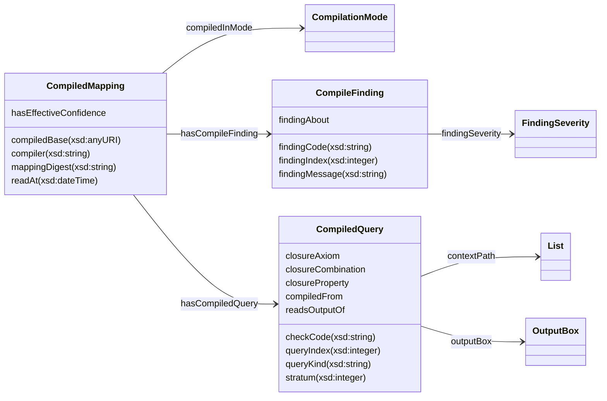

<!-- end -->

**`tools/mork_compilers`, the SHACL, SWRL, OWL and SPARQL backends.** These compile Eligibility conditions and profiles through the executable IR of 5.13, and they do not read mapping graphs. They write their results in MORK's vocabulary. The SHACL backend attaches the shapes it generates to a data mapping with `mork:generatesShapeDefinition`, which is what classifies that mapping as a shape mapping. The SWRL backend writes each rule as a structured `swrl:Imp` under `mork:generatesRuleDefinition`, with `mork:swrlCompactSyntax` as a readable annotation. The SPARQL backend writes a `mork:QueryTemplate`. The OWL backend turns bound conditions and profiles into design-time classes in an `exe:OwlArtefact`, and a reasoner used only in tests answers the `exe:DesignTimeCheck` questions. SWRL is restricted to positive, monotonic inference, so its rules never derive a denial from the absence of a fact and never derive an undetermined outcome. See the [package README](../../tools/mork_compilers/README.md).

The compilers agree on the points that make a compiled artefact trustworthy.

- **Determinism.** A compiled result is a pure function of the mapping graph and the declared inputs, so the same graph in any triple order gives the same text, and the compilers' tests permute their inputs and repeat them.
- **No clock.** The instant at which mappings are in force is an input and never read from the machine.
- **Refusal over guesswork.** A node a compiler cannot classify, or a property that would change what a mapping writes, is refused and not ignored.
- **Provenance.** An artefact records the node it was compiled from.

They differ in what they read. The RML and RDF backends read mapping graphs and move instance data, using the strata, the DAG, identity and values. The Eligibility backends read Eligibility declarations and write mapping nodes for the artefacts they produce.

### 5.15 MORK Compact Notation

A mapping graph in Turtle is expensive to write by hand and expensive for a model to generate. Prefixed names repeat on every triple, every individual is typed `owl:NamedIndividual`, every mapping restates its scheme, and an `owl:Axiom` annotation costs dozens of tokens to say that a match is lexical. MORK Compact Notation (MCN) is a text encoding of MORK graphs that says each fact once, gives every MORK term a one-to-three character code, writes structure by position where the ontology fixes it, and binds an annotation to the triple it annotates. A pure, deterministic decoder turns MCN into an OWL 2 document, so the decoded graph is what is stored, hashed, validated and compiled. No shape, compiler or reasoner needs to know that MCN exists.

For example, a mapping's exact T-Box match, annotated with a note and a weighting, is one line of MCN:

```text
xt :Loan{n "Close lexical match on 'loan'" w 90}
```

The decoder writes it as the match and the OWL 2 annotated axiom that carries the note and the weighting:

```turtle-example
:m mork:exactTBoxMatch fin:Loan .
[] a owl:Axiom ; owl:annotatedSource :m ; owl:annotatedProperty mork:exactTBoxMatch ;
   owl:annotatedTarget fin:Loan ; mork:mappingNote "Close lexical match on 'loan'" ; mork:weighting 90 .
```

Measured on the loan mapping example, MCN takes 219 tokens where the Turtle takes 614, and about a third of Turtle's tokens per triple for the structure alone.

MCN is the wire format of a proposal. A model emits MCN, the decoder produces the graph, and everything after that operates on the graph. The notation is not a storage or an interchange format, does not make a proposal correct, and gives up legibility where it costs tokens. The [specification](../../docs/architecture/mork-compact-notation.md) defines the lexical rules, the codebook and the decoding algorithm, and the `mcn` package under `tools/mork` holds the decoder and the codebook. A codebook check holds the notation to the vocabulary of section 6.

### 5.16 The MORK Teaching Pack

The MORK Teaching Pack (MTP) is the material from which a model learns to write MCN. It is a deterministic generator for a versioned, hash-pinned curriculum, built from the normative ontology, the MCN decoder and codebook, the examples and the shapes. It is not a model runtime, an evaluation harness or a second source of truth, and it never moves or rewrites `spec/Mork.ttl`, the decoder, the codebook, the examples or the shapes.

The build extracts logical facts and fingerprints from the ontology, verifies the codebook's coverage, reads curated data, measures the example corpus, validates the example cassettes, and writes a manifest of digests. The curated data is `ontology/mork/mtp/data/`, and the generated and committed output is `ontology/mork/mtp/out/`, which the build owns. A change to `spec/Mork.ttl` therefore changes the fingerprints the pack pins, and `mise run check:mtp` fails until the pack is rebuilt with `mise run build:mtp` ([overview](../../docs/architecture/mork-teaching-pack.md)).

### 5.17 Guards

A mapping applies to every node its path reaches. A guard confines it to the nodes that conform to a SHACL node shape, named with `mork:appliesWhen`, so a mapping can apply to some values of a source and another mapping to others. The mapping applies to a node, and the mappings beneath it apply in its context, only when the node conforms to the shape. A guard tests the source's shape, which is what SHACL describes, so MORK states it in SHACL and adds no expression language of its own.

For example, ODRL states a comparison as a constraint whose operator is `lt`, `lteq`, `gt` or `gteq`, and only those constraints become a range of values:

```turtle-example
om:Comparison a mork:Datum ;
    mork:compositeBroaderMapping om:Scope ;
    mork:mappingFor om:ConstraintConcept ;
    mork:appliesWhen [ a sh:NodeShape ;
        sh:property [ sh:path odrl:operator ; sh:in ( odrl:lt odrl:lteq odrl:gt odrl:gteq ) ] ] ;
    mork:exactTBoxMatch elg:IntervalCondition .
```

A compiler compiles a guard to a test it can prove means what the shape means. `tools/mork_rdf` compiles the constraint components `sh:hasValue`, `sh:in`, `sh:class`, `sh:datatype`, `sh:nodeKind`, `sh:minCount`, `sh:maxCount`, `sh:not`, `sh:and` and `sh:or`, over a property shape's `sh:path` or the node itself, and refuses any other by name. Its tests check that a node passes a compiled guard exactly when pySHACL says the node conforms to the shape. A backend that cannot express a guard refuses the guarded mapping, never compiling it unguarded.

### 5.18 Communities, and the history of mappings

MORK expects mapping to get easier as it is done. Three kinds of evidence accumulate in a graph of their own. **Recognition**: a source field's name is lexically close to the concept it maps to, through edit distance, abbreviations and shared words, and each accepted mapping teaches the abbreviations it used. **Communities**: in a domain, certain concepts occur together in a section, so when a mapping run is accepted each of its sections becomes a `mork:SectionObservation` of the concepts it holds, community detection over those observations finds `mork:SemanticCommunity` clusters, and a new section is matched to its likeliest community (`mork:CommunityMatch`). **Projections**: what a community's concepts have been mapped to in one target ontology becomes a `mork:OntologicalProjection`, with the class and the properties they most often took and how often, and a shape the mappings take often enough becomes a `mork:DAGTemplate`, which maps a new section of the community without a model. Target terms are reasoned about through shadow individuals (`mork:shadowOf`), so the patterns stay in OWL 2 DL. `tools/mork`'s `mork_communities` package implements all of this.

The history is fed by reviews. A `mork:ProposalRun` records who proposed mappings, a model and its teaching pack, and every mapping it proposed names it with `prov:wasGeneratedBy`. A `mork:MappingReview` records the decision on one of them: `mork:Accepted`, `mork:Corrected` with the mapping that replaces it, `mork:Rejected` or `mork:Deferred`, with its reviewer and time in PROV. Accepted and corrected mappings become observations and teach recognition, and rejected ones are kept, so the next proposer is told what was refused.

```turtle-example
ex:run-1 a mork:ProposalRun , prov:Activity ;
    mork:proposerModel "a language model" ; mork:teachingPackVersion "MTP 0.1.0" ; mork:proposedFor ex:Odrl .
ex:Map_Duty prov:wasGeneratedBy ex:run-1 .
ex:review-7 a mork:MappingReview , prov:Activity ;
    mork:reviewOf ex:Map_Duty ; mork:reviewDecision mork:Corrected ; mork:correctedBy ex:Map_Duty_OnAct ;
    mork:reviewNote "A duty on a permission is what the permission arises on, not an obligation of its own." ;
    prov:wasAssociatedWith ex:reviewer ; prov:endedAtTime "2026-10-29T12:00:00Z"^^xsd:dateTime .
```

<!-- start: {"generated": "class-diagram", "part": "Communities and the history of mappings", "classes": ["mork:SectionObservation", "mork:CommunityScheme", "mork:SemanticCommunity", "mork:CommunityMembership", "mork:CommunityMatch", "mork:OntologicalProjection", "mork:PropertyProjection", "mork:DAGTemplate", "mork:MappingReview", "mork:ReviewDecision", "mork:ProposalRun"]} -->

**Communities and the history of mappings**

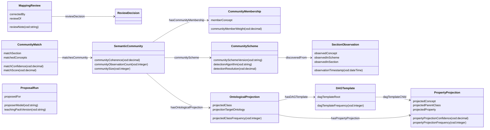

<!-- end -->

### 5.19 Cross references

- The foundations MORK relies on, Foundation's governance states, versions and supersession, are in [Foundation](../foundation/README.md).
- Eligibility, whose conditions the Executable vocabulary describes plans for, is in [Eligibility](../eligibility/README.md).
- The compiler packages are [`tools/mork`](../../tools/mork/README.md), [`tools/mork_rdf`](../../tools/mork_rdf/README.md) and [`tools/mork_compilers`](../../tools/mork_compilers/README.md).
- The compact notation is specified in [MORK Compact Notation](../../docs/architecture/mork-compact-notation.md), and the pack in [MORK Teaching Pack](../../docs/architecture/mork-teaching-pack.md).

## 6. Description Logic Encoding

Section 6 is the only source of the axioms in `spec/Mork.ttl` and `spec/Executable.ttl`. An `output-file` region sends the entries it holds to one of the two documents, MORK's first and Executable's second. MORK has no vocabulary document, so its individuals are in the spec document too. A definition is the text of the term's former `skos:definition`, or of its `rdfs:comment` where Executable had one, and a term that had neither has a definition written for the migration (section 12).

### 6.1 Classes

Superclasses and restrictions are written in **Subclass of.** and **Equivalent to.**, as OWL Manchester expressions with CURIEs. Section 5 explains the classes in groups, with a diagram of each.

<!-- start: {"output-file": "spec/Mork.ttl"} -->

#### `mork:AnonymousElement`

**Definition.** Used to describe the Representation of an Entity that has no identifier, e.g., that is defined anonymously, such as an object within an array.

**Label.** anonymous entity

**Subclass of.** `mork:CollectionElement`, `mork:CollectionElement and (mork:identifier value "")`

#### `mork:Array`

**Definition.** Used to represent an Array, which is an unordered collection of elements. Elements can be associated with the array via the elementType object property.

**Label.** array

**Subclass of.** `mork:UnorderedCollection`

#### `mork:Association`

**Definition.** Represents an association between two data Representations. This mirrors the role of Objectification in the subClass hierarchy of DataConcept.

**Label.** association

**Subclass of.** `mork:Representation`

**Scope note.** By convention, mork:Association does not collect individual members, but acts as a structural component.

#### `mork:Attribute`

**Definition.** is used to denote an attribute in a representation scheme

**Label.** attribute (representation)

**Subclass of.** `mork:IdentifiableElement`

#### `mork:AxiomForm`

**Definition.** Which form of T-Box axiom axiomForm names. Named individuals are GlobalAxioms, UniversalRestriction, ExistentialRestriction and DefiningRestriction.

**Label.** axiom form

#### `mork:Chaining`

**Definition.** A Composition that does not collect like elements. It is disjoint with Collection.

**Subclass of.** `mork:Composition`

#### `mork:ClassCombination`

**Definition.** Which combination of several classes classCombination names. Named individuals are UnionOfClasses and IntersectionOfClasses.

**Label.** class combination

#### `mork:Collection`

**Definition.** Used to represent a collection of elements, such as a list or array.

**Label.** collection

**Subclass of.** `mork:Composition`

#### `mork:CollectionElement`

**Definition.** Used to describe the membership of elements within a collection.

**Label.** collection element

**Subclass of.** `mork:Membership`

#### `mork:CompiledMapping`

**Definition.** A mapping scheme as a compiler compiled it, at one instant, against one base, with its queries, its findings and its mappings' effective confidences. It is named by the digest of its compiled text, so one compilation always has one name, and is typed prov:Entity beside this class.

**Label.** compiled mapping

#### `mork:CompiledQuery`

**Definition.** One query of a compiled mapping, a CONSTRUCT that writes a mapping's triples, a check SELECT that reports where it could not, or a closure SELECT that gathers the members of a class combination once the mappings that create them have run.

**Label.** compiled query

#### `mork:CompileFinding`

**Definition.** One thing a compiler found while compiling a mapping scheme, with its code, its severity and the mapping it is about.

**Label.** compile finding

#### `mork:OutputBox`

**Definition.** Which output a compiled query writes to. Named individuals are InstanceOutput and TerminologyOutput.

**Label.** output box

#### `mork:FindingSeverity`

**Definition.** How severe a compile finding is. Named individuals are ErrorFinding, WarningFinding and InfoFinding.

**Label.** finding severity

#### `mork:SectionObservation`

**Definition.** A record that a set of concepts occurred together in one section of a representation scheme, made when a mapping run over that scheme is accepted.

**Label.** section observation

#### `mork:CommunityScheme`

**Definition.** One discovery of semantic communities, over the section observations it was discovered from, with the algorithm and resolution it used.

**Label.** community scheme

#### `mork:SemanticCommunity`

**Definition.** A cluster of concepts that tend to occur together in sections of a domain's representation schemes, found by community detection over section observations.

**Label.** semantic community

#### `mork:CommunityMembership`

**Definition.** A concept's membership of a semantic community, with its weight in it.

**Label.** community membership

#### `mork:CommunityMatch`

**Definition.** The best-matching semantic community for the concepts observed in one section, with its score and confidence.

**Label.** community match

#### `mork:OntologicalProjection`

**Definition.** What the mappings of a semantic community's concepts have most often targeted in one target ontology, the class and the properties beneath it.

**Label.** ontological projection

#### `mork:PropertyProjection`

**Definition.** One concept of a community and the property it has most often been mapped to, beneath the projected class, with how often and how confidently.

**Label.** property projection

#### `mork:DAGTemplate`

**Definition.** A shape of mapping DAG, a root class and its property projections, that a community's mappings have taken often enough to map a new section of it without a language model.

**Label.** DAG template

#### `mork:MappingReview`

**Definition.** A person's or a reference's decision on one proposed mapping. It is also a prov:Activity, its reviewer named with prov:wasAssociatedWith and its time with prov:endedAtTime.

**Label.** mapping review

#### `mork:ReviewDecision`

**Definition.** Which decision a mapping review made. Named individuals are Accepted, Corrected, Rejected and Deferred.

**Label.** review decision

#### `mork:ProposalRun`

**Definition.** One run in which a proposer, such as a language model given a teaching pack, proposed mappings for a source. It is also a prov:Activity, and each mapping it proposed names it with prov:wasGeneratedBy.

**Label.** proposal run

#### `mork:CompilationMode`

**Definition.** Which of draft, review, or production compilation a MappingScheme's compilationMode names. Named individuals are DraftMode, ReviewMode, and ProductionMode.

**Label.** compilation mode

#### `mork:Composition`

**Definition.** Is used to represent a compositional association between two Representation elements. This carries the semantics that the object in a subject-predicate-object triple, should not be present in an object graph without the presence of a corresponding element representing the subject.

**Label.** composition

**Subclass of.** `mork:Association`

#### `mork:ConcatExpression`

**Definition.** A concatenation of two template expressions. Evaluates to the string concatenation of its left and right operands. Concatenation is associative with Literal("") as identity.

**Label.** concat expression

**Subclass of.** `mork:TemplateExpression`, `mork:concatLeft some mork:TemplateExpression`, `mork:concatRight some mork:TemplateExpression`

#### `mork:ConstraintProvenance`

**Definition.** Records the origin and review chain of generated constraints, including LLM model ID, confidence, review status, jurisdiction, and effective period.

**Label.** constraint provenance

**Subclass of.** `skos:Concept`, `mork:provenanceCreator some xsd:string`, `mork:provenanceCreated some xsd:dateTime`

#### `mork:ConstraintScheme`

**Definition.** A container for a coherent set of SHACL shapes, versionable and scoped to a jurisdiction and effective period.

**Label.** constraint scheme

**Subclass of.** `skos:ConceptScheme`

#### `mork:DataConcept`

**Definition.** An abstract description of a concept, representing a concept to be mapped to a representation and/or ontology scheme.

**Label.** data concept

**Subclass of.** `skos:Concept`, `skos:Concept and (mork:conceptScheme some mork:TaxonomyScheme)`

**Scope note.** DataConcepts are derived from a representation scheme and mapped to an ontological scheme. An individual can be both a Representation and a DataConcept.

#### `mork:DataMapping`

**Definition.** is used to capture a mapping between concepts from a representation and/or concept scheme to an ontological scheme

**Label.** data mapping

**Subclass of.** `skos:Concept`, `skos:Concept and (mork:mappingScheme some mork:MappingScheme)`

#### `mork:Datum`

**Definition.** defines a mapping that explicitly states a datum must be individuated in a target OntologicalScheme

**Label.** datum mapping

**Subclass of.** `mork:DataMapping`

**Equivalent to.** `mork:deferredMapping some mork:DataMapping`

#### `mork:DeferredConceptIRI`

**Definition.** Used to indicate that the axiom a mapping property is referring to shall be obtained once it is created, referencing the conceptName, conceptIRI, or conceptNameTemplate on the mapping which declares the relationship to obtain (i.e., locate) the axiom in question.

**Label.** deferred concept iri

**Subclass of.** `mork:OwlAxiom`

#### `mork:DeferredContext`

**Definition.** Used to act as a placeholder for an axiom that some DataMapping proposes the creation of, which must be referenced by an object property in a related DataMapping.

**Label.** deferred context

**Subclass of.** `mork:DataMapping`

#### `mork:Digraph`

**Definition.** A concept that a digraph match relates to an axiom. Deprecated in favour of the composite mappings.

**Subclass of.** `skos:Concept`, `mork:digraphMatch some mork:OwlAxiom`

#### `mork:Entity`

**Definition.** Is used to denote an entity in a representation scheme. An Entity will usually be marked with its identity in some originating representation scheme using the identifier datatype property.

**Label.** entity (representation)

**Subclass of.** `mork:IdentifiableElement`

#### `mork:ExclusionIntent`

**Definition.** An intent node representing an exclusion (e.g., 'exclude nation-state attacks').

**Label.** exclusion intent

**Subclass of.** `mork:IntentNode`

#### `mork:GenerativeMapping`

**Definition.** The class of all DataMapping individuals whose evaluation produces a constraint, inference, transformation, or projection artefact (SHACL shape, SWRL rule, RML triples map, projection mapping records, or future artefact types). Serves as the common superclass for ShapeMapping, RuleMapping, TransformMapping, and ProjectionMapping, and as the domain for shared properties (hasParameterBinding, hasTargetingSpec, dependsOnMapping).

**Label.** generative mapping

**Subclass of.** `mork:DataMapping`, `fnd:Governable`, `fnd:Versioned`

**Scope note.** GenerativeMapping is not an equivalence class — it has no structural characterisation that would allow automatic classification. Membership is inferred via subclass relationships from ShapeMapping, RuleMapping, TransformMapping, or ProjectionMapping. Foundation alignment: subclassing fnd:Governable and fnd:Versioned requires exactly one fnd:hasGovernanceState and one fnd:hasIdentity per instance at the OWL level, matching the pattern srf:SurfaceContract already uses. This is additive to, not a replacement for, the pre-existing reviewStatus (on *Provenance individuals), supersedes, mappingVersion, and deprecationReason properties, which remain valid and are unchanged. Production-mode compilation gating on governance state is a SHACL-level, mode-conditional check (mork:GenerativeMappingProductionGovernanceShape: beyond Draft, plus identity), not an unconditional OWL requirement — a draft-mode mapping with no governance state asserted yet is incomplete, not inconsistent.

#### `mork:Hypothesis`

**Definition.** A data mapping that another mapping uses as a hypothesis in support of its postulated match.

**Subclass of.** `mork:DataMapping`

#### `mork:IdentifiableElement`

**Definition.** A Representation that carries an identifier used by some external scheme or schema. Entity and Attribute are identifiable elements.

**Subclass of.** `mork:Representation`, `mork:Representation and (mork:identifier some xsd:string)`

#### `mork:InclusionIntent`

**Definition.** An intent node representing an explicit inclusion (e.g., 'including sub-limits').

**Label.** inclusion intent

**Subclass of.** `mork:IntentNode`

#### `mork:IndexedMapping`

**Definition.** A data mapping that occurs at a position in a collection of mappings, which mork:mappingIndex records.

**Subclass of.** `mork:DataMapping`

#### `mork:IntentNode`

**Definition.** "The base class for structured intent representations. IntentNode individuals form a bounded join-semilattice under :refinesIntent.\n\nSubtypes capture the principal categories of insurance product and eligibility criteria: QualitativeIntent, QuantitativeConstraint, SpatialScope, TemporalScope, ExclusionIntent, InclusionIntent. These subtypes are not mutually disjoint."^^xsd:string

**Label.** intent node

**Subclass of.** `skos:Concept`, `mork:intentScheme some mork:IntentScheme`

**Scope note.** IntentNode properties reference only SKOS concept schemes, xsd datatypes, and the natural language source. None reference the target ontology's classes or properties, ensuring stability under ontology evolution (Foundations §3.8.4, Proposition 3.8.4).

#### `mork:IntentScheme`

**Definition.** "A container for intent nodes extracted from natural language specifications. It carries jurisdiction, effective period, and provenance metadata.\n\nThe IntentScheme occupies a position between natural language and ontological commitment. It captures what the user means without committing to how that meaning is realised in a target ontology."^^xsd:string

**Label.** intent scheme

**Subclass of.** `skos:ConceptScheme`

#### `mork:Interpolation`

**Definition.** Used to collect two or more mappings that require interpolation against a template. The syntax for referencing the mappings is simply $1, $2, $3, according to their position within the underlying OrderedCollection.

**Label.** interpolation template

**Subclass of.** `skos:OrderedCollection`

**Equivalent to.** `(mork:interpolationComponent some mork:DataMapping) and (mork:interpolationTemplate some xsd:string)`

#### `mork:InterpolationExpression`

**Definition.** A template interpolation with placeholder bindings. Evaluates by substituting each placeholder in the templateString with the evaluated value of its corresponding TemplateBinding.

**Label.** interpolation expression

**Subclass of.** `mork:TemplateExpression`, `mork:templateString some xsd:string`

#### `mork:LiteralExpression`

**Definition.** A constant string value in the template expression algebra. Evaluates to its dataInline value.

**Label.** literal expression

**Subclass of.** `mork:TemplateExpression`, `mork:dataInline some xsd:string`

#### `mork:Lookup`

**Definition.** Defines a "lookup", from some base data to a named individual

**Label.** lookup

**Subclass of.** `mork:DataMapping`, `mork:DataMapping and (mork:dataRef some xsd:string)`

**Scope note.** "- dataRef value points to a \"path\" in the source data where the lookup (code or indicator) resides\n- t-box match indicates the class to which the identified individual must belong\n- r-box match indicates the relationship between the mapping subject and the identified individual (object)"^^xsd:string

#### `mork:LookupComparison`

**Definition.** Which comparison lookupComparison names. Named individuals are CastComparison, LexicalComparison and TermComparison.

**Label.** lookup comparison

#### `mork:LookupExpression`

**Definition.** Resolves a value against a concept scheme by matching on a specified datatype property. Evaluates by finding the concept in lookupScheme whose lookupProperty value equals the evaluated lookupSource.

**Label.** lookup expression

**Subclass of.** `mork:TemplateExpression`, `mork:lookupSource some mork:TemplateExpression`, `mork:lookupScheme some skos:ConceptScheme`

#### `mork:MappingScheme`

**Definition.** a scheme that captures mappings between concepts, from a RepresentationScheme to an OntologicalScheme

**Label.** mapping scheme

**Subclass of.** `skos:ConceptScheme`

#### `mork:Membership`

**Definition.** Conceptual representation of the notion of "membership" within some containing Representation element.

**Label.** membership

**Subclass of.** `mork:Representation`

**Scope note.** By convention, individuals should not made direct members of this class, but rather belong to its subclasses.

#### `mork:NormativeReferenceItent`

**Definition.** An intent node referencing an external standard, authority, or published form by identifier, without committing to its domain semantics.

**Label.** normative reference intent

**Subclass of.** `mork:IntentNode`

#### `mork:Objectification`

**Definition.** Represents an "objectified fact" relating two DataConcepts to one another with a specific set of roles in mind.

**Subclass of.** `mork:DataConcept`

**Equivalent to.** `(mork:broadConceptRole min 1 skos:Concept) and (mork:narrowConceptRole min 1 skos:Concept)`

#### `mork:OntologicalScheme`

**Definition.** A concept scheme that holds the terms of a target ontology. A mapping scheme maps concepts from a representation scheme to one.

**Label.** ontological scheme

**Subclass of.** `skos:ConceptScheme`

#### `mork:OrderedCollection`

**Definition.** A Collection whose items are ordered, that is a collection for which mork:orderedItems is true.

**Subclass of.** `mork:Collection`

**Equivalent to.** `mork:orderedItems value "true"^^xsd:boolean`

#### `mork:OwlAxiom`

**Definition.** used to denote an axiom in an OWL ontology

**Label.** owl axiom

**Equivalent to.** `skos:Concept and (skos:inScheme some mork:OntologicalScheme)`

**Scope note.** "The OwlAxiom members of an OntologicalScheme are not interrelated using skos notation, since that information is already present in the ontology itself.\n\nRather, the behaviour when mapping data into (and out of) an OntologicalScheme is captured by each DataMapping such that ?mapping skos:inScheme :MappingScheme"^^xsd:string

#### `mork:OwlClass`

**Definition.** Represents an OWL Class.

**Label.** owl class

**Subclass of.** `mork:OwlAxiom`

#### `mork:OwlDataProperty`

**Definition.** Represents an OWL DataProperty

**Label.** owl data property

**Subclass of.** `mork:OwlAxiom`

#### `mork:OwlObjectProperty`

**Definition.** Represents an OWL ObjectProperty

**Label.** owl object property

**Subclass of.** `mork:OwlAxiom`

#### `mork:ParameterBinding`

**Definition.** A reified binding with type metadata: paramName, paramType (Numeric, Concept, Path, String, Duration), and paramValue.

**Label.** parameter binding

#### `mork:ProjectionMapping`

**Definition.** A generative mapping that, when compiled, produces lookup-surface class definitions as first-class RDF graph objects and records the generated symbols against the mapping.

**Label.** projection mapping

**Subclass of.** `mork:GenerativeMapping`, `mork:generatesClassDefinition some mork:OwlClass`, `mork:hasProjectionProvenance some mork:ProjectionProvenance`, `mork:hasTargetingSpec some mork:TargetingSpec`, `mork:hasParameterBinding min 1`

**Equivalent to.** `mork:DataMapping and (mork:generatesClassDefinition some mork:OwlClass)`

**Scope note.** Classification as ProjectionMapping is inferred from the presence of the generatesClassDefinition property pointing to an OwlClass, following the same definitional pattern as ShapeMapping, RuleMapping, and TransformMapping.

#### `mork:ProjectionProvenance`

**Definition.** Records the origin and review chain of generated projection mappings, including profile, read-set identity, review status, and generation timestamps.

**Label.** projection provenance

**Subclass of.** `skos:Concept`, `mork:provenanceCreator some xsd:string`, `mork:provenanceCreated some xsd:dateTime`

#### `mork:QualitativeIntent`

**Definition.** An intent node representing domain-bearing tokens and nominative signals (e.g., concepts, labels, codes), whose meanings must be inferred via a knowledge base.

**Label.** qualitative intent

**Subclass of.** `mork:IntentNode`

#### `mork:QuantitativeConstraint`

**Definition.** An intent node representing a numeric bound or comparison (e.g., 'up to $25M', 'revenue between $10M and $100M').

**Label.** quantitative constraint

**Subclass of.** `mork:IntentNode`

#### `mork:QueryTemplate`

**Definition.** A reusable, parameterised query template (SPARQL or Cypher) with parameter placeholders.

**Label.** query template

**Subclass of.** `skos:Concept`

#### `mork:Referencing`

**Definition.** An Association in which one representation element refers to another and does not contain it.

**Subclass of.** `mork:Association`

#### `mork:RefExpression`

**Definition.** A reference to source data at a path in the template expression algebra. Evaluates by extracting the value at the dataRef path from the input.

**Label.** ref expression

**Subclass of.** `mork:TemplateExpression`, `mork:dataRef some xsd:string`

#### `mork:Representation`

**Definition.** Is used to describe the representation of a DataConcept. Some individuals may be both DataConcept and Representation.

**Label.** representation

**Subclass of.** `skos:Concept`, `skos:inScheme some mork:RepresentationScheme`

#### `mork:RepresentationScheme`

**Definition.** a scheme that maps concepts to their representation

**Label.** representation scheme

**Subclass of.** `skos:ConceptScheme`, `skos:ConceptScheme and (mork:format some mork:SerializationFormat)`

#### `mork:RuleMapping`

**Definition.** "A generative mapping that, when compiled, produces SWRL rules as first-class RDF graph objects (swrl:Imp individuals with structured antecedent/consequent atom lists).\n\nClassification as RuleMapping is inferred from the presence of the generatesRuleDefinition property pointing to a swrl:Imp individual. The canonical representation is the structured RDF graph, not a serialised string.\n\nThe optional swrlCompactSyntax annotation provides a human-readable rendering with no logical role."^^xsd:string

**Label.** rule mapping

**Subclass of.** `mork:GenerativeMapping`, `mork:generatesRuleDefinition some swrl:Imp`, `mork:hasRuleProvenance some mork:RuleProvenance`, `mork:hasTargetingSpec some mork:TargetingSpec`, `mork:hasParameterBinding min 1`

**Equivalent to.** `mork:DataMapping and (mork:generatesRuleDefinition some swrl:Imp)`

#### `mork:RuleProvenance`

**Definition.** Records the origin and review chain of generated SWRL rules, including LLM model ID, confidence, review status, jurisdiction, effective period, and impact scope (advisory, enforcement, annotation).

**Label.** rule provenance

**Subclass of.** `skos:Concept`, `mork:provenanceCreator some xsd:string`, `mork:provenanceCreated some xsd:dateTime`

#### `mork:RuleScheme`

**Definition.** A container for a cohesive set of SWRL rules, versionable and scoped to a jurisdiction and effective period.

**Label.** rule scheme

**Subclass of.** `skos:ConceptScheme`

#### `mork:RuleTemplate`

**Definition.** A parameterisable SWRL rule pattern with typed variables and atoms for antecedent/consequent. RuleTemplates serve as curated, reusable patterns that the LLM can instantiate.

**Label.** rule template

**Subclass of.** `skos:Concept`

#### `mork:ScalarValueElement`

**Definition.** Used to describe scalar (atomic) values as members of a collection, such as an Array.

**Label.** scalar value

**Subclass of.** `mork:AnonymousElement`

#### `mork:SerializationFormat`

**Definition.** A format in which a representation scheme's source is serialised. The individuals JSON, XML, YAML and RDF are the formats MORK names, and mork:format relates a scheme to one.

#### `mork:SetListing`

**Definition.** A Collection whose items are unique, that is a collection for which mork:uniqueItems is true.

**Subclass of.** `mork:Collection`

**Equivalent to.** `mork:uniqueItems value "true"^^xsd:boolean`

#### `mork:ShapeMapping`

**Definition.** "A generative mapping that, when compiled by the Compiler-Agent, instantiates SHACL shapes as first-class RDF graph objects.\n\nClassification as ShapeMapping is inferred from the presence of the generatesShapeDefinition property pointing to an sh:Shape individual, following the same definitional pattern as Datum (≡ ∃deferredMapping.DataMapping) and RuleMapping (≡ DataMapping ⊓ ∃generatesRuleDefinition.swrl:Imp).\n\nThe generated shape is structured RDF — not a serialised string. Its internal structure is fully traversable, queryable, and validatable within the RDF graph."^^xsd:string

**Label.** shape mapping

**Subclass of.** `mork:GenerativeMapping`, `mork:hasTargetingSpec some mork:TargetingSpec`, `mork:hasParameterBinding min 1`, `mork:hasConstraintProvenance some mork:ConstraintProvenance`, `mork:generatesShapeDefinition some sh:Shape`

**Equivalent to.** `mork:DataMapping and (mork:generatesShapeDefinition some sh:Shape)`

#### `mork:ShapeTemplate`

**Definition.** A parameterisable blueprint for one SHACL NodeShape or PropertyShape. ShapeTemplates serve as curated, reusable patterns that the LLM can instantiate, reducing scope for hallucination and model drift.

**Label.** shape template

**Subclass of.** `skos:Concept`

#### `mork:SpatialScope`

**Definition.** An intent node representing a geographic scope (e.g., 'in US states', 'excluding EU').

**Label.** spatial scope

**Subclass of.** `mork:IntentNode`

#### `mork:TargetingSpec`

**Definition.** "Binds a GenerativeMapping (ShapeMapping, RuleMapping, TransformMapping, or ProjectionMapping) to its target scope within the target ontology. Supports four targeting modes from the SHACL vocabulary:\n\n- sh:targetClass: the shape/rule applies to all instances of the specified class\n- sh:targetObjectsOf: applies to all objects of the specified property\n- sh:targetSubjectsOf: applies to all subjects of the specified property\n- sh:targetNode: applies to a specific named individual\n\nAlso supports optional jurisdiction scoping (appliesInJurisdiction) and effective date range (effectiveFrom, effectiveUntil). At least one targeting mode must be declared (enforced by GCI 5.6h-i and SHACL Shape M8)."^^xsd:string

**Label.** targeting spec

**Subclass of.** `(sh:targetClass some owl:Class) or (sh:targetObjectsOf some rdf:Property) or (sh:targetSubjectsOf some rdf:Property) or (sh:targetNode some owl:Thing)`

#### `mork:TaxonomyScheme`

**Definition.** A concept scheme that arranges its concepts as a taxonomy.

**Subclass of.** `skos:ConceptScheme`

#### `mork:TemplateBinding`

**Definition.** A binding of a placeholder name to a template expression. Used within InterpolationExpression to provide values for template placeholders.

**Label.** template binding

#### `mork:TemplateExpression`

**Definition.** "Base class for the formal template expression language (Foundations §3.9). \nRepresents a node in the expression algebra used for IRI formation, name generation, and value interpolation.\nThe expressions form a monoid (TemplateExpression, Concat, Literal(\"\")) over string-valued expressions."^^xsd:string

**Label.** template expression

**Subclass of.** `skos:Concept`

#### `mork:TemporalScope`

**Definition.** An intent node representing a temporal scope or duration (e.g., '12 months', 'annual').

**Label.** temporal scope

**Subclass of.** `mork:IntentNode`

#### `mork:TransformMapping`

**Definition.** "A generative mapping that, when compiled, produces an RML/R2RML triples map as a first-class RDF graph object (an rr:TriplesMap individual with structured subject map, predicate-object maps, and logical source).\n\nClassification as TransformMapping is inferred from the presence of the generatesTransformDefinition property pointing to an rr:TriplesMap individual, following the same definitional pattern as ShapeMapping (≡ DataMapping ⊓ ∃generatesShapeDefinition.sh:Shape) and RuleMapping (≡ DataMapping ⊓ ∃generatesRuleDefinition.swrl:Imp).\n\nThe generated triples map is structured RDF — not a serialised mapping file. Its internal structure (logical source, subject map, predicate-object maps, referencing object maps and join conditions) is fully traversable and queryable within the RDF graph."^^xsd:string

**Label.** transform mapping

**Subclass of.** `mork:GenerativeMapping`, `mork:generatesTransformDefinition some rr:TriplesMap`, `mork:hasTransformProvenance some mork:TransformProvenance`

**Equivalent to.** `mork:DataMapping and (mork:generatesTransformDefinition some rr:TriplesMap)`

**Scope note.** "Unlike ShapeMapping and RuleMapping, an ordinary (non-generative) DataMapping is already RML-compilable in the ingress direction — a compiler may walk any Datum, Lookup, or R-Box assertion node and emit a triples map without that node ever being asserted as a TransformMapping. TransformMapping exists to make that compiled artefact a first-class, queryable, provenance-bearing graph object exactly where a deployment needs to trace \"which mapping produced this triples map\" — the same governance guarantee ShapeMapping and RuleMapping already give SHACL shapes and SWRL rules.\n\nTransformMapping is also the natural target for the reverse (egress) direction: a DataMapping whose source is itself part of the ontology (e.g. a qnt:Quantity or qnt:Range chain) and whose rr:TriplesMap projects that chain out to a flatter, deployment-specific representation. egressProjection (§ DataMapping) names the target Representation. generatesTransformDefinition names the compiled artefact that performs the projection."^^xsd:string

#### `mork:TransformProvenance`

**Definition.** Records the origin and review chain of a generated RML triples map, including LLM model ID, confidence, review status, and the direction of transformation (ingress: external source to ontology, or egress: ontology to a flatter target representation).

**Label.** transform provenance

**Subclass of.** `skos:Concept`

#### `mork:UncertainMapping`

**Definition.** Individuals belonging to this class, represent mapping where the ontological target is missing, incomplete, uncertain, or undefined. Members of this class SHOULD also be members of DataMapping or one of its (other) subclasses.

**Label.** uncertain mapping

**Subclass of.** `mork:DataMapping`

**Equivalent to.** `(mork:hypothesisMapping some mork:DataMapping) or (mork:mappingRecommendation some xsd:string)`

#### `mork:UnorderedCollection`

**Definition.** A Collection whose items are not ordered, that is a collection for which mork:orderedItems is false.

**Subclass of.** `mork:Collection`

**Equivalent to.** `mork:orderedItems value "false"^^xsd:boolean`

#### `mork:WeightedMatch`

**Definition.** is used to score a potential match (between concept taxa and ontological facts)

**Label.** weighted match

**Subclass of.** `mork:DataMapping`, `mork:weighting some xsd:integer`

**Scope note.** each member of this class may carry skos:note and rdfs:seeAlso that explain the rules used to arrive at the match

<!-- end -->


<!-- start: {"output-file": "spec/Executable.ttl"} -->

#### `exe:ConceptMatchPlan`

**Definition.** A condition plan that matches a candidate concept against required and excluded concepts (elg:ExactMatch, elg:SetMembership, elg:HierarchicalMatch), per ADR-A87.

**Subclass of.** `exe:ConditionPlan`

#### `exe:ConditionPlan`

**Definition.** An executable plan for one elg:Condition.

**Subclass of.** `exe:ExecutablePlan`

#### `exe:DesignTimeCheck`

**Definition.** A reasoner's answer to one question about the classes of an exe:OwlArtefact, run through the test-only reasoning harness (ADR-A90 item 6).

**Subclass of.** `prov:Entity`

#### `exe:Diagnostic`

**Definition.** The reason a compiled artefact gives for an Undetermined outcome. A closed set of named individuals.

#### `exe:ExecutablePlan`

**Definition.** A deterministic, implementation-neutral executable representation compiled from an Eligibility declaration.

**Subclass of.** `prov:Entity`

#### `exe:GeneratedArtefact`

**Definition.** A compiler output: a SPARQL query template, a SHACL shape, a SWRL rule, or an OWL module.

**Subclass of.** `prov:Entity`

#### `exe:IntervalContainmentPlan`

**Definition.** A condition plan that evaluates whether a candidate range is contained by some member of a required range set (elg:IntervalContainment).

**Subclass of.** `exe:ConditionPlan`

#### `exe:OverlapCheck`

**Definition.** Whether the intersection of the checked class and the class it is checked against can have any instance.

**Subclass of.** `exe:DesignTimeCheck`

#### `exe:OwlArtefact`

**Definition.** A module of design-time OWL classes generated by the OWL backend: one class per condition and profile, and the hierarchy classes they use (ADR-A90).

**Subclass of.** `exe:GeneratedArtefact`

#### `exe:ProfilePlan`

**Definition.** An executable plan for one elg:AdmissionProfile, aggregating its condition plans by strong Kleene logic.

**Subclass of.** `exe:ExecutablePlan`

#### `exe:SatisfiabilityCheck`

**Definition.** Whether the checked class can have any instance.

**Subclass of.** `exe:DesignTimeCheck`

#### `exe:ShaclArtefact`

**Definition.** A sh:NodeShape generated by the SHACL backend.

**Subclass of.** `exe:GeneratedArtefact`

#### `exe:SparqlArtefact`

**Definition.** A mork:QueryTemplate generated by the SPARQL backend.

**Subclass of.** `exe:GeneratedArtefact`

#### `exe:SubsumptionCheck`

**Definition.** Whether the checked class is subsumed by the class it is checked against: a revised profile admits no one the earlier one did not.

**Subclass of.** `exe:DesignTimeCheck`

#### `exe:SwrlArtefact`

**Definition.** A swrl:Imp generated by the SWRL backend.

**Subclass of.** `exe:GeneratedArtefact`

<!-- end -->

### 6.2 Object Properties

The object properties of MORK first, then those of Executable.

<!-- start: {"output-file": "spec/Mork.ttl"} -->

#### `mork:appliesInJurisdiction`

**Definition.** References a SKOS concept from a jurisdiction concept scheme, scoping the GenerativeMapping to a specific jurisdiction.

**Label.** applies in jurisdiction

**Domain.** `mork:GenerativeMapping`

**Range.** `skos:Concept`

#### `mork:appliesWhen`

**Definition.** A SHACL node shape the nodes a mapping applies to must conform to. The mapping, and the mappings beneath it in its context, apply only to the nodes its path reaches that conform to the shape.

**Label.** applies when

**Range.** `sh:NodeShape`

**Scope note.** A guard tests the source, never the target. Several guarded mappings on one path divide its nodes among them, and a node no guard admits is mapped by none.

#### `mork:assertsPropertyDomains`

**Definition.** Used to indicate that a mapping to an object property should provide assertions about the domain(s) of that property. Intended for use with deferred mappings (i.e., where the axiom to which the domain property shall refer does not exist at the time the mapping is defined).

**Label.** asserts property domains

**Subproperty of.** `mork:propertyMappingAssertions`

#### `mork:assertsPropertyRanges`

**Definition.** Used to indicate that a mapping to an object property should provide assertions about the range(s) of that property. Intended for use with deferred mappings (i.e., where the axiom to which the rdfs:range property shall refer does not exist at the time the mapping is defined).

**Label.** asserts property ranges

**Subproperty of.** `mork:propertyMappingAssertions`

#### `mork:associativeBroader`

**Definition.** extends skos:broader with the concept of associativity

**Label.** associative broader

**Inverse of.** `mork:associativeNarrower`

**Subproperty of.** `skos:broader`

**Scope note.** By convention, associativeBroader is not used to make assertions. Rather, its subProperties should be used, however the superProperty exists in order to draw inferences about the transitive closure of a hierarchical relation.

#### `mork:associativeNarrower`

**Definition.** extends skos:narrower with the concept of associativity

**Label.** associative narrower

**Subproperty of.** `skos:narrower`

**Scope note.** By convention, associativeNarrower is not used to make assertions. Rather, its subProperties should be used, however the superProperty exists in order to draw inferences about the transitive closure of a hierarchical relation.

#### `mork:axiomForm`

**Definition.** The form of the T-Box axioms a mapping's assertsPropertyDomains and assertsPropertyRanges produce. It may be given more than once, and each form named is produced. Unset is equivalent to GlobalAxioms.

**Label.** axiom form

**Range.** `mork:AxiomForm`

**Scope note.** Under OWL's open-world semantics every form entails and none constrains. A closed-world check that data observes a domain or range is a shape, produced by a ShapeMapping. The forms differ in scope: a global axiom holds for every use of the property, a restriction only for the members of the domain classes.

#### `mork:bindsToCriteria`

**Definition.** Links a QueryTemplate to the product criteria or CriteriaShape that generated the query.

**Label.** binds to criteria

**Domain.** `mork:QueryTemplate`

#### `mork:broadABoxCategoryMatch`

**Definition.** "Used to state a mapping link where the subject maps to a broader category via object-property link to an individual that represents the Hyperonym (i.e., the more specific thing in the A-Box of the mapped concept scheme).\n\nThe A-Box (or Assertional Box) contains assertions (or facts) about individuals within the domain."^^xsd:string

**Label.** has broad a-box category match

**Inverse of.** `mork:narrowABoxCategoryMatch`

**Subproperty of.** `mork:broadCategoryMatch`

**Scope note.** "An ABox category match may apply either before or after a datum is to be individuated. In either case, the operation is implied to be idempotent.\n\nAn ABox category match implies the presence of both a RBox match (to the object property over which the relationship is to be defined) and a skos:mappingRelation to the owl:Individual in the A-box. This is not described in the domains for this property, since such constraints are better expressed as SWRL/SHACL constraints."^^xsd:string

#### `mork:broadCategoryMatch`

**Definition.** A broadCategoryMatch is used to state a hyperonymic, categorical mapping link between two conceptual resources in different concept schemes, where the subject is the (more specific) hyponym, and the object is the (more general) hyperonym.

**Label.** has broad category match

**Inverse of.** `mork:narrowCategoryMatch`

**Subproperty of.** `skos:broadMatch`

#### `mork:broadConceptRole`

**Definition.** Used to model the subject in an Objectification, i.e., a relationship between concepts that must be "reified" in order to annotate it, or create associations between the relationship and other concepts.

**Label.** has objectified broad concept role

**Range.** `skos:Concept`

**Subproperty of.** `mork:associativeBroader`

**Scope note.** "This property is NOT marked as the inverse of narrowConceptRole, since doing so would cause the reasoner to assume that the participants in an Objectification are members of that class.\n\nFor situations where such extended reasoning is desireable, broadNavigableConceptRole and its inverse narrowNavigableConceptRole can be used."^^xsd:string

#### `mork:broaderApplicative`

**Definition.** "Models contextual (Kleisli) composition for the context monad. This causes any compositeNarrowerMapping to be applied within the context (i.e., mapping outcome) of the object, rather than the subject.\n\nUsed when a mapping needs to interact with the outcome of a prior mapping, for example a compositeBroader or hypothesisMapping. Please read the skos:scopeNote for the expected behaviours."^^xsd:string

**Label.** has broader applicative mapping

**Subproperty of.** `mork:broaderMapping`

**Scope note.** "All compositeNarrowerMappings will be applied to the context (i.e., the axioms resulting as the *outcome* of the broaderApplicative object mapping). This implies the following rules:\n\n- The broaderApplicative object must be a DataMapping or subclass thereof.\n- An exactRBoxMatch or inverseRBoxMatch MUST be provided to indicate the relationship between the subject (outcome of this mapping) and the object (on the other end of the relationship).\n\nSpecifically, this instruction means:\n\n- Consider the context/outcome axiom of this (subject) mapping, refer to it as the \"child\"\n- Look up the broaderApplicative mapping, refer to it as the \"parent\"\n- Find the axiom (or entry point into a digraph of axioms) created by the \"parent\" mapping, that is related to the \"child\" axiom along the relationship defined by the exactRBoxMatch\n- Apply the compositeNarrowerMappings of the subject (mapping) to the parent's axiom(s) and not to the child's\n\nFormally, this is modelled as Kleisli composition for a context monad (see Foundations §2.4). The co-occurrence constraint requiring an exactRBoxMatch is enforced by GCI Axiom 2.14a."^^xsd:string

#### `mork:broaderMapping`

**Definition.** Relates a mapping to a mapping that is more general (less specific)

**Label.** has broader mapping

**Domain.** `mork:DataMapping or (skos:OrderedCollection and (skos:member some mork:DataMapping))`

**Range.** `mork:DataMapping`

**Inverse of.** `mork:narrowerMapping`

**Subproperty of.** `mork:relatedMapping`

#### `mork:broadNavigableConceptRole`

**Definition.** Extends broadConceptRole to model the subject in an Objectification where the participating concepts can be inferred to be members of the Objectification class

**Label.** has navigable objectified broad concept role

**Inverse of.** `mork:narrowNavigableConceptRole`

**Subproperty of.** `mork:broadConceptRole`

**Scope note.** "This property is the inverse of narrowNavigableConceptRole. The reasoner will assume Individuals related via this property are members of the class Objectification.\n\nFor situations where such reasoning is not desireable, use the superProperty broadConceptRole instead."^^xsd:string

#### `mork:broadRBoxCategoryMatch`

**Definition.** "Used to state a mapping link where the subject maps to a broader category of relationship (i.e., the more specific relation in the R-Box of the mapped concept scheme). This property is intended for use with members of the Objectification class, however no domain or range assertions are made in order to avoid having the reasoner incorrectly assign individuals to said class.\n\nThe R-Box (or Relational Box) defines the properties or roles that can be used to relate individuals, and their characteristics, such as whether they are symmetric, transitive, or functional."^^xsd:string

**Label.** has broad r-box category match

**Inverse of.** `mork:narrowRBoxCategoryMatch`

**Subproperty of.** `mork:broadCategoryMatch`

**Scope note.** Assertions made with this property are intended for use alongside matches to individuals in the A-Box of a target ontology.

#### `mork:broadTBoxCategoryMatch`

**Definition.** "Used to define a hyperonymic, categorical relationship between concepts in different concept schemes, specifically modelling the subject as being in an owl:subclassOf relationship with the object.\n\nThe T-Box (or Terminological Box) defines the vocabulary of the domain by describing concepts (such as Classes) and roles (relationships that can be defined between objects)."^^xsd:string

**Label.** has broad t-box category match

**Inverse of.** `mork:narrowTBoxCategoryMatch`

**Subproperty of.** `mork:broadCategoryMatch`

**Scope note.** A TBox category must be applied before a datum can be individuated, since it implies the existence of an owl:Class not originally present in an OntologicalScheme. The implication here is that the operation resulting from this axiom is idempotent.

#### `mork:classCombination`

**Definition.** How the classes a mapping names with assertsPropertyDomains, or with assertsPropertyRanges, are combined when there are several. Unset is equivalent to UnionOfClasses.

**Label.** class combination

**Range.** `mork:ClassCombination`

**Characteristics.** functional

**Scope note.** A combination over classes created from source data is known only once the mappings that create them have run. It is produced at the closure of the mapping DAG, after every mapping it depends on.

#### `mork:closeMapping`

**Definition.** used to link two mappings that are sufficiently similar that they can be used interchangeably in some applications.

**Label.** has close mapping

**Subproperty of.** `mork:relatedMapping`

#### `mork:compiledInMode`

**Definition.** The compilation mode a compiled mapping was compiled under.

**Label.** compiled in mode

**Domain.** `mork:CompiledMapping`

**Range.** `mork:CompilationMode`

**Characteristics.** functional

#### `mork:hasCompiledQuery`

**Definition.** A query of a compiled mapping.

**Label.** has compiled query

**Domain.** `mork:CompiledMapping`

**Range.** `mork:CompiledQuery`

#### `mork:compiledFrom`

**Definition.** The mapping node a compiled query comes from.

**Label.** compiled from

**Domain.** `mork:CompiledQuery`

**Characteristics.** functional

#### `mork:contextPath`

**Definition.** The list of mapping nodes from a compiled query's root to the mapping it comes from, which is the chain of contexts its WHERE clause follows.

**Label.** context path

**Domain.** `mork:CompiledQuery`

**Range.** `rdf:List`

**Characteristics.** functional

#### `mork:outputBox`

**Definition.** Whether a compiled query writes instance data or terminology.

**Label.** output box

**Domain.** `mork:CompiledQuery`

**Range.** `mork:OutputBox`

**Characteristics.** functional

#### `mork:readsOutputOf`

**Definition.** A mapping whose output a compiled query reads, so that the query runs in a later stratum than that mapping's queries.

**Label.** reads output of

**Domain.** `mork:CompiledQuery`

#### `mork:closureProperty`

**Definition.** The property a closure query writes an axiom about.

**Label.** closure property

**Domain.** `mork:CompiledQuery`

**Characteristics.** functional

#### `mork:closureAxiom`

**Definition.** The axiom a closure query writes, rdfs:domain or rdfs:range, named by the property that states it.

**Label.** closure axiom

**Domain.** `mork:CompiledQuery`

**Characteristics.** functional

#### `mork:closureCombination`

**Definition.** How a closure query combines its members, owl:unionOf or owl:intersectionOf, named by the property that states it.

**Label.** closure combination

**Domain.** `mork:CompiledQuery`

**Characteristics.** functional

#### `mork:hasCompileFinding`

**Definition.** A finding of a compiled mapping.

**Label.** has compile finding

**Domain.** `mork:CompiledMapping`

**Range.** `mork:CompileFinding`

#### `mork:findingSeverity`

**Definition.** The severity of a compile finding.

**Label.** finding severity

**Domain.** `mork:CompileFinding`

**Range.** `mork:FindingSeverity`

**Characteristics.** functional

#### `mork:findingAbout`

**Definition.** The mapping node a compile finding is about.

**Label.** finding about

**Domain.** `mork:CompileFinding`

**Characteristics.** functional

#### `mork:hasEffectiveConfidence`

**Definition.** An entry of a compiled mapping that records one mapping's effective confidence.

**Label.** has effective confidence

**Domain.** `mork:CompiledMapping`

#### `mork:confidenceOf`

**Definition.** The mapping node an effective confidence entry is for.

**Label.** confidence of

**Characteristics.** functional

#### `mork:observedInSection`

**Definition.** The section a section observation was made in.

**Label.** observedInSection

**Domain.** `mork:SectionObservation`

#### `mork:observedInScheme`

**Definition.** The representation scheme a section observation was made in.

**Label.** observedInScheme

**Domain.** `mork:SectionObservation`

#### `mork:observedConcept`

**Definition.** A concept a section observation saw.

**Label.** observedConcept

**Domain.** `mork:SectionObservation`

#### `mork:discoveredFrom`

**Definition.** A section observation a community scheme was discovered from.

**Label.** discoveredFrom

**Domain.** `mork:CommunityScheme`

**Range.** `mork:SectionObservation`

#### `mork:communityScheme`

**Definition.** The community scheme a semantic community belongs to.

**Label.** communityScheme

**Domain.** `mork:SemanticCommunity`

**Range.** `mork:CommunityScheme`

#### `mork:hasCommunityMembership`

**Definition.** A membership of a semantic community.

**Label.** hasCommunityMembership

**Domain.** `mork:SemanticCommunity`

**Range.** `mork:CommunityMembership`

#### `mork:memberConcept`

**Definition.** The concept a community membership is of.

**Label.** memberConcept

**Domain.** `mork:CommunityMembership`

#### `mork:matchSection`

**Definition.** The section a community match is for.

**Label.** matchSection

**Domain.** `mork:CommunityMatch`

#### `mork:matchesCommunity`

**Definition.** The semantic community a community match found.

**Label.** matchesCommunity

**Domain.** `mork:CommunityMatch`

**Range.** `mork:SemanticCommunity`

#### `mork:matchedConcepts`

**Definition.** A concept of the section that a community match found in the community.

**Label.** matchedConcepts

**Domain.** `mork:CommunityMatch`

#### `mork:hasOntologicalProjection`

**Definition.** An ontological projection of a semantic community.

**Label.** hasOntologicalProjection

**Domain.** `mork:SemanticCommunity`

**Range.** `mork:OntologicalProjection`

#### `mork:projectionTargetOntology`

**Definition.** The target ontology an ontological projection is onto.

**Label.** projectionTargetOntology

**Domain.** `mork:OntologicalProjection`

#### `mork:projectedClass`

**Definition.** The shadow of the class an ontological projection most often targets.

**Label.** projectedClass

**Domain.** `mork:OntologicalProjection`

#### `mork:hasPropertyProjection`

**Definition.** A property projection beneath an ontological projection.

**Label.** hasPropertyProjection

**Domain.** `mork:OntologicalProjection`

**Range.** `mork:PropertyProjection`

#### `mork:projectedConcept`

**Definition.** The concept a property projection is for.

**Label.** projectedConcept

**Domain.** `mork:PropertyProjection`

#### `mork:projectedProperty`

**Definition.** The shadow of the property a property projection's concept is most often mapped to.

**Label.** projectedProperty

**Domain.** `mork:PropertyProjection`

#### `mork:projectedParentClass`

**Definition.** The shadow of the class the projected property is asserted on.

**Label.** projectedParentClass

**Domain.** `mork:PropertyProjection`

#### `mork:hasDAGTemplate`

**Definition.** A DAG template of an ontological projection.

**Label.** hasDAGTemplate

**Domain.** `mork:OntologicalProjection`

**Range.** `mork:DAGTemplate`

#### `mork:dagTemplateRoot`

**Definition.** The shadow of a DAG template's root class.

**Label.** dagTemplateRoot

**Domain.** `mork:DAGTemplate`

#### `mork:dagTemplateChild`

**Definition.** A property projection a DAG template asserts beneath its root.

**Label.** dagTemplateChild

**Domain.** `mork:DAGTemplate`

**Range.** `mork:PropertyProjection`

#### `mork:shadowOf`

**Definition.** The target ontology's term a shadow individual stands for, so mapping patterns over the term can be reasoned about in OWL 2 DL.

**Label.** shadowOf

#### `mork:shadowSubClassOf`

**Definition.** That one shadow's class is a subclass of another shadow's.

**Label.** shadowSubClassOf

#### `mork:shadowSubPropertyOf`

**Definition.** That one shadow's property is a subproperty of another shadow's.

**Label.** shadowSubPropertyOf

#### `mork:shadowDomain`

**Definition.** A shadow of a class that is a domain of a shadow's property.

**Label.** shadowDomain

#### `mork:shadowRange`

**Definition.** A shadow of a class that is a range of a shadow's property.

**Label.** shadowRange

#### `mork:reviewOf`

**Definition.** The proposed mapping a mapping review decides.

**Label.** reviewOf

**Domain.** `mork:MappingReview`

#### `mork:reviewDecision`

**Definition.** What a mapping review decided.

**Label.** reviewDecision

**Domain.** `mork:MappingReview`

**Range.** `mork:ReviewDecision`

#### `mork:correctedBy`

**Definition.** The mapping that replaces a corrected proposal, for a review that decided Corrected.

**Label.** correctedBy

**Domain.** `mork:MappingReview`

#### `mork:proposedFor`

**Definition.** The representation scheme a proposal run proposed mappings for.

**Label.** proposedFor

**Domain.** `mork:ProposalRun`

#### `mork:compilationMode`

**Definition.** The compilation mode a MappingScheme's member mappings are compiled under: DraftMode, ReviewMode, or ProductionMode (Foundations §5.10b). Unset is equivalent to DraftMode. Only ProductionMode brings the governance-state and version-identity SHACL gate (mork:GenerativeMappingProductionGovernanceShape) into force for that scheme's mappings. A mapping compiled under DraftMode or ReviewMode is unaffected by it.

**Label.** compilation mode

**Domain.** `mork:MappingScheme`

**Range.** `mork:CompilationMode`

**Characteristics.** functional

#### `mork:compositeBroader`

**Definition.** Extends associativeBroader with the concept of composition, wherein the object's existence is semantically conditional upon the subject's. This property is the inverse of compositeNarrower.

**Label.** composite broader

**Inverse of.** `mork:compositeNarrower`

**Subproperty of.** `mork:associativeBroader`

#### `mork:compositeBroaderMapping`

**Definition.** compositeBroaderMapping is used to compose mappings into a directed acyclic graph. The subject mapping is the component part of the object mapping. This is the inverse of compositeNarrowerMapping.

**Label.** has composite broader mapping

**Inverse of.** `mork:compositeNarrowerMapping`

**Subproperty of.** `mork:broaderMapping`

#### `mork:compositeBroaderTemplate`

**Definition.** Version of 'composite broader mapping' for use in templates. This property is the inverse of compositeNarrowerTemplate.

**Label.** has composite broader template

**Inverse of.** `mork:compositeNarrowerTemplate`

**Subproperty of.** `mork:compositeBroaderMapping`

#### `mork:compositeNarrower`

**Definition.** Extends associativeNarrower with the concept of composition, wherein the subject's existence is semantically conditional upon the object's. This property is the inverse of compositeBroader.

**Label.** composite narrower

**Subproperty of.** `mork:associativeNarrower`

#### `mork:compositeNarrowerMapping`

**Definition.** compositeNarrowerMapping is used to compose mappings into a directed acyclic graph. The object mapping is the component part of the subject mapping. This is the inverse of compositeBroaderMapping.

**Label.** has composite narrower mapping

**Subproperty of.** `mork:narrowerMapping`

#### `mork:compositeNarrowerTemplate`

**Definition.** Version of 'composite narrower mapping' for use in templates.

**Label.** has composite narrower template

**Subproperty of.** `mork:compositeNarrowerMapping`

#### `mork:concatenation`

**Definition.** Used to indicate that a placeholderMapping is being used for the purposes of concatenating values

**Label.** concatenation

**Subproperty of.** `mork:placeholderMapping`

#### `mork:concatLeft`

**Definition.** The left operand of a concatenation expression.

**Label.** concat left

**Domain.** `mork:ConcatExpression`

**Range.** `mork:TemplateExpression`

**Characteristics.** functional

#### `mork:concatRight`

**Definition.** The right operand of a concatenation expression.

**Label.** concat right

**Domain.** `mork:ConcatExpression`

**Range.** `mork:TemplateExpression`

**Characteristics.** functional

#### `mork:conceptScheme`

**Definition.** denotes the subject's membership in the object (TaxonomyScheme)

**Label.** in concept scheme

**Range.** `mork:TaxonomyScheme`

**Subproperty of.** `skos:inScheme`

#### `mork:constraintDimension`

**Definition.** References a concept identifying the measured dimension a quantitative constraint applies to. The concept resides in an external scheme.

**Label.** constraint dimension

**Domain.** `mork:QuantitativeConstraint`

**Range.** `skos:Concept`

#### `mork:constraintUnit`

**Definition.** References a concept representing the unit of measurement for a quantitative constraint (e.g., USD, GBP, metres).

**Label.** constraint unit

**Domain.** `mork:QuantitativeConstraint`

**Range.** `skos:Concept`

#### `mork:deferredMapping`

**Definition.** Used to defer to a mapping where the subject is dependent on the result of applying the object (mapping) and obtaining the outcome. This can be used, for example, to ensure that individuals which belong to an owl:Class are processed only after the class axiom has been asserted.

**Label.** has deferred mapping

**Characteristics.** symmetric

**Subproperty of.** `mork:relatedMapping`

#### `mork:dependentMapping`

**Definition.** Used to specifically indicate that the object mapping MUST be processed prior to the subject. Unlike the superProperty deferredMapping, the subject may not use the output of the object (mapping) directly (as its context).

**Label.** has dependent mapping

**Subproperty of.** `mork:deferredMapping`

**Scope note.** This property should be used when a related mapping must be executed in order to assert some axiom(s) prior to their use. The subject MUST NOT consider the target state of the object to be part of the context (of the subject's mapping), but rather must refer to it via other means, e.g., by reference to a DeferredContext that brings the asserted axioms into scope via mork:yieldConcept.

#### `mork:dependsOnMapping`

**Definition.** Compositional dependency ensuring that target concepts exist before the GenerativeMapping (ShapeMapping, RuleMapping, TransformMapping, or ProjectionMapping) is compiled.

**Label.** depends on mapping

**Domain.** `mork:GenerativeMapping`

**Range.** `mork:DataMapping`

#### `mork:digraphMatch`

**Definition.** is used to state a hierarchical mapping link between conceptual resources in different concept schemes, where one concept is mapped to a directed (sub-)graph of related concepts.

**Label.** has digraph match

**Range.** `mork:Digraph`

**Inverse of.** `mork:digraphOf`

**Subproperty of.** `skos:broadMatch`

#### `mork:digraphOf`

**Definition.** digraphFrom is used to state a hierarchical mapping link between conceptual resources in different concept schemes, where concepts belong to a directed (sub-)graph that relates back to some parent concept (in another scheme).

**Label.** is digraph match from

**Domain.** `mork:Digraph`

**Subproperty of.** `skos:narrowMatch`

#### `mork:egressProjection`

**Definition.** Links a DataMapping to the specific Representation element it should project to during egress. Enables the Compiler-Agent to generate both ingress transforms (forward traversal) and egress query templates (reverse traversal, SPARQL CONSTRUCT) from the mapping DAG.

**Label.** egress projection

**Domain.** `mork:DataMapping`

**Range.** `mork:Representation`

#### `mork:elementType`

**Definition.** Specialises compositeNarrower with a particular semantics for describing the type of elements within a Collection. The domain and range for this property assertions provide an explicit hint to the reasoner as such.

**Label.** element type

**Domain.** `mork:Collection`

**Range.** `mork:CollectionElement`

**Subproperty of.** `mork:compositeNarrower`

#### `mork:exactABoxMatch`

**Definition.** Used to indicate an exact match to an element in the A-Box of an ontology (i.e., OntologicalScheme). The subject may come from any aspect of another domain (e.g., belonging to RepresentationScheme or TaxonomyScheme, coming from the T-Box, A-Box, or R-Box).

**Label.** exact A-Box match

**Subproperty of.** `mork:intransitiveExactMatch`

#### `mork:exactMapping`

**Definition.** used to link two mappings, indicating a high degree of confidence that they can be used interchangeably across a wide range of applications.

**Label.** has exact mapping

**Subproperty of.** `mork:closeMapping`

#### `mork:exactRBoxMatch`

**Definition.** Used to indicate an exact match to an element in the R-Box of an ontology (i.e., OntologicalScheme). The subject may come from any aspect of another domain (e.g., belonging to RepresentationScheme or TaxonomyScheme, coming from the T-Box, A-Box, or R-Box).

**Label.** exact R-Box match

**Subproperty of.** `mork:intransitiveExactMatch`

#### `mork:exactTBoxMatch`

**Definition.** "Used to indicate an exact match to an element in the T-Box of an ontology (i.e., OntologicalScheme). The subject may come from any aspect of another domain (e.g., belonging to RepresentationScheme or TaxonomyScheme, coming from the T-Box, A-Box, or R-Box).\n\nThe T-Box (or Terminological Box) defines the vocabulary of the domain by describing concepts (such as Classes) and roles (relationships that can be defined between objects)."^^xsd:string

**Label.** exact T-Box match

**Subproperty of.** `mork:intransitiveExactMatch`

#### `mork:format`

**Definition.** denotes the SerializationFormat used by a RepresentationScheme

**Label.** has format

**Domain.** `mork:RepresentationScheme`

**Range.** `mork:SerializationFormat`

**Subproperty of.** `owl:topObjectProperty`

#### `mork:generatesClassDefinition`

**Definition.** Links a ProjectionMapping to a class the surface compiler minted for it.

**Label.** generates class definition

**Domain.** `mork:ProjectionMapping`

**Range.** `mork:OwlClass`

#### `mork:generatesRuleDefinition`

**Definition.** Links a RuleMapping to the SWRL rule (swrl:Imp individual) it generates when compiled. The generated rule is structured RDF with fully traversable antecedent/consequent atom lists, class predicates, property predicates, and variable bindings.

**Label.** generates rule definition

**Domain.** `mork:RuleMapping`

**Range.** `swrl:Imp`

#### `mork:generatesShapeDefinition`

**Definition.** Links a ShapeMapping to the SHACL shape (sh:Shape individual, which may be an sh:NodeShape or sh:PropertyShape) it generates when compiled. The generated shape is structured RDF — not a serialised string. Its internal structure (target declarations, property constraints, SPARQL components, severity annotations) is fully traversable, queryable, and validatable within the RDF graph.

**Label.** generates shape definition

**Domain.** `mork:ShapeMapping`

**Range.** `sh:Shape`

#### `mork:generatesTransformDefinition`

**Definition.** Links a TransformMapping to the RML/R2RML triples map (rr:TriplesMap individual) it generates when compiled. The generated triples map is structured RDF — logical source, subject map, and predicate-object/referencing-object maps — fully traversable and queryable within the RDF graph, not a serialised mapping file.

**Label.** generates transform definition

**Domain.** `mork:TransformMapping`

**Range.** `rr:TriplesMap`

#### `mork:hasBinding`

**Definition.** Relates an InterpolationExpression to one of its placeholder bindings.

**Label.** has binding

**Domain.** `mork:InterpolationExpression`

**Range.** `mork:TemplateBinding`

#### `mork:hasConcept`

**Definition.** Denotes the membership of a skos:Concept in a skos:ConceptScheme. This property is the inverse of skos:inScheme

**Label.** has concept

**Inverse of.** `skos:inScheme`

**Subproperty of.** `owl:topObjectProperty`

#### `mork:hasConstraintProvenance`

**Definition.** Links a ShapeMapping to its provenance record (origin, review chain, lifecycle metadata).

**Label.** has constraint provenance

**Domain.** `mork:ShapeMapping`

**Range.** `mork:ConstraintProvenance`

#### `mork:hasMapping`

**Definition.** Used to denote a mapping relation between a representation or concept scheme element and a mapping scheme element.

**Label.** has mapping

**Domain.** `(mork:conceptScheme some mork:TaxonomyScheme) or (mork:representationScheme some mork:RepresentationScheme)`

**Range.** `mork:mappingScheme some mork:MappingScheme`

**Inverse of.** `mork:mappingFor`

**Subproperty of.** `skos:relatedMatch`

**Scope note.** Whilst it is expected that concepts in a RepresentationScheme or TaxonomyScheme may directly leverage object properties in the skos:mappingRelation hierarchy, selection of a specific mapping may require intermediation via an individual in a MappingScheme. This property exists to support the latter construct.

#### `mork:hasParameterBinding`

**Definition.** Relates a GenerativeMapping (ShapeMapping, RuleMapping, TransformMapping, or ProjectionMapping) to one of its typed parameter bindings (paramName, paramType, paramValue). Also used by QueryTemplate via the separate paramBinding property.

**Label.** has parameter binding

**Domain.** `mork:GenerativeMapping`

**Range.** `mork:ParameterBinding`

#### `mork:hasProjectionProvenance`

**Definition.** Links a ProjectionMapping to its provenance record (origin, review chain, lifecycle metadata).

**Label.** has projection provenance

**Domain.** `mork:ProjectionMapping`

**Range.** `mork:ProjectionProvenance`

#### `mork:hasRuleProvenance`

**Definition.** Links a RuleMapping to its provenance record (origin, review chain, lifecycle metadata).

**Label.** has rule provenance

**Domain.** `mork:RuleMapping`

**Range.** `mork:RuleProvenance`

#### `mork:hasRuleTemplate`

**Definition.** Links a RuleMapping to a parameterisable RuleTemplate from the curated template catalog.

**Label.** has rule template

**Domain.** `mork:RuleMapping`

**Range.** `mork:RuleTemplate`

#### `mork:hasSeverity`

**Definition.** The severity level for the generated SHACL shape (sh:Violation, sh:Warning, or sh:Info). May also be set directly on the generated shape.

**Label.** has severity

**Domain.** `mork:ShapeMapping`

**Range.** `sh:Severity`

#### `mork:hasShapeTemplate`

**Definition.** Links a ShapeMapping to a parameterisable ShapeTemplate from the curated template catalog. Template usage is strongly recommended as a governance mechanism but is not a necessary condition. Absence triggers a SHACL warning routing to mandatory human review.

**Label.** has shape template

**Domain.** `mork:ShapeMapping`

**Range.** `mork:ShapeTemplate`

#### `mork:hasTargetingSpec`

**Definition.** Binds a GenerativeMapping (ShapeMapping, RuleMapping, TransformMapping, or ProjectionMapping) to its targeting specification (sh:targetClass, sh:targetObjectsOf, sh:targetSubjectsOf, or sh:targetNode, with optional jurisdiction scoping and effective date range).

**Label.** has targeting spec

**Domain.** `mork:GenerativeMapping`

**Range.** `mork:TargetingSpec`

#### `mork:hasTransformProvenance`

**Definition.** Links a TransformMapping to its provenance record (origin, review chain, lifecycle metadata).

**Label.** has transform provenance

**Domain.** `mork:TransformMapping`

**Range.** `mork:TransformProvenance`

#### `mork:hypothesisMapping`

**Definition.** Used to provide a mapping (object) that is being used as a hypothesis in support of the (subject) mapping's postulated match. Can also be used to hypothesise a mapping for an UncertainMapping.

**Label.** has hypothesis mapping

**Subproperty of.** `mork:relatedMapping`

#### `mork:identityTemplateMapping`

**Definition.** Used to indicate a deferredMapping (which this is a sub-object-property of) between the subject and some object(s) upon which the identity (IRI formation) of the subject is dependent. Unlike deferredMapping, this property is not symmetric.

**Label.** has identity template mapping

**Subproperty of.** `mork:templateMapping`

**Scope note.** This property establishes that IRI formation depends on template evaluation. The precedence relation resolvesIdentityFor is derived from this property (see Foundations §2.5, Rule P8).

#### `mork:indicativeMapping`

**Definition.** Used to denote a potential mapping relation between a representation or concept scheme element and a mapping scheme element, suggesting that the subject may be an indicator for the existence of the object.

**Label.** indicative mapping

**Subproperty of.** `mork:hasMapping`

#### `mork:intentMapping`

**Definition.** Links an intent node to the DataMapping (or ShapeMapping/RuleMapping) that realises it in terms of the target ontology.

**Label.** intent mapping

**Domain.** `mork:IntentNode`

**Range.** `mork:DataMapping`

**Subproperty of.** `skos:mappingRelation`

#### `mork:intentScheme`

**Definition.** Denotes the subject's membership in the object IntentScheme

**Label.** in intent scheme

**Range.** `mork:IntentScheme`

**Subproperty of.** `skos:inScheme`

#### `mork:interpolationComponent`

**Definition.** Relates an InterpolationTemplate to one of its members.

**Label.** has template component (member)

**Domain.** `skos:OrderedCollection`

**Range.** `(mork:DataMapping and (mork:dataRef some xsd:string)) or (mork:dataInline min 1)`

**Subproperty of.** `skos:member`

#### `mork:intransitiveExactMatch`

**Definition.** "This is an intransitive version of skos:exactMatch. It is used to indicate what we believe to be a semantically exact match between concepts in different concept schemes.\n\nPlaced under skos:closeMatch rather than skos:exactMatch to avoid inheriting transitivity, which would cause unintended inferences across chains of box matches."^^xsd:string

**Label.** has (intransitive) exact match

**Characteristics.** symmetric

**Subproperty of.** `skos:closeMatch`

#### `mork:inverseRBoxMatch`

**Definition.** "Used to indicate an exact match to the inverse of an element in the R-Box of an ontology (i.e., OntologicalScheme). \n\nThis is required for situations where the inverse of a datatype or object property must be referenced but no explicit axiom exists for the binding.\n\nThe subject may come from any aspect of another domain (e.g., belonging to RepresentationScheme or TaxonomyScheme, coming from the T-Box, A-Box, or R-Box)."^^xsd:string

**Label.** exact inverse R-Box match

**Subproperty of.** `mork:exactRBoxMatch`

**Scope note.** NB: This property is NOT the inverse of exactRBoxMatch, but rather it represents the same semantics when referencing the inverse of the property. Since inverseRBoxMatch is a subproperty of exactRBoxMatch, the co-occurrence GCI (Axiom 2.14a) covers both direct and inverse cases.

#### `mork:lexicalMatch`

**Definition.** Used to indicate a possible or partial lexical match, where similar terms (i.e., words) exist, but the semantics or structure are not a good match.

**Label.** is lexical match with

**Subproperty of.** `mork:possibleMatch`

#### `mork:lookupComparison`

**Definition.** How a Lookup compares the value its dataRef reads with the value of the reference data it matches on. Unset is equivalent to CastComparison.

**Label.** lookup comparison

**Range.** `mork:LookupComparison`

**Characteristics.** functional

#### `mork:lookupDatatype`

**Definition.** The datatype of the reference data a Lookup matches on, to which a CastComparison casts the value its dataRef reads.

**Label.** lookup datatype

**Range.** `rdfs:Datatype`

**Characteristics.** functional

#### `mork:lookupProperty`

**Definition.** The datatype property on which the lookup match is performed.

**Label.** lookup property

**Domain.** `mork:LookupExpression`

**Range.** `owl:DatatypeProperty`

**Characteristics.** functional

#### `mork:lookupScheme`

**Definition.** The concept scheme against which the lookup is performed.

**Label.** lookup scheme

**Domain.** `mork:LookupExpression`

**Range.** `skos:ConceptScheme`

**Characteristics.** functional

#### `mork:lookupSource`

**Definition.** The source expression whose evaluation provides the value to look up.

**Label.** lookup source

**Domain.** `mork:LookupExpression`

**Range.** `mork:TemplateExpression`

**Characteristics.** functional

#### `mork:mappingFor`

**Definition.** Indicates the Representation or DataConcept for which a DataMapping applies. This property is the inverse of hasMapping.

**Label.** is mapping for

**Subproperty of.** `skos:relatedMatch`

#### `mork:mappingScheme`

**Definition.** denotes the subject's membership in the object MappingScheme

**Label.** in mapping scheme

**Range.** `mork:MappingScheme`

**Subproperty of.** `skos:inScheme`

#### `mork:memberOf`

**Definition.** Defines the object as a component property (i.e., member) of the subject, primarily to describe Representation elements using a clear vocabulary. This property is the inverse of memberProperty.

**Label.** member property of

**Inverse of.** `mork:memberProperty`

**Subproperty of.** `mork:compositeBroader`

#### `mork:memberProperty`

**Definition.** "Defines the subject as a component property (i.e., member) of the object. This specialisation of compositeNarrower provides a clear vocabulary for describing member properties (i.e., associations via property) within Representation schemes.\n\nNote that memberProperty is both asymmetric and irreflexive."^^xsd:string

**Label.** member property

**Subproperty of.** `mork:compositeNarrower`

#### `mork:missingOrUnrelatedMatch`

**Definition.** A match to a term that is missing or unrelated to the subject. Deprecated, and kept for existing data.

**Label.** missing or unrelated match

**Subproperty of.** `skos:relatedMatch`

#### `mork:narrowABoxCategoryMatch`

**Definition.** "Used to state a mapping link where the subject maps to a narrower category via object-property link to an individual that represents the Hyperonym (i.e., the more specific thing in the A-Box of the mapped concept scheme).\n\nThe A-Box (or Assertional Box) contains assertions (or facts) about individuals within the domain."^^xsd:string

**Label.** has narrow a-box category match

**Subproperty of.** `mork:narrowCategoryMatch`

**Scope note.** "An ABox category match may apply either before or after a datum is to be individuated. In either case, the operation is implied to be idempotent.\n\nAn ABox category match implies the presence of both a TBox match (to the object property over which the relationship is to be defined) and a skos:mappingRelation to the owl:Individual in the a-box, as described in the domains for this property."^^xsd:string

#### `mork:narrowCategoryMatch`

**Definition.** A narrowCategoryMatch is used to state a hyperonymic, categorical mapping link between two conceptual resources in different concept schemes, where the subject is the (more general) hyperonym and the object is the (more specific) hyponym.

**Label.** has narrow category match

**Subproperty of.** `skos:narrowMatch`

#### `mork:narrowConceptRole`

**Definition.** Used to model the object in association Objectification, i.e., a relationship between concepts that must be "reified" in order to annotate it, or create associations between the relationship and other concepts.

**Label.** has objectified narrow concept role

**Range.** `skos:Concept`

**Subproperty of.** `mork:associativeNarrower`

#### `mork:narrowerMapping`

**Definition.** Relates a mapping to a mapping that is more specific

**Label.** has narrower mapping

**Domain.** `mork:DataMapping`

**Range.** `mork:DataMapping or (skos:OrderedCollection and (skos:member some mork:DataConcept))`

**Subproperty of.** `mork:relatedMapping`

#### `mork:narrowNavigableConceptRole`

**Definition.** Extends narrowConceptRole to model the object in an Objectification where the participating concepts can be inferred to be members of the Objectification class

**Label.** has navigable objectified narrow concept role

**Subproperty of.** `mork:narrowConceptRole`

**Scope note.** "This property is the inverse of broadNavigableConceptRole. The reasoner will assume Individuals related via this property are members of the class Objectification.\n\nFor situations where such reasoning is not desireable, use the superProperty narrowConceptRole instead."^^xsd:string

#### `mork:narrowRBoxCategoryMatch`

**Definition.** "Used to state a mapping link where the subject maps to a narrower category of relationship (i.e., the more general relation in the R-Box of the mapped concept scheme). This property is intended for use with members of the Objectification class, however no domain or range assertions are made in order to avoid having the reasoner incorrectly assign individuals to said class.\n\nThe R-Box (or Relational Box) defines the properties or roles that can be used to relate individuals, and their characteristics, such as whether they are symmetric, transitive, or functional."^^xsd:string

**Label.** has narrow r-box category match

**Subproperty of.** `mork:narrowCategoryMatch`

#### `mork:narrowTBoxCategoryMatch`

**Definition.** "Used to define a hyperonymic, categorical relationship between concepts in different concept schemes, specifically modelling the subject as being the superclass in an owl:subclassOf relationship with the object.\n\nThe T-Box (or Terminological Box) defines the vocabulary of the domain by describing concepts (such as Classes) and roles (relationships that can be defined between objects)."^^xsd:string

**Label.** has narrow t-box match

**Subproperty of.** `mork:narrowCategoryMatch`

**Scope note.** A TBox category must be applied before a datum can be individuated, since it implies the existence of an owl:Class not originally present in an OntologicalScheme. The implication here is that the operation resulting from this axiom is idempotent.

#### `mork:ontologicalScheme`

**Definition.** Denotes the subject membership in an OntologicalScheme. Note that this is designed for use only by inference based on SWRL or SHACL constraints, and should not be used directly (since there is no hint on the Domain)

**Label.** in ontological scheme

**Range.** `mork:OntologicalScheme`

**Subproperty of.** `skos:inScheme`

#### `mork:paramBinding`

**Definition.** Links a QueryTemplate to one of its parameter bindings.

**Label.** param binding

**Domain.** `mork:QueryTemplate`

**Range.** `mork:ParameterBinding`

#### `mork:partialMatch`

**Definition.** Synonym for possibleMatch

**Label.** is partial match with

**Subproperty of.** `skos:mappingRelation`

#### `mork:pathMatch`

**Definition.** Used to associate a match with a specific path (i.e., predicate)

**Label.** matches on path

**Subproperty of.** `skos:mappingRelation`

#### `mork:placeholderExpression`

**Definition.** The template expression that provides the value for a placeholder binding.

**Label.** placeholder expression

**Domain.** `mork:TemplateBinding`

**Range.** `mork:TemplateExpression`

**Characteristics.** functional

#### `mork:placeholderMapping`

**Definition.** Indicates that a mapping defers to a collection of "placeholders" for values that should be derived at processing time

**Label.** has placeholder mapping

**Domain.** `mork:DataMapping`

**Range.** `mork:Interpolation and (mork:interpolationComponent some ((mork:dataRef some xsd:string) or (mork:dataInline min 1)))`

**Subproperty of.** `owl:topObjectProperty`

#### `mork:possibleMatch`

**Definition.** Used to indicate a possible/potential match.

**Label.** is possible match with

**Subproperty of.** `skos:mappingRelation`

#### `mork:precedes`

**Definition.** Materialised precedence relation: m1 :precedes m2 means m1 must be evaluated before m2 in any valid execution schedule. This is a derived relation, populated via subproperty axioms and SWRL rules (see Foundations §2.5).

**Label.** precedes

**Domain.** `mork:DataMapping`

**Range.** `mork:DataMapping`

**Characteristics.** transitive

**Scope note.** "The precedence relation is the transitive closure of structural dependency relationships. \nIt is derived from: compositeBroaderMapping (inverse), broaderApplicative (inverse), dependentMapping (inverse), and templateMapping (inverse) via subproperty axioms, plus conditional rules (SWRL) for T-Box before A-Box, identity resolution, and template child correlation.\n\nA transitive property cannot also be asymmetric or irreflexive in OWL 2 DL, and neither characteristic would catch a cycle of three or more mappings. mork:PrecedenceAcyclicityShape (shapes/constraints.ttl) rejects every cycle instead, through this property and the properties it is derived from."^^xsd:string

#### `mork:propertyMappingAssertions`

**Definition.** Used to make assertions about proposed object or datatype property mappings

**Label.** has property mapping assertions

**Subproperty of.** `owl:topObjectProperty`

**Scope note.** By convention, propertyMappingAssertions is not used to make assertions, but rather its subProperties are instead.

#### `mork:referenceDataMapping`

**Definition.** Used to denote that a mapping takes a value from some input data (via dataRef), and matches it to a subject which contains an exact match on either the contents of its dataInline or the name of the individual.

**Label.** has reference data mapping

**Range.** `mork:dataRef some xsd:string`

**Subproperty of.** `mork:templateMapping`

**Scope note.** If the name of the individual is to be used, then the value of the object's dataInline MUST be set to "".

#### `mork:referenceDataPath`

**Definition.** Used to indicate the predicate on which a Lookup is based.

**Label.** matches reference data on path

**Subproperty of.** `mork:pathMatch`

#### `mork:refinesIntent`

**Definition.** "Expresses that the subject elaborates or specialises the object. The transitive closure of :refinesIntent gives the composition structure of compound intents.\n\nThis property is the strict refinement order between distinct intent nodes, and is acyclic (mork:IntentRefinementAcyclicityShape). Its reflexive-transitive closure generates the morphisms of the preorder category Int(I) (Foundations §2.5a). The intent nodes under that closure form a bounded join-semilattice."^^xsd:string

**Label.** refines intent

**Domain.** `mork:IntentNode`

**Range.** `mork:IntentNode`

**Characteristics.** transitive

#### `mork:relatedMapping`

**Definition.** used to describe a relationships between two potential mappings

**Label.** has related mapping

**Subproperty of.** `skos:related`

#### `mork:relatedProperty`

**Definition.** Used to relate DataConcept or Attribute individuals to object or datatype properties.

**Label.** has related property

**Subproperty of.** `skos:related`

#### `mork:representationOf`

**Definition.** Used to indicate that a Representation can be used for a given DataConcept. NB: it is perfectly reasonable for an individual to belong to both the Representation and DataConcept classes, therefore this property can be used by an individual to refer to itself.

**Label.** is representation of

**Inverse of.** `mork:representedAs`

**Subproperty of.** `skos:relatedMatch`

#### `mork:representationScheme`

**Definition.** Denotes the subject's membership in the object RepresentationScheme

**Label.** in representation scheme

**Range.** `mork:RepresentationScheme`

**Subproperty of.** `skos:inScheme`

#### `mork:representedAs`

**Definition.** Used to describe one of the (potentially multiple) Representations of a DataConcept. This property is the inverse of representationOf.

**Label.** is represented as

**Subproperty of.** `skos:relatedMatch`

#### `mork:resolvesIdentityFor`

**Definition.** m :resolvesIdentityFor d means m must complete (producing an IRI or identity) before d can be individuated. As a subproperty of :precedes, each of its edges is a :precedes edge, so it counts towards the precedence acyclicity check.

**Label.** resolves identity for

**Domain.** `mork:DataMapping`

**Range.** `mork:Datum`

**Subproperty of.** `mork:precedes`

#### `mork:scopeValue`

**Definition.** References a concept in a geography concept scheme that identifies the spatial scope (e.g., a country, state, or region).

**Label.** scope value

**Domain.** `mork:SpatialScope`

**Range.** `skos:Concept`

#### `mork:semanticMatch`

**Definition.** Used to indicate a partial/possible semantic match.

**Label.** is semantic match with

**Subproperty of.** `mork:possibleMatch`

#### `mork:siblingMapping`

**Definition.** Used to construct a DataMapping graph that represents an rdf:List, since skos:Collection and skos:Concept are disjoint and we need a way to describe outputs that a represented as rdf:Lists.

**Subproperty of.** `mork:relatedMapping`

#### `mork:softPrecedes`

**Definition.** Advisory precedence relation: m1 :softPrecedes m2 means m1 should be evaluated before m2 when possible, but m2 may proceed (with reduced confidence) if m1 is unavailable.

**Label.** soft precedes

**Domain.** `mork:DataMapping`

**Range.** `mork:DataMapping`

**Characteristics.** transitive

**Scope note.** Acyclic, checked by mork:SoftPrecedenceAcyclicityShape independently of :precedes.

#### `mork:structuralMatch`

**Definition.** Used to indicate a match in structure, i.e., where concepts in different concept schemes appear at the same place structurally, but may have different semantics/meanings, or have a poor lexical match.

**Label.** is structural match with

**Subproperty of.** `mork:possibleMatch`

#### `mork:supersedes`

**Definition.** Creates a temporal chain among mapping versions. m1 :supersedes m2 means m1 is a newer version that replaces m2.

**Label.** supersedes

**Domain.** `mork:DataMapping`

**Range.** `mork:DataMapping`

#### `mork:templateBinding`

**Definition.** Captures the explicit correlation between a template child and an instantiation child. Used for template child correlation precedence (Foundations §2.5.4, Rule P11).

**Label.** template binding

**Domain.** `mork:DataMapping`

**Range.** `mork:DataMapping`

#### `mork:templateClassMapping`

**Definition.** Used to denote an owl:Class that should be used as a template for generating t-box assertions.

**Label.** has template class mapping

**Subproperty of.** `mork:templateMapping`

#### `mork:templateMapping`

**Definition.** "Used to denote a deferred mapping where the subject and the object together provide partial mapping semantics and must therefore be taken as a whole by a processing engine.\n\nThis mechanism can be used to reduce the number of assertions required in order to fulfil a mapping, since the object can act as a template - providing partial mapping semantics - and leave the specific details of the mapping to the subject."^^xsd:string

**Label.** has template mapping

**Subproperty of.** `mork:deferredMapping`

**Scope note.** "When a partial mapping intended for use as a \"template\" is created, any compositeNarrowerMapping that is also a partial (rather than a complete) mapping, should be associated via compositeNarrowerTemplate.\n\nNB: where multiple composite narrower mappings exist on both the subject and object, the following semantics shall apply:\n\nIf the narrower mapping on the subject explicitly refers to a narrower mapping of the object, that assertion shall take precidence. \n\nIf the composite narrower mappings of both the subject and the object are modelled using skos:OrderedCollection, then the ordering of both collections will be respected. Should the size of the respective collections differ, the smaller of the two will be taken as the range of applicable mappings for the whole.\n\nIf the composite narrower mappings of either subject or object are members of the DataMapping class or subclasses thereof and, members (by inference) of the IndexedMapping class, then the mappingIndex shall be used to correlate the templates and non-templates together, whether via exact indexA == indexB semantics, or by linking the indexes to the ordering of an skos:OrderedCollection."^^xsd:string

#### `mork:weightedBroader`

**Definition.** used to indicate that the subject has a lower weighting (and thereby is a broader match), compared to the object - this property is the inverse of weightedNarrower

**Label.** has weighted broader

**Inverse of.** `mork:weightedNarrower`

**Subproperty of.** `mork:broaderMapping`

#### `mork:weightedNarrower`

**Definition.** Used to indicate that the object has a higher weighting (and thereby is a narrower match), compared to the subject. Explicitly means that the object is a more likely match than the subject.

**Label.** has weighted narrower

**Subproperty of.** `mork:narrowerMapping`

#### `mork:yieldConcept`

**Definition.** Used to indicate that a mapping yields a particular concept to a broader scope'd mapping. In practice, this means that a compositeNarrower or deferredMapping can "yield" its output to another mapping, allowing generated axioms to be referenced declaratively prior to their assertion in a target ontology.

**Label.** yields concept

**Subproperty of.** `owl:topObjectProperty`

<!-- end -->

<!-- start: {"output-file": "spec/Executable.ttl"} -->

#### `exe:admittedBy`

**Definition.** A concept the condition permits, enumerated at compile time from its expansion so that a SWRL rule derives Permitted from a positive fact.

**Range.** `elg:Condition`

#### `exe:againstClass`

**Definition.** The subsuming class of a subsumption check, or the other class of an overlap check.

**Domain.** `exe:DesignTimeCheck`

**Characteristics.** functional

#### `exe:checkedClass`

**Definition.** The class a design-time check asks about.

**Domain.** `exe:DesignTimeCheck`

**Characteristics.** functional

#### `exe:checkedModule`

**Definition.** The OWL artefact whose classes a design-time check was run on.

**Domain.** `exe:DesignTimeCheck`

**Range.** `exe:OwlArtefact`

**Characteristics.** functional

**Subproperty of.** `prov:wasDerivedFrom`

#### `exe:compiledFromMapping`

**Definition.** The MORK mapping an executable plan was compiled alongside, where one was minted (the SHACL and SWRL backends mint one, and the SPARQL backend does not, since mork:QueryTemplate has no mapping-linking property in ontology/mork/spec/Mork.ttl today).

**Domain.** `exe:ExecutablePlan`

**Range.** `mork:DataMapping`

**Subproperty of.** `prov:wasDerivedFrom`

#### `exe:deniedBy`

**Definition.** A concept the condition denies, enumerated at compile time so that a SWRL rule derives Denied from a positive fact, never from absence.

**Range.** `elg:Condition`

#### `exe:deniedUnder`

**Definition.** A subject reached through an elg:EvidenceBinding that a SWRL rule derived the condition denies, from a positive fact (ADR-A91).

**Range.** `elg:Condition`

#### `exe:derivedFromEligibilityNode`

**Definition.** Direct provenance link from an executable plan to an Eligibility declaration node it was compiled from.

**Domain.** `exe:ExecutablePlan`

**Subproperty of.** `prov:wasDerivedFrom`

#### `exe:derivedFromQuantificationNode`

**Definition.** Direct provenance link from an executable plan to a Quantification node (qnt:RangeSet, qnt:Range, qnt:Bound, qnt:Value, qnt:ValueSpace) it was compiled from.

**Domain.** `exe:ExecutablePlan`

**Subproperty of.** `prov:wasDerivedFrom`

#### `exe:derivedFromVocabularyNode`

**Definition.** Direct provenance link from an executable plan to a concept, concept scheme or scheme contract it was compiled from.

**Domain.** `exe:ExecutablePlan`

**Subproperty of.** `prov:wasDerivedFrom`

#### `exe:hasConditionPlan`

**Definition.** One of a profile plan's constituent condition plans.

**Domain.** `exe:ProfilePlan`

**Range.** `exe:ConditionPlan`

#### `exe:implementsCondition`

**Definition.** The Eligibility condition a condition plan compiles.

**Domain.** `exe:ConditionPlan`

**Range.** `elg:Condition`

**Characteristics.** functional

#### `exe:implementsProfile`

**Definition.** The Eligibility profile a profile plan compiles.

**Domain.** `exe:ProfilePlan`

**Range.** `elg:AdmissionProfile`

**Characteristics.** functional

#### `exe:impliesDecision`

**Definition.** A positive, monotonic classification a SWRL rule derived for a Question.

**Domain.** `elg:Question`

**Range.** `elg:Decision`

**Scope note.** Introduced because elg:decisionValue's domain is elg:EligibilityDecision, not elg:Question — a SWRL rule derives a fact about the Question already in scope, not a newly minted EligibilityDecision individual (open-world reasoning gives SWRL no way to mint one safely). tools/mork_compilers/swrl_backend.py derives elg:Permitted, and elg:Denied only from an exe:deniedBy fact enumerated at compile time. Deriving either from the absence of a fact, or deriving elg:Undetermined, would violate the positive-only restriction of the SWRL backend.

#### `exe:impliesProfileDecision`

**Definition.** A positive, monotonic profile outcome a SWRL rule derived for an elg:EligibilityDecision record from its questions' exe:impliesDecision facts, or for a bound subject from its exe:permittedUnder and exe:deniedUnder facts (ADR-A91).

**Range.** `elg:Decision`

**Scope note.** Separate from elg:decisionValue, which is functional: a record that already asserts a value would otherwise be forced to equate two decision individuals.

#### `exe:owlProfile`

**Definition.** The OWL 2 profile the module's axioms fall within, named by its W3C profile IRI (http://www.w3.org/ns/owl-profile/EL or .../DL), per ADR-A90 item 7.

**Domain.** `exe:OwlArtefact`

**Characteristics.** functional

#### `exe:permittedUnder`

**Definition.** A subject reached through an elg:EvidenceBinding that a SWRL rule derived the condition permits (ADR-A91). Names the condition, since one subject is evaluated by several.

**Range.** `elg:Condition`

#### `exe:producesArtefact`

**Definition.** An artefact an executable plan's compilation produced.

**Domain.** `exe:ExecutablePlan`

**Range.** `exe:GeneratedArtefact`

#### `exe:usesCompositionOperation`

**Definition.** How a profile plan aggregates its condition plans' outcomes (elg:AllRequired or elg:AnySufficient).

**Domain.** `exe:ProfilePlan`

**Range.** `elg:CompositionOperation`

**Characteristics.** functional

<!-- end -->

### 6.3 Datatype Properties

The datatype properties of MORK first, then those of Executable.

<!-- start: {"output-file": "spec/Mork.ttl"} -->

#### `mork:collectionElementScalarValue`

**Definition.** A placeholder super-property of the datatype properties generated to hold the range of individuals of Attribute and ScalarValueElement.

**Subproperty of.** `owl:topDataProperty`

**Scope note.** "Not for external use. This datatype property is used as a placeholder super-property for generated owl:DataTypeProperty axioms which are used to hold the rdfs/xsd range for individuals in the Attribute and ScalarValueElement classes.\n\nThis specific property is exclusively used to manage Objectification."^^xsd:string

#### `mork:conceptFQNameTemplate`

**Definition.** A template for the fully qualified name of the concept a mapping creates.

**Subproperty of.** `mork:conceptNameTemplate`

#### `mork:conceptId`

**Definition.** Specialises identifier for use in denoting the id of a DataConcept

**Label.** concept id

**Domain.** `skos:Concept`

**Range.** `xsd:string`

**Characteristics.** functional

**Subproperty of.** `mork:identifier`, `skos:notation`

#### `mork:conceptIRI`

**Definition.** The IRI of the concept a mapping creates or refers to.

**Range.** `xsd:anyURI`

**Subproperty of.** `mork:conceptName`

#### `mork:conceptName`

**Definition.** The name of the class, property or individual a mapping creates or refers to.

**Subproperty of.** `mork:name`

#### `mork:conceptNameTemplate`

**Definition.** Template for a concept name

**Subproperty of.** `mork:template`

#### `mork:conceptShortNameTemplate`

**Definition.** A template for the short name of the concept a mapping creates.

**Subproperty of.** `mork:conceptNameTemplate`

#### `mork:constraintOperator`

**Definition.** The comparison operator for a quantitative constraint. Range: {"LessThanOrEqual", "GreaterThanOrEqual", "Equal", "Between", "NotEqual"}.

**Label.** constraint operator

**Domain.** `mork:QuantitativeConstraint`

**Range.** `xsd:string`

#### `mork:constraintUpperValue`

**Definition.** The upper bound numeric value, used when constraintOperator = 'Between'.

**Label.** constraint upper value

**Domain.** `mork:QuantitativeConstraint`

**Range.** `xsd:decimal`

#### `mork:constraintValue`

**Definition.** The numeric value for a quantitative constraint (lower bound when constraintOperator = 'Between').

**Label.** constraint value

**Domain.** `mork:QuantitativeConstraint`

**Range.** `xsd:decimal`

#### `mork:constraintVersion`

**Definition.** Version identifier for a ConstraintScheme.

**Label.** constraint version

**Domain.** `mork:ConstraintScheme`

**Range.** `xsd:string`

#### `mork:data`

**Definition.** The data a mapping reads or carries. Its sub-properties say where the data is, and what it is.

**Subproperty of.** `owl:topDataProperty`

#### `mork:dataInline`

**Definition.** Data written in the mapping itself and not read from a source, for example a constant or the literal text of a template expression.

**Subproperty of.** `mork:data`

#### `mork:dataRef`

**Definition.** A reference to the data in the source, for example a path or a column. A mapping has at most one.

**Characteristics.** functional

**Subproperty of.** `mork:data`

#### `mork:deprecationReason`

**Definition.** A textual explanation of why a mapping was deprecated.

**Label.** deprecation reason

**Domain.** `mork:DataMapping`

**Range.** `xsd:string`

#### `mork:effectiveFrom`

**Definition.** The date/time from which a mapping, constraint, or targeting specification becomes effective.

**Label.** effective from

**Range.** `xsd:dateTime`

#### `mork:effectiveUntil`

**Definition.** The date/time until which a mapping, constraint, or targeting specification remains effective.

**Label.** effective until

**Range.** `xsd:dateTime`

#### `mork:externalPropertyValue`

**Definition.** A placeholder super-property of the datatype properties generated to hold the range of individuals of Attribute.

**Subproperty of.** `owl:topDataProperty`

**Scope note.** Not for external use. This datatype property is used as a placeholder super-property for generated owl:DataTypeProperty axioms which are used to hold the rdfs/xsd range for individuals in the Attribute class.

#### `mork:hasIntentConfidence`

**Definition.** LLM extraction confidence score for this intent node, in the range [0, 1].

**Label.** has intent confidence

**Domain.** `mork:IntentNode`

**Range.** `xsd:decimal`

#### `mork:hasNaturalLanguageSource`

**Definition.** The original natural language text fragment from which this intent node was extracted.

**Label.** has natural language source

**Domain.** `mork:IntentNode`

**Range.** `xsd:string`

#### `mork:identifier`

**Definition.** Is used to mark a Representation or DataConcept with an identifier used by some external scheme or schema.

**Label.** identifier

**Subproperty of.** `owl:topDataProperty`

#### `mork:impactScope`

**Definition.** The impact scope of a generated SWRL rule. Values: advisory, enforcement, annotation.

**Label.** impact scope

**Domain.** `mork:RuleProvenance`

**Range.** `xsd:string`

#### `mork:incompleteMapping`

**Definition.** True when a mapping is incomplete, so that a compiler must not treat it as decided.

**Range.** `xsd:boolean`

**Subproperty of.** `owl:topDataProperty`

#### `mork:individualIRI`

**Definition.** The IRI of the individual a mapping creates or refers to.

**Subproperty of.** `mork:individualName`

#### `mork:individualName`

**Definition.** The name of the individual a mapping creates or refers to.

**Subproperty of.** `mork:name`

#### `mork:inputHash`

**Definition.** Hash of the natural language source that produced the constraint.

**Label.** input hash

**Domain.** `mork:ConstraintProvenance or mork:RuleProvenance or mork:ProjectionProvenance`

**Range.** `xsd:string`

#### `mork:interpolationTemplate`

**Definition.** Used to indicate a runtime interpolation of dataRef and/or dataInline values into a new string.

**Range.** `xsd:string`

**Subproperty of.** `mork:template`

**Scope note.** "Allows the values assigned to datatype properties to be referenced for string interpolation. Referenced properties are evaluated against properties relating to the subject of the assertion.\n\nThis datatype property can be used in one of two ways:\n\n1. to combine datatype properties from the assertion context with string literals/interpolation - see the skos:example on the Interpolation class for details.\n\n2. to provide a template for interpolating placeholder data into a new value, see the skos:example on this property for details.."^^xsd:string

#### `mork:iri`

**Definition.** Is used to identify a skos:Concept via a fully qualified IRI

**Label.** identifier iri

**Domain.** `mork:OwlAxiom`

**Characteristics.** functional

**Subproperty of.** `mork:conceptId`

#### `mork:itemsConstrained`

**Definition.** Whether a constraint applies to the items of a Collection. Its sub-properties name the constraints, order and uniqueness.

**Range.** `xsd:boolean`

**Subproperty of.** `owl:topDataProperty`

#### `mork:jurisdiction`

**Definition.** The jurisdiction applicable to a ConstraintScheme, ConstraintProvenance, or TargetingSpec.

**Label.** jurisdiction

**Range.** `xsd:string`

#### `mork:llmConfidence`

**Definition.** Confidence score from the LLM that generated the constraint.

**Label.** llm confidence

**Domain.** `mork:ConstraintProvenance or mork:RuleProvenance or mork:ProjectionProvenance`

**Range.** `xsd:decimal`

#### `mork:llmModelId`

**Definition.** Identifier of the LLM model that generated the constraint.

**Label.** llm model id

**Domain.** `mork:ConstraintProvenance or mork:RuleProvenance or mork:ProjectionProvenance`

**Range.** `xsd:string`

#### `mork:mappingIndex`

**Definition.** used to denote the index of a mapping where it occurs within a collection of mappings.

**Label.** mapping index

**Subproperty of.** `owl:topDataProperty`

#### `mork:mappingRecommendation`

**Definition.** A recommendation, in text, for how an uncertain mapping should be settled, for example a new class to create in the target ontology. A mapping has at most one.

**Range.** `xsd:string`

**Characteristics.** functional

**Subproperty of.** `mork:data`

#### `mork:mappingVersion`

**Definition.** Version identifier for a MappingScheme.

**Label.** mapping version

**Domain.** `mork:MappingScheme`

**Range.** `xsd:string`

#### `mork:name`

**Definition.** The name of something a mapping creates or refers to. Its sub-properties name concepts and individuals.

**Range.** `xsd:string`

**Subproperty of.** `owl:topDataProperty`

#### `mork:orderedItems`

**Definition.** Whether the items of a Collection are ordered.

**Subproperty of.** `mork:itemsConstrained`

#### `mork:paramName`

**Definition.** The name of the parameter in a ParameterBinding.

**Label.** param name

**Domain.** `mork:ParameterBinding`

**Range.** `xsd:string`

#### `mork:paramType`

**Definition.** The type of the parameter in a ParameterBinding. Values: Numeric, Concept, Path, String, Duration.

**Label.** param type

**Domain.** `mork:ParameterBinding`

**Range.** `xsd:string`

#### `mork:paramValue`

**Definition.** The value of the parameter in a ParameterBinding.

**Label.** param value

**Domain.** `mork:ParameterBinding`

#### `mork:path`

**Definition.** Is used to denote a "path expression" that locates a Representation within an externally defined scheme or schema.

**Label.** has path

**Subproperty of.** `mork:identifier`

#### `mork:placeholderName`

**Definition.** The name of the placeholder in the template string that this binding provides a value for.

**Label.** placeholder name

**Domain.** `mork:TemplateBinding`

**Range.** `xsd:string`

**Characteristics.** functional

#### `mork:provenanceCreated`

**Definition.** The creation date of the constraint or rule. Shadows dct:created for use in OWL 2 DL restrictions.

**Label.** provenance created

**Domain.** `mork:ConstraintProvenance or mork:RuleProvenance or mork:ProjectionProvenance`

**Range.** `xsd:dateTime`

#### `mork:provenanceCreator`

**Definition.** The creator of the constraint or rule. Shadows dct:creator for use in OWL 2 DL restrictions.

**Label.** provenance creator

**Domain.** `mork:ConstraintProvenance or mork:RuleProvenance or mork:ProjectionProvenance`

**Range.** `xsd:string`

#### `mork:queryLanguage`

**Definition.** The query language of a QueryTemplate. Values: SPARQL, Cypher.

**Label.** query language

**Domain.** `mork:QueryTemplate`

**Range.** `xsd:string`

#### `mork:queryText`

**Definition.** The serialised query template text with parameter placeholders.

**Label.** query text

**Domain.** `mork:QueryTemplate`

**Range.** `xsd:string`

#### `mork:reference`

**Definition.** A reference to a representation element within its scheme.

**Subproperty of.** `mork:identifier`

#### `mork:referenceIdentifier`

**Definition.** An opaque identifier for the referenced external standard or authority (e.g., a body name or form code).

**Label.** reference identifier

**Domain.** `mork:NormativeReferenceItent`

**Range.** `xsd:string`

#### `mork:reviewStatus`

**Definition.** Review status of the constraint. Values: DRAFT, APPROVED, DEPRECATED.

**Label.** review status

**Domain.** `mork:ConstraintProvenance or mork:RuleProvenance or mork:ProjectionProvenance`

**Range.** `xsd:string`

#### `mork:scopeInclusion`

**Definition.** Whether the spatial scope is an inclusion or exclusion. Range: {"Include", "Exclude"}.

**Label.** scope inclusion

**Domain.** `mork:SpatialScope`

**Range.** `xsd:string`

#### `mork:scopeType`

**Definition.** The type of spatial scope. Range: {"Country", "State", "Region", "Postcode", "Coordinate"}.

**Label.** scope type

**Domain.** `mork:SpatialScope`

**Range.** `xsd:string`

#### `mork:swrlText`

**Definition.** Serialised SWRL rule text for a RuleMapping.

**Label.** swrl text

**Domain.** `mork:RuleMapping`

**Range.** `xsd:string`

#### `mork:targetsOntology`

**Definition.** The target ontology namespace for a RuleMapping.

**Label.** targets ontology

**Domain.** `mork:RuleMapping`

**Range.** `xsd:anyURI`

#### `mork:template`

**Definition.** used to store templates for the generation of identifiers within a merged graph

**Subproperty of.** `owl:topDataProperty`

#### `mork:templateString`

**Definition.** The template string with placeholder references for an InterpolationExpression.

**Label.** template string

**Domain.** `mork:InterpolationExpression`

**Range.** `xsd:string`

**Characteristics.** functional

#### `mork:temporalDuration`

**Definition.** The duration of the temporal scope.

**Label.** temporal duration

**Domain.** `mork:TemporalScope`

**Range.** `xsd:dayTimeDuration`

#### `mork:temporalUnit`

**Definition.** The unit of the temporal scope. Range: {"Days", "Months", "Years"}.

**Label.** temporal unit

**Domain.** `mork:TemporalScope`

**Range.** `xsd:string`

#### `mork:uniqueItems`

**Definition.** Whether the items of a Collection are unique, as in a set.

**Subproperty of.** `mork:itemsConstrained`

#### `mork:mappingDigest`

**Definition.** The SHA-256 of the mapping graph's RDFC-1.0 canonical N-Quads, in lowercase hex, that a compiled mapping was compiled from.

**Label.** mapping digest

**Domain.** `mork:CompiledMapping`

**Range.** `xsd:string`

**Characteristics.** functional

#### `mork:readAt`

**Definition.** The instant at which a compiled mapping read the mappings in force, given by its caller and never read from a clock.

**Label.** read at

**Domain.** `mork:CompiledMapping`

**Range.** `xsd:dateTime`

**Characteristics.** functional

#### `mork:compiledBase`

**Definition.** The namespace under which a compiled mapping mints IRIs.

**Label.** compiled base

**Domain.** `mork:CompiledMapping`

**Range.** `xsd:anyURI`

**Characteristics.** functional

#### `mork:compiler`

**Definition.** The compiler and its version that made a compiled mapping.

**Label.** compiler

**Domain.** `mork:CompiledMapping`

**Range.** `xsd:string`

**Characteristics.** functional

#### `mork:queryIndex`

**Definition.** A compiled query's position in its compiled mapping, the order the queries run in within a stratum.

**Label.** query index

**Domain.** `mork:CompiledQuery`

**Range.** `xsd:integer`

**Characteristics.** functional

#### `mork:queryKind`

**Definition.** Whether a compiled query is a construct, a check or a closure.

**Label.** query kind

**Domain.** `mork:CompiledQuery`

**Range.** `xsd:string`

**Characteristics.** functional

#### `mork:stratum`

**Definition.** The step of a run a compiled query belongs to, after every stratum whose output it reads.

**Label.** stratum

**Domain.** `mork:CompiledQuery`

**Range.** `xsd:integer`

**Characteristics.** functional

#### `mork:checkCode`

**Definition.** The finding code each row of a check query reports.

**Label.** check code

**Domain.** `mork:CompiledQuery`

**Range.** `xsd:string`

**Characteristics.** functional

#### `mork:findingIndex`

**Definition.** A compile finding's position among its compiled mapping's findings.

**Label.** finding index

**Domain.** `mork:CompileFinding`

**Range.** `xsd:integer`

**Characteristics.** functional

#### `mork:findingCode`

**Definition.** The code of a compile finding, from the compiler's list of findings.

**Label.** finding code

**Domain.** `mork:CompileFinding`

**Range.** `xsd:string`

**Characteristics.** functional

#### `mork:findingMessage`

**Definition.** What a compile finding says, for a reviewer.

**Label.** finding message

**Domain.** `mork:CompileFinding`

**Range.** `xsd:string`

**Characteristics.** functional

#### `mork:effectiveConfidence`

**Definition.** A mapping's effective confidence, from 0 to 1, its own weighting times the least of its children's.

**Label.** effective confidence

**Range.** `xsd:double`

**Characteristics.** functional

#### `mork:observationTimestamp`

**Definition.** When a section observation was made.

**Label.** observationTimestamp

**Domain.** `mork:SectionObservation`

**Range.** `xsd:dateTime`

**Characteristics.** functional

#### `mork:communitySchemeVersion`

**Definition.** A community scheme's version.

**Label.** communitySchemeVersion

**Domain.** `mork:CommunityScheme`

**Range.** `xsd:string`

**Characteristics.** functional

#### `mork:detectionAlgorithm`

**Definition.** The community detection algorithm a community scheme used, for example leiden or louvain.

**Label.** detectionAlgorithm

**Domain.** `mork:CommunityScheme`

**Range.** `xsd:string`

**Characteristics.** functional

#### `mork:detectionResolution`

**Definition.** The resolution a community scheme's detection used, which sets how large its communities are.

**Label.** detectionResolution

**Domain.** `mork:CommunityScheme`

**Range.** `xsd:decimal`

**Characteristics.** functional

#### `mork:communitySize`

**Definition.** How many concepts a semantic community has.

**Label.** communitySize

**Domain.** `mork:SemanticCommunity`

**Range.** `xsd:integer`

**Characteristics.** functional

#### `mork:communityObservationCount`

**Definition.** How many section observations a semantic community was found in.

**Label.** communityObservationCount

**Domain.** `mork:SemanticCommunity`

**Range.** `xsd:integer`

**Characteristics.** functional

#### `mork:communityCoherence`

**Definition.** How tightly a semantic community's concepts occur together, from 0 to 1.

**Label.** communityCoherence

**Domain.** `mork:SemanticCommunity`

**Range.** `xsd:decimal`

**Characteristics.** functional

#### `mork:communityMemberWeight`

**Definition.** How strongly a concept belongs to its community, from 0 to 1.

**Label.** communityMemberWeight

**Domain.** `mork:CommunityMembership`

**Range.** `xsd:decimal`

**Characteristics.** functional

#### `mork:matchScore`

**Definition.** A community match's score.

**Label.** matchScore

**Domain.** `mork:CommunityMatch`

**Range.** `xsd:decimal`

**Characteristics.** functional

#### `mork:matchConfidence`

**Definition.** A community match's confidence, from 0 to 1.

**Label.** matchConfidence

**Domain.** `mork:CommunityMatch`

**Range.** `xsd:decimal`

**Characteristics.** functional

#### `mork:projectedClassFrequency`

**Definition.** How many mappings of the community targeted the projected class.

**Label.** projectedClassFrequency

**Domain.** `mork:OntologicalProjection`

**Range.** `xsd:integer`

**Characteristics.** functional

#### `mork:propertyProjectionFrequency`

**Definition.** How many mappings of the concept targeted the projected property.

**Label.** propertyProjectionFrequency

**Domain.** `mork:PropertyProjection`

**Range.** `xsd:integer`

**Characteristics.** functional

#### `mork:propertyProjectionConfidence`

**Definition.** How confident a property projection is, from 0 to 1.

**Label.** propertyProjectionConfidence

**Domain.** `mork:PropertyProjection`

**Range.** `xsd:decimal`

**Characteristics.** functional

#### `mork:dagTemplateFrequency`

**Definition.** How many of the community's mapping runs took a DAG template's shape.

**Label.** dagTemplateFrequency

**Domain.** `mork:DAGTemplate`

**Range.** `xsd:integer`

**Characteristics.** functional

#### `mork:reviewNote`

**Definition.** Why a mapping review decided as it did, in words.

**Label.** reviewNote

**Domain.** `mork:MappingReview`

**Range.** `xsd:string`

**Characteristics.** functional

#### `mork:proposerModel`

**Definition.** The model or other proposer that made a proposal run's mappings.

**Label.** proposerModel

**Domain.** `mork:ProposalRun`

**Range.** `xsd:string`

**Characteristics.** functional

#### `mork:teachingPackVersion`

**Definition.** The teaching pack and its version a proposal run's proposer was given.

**Label.** teachingPackVersion

**Domain.** `mork:ProposalRun`

**Range.** `xsd:string`

**Characteristics.** functional

#### `mork:weighting`

**Definition.** confidence score out of 100

**Range.** `xsd:integer`

**Subproperty of.** `owl:topDataProperty`

<!-- end -->

<!-- start: {"output-file": "spec/Executable.ttl"} -->

#### `exe:checkHolds`

**Definition.** Whether the question a design-time check asks was answered yes.

**Domain.** `exe:DesignTimeCheck`

**Range.** `xsd:boolean`

**Characteristics.** functional

#### `exe:siblingsDisjoint`

**Definition.** Whether the module declares the hierarchy classes of sibling concepts disjoint, a caller option (ADR-A90 item 3).

**Domain.** `exe:OwlArtefact`

**Range.** `xsd:boolean`

**Characteristics.** functional

<!-- end -->

### 6.4 Individuals

MORK's individuals are the compilation modes, serialisation formats, lookup comparisons, axiom forms and class combinations, and the individuals that stand for OWL axioms of a target ontology. Executable's are its diagnostics. `mork:OwlAxiom` is a class and an individual at once, and its statements as an individual are in 6.6.

<!-- start: {"output-file": "spec/Mork.ttl"} -->

| Individual | Type |
|---|---|
| `mork:MorkOntologyScheme` | `mork:OntologicalScheme`, `owl:NamedIndividual` |
| `mork:Bottom` | `mork:OwlAxiom`, `owl:NamedIndividual` |
| `mork:DeferredIndividualDefinition` | `mork:OwlAxiom`, `owl:NamedIndividual` |
| `mork:OwlNothing` | `mork:OwlAxiom`, `owl:NamedIndividual` |
| `mork:DeferredClassDefinition` | `mork:OwlClass`, `owl:NamedIndividual` |
| `mork:DeferredDataPropertyDefinition` | `mork:OwlDataProperty`, `owl:NamedIndividual` |
| `mork:DeferredObjectPropertyDefinition` | `mork:OwlObjectProperty`, `owl:NamedIndividual` |
| `mork:JSON` | `mork:SerializationFormat`, `owl:NamedIndividual` |
| `mork:XML` | `mork:SerializationFormat`, `owl:NamedIndividual` |
| `mork:YAML` | `mork:SerializationFormat`, `owl:NamedIndividual` |

| Individual | Type | Definition |
|---|---|---|
| `mork:DeferredABoxReference` | `mork:DeferredContext`, `owl:NamedIndividual` | Used as a placeholder for referencing the A-Box object in a triple that a DataMapping with an RBox-match refers to. |

| Individual | Type | Scope note |
|---|---|---|
| `mork:RDF` | `mork:SerializationFormat`, `owl:NamedIndividual` | A source in RDF is read as a graph, whatever syntax carried it. Its representations are its own vocabulary's terms, a path is a SPARQL 1.1 property path, and the prefixes a path uses are declared with sh:declare. |

| Individual | Type | Label | Definition |
|---|---|---|---|
| `mork:DefiningRestriction` | `mork:AxiomForm`, `owl:NamedIndividual` | defining restriction | Each domain class D is equivalent to the restriction that some value of the property is in the range R, D ≡ ∃p.R, so anything with such a value is classified as a member of D. |
| `mork:ExistentialRestriction` | `mork:AxiomForm`, `owl:NamedIndividual` | existential restriction | Each domain class D is a subclass of the restriction that some value of the property is in the range R, D ⊑ ∃p.R, so every member of D has such a value. |
| `mork:GlobalAxioms` | `mork:AxiomForm`, `owl:NamedIndividual` | global axioms | The property's rdfs:domain and rdfs:range, which hold for every use of it. The default. |
| `mork:UniversalRestriction` | `mork:AxiomForm`, `owl:NamedIndividual` | universal restriction | Each domain class D is a subclass of the restriction that every value of the property is in the range R, D ⊑ ∀p.R. It holds only for members of D. |
| `mork:IntersectionOfClasses` | `mork:ClassCombination`, `owl:NamedIndividual` | intersection of classes | Several classes are combined with owl:intersectionOf. |
| `mork:UnionOfClasses` | `mork:ClassCombination`, `owl:NamedIndividual` | union of classes | Several classes are combined with owl:unionOf. The default. |
| `mork:DraftMode` | `mork:CompilationMode`, `owl:NamedIndividual` | draft mode | Governance state and version identity are not required on member mappings. The default where compilationMode is unset. |
| `mork:Accepted` | `mork:ReviewDecision`, `owl:NamedIndividual` | accepted | The proposed mapping is right as proposed. |
| `mork:Corrected` | `mork:ReviewDecision`, `owl:NamedIndividual` | corrected | The proposed mapping is replaced by the mapping the review names with correctedBy. |
| `mork:Rejected` | `mork:ReviewDecision`, `owl:NamedIndividual` | rejected | The proposed mapping is wrong, and nothing replaces it. |
| `mork:Deferred` | `mork:ReviewDecision`, `owl:NamedIndividual` | deferred | The decision on the proposed mapping waits. |
| `mork:InstanceOutput` | `mork:OutputBox`, `owl:NamedIndividual` | instance output | The instance data a compiled query writes, its target graph. |
| `mork:TerminologyOutput` | `mork:OutputBox`, `owl:NamedIndividual` | terminology output | The classes, properties and axioms a compiled query writes, its T-Box graph. |
| `mork:ErrorFinding` | `mork:FindingSeverity`, `owl:NamedIndividual` | error finding | A mapping not compiled. In production mode any error refuses the compilation. |
| `mork:WarningFinding` | `mork:FindingSeverity`, `owl:NamedIndividual` | warning finding | Something compiled that a reviewer should know about, for example a broad match. |
| `mork:InfoFinding` | `mork:FindingSeverity`, `owl:NamedIndividual` | info finding | Nothing lost, for example a mapping left to another backend. |
| `mork:ProductionMode` | `mork:CompilationMode`, `owl:NamedIndividual` | production mode | Every GenerativeMapping in the scheme must have progressed beyond fnd:Draft governance state (Reviewed, Active, or Superseded) and declare fnd:hasIdentity before it compiles. It is enforced by mork:GenerativeMappingProductionGovernanceShape. |
| `mork:ReviewMode` | `mork:CompilationMode`, `owl:NamedIndividual` | review mode | Governance state and version identity are recommended but not enforced by mork:GenerativeMappingProductionGovernanceShape on member mappings. |
| `mork:CastComparison` | `mork:LookupComparison`, `owl:NamedIndividual` | cast comparison | The value read is cast to the lookupDatatype, then matched as the same RDF term, which an index can serve. Without a lookupDatatype it is compared as LexicalComparison is. An IRI is matched as it is. The default. |
| `mork:LexicalComparison` | `mork:LookupComparison`, `owl:NamedIndividual` | lexical comparison | The value read and the reference value match when their lexical forms are equal, whatever their datatypes. No index can serve it, so each value read is compared with each reference value. |
| `mork:TermComparison` | `mork:LookupComparison`, `owl:NamedIndividual` | term comparison | The value read matches only the same RDF term, with no cast. A value whose datatype differs from the reference data's is reported unresolved, which the author has chosen. |

<!-- end -->

<!-- start: {"output-file": "spec/Executable.ttl"} -->

| Individual | Type | Definition |
|---|---|---|
| `exe:AboveExclusion` | `exe:Diagnostic` | Under hierarchical match, the candidate stands strictly above an excluded concept (elg:L11). |
| `exe:MissingCandidate` | `exe:Diagnostic` | The question offers no candidate. |
| `exe:NoBoundInUnit` | `exe:Diagnostic` | No required interval is stated in the candidate's unit, and no conversion is attempted (qnt:NoBoundInUnit). |
| `exe:NoClosureLicence` | `exe:Diagnostic` | The outcome needs the records a binding reaches to be complete, and no closure in force licenses that (ADR-A105, elg:L15, elg:L17). Also the reason a compiler refuses a binding that names something which is not a closure, or a closure with no source. |
| `exe:NoHierarchy` | `exe:Diagnostic` | Under hierarchical match, no member of the resolved scheme has a broader concept within it, so a member the condition does not name cannot be placed (elg:L14, ADR-A100). |
| `exe:OutsideScheme` | `exe:Diagnostic` | The candidate concept is not a member of the scheme the condition's contract resolved to. |
| `exe:RefusedOperation` | `exe:Diagnostic` | A profile's composition operation has no evaluable definition here, for example one a downstream ontology adds (ADR-A05). |
| `exe:SeveralCandidates` | `exe:Diagnostic` | The question offers more than one candidate concept, and no reading of several is defined. |
| `exe:ValueSpaceMismatch` | `exe:Diagnostic` | The value an evidence binding reaches is not read on the condition's value space. |

<!-- end -->

### 6.5 Disjointness and Keys

Disjoint classes. One `owl:AllDisjointClasses` axiom carries a comment, so it is in 6.6 with the other axioms the grammar cannot annotate.

<!-- start: {"output-file": "spec/Mork.ttl"} -->

**All disjoint.** `mork:OrderedCollection`, `mork:SetListing`, `mork:UnorderedCollection`

**Disjoint.** `mork:Association`, `mork:Entity`

**Disjoint.** `mork:Chaining`, `mork:Collection`

<!-- end -->

<!-- start: {"output-file": "spec/Executable.ttl"} -->

**All disjoint.** `exe:SubsumptionCheck`, `exe:SatisfiabilityCheck`, `exe:OverlapCheck`

**Disjoint.** `exe:ConditionPlan`, `exe:ProfilePlan`

**Disjoint.** `exe:IntervalContainmentPlan`, `exe:ConceptMatchPlan`

**Disjoint.** `exe:OwlArtefact`, `exe:ShaclArtefact`

**Disjoint.** `exe:OwlArtefact`, `exe:SparqlArtefact`

**Disjoint.** `exe:OwlArtefact`, `exe:SwrlArtefact`

**Disjoint.** `exe:ShaclArtefact`, `exe:SwrlArtefact`

**Disjoint.** `exe:SparqlArtefact`, `exe:ShaclArtefact`

**Disjoint.** `exe:SparqlArtefact`, `exe:SwrlArtefact`

<!-- end -->

### 6.6 Other Axioms

Statements the grammar cannot state are `turtle-spec` blocks. They are the annotation properties, the property characteristics the grammar has no word for, the annotations of terms beyond a label and a scope note, and the axioms with anonymous expressions.


<!-- start: {"output-file": "spec/Mork.ttl"} -->

#### Annotation properties

```turtle-spec
dct:contributor a owl:AnnotationProperty .

dct:creator a owl:AnnotationProperty .

dct:description a owl:AnnotationProperty .

dct:title a owl:AnnotationProperty .

mork:mappingNote a owl:AnnotationProperty ;
    rdfs:label "mapping note" ;
    rdfs:subPropertyOf skos:note ;
    skos:definition "Used to provide notes about a mapping decision." .

mork:swrlCompactSyntax a owl:AnnotationProperty ;
    rdfs:label "swrl compact syntax" ;
    rdfs:subPropertyOf skos:note ;
    skos:definition "A human-readable rendering of a SWRL rule in compact syntax. This is an annotation property with no logical role in reasoning or validation. The canonical representation of the rule is the structured swrl:Imp individual linked via generatesRuleDefinition." .

mork:userDeclined a owl:AnnotationProperty ;
    rdfs:label "user declined" ;
    rdfs:subPropertyOf skos:note ;
    skos:definition "A note explaining that a user has declined the use of a DataMapping" .
```

#### Property characteristics beyond the grammar

```turtle-spec
mork:broaderApplicative a owl:AsymmetricProperty .

mork:memberProperty a owl:AsymmetricProperty,
        owl:IrreflexiveProperty .

mork:supersedes a owl:AsymmetricProperty,
        owl:IrreflexiveProperty .
```

#### Further types

```turtle-spec
mork:DeferredConceptIRI a mork:OwlAxiom,
        owl:NamedIndividual .

rdf:List a owl:Class .
```

#### Further statements about individuals

```turtle-spec
mork:Bottom owl:sameAs mork:OwlNothing .

mork:DeferredABoxReference mork:ontologicalScheme mork:MorkOntologyScheme .

mork:DeferredClassDefinition mork:ontologicalScheme mork:MorkOntologyScheme .

mork:DeferredConceptIRI mork:ontologicalScheme mork:MorkOntologyScheme .

mork:DeferredDataPropertyDefinition mork:ontologicalScheme mork:MorkOntologyScheme .

mork:DeferredIndividualDefinition mork:ontologicalScheme mork:MorkOntologyScheme .

mork:DeferredObjectPropertyDefinition mork:ontologicalScheme mork:MorkOntologyScheme .
```

#### Property relations

```turtle-spec
mork:partialMatch owl:equivalentProperty mork:possibleMatch .
```

#### Alternative labels

```turtle-spec
mork:Objectification skos:altLabel "RoleAssociation" .

mork:ScalarValueElement skos:altLabel "scalar collection element value" .

mork:broadABoxCategoryMatch skos:altLabel "has a-box super-category match" .

mork:broadTBoxCategoryMatch skos:altLabel "has t-box super-category match" .

mork:hasConcept skos:altLabel "contains concept" .

mork:narrowABoxCategoryMatch skos:altLabel "has a-box sub-category match" .

mork:narrowTBoxCategoryMatch skos:altLabel "has t-box sub-category match" .
```

#### See also

```turtle-spec
mork:Array rdfs:seeAlso mork:elementType .

mork:Datum rdfs:seeAlso mork:compositeNarrowerMapping .

mork:DeferredConceptIRI rdfs:seeAlso mork:DeferredContext .

mork:Entity rdfs:seeAlso mork:identifier .

mork:UncertainMapping rdfs:seeAlso mork:hypothesisMapping,
        mork:mappingRecommendation .

mork:broadConceptRole rdfs:seeAlso mork:Objectification .

mork:broadNavigableConceptRole rdfs:seeAlso mork:Objectification .

mork:broadRBoxCategoryMatch rdfs:seeAlso mork:Objectification .

mork:compositeBroaderTemplate rdfs:seeAlso mork:templateMapping .

mork:compositeNarrowerTemplate rdfs:seeAlso mork:templateMapping .

mork:dependentMapping rdfs:seeAlso mork:yieldConcept .

mork:memberOf rdfs:seeAlso mork:memberProperty .

mork:narrowNavigableConceptRole rdfs:seeAlso mork:Objectification .

mork:narrowRBoxCategoryMatch rdfs:seeAlso mork:Objectification .

mork:representationOf rdfs:seeAlso mork:DataConcept,
        mork:Representation .

mork:Lookup rdfs:seeAlso mork:referenceDataMapping .

mork:compositeBroaderMapping rdfs:seeAlso mork:compositeNarrowerMapping .

mork:hypothesisMapping rdfs:seeAlso mork:compositeNarrowerMapping .

mork:interpolationComponent rdfs:seeAlso mork:Interpolation .

mork:interpolationTemplate rdfs:seeAlso mork:Interpolation .

mork:referenceDataMapping rdfs:seeAlso mork:Lookup .

mork:Interpolation rdfs:seeAlso mork:interpolationComponent,
        mork:interpolationTemplate .

mork:compositeNarrowerMapping rdfs:seeAlso mork:compositeBroaderMapping .
```

#### Examples

```turtle-spec
mork:AnonymousElement skos:example """### the Array contractingParties contains elements which provide firstName and lastName
### e.g., (JSON)
### { "contractingParties": [ { "firstName": "Joe", "lastName:", "Blogs" }, { "firstName": "John", "lastName": "Johns" } ] }
###

:JS_Array_ContractingParties rdf:type owl:NamedIndividual, mork:Array ;
                             mork:elementType :JS_Elem_ContractingParties ;
                             mork:identifier "contractingParties" ;
                             mork:path "contract.signatories.contractingParties" ;
                             mork:representationOf :DC_ContractingParties ;
                             mork:representationScheme :Scheme_Rep_Contracts .

:JS_Elem_ContractingParties rdf:type owl:NamedIndividual, mork:AnonymousEntity ;
                            mork:identifier "" ;
                            mork:memberProperty :JS_Attr_FirstName, :JS_Attr_LastName ;
                            mork:path "contract.signatories.contractingParties[n]" ;
                            mork:representationOf :DC_ContractingParties_Party ;
                            mork:representationScheme :Scheme_Rep_Contracts .""" .

mork:DeferredConceptIRI skos:example """:Map_FalconTypes rdf:type owl:NamedIndividual , mork:DataMapping ;
    # nb: the conceptName refers to a generated class in the target ontology
    mork:conceptName "#Species" ;
    mork:mappingFor :FalconType ;
    mork:weighting 85 ;
    mork:deferredMapping :Map_Gen_Species_Class , :Map_Gen_Bird_Class , :Map_Gen_IsSpeciesOf ;
    # yield the concept 'Species' to a broader mapping
    mork:yieldConcept mork:DeferredConceptIRI ;
    mork:mappingNote "Define a new class 'Species' and a new class 'Bird' in the target ontology." .

[ rdf:type owl:Axiom ;
   owl:annotatedSource :Map_FalconTypes ;
   owl:annotatedProperty mork:weighting ;
   mork:mappingNote "Falcon is a bird, birds lay eggs, however birds are not reptiles." ;
 ] .

[ rdf:type owl:Axiom ;
   owl:annotatedSource :Map_FalconTypes ;
   owl:annotatedProperty mork:deferredMapping ;
   owl:annotatedTarget mork:DeferredClassDefinition ;
   mork:mappingNote "Not only is 'Falcon' absent from the target ontology, a Falcon is a bird, which is neither a Reptile nor a Mammal. Recommend defining a new class 'Species' and a new class 'Bird' in the target ontology, and then defining 'Falcon' as an individual of the class 'Species', and allows it to refer to the class 'Bird' via a new object property 'isSpeciesOf'." ;
 ] .

 :Map_Gen_Species_Class rdf:type owl:NamedIndividual , mork:DataMapping ;
    # we use a #<conceptName> when the generated IRI should be prefixed with the base IRI of the output ontology
    # we can also use another prefix to change this, e.g., "zoo:species"
    mork:conceptName "#Species" ; 
    mork:broadTBoxCategoryMatch owl:Thing ;  # make a new Thing called Species
    skos:mappingNote "Falcon and Platypus are both types of species of Animal." .

:Map_Gen_Bird_Class rdf:type owl:NamedIndividual , mork:DataMapping ;
    mork:conceptName "#Bird" ;
    mork:broadTBoxCategoryMatch zoo:Animal ; # make a new type of animal called Bird
    mork:mappingRecommendation "Recommend introducing a notional construct to model reproductive modes, with 'Oviparity' as a member/individual." .

:Map_Gen_IsSpeciesOf rdf:type owl:NamedIndividual , mork:DataMapping ;
    mork:conceptName "#isSpeciesOf" ;
    mork:broadRBoxCategoryMatch owl:topObjectProperty ;
    mork:assertsPropertyDomains :Map_Gen_Species_Domain ;
    mork:assertsPropertyRanges zoo:Animal ;
    mork:mappingNote "Establishes a relationship between Species and Animal" .

:Map_Gen_Species_Domain rdf:type owl:NamedIndividual , mork:DeferredContext ;
    mork:conceptName "#Species" ;
    mork:yieldConcept mork:DeferredConceptIRI ;
    mork:mappingNote "Yields the axiom <BaseIRI>#Species at processing time." .""" .

mork:Interpolation skos:example """###  http://www.nebularis.org/ontologies/Mork#CorporateName
:ConcatCorporateName rdf:type owl:NamedIndividual , mork:Interpolation ;
               :interpolationComponent :FirstName ,
                                                            :LastName ;
               :interpolationTemplate "$2, $1" ,
               skos:note "produces Lastname, Firstname, e.g., 'Vader, Darth'".

###  http://www.nebularis.org/ontologies/Mork#FirstName
:FirstName rdf:type owl:NamedIndividual , mork:DataMapping ;
           :dataRef "path.to.firstName" .

###  http://www.nebularis.org/ontologies/Mork#LastName
:LastName rdf:type owl:NamedIndividual , mork:DataMapping ;
          :dataRef "path.to.lastName" .

###  http://www.nebularis.org/ontologies/Mork#MappingExample
:MappingExample rdf:type owl:NamedIndividual ,
                         :Datum ;
                :concatenation :ConcatCorporateName ;
                :exactRBoxMatch :corporateName .""" .

mork:Objectification skos:example """# We can model a mapping directly from a relationship
:Concept_Contract_Signatories
                 rdf:type owl:NamedIndividual,
                 mork:Objectification ; 
           mork:broadConceptRole :Rep_Contract ;
           mork:conceptScheme :Taxa_Scheme ; 
           mork:narrowConceptRole :Rep_Signatories ;
           skos:note "Models an association between Rep_Conditions and the attribute combinedLimitSymbols, which is represented by Rep_CombinedLimitSymbols" .

:Mapping_Signatories 
                 rdf:type owl:NamedIndividual, mork:DataMapping ;
           mork:mappingFor :Concept_Contract_Signatories ;
           skos:closeMatch contract:signatory ;
           mork:mappingScheme :Scheme_Map_Contracts ;
           mork:weighting 80 ;
           skos:note "the representation Array signatories may be related to the ontological concept signatory" .

[ rdf:type owl:Axiom ;
   owl:annotatedSource :Mapping_Signatories ;
   owl:annotatedProperty skos:closeMatch ;
   owl:annotatedTarget contract:signatory ;
   skos:note "close match on 'signatories' and owl:objectProperty 'signatory'"
 ] .""" .

mork:OwlAxiom skos:example """###  Mapping between the concept Signatory_acceptingParty and an objectProperty 
###  in the target ontology (acceptingParty), met via Onto_Assoc_Contract_acceptingParty
###  since placing an instance of owl:ObjectProperty in the object position of an RDF 
###  triple is disallowed by some processing environments (e.g., owlapi).
###
###  Note that we mark Onto_Assoc_Contract_acceptingParty as representing acceptingParty
###  via the owl:sameAs construct.
###

:Map_Signatory_acceptingParty rdf:type owl:NamedIndividual ;
              skos:relatedMatch Onto_Assoc_Contract_acceptingParty ;
              mork:hypothesisMapping :Map_Signatory_Party ;
              mork:mappingScheme :Scheme_Map_Contracts .

:Onto_Assoc_Contract_acceptingParty 
                       rdf:type owl:NamedIndividual, 
                       mork:OwlObjectProperty ;
              owl:sameAs <http://www.nebularis.org/hyperthunk/examples/Contract#acceptingParty> ;
              mork:conceptName "acceptingParty" ;
              mork:iri "http://www.nebularis.org/hyperthunk/examples/Contract/acceptingParty" ;
              mork:ontologicalScheme :Scheme_Onto_Contracts .""" .

mork:ScalarValueElement skos:example """###  http://www.nebularis.org/hyperthunk/Mapping#Rep_CombinedLimitSymbols
:Rep_CombinedLimitSymbols rdf:type owl:NamedIndividual , 
                                    mork:Array ;
                          mork:elementType :Rep_CombinedLimitSymbols_Element2147483650 ;
                          mork:representationOf :Rep_CombinedLimitSymbols ;
                          mork:representationScheme :Mapping_Representation ;
                          mork:identifier "combinedLimitSymbols" ;
                          mork:orderedItems "false"^^xsd:boolean .

###  http://www.nebularis.org/hyperthunk/Mapping#Rep_CombinedLimitSymbols_Element2147483650
:Rep_CombinedLimitSymbols_Element2147483650 rdf:type owl:NamedIndividual , 
                                    mork:ScalarValueElement ;
                          mork:representationScheme :Mapping_Representation ;
                          mork:identifier "combinedLimitSymbols_Element2147483650" ;
                          rdfs:seeAlso :combinedLimitSymbols_Element2147483650 .""" .

mork:broadABoxCategoryMatch skos:example """###  http://www.example.org/Risks#isSubcategoryOf
:isSubcategoryOf rdf:type owl:ObjectProperty .

###  http://www.example.org/Risks#RegulatoryRisk
:RegulatoryRisk rdf:type owl:NamedIndividual ,
                                          risk:Risk .

###  http://www.example.org/Risks#PCIDSS
:PCIDSS rdf:type owl:NamedIndividual ,
            skos:note "Hyperonymic relation via A-Box object property" ;
            mork:hasMapping :PciDssMapping ;
            rdfs:comment "we want to instantiate an axiom `:isSubcategoryOf :RegulatoryRisk' here" .

###  http://www.example.org/Mapping#PciDssMapping
:PciDssMapping rdf:type owl:NamedIndividual ,
                      mork:DataMapping ;
            rdfs:comment "the following statements assert the desired axiom for PCIDSS, viz `isSubcategoryOf :RegulatoryRisk'" ;
            mork:exactTBoxMatch risk:Risk ;
            mork:exactRBoxMatch risk:isSubcategoryOf ;
            mork:broadABoxCategoryMatch risk:RegulatoryRisk .""" .

mork:compositeBroaderMapping skos:example "See compositeNarrowerMapping for an example" .

mork:compositeNarrowerMapping skos:example """Take some representation scheme, mapped from json: 

{
    "aardvarkName": "Peter",
    "aardvarkSex": "M"
}

This will yield two attributes, to which we will map three concepts in a concept scheme: aardvark, aardvark_Name, and aardvark_Sex.

In our ontology, we may wish to model aardvark within the t-box of the ontology:

:Aardvark rdf:type owl:Class;
            rdfs:subClassOf :Animal .

In this case, an input datum for aardvark will require that we define the class first, then assert a new individual which is a member of said class, before we can manage the input record by making DataTypeProperty assertions against the name and sex of the newly individuated animal.

Or indeed we might be required to model this by relating our new individual to some other fact within the a-box, adding meaning via object properties or annotations, e.g., using skos:

:Aardvark rdf:type owl:NamedIndividual ;
           skos:narrowerTransitive :Animal .

In either case, we are required to undertake multiple steps to individuate the record before we can begin to process the attributes that belong to (i.e. are narrower within) its concept scheme. This will yield a composition of mappings in order to create the necessary digraph in the target ontology scheme. The following example snippet (Turtle) positions the Aardvark concept in the T-Box of that target ontology, with subsequent individuals assigned to said class. Note the use of deferredMapping here, such that the class is composed of individuals, however the individuals cannot be asserted to belong to the class until it exists.

:MapAardvarkClass rdf:type owl:NamedIndividual ;
            rdfs:subClassOf mork:DataMapping ;
            mork:broadTBoxCategoryMatch ont:Animal ; 
            mork:compositeNarrowerMapping :MapAardvarkIndividual ;
            mork:conceptName "Aardvark" .

:MapAardvarkIndividual rdf:type owl:NamedIndividual ;
            rdfs:subClassOf mork:Datum ;
            mork:deferredMapping :MapAardvarkClass ;
            mork:compositeNarrowerMapping :MapAardvarkName, :MapAardvarkSex .

Subsequent mappings (for name and sex) may rely on these mappings as a hypothesis.""" .

mork:conceptNameTemplate skos:example ":Subject mork:conceptNameTemplate \"Item{$name}\"" .

mork:hypothesisMapping skos:example """A hypothesis mapping can be used to support the weighting for another mapping. Borrowing the "aardvark" datum mapping example from the compositeNarrowerMapping skos:example, we can see the the concept mapping of aardvark_name may rely on the "Aardvark Class" mapping as a hypothesis, since if we have not mapped the axiom for the whole, then the part cannot be mapped either.

:Aardvark rdf:type owl:NamedIndividual ;
            rdfs:subClassOf mork:DataConcept ;
            mork:conceptScheme :Animals_Taxo ;
            skos:closeMatch :MapAardvarkClass ;
            mork::compositeNarrower :Aardvark_Name .

:Aardvark_Name rdf:type owl:NamedIndividual ;
            rdfs:subClassOf mork:DataConcept ;
            mork:conceptScheme :Animals_Taxo ;
            mork:compositeBroader :Aardvark ;
            skos:closeMatch :MapAardvark_Name .

:MapAardvark_Name rdf:type owl:NamedIndividual ;
            rdfs:subClassOf mork:DataMapping ;
            mork:hypothesisMapping :MapAardvarkClass ;
            skos:closeMatch :Ont_prop_Animal_Name .

:MapAardvarkClass rdf:type owl:NamedIndividual ;
            rdfs:subClassOf mork:DataMapping ;
            mork:broadClassMatch ont:Animal ;
            mork:compositeNarrowerMapping :MapAardvarkIndividual ;
            mork:conceptName "Aardvark" .

:MapAardvarkIndividual rdf:type owl:NamedIndividual ;
            rdfs:subClassOf datarep:Datum ;
            mork:deferredMapping :MapAardvarkClass .

This is a somewhat unnecessary hypothesis, since it is assumed that a processing logic would traverse the concept scheme for the taxa and fail the parent (aardvark) mapping before arriving at its component properties, however it provides an illustration of the use of this construct.""" .

mork:identityTemplateMapping skos:example "Aardvark is identified by its 'name' property, and thus we must process the 'name' mapping first and use the outcome of this mapping to determine the correct IRI/identity for each individual aardvark we come across." .

mork:interpolationTemplate skos:example """:SomeMapping rdf:type owl:NamedIndividual , mork:Datum ;
    mork:dataRef "path.to.processing-context.data.id" ;
    mork:dataInline "ID" ;
    mork:interpolationTemplate "The ${mork:dataInline} is: ${mork:dataRef}" .""" .

mork:memberProperty skos:example """###  http://www.nebularis.org/hyperthunk/Mapping#Rep_Issuer
:Rep_Issuer rdf:type owl:NamedIndividual ,
                     mork:DataConcept ,
                     mork:Entity ;
            mork:conceptScheme :Mapping_Taxa ;
            mork:memberProperty :Rep_IssuerID ;
            mork:representationOf :Rep_Issuer ;
            mork:representationScheme :Mapping_Representation ;
            mork:identifier "issuer" ;
            skos:note "Individual Representation Rep_Issuer" .""" .

mork:referenceDataMapping skos:example """:Mapping_Contract_LOB rdf:type owl:NamedIndividual , mork:Datum ;
    mork:mappingScheme :Example_Scheme ;
    mork:exactTBoxMatch :Contract ;
    mork:referenceDataMapping :Mapping_Lob ;
    mork:compositeNarrowerMapping :Mapping_Contract_Details .

[ rdf:type owl:Axiom ;
  owl:annotatedSource :Mapping_Contract_LOB ;
  owl:annotationProperty mork:referenceDataMapping ;
  owl:annotatedTarget :Mapping_Lob ;
  skos:note "lob may be determined by a lookup on the value contained in the lineOfBusiness field" ] .

:Mapping_Lob rdf:type owl:NamedIndividual , mork:Lookup ;
    mork:mappingScheme :Example_Scheme ;
    mork:exactRBoxMatch :lob ;
    mork:exactTBoxMatch :LineOfBusiness ;
    mork:referenceDataPath: skos:abbreviation ;
    mork:dataRef "path.to.data.field.lineOfBusiness" ;
    skos:note "Line of business code maps to 'lob LineOfBusiness', via reference data lookup" .""" .
```

#### Editorial and history notes

```turtle-spec
mork:Attribute skos:historyNote """Since we cannot easily capture data type constraints as data in OWL, members of this class will usually be "shadowed" by an owl:DataTypeProperty that is generated by a mapping process, against which the range (of possible data types) will be captured. 

The individual Attribute will then be marked as relating to the generated owl:DataTypeProperty using either the owl:sameAs axiom, or and rdfs:seeAlso annotation.""" .

mork:Digraph skos:editorialNote "Deprecated: Use compositeBroaderMapping and compositeNarrowerMapping instead." .

mork:Objectification skos:editorialNote """An Objectification allows instances of relationships to be treated as entities in their own right, sometimes referred to as "reification" (e.g., in UML, mediated by association classes), "objectification", or "nesting", e.g., in Object-Role Modeling (ORM) notation.

Objectification is related to the linguistic activity of nominalization. In the context of Mork, an Objectification plays a similar role to an association class (in UML), insomuch as RDF does not allow us to attribute facts (i.e., properties) to the edges between nodes in the graph, therefore an intermediate node serves to allow us to capture the notion of "relatedness" in such a way that it can be mapped.

See Terry Halpin's paper on objectified facts for more details: https://www.orm.net/pdf/objectification.pdf""" .

mork:digraphMatch skos:editorialNote "Deprecated: Use compositeBroaderMapping and compositeNarrowerMapping instead." .

mork:digraphOf skos:editorialNote "Deprecated: Use compositeBroaderMapping and compositeNarrowerMapping instead." .

mork:identifier skos:note """###  In this example, the 'identifier' denotes the JSON element/property name,
###  whilst the 'path' denotes the location in the json document.
###

:JS_Array_ContractingParties rdf:type owl:NamedIndividual, mork:Array ;
                   mork:elementType :JS_Elem_ContractingParties ;
                   mork:identifier "contractingParties" ;
                   mork:path "contract.signatories.contractingParties" .""" .

mork:missingOrUnrelatedMatch skos:editorialNote "Deprecated: Do not use." .

mork:swrlText skos:editorialNote "Deprecated: Use generatesRuleDefinition (object property → swrl:Imp) for canonical structured representation, and swrlCompactSyntax (annotation property) for human-readable rendering." .
```

#### Deprecations

```turtle-spec
mork:Digraph owl:deprecated true .

mork:digraphMatch owl:deprecated true .

mork:digraphOf owl:deprecated true .

mork:missingOrUnrelatedMatch owl:deprecated true .

mork:swrlText owl:deprecated true .
```

#### Notes held as comments

```turtle-spec
mork:DataMapping rdfs:comment "Usually a DataMapping will provide some skos:note annotation explaining the logic behind the mapping. Optionally, mapping properties may be annotated to provide additional logical explanations." .

mork:Datum rdfs:comment """The need to individuate a datum (described by a TaxonomyScheme, provided via a RepresentationScheme) in an OntologicalScheme is implied by the existence of a DataMapping, however when individuation of a DataConcept requires complex mapping steps, specificity becomes important.

The equivalence class definition means any individual that has a deferredMapping to a DataMapping is automatically classified as a Datum. This means the need for individuation is inferred from the dependency structure, not manually asserted.""" .

mork:OwlAxiom rdfs:comment """For processing environments where objectProperties cannot refer to an arbitrary owl:Thing, each axiom in the OntologicalScheme will be connected to an assertion of this type via the owl:sameAs mechanism.

Can also be used to instantiate individual members of this class that represent owl:Nothing (which is a problematic assertion in most processing environments).

It is recommended that each member of this class also uses the rdfs:seeAlso annotation to record the owl:Thing it points to, for environments that do not properly support the owl:sameAs axiom.""" .

mork:compositeNarrowerMapping rdfs:comment "A concept in a TaxonomyScheme may well be broken down into multiple axioms when mapped to an OntologicalScheme. In this case, the digraph of mapping instructions can be constructed by relating mappings using this (and its inverse) property." .

mork:relatedMapping rdfs:comment "These concept mapping relations mirror mapping relations, and the data model defined below is similar. A distinct vocabulary is provided for describing the semantic and structural relationships between mappings, to provide a convenient way to differentiate links within a mapping scheme from links between different schemes." .
```

#### Where a format is defined

```turtle-spec
mork:JSON rdfs:isDefinedBy "https://datatracker.ietf.org/doc/html/rfc7159.html" .

mork:RDF rdfs:isDefinedBy "https://www.w3.org/TR/rdf11-concepts/" .

mork:XML rdfs:isDefinedBy "https://www.w3.org/TR/xml/" .

mork:YAML rdfs:isDefinedBy "https://yaml.org/spec/" .
```

#### Annotations of the order axioms

```turtle-spec
[] a owl:Axiom ;
    rdfs:comment "Axiom P10 (Foundations §2.5.4): Template precedes instantiation." ;
    owl:annotatedProperty rdfs:subPropertyOf ;
    owl:annotatedSource [ owl:inverseOf mork:templateMapping ] ;
    owl:annotatedTarget mork:precedes .

[] a owl:Axiom ;
    rdfs:comment "Axiom P5 (Foundations §2.5.2): Hypothesis as soft precedence." ;
    owl:annotatedProperty rdfs:subPropertyOf ;
    owl:annotatedSource [ owl:inverseOf mork:hypothesisMapping ] ;
    owl:annotatedTarget mork:softPrecedes .

[] a owl:Axiom ;
    rdfs:comment "Axiom P2 (Foundations §2.5.2): Applicative precedence — parent context must be established before contextual application." ;
    owl:annotatedProperty rdfs:subPropertyOf ;
    owl:annotatedSource [ owl:inverseOf mork:broaderApplicative ] ;
    owl:annotatedTarget mork:precedes .

[] a owl:Axiom ;
    rdfs:comment "Axiom P1 (Foundations §2.5.2): Compositional precedence — a parent mapping precedes its composite children." ;
    owl:annotatedProperty rdfs:subPropertyOf ;
    owl:annotatedSource [ owl:inverseOf mork:compositeBroaderMapping ] ;
    owl:annotatedTarget mork:precedes .

[] a owl:Axiom ;
    rdfs:comment "Axiom P3 (Foundations §2.5.2): Strict dependency precedence." ;
    owl:annotatedProperty rdfs:subPropertyOf ;
    owl:annotatedSource [ owl:inverseOf mork:dependentMapping ] ;
    owl:annotatedTarget mork:precedes .
```

#### Order relations from inverse properties

```turtle-spec
[] a owl:ObjectProperty ;
    rdfs:subPropertyOf mork:precedes ;
    owl:inverseOf mork:dependentMapping .

[] a owl:ObjectProperty ;
    rdfs:subPropertyOf mork:precedes ;
    owl:inverseOf mork:templateMapping .

[] a owl:ObjectProperty ;
    rdfs:subPropertyOf mork:softPrecedes ;
    owl:inverseOf mork:hypothesisMapping .

[] a owl:ObjectProperty ;
    rdfs:subPropertyOf mork:precedes ;
    owl:inverseOf mork:broaderApplicative .

[] a owl:ObjectProperty ;
    rdfs:subPropertyOf mork:precedes ;
    owl:inverseOf mork:compositeBroaderMapping .
```

#### Disjoint properties

```turtle-spec
[] a owl:AllDisjointProperties ;
    owl:members ( mork:broaderMapping mork:closeMapping mork:deferredMapping mork:hypothesisMapping mork:narrowerMapping ) .
```

#### Disjoint classes with a comment

```turtle-spec
[] a owl:AllDisjointClasses ;
    rdfs:comment "A DataMapping individual cannot simultaneously generate a SHACL shape and a SWRL rule. If a business criterion requires both validation and inference, it is modelled as two separate GenerativeMapping individuals." ;
    owl:members ( mork:ShapeMapping mork:RuleMapping ) .
```

#### Class and property expressions of `mork:Attribute`

```turtle-spec
mork:Attribute owl:equivalentClass [ a owl:Class ;
            owl:intersectionOf ( [ a owl:Class ;
                        owl:unionOf ( [ a owl:Restriction ;
                                    owl:onProperty [ owl:inverseOf mork:memberProperty ] ;
                                    owl:someValuesFrom mork:Association ] [ a owl:Restriction ;
                                    owl:onProperty [ owl:inverseOf mork:memberProperty ] ;
                                    owl:someValuesFrom mork:Entity ] ) ] [ a owl:Restriction ;
                        owl:onClass mork:Representation ;
                        owl:onProperty mork:memberProperty ;
                        owl:qualifiedCardinality "0"^^xsd:nonNegativeInteger ] ) ] .
```

#### Class and property expressions of `mork:Hypothesis`

```turtle-spec
mork:Hypothesis owl:equivalentClass [ a owl:Restriction ;
            owl:onProperty [ owl:inverseOf mork:hypothesisMapping ] ;
            owl:someValuesFrom mork:DataMapping ] .
```

#### Class and property expressions of `mork:pathMatch`

```turtle-spec
mork:pathMatch rdfs:domain [ a owl:Restriction ;
            owl:onProperty [ owl:inverseOf mork:referenceDataMapping ] ;
            owl:someValuesFrom mork:DataMapping ] .
```

#### GCI Axiom 2.14a

```turtle-spec
[] a owl:Axiom ;
    rdfs:comment "GCI Axiom 2.14a (Foundations §2.4.2): broaderApplicative co-occurrence. Since inverseRBoxMatch ⊑ exactRBoxMatch, this covers both direct and inverse cases." ;
    owl:annotatedProperty rdfs:subClassOf ;
    owl:annotatedSource [ a owl:Class ;
            rdfs:subClassOf owl:Nothing ;
            owl:intersectionOf ( [ a owl:Restriction ;
                        owl:onProperty mork:broaderApplicative ;
                        owl:someValuesFrom mork:DataMapping ] [ a owl:Class ;
                        owl:complementOf [ a owl:Restriction ;
                                owl:onProperty mork:exactRBoxMatch ;
                                owl:someValuesFrom owl:Thing ] ] ) ] ;
    owl:annotatedTarget owl:Nothing .
```

#### GCI Axiom 2.14b

```turtle-spec
[] a owl:Axiom ;
    rdfs:comment "GCI Axiom 2.14b (Foundations §2.4.2): A mapping with broadABoxCategoryMatch in a compositional context must declare an exactRBoxMatch." ;
    owl:annotatedProperty rdfs:subClassOf ;
    owl:annotatedSource [ a owl:Class ;
            rdfs:subClassOf owl:Nothing ;
            owl:intersectionOf ( [ a owl:Restriction ;
                        owl:onProperty mork:broadABoxCategoryMatch ;
                        owl:someValuesFrom owl:Thing ] [ a owl:Restriction ;
                        owl:onProperty mork:compositeBroaderMapping ;
                        owl:someValuesFrom mork:DataMapping ] [ a owl:Class ;
                        owl:complementOf [ a owl:Restriction ;
                                owl:onProperty mork:exactRBoxMatch ;
                                owl:someValuesFrom owl:Thing ] ] ) ] ;
    owl:annotatedTarget owl:Nothing .
```

#### GCI Axiom 2.14d

```turtle-spec
[] a owl:Axiom ;
    rdfs:comment "GCI Axiom 2.14d (Foundations §2.4.2): A mapping with broadRBoxCategoryMatch in a compositional context should reference an A-Box target." ;
    owl:annotatedProperty rdfs:subClassOf ;
    owl:annotatedSource [ a owl:Class ;
            rdfs:subClassOf owl:Nothing ;
            owl:intersectionOf ( [ a owl:Restriction ;
                        owl:onProperty mork:broadRBoxCategoryMatch ;
                        owl:someValuesFrom owl:Thing ] [ a owl:Restriction ;
                        owl:onProperty mork:compositeBroaderMapping ;
                        owl:someValuesFrom mork:DataMapping ] [ a owl:Class ;
                        owl:complementOf [ a owl:Class ;
                                owl:unionOf ( [ a owl:Restriction ;
                                            owl:onProperty mork:exactABoxMatch ;
                                            owl:someValuesFrom owl:Thing ] [ a owl:Restriction ;
                                            owl:onProperty mork:broadABoxCategoryMatch ;
                                            owl:someValuesFrom owl:Thing ] ) ] ] ) ] ;
    owl:annotatedTarget owl:Nothing .
```

#### GCI Axiom 2.7a

```turtle-spec
mork:Datum rdfs:subClassOf _:m72 .

[] a owl:Axiom ;
    rdfs:comment "GCI Axiom 2.7a (Foundations §2.7): A Datum must defer to a mapping that establishes a T-Box axiom. Multi-hop T-Box ancestry requires SHACL validation." ;
    owl:annotatedProperty rdfs:subClassOf ;
    owl:annotatedSource mork:Datum ;
    owl:annotatedTarget _:m72 .

_:m70 a owl:Class ;
    owl:unionOf ( [ a owl:Restriction ;
                owl:onProperty mork:exactTBoxMatch ;
                owl:someValuesFrom owl:Thing ] [ a owl:Restriction ;
                owl:onProperty mork:broadTBoxCategoryMatch ;
                owl:someValuesFrom owl:Thing ] ) .

_:m72 a owl:Restriction ;
    owl:onProperty mork:deferredMapping ;
    owl:someValuesFrom _:m70 .
```

#### GCI Axiom 5.10a

```turtle-spec
[] a owl:Axiom ;
    rdfs:comment "GCI Axiom 5.10a (Foundations §5.10a): Any mapping that supersedes another must have an effective-from date." ;
    owl:annotatedProperty rdfs:subClassOf ;
    owl:annotatedSource [ a owl:Class ;
            rdfs:subClassOf owl:Nothing ;
            owl:intersectionOf ( [ a owl:Restriction ;
                        owl:onProperty mork:supersedes ;
                        owl:someValuesFrom mork:DataMapping ] [ a owl:Class ;
                        owl:complementOf [ a owl:Restriction ;
                                owl:onProperty mork:effectiveFrom ;
                                owl:someValuesFrom xsd:dateTime ] ] ) ] ;
    owl:annotatedTarget owl:Nothing .
```

#### Annotations of annotation values

```turtle-spec
[] a owl:Axiom ;
    rdfs:comment "Shows an Array and its corresponding element type" ;
    owl:annotatedProperty skos:example ;
    owl:annotatedSource mork:ScalarValueElement ;
    owl:annotatedTarget """###  http://www.nebularis.org/hyperthunk/Mapping#Rep_CombinedLimitSymbols
:Rep_CombinedLimitSymbols rdf:type owl:NamedIndividual , 
                                    mork:Array ;
                          mork:elementType :Rep_CombinedLimitSymbols_Element2147483650 ;
                          mork:representationOf :Rep_CombinedLimitSymbols ;
                          mork:representationScheme :Mapping_Representation ;
                          mork:identifier "combinedLimitSymbols" ;
                          mork:orderedItems "false"^^xsd:boolean .

###  http://www.nebularis.org/hyperthunk/Mapping#Rep_CombinedLimitSymbols_Element2147483650
:Rep_CombinedLimitSymbols_Element2147483650 rdf:type owl:NamedIndividual , 
                                    mork:ScalarValueElement ;
                          mork:representationScheme :Mapping_Representation ;
                          mork:identifier "combinedLimitSymbols_Element2147483650" ;
                          rdfs:seeAlso :combinedLimitSymbols_Element2147483650 .""" .
```

<!-- end -->


<!-- start: {"output-file": "spec/Executable.ttl"} -->

#### Further definitions

```turtle-spec
exe:ExecutablePlan skos:definition "The common superclass of every compiled plan this vocabulary describes. Never asserted directly; every plan is one of its subclasses." .
```

<!-- end -->

### 6.7 Axiom Index

The Axiom Index is generated from this section.

<!-- start: {"generated": "axiom-index"} -->

| Term | Kind | Summary |
|---|---|---|
| `exe:ConceptMatchPlan` | Class | Subclass of `exe:ConditionPlan`. Disjoint with `exe:IntervalContainmentPlan`. |
| `exe:ConditionPlan` | Class | Subclass of `exe:ExecutablePlan`. Disjoint with `exe:ProfilePlan`. |
| `exe:DesignTimeCheck` | Class | Subclass of `prov:Entity`. |
| `exe:Diagnostic` | Class |  |
| `exe:ExecutablePlan` | Class | Subclass of `prov:Entity`. |
| `exe:GeneratedArtefact` | Class | Subclass of `prov:Entity`. |
| `exe:IntervalContainmentPlan` | Class | Subclass of `exe:ConditionPlan`. Disjoint with `exe:ConceptMatchPlan`. |
| `exe:OverlapCheck` | Class | Subclass of `exe:DesignTimeCheck`. Disjoint with `exe:SatisfiabilityCheck`, `exe:SubsumptionCheck`. |
| `exe:OwlArtefact` | Class | Subclass of `exe:GeneratedArtefact`. Disjoint with `exe:ShaclArtefact`, `exe:SparqlArtefact`, `exe:SwrlArtefact`. |
| `exe:ProfilePlan` | Class | Subclass of `exe:ExecutablePlan`. Disjoint with `exe:ConditionPlan`. |
| `exe:SatisfiabilityCheck` | Class | Subclass of `exe:DesignTimeCheck`. Disjoint with `exe:OverlapCheck`, `exe:SubsumptionCheck`. |
| `exe:ShaclArtefact` | Class | Subclass of `exe:GeneratedArtefact`. Disjoint with `exe:OwlArtefact`, `exe:SparqlArtefact`, `exe:SwrlArtefact`. |
| `exe:SparqlArtefact` | Class | Subclass of `exe:GeneratedArtefact`. Disjoint with `exe:OwlArtefact`, `exe:ShaclArtefact`, `exe:SwrlArtefact`. |
| `exe:SubsumptionCheck` | Class | Subclass of `exe:DesignTimeCheck`. Disjoint with `exe:OverlapCheck`, `exe:SatisfiabilityCheck`. |
| `exe:SwrlArtefact` | Class | Subclass of `exe:GeneratedArtefact`. Disjoint with `exe:OwlArtefact`, `exe:ShaclArtefact`, `exe:SparqlArtefact`. |
| `mork:AnonymousElement` | Class | Subclass of `mork:CollectionElement` and (`mork:identifier` value ""), `mork:CollectionElement`. |
| `mork:Array` | Class | Subclass of `mork:UnorderedCollection`. |
| `mork:Association` | Class | Subclass of `mork:Representation`. Disjoint with `mork:Entity`. |
| `mork:Attribute` | Class | Subclass of `mork:IdentifiableElement`. |
| `mork:AxiomForm` | Class |  |
| `mork:Chaining` | Class | Subclass of `mork:Composition`. Disjoint with `mork:Collection`. |
| `mork:ClassCombination` | Class |  |
| `mork:Collection` | Class | Subclass of `mork:Composition`. Disjoint with `mork:Chaining`. |
| `mork:CollectionElement` | Class | Subclass of `mork:Membership`. |
| `mork:CommunityMatch` | Class |  |
| `mork:CommunityMembership` | Class |  |
| `mork:CommunityScheme` | Class |  |
| `mork:CompilationMode` | Class |  |
| `mork:CompileFinding` | Class |  |
| `mork:CompiledMapping` | Class |  |
| `mork:CompiledQuery` | Class |  |
| `mork:Composition` | Class | Subclass of `mork:Association`. |
| `mork:ConcatExpression` | Class | Subclass of `mork:concatLeft` some `mork:TemplateExpression`, `mork:concatRight` some `mork:TemplateExpression`, `mork:TemplateExpression`. |
| `mork:ConstraintProvenance` | Class | Subclass of `mork:provenanceCreated` some `xsd:dateTime`, `mork:provenanceCreator` some `xsd:string`, `skos:Concept`. |
| `mork:ConstraintScheme` | Class | Subclass of `skos:ConceptScheme`. |
| `mork:DAGTemplate` | Class |  |
| `mork:DataConcept` | Class | Subclass of `skos:Concept` and (`mork:conceptScheme` some `mork:TaxonomyScheme`), `skos:Concept`. |
| `mork:DataMapping` | Class | Subclass of `skos:Concept` and (`mork:mappingScheme` some `mork:MappingScheme`), `skos:Concept`. |
| `mork:Datum` | Class | Subclass of `mork:DataMapping`. Equivalent to `mork:deferredMapping` some `mork:DataMapping`. |
| `mork:DeferredConceptIRI` | Class | Subclass of `mork:OwlAxiom`. |
| `mork:DeferredContext` | Class | Subclass of `mork:DataMapping`. |
| `mork:Digraph` | Class | Subclass of `mork:digraphMatch` some `mork:OwlAxiom`, `skos:Concept`. |
| `mork:Entity` | Class | Subclass of `mork:IdentifiableElement`. Disjoint with `mork:Association`. |
| `mork:ExclusionIntent` | Class | Subclass of `mork:IntentNode`. |
| `mork:FindingSeverity` | Class |  |
| `mork:GenerativeMapping` | Class | Subclass of `fnd:Governable`, `fnd:Versioned`, `mork:DataMapping`. |
| `mork:Hypothesis` | Class | Subclass of `mork:DataMapping`. |
| `mork:IdentifiableElement` | Class | Subclass of `mork:Representation` and (`mork:identifier` some `xsd:string`), `mork:Representation`. |
| `mork:InclusionIntent` | Class | Subclass of `mork:IntentNode`. |
| `mork:IndexedMapping` | Class | Subclass of `mork:DataMapping`. |
| `mork:IntentNode` | Class | Subclass of `mork:intentScheme` some `mork:IntentScheme`, `skos:Concept`. |
| `mork:IntentScheme` | Class | Subclass of `skos:ConceptScheme`. |
| `mork:Interpolation` | Class | Subclass of `skos:OrderedCollection`. Equivalent to (`mork:interpolationComponent` some `mork:DataMapping`) and (`mork:interpolationTemplate` some `xsd:string`). |
| `mork:InterpolationExpression` | Class | Subclass of `mork:templateString` some `xsd:string`, `mork:TemplateExpression`. |
| `mork:LiteralExpression` | Class | Subclass of `mork:dataInline` some `xsd:string`, `mork:TemplateExpression`. |
| `mork:Lookup` | Class | Subclass of `mork:DataMapping` and (`mork:dataRef` some `xsd:string`), `mork:DataMapping`. |
| `mork:LookupComparison` | Class |  |
| `mork:LookupExpression` | Class | Subclass of `mork:lookupScheme` some `skos:ConceptScheme`, `mork:lookupSource` some `mork:TemplateExpression`, `mork:TemplateExpression`. |
| `mork:MappingReview` | Class |  |
| `mork:MappingScheme` | Class | Subclass of `skos:ConceptScheme`. |
| `mork:Membership` | Class | Subclass of `mork:Representation`. |
| `mork:NormativeReferenceItent` | Class | Subclass of `mork:IntentNode`. |
| `mork:Objectification` | Class | Subclass of `mork:DataConcept`. Equivalent to (`mork:broadConceptRole` min 1 `skos:Concept`) and (`mork:narrowConceptRole` min 1 `skos:Concept`). |
| `mork:OntologicalProjection` | Class |  |
| `mork:OntologicalScheme` | Class | Subclass of `skos:ConceptScheme`. |
| `mork:OrderedCollection` | Class | Subclass of `mork:Collection`. Equivalent to `mork:orderedItems` value "true"^^xsd:boolean. Disjoint with `mork:SetListing`, `mork:UnorderedCollection`. |
| `mork:OutputBox` | Class |  |
| `mork:OwlAxiom` | Class | Equivalent to `skos:Concept` and (`skos:inScheme` some `mork:OntologicalScheme`). |
| `mork:OwlClass` | Class | Subclass of `mork:OwlAxiom`. |
| `mork:OwlDataProperty` | Class | Subclass of `mork:OwlAxiom`. |
| `mork:OwlObjectProperty` | Class | Subclass of `mork:OwlAxiom`. |
| `mork:ParameterBinding` | Class |  |
| `mork:ProjectionMapping` | Class | Subclass of `mork:generatesClassDefinition` some `mork:OwlClass`, `mork:hasParameterBinding` min 1, `mork:hasProjectionProvenance` some `mork:ProjectionProvenance`, `mork:hasTargetingSpec` some `mork:TargetingSpec`, `mork:GenerativeMapping`. Equivalent to `mork:DataMapping` and (`mork:generatesClassDefinition` some `mork:OwlClass`). |
| `mork:ProjectionProvenance` | Class | Subclass of `mork:provenanceCreated` some `xsd:dateTime`, `mork:provenanceCreator` some `xsd:string`, `skos:Concept`. |
| `mork:PropertyProjection` | Class |  |
| `mork:ProposalRun` | Class |  |
| `mork:QualitativeIntent` | Class | Subclass of `mork:IntentNode`. |
| `mork:QuantitativeConstraint` | Class | Subclass of `mork:IntentNode`. |
| `mork:QueryTemplate` | Class | Subclass of `skos:Concept`. |
| `mork:RefExpression` | Class | Subclass of `mork:dataRef` some `xsd:string`, `mork:TemplateExpression`. |
| `mork:Referencing` | Class | Subclass of `mork:Association`. |
| `mork:Representation` | Class | Subclass of `skos:inScheme` some `mork:RepresentationScheme`, `skos:Concept`. |
| `mork:RepresentationScheme` | Class | Subclass of `skos:ConceptScheme` and (`mork:format` some `mork:SerializationFormat`), `skos:ConceptScheme`. |
| `mork:ReviewDecision` | Class |  |
| `mork:RuleMapping` | Class | Subclass of `mork:generatesRuleDefinition` some `swrl:Imp`, `mork:hasParameterBinding` min 1, `mork:hasRuleProvenance` some `mork:RuleProvenance`, `mork:hasTargetingSpec` some `mork:TargetingSpec`, `mork:GenerativeMapping`. Equivalent to `mork:DataMapping` and (`mork:generatesRuleDefinition` some `swrl:Imp`). |
| `mork:RuleProvenance` | Class | Subclass of `mork:provenanceCreated` some `xsd:dateTime`, `mork:provenanceCreator` some `xsd:string`, `skos:Concept`. |
| `mork:RuleScheme` | Class | Subclass of `skos:ConceptScheme`. |
| `mork:RuleTemplate` | Class | Subclass of `skos:Concept`. |
| `mork:ScalarValueElement` | Class | Subclass of `mork:AnonymousElement`. |
| `mork:SectionObservation` | Class |  |
| `mork:SemanticCommunity` | Class |  |
| `mork:SerializationFormat` | Class |  |
| `mork:SetListing` | Class | Subclass of `mork:Collection`. Equivalent to `mork:uniqueItems` value "true"^^xsd:boolean. Disjoint with `mork:OrderedCollection`, `mork:UnorderedCollection`. |
| `mork:ShapeMapping` | Class | Subclass of `mork:generatesShapeDefinition` some `sh:Shape`, `mork:hasConstraintProvenance` some `mork:ConstraintProvenance`, `mork:hasParameterBinding` min 1, `mork:hasTargetingSpec` some `mork:TargetingSpec`, `mork:GenerativeMapping`. Equivalent to `mork:DataMapping` and (`mork:generatesShapeDefinition` some `sh:Shape`). |
| `mork:ShapeTemplate` | Class | Subclass of `skos:Concept`. |
| `mork:SpatialScope` | Class | Subclass of `mork:IntentNode`. |
| `mork:TargetingSpec` | Class | Subclass of (`sh:targetClass` some `owl:Class`) or (`sh:targetObjectsOf` some `rdf:Property`) or (`sh:targetSubjectsOf` some `rdf:Property`) or (`sh:targetNode` some `owl:Thing`). |
| `mork:TaxonomyScheme` | Class | Subclass of `skos:ConceptScheme`. |
| `mork:TemplateBinding` | Class |  |
| `mork:TemplateExpression` | Class | Subclass of `skos:Concept`. |
| `mork:TemporalScope` | Class | Subclass of `mork:IntentNode`. |
| `mork:TransformMapping` | Class | Subclass of `mork:generatesTransformDefinition` some `rr:TriplesMap`, `mork:hasTransformProvenance` some `mork:TransformProvenance`, `mork:GenerativeMapping`. Equivalent to `mork:DataMapping` and (`mork:generatesTransformDefinition` some `rr:TriplesMap`). |
| `mork:TransformProvenance` | Class | Subclass of `skos:Concept`. |
| `mork:UncertainMapping` | Class | Subclass of `mork:DataMapping`. Equivalent to (`mork:hypothesisMapping` some `mork:DataMapping`) or (`mork:mappingRecommendation` some `xsd:string`). |
| `mork:UnorderedCollection` | Class | Subclass of `mork:Collection`. Equivalent to `mork:orderedItems` value "false"^^xsd:boolean. Disjoint with `mork:OrderedCollection`, `mork:SetListing`. |
| `mork:WeightedMatch` | Class | Subclass of `mork:weighting` some `xsd:integer`, `mork:DataMapping`. |
| `exe:admittedBy` | Object property | Range `elg:Condition`. |
| `exe:againstClass` | Object property | Domain `exe:DesignTimeCheck`. Functional. |
| `exe:checkedClass` | Object property | Domain `exe:DesignTimeCheck`. Functional. |
| `exe:checkedModule` | Object property | Domain `exe:DesignTimeCheck`. Range `exe:OwlArtefact`. Functional. Subproperty of `prov:wasDerivedFrom`. |
| `exe:compiledFromMapping` | Object property | Domain `exe:ExecutablePlan`. Range `mork:DataMapping`. Subproperty of `prov:wasDerivedFrom`. |
| `exe:deniedBy` | Object property | Range `elg:Condition`. |
| `exe:deniedUnder` | Object property | Range `elg:Condition`. |
| `exe:derivedFromEligibilityNode` | Object property | Domain `exe:ExecutablePlan`. Subproperty of `prov:wasDerivedFrom`. |
| `exe:derivedFromQuantificationNode` | Object property | Domain `exe:ExecutablePlan`. Subproperty of `prov:wasDerivedFrom`. |
| `exe:derivedFromVocabularyNode` | Object property | Domain `exe:ExecutablePlan`. Subproperty of `prov:wasDerivedFrom`. |
| `exe:hasConditionPlan` | Object property | Domain `exe:ProfilePlan`. Range `exe:ConditionPlan`. |
| `exe:implementsCondition` | Object property | Domain `exe:ConditionPlan`. Range `elg:Condition`. Functional. |
| `exe:implementsProfile` | Object property | Domain `exe:ProfilePlan`. Range `elg:AdmissionProfile`. Functional. |
| `exe:impliesDecision` | Object property | Domain `elg:Question`. Range `elg:Decision`. |
| `exe:impliesProfileDecision` | Object property | Range `elg:Decision`. |
| `exe:owlProfile` | Object property | Domain `exe:OwlArtefact`. Functional. |
| `exe:permittedUnder` | Object property | Range `elg:Condition`. |
| `exe:producesArtefact` | Object property | Domain `exe:ExecutablePlan`. Range `exe:GeneratedArtefact`. |
| `exe:usesCompositionOperation` | Object property | Domain `exe:ProfilePlan`. Range `elg:CompositionOperation`. Functional. |
| `mork:appliesInJurisdiction` | Object property | Domain `mork:GenerativeMapping`. Range `skos:Concept`. |
| `mork:appliesWhen` | Object property | Range `sh:NodeShape`. |
| `mork:assertsPropertyDomains` | Object property | Subproperty of `mork:propertyMappingAssertions`. |
| `mork:assertsPropertyRanges` | Object property | Subproperty of `mork:propertyMappingAssertions`. |
| `mork:associativeBroader` | Object property | Inverse of `mork:associativeNarrower`. Subproperty of `skos:broader`. |
| `mork:associativeNarrower` | Object property | Subproperty of `skos:narrower`. |
| `mork:axiomForm` | Object property | Range `mork:AxiomForm`. |
| `mork:bindsToCriteria` | Object property | Domain `mork:QueryTemplate`. |
| `mork:broadABoxCategoryMatch` | Object property | Inverse of `mork:narrowABoxCategoryMatch`. Subproperty of `mork:broadCategoryMatch`. |
| `mork:broadCategoryMatch` | Object property | Inverse of `mork:narrowCategoryMatch`. Subproperty of `skos:broadMatch`. |
| `mork:broadConceptRole` | Object property | Range `skos:Concept`. Subproperty of `mork:associativeBroader`. |
| `mork:broadNavigableConceptRole` | Object property | Inverse of `mork:narrowNavigableConceptRole`. Subproperty of `mork:broadConceptRole`. |
| `mork:broadRBoxCategoryMatch` | Object property | Inverse of `mork:narrowRBoxCategoryMatch`. Subproperty of `mork:broadCategoryMatch`. |
| `mork:broadTBoxCategoryMatch` | Object property | Inverse of `mork:narrowTBoxCategoryMatch`. Subproperty of `mork:broadCategoryMatch`. |
| `mork:broaderApplicative` | Object property | Subproperty of `mork:broaderMapping`. |
| `mork:broaderMapping` | Object property | Domain `mork:DataMapping` or (`skos:OrderedCollection` and (`skos:member` some `mork:DataMapping`)). Range `mork:DataMapping`. Inverse of `mork:narrowerMapping`. Subproperty of `mork:relatedMapping`. |
| `mork:classCombination` | Object property | Range `mork:ClassCombination`. Functional. |
| `mork:closeMapping` | Object property | Subproperty of `mork:relatedMapping`. |
| `mork:closureAxiom` | Object property | Domain `mork:CompiledQuery`. Functional. |
| `mork:closureCombination` | Object property | Domain `mork:CompiledQuery`. Functional. |
| `mork:closureProperty` | Object property | Domain `mork:CompiledQuery`. Functional. |
| `mork:communityScheme` | Object property | Domain `mork:SemanticCommunity`. Range `mork:CommunityScheme`. |
| `mork:compilationMode` | Object property | Domain `mork:MappingScheme`. Range `mork:CompilationMode`. Functional. |
| `mork:compiledFrom` | Object property | Domain `mork:CompiledQuery`. Functional. |
| `mork:compiledInMode` | Object property | Domain `mork:CompiledMapping`. Range `mork:CompilationMode`. Functional. |
| `mork:compositeBroader` | Object property | Inverse of `mork:compositeNarrower`. Subproperty of `mork:associativeBroader`. |
| `mork:compositeBroaderMapping` | Object property | Inverse of `mork:compositeNarrowerMapping`. Subproperty of `mork:broaderMapping`. |
| `mork:compositeBroaderTemplate` | Object property | Inverse of `mork:compositeNarrowerTemplate`. Subproperty of `mork:compositeBroaderMapping`. |
| `mork:compositeNarrower` | Object property | Subproperty of `mork:associativeNarrower`. |
| `mork:compositeNarrowerMapping` | Object property | Subproperty of `mork:narrowerMapping`. |
| `mork:compositeNarrowerTemplate` | Object property | Subproperty of `mork:compositeNarrowerMapping`. |
| `mork:concatLeft` | Object property | Domain `mork:ConcatExpression`. Range `mork:TemplateExpression`. Functional. |
| `mork:concatRight` | Object property | Domain `mork:ConcatExpression`. Range `mork:TemplateExpression`. Functional. |
| `mork:concatenation` | Object property | Subproperty of `mork:placeholderMapping`. |
| `mork:conceptScheme` | Object property | Range `mork:TaxonomyScheme`. Subproperty of `skos:inScheme`. |
| `mork:confidenceOf` | Object property | Functional. |
| `mork:constraintDimension` | Object property | Domain `mork:QuantitativeConstraint`. Range `skos:Concept`. |
| `mork:constraintUnit` | Object property | Domain `mork:QuantitativeConstraint`. Range `skos:Concept`. |
| `mork:contextPath` | Object property | Domain `mork:CompiledQuery`. Range `rdf:List`. Functional. |
| `mork:correctedBy` | Object property | Domain `mork:MappingReview`. |
| `mork:dagTemplateChild` | Object property | Domain `mork:DAGTemplate`. Range `mork:PropertyProjection`. |
| `mork:dagTemplateRoot` | Object property | Domain `mork:DAGTemplate`. |
| `mork:deferredMapping` | Object property | Symmetric. Subproperty of `mork:relatedMapping`. |
| `mork:dependentMapping` | Object property | Subproperty of `mork:deferredMapping`. |
| `mork:dependsOnMapping` | Object property | Domain `mork:GenerativeMapping`. Range `mork:DataMapping`. |
| `mork:digraphMatch` | Object property | Range `mork:Digraph`. Inverse of `mork:digraphOf`. Subproperty of `skos:broadMatch`. |
| `mork:digraphOf` | Object property | Domain `mork:Digraph`. Subproperty of `skos:narrowMatch`. |
| `mork:discoveredFrom` | Object property | Domain `mork:CommunityScheme`. Range `mork:SectionObservation`. |
| `mork:egressProjection` | Object property | Domain `mork:DataMapping`. Range `mork:Representation`. |
| `mork:elementType` | Object property | Domain `mork:Collection`. Range `mork:CollectionElement`. Subproperty of `mork:compositeNarrower`. |
| `mork:exactABoxMatch` | Object property | Subproperty of `mork:intransitiveExactMatch`. |
| `mork:exactMapping` | Object property | Subproperty of `mork:closeMapping`. |
| `mork:exactRBoxMatch` | Object property | Subproperty of `mork:intransitiveExactMatch`. |
| `mork:exactTBoxMatch` | Object property | Subproperty of `mork:intransitiveExactMatch`. |
| `mork:findingAbout` | Object property | Domain `mork:CompileFinding`. Functional. |
| `mork:findingSeverity` | Object property | Domain `mork:CompileFinding`. Range `mork:FindingSeverity`. Functional. |
| `mork:format` | Object property | Domain `mork:RepresentationScheme`. Range `mork:SerializationFormat`. Subproperty of `owl:topObjectProperty`. |
| `mork:generatesClassDefinition` | Object property | Domain `mork:ProjectionMapping`. Range `mork:OwlClass`. |
| `mork:generatesRuleDefinition` | Object property | Domain `mork:RuleMapping`. Range `swrl:Imp`. |
| `mork:generatesShapeDefinition` | Object property | Domain `mork:ShapeMapping`. Range `sh:Shape`. |
| `mork:generatesTransformDefinition` | Object property | Domain `mork:TransformMapping`. Range `rr:TriplesMap`. |
| `mork:hasBinding` | Object property | Domain `mork:InterpolationExpression`. Range `mork:TemplateBinding`. |
| `mork:hasCommunityMembership` | Object property | Domain `mork:SemanticCommunity`. Range `mork:CommunityMembership`. |
| `mork:hasCompileFinding` | Object property | Domain `mork:CompiledMapping`. Range `mork:CompileFinding`. |
| `mork:hasCompiledQuery` | Object property | Domain `mork:CompiledMapping`. Range `mork:CompiledQuery`. |
| `mork:hasConcept` | Object property | Inverse of `skos:inScheme`. Subproperty of `owl:topObjectProperty`. |
| `mork:hasConstraintProvenance` | Object property | Domain `mork:ShapeMapping`. Range `mork:ConstraintProvenance`. |
| `mork:hasDAGTemplate` | Object property | Domain `mork:OntologicalProjection`. Range `mork:DAGTemplate`. |
| `mork:hasEffectiveConfidence` | Object property | Domain `mork:CompiledMapping`. |
| `mork:hasMapping` | Object property | Domain (`mork:conceptScheme` some `mork:TaxonomyScheme`) or (`mork:representationScheme` some `mork:RepresentationScheme`). Range `mork:mappingScheme` some `mork:MappingScheme`. Inverse of `mork:mappingFor`. Subproperty of `skos:relatedMatch`. |
| `mork:hasOntologicalProjection` | Object property | Domain `mork:SemanticCommunity`. Range `mork:OntologicalProjection`. |
| `mork:hasParameterBinding` | Object property | Domain `mork:GenerativeMapping`. Range `mork:ParameterBinding`. |
| `mork:hasProjectionProvenance` | Object property | Domain `mork:ProjectionMapping`. Range `mork:ProjectionProvenance`. |
| `mork:hasPropertyProjection` | Object property | Domain `mork:OntologicalProjection`. Range `mork:PropertyProjection`. |
| `mork:hasRuleProvenance` | Object property | Domain `mork:RuleMapping`. Range `mork:RuleProvenance`. |
| `mork:hasRuleTemplate` | Object property | Domain `mork:RuleMapping`. Range `mork:RuleTemplate`. |
| `mork:hasSeverity` | Object property | Domain `mork:ShapeMapping`. Range `sh:Severity`. |
| `mork:hasShapeTemplate` | Object property | Domain `mork:ShapeMapping`. Range `mork:ShapeTemplate`. |
| `mork:hasTargetingSpec` | Object property | Domain `mork:GenerativeMapping`. Range `mork:TargetingSpec`. |
| `mork:hasTransformProvenance` | Object property | Domain `mork:TransformMapping`. Range `mork:TransformProvenance`. |
| `mork:hypothesisMapping` | Object property | Subproperty of `mork:relatedMapping`. |
| `mork:identityTemplateMapping` | Object property | Subproperty of `mork:templateMapping`. |
| `mork:indicativeMapping` | Object property | Subproperty of `mork:hasMapping`. |
| `mork:intentMapping` | Object property | Domain `mork:IntentNode`. Range `mork:DataMapping`. Subproperty of `skos:mappingRelation`. |
| `mork:intentScheme` | Object property | Range `mork:IntentScheme`. Subproperty of `skos:inScheme`. |
| `mork:interpolationComponent` | Object property | Domain `skos:OrderedCollection`. Range (`mork:DataMapping` and (`mork:dataRef` some `xsd:string`)) or (`mork:dataInline` min 1). Subproperty of `skos:member`. |
| `mork:intransitiveExactMatch` | Object property | Symmetric. Subproperty of `skos:closeMatch`. |
| `mork:inverseRBoxMatch` | Object property | Subproperty of `mork:exactRBoxMatch`. |
| `mork:lexicalMatch` | Object property | Subproperty of `mork:possibleMatch`. |
| `mork:lookupComparison` | Object property | Range `mork:LookupComparison`. Functional. |
| `mork:lookupDatatype` | Object property | Range `rdfs:Datatype`. Functional. |
| `mork:lookupProperty` | Object property | Domain `mork:LookupExpression`. Range `owl:DatatypeProperty`. Functional. |
| `mork:lookupScheme` | Object property | Domain `mork:LookupExpression`. Range `skos:ConceptScheme`. Functional. |
| `mork:lookupSource` | Object property | Domain `mork:LookupExpression`. Range `mork:TemplateExpression`. Functional. |
| `mork:mappingFor` | Object property | Subproperty of `skos:relatedMatch`. |
| `mork:mappingScheme` | Object property | Range `mork:MappingScheme`. Subproperty of `skos:inScheme`. |
| `mork:matchSection` | Object property | Domain `mork:CommunityMatch`. |
| `mork:matchedConcepts` | Object property | Domain `mork:CommunityMatch`. |
| `mork:matchesCommunity` | Object property | Domain `mork:CommunityMatch`. Range `mork:SemanticCommunity`. |
| `mork:memberConcept` | Object property | Domain `mork:CommunityMembership`. |
| `mork:memberOf` | Object property | Inverse of `mork:memberProperty`. Subproperty of `mork:compositeBroader`. |
| `mork:memberProperty` | Object property | Subproperty of `mork:compositeNarrower`. |
| `mork:missingOrUnrelatedMatch` | Object property | Subproperty of `skos:relatedMatch`. |
| `mork:narrowABoxCategoryMatch` | Object property | Subproperty of `mork:narrowCategoryMatch`. |
| `mork:narrowCategoryMatch` | Object property | Subproperty of `skos:narrowMatch`. |
| `mork:narrowConceptRole` | Object property | Range `skos:Concept`. Subproperty of `mork:associativeNarrower`. |
| `mork:narrowNavigableConceptRole` | Object property | Subproperty of `mork:narrowConceptRole`. |
| `mork:narrowRBoxCategoryMatch` | Object property | Subproperty of `mork:narrowCategoryMatch`. |
| `mork:narrowTBoxCategoryMatch` | Object property | Subproperty of `mork:narrowCategoryMatch`. |
| `mork:narrowerMapping` | Object property | Domain `mork:DataMapping`. Range `mork:DataMapping` or (`skos:OrderedCollection` and (`skos:member` some `mork:DataConcept`)). Subproperty of `mork:relatedMapping`. |
| `mork:observedConcept` | Object property | Domain `mork:SectionObservation`. |
| `mork:observedInScheme` | Object property | Domain `mork:SectionObservation`. |
| `mork:observedInSection` | Object property | Domain `mork:SectionObservation`. |
| `mork:ontologicalScheme` | Object property | Range `mork:OntologicalScheme`. Subproperty of `skos:inScheme`. |
| `mork:outputBox` | Object property | Domain `mork:CompiledQuery`. Range `mork:OutputBox`. Functional. |
| `mork:paramBinding` | Object property | Domain `mork:QueryTemplate`. Range `mork:ParameterBinding`. |
| `mork:partialMatch` | Object property | Subproperty of `skos:mappingRelation`. |
| `mork:pathMatch` | Object property | Subproperty of `skos:mappingRelation`. |
| `mork:placeholderExpression` | Object property | Domain `mork:TemplateBinding`. Range `mork:TemplateExpression`. Functional. |
| `mork:placeholderMapping` | Object property | Domain `mork:DataMapping`. Range `mork:Interpolation` and (`mork:interpolationComponent` some ((`mork:dataRef` some `xsd:string`) or (`mork:dataInline` min 1))). Subproperty of `owl:topObjectProperty`. |
| `mork:possibleMatch` | Object property | Subproperty of `skos:mappingRelation`. |
| `mork:precedes` | Object property | Domain `mork:DataMapping`. Range `mork:DataMapping`. Transitive. |
| `mork:projectedClass` | Object property | Domain `mork:OntologicalProjection`. |
| `mork:projectedConcept` | Object property | Domain `mork:PropertyProjection`. |
| `mork:projectedParentClass` | Object property | Domain `mork:PropertyProjection`. |
| `mork:projectedProperty` | Object property | Domain `mork:PropertyProjection`. |
| `mork:projectionTargetOntology` | Object property | Domain `mork:OntologicalProjection`. |
| `mork:propertyMappingAssertions` | Object property | Subproperty of `owl:topObjectProperty`. |
| `mork:proposedFor` | Object property | Domain `mork:ProposalRun`. |
| `mork:readsOutputOf` | Object property | Domain `mork:CompiledQuery`. |
| `mork:referenceDataMapping` | Object property | Range `mork:dataRef` some `xsd:string`. Subproperty of `mork:templateMapping`. |
| `mork:referenceDataPath` | Object property | Subproperty of `mork:pathMatch`. |
| `mork:refinesIntent` | Object property | Domain `mork:IntentNode`. Range `mork:IntentNode`. Transitive. |
| `mork:relatedMapping` | Object property | Subproperty of `skos:related`. |
| `mork:relatedProperty` | Object property | Subproperty of `skos:related`. |
| `mork:representationOf` | Object property | Inverse of `mork:representedAs`. Subproperty of `skos:relatedMatch`. |
| `mork:representationScheme` | Object property | Range `mork:RepresentationScheme`. Subproperty of `skos:inScheme`. |
| `mork:representedAs` | Object property | Subproperty of `skos:relatedMatch`. |
| `mork:resolvesIdentityFor` | Object property | Domain `mork:DataMapping`. Range `mork:Datum`. Subproperty of `mork:precedes`. |
| `mork:reviewDecision` | Object property | Domain `mork:MappingReview`. Range `mork:ReviewDecision`. |
| `mork:reviewOf` | Object property | Domain `mork:MappingReview`. |
| `mork:scopeValue` | Object property | Domain `mork:SpatialScope`. Range `skos:Concept`. |
| `mork:semanticMatch` | Object property | Subproperty of `mork:possibleMatch`. |
| `mork:shadowDomain` | Object property |  |
| `mork:shadowOf` | Object property |  |
| `mork:shadowRange` | Object property |  |
| `mork:shadowSubClassOf` | Object property |  |
| `mork:shadowSubPropertyOf` | Object property |  |
| `mork:siblingMapping` | Object property | Subproperty of `mork:relatedMapping`. |
| `mork:softPrecedes` | Object property | Domain `mork:DataMapping`. Range `mork:DataMapping`. Transitive. |
| `mork:structuralMatch` | Object property | Subproperty of `mork:possibleMatch`. |
| `mork:supersedes` | Object property | Domain `mork:DataMapping`. Range `mork:DataMapping`. |
| `mork:templateBinding` | Object property | Domain `mork:DataMapping`. Range `mork:DataMapping`. |
| `mork:templateClassMapping` | Object property | Subproperty of `mork:templateMapping`. |
| `mork:templateMapping` | Object property | Subproperty of `mork:deferredMapping`. |
| `mork:weightedBroader` | Object property | Inverse of `mork:weightedNarrower`. Subproperty of `mork:broaderMapping`. |
| `mork:weightedNarrower` | Object property | Subproperty of `mork:narrowerMapping`. |
| `mork:yieldConcept` | Object property | Subproperty of `owl:topObjectProperty`. |
| `exe:checkHolds` | Datatype property | Domain `exe:DesignTimeCheck`. Range `xsd:boolean`. Functional. |
| `exe:siblingsDisjoint` | Datatype property | Domain `exe:OwlArtefact`. Range `xsd:boolean`. Functional. |
| `mork:checkCode` | Datatype property | Domain `mork:CompiledQuery`. Range `xsd:string`. Functional. |
| `mork:collectionElementScalarValue` | Datatype property | Subproperty of `owl:topDataProperty`. |
| `mork:communityCoherence` | Datatype property | Domain `mork:SemanticCommunity`. Range `xsd:decimal`. Functional. |
| `mork:communityMemberWeight` | Datatype property | Domain `mork:CommunityMembership`. Range `xsd:decimal`. Functional. |
| `mork:communityObservationCount` | Datatype property | Domain `mork:SemanticCommunity`. Range `xsd:integer`. Functional. |
| `mork:communitySchemeVersion` | Datatype property | Domain `mork:CommunityScheme`. Range `xsd:string`. Functional. |
| `mork:communitySize` | Datatype property | Domain `mork:SemanticCommunity`. Range `xsd:integer`. Functional. |
| `mork:compiledBase` | Datatype property | Domain `mork:CompiledMapping`. Range `xsd:anyURI`. Functional. |
| `mork:compiler` | Datatype property | Domain `mork:CompiledMapping`. Range `xsd:string`. Functional. |
| `mork:conceptFQNameTemplate` | Datatype property | Subproperty of `mork:conceptNameTemplate`. |
| `mork:conceptIRI` | Datatype property | Range `xsd:anyURI`. Subproperty of `mork:conceptName`. |
| `mork:conceptId` | Datatype property | Domain `skos:Concept`. Range `xsd:string`. Functional. Subproperty of `mork:identifier`, `skos:notation`. |
| `mork:conceptName` | Datatype property | Subproperty of `mork:name`. |
| `mork:conceptNameTemplate` | Datatype property | Subproperty of `mork:template`. |
| `mork:conceptShortNameTemplate` | Datatype property | Subproperty of `mork:conceptNameTemplate`. |
| `mork:constraintOperator` | Datatype property | Domain `mork:QuantitativeConstraint`. Range `xsd:string`. |
| `mork:constraintUpperValue` | Datatype property | Domain `mork:QuantitativeConstraint`. Range `xsd:decimal`. |
| `mork:constraintValue` | Datatype property | Domain `mork:QuantitativeConstraint`. Range `xsd:decimal`. |
| `mork:constraintVersion` | Datatype property | Domain `mork:ConstraintScheme`. Range `xsd:string`. |
| `mork:dagTemplateFrequency` | Datatype property | Domain `mork:DAGTemplate`. Range `xsd:integer`. Functional. |
| `mork:data` | Datatype property | Subproperty of `owl:topDataProperty`. |
| `mork:dataInline` | Datatype property | Subproperty of `mork:data`. |
| `mork:dataRef` | Datatype property | Functional. Subproperty of `mork:data`. |
| `mork:deprecationReason` | Datatype property | Domain `mork:DataMapping`. Range `xsd:string`. |
| `mork:detectionAlgorithm` | Datatype property | Domain `mork:CommunityScheme`. Range `xsd:string`. Functional. |
| `mork:detectionResolution` | Datatype property | Domain `mork:CommunityScheme`. Range `xsd:decimal`. Functional. |
| `mork:effectiveConfidence` | Datatype property | Range `xsd:double`. Functional. |
| `mork:effectiveFrom` | Datatype property | Range `xsd:dateTime`. |
| `mork:effectiveUntil` | Datatype property | Range `xsd:dateTime`. |
| `mork:externalPropertyValue` | Datatype property | Subproperty of `owl:topDataProperty`. |
| `mork:findingCode` | Datatype property | Domain `mork:CompileFinding`. Range `xsd:string`. Functional. |
| `mork:findingIndex` | Datatype property | Domain `mork:CompileFinding`. Range `xsd:integer`. Functional. |
| `mork:findingMessage` | Datatype property | Domain `mork:CompileFinding`. Range `xsd:string`. Functional. |
| `mork:hasIntentConfidence` | Datatype property | Domain `mork:IntentNode`. Range `xsd:decimal`. |
| `mork:hasNaturalLanguageSource` | Datatype property | Domain `mork:IntentNode`. Range `xsd:string`. |
| `mork:identifier` | Datatype property | Subproperty of `owl:topDataProperty`. |
| `mork:impactScope` | Datatype property | Domain `mork:RuleProvenance`. Range `xsd:string`. |
| `mork:incompleteMapping` | Datatype property | Range `xsd:boolean`. Subproperty of `owl:topDataProperty`. |
| `mork:individualIRI` | Datatype property | Subproperty of `mork:individualName`. |
| `mork:individualName` | Datatype property | Subproperty of `mork:name`. |
| `mork:inputHash` | Datatype property | Domain `mork:ConstraintProvenance` or `mork:RuleProvenance` or `mork:ProjectionProvenance`. Range `xsd:string`. |
| `mork:interpolationTemplate` | Datatype property | Range `xsd:string`. Subproperty of `mork:template`. |
| `mork:iri` | Datatype property | Domain `mork:OwlAxiom`. Functional. Subproperty of `mork:conceptId`. |
| `mork:itemsConstrained` | Datatype property | Range `xsd:boolean`. Subproperty of `owl:topDataProperty`. |
| `mork:jurisdiction` | Datatype property | Range `xsd:string`. |
| `mork:llmConfidence` | Datatype property | Domain `mork:ConstraintProvenance` or `mork:RuleProvenance` or `mork:ProjectionProvenance`. Range `xsd:decimal`. |
| `mork:llmModelId` | Datatype property | Domain `mork:ConstraintProvenance` or `mork:RuleProvenance` or `mork:ProjectionProvenance`. Range `xsd:string`. |
| `mork:mappingDigest` | Datatype property | Domain `mork:CompiledMapping`. Range `xsd:string`. Functional. |
| `mork:mappingIndex` | Datatype property | Subproperty of `owl:topDataProperty`. |
| `mork:mappingRecommendation` | Datatype property | Range `xsd:string`. Functional. Subproperty of `mork:data`. |
| `mork:mappingVersion` | Datatype property | Domain `mork:MappingScheme`. Range `xsd:string`. |
| `mork:matchConfidence` | Datatype property | Domain `mork:CommunityMatch`. Range `xsd:decimal`. Functional. |
| `mork:matchScore` | Datatype property | Domain `mork:CommunityMatch`. Range `xsd:decimal`. Functional. |
| `mork:name` | Datatype property | Range `xsd:string`. Subproperty of `owl:topDataProperty`. |
| `mork:observationTimestamp` | Datatype property | Domain `mork:SectionObservation`. Range `xsd:dateTime`. Functional. |
| `mork:orderedItems` | Datatype property | Subproperty of `mork:itemsConstrained`. |
| `mork:paramName` | Datatype property | Domain `mork:ParameterBinding`. Range `xsd:string`. |
| `mork:paramType` | Datatype property | Domain `mork:ParameterBinding`. Range `xsd:string`. |
| `mork:paramValue` | Datatype property | Domain `mork:ParameterBinding`. |
| `mork:path` | Datatype property | Subproperty of `mork:identifier`. |
| `mork:placeholderName` | Datatype property | Domain `mork:TemplateBinding`. Range `xsd:string`. Functional. |
| `mork:projectedClassFrequency` | Datatype property | Domain `mork:OntologicalProjection`. Range `xsd:integer`. Functional. |
| `mork:propertyProjectionConfidence` | Datatype property | Domain `mork:PropertyProjection`. Range `xsd:decimal`. Functional. |
| `mork:propertyProjectionFrequency` | Datatype property | Domain `mork:PropertyProjection`. Range `xsd:integer`. Functional. |
| `mork:proposerModel` | Datatype property | Domain `mork:ProposalRun`. Range `xsd:string`. Functional. |
| `mork:provenanceCreated` | Datatype property | Domain `mork:ConstraintProvenance` or `mork:RuleProvenance` or `mork:ProjectionProvenance`. Range `xsd:dateTime`. |
| `mork:provenanceCreator` | Datatype property | Domain `mork:ConstraintProvenance` or `mork:RuleProvenance` or `mork:ProjectionProvenance`. Range `xsd:string`. |
| `mork:queryIndex` | Datatype property | Domain `mork:CompiledQuery`. Range `xsd:integer`. Functional. |
| `mork:queryKind` | Datatype property | Domain `mork:CompiledQuery`. Range `xsd:string`. Functional. |
| `mork:queryLanguage` | Datatype property | Domain `mork:QueryTemplate`. Range `xsd:string`. |
| `mork:queryText` | Datatype property | Domain `mork:QueryTemplate`. Range `xsd:string`. |
| `mork:readAt` | Datatype property | Domain `mork:CompiledMapping`. Range `xsd:dateTime`. Functional. |
| `mork:reference` | Datatype property | Subproperty of `mork:identifier`. |
| `mork:referenceIdentifier` | Datatype property | Domain `mork:NormativeReferenceItent`. Range `xsd:string`. |
| `mork:reviewNote` | Datatype property | Domain `mork:MappingReview`. Range `xsd:string`. Functional. |
| `mork:reviewStatus` | Datatype property | Domain `mork:ConstraintProvenance` or `mork:RuleProvenance` or `mork:ProjectionProvenance`. Range `xsd:string`. |
| `mork:scopeInclusion` | Datatype property | Domain `mork:SpatialScope`. Range `xsd:string`. |
| `mork:scopeType` | Datatype property | Domain `mork:SpatialScope`. Range `xsd:string`. |
| `mork:stratum` | Datatype property | Domain `mork:CompiledQuery`. Range `xsd:integer`. Functional. |
| `mork:swrlText` | Datatype property | Domain `mork:RuleMapping`. Range `xsd:string`. |
| `mork:targetsOntology` | Datatype property | Domain `mork:RuleMapping`. Range `xsd:anyURI`. |
| `mork:teachingPackVersion` | Datatype property | Domain `mork:ProposalRun`. Range `xsd:string`. Functional. |
| `mork:template` | Datatype property | Subproperty of `owl:topDataProperty`. |
| `mork:templateString` | Datatype property | Domain `mork:InterpolationExpression`. Range `xsd:string`. Functional. |
| `mork:temporalDuration` | Datatype property | Domain `mork:TemporalScope`. Range `xsd:dayTimeDuration`. |
| `mork:temporalUnit` | Datatype property | Domain `mork:TemporalScope`. Range `xsd:string`. |
| `mork:uniqueItems` | Datatype property | Subproperty of `mork:itemsConstrained`. |
| `mork:weighting` | Datatype property | Range `xsd:integer`. Subproperty of `owl:topDataProperty`. |
| `exe:AboveExclusion` | Individual | Type `exe:Diagnostic`. |
| `exe:MissingCandidate` | Individual | Type `exe:Diagnostic`. |
| `exe:NoBoundInUnit` | Individual | Type `exe:Diagnostic`. |
| `exe:NoClosureLicence` | Individual | Type `exe:Diagnostic`. |
| `exe:NoHierarchy` | Individual | Type `exe:Diagnostic`. |
| `exe:OutsideScheme` | Individual | Type `exe:Diagnostic`. |
| `exe:RefusedOperation` | Individual | Type `exe:Diagnostic`. |
| `exe:SeveralCandidates` | Individual | Type `exe:Diagnostic`. |
| `exe:ValueSpaceMismatch` | Individual | Type `exe:Diagnostic`. |
| `mork:Accepted` | Individual | Type `mork:ReviewDecision`, `owl:NamedIndividual`. |
| `mork:Bottom` | Individual | Type `mork:OwlAxiom`, `owl:NamedIndividual`. |
| `mork:CastComparison` | Individual | Type `mork:LookupComparison`, `owl:NamedIndividual`. |
| `mork:Corrected` | Individual | Type `mork:ReviewDecision`, `owl:NamedIndividual`. |
| `mork:Deferred` | Individual | Type `mork:ReviewDecision`, `owl:NamedIndividual`. |
| `mork:DeferredABoxReference` | Individual | Type `mork:DeferredContext`, `owl:NamedIndividual`. |
| `mork:DeferredClassDefinition` | Individual | Type `mork:OwlClass`, `owl:NamedIndividual`. |
| `mork:DeferredDataPropertyDefinition` | Individual | Type `mork:OwlDataProperty`, `owl:NamedIndividual`. |
| `mork:DeferredIndividualDefinition` | Individual | Type `mork:OwlAxiom`, `owl:NamedIndividual`. |
| `mork:DeferredObjectPropertyDefinition` | Individual | Type `mork:OwlObjectProperty`, `owl:NamedIndividual`. |
| `mork:DefiningRestriction` | Individual | Type `mork:AxiomForm`, `owl:NamedIndividual`. |
| `mork:DraftMode` | Individual | Type `mork:CompilationMode`, `owl:NamedIndividual`. |
| `mork:ErrorFinding` | Individual | Type `mork:FindingSeverity`, `owl:NamedIndividual`. |
| `mork:ExistentialRestriction` | Individual | Type `mork:AxiomForm`, `owl:NamedIndividual`. |
| `mork:GlobalAxioms` | Individual | Type `mork:AxiomForm`, `owl:NamedIndividual`. |
| `mork:InfoFinding` | Individual | Type `mork:FindingSeverity`, `owl:NamedIndividual`. |
| `mork:InstanceOutput` | Individual | Type `mork:OutputBox`, `owl:NamedIndividual`. |
| `mork:IntersectionOfClasses` | Individual | Type `mork:ClassCombination`, `owl:NamedIndividual`. |
| `mork:JSON` | Individual | Type `mork:SerializationFormat`, `owl:NamedIndividual`. |
| `mork:LexicalComparison` | Individual | Type `mork:LookupComparison`, `owl:NamedIndividual`. |
| `mork:MorkOntologyScheme` | Individual | Type `mork:OntologicalScheme`, `owl:NamedIndividual`. |
| `mork:OwlNothing` | Individual | Type `mork:OwlAxiom`, `owl:NamedIndividual`. |
| `mork:ProductionMode` | Individual | Type `mork:CompilationMode`, `owl:NamedIndividual`. |
| `mork:RDF` | Individual | Type `mork:SerializationFormat`, `owl:NamedIndividual`. |
| `mork:Rejected` | Individual | Type `mork:ReviewDecision`, `owl:NamedIndividual`. |
| `mork:ReviewMode` | Individual | Type `mork:CompilationMode`, `owl:NamedIndividual`. |
| `mork:TermComparison` | Individual | Type `mork:LookupComparison`, `owl:NamedIndividual`. |
| `mork:TerminologyOutput` | Individual | Type `mork:OutputBox`, `owl:NamedIndividual`. |
| `mork:UnionOfClasses` | Individual | Type `mork:ClassCombination`, `owl:NamedIndividual`. |
| `mork:UniversalRestriction` | Individual | Type `mork:AxiomForm`, `owl:NamedIndividual`. |
| `mork:WarningFinding` | Individual | Type `mork:FindingSeverity`, `owl:NamedIndividual`. |
| `mork:XML` | Individual | Type `mork:SerializationFormat`, `owl:NamedIndividual`. |
| `mork:YAML` | Individual | Type `mork:SerializationFormat`, `owl:NamedIndividual`. |

<!-- end -->

## 7. Shapes

A shape lives in one file only, so no violation is reported twice.

### 7.1 Structural shapes

Section 6 states no restriction table, so no `shapes/structural.ttl` is generated. MORK's OWL restrictions are for the reasoner, and the closed-world checks are the hand-written shapes of 7.2.

### 7.2 Constraints

`shapes/constraints.ttl` holds the shapes that validate a mapping graph. Foundation leaves `fnd:GovernanceState` open at the OWL level, so MORK closes it here for its own governable classes, as every layer that uses `fnd:hasGovernanceState` is expected to do for itself.

| Shape | Reports |
|---|---|
| `mork:GenerativeMappingGovernanceStateClosedShape` | a governance state that is not one of Foundation's four |
| `mork:GenerativeMappingProductionGovernanceShape` | a generative mapping in a scheme in production mode that is still in draft or has no persistent identity. A superseded mapping is historical and is not rejected on that basis |
| `mork:GenerativeMappingSupersessionEffectiveFromShape` | a generative mapping that supersedes an earlier version through `fnd:supersededBy` and records no `mork:effectiveFrom` |
| `mork:PrecedenceAcyclicityShape` | a mapping that precedes itself, directly or through the properties `mork:precedes` is derived from |
| `mork:SoftPrecedenceAcyclicityShape` | the same for `mork:softPrecedes` and the inverse of `mork:hypothesisMapping` |
| `mork:IntentRefinementAcyclicityShape` | an intent node that refines itself through `mork:refinesIntent` |

The order relations are transitive, which OWL 2 DL forbids from also being asymmetric or irreflexive, so their acyclicity is checked here and not in the ontology. Each shape follows the relation and the named properties it is derived from, so a cycle is found whether or not the relation has been materialised.

<!-- hidden: {"output-file": "shapes/constraints.ttl"}
```turtle-shapes
#
# MORK SHACL constraints (Foundations §5.10b).
#
# This file was empty before 2026-09-18: MORK relied entirely on
# its own OWL restrictions and GCI axioms (see spec/Mork.ttl) for structural
# checks, with no closed-world layer of its own. These are the first shapes.
#
# fnd:GovernanceState is open at the OWL level by Foundation's own design
# (ontology/foundation/README.md §6: "the enumeration itself is a different layer's
# concern") and is closed here, scoped to MORK's own governable classes, the
# same way every layer using fnd:hasGovernanceState is expected to close it
# for itself rather than Foundation imposing one global shape.
#
# Production-mode gating is conditional, not universal: a GenerativeMapping
# with no governance state is incomplete, not inconsistent, unless its
# mapping scheme is explicitly in mork:ProductionMode. Draft- and
# review-mode compilation are unaffected by GenerativeMappingProductionGovernanceShape.

@prefix sh:   <http://www.w3.org/ns/shacl#> .
@prefix mork: <http://www.nebularis.org/ontologies/Mork#> .
@prefix fnd:  <https://www.nebularis.org/neuro-semantic/lattice/foundation#> .

mork:GenerativeMappingGovernanceStateClosedShape a sh:NodeShape ;
	sh:targetClass mork:GenerativeMapping ;
	sh:property [
		sh:path fnd:hasGovernanceState ;
		sh:in ( fnd:Draft fnd:Reviewed fnd:Active fnd:Superseded ) ;
		sh:message "A GenerativeMapping's governance state must be one of Foundation's four named GovernanceState individuals." ;
	] .

mork:GenerativeMappingProductionGovernanceShape a sh:NodeShape ;
	sh:targetClass mork:GenerativeMapping ;
	sh:sparql [
		sh:message "A GenerativeMapping in a ProductionMode mapping scheme must have progressed beyond Draft governance state (Reviewed, Active, or Superseded) and must declare a persistent identity before it compiles. A Superseded mapping is historical, not unvetted, and is not rejected on that basis alone." ;
		sh:select """
			PREFIX mork: <http://www.nebularis.org/ontologies/Mork#>
			PREFIX fnd:  <https://www.nebularis.org/neuro-semantic/lattice/foundation#>
			SELECT $this WHERE {
				$this mork:mappingScheme ?scheme .
				?scheme mork:compilationMode mork:ProductionMode .
				FILTER (
					NOT EXISTS { $this fnd:hasGovernanceState ?state . FILTER (?state != fnd:Draft) }
					|| NOT EXISTS { $this fnd:hasIdentity ?identity }
				)
			}
		""" ;
	] .

mork:GenerativeMappingSupersessionEffectiveFromShape a sh:NodeShape ;
	sh:targetClass mork:GenerativeMapping ;
	sh:sparql [
		sh:message "A GenerativeMapping that supersedes an earlier version via fnd:supersededBy has no mork:effectiveFrom recorded for when it took over, extending GCI Axiom 5.10a to the Foundation-aligned supersession direction." ;
		sh:select """
			PREFIX mork: <http://www.nebularis.org/ontologies/Mork#>
			PREFIX fnd:  <https://www.nebularis.org/neuro-semantic/lattice/foundation#>
			SELECT $this WHERE {
				?older fnd:supersededBy $this .
				FILTER NOT EXISTS { $this mork:effectiveFrom ?from }
			}
		""" ;
	] .

# Shape M7 and its siblings. The order relations are transitive,
# which OWL 2 DL forbids from also being asymmetric or irreflexive, so their
# acyclicity is checked here. Each shape follows the relation and the named
# properties it is derived from, so a cycle is found whether or not the
# relation has been materialised. The two precedence relations are checked
# separately, as declared.

mork:PrecedenceAcyclicityShape a sh:NodeShape ;
	sh:targetSubjectsOf mork:precedes , mork:resolvesIdentityFor ;
	sh:targetObjectsOf mork:compositeBroaderMapping , mork:broaderApplicative , mork:dependentMapping , mork:templateMapping ;
	sh:sparql [
		sh:message "The mapping precedes itself: mork:precedes, directly or through the properties it is derived from (Axioms P1, P2, P3, P10), forms a cycle, so no execution schedule exists." ;
		sh:select """
			PREFIX mork: <http://www.nebularis.org/ontologies/Mork#>
			SELECT $this WHERE {
				$this (mork:precedes|mork:resolvesIdentityFor|^mork:compositeBroaderMapping|^mork:broaderApplicative|^mork:dependentMapping|^mork:templateMapping)+ $this .
			}
		""" ;
	] .

mork:SoftPrecedenceAcyclicityShape a sh:NodeShape ;
	sh:targetSubjectsOf mork:softPrecedes ;
	sh:targetObjectsOf mork:hypothesisMapping ;
	sh:sparql [
		sh:message "The mapping soft-precedes itself: mork:softPrecedes, directly or through inverse mork:hypothesisMapping (Axiom P5), forms a cycle." ;
		sh:select """
			PREFIX mork: <http://www.nebularis.org/ontologies/Mork#>
			SELECT $this WHERE {
				$this (mork:softPrecedes|^mork:hypothesisMapping)+ $this .
			}
		""" ;
	] .

mork:IntentRefinementAcyclicityShape a sh:NodeShape ;
	sh:targetSubjectsOf mork:refinesIntent ;
	sh:sparql [
		sh:message "The intent node refines itself through a cycle of mork:refinesIntent. Refinement is a strict order, and its reflexive closure is the preorder." ;
		sh:select """
			PREFIX mork: <http://www.nebularis.org/ontologies/Mork#>
			SELECT $this WHERE {
				$this mork:refinesIntent+ $this .
			}
		""" ;
	] .
```
-->

## 8. Examples

Example files are written by hand and are not extracted. The Zoo files show deferred references and uncertain mappings against a small animal ontology, and the catalogue example of the RDF-to-RDF compiler's tests shows every construct that compiler handles.

- [`examples/Zoo/PropertyGeneration.ttl`](examples/Zoo/PropertyGeneration.ttl) creates a class and a property in the target ontology through deferred contexts, and asserts domain and range axioms for the property (5.7, 5.8).
- [`examples/Zoo/UncertainMappings.ttl`](examples/Zoo/UncertainMappings.ttl) holds uncertain mappings with lexical matches, hypotheses and recommendations (5.9).
- [`examples/Zoo/Zoo.ttl`](examples/Zoo/Zoo.ttl) and [`examples/Zoo/Petstore.ttl`](examples/Zoo/Petstore.ttl) are the target ontology and the source representations the two files above map between.
- [`examples/Governance/GovernanceAndVersioning.ttl`](examples/Governance/GovernanceAndVersioning.ttl) shows governance states, persistent identities and the production gate, with the report each shape should give (5.10).
- [`examples/Mork2RML/loan_mapping.ttl`](examples/Mork2RML/loan_mapping.ttl) and its compiled [`loan_mapping.rml`](examples/Mork2RML/loan_mapping.rml) show a JSON source compiled by `mork2rml`.
- [`examples/Meta_RML/RMLMap.ttl`](examples/Meta_RML/RMLMap.ttl) and [`GPTAttempt.ttl`](examples/Meta_RML/GPTAttempt.ttl) are an RML mapping and a model's attempt to write one.
- [`examples/MorkSharp/MorkConfig.ttl`](examples/MorkSharp/MorkConfig.ttl) is a mapping configuration for the C# tooling.
- The library catalogue of [`tools/mork_rdf/tests/fixtures`](../../tools/mork_rdf/tests/fixtures) maps an RDF source into a works vocabulary with one mapping for each construct, and the compiler's README follows it to the SPARQL.
- The Teaching Pack's cassettes in [`mtp/data/cassettes`](mtp/data/cassettes) are worked mappings in MCN.

## 9. Canonicalisation

Not applicable.

## 10. Formalisation

Not applicable.

## 11. Dependencies

- [Foundation](../foundation/README.md), through `owl:imports` at the release's version. MORK takes `fnd:Governable`, `fnd:Versioned`, `fnd:hasGovernanceState`, `fnd:hasIdentity` and the four governance states from it.
- SKOS, for the concept schemes and matches MORK specialises, SHACL, for targeting specifications and path prefixes, and SWRL, for the rules a rule mapping generates.
- `spec/Executable.ttl` imports `spec/Mork.ttl`, PROV-O, and [Eligibility](../eligibility/README.md) at the release's version. It names Eligibility terms and Quantification terms by IRI and does not make either depend on MORK.
- Tools under `tools/` read this module: `mork`, `mork_rdf` and `mork_compilers`. Their packages and their checks are `mise run check:mork`, `check:mork-rdf` and `check:mork-compilers`.

## 12. Release Notes

- **Next release** (additive). The README follows the layout of [ADR-A126](../../docs/architecture/decisions/ADR-A126-literate-specification-layout-and-grammar.md), and generates both spec documents and the shapes file from sections 1, 2, 6 and 7. Both spec documents gain a `dct:description` and a `dct:creator`, and 230 definitions move from `skos:definition` to `rdfs:comment`, where the layout puts a term's definition. 31 terms of MORK and 3 of Executable gain a definition they lacked. 20 definitions and 13 scope notes become `xsd:string` typed literals, which are equal to plain literals in RDF 1.1. Some texts drop a citation of a decision that is not published, a pointer to a document that does not exist or a semicolon, and the closed-world shape for production mode has its message reworded the same way (no effect).
- **Next release** (additive). `mork:RDF` joins `mork:JSON`, `mork:XML` and `mork:YAML` as a serialisation format, for a source that is RDF in every serialisation. New: `mork:LookupComparison` with `mork:CastComparison`, `mork:LexicalComparison` and `mork:TermComparison`, and `mork:lookupComparison` and `mork:lookupDatatype` for a lookup that compares by a cast, by lexical form or by exact term. New: `mork:AxiomForm` with `mork:GlobalAxioms`, `mork:UniversalRestriction`, `mork:ExistentialRestriction` and `mork:DefiningRestriction`, `mork:axiomForm`, and `mork:ClassCombination` with `mork:UnionOfClasses` and `mork:IntersectionOfClasses`, and `mork:classCombination`, for the axioms that `mork:assertsPropertyDomains` and `mork:assertsPropertyRanges` produce. A mapping that names none of them means what it meant before (no effect). New: `mork:CompiledMapping`, `mork:CompiledQuery`, `mork:CompileFinding`, `mork:OutputBox` and `mork:FindingSeverity` with their individuals and properties, for describing a compiled mapping as RDF (no effect). New: `mork:appliesWhen`, a SHACL node shape that confines a mapping to the nodes conforming to it (no effect on a mapping that names none). New: the terms the community tooling already wrote, `mork:SectionObservation`, `mork:CommunityScheme`, `mork:SemanticCommunity`, `mork:CommunityMembership`, `mork:CommunityMatch`, `mork:OntologicalProjection`, `mork:PropertyProjection` and `mork:DAGTemplate` with their properties and the shadow properties, and the review record, `mork:MappingReview`, `mork:ReviewDecision` with its four individuals, and `mork:ProposalRun` (no effect).
- **Next release.** `mork:GenerativeMapping` is a subclass of `fnd:Versioned`, where it was a subclass of `fnd:Version`, which Foundation reserves for one specific version (changes meaning).

Earlier versions are listed in the [ontology release register](../../docs/architecture/ontology-releases.md).

- `mork` 0.19.0, `executable` 0.19.0 and `mork-shapes` 0.19.0. Every document takes the release's number and imports the other layers at it (no effect). `exe:usesCompositionOperation` replaces `exe:usesCompatibilityOperation`, with the range `elg:CompositionOperation`, and the diagnostic for a composition operation with no evaluable definition is reworded to match (changes meaning).
- `executable` 0.7.0 (additive). New: `exe:NoClosureLicence`, the diagnostic for an outcome that needs complete records when no closure in force licenses them.
- `executable` 0.6.0 (additive). New: `exe:NoHierarchy`, the diagnostic for a hierarchical match that finds no member with a broader concept in its scheme.
- `mork` 0.5.0. Re-pinned to Foundation 0.4.0.
- `mork` 0.4.0, `executable` 0.5.0 and `mork-shapes` 0.1.0. The first versions released by tag, under the versioning policy. `mork` imports Foundation 0.3.0.

## 13. Open Issues

- **`spec/Mork.owl`.** An OWL/XML copy of an earlier `spec/Mork.ttl` that no tool reads and nothing generates. It has no version IRI and will drift further. We should remove it, or generate it.
- **The definition annotation.** The layout puts a term's definition in `rdfs:comment`, and MORK had used `skos:definition`. Keeping both would state each definition twice, so the migration keeps one. A further annotation label in the grammar for `skos:definition` would let the module keep its original property.
- **New definitions.** The 34 definitions that the migration adds are drafted from each term's position in the vocabulary and from how the compilers use it, and the maintainers should review them.
- **Citations of the foundations.** Several definitions and axiom annotations cite sections of the MORK foundations paper, which this repository does not hold. They should cite a published document, or drop the citation.
- **Not read by any compiler.** `mork:templateClassMapping` is not read by the RDF-to-RDF backend, so a class creation that names one compiles without those axioms, and generative mappings are compiled only by the Eligibility backends of 5.14. Neither is a choice, and each should have a decision.
- **Plain literals.** 20 definitions and 13 scope notes are `xsd:string` typed literals, since the grammar writes a text with a line break or markup that way. The grammar could accept a plain Turtle literal.
