<!-- SPDX-License-Identifier: CC-BY-SA-4.0 -->

# Persistence Ontology — the Data Access Layer (`dal:`)

Literate specification and guide for the persistence profile substrate, in the layout of
[ADR-A126](../../docs/architecture/decisions/ADR-A126-literate-specification-layout-and-grammar.md).

This README is meant to be read on its own. It explains why storing changing data safely in an RDF
store needs machinery that a relational database gives for free, what that machinery is, which
choices it leaves to an adopter, and how this ontology records those choices so that a compiler can
turn them into SPARQL. The full reasoning lives in two architecture guides, the
[RDF and SPARQL patterns guide](../../docs/architecture/rdf-sparql-patterns-guide.md) (cited here as
*the guide*) and the [IRI and identity patterns guide](../../docs/architecture/iri-identity-patterns.md)
(*the identity guide*). This document summarises what an adopter needs from them, so that a design
built on Persistence can be understood without reading either first.

---

## 1. Purpose and Scope

A relational database gives an application a unique key, a row that two writers collide on and a count of the rows an update touched. An RDF store gives none of them, so an adopter that writes changing data to one needs machinery of its own. Which machinery depends on the adopter's domain, workload and store, so LATTICE does not decide it. Persistence is the vocabulary an adopter uses to record, per class and per deployment, which options they chose for aggregate boundaries, concurrency, ordering, history, uniqueness, identity minting, epochs and erasure. The compiler in `tools/persistence` turns that record into generated, portable SPARQL and identity minting recipes.

Persistence targets classes, graphs and shapes by IRI reference only. It is optional, and an adopter's domain ontology never needs to know that it exists. The configuration vocabulary imports nothing, and only the optional `persistent-foundation` document imports a layer.

## 2. Namespace and Prefixes

| Document | Ontology IRI | Version IRI | Imports |
|---|---|---|---|
| `spec/persistence.ttl` | <https://www.nebularis.org/neuro-semantic/lattice/persistence> | <https://www.nebularis.org/neuro-semantic/lattice/persistence/0.19.0> | none |
| `spec/persistent-foundation.ttl` | <https://www.nebularis.org/neuro-semantic/lattice/persistent-foundation> | <https://www.nebularis.org/neuro-semantic/lattice/persistent-foundation/0.19.0> | <https://www.nebularis.org/neuro-semantic/lattice/foundation/0.19.0>, <https://www.nebularis.org/neuro-semantic/lattice/persistence/0.19.0> |

| Prefix | Namespace |
|---|---|
| `dal:` | <https://www.nebularis.org/neuro-semantic/lattice/persistence#> |
| `fnd:` | <https://www.nebularis.org/neuro-semantic/lattice/foundation#> |

| Identifier | Role | Display name |
|---|---|---|
| <https://github.com/hyperthunk> | creator | T. R. Watson |

## 3. Extraction Contract

- Sections 1, 2 and 6 generate `spec/persistence.ttl`. Persistence has no vocabulary document, so section 6's
  individuals tables sit in a region that sends them to the spec document.
- `spec/persistent-foundation.ttl` has its own row in section 2's header table. It imports Foundation and
  `spec/persistence.ttl`, and the two spec documents share one version. The terms of section 6 that belong to it sit in
  `output-file` regions ([literate specifications](../../docs/architecture/literate-specifications.md)).
- The two hidden blocks of section 7 generate `shapes/constraints.ttl` and `shapes/persistent-foundation.ttl`, each
  naming its file. Section 6 states no OWL restriction, so no `shapes/structural.ttl` is generated.
- Extraction rewrites the class diagram (section 4) and the Axiom Index (6.7), which are never edited by hand.
- `turtle` blocks outside section 6 are illustrative only.

```bash
mise exec -- python tools/literate_extract.py ontology/persistence/README.md --layer persistence --root . --check
```

The module's entry in the [repository catalogue](../../repository-catalogue.md)
([ADR-A121](../../docs/architecture/decisions/ADR-A121-repository-catalogue.md)) follows.

```toml repository-catalogue
[module]
kind = "standalone"
roles = ["docs", "examples", "shapes", "spec", "test"]
imports = ["foundation"]

[module.extract]
spec = ["spec/persistence.ttl", "spec/persistent-foundation.ttl"]
shapes = ["shapes/constraints.ttl", "shapes/persistent-foundation.ttl"]
```

## 4. Overview

The guides document **what the options are and what each one costs**. This ontology is **how one adopter records which
options they chose**, per class and per deployment, and the [`tools/persistence`](../../tools/persistence/README.md)
compiler turns that record into generated, portable SPARQL and identity minting recipes.

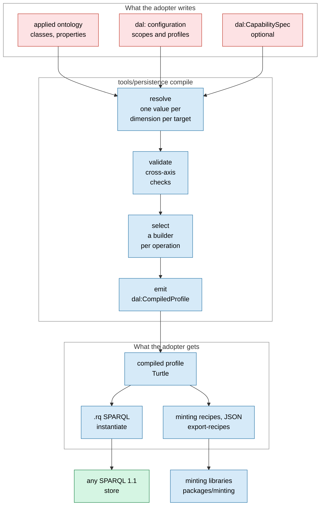

**This ontology targets classes, graphs and shapes by IRI reference only.** It imports nothing from
Foundation, Vocabulary, Quantification, Party, Eligibility, Wording, Behaviour or Instrument, and none
of them imports it. It has no place in the layer order of
[ontology-architecture.md](../../docs/architecture/ontology-architecture.md#the-lattice-layers):
it sits beside Surface and MORK as a cross-cutting substrate. An adopter's domain ontology never needs
to know that Persistence exists, and a configuration can be added, changed or removed without touching
it (ADR-A78). The one exception is optional: `persistent-foundation` (§5.11) imports Foundation, so that
Persistence can enforce Foundation's natural keys, and the `dal:` ontology itself imports nothing.

**Persistence is optional.** An adopter may use LATTICE's ontologies without this vocabulary, the
compiler, or any runtime component. Everything here is for adopters who write changing data to an RDF
store and want the guarantees described below.

### 4.1 Namespace

```turtle
@prefix dal: <https://www.nebularis.org/neuro-semantic/lattice/persistence#> .
```

The directory is named `persistence` because the compiler, and any future housekeeping or runtime
component (ADR-A80), belong to that subsystem. The ontology inside it is named for what it is: a
**Data Access Layer** configuration vocabulary, hence `dal:`.

### 4.2 The class diagrams

The class diagrams are generated from section 6, one for each part of the model. Each draws its own classes with their members, and a class it links to in another part as a bare box. An enumeration lists its individuals.

<!-- start: {"generated": "class-diagram", "part": "Profiles, scopes and capabilities", "classes": ["dal:ProfileScope", "dal:GraphPatternScope", "dal:NamespaceScope", "dal:ClassScope", "dal:ShapeScope", "dal:EquivalentClassScope", "dal:DataAccessProfile", "dal:CapabilitySpec", "dal:CapabilityRequirement", "dal:CapabilityCheck"], "enumerations": "table"} -->

**Profiles, scopes and capabilities**

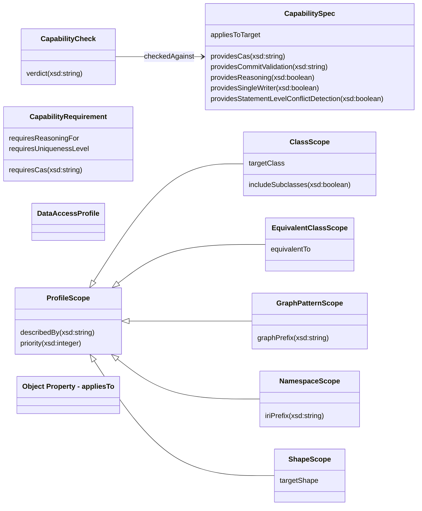

<!-- end -->

<!-- start: {"generated": "class-diagram", "part": "Aggregate boundary, concurrency and write discipline", "classes": ["dal:AggregateBoundaryProfile", "dal:AggregateBoundaryStrategy", "dal:OwnershipKind", "dal:ReferenceMode", "dal:ReferenceData", "dal:ConcurrencyProfile", "dal:ConcurrencyStrategy", "dal:WriteDisciplineProfile", "dal:WriteDiscipline", "dal:MembershipEncoding", "dal:FirstWriteMode", "dal:DeadlockPolicy"], "enumerations": "table"} -->

**Aggregate boundary, concurrency and write discipline**

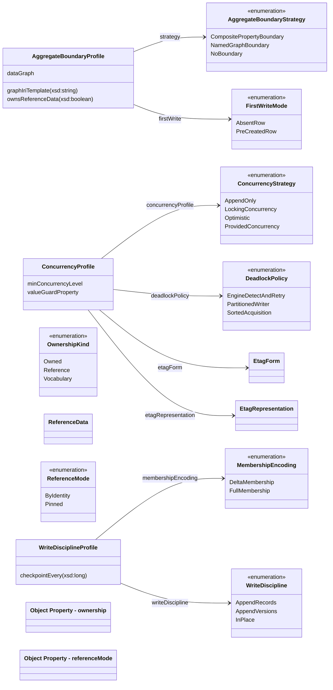

<!-- end -->

<!-- start: {"generated": "class-diagram", "part": "Ordering, receipts, meta topology and retention", "classes": ["dal:OrderingProfile", "dal:OrderingGrain", "dal:DatasetTierModel", "dal:ReceiptProfile", "dal:ReceiptModel", "dal:MetaTopologyProfile", "dal:MetaTopology", "dal:GlobalReadStrategy", "dal:ContiguityCheckMode", "dal:RetentionMode", "dal:EtagForm", "dal:EtagRepresentation"], "enumerations": "table"} -->

**Ordering, receipts, meta topology and retention**

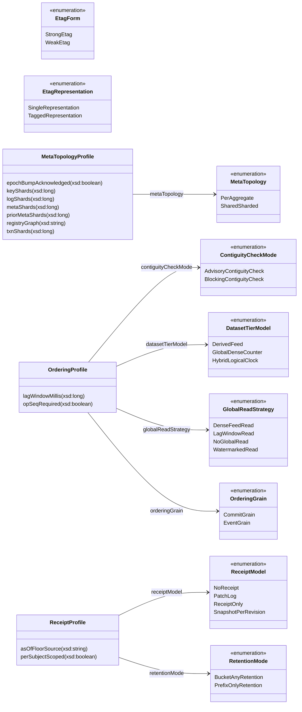

<!-- end -->

<!-- start: {"generated": "class-diagram", "part": "Uniqueness and keys", "classes": ["dal:UniquenessConstraint", "dal:ClaimScheme", "dal:SchemeState", "dal:PersistenceKeyed"], "enumerations": "table"} -->

**Uniqueness and keys**

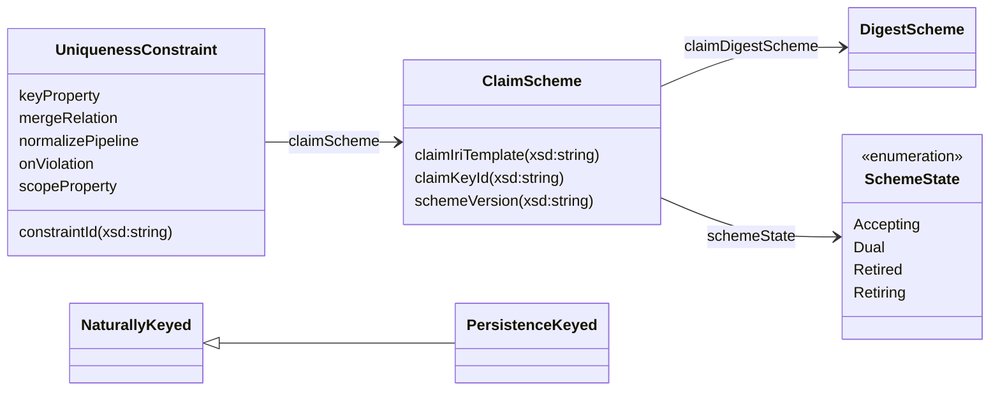

<!-- end -->

<!-- start: {"generated": "class-diagram", "part": "Identity, epochs and privacy", "classes": ["dal:IdentityProfile", "dal:ResourceRole", "dal:IdentityStrategy", "dal:DigestScheme", "dal:OccurrenceNamespaceDerivation", "dal:EventIdentityStrategy", "dal:SurrogateKind", "dal:SelfReferenceRule", "dal:EpochProfile", "dal:EpochAuthority", "dal:EpochGuardScope", "dal:PrivacyProfile", "dal:PrivacyClass", "dal:ErasureStrategy", "dal:ErasurePrecedence"], "enumerations": "table"} -->

**Identity, epochs and privacy**

```mermaid
classDiagram
    direction LR
    class DigestScheme {
        digestEncoding (xsd:string)
        digestFunction (xsd:string)
        digestWidthBits (xsd:integer)
        verifyFullDigestOnWrite (xsd:boolean)
    }
    class EpochAuthority {
        <<enumeration>>
        ExternalHighWaterMark
        RestoreControlledEpoch
        StoreLocalEpoch
        WriterStartRefusal
    }
    class EpochGuardScope {
        <<enumeration>>
        DatasetLevelGuard
        RowLevelGuardOnly
    }
    class EpochProfile {
        epochCoordinatorBinding (xsd:string)
        erasureRegisterBinding (xsd:string)
        erasureReplayOnRestore (xsd:boolean)
    }
    class ErasurePrecedence {
        <<enumeration>>
        ErasureWins
        MonotonicityWins
    }
    class ErasureStrategy {
        <<enumeration>>
        CryptoShred
        NoErasure
        PerSubjectGraphDrop
    }
    class EventIdentityStrategy {
        <<enumeration>>
        ExternalEventIdStrategy
        PositionDerivedEvent
        RandomOccurrenceEvent
    }
    class IdentityProfile {
        acceptedIriPattern (xsd:string)
        callerSuppliedPattern (xsd:string)
        canonicalizationWorkBudget (xsd:integer)
        epochWidth (xsd:integer)
        mintedIriTemplate (xsd:string)
        namingAuthority (xsd:string)
        sequenceWidth (xsd:integer)
        tuplePrefix
        uniquenessWitnessRequired (xsd:boolean)
    }
    class IdentityStrategy {
        <<enumeration>>
        AdoptedIdentity
        ContentAddressedIdentity
        DerivedHashIdentity
        ExternalRegistryIdentity
        NaturalKeyIdentity
        RandomSurrogateIdentity
        SurrogateClaimedIdentity
    }
    class OccurrenceNamespaceDerivation {
        <<enumeration>>
        HashedTargetDerivation
        RegistryTokenDerivation
    }
    class PrivacyClass {
        <<enumeration>>
        InternalData
        PersonalData
        PublicData
    }
    class PrivacyProfile
    class ResourceRole {
        <<enumeration>>
        AggregateRootRole
        ComponentRole
        ContentRevisionRole
        EntityRole
        EventOccurrenceRole
        GraphLocatorRole
        KeyClaimRole
        LineageRole
    }
    class SelfReferenceRule {
        <<enumeration>>
        ExcludeHeaderSubgraph
        PlaceholderSubstitution
        SelfReferenceDisallowed
    }
    class SurrogateKind {
        <<enumeration>>
        CallerSuppliedSurrogate
        UuidV4Surrogate
    }
    class UniquenessConstraint
    EpochProfile --> EpochAuthority : epochAuthority
    EpochProfile --> EpochGuardScope : epochGuardScope
    IdentityProfile --> DigestScheme : digestScheme
    IdentityProfile --> EventIdentityStrategy : eventIdentityStrategy
    IdentityProfile --> IdentityStrategy : identityStrategy
    IdentityProfile --> OccurrenceNamespaceDerivation : occurrenceNamespaceDerivation
    IdentityProfile --> ResourceRole : resourceRole
    IdentityProfile --> SelfReferenceRule : selfReferenceRule
    IdentityProfile --> SurrogateKind : surrogateKind
    IdentityProfile --> UniquenessConstraint : claimsConstraint
    IdentityProfile --> UniquenessConstraint : keyConstraint
    PrivacyProfile --> ErasurePrecedence : erasurePrecedence
    PrivacyProfile --> ErasureStrategy : erasureStrategy
    PrivacyProfile --> PrivacyClass : privacyClass
```

<!-- end -->

<!-- start: {"generated": "class-diagram", "part": "The compiled profile", "classes": ["dal:CompiledProfile", "dal:ResolvedDimension", "dal:MintingRecipe", "dal:Diagnostic", "dal:ReferenceEdge", "dal:Template", "dal:GeneratedOperation", "dal:ParameterBinding"], "enumerations": "table"} -->

**The compiled profile**

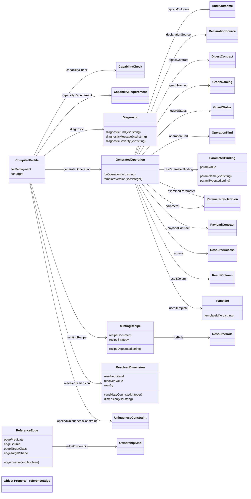

<!-- end -->

<!-- start: {"generated": "class-diagram", "part": "The operation contract, parameters and resources", "classes": ["dal:ParameterDeclaration", "dal:ParameterKind", "dal:Rule", "dal:Source", "dal:ResourceAccess", "dal:AccessMode", "dal:ResourceKind", "dal:GraphNaming", "dal:OperationKind"], "enumerations": "table"} -->

**The operation contract, parameters and resources**

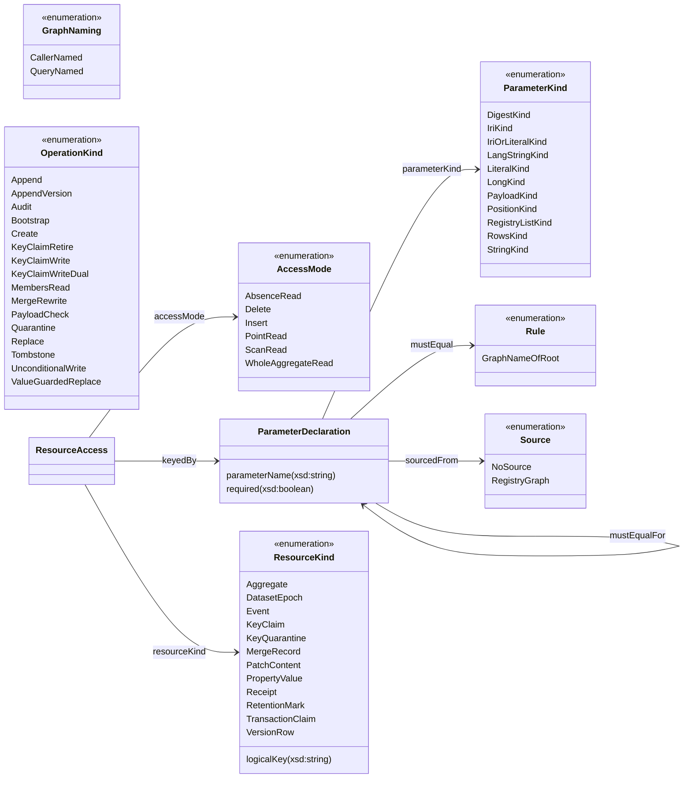

<!-- end -->

<!-- start: {"generated": "class-diagram", "part": "The operation contract, results, payload and digest", "classes": ["dal:AuditOutcome", "dal:GuardStatus", "dal:DeclarationSource", "dal:ResultColumn", "dal:ColumnKind", "dal:PayloadContract", "dal:PayloadEncoding", "dal:BoundaryShapeAbsence", "dal:DigestContract", "dal:DigestPart", "dal:DigestPartRole"], "enumerations": "table"} -->

**The operation contract, results, payload and digest**

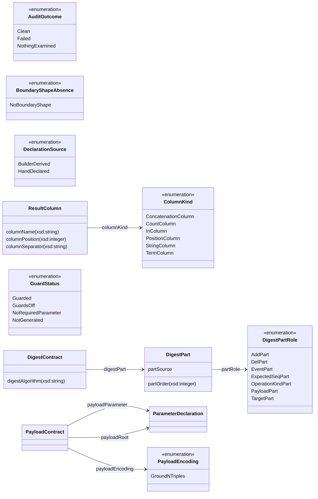

<!-- end -->

## 5. Detailed Design

This section explains why Persistence exists (5.1 to 5.3), how an adopter configures it (5.4 to 5.7) and what the compiler produces (5.8 to 5.12). Section 5.13 then follows one aggregate through eight steps, from its declaration to the graphs a generated update leaves behind. Section 5.14 collects what we learned the hard way, each item tied to the test or the record that taught it. [Section 8](#8-examples) lists every example and the SPARQL it compiles to, and the steps of 5.13 point into it.

**Reading the pictures.** One set of colours is used in every picture, so a colour means the same thing wherever it appears. Pictures of a write show each named graph the update touches as a box, with what is deleted from it and inserted into it on the arrows.

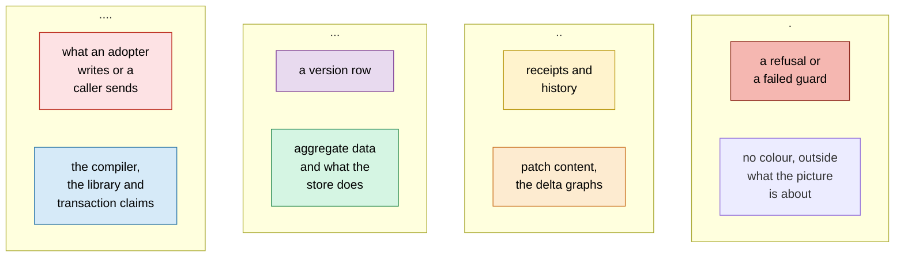

A sequence diagram cannot carry a class, so its phases are tinted with the same fills, kept translucent so that the text stays legible on a light and on a dark page. The tint of a caller's step is pink, a step the store applies is green, and a guard that fails is red.

### 5.1 Why persistence in RDF is hard

A relational database gives an application three things it barely notices until they are gone: a
`UNIQUE` index, a row that two writers collide on, and a return value saying how many rows an
`UPDATE` touched. RDF over SPARQL gives none of them (guide, Chapter 1).

**Set semantics hide lost updates.** An RDF graph is a set of triples. Inserting a triple that is
already present is a no-op, and so is deleting one that is absent. Two writers who both move the
world from state A to state B therefore do not collide. They merge:

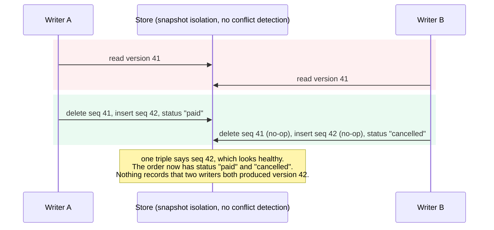

**There is no return value.** A SPARQL update endpoint replies `200` or `204` whether it changed ten
thousand triples or none. A conditional update whose condition failed looks exactly like one that
succeeded. Reading the version back afterwards does not help: it shows the current version, not
whether *your* write produced it.

**Isolation is underspecified.** SPARQL 1.1 says one request SHOULD be atomic and says nothing about
isolation. A check-then-write has to fit in one request, and even then `INSERT … WHERE { FILTER NOT
EXISTS { … } }` is a textbook write skew under snapshot isolation: two writers both see "no such key"
and both insert.

**OWL does not help, and can hurt.** `owl:InverseFunctionalProperty` and `owl:hasKey` look like
uniqueness constraints and are not. With a reasoner, two people who share an email are not rejected.
They are silently merged by an inferred `owl:sameAs`, which cannot be cleanly retracted if the merge
was wrong.

What the patterns rebuild, and where this README covers it:

| A relational database gives | An RDF store needs | Here |
|---|---|---|
| a `UNIQUE` index | a deterministic claim node per key value, with at most one owner | §5.6.6 |
| a `SERIAL` sequence | a counter rewritten inside the writing transaction | §5.6.3 |
| a row two writers collide on | one small version row per aggregate, kept apart from its payload | §5.2, §5.6.1 |
| `UPDATE … RETURNING` | a transaction claim keyed by a client-generated id, checked after the write | §5.3 |
| `BEGIN … COMMIT` across statements | one request, or a vendor transaction API, gated by capability | §5.6.2, §5.7 |
| a documented isolation level | an empirical conformance test per backend | §5.7 |

The guide calls the version-row machinery the **strong profile**, and is explicit that it is not the
platform default. Data addressed by immutable revision hashes, or data with no concurrent writers,
can use a **baseline profile** that relies on the store's own behaviour. Every choice below is made
per class or per deployment, so the strong profile can be switched on where it pays for itself and
left off where it does not.

### 5.2 The infrastructure the patterns add

The patterns keep changing data in several kinds of graph, each with its own mutability, retention,
access control and contention (guide §2.3). Separating them is not decoration: several guarantees
depend on it.

| Graph | Holds | Mutability | Example IRI | Present when |
|---|---|---|---|---|
| Payload | the domain triples of one aggregate | replaced whole, or immutable per revision | `urn:g:orders/1` | always |
| Meta (sharded) | one **version row** per aggregate or stream: epoch, sequence, head, tombstone | one small hot statement per row | `urn:g:meta/17` | strong profile |
| Keys | one **key claim** per unique key value | append, tombstoned, or deleted under erasure | `urn:g:keys` | any uniqueness constraint |
| Txn | one **transaction claim** per client transaction id, with a digest of the request | append, pruned after a time-to-live | `urn:g:txn` | strong profile |
| Log | append-only **receipts**, one per write, bucketed by month | append, pruned only from the oldest end | `urn:g:txlog/2026-09` | strong profile |
| Pinned heads | receipts still serving as a stream's head when their bucket is pruned | replaced as heads move | `urn:g:txlog/pinned` | retention on receipts |
| Events | domain events of append-only streams | append | `urn:g:events/orders/2026-09` | append form |
| Deltas | the triples each revision added and removed | immutable | `urn:g:delta/orders/1/…/add` | patch-log receipts |
| Snapshots | one sealed payload graph per revision | immutable | `urn:g:orders/1/e…/…` | snapshot receipts |
| Retention | per-target low-water marks | rewritten by the retention job | `urn:g:retention` | retention on receipts |
| Registry | the family's list of log, event, delta, txn and key graphs | rewritten on bucket rotation | `urn:g:registry/orders` | strong profile |
| Dataset | the dataset node: the current **epoch** | rewritten only by the epoch authority | `urn:g:dataset` | strong profile |

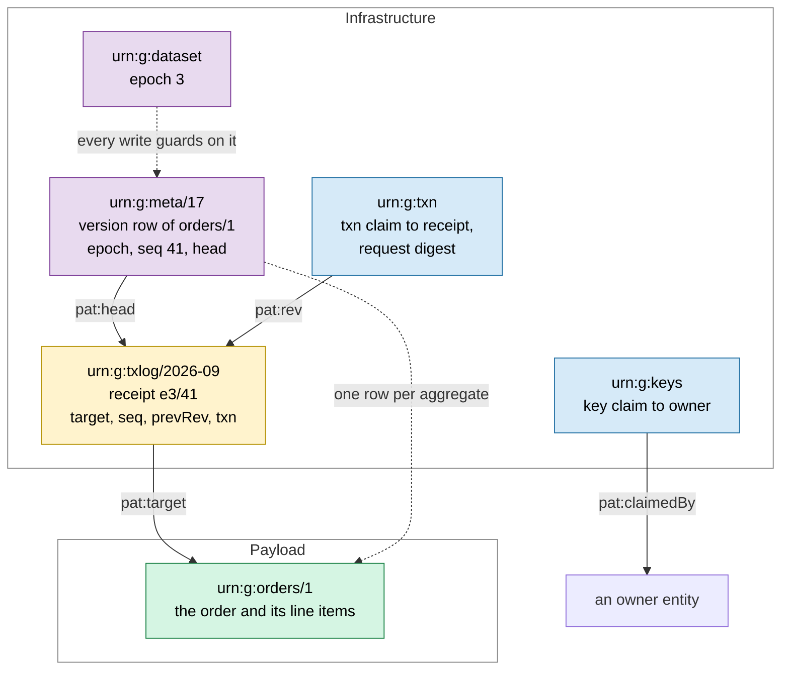

The terms, in one place:

- **Aggregate.** The unit of consistency: an order and its line items change together and are read
  together. Choosing what an aggregate is belongs to the adopter (§5.6.1).
- **Version row.** A tiny record, kept apart from the payload, holding the aggregate's current
  sequence number and head receipt. Every write to the aggregate rewrites this one statement, which is
  what makes two concurrent writers collide. Keeping it out of the payload graph is what lets a write
  replace the payload whole without erasing its own history (guide §17.1, A3).
- **Receipt.** An append-only record of one write: which aggregate, which position, which previous
  receipt, which client transaction. Receipts order the writes and audit them. Whether they also let
  a reader replay the change depends on the receipt model (§5.6.4).
- **Transaction claim.** A node keyed by the client's transaction id. It is how a writer learns, after
  the fact, whether its write applied (§5.3).
- **Key claim.** A deterministic node per unique key value, owned by at most one entity. It turns
  global uniqueness into a per-node cardinality check (§5.6.6).
- **Epoch.** A number on the dataset, bumped on every restore, rebuild or migration. Positions are
  `(epoch, seq)` pairs, so a position recorded before a restore can never be mistaken for one minted
  after it (§5.6.8).

**Every IRI in these examples is illustrative.** The `urn:g:`, `urn:rev:`, `urn:key:` and similar
namespaces are unregistered and would collide the moment two deployments merge. A deployment chooses a
controlled `https` authority, a `tag:` URI or a registered scheme through its identity profile (§5.6.7).
The compiler currently binds the infrastructure graph IRIs above as fixed constants (§5.8).

### 5.3 One write, end to end

The strong profile's write is a single guarded SPARQL update, followed by a confirmation read
(guide Chapters 14, 15 and 19). Everything below is generated by the compiler: an adopter does not
write it by hand.

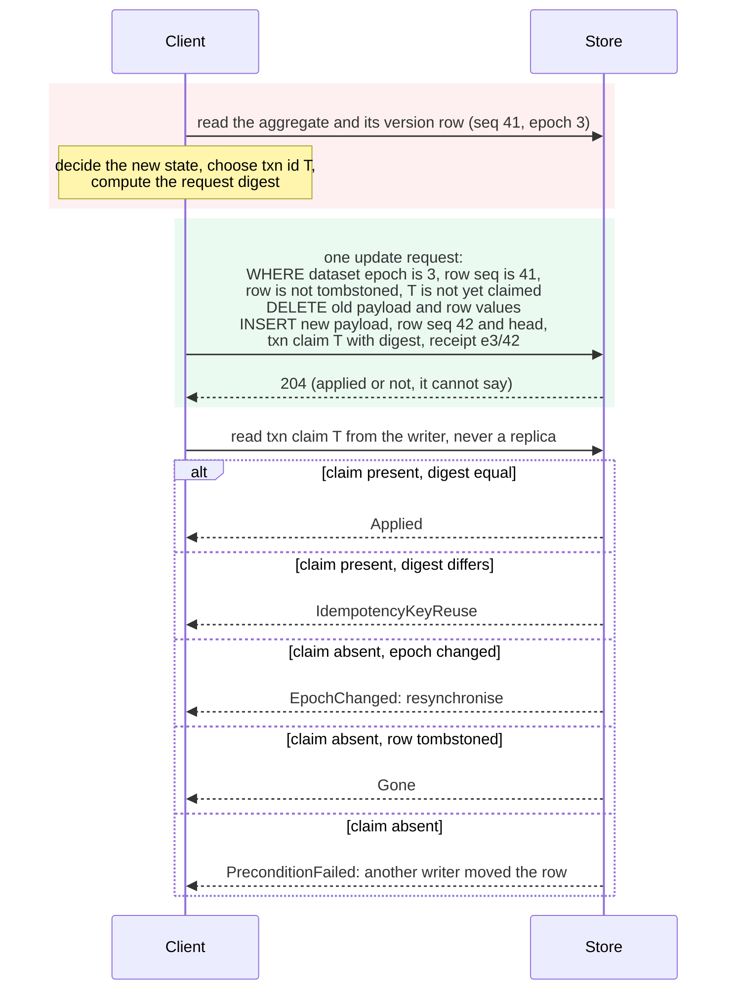

Each guard in the `WHERE` clause has a job:

| Guard | Stops | Outcome when it fails |
|---|---|---|
| the dataset epoch equals the writer's | a write started before a restore landing after it | `EpochChanged` |
| the row's sequence equals the expected one | a lost update: someone else wrote first | `PreconditionFailed` (`412`) |
| the row carries no tombstone | an editor with a stale tag resurrecting a deleted aggregate | `Gone` (`410`) |
| the transaction id is not yet claimed | a retry applying the same change twice | the retry is a no-op, then `Applied` |

**Why the transaction claim, not a re-read.** After a timeout, the write may or may not have applied,
and reading the version shows only what is current. A claim keyed by the client's own transaction id
is definitive and survives concurrent writers. The claim carries a digest of the request, so a client
that reuses an id for a different request is told so instead of being told it succeeded. An `Unknown`
outcome (a transport failure) is resolved by resending the identical request and then confirming:
the resend either applies once or is a no-op against the claim. A claim protects retries only for as
long as it is kept, so its time-to-live must cover the longest redelivery horizon (guide §15.2 and §24.2).

**Compare-and-set or append.** The same version row serves two contracts (guide Chapter 22):

| | Append | Compare-and-set |
|---|---|---|
| client knows the current sequence | no | yes, it read the aggregate |
| the new sequence is computed by | the store, inside the update | the client |
| fails when | the stream is tombstoned, the epoch changed, the txn is already claimed | those, and the expected sequence does not match |
| retry on conflict | resend as is | re-read, re-decide, resend |
| used for | event streams, decision records, ingestion | aggregate replace, state machines |

An aggregate replaced whole is always compare-and-set. An event stream is always append. Both write
the same version row, transaction claim and receipt shape, so one stream can be appended to by
ingestion and compare-and-set by an editor without two mechanisms.

**HTTP agrees with SPARQL by construction.** The ETag of an aggregate is derived, never stored:
`"{epoch}-{seq}"`, a strong validator (§5.6.2). `If-Match: "3-41"` on a Graph Store Protocol `PUT` is
the same guard as the SPARQL above.

### 5.4 The configuration model

An adopter's configuration is a graph of `dal:` individuals of two kinds: **scopes**, which say what
a profile applies to, and **profiles**, which declare values for one or more **dimensions**.

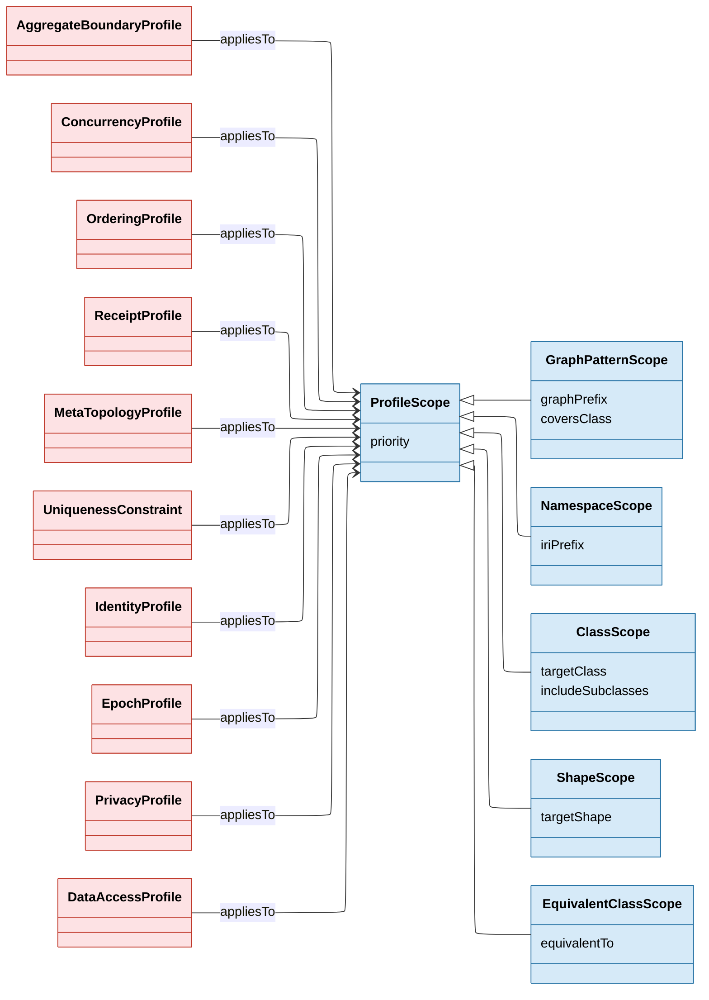

Every dimension resolves **on its own**, per target (§5.5). The table lists each one, the class that
declares it, its values, and the platform baseline default the compiler uses when no scope matches.

| Dimension | Declared on | Values | Baseline | Section |
|---|---|---|---|---|
| Aggregate boundary | `dal:AggregateBoundaryProfile` (`dal:strategy`) | `dal:NamedGraphBoundary`, `dal:CompositePropertyBoundary`, `dal:NoBoundary` | named graph | 5.6.1 |
| First write | `dal:AggregateBoundaryProfile` (`dal:firstWrite`) | `dal:AbsentRow`, `dal:PreCreatedRow` | absent row | 5.6.1 |
| Write discipline | `dal:WriteDisciplineProfile` (`dal:writeDiscipline`) | `dal:InPlace`, `dal:AppendVersions`, `dal:AppendRecords` | in place | 5.6.10 |
| Membership encoding | `dal:WriteDisciplineProfile` (`dal:membershipEncoding`, `dal:checkpointEvery`) | `dal:FullMembership`, `dal:DeltaMembership`, and an interval of at least 1 | full, every 16 | 5.6.11 |
| Concurrency | `dal:ConcurrencyProfile` (`dal:concurrencyProfile`) | `dal:ProvidedConcurrency`, `dal:Optimistic`, `dal:AppendOnly`, `dal:LockingConcurrency` (marker only) | provided | 5.6.2 |
| Deadlock policy | `dal:ConcurrencyProfile` | `dal:EngineDetectAndRetry`, `dal:SortedAcquisition`, `dal:PartitionedWriter` | engine detect and retry | 5.6.2 |
| ETag form and representation | `dal:ConcurrencyProfile` | `dal:StrongEtag`/`dal:WeakEtag`, `dal:SingleRepresentation`/`dal:TaggedRepresentation` | strong, single | 5.6.2 |
| Ordering grain | `dal:OrderingProfile` (`dal:orderingGrain`) | `dal:CommitGrain`, `dal:EventGrain` | commit | 5.6.3 |
| Dataset tier | `dal:OrderingProfile` (`dal:datasetTierModel`) | `dal:DerivedFeed`, `dal:GlobalDenseCounter`, `dal:HybridLogicalClock` | none | 5.6.3 |
| Global read | `dal:OrderingProfile` | `dal:WatermarkedRead`, `dal:LagWindowRead` (with `dal:lagWindowMillis`), `dal:DenseFeedRead`, `dal:NoGlobalRead` | none | 5.6.3 |
| Contiguity check | `dal:OrderingProfile` | `dal:BlockingContiguityCheck`, `dal:AdvisoryContiguityCheck` | blocking | 5.6.3 |
| Receipt model | `dal:ReceiptProfile` (`dal:receiptModel`) | `dal:ReceiptOnly`, `dal:PatchLog`, `dal:SnapshotPerRevision`, `dal:NoReceipt` | receipt only | 5.6.4 |
| Retention | `dal:ReceiptProfile` | `dal:PrefixOnlyRetention`, `dal:BucketAnyRetention`, plus `dal:asOfFloorSource` | prefix only | 5.6.4 |
| Meta topology | `dal:MetaTopologyProfile` (`dal:metaTopology`) | `dal:SharedSharded`, `dal:PerAggregate`, plus `dal:metaShards`, `dal:txnShards`, `dal:logShards`, `dal:keyShards`, `dal:registryGraph` | shared, sharded | 5.6.5 |
| Uniqueness | `dal:UniquenessConstraint` | many-valued: zero, one or several keyed constraints per target | none | 5.6.6 |
| Identity minting | `dal:IdentityProfile` | one `dal:IdentityStrategy` per `dal:ResourceRole`, each role its own dimension `identity:<Role>` | none | 5.6.7 |
| Epoch | `dal:EpochProfile` | authority: `dal:ExternalHighWaterMark`, `dal:RestoreControlledEpoch`, `dal:WriterStartRefusal`, `dal:StoreLocalEpoch` (warned). Guard: `dal:DatasetLevelGuard`, `dal:RowLevelGuardOnly` (warned) | row-level guard (warned) | 5.6.8 |
| Privacy and erasure | `dal:PrivacyProfile` | class: `dal:PersonalData`, `dal:InternalData`, `dal:PublicData`. Strategy: `dal:PerSubjectGraphDrop`, `dal:CryptoShred`, `dal:NoErasure`. Precedence: `dal:ErasureWins`, `dal:MonotonicityWins` | none | 5.6.9 |

"None" means the absence is itself meaningful and checked where it matters: an undeclared privacy
profile means "this scope declares no privacy stance", not "this scope is public data". The epoch
guard's baseline is the discouraged row-level guard, kept so that no existing deployment's generated
SPARQL changed when the dimension was introduced, and it raises its warning whether it was declared
or defaulted.

**Two authoring conveniences.**

- A **`dal:DataAccessProfile`** is sugar: one node declaring several dimensions at one scope. It
  decomposes into the same per-dimension model and is never a special case.
- **Extension properties** (`dal:firstWrite`, `dal:etagForm`, `dal:lagWindowMillis`, the shard counts
  and the rest) each resolve as a dimension of their own, even though they share a class with another
  row. A node typed with a specific profile class must carry that class's primary value (for example
  `dal:concurrencyProfile` on a `dal:ConcurrencyProfile`), so an extension property declared on its
  own goes on a `dal:DataAccessProfile` node. The compiled profile records each resolved value, using
  `dal:resolvedLiteral` for literal-valued ones.

### 5.5 Scopes, targets and resolution

#### 5.5.1 Five scope kinds

A scope says which resources a profile applies to. Four kinds need no reasoning, and one does:

| Scope kind | Matches | Needs reasoning |
|---|---|---|
| `dal:GraphPatternScope` | instances of the classes named by `dal:coversClass`, in graphs whose IRI starts with `dal:graphPrefix` | no |
| `dal:NamespaceScope` | resources whose own IRI starts with `dal:iriPrefix` | no |
| `dal:ClassScope` | asserted `rdf:type`, optionally with the asserted `rdfs:subClassOf*` closure (`dal:includeSubclasses`) | no |
| `dal:ShapeScope` | resources conforming to a named `sh:NodeShape`, resolved once at compile time | no |
| `dal:EquivalentClassScope` | resources reachable through `owl:equivalentClass` and `owl:intersectionOf` | **yes** |

#### 5.5.2 A target is a class, plus a deployment

The compiler resolves profiles for **targets**. A target is a class, or a class together with one of
its deployments: a shared class written by two applied ontologies into two graph families is two
targets, because what differs between the deployments is which graph the data lives in, not the
class (ADR-A78 point 5). One target is compiled per `dal:GraphPatternScope` that covers the class,
plus an unscoped fallback for instances outside any of them.

Every other scope kind matches on the class alone, so its values apply across all of the class's
deployments. Two consequences matter when designing a configuration:

- **Profiles cannot vary per instance.** Two instances of one class in the same deployment always get
  the same profile. Data that needs different treatment is told apart by class, or by the graph it is
  written to.
- **A shared class carries no profile of its own.** Authority belongs to whichever applied ontology
  deploys it, scoped to that deployment's graph pattern, which structurally outranks a bare class
  scope.

#### 5.5.3 Precedence

When several profiles declare a value for the same dimension at scopes that all match one target,
the compiler picks one, the same way every time, on any machine
([precedence and resolution](docs/precedence-and-resolution.md)):

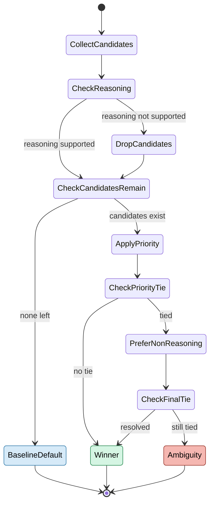

The algorithm never ranks scope kinds against each other: a graph-pattern scope naming one exact graph
can be narrower than a class scope matching millions of individuals, so `dal:priority` is how an
adopter says what they mean. A remaining tie is a refusal, never a guess.

### 5.6 The dimensions, one by one

#### 5.6.1 Aggregate boundary

**The question.** Which triples change together, and so must be written as one unit?

Only the adopter can say: whether an order's line items are part of the order, or independent
entities it refers to, is a fact about their domain
([aggregate boundaries](docs/aggregate-boundaries.md)).

| Strategy | What the aggregate is | Authoring | Write |
|---|---|---|---|
| `dal:NamedGraphBoundary` | everything in one named graph per aggregate root | `dal:graphIriTemplate` | the whole graph is replaced |
| `dal:CompositePropertyBoundary` | the nodes reached from the root along the owned edges of a classified shape, in one named graph | `dal:boundaryShape`, an `sh:NodeShape` whose node properties carry `dal:ownership`, and `dal:dataGraph` | the closure is swept and rewritten |
| `dal:NoBoundary` | no aggregate: one property's value | `dal:valueGuardProperty` on the concurrency profile, and `dal:dataGraph` | a value-based guard on that property, in the data graph |

**Why replace whole.** If the previous version of an order had three line items and the new one has
two, a patch that forgets the third leaves a dangling triple. Replacing the aggregate makes each write
the complete new state, which is what an aggregate is. This is safe only because the version row lives
outside the payload graph: a whole-graph delete would otherwise erase the aggregate's own ordering
evidence on every write.

**What is in the aggregate.** An aggregate is a root and the nodes it owns. A node the root reaches is
owned, a reference to an independent entity or another aggregate, or vocabulary. A delete removes every
triple whose subject is the root or an owned node, so the edges to references and vocabulary go and the
nodes at their ends stay. The adopter classifies every edge that leads to a node, in the boundary shape,
with `dal:ownership`, and the compiler refuses an edge left unclassified. Ownership belongs to an edge in
its context: a document attached to a task can be a part of the task, while the same property on a plan
points at a template many projects share. [Aggregate boundaries](docs/aggregate-boundaries.md) has the
rules, the refusals and the reasons.

**What an edge names.** `dal:referenceMode` sits on the same property shape as `dal:ownership`, one of `dal:ByIdentity` (absent
means this) and `dal:Pinned`. Ownership says what a write sweeps, and the reference mode says what a reference names, when its
target has versions (§5.6.10): the persistent identity, or one version of it. `compile` records the mode of every edge that leads to a
node in the compiled profile, once, and the contract of each operation that takes a payload points at those edges, so a caller's check
can read them. The mode
changes no generated operation, since a write stores what its payload contains.

```turtle
ex:OpinionShape a sh:NodeShape ; sh:targetClass ex:Opinion ;
    sh:property [ sh:path ex:about ;  sh:class ex:Policy ;  dal:ownership dal:Reference ; dal:referenceMode dal:Pinned ] ,
                [ sh:path ex:author ; sh:class ex:Person ;  dal:ownership dal:Reference ] .
```

| Refused or warned | When |
|---|---|
| `PinnedReferenceToUnversionedClass` (refusal) | an edge is `dal:Pinned` and its target class is not a subclass of `fnd:Version` (by IRI, with no import), or it has no target class, or it is a value property |
| `ReferenceModeUnknown` (refusal) | the value is neither individual |
| `EvidenceEdgeByIdentity` (warning) | the edge's subject class is a subclass of `fnd:Evidence` or `fnd:DerivedArtefact`, or a record class, its target class is versioned, and the edge is by identity |

**Record classes.** A class whose instances are records, cited for what they said at a time, need not be modelled as `fnd:Evidence`. A
profile names it with `dal:recordClass`, and its subclasses, as the configuration asserts them, are records too. The warning above reads
it, and so does `NoReceiptForRecord` (§5.6.4). The compiled profile states the record classes the family touches, its target class and the
subject classes of its edges, and the caller library reads them.

```turtle
ex:OpinionBoundaryProfile dal:recordClass ex:Opinion .
```

**When to pin.** Pin an edge when the node that holds it is evidence of exactly what it saw, such as an opinion, a decision, an
assessment or a derived figure that cites the version it was computed from. A later version of the target must not change what the
record says it read. Leave the edge by identity when the node means the thing as it is now, such as a line item of a current quote, a
task's assignee or a policy's insured, so a new version of the target needs no write to the node that refers to it. A caller that
pins writes the version's IRI as the object, and one that leaves the edge by identity writes the identity's. A reader that wants the
version in force at a date resolves an identity through the version row or the root version's membership, and no generated read does
so yet. The warning is for the case that is usually a mistake, so a deliberate choice stays by identity and compiles.

**Which strategy.** Prefer a named graph per aggregate for a new deployment. It is the cheapest boundary
to reason about, and a delete is one operation. The composite strategy is for data that already lives in
one large shared graph, which it keeps in the family's `dal:dataGraph`. LATTICE does not impose a layout.

**Why a shape, not a sub-property.** A composite boundary is declared by pointing a SHACL shape at the
domain's own properties by IRI. Asserting a domain property as `rdfs:subPropertyOf dal:isCompositeOf`
was rejected (ADR-A78 point 4): it would leak OWL entailments into the domain ontology and create the
import dependency this ontology otherwise avoids. The compiler walks the shape once, offline, and
compiles the owned edges to one SPARQL property path. No store is ever asked to run SHACL to find a
write's boundary, and the same shape can keep serving the adopter's own validation.

**First write.** A family picks one way to create a version row, declared as `dal:firstWrite`:

- **`dal:AbsentRow`** (baseline). No row exists until a create operation writes the first payload,
  sequence 1, the first receipt and the head in one update. The create is a uniqueness problem (the
  row must not exist yet), with the same write-skew exposure as any key claim.
- **`dal:PreCreatedRow`**. A row at sequence 0 is written when the aggregate's id is allocated, so
  every later write, including the first, rewrites an existing statement. On stores with
  multi-version concurrency, this removes the creation race entirely.

#### 5.6.2 Concurrency

**The question.** How are two writers to one aggregate kept from silently overwriting each other?

| Strategy | Means | Use when |
|---|---|---|
| `dal:ProvidedConcurrency` (baseline) | rely on the store. The compiler generates an unconditional write | no concurrent writers, or a store that serialises them |
| `dal:Optimistic` | the guarded compare-and-set of §5.3 | read-modify-write by concurrent writers on a store that detects write conflicts |
| `dal:AppendOnly` | the append form of §5.3: the store allocates the next position | event streams and decision records |
| `dal:LockingConcurrency` | a marker that mutual exclusion lives outside the store (an external lock, a single writer per partition) | the store's isolation is too weak or unknown. No guard is generated |

`dal:minConcurrencyLevel` (`dal:Linearizable`, `dal:BestEffort`) records the level the family needs,
which a capability check compares with the store (§5.7).

**Choosing, by situation** (guide §16.6):

| Situation | Use |
|---|---|
| one aggregate per graph, HTTP in front (LDP, Solid, Graph Store Protocol with ETags) | HTTP preconditions over the same version row |
| a store with a real transaction API | explicit serializable transactions, with the guards as defence in depth |
| a store with only a SPARQL Update endpoint | `dal:Optimistic`: guarded single-request update, transaction claim, receipts, retry, verified by the conformance tests |
| weak or unknown isolation | a single-writer queue or an external lock with fencing tokens (`dal:LockingConcurrency`) |
| audit, offline clients, multi-master | a patch log or event sourcing (§5.6.4) |

**Deadlocks across aggregates.** A write that touches two version rows can deadlock on stores that
lock, or livelock on stores that abort and retry. SPARQL specifies no evaluation order, so listing the
rows in sorted order in the query text does not make the engine acquire them in that order.
`dal:deadlockPolicy` says who is responsible:

- **`dal:EngineDetectAndRetry`** (baseline). The engine detects deadlocks. An abort is treated as an
  ordinary conflict and retried with jitter.
- **`dal:SortedAcquisition`**. The client itself acquires in sorted order. Valid only for multi-request
  transactions and external locks, where acquisition really is separate steps. The compiler warns when
  it is combined with a single guarded update.
- **`dal:PartitionedWriter`**. Every target of a multi-target write goes through one partition, so no
  ordering is needed.

**ETags.** `dal:etagForm` should stay `dal:StrongEtag`: HTTP `If-Match` requires strong comparison,
and a weak tag never satisfies it, so a store emitting weak tags would fail every conditional write
(a warning, `dal:WeakEtagCasWarningShape`). A strong tag also promises identical bytes for every
response carrying it, so a store serving several media types either serves one representation for
conditional requests (`dal:SingleRepresentation`) or folds the representation into the tag
(`dal:TaggedRepresentation`).

**Value-based guards.** With `dal:NoBoundary`, compare-and-set guards on the old value of one property
(`dal:valueGuardProperty`) instead of a version row. It suits a status field in a state machine, and it
cannot detect a concurrent change to any other field. The values live in the family's `dal:dataGraph`, as a
composite family's aggregates do, and a family with no boundary that guards a value and declares none is
refused (`MissingDataGraph`). Every pattern of the guard is inside that graph, never in the default graph, whose
contents differ between stores.

#### 5.6.3 Ordering

**The question.** In what order did changes happen, and can a consumer tell whether it missed one?

"Ordering" names five different requirements (guide §3.1), and conflating them causes most of the
trouble:

| | Requirement | Needs |
|---|---|---|
| O1 | total order for replay and sync: "everything after where I left off" | a dense, gap-detectable position |
| O2 | causal order per entity: version 3 supersedes version 2 | a per-stream counter |
| O3 | domain order: sorted by when things happened in the world | a valid time, with commit order only as a tiebreak |
| O4 | point-in-time reads: "as of last Tuesday" | history (§5.6.4) |
| O5 | ordered collections inside the data | a rank or index property, a different problem entirely |

Three clocks are kept apart, and never allowed to stand in for each other:

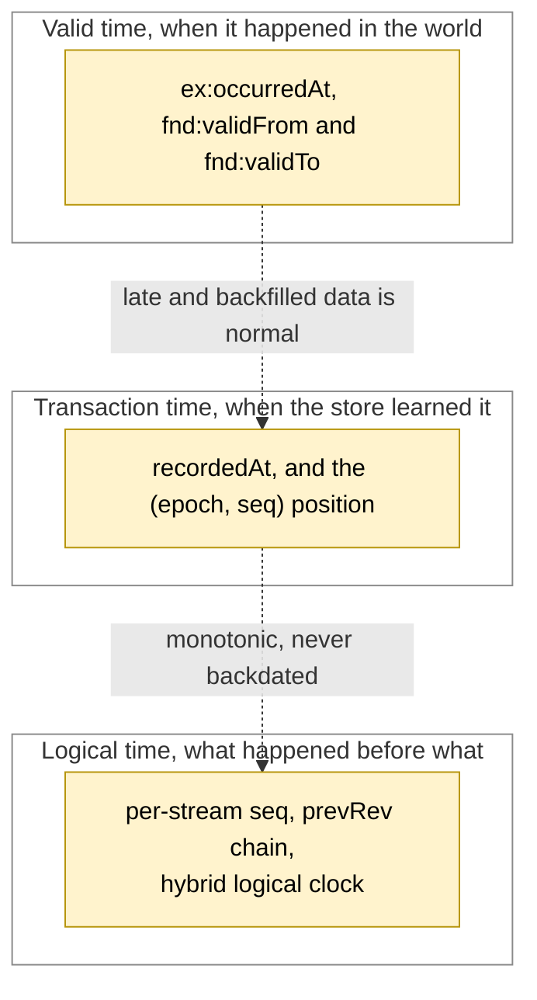

**Dense or sparse.** A dense counter has no gaps, so "did I miss anything?" is answerable, but writers
to one counter take turns. A sparse clock (a hybrid logical clock, a store's log position) never makes
writers wait, but gaps are expected and completeness cannot be checked. Both cannot be had at once. The
usable middle is **dense per stream, sparse across streams**, which is why the grain of a sequence
matters more than its encoding.

**Why the counter is in the writing transaction.** Any scheme that allocates a number before the
transaction commits loses data under concurrency:

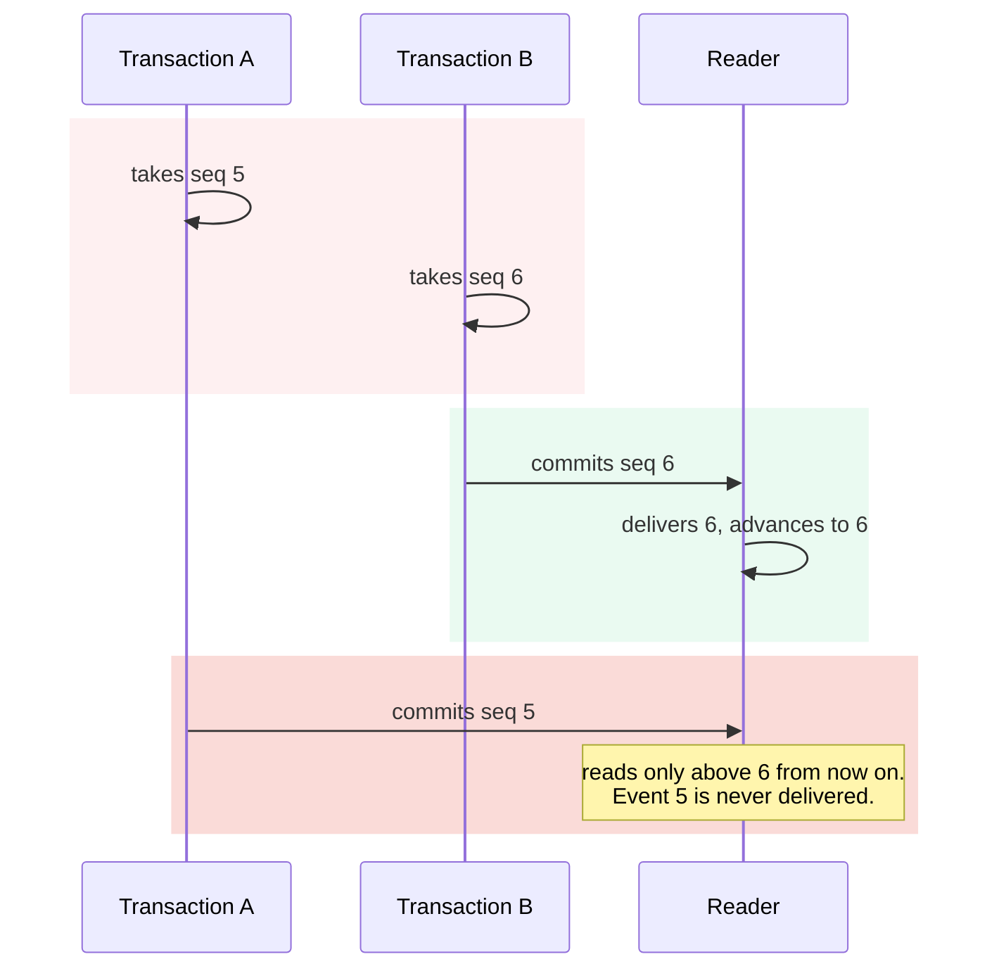

Putting the read-and-increment of the counter in the same update as the payload write, on one shared
statement, closes the hole: the transaction that commits position *n+1* necessarily read the value
committed by the holder of *n*. Allocation order equals commit order, the sequence is dense, and
aborted transactions consume nothing (guide §9, G2). The version row is that statement, so the
compare-and-set guard and the dense counter are the same operation.

**Grain.** `dal:orderingGrain` is `dal:CommitGrain` (one position per write, the baseline) or
`dal:EventGrain`, where one write carrying several events orders them by a client-supplied ordinal,
`opSeq` (`dal:opSeqRequired true`). A SPARQL update cannot generate distinct ordinals itself: `NOW()`
is constant within an execution, and `UUID()` is unordered. Commit grain with `opSeq` required is
refused as contradictory.

**The dataset tier.** The per-stream tier comes free with the version row. A total order across
streams is a separate, weaker, derived concern, declared by `dal:datasetTierModel`:
`dal:DerivedFeed` (the store's own dense change feed), `dal:GlobalDenseCounter` (affordable only on
a store that already serialises every write) or `dal:HybridLogicalClock` (sparse, comparable across
nodes). A single dataset-wide counter in the meta graph would make every write in the dataset
contend on one statement, so it is never the default.

**Reading across streams.** `dal:globalReadStrategy` says how a consumer of the dataset tier reads
without skipping a write that commits late:

| Strategy | Reads up to | Needs |
|---|---|---|
| `dal:WatermarkedRead` | a published watermark below which no writer can still land | a watermark source |
| `dal:LagWindowRead` | now minus a fixed lag | `dal:lagWindowMillis`, at least the maximum transaction time plus clock skew plus replica lag plus a margin |
| `dal:DenseFeedRead` | the store's own dense change feed | a backend with one |
| `dal:NoGlobalRead` | nothing: only per-stream reads exist | no cross-aggregate consumers (warned when a dataset tier is declared) |

A hybrid logical clock is stamped before the transaction commits, so a read without an upper bound
can deliver past a write that is still in flight and skip it forever. The upper bound is what makes
the read safe, and a late-arrival audit backs it up.

**Contiguity.** A consumer checks that the sequence numbers it has seen per stream have no gaps.
`dal:BlockingContiguityCheck` (baseline) halts and raises an alarm on a gap, because a silently skipped
gap looks exactly like data loss. `dal:AdvisoryContiguityCheck` logs and continues, for a family whose
downstream reconciliation re-derives completeness independently, and is warned.

#### 5.6.4 Receipts, history and retention

**The question.** What does the log remember about each write, and for how long?

Replacing an aggregate whole discards the difference between versions, so receipts alone order and
audit writes but cannot replay them. A family declares one of four models (guide Chapter 20):

| Model | Records | Gives | Costs | Use when |
|---|---|---|---|---|
| `dal:ReceiptOnly` (baseline) | that a write happened, where, and by which transaction | outcome, audit, order | lowest | compare-and-set outcomes and light audit are enough |
| `dal:PatchLog` | plus the triples each write added and removed, in delta graphs | replay, change data capture, as-of reads | about twice the write volume | downstream replay or deterministic history is needed |
| `dal:SnapshotPerRevision` | a sealed payload graph per revision (not built, `compile` warns `ReceiptModelNotHonoured` and refuses it on a composite family written in place, `CompositeBoundarySnapshotNotBuilt`) | point-in-time reads without replay, immutable evidence | the most storage and graphs | compliance, forensics, data already addressed by revision |
| `dal:NoReceipt` | nothing about the write beyond its transaction claim: no receipt, no log bucket, no head | a retry after a lost reply is confirmed, and the seq still decides a race | the lowest, and no audit, order or history | a family that is derived and can be regenerated, or that keeps no history. Refused with an append discipline |

**The patch log is written by the in-place writes** of a `dal:NamedGraphBoundary` or `dal:CompositePropertyBoundary` family that declares
`dal:PatchLog`. `compile` then selects a patch-log variant of `create-if-absent`, `cas-replace` and `tombstone-delete`, which writes the
delta graphs in the same update as the write, named from the receipt, `newRev` followed by `/add` and `/del`, so a caller cannot name one wrongly.
A create's add graph holds its payload. A replace's add and del graphs hold the delta the caller computed from the aggregate it read before the
compare-and-set, in the request-time slots `{{{assertTriples}}}` and `{{{retractTriples}}}`. A tombstone's del graph holds what its sweep removed,
at no cost to the caller. The receipt names a graph with `pat:asserts` or `pat:retracts` wherever the write puts content in it. An unrendered slot is
a syntax error, so a request that leaves one out writes nothing. Each delta must satisfy the patch rules (the del triples were in the
old state, the add triples were not, and the new state is the old less del plus add), which the caller checks before it submits. The
guard that loses a race writes none of it. A backward as-of read over these graphs is described in the patterns guide, S6.

**Refused.** `NoReceiptWithAppendDiscipline`, for `dal:NoReceipt` with `dal:AppendVersions`, `dal:AppendRecords`, an append-only
concurrency or a stream. A version or a record takes its position and its transaction time from the receipt. A composite family may declare
`dal:NoReceipt`, where `dal:ReceiptOnly` is refused, since it has asked for no history and not for a history it cannot audit. The audits that
read receipts (the gap scan and the two receipt-side fork audits) are not generated for such a family. A gap scan generated for another family of the same meta graph
would report this family's version rows as gaps, so such a family belongs in a shard of its own, and `compile` refuses it otherwise
(`NoReceiptSharesMetaShard`). **Warned.** `NoReceiptForRecord`, for `dal:NoReceipt` on a family whose target class is versioned or a record
class (§5.6.1), whose instances are cited for what they said at a time. With no receipt nothing records when a write took effect.

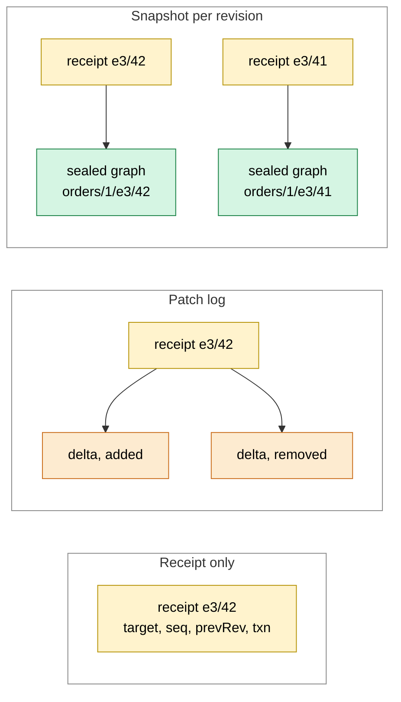

Decision records (eligibility decisions, behaviour state changes, MORK outcomes) are always
append-only, so for them a receipt-only model with whole replace is not an option. A composite
boundary with receipts only is refused: a closure sweep is not a single graph replace, and a receipt
could not say what changed inside it. A family that appends versions or records (§5.6.10) is not refused,
since its history is in the data and nothing is swept. A graph family whose targets resolve to different receipt
models raises a warning, so a consumer is told rather than left to assume uniformity.

**Retention.** History that is kept forever grows forever, so receipts are pruned (guide §24.2):

- **Only from the oldest end** (`dal:PrefixOnlyRetention`, baseline). Receipts live in monthly buckets,
  and buckets are dropped whole, oldest first. The oldest position that as-of replay can reconstruct is
  then one number per family. Dropping a bucket from the middle would leave a hole that replay reads
  across silently, so `dal:BucketAnyRetention` with an as-of floor is refused.
- **Low-water marks first.** Before a bucket is dropped, each affected stream's retention low-water
  mark is raised in its own transaction, so a gap check never mistakes pruning for loss.
- **Live heads are carried forward.** A stream written once in March and never since still has its head
  receipt in March's bucket. Before dropping it, the retention job copies every receipt that is still
  some stream's head into a pinned-heads graph.
- `dal:asOfFloorSource` names the job that advances the as-of floor.

Retention, epoch bumps and the erasure procedure are housekeeping (ADR-A80): the compiler does not
generate them, and this vocabulary records the choices they must honour.

#### 5.6.5 Meta topology

**The question.** Where do the version rows live, and what do concurrent writers collide on?

| Topology | Version rows | Strength | Cost |
|---|---|---|---|
| `dal:SharedSharded` (baseline) | in a fixed set of meta graphs, `dal:metaShards` of them, by hash | controls the number of graphs | collisions are as fine as the store's conflict detection within a graph |
| `dal:PerAggregate` | one meta graph per aggregate | isolates conflicts on stores that detect them per graph | doubles the number of graphs |

Neither is better in general. Which wins depends on whether the store detects conflicts per
statement, per graph or per page, which only a conformance test on the target store can say. Sharding
the meta graph is not enough by itself: every write also inserts into the transaction-claim graph, the
current log bucket and the key graph, so `dal:txnShards`, `dal:logShards` and `dal:keyShards` declare
how those are sharded too. The generated operations still write one of each, and a declared count above 1
raises a `ShardingNotHonoured` warning.

Changing `dal:metaShards` moves every version row, which is a migration: the compiler refuses it unless
`dal:priorMetaShards` and `dal:epochBumpAcknowledged true` record that the epoch will be bumped (§5.6.8).
`dal:registryGraph` names the graph that lists the family's log, event, delta, transaction and key
graphs, so audits and readers find them by explicit links, never by scanning graph-name prefixes.

#### 5.6.6 Uniqueness

**The question.** How is "no two people share an email" kept true when an RDF store will happily hold
both?

RDF gives one uniqueness guarantee for free: no duplicate triples. Everything people mean by "unique"
has to be built, and there are four kinds (guide Chapter 4):

| Kind | Example | Difficulty |
|---|---|---|
| K1 cardinality | a person has at most one tax number | easy: `sh:maxCount 1` |
| K2 global key | no two people share an email | hard: needs a scan or an index |
| K3 scoped key | an order number is unique per tenant | hard, plus normalisation |
| K4 entity identity | do not mint two IRIs for one real-world thing | the one that bites in production |

The patterns reduce K2 and K3 to K1, because cardinality is the only kind every store checks cheaply.
They are stacked, not chosen between (guide Chapters 5 to 8):

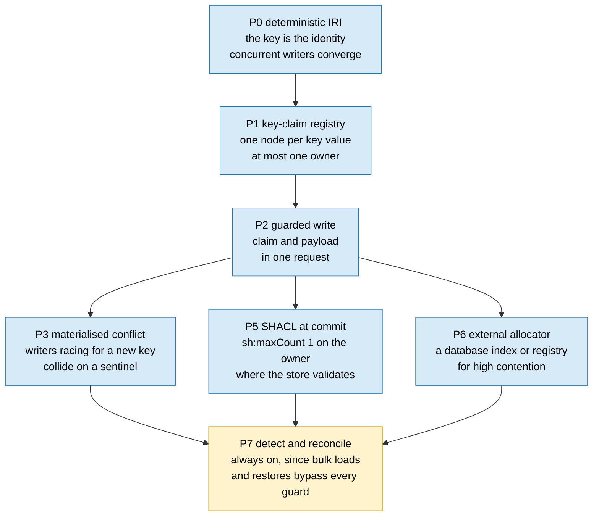

**P0, the key as the identity.** If an entity's IRI is derived from its key, a second insert of the same
thing is a no-op and uniqueness is structural. It suits only keys that are immutable and not personal
data: a changed key changes the identity, and a hash of an email can be reversed by trying a list of
emails.

**P1, the claim node.** For mutable or sensitive keys, the deterministic node is minted for the *key
value* instead, and owned by the entity, which keeps an opaque IRI:

```turtle
GRAPH <urn:g:keys> {
  <urn:key:person-email:v1:XUBJFDLLB7FTG552FYCFIMRUR4>     # HMAC of (scheme version, constraint, tenant, normalised email)
      a              pat:KeyClaim ;
      pat:constraint "person-email-unique" ;
      pat:claimedBy  <urn:person:8f2c1b7e-3e4a-4f7c-9a6d-2b1e0c5d7f90> .   # at most one
}
```

The claim IRI is a keyed hash (HMAC) under a secret only the platform holds, so the keys graph is an
index of every email without revealing any of them. All writers for one key now touch the same
subject, which is what makes conflict detection, locking and sharding work. "Find the person with
this email" becomes a one-triple lookup.

**P2, the guarded write.** The claim and the payload are written in one update that applies only if
no other owner holds the claim. Ownership is monotonic, since only a claim's own owner releases it, so
a follow-up `ASK` that sees the claim proves the write applied. The remaining gap is two different
writers racing for a key nobody holds yet, which P3, P5 or P6 closes depending on the store.

A `dal:UniquenessConstraint` declares one keyed constraint:

| Property | Says |
|---|---|
| `dal:constraintId` | the constraint's stable name, part of every claim IRI |
| `dal:keyProperty` | an RDF list of the properties whose values make the key |
| `dal:scopeProperty` | the property whose value scopes uniqueness, typically the tenant |
| `dal:normalizePipeline` | how key values are normalised before the claim is computed |
| `dal:claimScheme` | the claim scheme or schemes in use (rotation, below) |
| `dal:onViolation` | `dal:Reject` (baseline), `dal:Merge` or `dal:Quarantine` |
| `dal:mergeRelation` | the relation a merge records, required with `dal:Merge` |
| `dal:minEnforcementLevel` | `dal:Advisory`, `dal:Transactional` or `dal:Strong` |

**Normalisation is where uniqueness actually breaks.** `"A@B.com"` and `"a@b.com"`, an NFC and an NFD
`"café"`, a trailing space, a zero-width space: each pair has been treated as equal by a person and
different by a store. A constraint names one frozen pipeline, applied identically by the write path,
the reconciler and any backfill, and always in the application, since SPARQL cannot normalise Unicode
(guide §8.1). The pipelines are the minting specification's three:

| Pipeline | Steps | For |
|---|---|---|
| `dal:NfkcTrimCasefold` | NFKC case folding, then trim | caseless matching of human text, such as an email |
| `dal:NfkcTrimUppercase` | NFKC, trim, Unicode uppercase, NFKC again | codes conventionally upper case, such as a SKU |
| `dal:NfkcTrimLowercase` | NFKC, trim, Unicode lowercase, NFKC again | codes conventionally lower case |

**Rotating the claim secret.** Rotation changes every claim IRI, so it is never a single cutover. A
`dal:ClaimScheme` fixes every byte of a claim IRI (version, key identifier, digest, template) and moves
through four states:

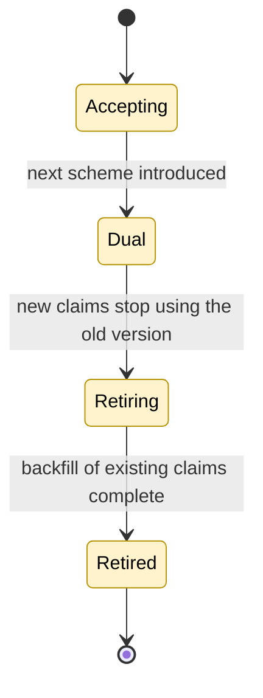

While two schemes are `dal:Dual`, the compiler selects a write that guards and inserts both versions'
claims for the same owner in one update, so no window opens in which a key is claimed under only one.

**Violations select a reconciler, not a different write.** The guarded write always prevents the race
at write time. But bulk loads, administrative `LOAD`s and restores bypass every guard, so a reconciler
runs regardless: "the reconciler is never the only strategy, and it is never absent" (guide §7.5).
`dal:onViolation` chooses which:

| `dal:onViolation` | Reconciler | What it does |
|---|---|---|
| `dal:Reject` (baseline) | `key-claim-duplicate-audit` | read-only: reports every over-claimed key |
| `dal:Merge` | `key-claim-merge-rewrite` | records `dal:mergeRelation` from each non-canonical owner to the lexicographically lowest owner IRI, never `owl:sameAs` |
| `dal:Quarantine` | `key-claim-quarantine` | copies the owners of every over-claimed key into a quarantine graph for review, deleting nothing |

None resolves a duplicate end to end. Rewriting references to a merge's canonical IRI, and retiring a
losing claim, stay with the caller, since only a claim's owner may retire it. A merge names a plain,
revocable relation the adopter's ontology defines, because `owl:sameAs` under a reasoner spreads to
every statement about both entities and cannot be retracted cleanly if the merge was wrong.

A key property must lie inside the aggregate it belongs to: with a composite boundary, a key property
the boundary shape cannot reach is refused.

#### 5.6.7 Identity minting

**The question.** What IRI does each resource get, and who decides?

LATTICE does not pick an identity scheme for an adopter. An IRI can name very different
things, with different needs for stability, privacy and ordering (identity guide §2):

| Resource role | Names | Typical stability |
|---|---|---|
| `dal:EntityRole` | a real or conceptual thing: a customer, a policy | long-lived |
| `dal:AggregateRootRole` | the unit of consistency | domain-defined |
| `dal:ComponentRole` | a part of an aggregate or artefact | depends on containment |
| `dal:LineageRole` | an enduring authored artefact family | long-lived |
| `dal:ContentRevisionRole` | one exact immutable content state | immutable |
| `dal:GraphLocatorRole` | where a graph is stored | deployment-local |
| `dal:KeyClaimRole` | a claim on a normalised key | retirable |
| `dal:EventOccurrenceRole` | something that happened, at a position | immutable, append-only |

A `dal:IdentityProfile` names one role and one strategy, so a class can take a different strategy per
role: an entity's own IRI may be a claimed surrogate while its event occurrences are position-derived.
Each role resolves as its own dimension, `identity:<Role>`.

| Strategy | Form | Deterministic | Key may change | Suits a personal-data key | Re-ingestion converges |
|---|---|---|---|---|---|
| `dal:NaturalKeyIdentity` | the encoded key in the IRI | yes | no | no | yes |
| `dal:DerivedHashIdentity` | a hash of the key | yes | no | no, unless keyed | yes |
| `dal:RandomSurrogateIdentity` | a UUID | no | yes | yes | no |
| `dal:SurrogateClaimedIdentity` | a UUID plus a keyed claim per key (P1) | the claim is | yes | yes | yes, by looking up the claim |
| `dal:ExternalRegistryIdentity` | issued by an outside registry | depends | depends | depends | if the registry is available |
| `dal:AdoptedIdentity` | an existing IRI, kept as it is | not applicable | not applicable | not applicable | yes |
| `dal:ContentAddressedIdentity` | a hash of canonical content | yes | not applicable | only if the content permits | yes |

**`dal:SurrogateClaimedIdentity` is the recommended general-purpose choice** for entities whose keys
are mutable or sensitive: the entity's IRI stays stable through key changes, and the claim gives
deterministic lookup and enforced uniqueness. A claimed identity names the uniqueness constraint it
claims (`dal:claimsConstraint`), and a natural-key or derived-hash identity the constraint it mints
from (`dal:keyConstraint`): without it the compiler refuses the profile, because the key it names would
not be the entity's key.

**Why personal data never goes in an IRI.** IRIs end up in logs, URLs, caches and dumps. A natural-key
IRI exposes the key outright, and an unkeyed hash of a low-entropy personal value (a national
insurance number, an email) is reversed by hashing every candidate. A keyed claim can be computed only
by the holder of the secret, which is why records of one person converge within a tenant, by looking
up the claim, and never correlate across tenants, whose secrets differ.

**Recipes, not code.** For each resolved role the compiler emits a self-contained **minting recipe**
(`dal:MintingRecipe`): canonical JSON with a digest, holding everything a minter needs, such as the
template, key properties, normalisation pipeline, digest scheme and widths. Missing members are refused
by name. `export-recipes` writes them out for the
[minting libraries](../../packages/minting/README.md) or any
implementation of the
[identity minting specification](../../docs/architecture/identity-minting-specification.md), and
conformance is defined by test vectors, not by LATTICE's code.

**Event identities.** `dal:eventIdentityStrategy` chooses `dal:PositionDerivedEvent` (an IRI from
target, epoch and sequence), `dal:RandomOccurrenceEvent` or `dal:ExternalEventIdStrategy`. A
position-derived event has a hazard a random one does not: two writers that both believe they won
under broken isolation mint the identical subject, so a check that counts subjects can never fire.
Such a profile must require a separate uniqueness witness (`dal:uniquenessWitnessRequired`), such as
the transaction id. Its namespace is derived from the target's IRI (`dal:HashedTargetDerivation`,
which needs a `dal:digestScheme`) or allocated by a registry (`dal:RegistryTokenDerivation`).

**Fixed widths.** Positions inside identity-bearing strings use one exact width per profile
(`dal:epochWidth`, `dal:sequenceWidth`), 19 digits in the examples, the width of a signed 64-bit
integer. Unpadded `e10` sorts before `e3`, and "short in examples, long in production" is two schemes,
not one.

#### 5.6.8 Epoch

**The question.** What stops a restore from making old positions mean new things?

```mermaid
sequenceDiagram
    participant D as Dataset
    participant C as Consumer
    rect rgba(213, 245, 227, 0.5)
    D->>C: events up to seq 91,438
    C->>C: remembers 91,438
    end
    rect rgba(245, 183, 177, 0.5)
    Note over D: restored from a morning backup:<br/>the counter rewinds to 90,900
    D->>D: new writes take 90,901 to 91,600,<br/>different events, the same numbers
    C->>D: resume after 91,438
    Note over C: skips 90,901 to 91,438, all new,<br/>and cannot tell that it did
    end
```

The fix is an **epoch** on the dataset, bumped on any restore, rebuild, re-key or migration, with
every position the pair `(epoch, seq)`. A consumer whose epoch no longer matches resynchronises
instead of resuming, and every open ETag goes stale at once, which is intended (guide §9, G4).

An epoch is safe only if two things hold (identity guide §10.3):

1. **The new epoch cannot come from the restored data**, or restoring the same backup twice reuses the
   epoch the first restore allocated. `dal:epochAuthority` says where it comes from:

   | Authority | Mechanism | Safety |
   |---|---|---|
   | `dal:ExternalHighWaterMark` | an outside system tracks the highest epoch ever issued, named by `dal:epochCoordinatorBinding` | fail-safe |
   | `dal:RestoreControlledEpoch` | the restore tooling allocates and records the epoch from its own log | as strong as the runbook |
   | `dal:WriterStartRefusal` | writers refuse to start until they see an externally acknowledged new epoch | fail-safe, at a cost in availability. Combinable with either above |
   | `dal:StoreLocalEpoch` | the epoch lives only in the dataset | warned: a double restore reuses an epoch |

2. **Every write guards on the dataset's current epoch.** `dal:epochGuardScope` is `dal:DatasetLevelGuard`
   (each write compares the dataset node) or `dal:RowLevelGuardOnly` (each write compares only the
   row's own epoch, warned). A row-level guard never sees a bump until the row is next written, so a
   stale client still matches. Under the dataset guard, a row keeps its older epoch until its next
   write rebases it, and its sequence continues, so the receipt chain crosses the boundary unbroken.

The restore runbook (guide §24.4), which housekeeping carries out: quiesce writers for at least the
maximum transaction time, allocate the new epoch from the declared authority, replay the erasure
register where the family holds personal data (§5.6.9), confirm the dataset-level guard, re-admit
writers, and run the reconciler, gap scan and fork audits before declaring the dataset healthy.

#### 5.6.9 Privacy and erasure

**The question.** How is one person's data removed when the law requires it, from a store whose other
patterns keep history?

A `dal:PrivacyProfile` declares the data's class (`dal:PersonalData`, `dal:InternalData`,
`dal:PublicData`), how a subject is erased, and what wins when erasure meets claim monotonicity:

| Strategy | Erases by |
|---|---|
| `dal:PerSubjectGraphDrop` | dropping the subject's own aggregate graph |
| `dal:CryptoShred` | destroying the key the subject's data is encrypted under |
| `dal:NoErasure` | not erasing: refused for personal data |

A family holding personal data keeps **one aggregate per subject**, so erasing one person rewrites
nobody else's data. Its version rows, receipts and transaction claims carry opaque IRIs and positions
only. Erasure is by decision: a non-personal decision record is written first, then the payload is
dropped or its key destroyed, and the version row is tombstoned so the subject's IRI and positions
are never reused (guide §24.5).

**History models can defeat erasure.** A patch log or a snapshot per revision keeps a second,
immutable copy of the payload, which a graph drop does not reach (identity guide §11.6):

| History model | Compatible with personal data and graph-drop erasure? |
|---|---|
| receipt only | yes: receipts carry pseudonymous references only |
| patch log | only if every delta graph is per subject (`dal:perSubjectScoped true`), or the family uses `dal:CryptoShred` |
| snapshot per revision | the same condition |

The compiler refuses personal data with no erasure, and personal data with a replay-capable model that
is neither per-subject nor crypto-shredded.

**Key claims are personal data too.** A claim IRI is an HMAC pseudonym of the key, and pseudonymised
data is still personal data. `dal:erasurePrecedence` decides: under `dal:ErasureWins` the subject's
claims are physically deleted, which breaks the rule that only an owner releases its claim, and is
acceptable because the release is on the owner's behalf. Under `dal:MonotonicityWins` erasure of a
claimed key waits for an explicit reconciliation.

**Erasure must survive a restore.** A backup predates every erasure made after it was taken, so
restoring it would bring erased subjects back. An append-only erasure register held outside the
dataset and its backups (`dal:erasureRegisterBinding`) is replayed before readers or writers are
admitted (`dal:erasureReplayOnRestore true`).

#### 5.6.10 Write discipline

**The question.** When a family writes a new state, does the old one go?

`dal:writeDiscipline`, declared on a `dal:WriteDisciplineProfile` (or any profile of the family) and resolved like any dimension, picks
one of three. Absent, it is `dal:InPlace`, so a configuration that declares none compiles as before.

| Discipline | A write | Operations | History is | Applies to |
|---|---|---|---|---|
| `dal:InPlace` (baseline) | replaces the old state and deletes it | `create-if-absent` or `bootstrap-version-row`, `cas-replace`, `tombstone-delete` | the receipt model's (§5.6.4) | every family |
| `dal:AppendVersions` | adds a new version beside the old and links it to the one before with `pat:previousVersion`. Nothing is swept or deleted | `bootstrap-version-row` and `append-version` | in the data, as versions | `dal:CompositePropertyBoundary`, and `dal:NoBoundary` with a `dal:dataGraph`, under `dal:Optimistic` |
| `dal:AppendRecords` | adds records, each an immutable occurrence | `bootstrap-version-row` and `append` | in the data, as records | any family. The discipline selects the append form whatever the concurrency |

```mermaid
flowchart LR
  subgraph inplace["InPlace, v1 is replaced"]
    A1["state v1"]:::data -- "sweep and delete" --> A2["state v2"]:::data
  end
  subgraph versions["AppendVersions, v1 stays"]
    B2["version v2"]:::data -- "pat:previousVersion" --> B1["version v1"]:::data
    B2 -. "shares by reference" .-> M["members not restated"]:::data
    B1 -.-> M
  end
  style inplace fill:none,stroke:#8a8a8a
  style versions fill:none,stroke:#8a8a8a
    classDef data fill:#d5f5e3,stroke:#1e8449,color:#000
```

**What `append-version` does,** in one update. It guards the identity's version row at the expected seq and the transaction claim. It
inserts the new version's own triples from the payload slot, and `$newVersion pat:previousVersion $priorVersion` when the row names a current
version. Persistence never writes `fnd:supersededBy`, which the domain asserts under its own rule (R2). It moves the row's seq and head and sets its current version to the new one, writes the receipt, and links the version to its
receipt with `pat:revision`. The current version is the latest one written. Which version is in force, or agreed, is evaluated
from other facts and never stored here. The first version is written at seq 0 onto a row `bootstrap-version-row` created, whatever
`dal:firstWrite` says, so a family that appends versions is never given `create-if-absent`. A family that appends versions has no
`tombstone-delete`, which would sweep the history. Removing one is housekeeping and erasure (ADR-A80), not a write of this family.

A caller restates only what changed. A member the new version does not restate is shared by reference, so the payload holds the
new version's own triples and a pointer to each unchanged member. A node a new version points at must already be in the data graph.

**Warned.** `compile` warns `VersionedClassWrittenInPlace` when a target class is a subclass of `fnd:Version`, by IRI in the loaded graphs
with no import of Foundation, and the discipline is `dal:InPlace`. A replace deletes the version before it, which the chain of `pat:previousVersion`
keeps. Declare `dal:AppendVersions`, or `dal:InPlace` deliberately for a working draft that nothing cites.

**Refused.** `AppendVersionsUnsupported`, for `dal:AppendVersions` on a named-graph family (a graph per version is not built), under a
concurrency that is not `dal:Optimistic` (the guard is the version row), or with no boundary and no `dal:dataGraph` (the default graph is
never written).

**What works best when.**

| The records are | Declare | Because |
|---|---|---|
| a working draft that people edit, nothing cites a state of it | `dal:InPlace`, `dal:ReceiptOnly` | one current state, the cheapest write, history needs no storage |
| edited in place, and a replayable change history is wanted | `dal:InPlace`, `dal:PatchLog` | the log keeps what changed, for each write. The caller computes a replace's delta |
| derived, can be regenerated, and needs no history | `dal:InPlace`, `dal:NoReceipt` | no receipt and no log bucket, and the claim still confirms a retry |
| things a party assents to, relies on or cites, and later changes make a new thing | `dal:AppendVersions`, `dal:ReceiptOnly` | each version stays and is reachable. A change costs the changed triples, one link and a receipt, with no sweep |
| occurrences that never change, such as drawdowns or deliveries | `dal:AppendRecords` | each record is written once and never reopened |
| derived from the rest | none of these. Compute it | storing it makes a second source for one fact |
| a hot record that many writers revise at once | `dal:AppendVersions`, and expect contention | writers race on one version row, as two replaces of one record do |

A family may be split to mix, for example an instrument's versions appended while a working draft beside it is edited in place. A
retention policy decides when a superseded version may be pruned, never one that a retained version references. That is
housekeeping and is not generated (ADR-A80).

#### 5.6.11 Membership encoding

**The question.** When a family appends versions and a root version lists many members, does each new version list them all?

`dal:membershipEncoding`, declared beside `dal:writeDiscipline` and resolved like any dimension, picks `dal:FullMembership` (the default) or
`dal:DeltaMembership`. `dal:DeltaMembership` is refused unless the family declares
`dal:AppendVersions` (`DeltaMembershipNeedsAppendVersions`), and any other value is refused (`MembershipEncodingUnknown`).

| | `dal:FullMembership` | `dal:DeltaMembership` |
|---|---|---|
| a new version stores | every member, under the domain's membership property | `pat:previousVersion`, and `pat:addsMember` and `pat:dropsMember` for what changed |
| the membership property | written for every version | written only for a checkpoint version |
| one change to a set of 500 | 501 triples besides the header | 3 |
| reading a version's members | one lookup | the generated `members` query, a chain back to the nearest checkpoint, at most `dal:checkpointEvery` versions |
| a domain shape | runs over the stored data | runs over the `members` results (below) |

`dal:checkpointEvery` is an `xsd:long`, 16 when absent, and must be at least 1 (`CheckpointEveryInvalid`). A **checkpoint** version, the
first and every one whose seq is a multiple of the interval, lists every member under the domain's property as under full membership and
carries `pat:checkpoint true`, so no chain is longer than the interval. The write does not decide which version is a checkpoint, since the
caller already holds the sequence. The caller fills `{{{payloadTriples}}}` with the full list and the marker on a checkpoint, and `{{{addedMembers}}}`
and `{{{droppedMembers}}}`, the triples `newVersion pat:addsMember m` and `newVersion pat:dropsMember m`, on any other version, leaving the
slots it does not use empty (`persistence.members.is_checkpoint`). The caller library's check verifies the choice (ADR-A132).

**The add and del parts.** The digest of the delta write has an add part and a del part (`dal:AddPart`, `dal:DelPart`), as a write under a
patch log does, and they hold different things. Here they hold the members the version adds and drops, as the triples of `{{{addedMembers}}}`
and `{{{droppedMembers}}}`. For example, version 5 of a quote that drops line 3 and adds line 7 has
`<urn:quote:1/v5> pat:addsMember <urn:quote:1/line7>` in its add part and `<urn:quote:1/v5> pat:dropsMember <urn:quote:1/line3>` in its del part.
Under a patch log they hold the triples of the aggregate a write adds and removes (`{{{assertTriples}}}`, `{{{retractTriples}}}`). For
example, a replace that renames a project has its new title, `<urn:project:1> <urn:ex:title> "Beta"`, in the add part and its old title in the del
part. A checkpoint version leaves both member slots empty, and they still hash as two empty parts.

The `members` operation (kind `MembersRead`) takes `$version` and `$membershipProperty`, since a family declares no membership property, and
returns `?member`. A member is one listed at a version of the chain from `$version` back to the nearest checkpoint, by the property or by
`pat:addsMember`, and not dropped by a later version of that chain. A member dropped and added again is a member. A version with no
checkpoint before it has no members, so the first version must be a checkpoint.

**Validating members.** A domain shape over the membership property cannot run over the stored delta, which does not hold the property for a
delta version, and would pass vacuously. Run `members`, put the rows in a scratch graph with `persistence.members.materialise(version, property,
rows)`, validate that graph with the domain's own shapes and discard it.

A large set changed slightly costs a handful of triples instead of a full list, and history stays readable. Every read of members pays the
chain, and domain shapes need the scratch graph, so the family trades read cost and validation convenience for write and storage cost. That
is why it is a choice. The fixtures under `test/membership/` hold the stored triples of two sets of members, of 500 and of 150, under each encoding, and
`benchmark/persistence-membership/` measures both against an in-place family with a patch log.

### 5.7 Capability self-checks

The compiler builds no store interface and consults no live backend. For each target it computes an
unconditional `dal:CapabilityRequirement` from the resolved profile alone: the concurrency level the
family needs, whether resolution relied on reasoning, the uniqueness enforcement level.

An adopter may **optionally** supply a `dal:CapabilitySpec`, their own unverified statement of what
their environment provides, and the compiler checks the requirement against it:

```turtle
ex:MyFusekiEnvironment a dal:CapabilitySpec ;
    dal:appliesToTarget           ex:LoanApplication ;
    dal:providesCas               "LINEARIZABLE" ;
    dal:providesReasoning         false ;
    dal:providesCommitValidation  "NONE" .
```

A spec that says no reasoning is available also makes resolution drop reasoning-dependent scopes
(§5.5.3). Without a spec, nothing is dropped or downgraded: the compiler assumes the most any backend
could provide and records what its resolution depended on.

**Why unverified.** A compiler that needed a live store before producing anything would make every
adopter expose a running database to a design-time tool (ADR-A79). The truth about a store comes from
running the conformance tests against it (guide Chapter 27): a store's documentation says what its
isolation should be, and only the tests say what it is.

### 5.8 What the compiler produces

`python -m persistence compile` runs five stages and emits a `dal:CompiledProfile` per target:

| Stage | Output | Fails with |
|---|---|---|
| Load | one graph: this ontology, the adopter's configuration and applied ontology | malformed Turtle |
| Resolve | one value per dimension per target, each with the profile that won and how many candidates there were (`dal:ResolvedDimension`) | `ProfileAmbiguityError` |
| Validate | diagnostics: refusals and warnings (§5.10) | `CrossAxisViolation`, `BoundaryConflict`, `MissingBoundaryShapeError` |
| Select | one named builder per generated operation | none: a lookup table |
| Emit | `dal:GeneratedOperation`s with reified `dal:ParameterBinding`s and the contract of each (§5.8.1), minting recipes, the capability requirement | an encoder rejection |

The compiled profile names builders and parameters. It never embeds SPARQL text, so it is the same
whatever store will run it. `instantiate` finds each builder by its `dal:templateId`, the operation's id with
no suffix, and renders portable `.rq` files, and `export-recipes` writes the minting recipes as JSON. Neither assumes the other
is ever run, and an adopter who wants only the generated SPARQL can run both once and walk away.

**The run's choices are in the profile.** `compile --no-parameter-guards` leaves the required-parameter guard out of
every operation, for a caller whose own code checks every parameter, and `compile --caller-graph-names` has the caller
name each root's graph as `$g`. The profile records both on each operation (`dal:guardStatus`, `dal:graphNaming`)
and `instantiate` renders what the profile says. It has no flags of its own, so a profile cannot say its queries are
guarded while the rendered queries are not.

#### 5.8.1 The contract of a generated operation

Each `dal:GeneratedOperation` also states what a caller in any language, a relational realisation and a model checker need, with no
SPARQL text and no blank node. Every node of it has an IRI minted from the target (and the deployment, where there is one), the operation and the part,
for example `<…/compiled/LoanApplication/cas-replace#param-root>`, so two compiles give the same IRIs.

| Part | Holds |
|---|---|
| `dal:operationKind` | an individual of the closed `dal:OperationKind`, for example `dal:Create`, `dal:Replace`, `dal:Audit`, `dal:MembersRead`, and `dal:PayloadCheck`, which returns the subjects of a payload outside the aggregate |
| `dal:templateVersion` | the builder's version, bumped by any change to the text it renders |
| `dal:parameter` | each parameter's name, kind (`dal:ParameterKind`) and whether it is required. A caller-named graph's rule is `dal:GraphNameOfRoot`, which refers to `dal:graphIriTemplate`, and a registry list says it is sourced from the family's `dal:registryGraph` |
| `dal:access` | each logical resource the operation touches (`dal:ResourceKind`, such as `dal:VersionRow` or `dal:Receipt`), the mode (`dal:PointRead`, `dal:AbsenceRead`, `dal:ScanRead`, `dal:WholeAggregateRead`, `dal:Insert`, `dal:Delete`) and the parameter that keys it |
| `dal:resultColumn` | each column of an audit or of the members query, with its kind and a separator |
| `dal:payloadContract` | the payload slot, its root (the new version, for an append of versions), its encoding (`dal:GroundNTriples`), the boundary shape or `dal:NoBoundaryShape`, and the edges of the shape, each with the shape it leads to (`dal:edgeTargetShape`), so that a caller can walk the owned edges |
| `dal:reportsOutcome`, `dal:examinedParameter` | on an audit, the outcomes it can report (`dal:Clean`, `dal:Failed`, `dal:NothingExamined`) and the parameter that lists the graphs it reads |
| `dal:digestContract` | what the request digest is hashed over, in order: the operation kind, the target, the expected seq, and the payload, the events, or the added and dropped triples |
| `dal:guardStatus`, `dal:graphNaming` | the run's choices, above |
| `dal:declarationSource` | `dal:BuilderDerived`, read from the builder. `dal:HandDeclared` is kept for an operation with no builder, and none has since the value guard was given one |

The kinds, modes and resources are individuals of `spec/persistence.ttl`, each with its logical key and realisation. Shapes
in `shapes/constraints.ttl` check a compiled profile (§7.2), and the files of `test/expected-profiles/` are their positive fixtures.

**Which operations a target gets** follows from its dimensions:

| Configuration | Operations |
|---|---|
| `dal:Optimistic` with a named-graph boundary | `create-if-absent` (or `bootstrap-version-row` under `dal:PreCreatedRow`), `cas-replace`, `tombstone-delete` |
| `dal:Optimistic` with a composite boundary | `create-if-absent` (or `bootstrap-version-row` under `dal:PreCreatedRow`), `cas-replace` and `tombstone-delete`, each sweeping the aggregate with one property path inside the family's `dal:dataGraph` |
| `dal:Optimistic` with no boundary | `cas-replace` guarded on `dal:valueGuardProperty`, inside the family's `dal:dataGraph` |
| `dal:AppendVersions` (composite boundary, or no boundary with a `dal:dataGraph`, under `dal:Optimistic`) | `bootstrap-version-row` and `append-version`, whatever `dal:firstWrite` says, and no `tombstone-delete` (§5.6.10) |
| `dal:AppendRecords` | `bootstrap-version-row` and `append`, whatever the concurrency |
| `dal:AppendOnly`, or event grain with any concurrency other than `dal:Optimistic` | `bootstrap-version-row` and `append` |
| `dal:ProvidedConcurrency` or `dal:LockingConcurrency`, with commit grain | `unconditional-write` |
| each uniqueness constraint | `key-claim-write` (or its dual form during rotation), `key-claim-retire`, and the reconciler of §5.6.6 |
| a payload operation and a `dal:boundaryShape` | `payload-check`, the query that returns the subjects of a payload that no owned edge reaches from the root. A caller runs it over a local copy of its payload |
| every target | the audits: `gap-scan-audit`, `fork-detection-audit`, `revision-multi-txn-audit`, `txn-multi-revision-audit` |

Under `dal:DatasetLevelGuard`, the create, bootstrap, compare-and-set, tombstone and append operations
use their `-dataset-guard` variants. The value-guard and unconditional writes have none. The compiler's own [README](../../tools/persistence/README.md) documents the parameters each
operation takes, the obligations the generated SPARQL cannot enforce for the caller, and its known
limitations, among them: infrastructure graph IRIs are fixed constants rather than configurable,
declared shard counts are recorded but not yet applied, and retention and epoch bumps are left to
housekeeping.

### 5.9 Choosing a profile

The guide's decision procedure (Chapter 29), for each graph family, tenant or aggregate:

```mermaid
stateDiagram-v2
    [*] --> NewGraphFamily
    
    NewGraphFamily --> CheckImmutableRevision
    
    CheckImmutableRevision --> BaselineProfileRevision: immutable hash
    CheckImmutableRevision --> CheckConcurrentRWM: no immutable hash
    
    CheckConcurrentRWM --> CheckAppendOnly: no concurrent writers
    CheckConcurrentRWM --> CheckLinearizable: concurrent writers
    
    CheckAppendOnly --> StrongProfileAppend: append-only stream
    CheckAppendOnly --> BaselineProfileConcurrency: not append-only
    
    CheckLinearizable --> StrongProfileCAS: linearizable
    CheckLinearizable --> CheckPartitionable: not linearizable
    
    CheckPartitionable --> SingleWriterPartition: partitionable
    CheckPartitionable --> ExternalLock: not partitionable
    
    BaselineProfileRevision --> Uniqueness
    StrongProfileAppend --> Uniqueness
    BaselineProfileConcurrency --> Uniqueness
    StrongProfileCAS --> Uniqueness
    SingleWriterPartition --> Uniqueness
    ExternalLock --> Uniqueness
    
    Uniqueness --> [*]
    classDef tool fill:#d6eaf8,stroke:#2874a6,color:#000
    classDef data fill:#d5f5e3,stroke:#1e8449,color:#000
    classDef history fill:#fff3cd,stroke:#b7950b,color:#000
    class BaselineProfileRevision,BaselineProfileConcurrency tool
    class StrongProfileAppend,StrongProfileCAS data
    class SingleWriterPartition,ExternalLock history
```

What each choice costs to run (guide §29.4):

| Choice | Gains | Pays | Must operate |
|---|---|---|---|
| baseline | simplicity, the store's own behaviour | no proven outcome, no dense order, no replay unless the store has it | the reconciler, and whatever the store needs |
| strong, compare-and-set | provable outcomes, lost updates impossible or loud, dense per-aggregate order, derived ETags | one extra hot statement per aggregate, receipt volume | transaction-claim pruning, log rotation with low-water marks and pinned heads, fork, duplicate and gap alerts, the epoch runbook |
| strong, append | gap-detectable streams, idempotent ingestion | writers take turns per stream, `opSeq` discipline | the same, and frozen stream keys |
| patch-log receipts | replay, change data capture, as-of reads | about twice the write volume, delta graphs | delta bucket rotation |

### 5.10 Refusals and warnings

A configuration is checked twice: by SHACL shapes in [`shapes/constraints.ttl`](shapes/constraints.ttl),
which any SHACL engine can run on a configuration graph, and by the compiler, which mirrors the
cross-axis checks on resolved values. The compiler also catches combinations declared on different
profile nodes, which node-local shapes cannot see.

**Refused**, because the configuration cannot work:

| Check | Why |
|---|---|
| no boundary with compare-and-set and no value guard | there is nothing to replace whole |
| no boundary with a value guard and no `dal:dataGraph` | the guard would read and write the default graph, whose contents differ between stores |
| composite boundary with receipts only, unless the family appends versions or records | a receipt could not say what changed inside the closure |
| `dal:AppendVersions` on a named-graph family, without `dal:Optimistic`, or with no boundary and no data graph | the write has no variant, or no version row to guard, or no graph to hold the versions |
| commit grain with `opSeq` required | the two contradict each other |
| a key property outside a composite boundary | the key would not belong to the aggregate |
| `dal:metaShards` changed without an acknowledged epoch bump | moving version rows is a migration |
| `dal:BucketAnyRetention` with an as-of floor | replay would read across a hole |
| a lag-window read without `dal:lagWindowMillis` | there is no bound |
| `dal:Merge` without `dal:mergeRelation` | a merge must name what it records |
| personal data with no erasure, or with replayable history not scoped per subject | no lawful erasure path |
| an identity profile missing its key constraint, digest scheme, witness, namespace derivation or accepted pattern | the recipe could not be built |
| a capability requirement the declared spec does not meet | the environment cannot run the profile |

**Warned**, because the configuration works and its trade-off should be a conscious one: the
store-local epoch, the row-level epoch guard, a weak ETag with compare-and-set, no global read where
a dataset tier is declared, an advisory contiguity check, sorted acquisition with a single guarded
update, declared shard counts not yet honoured, mixed receipt models in one graph family, a
profile scoped to a bare class from another namespace, and a subclass of `fnd:Version` written in place.

### 5.11 Keys: `persistent-foundation`

Foundation gives every adopter keys: the names the world gives a thing, as key nodes with a
scheme and a value, either locating it (`fnd:externalKey`) or identifying it (`fnd:naturalKey`)
(Foundation README §8, [ADR-A114](../../docs/architecture/decisions/ADR-A114-external-and-natural-keys.md)).
A natural key identifies one thing, and something has to keep it that way. An adopter using a
reasoner alone takes `fnd:MergedOnNaturalKey`, and OWL merges any two things sharing one. **LATTICE
recommends Persistence instead, for any deployment that writes keyed data**: `owl:hasKey` merges on
any collision, including a mistaken one, and nothing in OWL can undo a merge or say why it happened.
Persistence refuses the second claim when it is written, and reports, quarantines or records for
review anything written around it.

`persistent-foundation` is how. It is optional, and it is Persistence's only document that imports a
layer: `spec/persistent-foundation.ttl` imports Foundation and this ontology, both at this README's version, so the `dal:`
configuration ontology itself still imports nothing (§11). It holds one class and the shapes that tie
Foundation's keys to Persistence's profiles.

```mermaid
flowchart LR
    subgraph ONT["the adopter's ontology"]
        S["scheme ex:lei<br/>a fnd:KeyScheme"]:::author
        KC["key class ex:LeiKey<br/>equivalent to fnd:keyScheme value ex:lei"]:::author
        C["ex:Company<br/>subclass of dal:PersistenceKeyed"]:::author
    end
    subgraph CFG["the dal: configuration"]
        IP["identity profile on ex:LeiKey<br/>mints key IRIs"]:::author
        KU["uniqueness on fnd:keyValue<br/>one key node per value"]:::author
        NU["uniqueness on fnd:naturalKey<br/>one owner per key"]:::author
        PP["privacy profile<br/>sensitive schemes only"]:::author
    end
    S --> KC
    KC --> IP
    KC --> KU
    KC -.-> PP
    C --> NU
    style ONT fill:none,stroke:#8a8a8a
    style CFG fill:none,stroke:#8a8a8a
    classDef author fill:#fde2e4,stroke:#c0392b,color:#000
```

#### 5.11.1 What an adopter declares

1. **The mixin on each keyed class**: `ex:Company rdfs:subClassOf dal:PersistenceKeyed`. It adds no
   key axiom, so no reasoner merges two companies, and never sits beside `fnd:MergedOnNaturalKey`.
2. **One key class per scheme**, defined from the scheme by an OWL restriction, and every key
   asserted a member of it. Persistence resolves every profile for a class (§5.5.2), so a scheme's keys
   need a class of their own for their IRIs to be minted their own way.
3. **For each key class**, an identity profile minting its key IRIs and a uniqueness constraint on
   `( fnd:keyValue )`, normalised by the scheme's `fnd:keyNormalisation`. The constraint is what the
   recipe mints from, and it guarantees one key node per value however many writers record it.
   Public schemes mint by natural key or derived hash, with no tenant scope, so two tenants recording
   one company number reach one node by computation. Sensitive schemes mint a claimed surrogate (§5.6.7).
4. **For each keyed class**, a uniqueness constraint on `( fnd:naturalKey )`. Its key component is
   the key node's IRI, so the generated `key-claim-write` refuses a second owner of one key node. Any
   of the three pipelines will do: a minted key IRI is already normalised, and its digest alphabet
   has one case, so no two key nodes fold together. `dal:onViolation` picks the reconciler (§5.6.6).
   A `dal:Merge` records `dal:mergeRelation` between the two owners, never `owl:sameAs`.
5. **For a sensitive scheme's key class**, a privacy profile that is not `dal:PublicData`, and for a
   personal-data scheme `dal:PersonalData`, so §5.6.9's erasure rules reach its keys.

The compiler reads one `dal:appliesTo` per constraint, so each class takes its own constraint, as the
example does. Deriving the natural-key constraint from the mixin alone is not built.

#### 5.11.2 What the shapes check

`shapes/persistent-foundation.ttl` runs on the adopter's ontology, configuration and data together,
since the compiler matches asserted types and never reasons:

| Shape | Reports |
|---|---|
| `dal:SchemeKeyClassShape` | a scheme with no key class, or more than one |
| `dal:KeyClassIdentityShape` | a key class with no identity profile for `dal:EntityRole` |
| `dal:SensitiveKeyClassShape` | a sensitive scheme's keys minted by any strategy other than `dal:SurrogateClaimedIdentity`, or with no privacy profile, or a public one. A personal-data scheme's keys without `dal:PersonalData` |
| `dal:KeyNormalisationShape` | a key class's uniqueness constraint normalising differently from its scheme |
| `dal:KeyTypedShape` | a key not asserted a member of its scheme's key class, or asserted a member of another scheme's, which a reasoner would resolve by merging the two schemes |
| `dal:PersistenceKeyedClassShape` | a `dal:PersistenceKeyed` class with no natural-key constraint, or one that is also `fnd:MergedOnNaturalKey` |

### 5.12 Repository layout

```
ontology/persistence/
  spec/persistence.ttl       the dal: vocabulary
  spec/persistent-foundation.ttl
                             dal:PersistenceKeyed, importing Foundation (optional, §5.11)
  shapes/constraints.ttl     SHACL shapes validating dal: configuration data (§7.2)
  shapes/persistent-foundation.ttl
                             the shapes tying Foundation's keys to dal: profiles (§5.11.2)
  examples/                  the worked examples of §8, one negative fixture per refused
                             combination, and the warning fixtures
  execution/                 the SPARQL and recipes each example compiles to: generated by
                             mise run build:persistence-execution, ignored by git (§8.5)
  docs/                      the precedence algorithm and the aggregate-boundary design
  test/expected-profiles/    the compiled profile each example gives, with the contract of every generated
                             operation (§5.8.1). Compared with the output of compile by graph isomorphism, and the
                             positive fixtures of the shapes over a compiled profile (§7.2).
                             Regenerate with mise run build:persistence-expected-profiles
  test/membership/           the stored triples of a set of members under each membership encoding (§5.6.11)
```

The compiler that consumes this ontology lives in [`tools/persistence`](../../tools/persistence/README.md),
following the repository's split between `ontology/` (semantic assets) and `tools/` (executable
reference implementations). The minting libraries live in `packages/minting`.

### 5.13 A running case, from declaration to history

The dimensions above are explained one at a time. This section follows a single aggregate through all of them, so that they meet in one place. The aggregate is a project that owns its milestones, a plan, tasks, subtasks, attachments and comments, declared in [`examples/composite-project-ownership.ttl`](examples/composite-project-ownership.ttl). A named-graph family, a stream and two families that append versions join where the case needs them.

Everything below comes from a shipped example, from the SPARQL that `compile` and `instantiate` produce for it, or from a test that runs the generated update on rdflib and on Oxigraph. The excerpts of SPARQL are quoted from the generated text, and [8.5](#85-every-example-and-the-sparql-it-compiles-to) says how to generate it. The counts in the pictures are those of the test data in `tools/persistence/tests/fixtures/project-data.ttl`, whose aggregate holds 28 triples.

```mermaid
flowchart LR
    A["1 declare"]:::author --> B["2 compile"]:::tool
    B --> C["3 generate"]:::tool
    C --> D["4 write"]:::store
    D --> E["5 race and retry"]:::store
    E --> F["6 history"]:::history
    F --> G["7 read back"]:::history
    G --> H["8 keep it small"]:::history
    classDef author fill:#fde2e4,stroke:#c0392b,color:#000
    classDef tool fill:#d6eaf8,stroke:#2874a6,color:#000
    classDef store fill:#d5f5e3,stroke:#1e8449,color:#000
    classDef history fill:#fff3cd,stroke:#b7950b,color:#000
```

| Step | Example | Generated operation | Held by (in `tools/persistence/tests/`) |
|---|---|---|---|
| 1 declare | `composite-project-ownership`, `baseline-single-class` | none, a declaration | `test_ownership_tree.py` (`test_ho4_t5`), `test_ownership_refusals.py` (`test_ho6_t2`), `test_named_graph_builders.py` (`test_h2_3_t9`) |
| 2 compile | `composite-project-ownership`, `invalid-compositeboundary-receiptonly` | the compiled profile | `test_resolver.py`, `test_compiler_integration.py` (`test_negative_fixture_fails_compile`) |
| 3 generate | `composite-project-ownership` | the contract of `cas-replace` | `test_expected_profiles.py` (`test_h2_7_t1`, `test_h2_7_t7`) |
| 4 write | `composite-project-ownership`, `append-stream-dataset-guard`, `write-discipline-composite-append-versions`, `write-discipline-delta-membership` | `create-if-absent`, `cas-replace`, `tombstone-delete`, `append-event`, `append-version`, `append-version-delta` | `test_composite_lifecycle.py` (`test_ho7_t2` to `t5`), `test_patch_log.py` (`test_h2_6d_t1`), `test_append_events.py` (`test_h2_6b_t1`), `test_write_disciplines.py` (`test_h2_6c_t1`), `test_membership.py` (`test_h2_6f_t1`) |
| 5 race and retry | the same, `value-based-cas`, `persistent-foundation-keys` | the guards of `cas-replace`, the value guard, `key-claim-write` | `test_patch_log.py` (`test_h2_6d_t5`, `t6`), `test_composite_lifecycle.py` (`test_ho7_t6`, `t7`), `test_contract_emission.py` (`test_h2_7_t20`), `test_key_claims_and_audits.py` (`test_h2_5_t15`) |
| 6 history | `composite-project-ownership`, `write-discipline-composite-append-versions` | the receipts, the delta graphs and the versions the writes leave | `test_patch_log.py` (`test_h2_6d_t10`), `test_write_disciplines.py` (`test_h2_6c_t3`) |
| 7 read back | `write-discipline-delta-membership` | `members` and the audits | `test_membership.py` (`test_h2_6f_t5`, `t8`, `t9`), `test_key_claims_and_audits.py` (`test_h2_5_t36`), `packages/persistence/python/tests/test_check.py` |
| 8 keep it small | `write-discipline-delta-membership` | the same, and the retention a housekeeper performs | `benchmark/persistence-membership`, `test_key_claims_and_audits.py` (`test_h2_5_t36`) |

#### 5.13.1 Declare

An adopter says what an aggregate is and nothing about how it is written. For the project, a class scope selects `ex:Project`, and three profiles apply to it, one for the boundary, one for concurrency and one for receipts.

```mermaid
flowchart LR
    S["ex:ProjectClass<br/>a dal:ClassScope<br/>targets ex:Project, priority 20"]:::author
    B["ex:ProjectBoundaryProfile<br/>composite property boundary<br/>boundary shape ex:ProjectShape<br/>data graph urn:g:projects"]:::author
    C["ex:ProjectConcurrencyProfile<br/>optimistic<br/>linearizable"]:::author
    R["ex:ProjectReceiptProfile<br/>patch log"]:::author
    B -- appliesTo --> S
    C -- appliesTo --> S
    R -- appliesTo --> S
    classDef author fill:#fde2e4,stroke:#c0392b,color:#000
```

The boundary is a classified shape (§5.6.1). Each edge that leads to a node says whether the node is owned, a reference to something independent, or vocabulary. The shape is written once, and what it selects is a closure. Starting at `ex:p1`, the project of the test data, the owned edges reach eight members and no other node.

```mermaid
flowchart TB
    subgraph AGG["the aggregate of ex:p1, nine nodes and 28 triples"]
        P1["ex:p1"]:::data
        M1["ex:m1"]:::data
        M2["ex:m2"]:::data
        PL["ex:plan1"]:::data
        T1["ex:t1"]:::data
        T2["ex:t2"]:::data
        T3["ex:t3"]:::data
        DO["ex:docOwned"]:::data
        C1["ex:c1<br/>a comment"]:::data
    end
    ACME["ex:acme"]
    ALICE["ex:alice"]
    DS["ex:docShared"]
    ST["ex:InProgress<br/>and ex:Done"]
    P1 -- hasMilestone --> M1
    P1 -- hasMilestone --> M2
    P1 -- hasPlan --> PL
    M1 -- hasTask --> T1
    T1 -- hasSubtask --> T2
    T2 -- hasSubtask --> T3
    T1 -- attachment --> DO
    C1 -- "onTask, followed backwards" --> T1
    P1 -. "forClient, a reference" .-> ACME
    T1 -. "assignee, a reference" .-> ALICE
    PL -. "attachment, a reference" .-> DS
    T1 -. "status, vocabulary" .-> ST
    style AGG fill:none,stroke:#8a8a8a
    classDef data fill:#d5f5e3,stroke:#1e8449,color:#000
```

Three details of the shape show how much the classification carries. The property `ex:attachment` is owned from a task and a reference from a plan, because ownership belongs to an edge in its context. The comment points at its task, so the edge is followed against its direction. A subtask is a task, so the walk recurses, and the compiler turns it into a star in one property path. A write sweeps the triples whose subject is one of the nine nodes and leaves the client, the assignee, the shared document and the status concepts as they are. `test_ownership_tree.py` holds the closure (`test_ho4_t5`), and `test_ownership_refusals.py` holds that an edge left unclassified is refused (`test_ho6_t2`).

A named-graph family declares less. [`examples/baseline-single-class.ttl`](examples/baseline-single-class.ttl) says that each loan application is a graph named from its root, with compare-and-set, event grain and a patch log. There is no boundary shape, since the graph is the aggregate.

```mermaid
flowchart LR
    R["$root<br/>an IRI the caller gives"]:::caller
    G["urn:g:loan-application/ and the encoded root<br/>one graph, the aggregate"]:::data
    M["urn:g:meta/47<br/>the version rows of the target,<br/>one of 64 shards"]:::meta
    R -- "the graph IRI template" --> G
    R -- "the row of the root" --> M
    classDef caller fill:#fde2e4,stroke:#c0392b,color:#000
    classDef meta fill:#e8daef,stroke:#7d3c98,color:#000
    classDef data fill:#d5f5e3,stroke:#1e8449,color:#000
```

The shard is chosen once per target, from the target's name. Every root of the target keeps its row in that graph, and the compiled `cas-replace` binds the graph with `BIND(IRI(CONCAT("urn:g:loan-application/", ENCODE_FOR_URI(STR($root)), "")) AS ?g)`. `test_named_graph_builders.py` holds what it writes (`test_h2_3_t9`).

#### 5.13.2 Compile

`compile` resolves one value for each dimension of the target (§5.5 and §5.8). For the project it resolves 27 dimensions. Three are declared by the profiles above. Of the other 24, twelve take the platform baseline and twelve stay without a value, which §5.4 says is itself meaningful. Then it validates the combination and selects the operations.

```mermaid
flowchart TB
    subgraph IN["declared by the adopter"]
        D1["boundary<br/>composite property"]:::author
        D2["concurrency<br/>optimistic"]:::author
        D3["receipt model<br/>patch log"]:::author
    end
    RES["resolve<br/>27 dimensions for ex:Project"]:::tool
    VAL["validate<br/>one warning, RowLevelGuardOnly<br/>no refusal"]:::tool
    SEL["select and emit<br/>8 operations, 11 reference edges"]:::tool
    IN --> RES --> VAL --> SEL
    style IN fill:none,stroke:#8a8a8a
    classDef author fill:#fde2e4,stroke:#c0392b,color:#000
    classDef tool fill:#d6eaf8,stroke:#2874a6,color:#000
```

The warning is a witness of the baseline at work. Nothing declares an epoch guard, so the dimension takes its baseline value, the row-level guard, which §5.6.8 discourages and the compiler reports whether the value was declared or defaulted. `test_resolver.py` holds both the resolution of every dimension and the baseline (`test_baseline_default_is_row_level_guard_only`).

A refusal is the other outcome. [`examples/invalid-compositeboundary-receiptonly.ttl`](examples/invalid-compositeboundary-receiptonly.ttl) declares the same boundary with `dal:ReceiptOnly`, and the compiler stops with `CompositeBoundaryReceiptConflict`. Its message ends with "Require at least dal:PatchLog.", the receipt model the project declares, since a receipt alone could not say what changed inside a closure. Nothing is generated for a refused target. `test_compiler_integration.py` holds that every negative example fails to compile (`test_negative_fixture_fails_compile`).

```mermaid
flowchart LR
    W1["composite boundary<br/>receipt only"]:::author --> V1["validate"]:::tool
    V1 --> X["CompositeBoundaryReceiptConflict<br/>nothing generated"]:::refused
    W2["composite boundary<br/>patch log"]:::author --> V2["validate"]:::tool
    V2 --> OK["three writes, a payload check<br/>and four audits"]:::tool
    classDef author fill:#fde2e4,stroke:#c0392b,color:#000
    classDef tool fill:#d6eaf8,stroke:#2874a6,color:#000
    classDef refused fill:#f5b7b1,stroke:#922b21,color:#000
```

When two profiles declare the same dimension at scopes that both match, §5.5.3 says which one wins, and a tie is a refusal.

#### 5.13.3 Generate

The compiled profile names a builder for each operation and holds no SPARQL (§5.8). For the project it holds eight operations, `create-if-absent`, `cas-replace`, `tombstone-delete`, `payload-check` and the four audits. Each states its contract (§5.8.1), and the contract of `cas-replace` is the one that matters most.

```mermaid
flowchart TB
    subgraph IN["ten parameters, all required"]
        P1["root, newRev, txnId<br/>IRIs"]:::caller
        P2["epoch<br/>an xsd:long"]:::caller
        P3["expectedSeq, nextSeq<br/>positions"]:::caller
        P4["requestDigest"]:::caller
        P5["payloadTriples,<br/>assertTriples, retractTriples<br/>request-time slots"]:::caller
    end
    OP["cas-replace<br/>kind Replace<br/>guarded"]:::tool
    subgraph OUT["the resources it touches"]
        R1["version row<br/>point read, absence read,<br/>delete, insert"]:::meta
        R2["transaction claim<br/>absence read, insert"]:::txn
        R3["aggregate<br/>whole aggregate read,<br/>delete, insert"]:::data
        R4["patch content<br/>insert"]:::delta
        R5["receipt<br/>insert"]:::log
    end
    DG["digest, in order<br/>operation kind, root, expected seq,<br/>payload, added, removed"]:::tool
    IN --> OP --> OUT
    OP --> DG
    style IN fill:none,stroke:#8a8a8a
    style OUT fill:none,stroke:#8a8a8a
    classDef caller fill:#fde2e4,stroke:#c0392b,color:#000
    classDef tool fill:#d6eaf8,stroke:#2874a6,color:#000
    classDef meta fill:#e8daef,stroke:#7d3c98,color:#000
    classDef txn fill:#d6eaf8,stroke:#2874a6,color:#000
    classDef data fill:#d5f5e3,stroke:#1e8449,color:#000
    classDef log fill:#fff3cd,stroke:#b7950b,color:#000
    classDef delta fill:#fdebd0,stroke:#ca6f1e,color:#000
```

Both the SPARQL and a caller in any language read the same contract. The names in it are the `$` names of the generated text, and the guard that the generated text opens with tests each parameter's type, so a mistyped parameter writes nothing. The part of the generated `WHERE` that decides whether the write applies is short.

```sparql
GRAPH <urn:g:meta/38> {
  $root pat:epoch $epoch ; pat:seq $expectedSeq .
  OPTIONAL { $root pat:head ?prevRev }
  FILTER NOT EXISTS { GRAPH <urn:g:meta/38> { $root pat:deleted "true"^^xsd:boolean } }
}
FILTER NOT EXISTS { GRAPH <urn:g:txn> { $txnId pat:rev ?any } }
```

The row must be at the expected sequence, must carry no tombstone, and the transaction id must not be claimed yet. The compiled profile is held to the builders by `test_expected_profiles.py`. It compares what `compile` emits with `test/expected-profiles/composite-project-ownership.expected.ttl` by graph isomorphism (`test_h2_7_t1`) and checks that every declared parameter is a `$` name of the rendered query (`test_h2_7_t7`).

#### 5.13.4 Write

Each kind of write is one update, and each leaves a different mark on the graphs. The pictures show, for the project and for the families of the other examples, the graphs an update touches, what it deletes and inserts, and the graphs before and after. The request is on the left, and a graph that a write does not touch is left out.

**Create.** `create-if-absent` writes the first state. It applies only if the root has no version row, no triple of its own and no claim for the transaction id, which are three absence tests.

```mermaid
flowchart TB
    subgraph REQ["the request"]
        PAY["payload<br/>the aggregate's 28 triples"]:::caller
    end
    subgraph BEFORE["before"]
        G0["three tests hold<br/>no row, no triple of the root,<br/>no claim for the txn id"]:::store
    end
    subgraph AFTER["after"]
        M["urn:g:meta/38<br/>4 triples<br/>a row at seq 1 with its head"]:::meta
        D["urn:g:projects<br/>28 triples"]:::data
        A["urn:rev:a/add<br/>28 triples"]:::delta
        T["urn:g:txn<br/>2 triples, the claim"]:::txn
        L["urn:g:txlog/2026-10<br/>7 triples, the receipt"]:::log
    end
    G0 -- "insert 4" --> M
    G0 -- "insert 2" --> T
    G0 -- "insert 7" --> L
    PAY -- "insert 28" --> D
    PAY -- "insert 28" --> A
    style REQ fill:none,stroke:#8a8a8a
    style BEFORE fill:none,stroke:#8a8a8a
    style AFTER fill:none,stroke:#8a8a8a
    classDef caller fill:#fde2e4,stroke:#c0392b,color:#000
    classDef store fill:#d5f5e3,stroke:#1e8449,color:#000
    classDef meta fill:#e8daef,stroke:#7d3c98,color:#000
    classDef data fill:#d5f5e3,stroke:#1e8449,color:#000
    classDef delta fill:#fdebd0,stroke:#ca6f1e,color:#000
    classDef txn fill:#d6eaf8,stroke:#2874a6,color:#000
    classDef log fill:#fff3cd,stroke:#b7950b,color:#000
```

Under a patch log the payload is written twice, once as the state and once as the add graph that the receipt asserts, so the log can rebuild the state from the create (`test_h2_6d_t4`). `test_composite_lifecycle.py` holds that a create writes the payload to the data graph, a row at seq 1 and one revision (`test_ho7_t2`), that a second create under another transaction changes nothing (`test_ho7_t3`), and that a create over a root that already has triples changes nothing (`test_ho7_t4`).

**Replace.** `cas-replace` is the write most callers make. It deletes the closure the owned edges select, inserts the new state and moves the row. The caller supplies the whole new state in `{{{payloadTriples}}}` and the delta it computed in `{{{assertTriples}}}` and `{{{retractTriples}}}`. The head of the generated update shows all three.

```sparql
DELETE {
  GRAPH <urn:g:projects> { ?s ?p ?o }
  GRAPH <urn:g:meta/38> { $root pat:seq $expectedSeq ; pat:head ?prevRev }
}
INSERT {
  GRAPH <urn:g:projects> { {{{payloadTriples}}} }
  GRAPH ?addGraph { {{{assertTriples}}} }
  GRAPH ?delGraph { {{{retractTriples}}} }
  GRAPH <urn:g:meta/38> { $root pat:epoch $epoch ; pat:seq $nextSeq ; pat:head $newRev }
  GRAPH <urn:g:txn> { $txnId pat:rev $newRev ; pat:requestDigest $requestDigest }
  # the receipt, nine triples
}
```

For example, a replace that renames the project, with a new title in the add slot and the old one in the del slot, leaves these graphs.

```mermaid
flowchart TB
    subgraph REQ["the request"]
        PAY["payload<br/>the whole new state, 28 triples"]:::caller
        ADD["add and del slots<br/>the new and the old name, 1 triple each"]:::caller
    end
    subgraph BEFORE["before"]
        M1["urn:g:meta/38<br/>row at seq 1, head a"]:::meta
        D1["urn:g:projects<br/>28 triples"]:::data
        TL1["urn:g:txn and urn:g:txlog/2026-10<br/>the create's claim and receipt"]:::log
    end
    subgraph AFTER["after"]
        M2["urn:g:meta/38<br/>row at seq 2, head b"]:::meta
        D2["urn:g:projects<br/>28 triples, the new state"]:::data
        TL2["urn:g:txn and urn:g:txlog/2026-10<br/>2 claims and 2 receipts"]:::log
        A2["urn:rev:b/add and urn:rev:b/del<br/>1 triple each"]:::delta
    end
    PAY ~~~ M1
    M1 -- "delete seq 1 and head a<br/>insert seq 2 and head b" --> M2
    D1 -- "delete the closure, 28" --> D2
    TL1 -- "insert 2 and 9" --> TL2
    PAY -- "insert 28" --> D2
    ADD -- "insert 2" --> A2
    style REQ fill:none,stroke:#8a8a8a
    style BEFORE fill:none,stroke:#8a8a8a
    style AFTER fill:none,stroke:#8a8a8a
    classDef caller fill:#fde2e4,stroke:#c0392b,color:#000
    classDef meta fill:#e8daef,stroke:#7d3c98,color:#000
    classDef data fill:#d5f5e3,stroke:#1e8449,color:#000
    classDef txn fill:#d6eaf8,stroke:#2874a6,color:#000
    classDef log fill:#fff3cd,stroke:#b7950b,color:#000
    classDef delta fill:#fdebd0,stroke:#ca6f1e,color:#000
```

The payload repeats every triple the aggregate keeps, such as an unchanged milestone, so a store that applies the update one solution at a time still ends with the right state (gotcha, §5.14). `test_patch_log.py` holds that a replace writes exactly the caller's delta into the two graphs the receipt names (`test_h2_6d_t1`) and that a payload never fills the add graph (`test_h2_6d_t2`).

**Tombstone.** `tombstone-delete` removes the aggregate and keeps the evidence that it existed. It needs no payload, copies what its sweep removed into the del graph, and marks the row.

```mermaid
flowchart TB
    subgraph REQ["the request"]
        RQ["expected seq, cause and actor<br/>no payload"]:::caller
    end
    subgraph BEFORE["before"]
        M1["urn:g:meta/38<br/>row at seq 2"]:::meta
        D1["urn:g:projects<br/>28 triples"]:::data
    end
    subgraph AFTER["after"]
        M2["urn:g:meta/38<br/>row at seq 3, deleted true"]:::meta
        D2["urn:g:projects<br/>empty of this aggregate"]:::data
        X2["urn:rev:c/del<br/>28 triples, a copy"]:::delta
        L2["urn:g:txlog/2026-10<br/>11 triples, a Deletion<br/>with its cause and actor"]:::log
    end
    M1 -- "delete seq 2 and the head<br/>insert seq 3, head and the tombstone" --> M2
    D1 -- "delete the closure, 28" --> D2
    D1 -- "the same 28 triples" --> X2
    RQ -- "insert 11" --> L2
    style REQ fill:none,stroke:#8a8a8a
    style BEFORE fill:none,stroke:#8a8a8a
    style AFTER fill:none,stroke:#8a8a8a
    classDef caller fill:#fde2e4,stroke:#c0392b,color:#000
    classDef meta fill:#e8daef,stroke:#7d3c98,color:#000
    classDef data fill:#d5f5e3,stroke:#1e8449,color:#000
    classDef delta fill:#fdebd0,stroke:#ca6f1e,color:#000
    classDef log fill:#fff3cd,stroke:#b7950b,color:#000
```

The sweep removes the closure of the root and no neighbour (`test_ho7_t5`), a replace after a tombstone writes nothing (`test_ho7_t7`), and the del graph holds the old aggregate and nothing else (`test_h2_6d_t3`).

**Append of events.** A stream never replaces anything. [`examples/append-stream-dataset-guard.ttl`](examples/append-stream-dataset-guard.ttl) declares a decision stream under the dataset-level guard, and `append-event-dataset-guard` takes the next position from the row inside the update. A batch of events is one request, so three events step the sequence once. The events arrive as rows in `{{{eventRows}}}`, with their own triples in `{{{eventTriples}}}`.

```mermaid
flowchart TB
    subgraph REQ["the request"]
        EV["three event rows<br/>and three triples of their own"]:::caller
    end
    subgraph BEFORE["before"]
        DS["urn:g:dataset<br/>the epoch, read and never written"]:::meta
        M1["urn:g:meta/42<br/>the stream's row, seq 0"]:::meta
    end
    subgraph AFTER["after"]
        M2["urn:g:meta/42<br/>row at seq 1, head"]:::meta
        E2["urn:g:events/decisionstream/2026-10<br/>15 triples, 4 per event<br/>and the 3 of the caller"]:::log
        TL2["urn:g:txn and urn:g:txlog/2026-10<br/>1 claim and 1 receipt, 8 triples"]:::log
    end
    DS -- "guards on the epoch" --> M2
    M1 -- "delete epoch and seq<br/>insert epoch, seq 1 and head" --> M2
    EV -- "insert 15" --> E2
    EV -- "insert 8" --> TL2
    style REQ fill:none,stroke:#8a8a8a
    style BEFORE fill:none,stroke:#8a8a8a
    style AFTER fill:none,stroke:#8a8a8a
    classDef caller fill:#fde2e4,stroke:#c0392b,color:#000
    classDef meta fill:#e8daef,stroke:#7d3c98,color:#000
    classDef log fill:#fff3cd,stroke:#b7950b,color:#000
    classDef txn fill:#d6eaf8,stroke:#2874a6,color:#000
```

Each event carries its type, its receipt (`pat:revision`), its position within the batch (`pat:opSeq`) and its time, which are the four triples of the picture. `test_append_events.py` holds that a three-row append steps the sequence once and writes one receipt, one claim and three events (`test_h2_6b_t1`), and that the result is the same under every hash seed on rdflib (`test_h2_6b_t2`).

**Append of a version.** A family that appends versions writes no replace and no tombstone. [`examples/write-discipline-composite-append-versions.ttl`](examples/write-discipline-composite-append-versions.ttl) declares a quote as a `fnd:Version`, and `append-version` adds a new version beside the old one. The caller writes only the new version's own triples, and a member it does not restate is reached by reference.

```mermaid
flowchart TB
    subgraph REQ["the request"]
        PAY["payload<br/>the new version's own triples<br/>and a link to the shared terms"]:::caller
    end
    subgraph BEFORE["before"]
        M1["urn:g:meta/43<br/>row at seq 1<br/>head r1, current version v1"]:::meta
        D1["urn:g:quotes<br/>4 triples<br/>v1 and the terms it links to"]:::data
    end
    subgraph AFTER["after"]
        M2["urn:g:meta/43<br/>row at seq 2<br/>head r2, current version v2"]:::meta
        D2["urn:g:quotes<br/>9 triples<br/>v1 untouched, v2 beside it"]:::data
        L2["urn:g:txlog/2026-10<br/>the receipt of v2, 7 triples"]:::log
    end
    M1 -- "delete seq, head and current version<br/>insert them moved on" --> M2
    D1 -- "delete nothing" --> D2
    PAY -- "insert 5, including<br/>previousVersion v1" --> D2
    PAY -- "insert 7" --> L2
    style REQ fill:none,stroke:#8a8a8a
    style BEFORE fill:none,stroke:#8a8a8a
    style AFTER fill:none,stroke:#8a8a8a
    classDef caller fill:#fde2e4,stroke:#c0392b,color:#000
    classDef meta fill:#e8daef,stroke:#7d3c98,color:#000
    classDef data fill:#d5f5e3,stroke:#1e8449,color:#000
    classDef log fill:#fff3cd,stroke:#b7950b,color:#000
```

The five inserted triples are the version's type, its link to the shared terms, one changed value, `pat:previousVersion` and `pat:revision`. The generated `DELETE` names only the version row, and `test_write_disciplines.py` holds that `append-version` never deletes from the data graph (`test_h2_6c_t10`) and that the second version leaves the first in place and links to it (`test_h2_6c_t1`).

**A delta version.** When a version lists many members, the delta encoding states only what changed. [`examples/write-discipline-delta-membership.ttl`](examples/write-discipline-delta-membership.ttl) declares it with a checkpoint every fourth version, so version 1 lists every member and carries the checkpoint marker. The next version writes `pat:addsMember` and `pat:dropsMember` in place of the list.

```mermaid
flowchart TB
    subgraph REQ["the request"]
        PAY["payload<br/>the new version's own triples"]:::caller
        ADD["added members<br/>one triple, adds line 4"]:::caller
        DRP["dropped members<br/>one triple, drops line 1"]:::caller
    end
    subgraph BEFORE["before"]
        D1["urn:g:quotes<br/>6 triples<br/>v1, a checkpoint, lists lines 1 to 3"]:::data
    end
    subgraph AFTER["after"]
        D2["urn:g:quotes<br/>11 triples<br/>v2 follows v1 and lists no member"]:::data
    end
    D1 -- "delete nothing" --> D2
    PAY -- "insert 3, the type,<br/>previousVersion and revision" --> D2
    ADD -- "insert 1" --> D2
    DRP -- "insert 1" --> D2
    style REQ fill:none,stroke:#8a8a8a
    style BEFORE fill:none,stroke:#8a8a8a
    style AFTER fill:none,stroke:#8a8a8a
    classDef caller fill:#fde2e4,stroke:#c0392b,color:#000
    classDef data fill:#d5f5e3,stroke:#1e8449,color:#000
```

A change to a set of 500 members stores three triples where the full encoding stores 501 (§5.6.11). The row and the receipt move exactly as in the picture above and are left out. `test_membership.py` holds that a checkpoint lists every member and a delta states only what changed (`test_h2_6f_t1`).

#### 5.13.5 Race and retry

A guarded update has no return value, so the store's reply cannot say whether it applied (§5.3). What a writer learns comes from the guards and from the claim.

**Two writers, one winner.** Two writers read the project at seq 1 and both send a replace with the expected seq 1. The store applies whichever update it receives first. The second finds no row at seq 1, so its `WHERE` has no solution and nothing is deleted or inserted, including the delta graphs it would have named.

```mermaid
sequenceDiagram
    participant A as Writer A
    participant B as Writer B
    participant S as Store
    rect rgba(253, 226, 228, 0.5)
    A->>S: read the project and its row, seq 1
    B->>S: read the project and its row, seq 1
    end
    rect rgba(213, 245, 227, 0.5)
    A->>S: cas-replace, expected seq 1, txn A
    Note over S: the row is at seq 1 and txn A is unclaimed.<br/>It sweeps, inserts, moves the row to seq 2<br/>and writes claim A and a receipt
    S-->>A: 204
    end
    rect rgba(245, 183, 177, 0.5)
    B->>S: cas-replace, expected seq 1, txn B
    Note over S: no row at seq 1, so no solution.<br/>No delete, no insert, no claim, no delta graph
    S-->>B: 204
    end
    rect rgba(253, 226, 228, 0.5)
    B->>S: read claim B from the writer
    S-->>B: absent, so PreconditionFailed
    B->>S: read at seq 2, decide again, resend with a new txn id
    end
```

`test_patch_log.py` holds that a write that loses the race writes nothing and neither does its delta, for a create, a replace and a tombstone (`test_h2_6d_t6`). `test_composite_lifecycle.py` holds it for a stale sequence (`test_ho7_t6`).

**A retry after a lost reply.** The write may have applied or not, and reading the row cannot tell, since it shows only the current seq. The client resends the identical request. By then the row has moved and the claim exists, so both guards fail and nothing is written. The update alone could not tell this from a lost race. The claim does, because it is keyed by the client's own id and carries a digest of the request.

```mermaid
sequenceDiagram
    participant C as Client
    participant S as Store
    rect rgba(253, 226, 228, 0.5)
    C->>S: cas-replace, expected seq 1, txn T, digest D
    end
    rect rgba(213, 245, 227, 0.5)
    Note over S: it applies, the row is at seq 2<br/>and claim T holds digest D
    S--xC: the reply is lost
    end
    rect rgba(253, 226, 228, 0.5)
    Note over C: no answer, so the outcome is unknown
    C->>S: the identical request, txn T, digest D
    end
    rect rgba(245, 183, 177, 0.5)
    Note over S: the row is at seq 2 and claim T exists.<br/>Both guards fail, so nothing is written
    S-->>C: 204
    end
    rect rgba(253, 226, 228, 0.5)
    C->>S: read claim T from the writer
    S-->>C: claim T with digest D
    Note over C: the digest equals the request's, so Applied.<br/>A different digest would be IdempotencyKeyReuse
    end
```

`test_patch_log.py` holds that a retry with the same transaction id writes nothing, the delta graphs included (`test_h2_6d_t5`), `test_append_events.py` holds it for an append (`test_h2_6b_t3`) and `test_composite_builders.py` for a replace and a tombstone (`test_h2_4a_t4`). The digest the client sends is computed by the caller library over the parts of the operation's digest contract (`packages/persistence/python/tests/test_vectors.py`). The confirming read is the caller's, and no generated operation performs it.

**A stale sequence.** An editor opens a project at seq 41 and submits it later. Other writers have moved the row on, so the update finds no row at seq 41 and writes nothing. If the row was tombstoned in the meantime the outcome is `Gone`, and no replace can bring it back.

```mermaid
sequenceDiagram
    participant E as Editor
    participant O as Other writers
    participant S as Store
    rect rgba(253, 226, 228, 0.5)
    E->>S: read the project, row at seq 41
    Note over E: the form stays open
    end
    rect rgba(213, 245, 227, 0.5)
    O->>S: two writes, the row moves to seq 43
    end
    rect rgba(245, 183, 177, 0.5)
    E->>S: cas-replace, expected seq 41
    Note over S: no row at seq 41, nothing written
    S-->>E: 204
    end
    rect rgba(253, 226, 228, 0.5)
    E->>S: read claim, absent
    alt the row is tombstoned
        S-->>E: Gone, 410
    else the row is live
        S-->>E: PreconditionFailed, 412, read seq 43 and decide again
    end
    end
```

`test_composite_lifecycle.py` holds that a replace after a tombstone is refused by the tombstone guard (`test_ho7_t7`), and `test_tsd_34_builders.py` holds that a write to a tombstoned row changes nothing on sixteen hash seeds and on Oxigraph (`test_h2_6g_t2`).

**A guard on a value.** With no boundary there is no row to guard, and the guard is the old value of one property. [`examples/value-based-cas.ttl`](examples/value-based-cas.ttl) guards an order's status, and the generated update is short enough to quote whole.

```sparql
DELETE {
  GRAPH <urn:g:order-status> { $root <https://example.org/lending#status> $oldValue }
}
INSERT {
  GRAPH <urn:g:order-status> { $root <https://example.org/lending#status> $newValue }
}
WHERE {
  { FILTER(ISIRI($root) && (ISIRI($oldValue) || ISLITERAL($oldValue)) && (ISIRI($newValue) || ISLITERAL($newValue))) }
  GRAPH <urn:g:order-status> { $root <https://example.org/lending#status> $oldValue }
}
```

A stale old value finds no triple to match and writes nothing (`test_contract_emission.py`, `test_h2_7_t20`). The guard cannot see a concurrent change to any other property, which is why §5.6.2 keeps it for a field of a state machine.

**A race for a key.** A key claim is the other thing writers race for. [`examples/persistent-foundation-keys.ttl`](examples/persistent-foundation-keys.ttl) gives each keyed class a claim on its natural key, and `key-claim-write` writes a claim only if no other owner holds it.

```mermaid
sequenceDiagram
    participant O1 as Owner 1
    participant O2 as Owner 2
    participant S as Store, urn:g:keys
    rect rgba(213, 245, 227, 0.5)
    O1->>S: key-claim-write, claim C, owner 1
    Note over S: no other owner holds C, so it writes<br/>C a pat:KeyClaim, claimedBy owner 1
    end
    rect rgba(245, 183, 177, 0.5)
    O2->>S: key-claim-write, claim C, owner 2
    Note over S: C is claimed by another owner, nothing written
    end
    rect rgba(213, 245, 227, 0.5)
    O1->>S: key-claim-write, claim C, owner 1
    Note over S: the owner may claim again, a no-op
    end
```

The picture is the sequential case, which `test_key_claims_and_audits.py` holds (`test_h2_5_t15` and `test_h2_5_t16`). Two writers racing for a key that nobody holds yet are decided by the store's isolation, which §5.6.6 treats as the gap that the later patterns close. `tools/test_keys.py` holds that the example compiles the natural key constraint (`test_f1_05_persistence_compiles_the_natural_key_constraint`).

#### 5.13.6 History

Each in-place write leaves a receipt, and under a patch log it leaves what it added and removed. After the create, the replace and the tombstone of the project, the log holds three receipts chained by `pat:prevRev`, and the row names the last one as its head.

```mermaid
flowchart TB
    ROW["urn:g:meta/38<br/>the row, seq 3<br/>head c, deleted"]:::meta
    RC["receipt c, seq 3<br/>a Deletion"]:::log
    RB["receipt b, seq 2"]:::log
    RA["receipt a, seq 1"]:::log
    CD["urn:rev:c/del<br/>28 triples"]:::delta
    BD["urn:rev:b/del<br/>1 triple"]:::delta
    BA["urn:rev:b/add<br/>1 triple"]:::delta
    AA["urn:rev:a/add<br/>28 triples"]:::delta
    ROW -- head --> RC
    RC -- prevRev --> RB
    RB -- prevRev --> RA
    RC -. retracts .-> CD
    RB -. retracts .-> BD
    RB -. asserts .-> BA
    RA -. asserts .-> AA
    classDef meta fill:#e8daef,stroke:#7d3c98,color:#000
    classDef log fill:#fff3cd,stroke:#b7950b,color:#000
    classDef delta fill:#fdebd0,stroke:#ca6f1e,color:#000
```

The receipts order and audit the writes, and the delta graphs make them replayable. The transaction claims, not drawn, point at the receipts, one claim for each write. `test_patch_log.py` holds that the chain of receipts lets the log rebuild the aggregate from its deltas (`test_h2_6d_t10`).

A family that appends versions keeps its history in the data. The versions form a chain, each version names its receipt, and the row names the current version. A member that a new version does not restate is shared.

```mermaid
flowchart TB
    ROW["urn:g:meta/43<br/>the row of the quote<br/>current version v2, head r2"]:::meta
    V2["version v2"]:::data
    V1["version v1"]:::data
    TERMS["the terms<br/>shared by reference"]:::data
    R2["receipt r2"]:::log
    R1["receipt r1"]:::log
    ROW -- currentVersion --> V2
    ROW -- head --> R2
    V2 -- previousVersion --> V1
    V2 -- hasTerms --> TERMS
    V1 -- hasTerms --> TERMS
    V2 -. revision .-> R2
    V1 -. revision .-> R1
    R2 -- prevRev --> R1
    classDef meta fill:#e8daef,stroke:#7d3c98,color:#000
    classDef data fill:#d5f5e3,stroke:#1e8449,color:#000
    classDef log fill:#fff3cd,stroke:#b7950b,color:#000
```

Nothing is deleted, so every version stays reachable. `test_write_disciplines.py` holds that each version names its receipt and that the receipts chain (`test_h2_6c_t3`), and that a member the caller does not restate is still reachable from the new version (`test_h2_6c_t4`).

#### 5.13.7 Read back

The current state of an in-place aggregate is the data graph, and the row says at which sequence. An earlier state is rebuilt from the log. The create's add graph is the state at seq 1, and each later receipt removes its del graph and adds its add graph.

```mermaid
flowchart TB
    AA["urn:rev:a/add<br/>the create's payload, 28 triples"]:::delta
    BD["urn:rev:b/del<br/>the old name, 1 triple"]:::delta
    BA["urn:rev:b/add<br/>the new name, 1 triple"]:::delta
    ST["the state at seq 2<br/>28 triples, equal to the data graph before the tombstone"]:::data
    AA -- "start from" --> ST
    BD -- "remove" --> ST
    BA -- "add" --> ST
    classDef delta fill:#fdebd0,stroke:#ca6f1e,color:#000
    classDef data fill:#d5f5e3,stroke:#1e8449,color:#000
```

A backward as-of read over these graphs is chapter 11 of the [patterns guide](../../docs/architecture/rdf-sparql-patterns-guide.md). No generated operation performs an as-of read.

The one generated read is `members`, which reads the members of a version in a family that uses delta membership. With a checkpoint every fourth version, the checkpoints of nine versions are 1, 4 and 8. The read of a version follows `pat:previousVersion` back to the nearest checkpoint and applies the adds and drops it meets on the way.

```mermaid
flowchart LR
    V1["v1<br/>checkpoint"]:::history
    V2["v2"]:::delta
    V3["v3"]:::delta
    V4["v4<br/>checkpoint"]:::history
    V5["v5"]:::delta
    V6["v6"]:::delta
    V7["v7"]:::delta
    V8["v8<br/>checkpoint"]:::history
    V9["v9"]:::delta
    V2 --> V1
    V3 --> V2
    V4 --> V3
    V5 --> V4
    V6 --> V5
    V7 --> V6
    V8 --> V7
    V9 --> V8
    linkStyle 3,4,7 stroke:#c0392b,stroke-width:4px
    classDef history fill:#fff3cd,stroke:#b7950b,color:#000
    classDef delta fill:#fdebd0,stroke:#ca6f1e,color:#000
```

The thick arrows are the chains that the reads of version 6 and of version 9 follow. A checkpoint ends the chain behind it, so version 6 never reads version 3 and version 9 reads one version only. `test_membership.py` holds that the members of a checkpoint are its list and of a delta that list with the changes applied (`test_h2_6f_t5`), that the chain stops at the nearest checkpoint (`test_h2_6f_t8`), and that every version of a longer history matches a reference model (`test_h2_6f_t9`). `test_tsd_34_builders.py` holds that the read is right on sixteen hash seeds (`test_h2_6g_t4`).

The audits are the other reads, and they report one of three outcomes. The one that is easy to miss is an audit that examined nothing, which is not a pass.

```mermaid
flowchart TB
    Q["run an audit<br/>its rows, the graphs it was given<br/>and the receipts it examined"]:::tool
    R{"any row?"}
    F["Failed<br/>the rows are the evidence"]:::refused
    L{"does it take a list of graphs?"}
    C1["Clean<br/>it reads fixed graphs"]:::data
    E{"is the list empty,<br/>or did it examine nothing?"}
    N["NothingExamined<br/>not a pass"]:::history
    C2["Clean"]:::data
    Q --> R
    R -- yes --> F
    R -- no --> L
    L -- no --> C1
    L -- yes --> E
    E -- yes --> N
    E -- no --> C2
    classDef tool fill:#d6eaf8,stroke:#2874a6,color:#000
    classDef data fill:#d5f5e3,stroke:#1e8449,color:#000
    classDef history fill:#fff3cd,stroke:#b7950b,color:#000
    classDef refused fill:#f5b7b1,stroke:#922b21,color:#000
```

Every audit declares these three outcomes and the parameter that lists the graphs it reads (`test_payload_check.py`, `test_h2_8b_t8`). The caller library classifies the result (`test_the_outcome_has_three_values` in `packages/persistence/python/tests/test_check.py`). The gap scan, for example, counts the receipts of each row from its low-water mark to its sequence and reports a row whose count is short, and `test_key_claims_and_audits.py` runs it over complete runs, a missing receipt and a head kept in the pinned graph (`test_h2_5_t36`).

#### 5.13.8 Keep it small

History that is kept forever grows forever, and each choice above has a cost in stored triples. The same set of 500 members, with one member replaced in each version, stores a very different amount under the three strategies.

| Stored triples after | 1 version | 10 versions | 100 versions | A read of the current members |
|---|---|---|---|---|
| in place, with a patch log | 500 | 518 | 698 | one lookup |
| appended versions, full membership | 503 | 5,030 | 50,300 | one lookup |
| appended versions, delta membership, checkpoint every 16 | 503 | 548 | 3,992 | a chain back to a checkpoint |

The counts are those of the data graph and the delta graphs, without receipts, and the check asserts each of them (`mise run check:persistence-membership`). The in-place family stores the least and keeps no version, and its replace pays for the sweep and the payload together, which the composite cost benchmark measures (`mise run check:persistence-composite-cost`, §5.14). The delta family stores almost as little and keeps every version, and it pays when it reads. `test/membership/` holds the stored triples of two sets of members under each encoding, which `test_membership_fixtures.py` reads.

Receipts are pruned from the oldest end, and the generated gap scan is built to accept the result. Retention is housekeeping and is not generated (§5.6.4). What a housekeeper does in one pass, in this order, is shown below.

```mermaid
flowchart TB
    subgraph MONTHS["receipt buckets, oldest first"]
        M6["urn:g:txlog/2026-06<br/>holds the head of a stream<br/>last written in June"]:::log
        M7["urn:g:txlog/2026-07"]:::log
        M8["urn:g:txlog/2026-08"]:::log
        M9["urn:g:txlog/2026-09<br/>current"]:::log
        M6 --> M7 --> M8 --> M9
    end
    subgraph PASS["one retention pass"]
        S1["1 raise the low-water mark of each stream<br/>in urn:g:retention, one transaction"]:::history
        S2["2 copy each receipt that is still a head<br/>into urn:g:txlog/pinned"]:::history
        S3["3 drop the oldest bucket whole<br/>urn:g:txlog/2026-06"]:::history
        S1 --> S2 --> S3
    end
    MONTHS ~~~ PASS
    style MONTHS fill:none,stroke:#8a8a8a
    style PASS fill:none,stroke:#8a8a8a
    classDef log fill:#fff3cd,stroke:#b7950b,color:#000
    classDef history fill:#fff3cd,stroke:#b7950b,color:#000
```

Afterwards the gap scan counts receipts from the low-water mark to the row's sequence, in the buckets and in the pinned graph, and finds the run complete. A receipt below the mark is not required, and a head held in the pinned graph counts. A gap above the mark is still reported (`test_key_claims_and_audits.py`, `test_h2_5_t36`).

Two further choices keep a family small. A family that is derived and can be regenerated declares `dal:NoReceipt`, and a family of occurrences that never change declares `dal:AppendRecords`. [8.5](#85-every-example-and-the-sparql-it-compiles-to) lists an example for each of the other dimensions, and §5.14 collects what to watch for.

### 5.14 Best practices, gotchas and considerations

Each item below is something a store, a standard or our own profile does that is easy to get wrong, with the test that holds our answer and, for the behaviour of a store, the entry of the [triple-store record](../../docs/architecture/triple-store-discovery.md) that records how we found out. Read that record before relying on what a store does with SPARQL. A picture is given where the mechanism is structural.

#### What a store does

**An integer is not an `xsd:long`.** Sequences, epochs and positions are `xsd:long`, and `"1"^^xsd:long` and `"1"^^xsd:integer` are different RDF terms, so a pattern that matches by term does not match the other. Oxigraph stores an integer-derived literal as `xsd:integer` and reports it so ([TSD-07]). The generated guard therefore compares a parameter with what the store makes of a constant, as in `DATATYPE($epoch) = DATATYPE("0"^^xsd:long)`, and the caller library refuses a position that is not exactly an `xsd:long` before it sends. Held by `test_store_probes.py` (`test_h2_5_t1`) and by `packages/persistence/python/tests/test_check.py`.

**The order a store applies an update in.** The specification removes every deletion of an update before it adds any insertion. rdflib applies the update one solution at a time, in an order that follows the process's hash seed, and Oxigraph before 0.5.12 applied each mutation in solution order ([TSD-01]). A replace would then lose a triple that the aggregate keeps, in some processes and not in others. The generated replace puts the whole payload in its `INSERT` template, so every solution ends by inserting every payload triple, and a triple the payload holds survives whatever order the store takes. A test of order-dependent behaviour on rdflib fixes or sweeps the hash seed. Held by `test_store_probes.py` (`test_h2_4b_t1` and `t2`) and `test_composite_builders.py` (`test_h2_4a_t7`).

```mermaid
sequenceDiagram
    participant U as The update
    participant G as The data graph
    rect rgba(213, 245, 227, 0.5)
    U->>G: solution 1, delete t1, then insert the whole payload
    U->>G: solution 2, delete t2, then insert the whole payload
    U->>G: solution 3, delete t3, then insert the whole payload
    Note over U,G: any order of the solutions ends the same.<br/>A payload triple that the aggregate held survives
    end
    rect rgba(245, 183, 177, 0.5)
    U->>G: a form that inserts the payload in one solution only
    U->>G: another solution deletes t1, which the payload keeps
    Note over U,G: applied after the first, t1 is lost,<br/>and only in the processes that order it so
    end
```

**`NOT EXISTS` and the graph.** On rdflib a `FILTER NOT EXISTS` with no `GRAPH` of its own, inside a `GRAPH` block that also holds a sub-select and a `UNION`, tests the default graph for some solutions, chosen by the hash seed ([TSD-34]). A tombstone test written that way finds nothing and lets a write through to a deleted row. Every generated `NOT EXISTS` names its graph, as in `FILTER NOT EXISTS { GRAPH <urn:g:meta/38> { $root pat:deleted "true"^^xsd:boolean } }`, and a check refuses a rendered operation that does not. Held by `test_tsd_34_builders.py` (`test_h2_6g_t1` and `test_h2_6g_t2`).

```mermaid
flowchart TB
    subgraph SAFE["what every generated operation writes"]
        A["GRAPH meta {<br/>FILTER NOT EXISTS {<br/>GRAPH meta { root deleted true } } }"]:::tool
        A2["the test reads the meta graph<br/>on every engine"]:::data
        A --> A2
    end
    subgraph RISK["what the check refuses"]
        B["GRAPH meta {<br/>FILTER NOT EXISTS {<br/>root deleted true } }"]:::refused
        B2["on rdflib, for some seeds,<br/>the test reads the default graph<br/>and a tombstoned row looks live"]:::refused
        B --> B2
    end
    style SAFE fill:none,stroke:#8a8a8a
    style RISK fill:none,stroke:#8a8a8a
    classDef tool fill:#d6eaf8,stroke:#2874a6,color:#000
    classDef data fill:#d5f5e3,stroke:#1e8449,color:#000
    classDef refused fill:#f5b7b1,stroke:#922b21,color:#000
```

**A request of several operations.** SPARQL 1.1 Update says a request should be atomic and leaves it to the store. A request whose second operation fails keeps its first on rdflib and loses it on Oxigraph, and the documentation of other stores says different things again ([TSD-06]). Each generated write is one update for that reason, and no write depends on two operations committing together. Whether one update is atomic is also the store's property, which §5.7 records and a conformance test on the target store establishes. Held by `test_store_probes.py` (`test_h2_4b_t3`).

**An empty `VALUES`.** An append's `{{{eventRows}}}` slot is a `VALUES` block. Empty, it gives no solution on Oxigraph, so nothing is written, and on rdflib it raises before changing anything ([TSD-21]). The caller check refuses an append of no events before it sends, so a generated operation never meets the difference. Held by `test_append_events.py` (`test_h2_6b_t6`) and `test_check.py` in the caller library (`test_the_rows_of_a_batch`).

**The cost of a sweep.** A composite replace's sweep gives one solution for each stored triple of the aggregate, and the `INSERT` template holds the whole payload. A store therefore fills the payload once for each solution before the copies collapse, and time and memory grow with the product of the two sizes ([TSD-02]). The work of the sweep alone is linear in the aggregate (`test_composite_sweep.py`, `test_ho1_t5`), and the payload is what multiplies. A named-graph family drops a graph and avoids it. The composite cost benchmark measures it, fails on a wrong result and never on time, and is run with `mise run check:persistence-composite-cost`. [Efficient queries and shapes](../../docs/architecture/efficient-queries-and-shapes.md) says which of its rules for a query hold for any engine and which only for rdflib.

```mermaid
flowchart LR
    SW["the sweep<br/>M solutions, one per stored triple"]:::store
    TP["the INSERT template<br/>N payload triples"]:::caller
    X["M times N triples filled<br/>then the copies collapse"]:::store
    SW --> X
    TP --> X
    classDef caller fill:#fde2e4,stroke:#c0392b,color:#000
    classDef store fill:#d5f5e3,stroke:#1e8449,color:#000
```

**A slot left unfilled.** The payload, the delta and the event slots are request-time text. An unfilled slot is a syntax error on every engine, so a request that leaves one out writes nothing. Held by `test_patch_log.py` (`test_h2_6d_t7` and `test_h2_6d_t8`).

#### What the model does not give

**Inverse functional properties are not uniqueness constraints.** `owl:InverseFunctionalProperty` and `owl:hasKey` look like a unique key. A reasoner does not reject two things that share a value. It infers that they are one thing, and the merge cannot be cleanly retracted if it was a mistake (§5.1 and [the patterns guide](../../docs/architecture/rdf-sparql-patterns-guide.md), chapter 4). A key claim refuses the second owner when it is written, and a merge, when an adopter chooses one, records a plain relation of its own (§5.6.6).

```mermaid
flowchart LR
    P1["person 1<br/>email a@x"]:::data
    P2["person 2<br/>email a@x"]:::data
    R["a reasoner with<br/>an inverse functional email"]:::tool
    S["owl:sameAs<br/>the two are one, silently"]:::refused
    K["a key claim for a@x<br/>owned by person 1"]:::txn
    N["person 2 is refused<br/>when it is written"]:::store
    P1 --> R
    P2 --> R
    R --> S
    P1 --> K
    P2 -. claims .-> K
    K --> N
    classDef data fill:#d5f5e3,stroke:#1e8449,color:#000
    classDef tool fill:#d6eaf8,stroke:#2874a6,color:#000
    classDef txn fill:#d6eaf8,stroke:#2874a6,color:#000
    classDef store fill:#d5f5e3,stroke:#1e8449,color:#000
    classDef refused fill:#f5b7b1,stroke:#922b21,color:#000
```

Held by `tools/test_keys.py`, where a class that merges on its natural key is inconsistent with two distinct members that share one (`test_f1_04_merged_on_natural_key_merges`), a class that Persistence keys is not (`test_f1_05_persistence_keyed_does_not_merge`), and the compiler generates the claim (`test_f1_05_persistence_compiles_the_natural_key_constraint`). The reasoner cases skip when the reasoner is not built.

**A blank node never goes in a payload.** A blank node is a fresh node each time a document is parsed ([TSD-29]), so a retried request would write a second copy and its digest would differ from the claim's. The caller library cannot build a blank node, and a nested record gets an IRI minted under its parent instead (the [identity guide](../../docs/architecture/iri-identity-patterns.md), section 9). Held by `packages/persistence/python/tests/test_payload.py` (`test_a_blank_node_is_refused`) and [ADR-A123](../../docs/architecture/decisions/ADR-A123-typed-operation-ir.md).

#### What a choice costs

**Guards off.** `compile --no-parameter-guards` leaves the required-parameter guard out of every operation, for a caller whose own code checks every parameter. A mistyped or missing parameter then writes a malformed row, or sweeps every aggregate of the data graph, in place of writing nothing, and the caller owns every check the store would have made. The compiler reports it once per target as `ParameterGuardsOff`, with the obligation. Held by `test_builders.py` (`test_h2_2_t14`), `test_composite_builders.py` (`test_h2_4a_t3`) and `test_payload_check.py` (`test_h2_8b_t11`).

**No receipt, and the meta shard.** A family that declares `dal:NoReceipt` writes a claim and no receipt and no head. The generated gap scan reads every version row of a meta graph and counts the receipts of each, so a no-receipt row in a shard that a scan covers is reported as a gap. Such a family belongs in a shard of its own, and `compile` refuses it otherwise (`NoReceiptSharesMetaShard`). Held by `test_payload_check.py` (`test_h2_8b_t14` and `test_h2_8b_t15`).

```mermaid
flowchart TB
    subgraph SHARD["one meta graph"]
        R1["a row of a family with receipts<br/>seq 5, head r5"]:::meta
        R2["a row of a no-receipt family<br/>seq 5, no head"]:::meta
    end
    LOG["receipts<br/>of the first family only"]:::log
    GAP["gap scan<br/>counts receipts from the mark to seq"]:::tool
    X["reports the second row as a gap<br/>NoReceiptSharesMetaShard refuses this"]:::refused
    R1 --> GAP
    R2 --> GAP
    LOG --> GAP
    GAP --> X
    style SHARD fill:none,stroke:#8a8a8a
    classDef meta fill:#e8daef,stroke:#7d3c98,color:#000
    classDef log fill:#fff3cd,stroke:#b7950b,color:#000
    classDef tool fill:#d6eaf8,stroke:#2874a6,color:#000
    classDef refused fill:#f5b7b1,stroke:#922b21,color:#000
```

**Pinned, or by identity.** An edge that refers to a versioned node names either its identity or one version of it (§5.6.1). Pin where a record is evidence of what it saw, such as an opinion about a quote, since a later version of the quote must not change what the opinion says it read. Leave the edge by identity where the node means the thing as it is now. The compiler warns `EvidenceEdgeByIdentity` for the case that is usually a mistake, and a deliberate choice compiles. Held by `test_reference_modes.py` (`test_h2_6e_t9` and `test_h2_6e_t10`).

```mermaid
flowchart TB
    OP["an opinion<br/>evidence of what it read"]:::data
    I["the quote's identity"]
    V2["version 2"]:::data
    V1["version 1"]:::data
    OP -- "by identity" --> I
    I -. "current version" .-> V2
    OP -- "pinned" --> V1
    V2 -- previousVersion --> V1
    classDef data fill:#d5f5e3,stroke:#1e8449,color:#000
```

**Full or delta membership.** The delta encoding writes a handful of triples where the full encoding writes the whole list, and its reads pay a chain back to a checkpoint. A domain shape over the membership property cannot run over the stored delta and has to run over the results of `members`, which §5.6.11 describes. The table in 5.13.8 gives the stored counts, and `mise run check:persistence-membership` asserts them. Held by `test_membership.py` (`test_h2_6f_t1`, `test_h2_6f_t12` and `test_h2_6f_t13`) and `test_membership_fixtures.py`.

**An event names an aggregate and never describes it.** An append's event triples may point at the aggregate that the event is about. They may not state anything about it, since the append would then write into the aggregate outside the aggregate's own guard. The caller check refuses an event triple whose subject is neither an event of the batch nor minted under one. Held by `test_an_event_may_name_an_aggregate_and_never_describe_one` in the caller library's `test_check.py`.

```mermaid
flowchart LR
    subgraph OK["allowed"]
        E1["event e1"]:::log -- "about" --> A1["the aggregate"]
    end
    subgraph NO["refused before sending"]
        A2["the aggregate"]:::refused -- "a triple with it as subject" --> V["a changed value"]:::refused
    end
    style OK fill:none,stroke:#8a8a8a
    style NO fill:none,stroke:#8a8a8a
    classDef log fill:#fff3cd,stroke:#b7950b,color:#000
    classDef refused fill:#f5b7b1,stroke:#922b21,color:#000
```

[TSD-01]: ../../docs/architecture/triple-store-discovery.md#tsd-01-the-order-in-which-a-deleteinsertwhere-is-applied
[TSD-02]: ../../docs/architecture/triple-store-discovery.md#tsd-02-what-filling-a-template-once-per-solution-costs
[TSD-06]: ../../docs/architecture/triple-store-discovery.md#tsd-06-a-request-whose-second-operation-fails-and-graph-management
[TSD-07]: ../../docs/architecture/triple-store-discovery.md#tsd-07-numeric-datatypes-are-not-kept-by-oxigraph
[TSD-21]: ../../docs/architecture/triple-store-discovery.md#tsd-21-an-empty-values-block-in-an-update
[TSD-29]: ../../docs/architecture/triple-store-discovery.md#tsd-29-two-parses-of-one-document-never-give-equal-triple-sets
[TSD-34]: ../../docs/architecture/triple-store-discovery.md#tsd-34-rdflib-evaluates-a-filter-not-exists-in-a-graph-block-against-the-wrong-graph-for-some-solutions

### 5.15 Cross references

| Document | Read it for |
|---|---|
| [rdf-sparql-patterns-guide.md](../../docs/architecture/rdf-sparql-patterns-guide.md) | the patterns this ontology configures, every failure they prevent, the full SPARQL, the conformance tests |
| [iri-identity-patterns.md](../../docs/architecture/iri-identity-patterns.md) | identity, minting, epochs, merge and erasure in depth |
| [identity-minting-specification.md](../../docs/architecture/identity-minting-specification.md) | the recipe format, pipelines, encodings and test vectors |
| [tools/persistence/README.md](../../tools/persistence/README.md) | using the compiler and its generated SPARQL, and its known limitations |
| [docs/precedence-and-resolution.md](docs/precedence-and-resolution.md), [docs/aggregate-boundaries.md](docs/aggregate-boundaries.md) | resolution and boundaries, in more depth |
| [ADR-A78](../../docs/architecture/decisions/ADR-A78-persistence-profile-substrate-and-aggregate-boundaries.md), [ADR-A79](../../docs/architecture/decisions/ADR-A79-persistence-compiler-toolchain.md), [ADR-A80](../../docs/architecture/decisions/ADR-A80-housekeeping-component-boundary.md) | the governing decisions |
| [ADR-A114](../../docs/architecture/decisions/ADR-A114-external-and-natural-keys.md) | external and natural keys, which Persistence enforces for adopters who choose it |
| [ADR-A122](../../docs/architecture/decisions/ADR-A122-aggregate-ownership.md), [ADR-A123](../../docs/architecture/decisions/ADR-A123-typed-operation-ir.md), [ADR-A132](../../docs/architecture/decisions/ADR-A132-persistence-caller-library.md) | aggregate ownership, the contract of a generated operation, and the caller library |

## 6. Description Logic Encoding

Every term of `spec/persistence.ttl` is stated here, once. The foundation document's one class is the entry in an `output-file` region of 6.1, which sends it to `spec/persistent-foundation.ttl`.

### 6.1 Classes

#### `dal:ProfileScope`

**Definition.** Base class for anything that answers 'which resources does this profile apply to'.

#### `dal:GraphPatternScope`

**Definition.** Matches graphs whose IRI starts with dal:graphPrefix. No reasoning.

**Subclass of.** `dal:ProfileScope`

#### `dal:NamespaceScope`

**Definition.** Matches resources whose own IRI starts with dal:iriPrefix. No reasoning.

**Subclass of.** `dal:ProfileScope`

#### `dal:ClassScope`

**Definition.** Matches resources with an asserted rdf:type of dal:targetClass, optionally including asserted
rdfs:subClassOf* members when dal:includeSubclasses is true. Asserted triples only, never entailment.

**Subclass of.** `dal:ProfileScope`

#### `dal:ShapeScope`

**Definition.** Matches resources conforming to dal:targetShape, an sh:NodeShape evaluated once against the adopter's
data model at compile time. Never a write-time SHACL dependency.

**Subclass of.** `dal:ProfileScope`

#### `dal:EquivalentClassScope`

**Definition.** Matches resources reachable only through owl:equivalentClass or other OWL entailment
(dal:equivalentTo). The only scope kind that needs a reasoner or a precomputed materialised closure.

**Subclass of.** `dal:ProfileScope`

#### `dal:DataAccessProfile`

**Definition.** Convenience individual declaring several dimensions at one scope. Never the model of record: the
compiler decomposes it into six per-dimension assertions before resolution runs.

#### `dal:AggregateBoundaryProfile`

**Definition.** A profile that declares how a target's aggregate is bounded and how its first write creates the
version row.

#### `dal:AggregateBoundaryStrategy`

**Definition.** How the triples that change together are delimited, one of a closed set of named strategies.

**Equivalent to.** { dal:NamedGraphBoundary, dal:CompositePropertyBoundary, dal:NoBoundary }

#### `dal:OwnershipKind`

**Definition.** How the aggregate stands to the node at the far end of an edge in a dal:boundaryShape tree. One of
dal:Owned, dal:Reference, dal:Vocabulary.

**Equivalent to.** { dal:Owned, dal:Reference, dal:Vocabulary }

#### `dal:ReferenceMode`

**Definition.** What an edge's reference names, when its target class is versioned. One of dal:ByIdentity, dal:Pinned.

**Equivalent to.** { dal:ByIdentity, dal:Pinned }

#### `dal:ReferenceData`

**Definition.** Declares that the instances of each dal:coversClass are reference data. An owned edge to reference
data is refused unless its profile declares dal:ownsReferenceData true. skos:Concept and skos:ConceptScheme are
reference data without a declaration.

#### `dal:ConcurrencyProfile`

**Definition.** A profile that declares how concurrent writers to one aggregate are kept apart, with the deadlock
policy and the ETag form and representation.

#### `dal:ConcurrencyStrategy`

**Definition.** The mechanism that keeps concurrent writers to one aggregate from overwriting each other, one of a
closed set of named strategies.

**Equivalent to.** { dal:ProvidedConcurrency, dal:Optimistic, dal:AppendOnly, dal:LockingConcurrency }

#### `dal:OrderingProfile`

**Definition.** A profile that declares a family's ordering grain, dataset tier, global read and contiguity check.

#### `dal:OrderingGrain`

**Definition.** The grain at which a family assigns positions, one of a closed set of named grains.

**Equivalent to.** { dal:CommitGrain, dal:EventGrain }

#### `dal:DatasetTierModel`

**Definition.** How a total order across streams is derived, for a family that declares one, one of a closed set of
named models.

**Equivalent to.** { dal:DerivedFeed, dal:HybridLogicalClock, dal:GlobalDenseCounter }

#### `dal:ReceiptProfile`

**Definition.** A profile that declares a family's receipt model and how its receipts are retained.

#### `dal:ReceiptModel`

**Definition.** What history a family's writes leave in the receipt log. One of dal:ReceiptOnly, dal:PatchLog,
dal:SnapshotPerRevision, dal:NoReceipt.

**Equivalent to.** { dal:ReceiptOnly, dal:PatchLog, dal:SnapshotPerRevision, dal:NoReceipt }

#### `dal:MetaTopologyProfile`

**Definition.** A profile that declares a family's meta topology, its shard counts and its registry graph.

#### `dal:MetaTopology`

**Definition.** How version rows are spread over meta graphs, one of a closed set of named topologies.

**Equivalent to.** { dal:SharedSharded, dal:PerAggregate }

#### `dal:UniquenessConstraint`

**Definition.** One keyed uniqueness constraint on a target, with its key properties, scope, normalisation and policy
on violation.

#### `dal:CapabilitySpec`

**Definition.** An adopter-authored, optional, static declaration of assumed backend capabilities. NEVER derived from
a live SPI or a TCK run, and never required for compilation to succeed. Shares field shape with the guide's
StoreCapabilities record (Chapter 25 §25.2) by design, not by identity, so a future SPI-integrated stage can populate
one from a real TCK run without a second vocabulary.

#### `dal:CapabilityRequirement`

**Definition.** The compiler's own unconditional output: exactly what a resolved configuration requires, independent
of any CapabilitySpec. Always produced, one per target.

#### `dal:CapabilityCheck`

**Definition.** A per-dimension comparison of a dal:CapabilityRequirement against a supplied dal:CapabilitySpec, with
a verdict. Present only when a spec was supplied for the target.

#### `dal:Template`

**Definition.** The builder that renders a generated operation, shared across every target resolving to the same
dimension combination. Its dal:templateId is the builder's identity, the operation id without a suffix.

#### `dal:GeneratedOperation`

**Definition.** One operation (create, cas-replace, tombstone, ...) selected for a target, with the builder that renders it,
the parameters bound into it and its contract.

#### `dal:ParameterBinding`

**Definition.** A reified, typed parameter binding that instantiate binds into the text a builder renders.
Modelled on mrk:ParameterBinding (paramName/paramType/paramValue).

#### `dal:ParameterDeclaration`

**Definition.** One request-time parameter of a generated operation: its name, its kind and whether it is required.
Its IRI is minted from the target, the operation and the name.

#### `dal:ParameterKind`

**Definition.** What a parameter holds. The first nine are SPARQL terms, and dal:PayloadKind, dal:RowsKind and
dal:RegistryListKind are request-time slots, text the caller fills in because a set of triples, of rows or of graph
IRIs is not one RDF term.

**Equivalent to.** { dal:IriKind, dal:LongKind, dal:StringKind, dal:LangStringKind, dal:PositionKind, dal:DigestKind, dal:IriOrLiteralKind, dal:LiteralKind, dal:PayloadKind, dal:RowsKind, dal:RegistryListKind }

#### `dal:Rule`

**Definition.** A rule a parameter's value must satisfy, named and never written as a SPARQL expression.

**Equivalent to.** { dal:GraphNameOfRoot }

#### `dal:Source`

**Definition.** Where a caller obtains a value, or the statement that there is no source.

**Equivalent to.** { dal:RegistryGraph, dal:NoSource }

#### `dal:ResourceAccess`

**Definition.** One logical resource an operation touches, with the mode of the access and the parameter that keys it.
Its IRI is minted from the target, the operation and the position of the access.

#### `dal:AccessMode`

**Definition.** How an operation touches a logical resource. An absence read is named apart from a point read, since
write skew turns on it.

**Equivalent to.** { dal:PointRead, dal:AbsenceRead, dal:ScanRead, dal:WholeAggregateRead, dal:Insert, dal:Delete }

#### `dal:ResourceKind`

**Definition.** A logical resource an operation reads or writes, with its logical key and its realisation in SPARQL.

**Equivalent to.** { dal:Aggregate, dal:DatasetEpoch, dal:Event, dal:KeyClaim, dal:KeyQuarantine, dal:MergeRecord, dal:PatchContent, dal:PropertyValue, dal:Receipt, dal:RetentionMark, dal:TransactionClaim, dal:VersionRow }

#### `dal:OperationKind`

**Definition.** The logical kind of a generated operation, closed. A dataset-guard variant, a patch-log variant and a
no-receipt variant have the kind of their base operation.

**Equivalent to.** { dal:Quarantine, dal:Create, dal:Bootstrap, dal:Replace, dal:Tombstone, dal:Append, dal:AppendVersion, dal:UnconditionalWrite, dal:ValueGuardedReplace, dal:KeyClaimWrite, dal:KeyClaimWriteDual, dal:KeyClaimRetire, dal:MergeRewrite, dal:Audit, dal:MembersRead, dal:PayloadCheck }

#### `dal:AuditOutcome`

**Definition.** What an audit reports. A query returns the rows that violate an invariant, so a caller derives the
outcome from the rows and from whether the audit read anything.

**Equivalent to.** { dal:Clean, dal:Failed, dal:NothingExamined }

#### `dal:GuardStatus`

**Definition.** Whether an operation's required-parameter guard is in its query, and why not when it is not.

**Equivalent to.** { dal:Guarded, dal:GuardsOff, dal:NoRequiredParameter, dal:NotGenerated }

#### `dal:GraphNaming`

**Definition.** Who names the named graph of a root.

**Equivalent to.** { dal:QueryNamed, dal:CallerNamed }

#### `dal:DeclarationSource`

**Definition.** Where an operation's contract comes from.

**Equivalent to.** { dal:BuilderDerived, dal:HandDeclared }

#### `dal:ResultColumn`

**Definition.** One column of the result of an operation that selects. Its IRI is minted from the target, the
operation and the column's name.

#### `dal:ColumnKind`

**Definition.** What a result column holds.

**Equivalent to.** { dal:IriColumn, dal:PositionColumn, dal:StringColumn, dal:TermColumn, dal:CountColumn, dal:ConcatenationColumn }

#### `dal:PayloadContract`

**Definition.** What an operation takes as the aggregate's triples: the slot, the root, the encoding, the boundary
shape the payload is checked against, and the edges of that shape that lead to a node. Its IRI is minted from the
target and the operation.

#### `dal:PayloadEncoding`

**Definition.** How a payload is written into its slot.

**Equivalent to.** { dal:GroundNTriples }

#### `dal:BoundaryShapeAbsence`

**Definition.** The statement that a family names no boundary shape.

**Equivalent to.** { dal:NoBoundaryShape }

#### `dal:DigestContract`

**Definition.** What the request digest of an operation is taken over. Its IRI is minted from the target and the
operation. The algorithm and the encoding are fixed here, and the caller library computes it (ADR-A132).

#### `dal:DigestPart`

**Definition.** One part of a digest: its role, its position and the parameters that fill it.

#### `dal:DigestPartRole`

**Definition.** What a part of a digest holds.

**Equivalent to.** { dal:OperationKindPart, dal:TargetPart, dal:ExpectedSeqPart, dal:PayloadPart, dal:EventPart, dal:AddPart, dal:DelPart }

#### `dal:CompiledProfile`

**Definition.** The canonical output of persistence compile. Never contains literal SPARQL text.

#### `dal:ResolvedDimension`

**Definition.** Provenance for one dimension's winning value at one target: which scope won, and how many candidates
existed.

#### `dal:MintingRecipe`

**Definition.** A self-contained minting recipe for one resource role at one target, generated by tools/persistence
(identity-minting-specification.md).

#### `dal:Diagnostic`

**Definition.** A warning the compiler recorded for a target in its compiled profile, with its kind and its message.

#### `dal:ReferenceEdge`

**Definition.** One edge of a family's dal:boundaryShape tree that leads to a node, in a compiled profile: its source
shape, step, ownership, target class and reference mode, in walk order.

#### `dal:IdentityProfile`

**Definition.** Convenience individual declaring an identity strategy for one resource role at one scope. Decomposes
into the same per-dimension model as dal:DataAccessProfile.

#### `dal:ResourceRole`

**Definition.** Which kind of thing is being named (iri-identity-patterns.md §2). Identity choices are made per role,
never once for a whole deployment.

**Equivalent to.** { dal:EntityRole, dal:AggregateRootRole, dal:ComponentRole, dal:LineageRole, dal:ContentRevisionRole, dal:GraphLocatorRole, dal:KeyClaimRole, dal:EventOccurrenceRole }

#### `dal:IdentityStrategy`

**Definition.** One minting pattern from iri-identity-patterns.md §6. An adopter selects the strategy compatible with
their key's mutability and privacy class; the framework does not default to one for every role.

**Equivalent to.** { dal:AdoptedIdentity, dal:NaturalKeyIdentity, dal:DerivedHashIdentity, dal:RandomSurrogateIdentity, dal:SurrogateClaimedIdentity, dal:ExternalRegistryIdentity, dal:ContentAddressedIdentity }

#### `dal:DigestScheme`

**Definition.** The exact bytes for a derived-hash or content-addressed identity (iri-identity-patterns.md §7.4).
Required whenever dal:identityStrategy is dal:DerivedHashIdentity or dal:ContentAddressedIdentity, except when
dal:eventIdentityStrategy is dal:PositionDerivedEvent and dal:occurrenceNamespaceDerivation is
dal:RegistryTokenDerivation: the namespace is a registry-allocated token, not digest-derived, so no digest scheme is
ever used for that role (persistence-compiler-iri-sync Slice 5).

#### `dal:OccurrenceNamespaceDerivation`

**Definition.** How an event/occurrence IRI's namespace is derived from its target (iri-identity-patterns.md §10.1,
§10.5). Required whenever dal:resourceRole is dal:EventOccurrenceRole and the strategy is position-derived.

**Equivalent to.** { dal:RegistryTokenDerivation, dal:HashedTargetDerivation }

#### `dal:EventIdentityStrategy`

**Definition.** Whether an occurrence IRI is deterministic from position or a random surrogate
(iri-identity-patterns.md §10.6).

**Equivalent to.** { dal:PositionDerivedEvent, dal:RandomOccurrenceEvent, dal:ExternalEventIdStrategy }

#### `dal:SurrogateKind`

**Definition.** What a surrogate identifier is.

**Equivalent to.** { dal:UuidV4Surrogate, dal:CallerSuppliedSurrogate }

#### `dal:SelfReferenceRule`

**Definition.** How a content-addressed graph that mentions its own identifier is hashed (iri-identity-patterns.md
§8.3).

**Equivalent to.** { dal:SelfReferenceDisallowed, dal:ExcludeHeaderSubgraph, dal:PlaceholderSubstitution }

#### `dal:EpochProfile`

**Definition.** A profile that declares where a dataset's epoch comes from and what every write guards on.

#### `dal:EpochAuthority`

**Definition.** Where a new epoch value is allocated from, so that it survives a restore (iri-identity-patterns.md
§10.3).

**Equivalent to.** { dal:ExternalHighWaterMark, dal:RestoreControlledEpoch, dal:WriterStartRefusal, dal:StoreLocalEpoch }

#### `dal:EpochGuardScope`

**Definition.** Which epoch value a write's guard compares against.

**Equivalent to.** { dal:DatasetLevelGuard, dal:RowLevelGuardOnly }

#### `dal:PrivacyProfile`

**Definition.** A profile that declares the class of a family's data, how a subject is erased and what wins when
erasure meets the monotonicity of claims.

#### `dal:PrivacyClass`

**Definition.** The class of data a profile governs for erasure, one of a closed set of named classes.

**Equivalent to.** { dal:PersonalData, dal:InternalData, dal:PublicData }

#### `dal:ErasureStrategy`

**Definition.** How one subject's data is erased, one of a closed set of named strategies.

**Equivalent to.** { dal:PerSubjectGraphDrop, dal:CryptoShred, dal:NoErasure }

#### `dal:ErasurePrecedence`

**Definition.** Which wins when erasure and the key-claim registry's ownership monotonicity (Chapter 6.2 of the
patterns guide) conflict, because a physically deleted claim breaks the 'a claim is only ever released by its own
owner' premise.

**Equivalent to.** { dal:ErasureWins, dal:MonotonicityWins }

#### `dal:GlobalReadStrategy`

**Definition.** How a cross-stream (dataset-tier) consumer avoids the pre-commit HLC reorder hole (guide §21.3, G2).
Exactly one is selected per family that advertises a dataset tier.

**Equivalent to.** { dal:WatermarkedRead, dal:LagWindowRead, dal:DenseFeedRead, dal:NoGlobalRead }

#### `dal:ContiguityCheckMode`

**Definition.** What a consumer does when the sequence numbers it has seen for a stream have a gap, one of a closed
set of named modes.

**Equivalent to.** { dal:BlockingContiguityCheck, dal:AdvisoryContiguityCheck }

#### `dal:RetentionMode`

**Definition.** How receipt buckets may be pruned, one of a closed set of named modes.

**Equivalent to.** { dal:PrefixOnlyRetention, dal:BucketAnyRetention }

#### `dal:EtagForm`

**Definition.** Whether the ETag derived for an aggregate is a strong or a weak validator.

**Equivalent to.** { dal:StrongEtag, dal:WeakEtag }

#### `dal:EtagRepresentation`

**Definition.** Whether conditional requests are served one representation or the tag names the representation.

**Equivalent to.** { dal:SingleRepresentation, dal:TaggedRepresentation }

#### `dal:FirstWriteMode`

**Definition.** How the first write of an aggregate creates its version row, one of a closed set of named modes.

**Equivalent to.** { dal:PreCreatedRow, dal:AbsentRow }

#### `dal:DeadlockPolicy`

**Definition.** Who is responsible for avoiding deadlock when a write touches several version rows, one of a closed
set of named policies.

**Equivalent to.** { dal:EngineDetectAndRetry, dal:SortedAcquisition, dal:PartitionedWriter }

#### `dal:WriteDisciplineProfile`

**Definition.** Declares how a scope's families write a new state (dal:writeDiscipline), and for a family that appends
versions how a version states its members (dal:membershipEncoding, dal:checkpointEvery). Resolved like any dimension.

#### `dal:WriteDiscipline`

**Definition.** How a family writes a new state. One of dal:InPlace, dal:AppendVersions, dal:AppendRecords.

**Equivalent to.** { dal:InPlace, dal:AppendVersions, dal:AppendRecords }

#### `dal:MembershipEncoding`

**Definition.** How a version of a root states its members. One of dal:FullMembership, dal:DeltaMembership.

**Equivalent to.** { dal:FullMembership, dal:DeltaMembership }

#### `dal:ClaimScheme`

**Definition.** Versioned state for a keyed-hash claim (guide Chapter 6.1), so rotating the HMAC secret does not open
a window where two scheme versions can each claim the same normalized key.

#### `dal:SchemeState`

**Definition.** A state of a claim scheme in its rotation, one of a closed set of named states.

**Equivalent to.** { dal:Accepting, dal:Dual, dal:Retiring, dal:Retired }

<!-- start: {"output-file": "spec/persistent-foundation.ttl"} -->

#### `dal:PersistenceKeyed`

**Definition.** A naturally keyed thing whose natural keys Persistence keeps unique when they are written.

**Utility.** Subject: a class whose members carry natural keys and are written through Persistence. Adds no key axiom,
so no reasoner merges two members sharing a key. Give the class a dal:UniquenessConstraint on fnd:naturalKey: the
guarded key-claim write then refuses a second owner, and dal:onViolation picks the reconciler for duplicates written
around it (reject, quarantine, or a reviewable dal:mergeRelation, never owl:sameAs). Never combine with
fnd:MergedOnNaturalKey.

**Subclass of.** `fnd:NaturallyKeyed`

<!-- end -->

### 6.2 Object Properties

#### `dal:coversClass`

**Definition.** On a dal:GraphPatternScope, which class(es) its resources instantiate. A design-time compiler resolves
per class, not per live instance, and has no data graph to check actual membership against, so a GraphPatternScope
must say what it covers rather than being discovered to cover it. Required for a GraphPatternScope to participate in
resolution for a class-level target. On a dal:ReferenceData, the classes whose instances are reference data. No
rdfs:domain is declared, since one would make every dal:ReferenceData a dal:GraphPatternScope.

#### `dal:targetClass`

**Definition.** The class a class scope matches by asserted type.

**Domain.** `dal:ClassScope`

#### `dal:targetShape`

**Definition.** An sh:NodeShape defining scope membership.

**Domain.** `dal:ShapeScope`

#### `dal:equivalentTo`

**Definition.** The class an equivalent-class scope matches through owl:equivalentClass or another OWL entailment.

**Domain.** `dal:EquivalentClassScope`

#### `dal:appliesTo`

**Definition.** Every profile dimension individual (including DataAccessProfile) carries exactly one of these.

**Range.** `dal:ProfileScope`

#### `dal:strategy`

**Definition.** The aggregate boundary strategy a boundary profile declares.

**Domain.** `dal:AggregateBoundaryProfile`

**Range.** `dal:AggregateBoundaryStrategy`

#### `dal:boundaryShape`

**Definition.** On a dal:AggregateBoundaryProfile, an sh:NodeShape, the root of a classified tree: every property
shape in it that leads to a node carries dal:ownership. Mandatory when dal:strategy is dal:CompositePropertyBoundary.
A dal:NamedGraphBoundary profile may name one too, to define the subjects a payload may contain. The compiler walks
the tree once, offline. No target backend ever executes it. On a dal:PayloadContract of a compiled profile, the shape
the payload is checked against, or dal:NoBoundaryShape. No rdfs:domain is declared, since the property has two.

#### `dal:dataGraph`

**Definition.** The named graph that holds the aggregates of a dal:CompositePropertyBoundary family, and the values of
a dal:NoBoundary family. Mandatory for the composite strategy, for dal:NoBoundary under dal:Optimistic with a
dal:valueGuardProperty (the refusal is MissingDataGraph), and for dal:AppendVersions. Every operation of such a family
reads and writes this graph only, never the default graph, whose contents differ between stores (static check S-1).

**Domain.** `dal:AggregateBoundaryProfile`

#### `dal:ownership`

**Definition.** On an sh:PropertyShape inside a dal:boundaryShape tree. Classifies the edge the property shape
describes, in the context of the node shape that holds it. Mandatory on every property shape that leads to a node.
Forbidden on a value property (sh:datatype, or sh:nodeKind sh:Literal). No rdfs:domain is declared, so the vocabulary
does not assert that a property shape is anything else.

**Range.** `dal:OwnershipKind`

#### `dal:recordClass`

**Definition.** On a profile, a class whose instances are records: evidence of what they saw, cited for what they said
at a time, beside the subclasses of fnd:Evidence and fnd:DerivedArtefact. Its subclasses, as the configuration asserts
them, are records too. compile warns EvidenceEdgeByIdentity for an edge by identity from a record class to a versioned
one, and NoReceiptForRecord for dal:NoReceipt on a family whose target is a record class or versioned. On a
dal:CompiledProfile, the record classes the family touches, its target class and the subject classes of its edges, so
a caller reads them without the configuration. No rdfs:domain is declared, since any profile may name one.

**Range.** `owl:Class`

#### `dal:referenceMode`

**Definition.** On an sh:PropertyShape inside a dal:boundaryShape tree, beside dal:ownership. Says what the edge
names, an identity (dal:ByIdentity, absent means this) or a version (dal:Pinned). Ownership says what a write sweeps,
the reference mode what a reference names. compile records it for every edge that leads to a node, refuses dal:Pinned
on an edge whose target class is not versioned (PinnedReferenceToUnversionedClass), and warns EvidenceEdgeByIdentity
for an edge by identity from an evidence class to a versioned one. The edge compiles unchanged, whichever the mode,
since a write names what the payload contains. No rdfs:domain is declared, as for dal:ownership.

**Range.** `dal:ReferenceMode`

#### `dal:concurrencyProfile`

**Definition.** The concurrency strategy a concurrency profile declares.

**Domain.** `dal:ConcurrencyProfile`

**Range.** `dal:ConcurrencyStrategy`

#### `dal:minConcurrencyLevel`

**Definition.** Meaningful only when dal:concurrencyProfile is dal:Optimistic.

**Domain.** `dal:ConcurrencyProfile`

#### `dal:valueGuardProperty`

**Definition.** For dal:NoBoundary targets choosing dal:Optimistic: the single property a value-based guard compares
the old value of (guide §14.2). Without one, Optimistic concurrency on a NoBoundary target has nothing coherent to
replace and is rejected.

**Domain.** `dal:ConcurrencyProfile`

#### `dal:orderingGrain`

**Definition.** The grain at which positions are assigned, per commit or per event.

**Domain.** `dal:OrderingProfile`

**Range.** `dal:OrderingGrain`

#### `dal:datasetTierModel`

**Definition.** The dataset tier model an ordering profile declares.

**Domain.** `dal:OrderingProfile`

**Range.** `dal:DatasetTierModel`

#### `dal:receiptModel`

**Definition.** The receipt model a receipt profile declares.

**Domain.** `dal:ReceiptProfile`

**Range.** `dal:ReceiptModel`

#### `dal:metaTopology`

**Definition.** The meta topology a meta topology profile declares.

**Domain.** `dal:MetaTopologyProfile`

**Range.** `dal:MetaTopology`

#### `dal:keyProperty`

**Definition.** An rdf:List of one or more properties forming the key.

**Domain.** `dal:UniquenessConstraint`

#### `dal:scopeProperty`

**Definition.** Optional: narrows the key to be unique within this property's value (a composite/scoped key, guide
K3).

**Domain.** `dal:UniquenessConstraint`

#### `dal:normalizePipeline`

**Definition.** The frozen normalization pipeline applied to every key component before claim derivation (guide §8.1).
A pipeline is identified by its implementation and pinned Unicode data version, not by its description: two
implementations that disagree on one input mint two claim IRIs for one key.

**Domain.** `dal:UniquenessConstraint`

#### `dal:onViolation`

**Definition.** What a uniqueness constraint does with a violation, one of dal:Reject, dal:Merge and dal:Quarantine,
which selects the reconciler.

**Domain.** `dal:UniquenessConstraint`

#### `dal:minEnforcementLevel`

**Definition.** The weakest enforcement level a uniqueness constraint accepts, one of dal:Advisory, dal:Transactional
and dal:Strong.

#### `dal:appliesToTarget`

**Definition.** Which named deployment target this spec describes.

**Domain.** `dal:CapabilitySpec`

#### `dal:requiresReasoningFor`

**Definition.** An rdf:List of the scopes, if any, whose resolution depended on reasoning being available.

**Domain.** `dal:CapabilityRequirement`

#### `dal:requiresUniquenessLevel`

**Definition.** The highest enforcement level that any uniqueness constraint of the target asks for.

**Domain.** `dal:CapabilityRequirement`

#### `dal:checkedAgainst`

**Definition.** The capability spec a capability check compared the requirement with.

**Domain.** `dal:CapabilityCheck`

**Range.** `dal:CapabilitySpec`

#### `dal:usesTemplate`

**Definition.** The template, that is the builder, a generated operation is rendered from.

**Domain.** `dal:GeneratedOperation`

**Range.** `dal:Template`

#### `dal:hasParameterBinding`

**Definition.** A parameter binding of a generated operation.

**Domain.** `dal:GeneratedOperation`

**Range.** `dal:ParameterBinding`

#### `dal:operationKind`

**Definition.** The logical kind of the operation, one individual of dal:OperationKind. A relational realisation and a
model compare operations by kind and not by the SPARQL a builder writes. A dataset-guard variant has the kind of its
base operation.

**Domain.** `dal:GeneratedOperation`

**Range.** `dal:OperationKind`

#### `dal:guardStatus`

**Definition.** Whether the operation's required-parameter guard is in the query, as the compile run chose
(persistence compile --no-parameter-guards). instantiate renders what this says, so a rendering cannot disagree with
its profile.

**Domain.** `dal:GeneratedOperation`

**Range.** `dal:GuardStatus`

#### `dal:graphNaming`

**Definition.** Who names the named graph the operation writes, as the compile run chose (persistence compile
--caller-graph-names). Absent for an operation that names no graph by a root.

**Domain.** `dal:GeneratedOperation`

**Range.** `dal:GraphNaming`

#### `dal:declarationSource`

**Definition.** Where the contract comes from, derived from the operation's builder or written by hand.

**Domain.** `dal:GeneratedOperation`

**Range.** `dal:DeclarationSource`

#### `dal:parameter`

**Definition.** A request-time parameter of the operation, one declaration for each $name of its query and each slot a
caller fills with text.

**Domain.** `dal:GeneratedOperation`

**Range.** `dal:ParameterDeclaration`

#### `dal:access`

**Definition.** A logical resource the operation touches, one declaration for each resource, mode and key.

**Domain.** `dal:GeneratedOperation`

**Range.** `dal:ResourceAccess`

#### `dal:resultColumn`

**Definition.** A column of the result of an operation that selects, an audit or the members query, in
dal:columnPosition order.

**Domain.** `dal:GeneratedOperation`

**Range.** `dal:ResultColumn`

#### `dal:payloadContract`

**Definition.** What the operation takes as the aggregate's triples. Absent for an operation with no payload.

**Domain.** `dal:GeneratedOperation`

**Range.** `dal:PayloadContract`

#### `dal:digestContract`

**Definition.** What the request digest of an operation that takes $requestDigest is taken over, so a caller in
another language can compute it.

**Domain.** `dal:GeneratedOperation`

**Range.** `dal:DigestContract`

#### `dal:parameterKind`

**Definition.** What the parameter holds, one individual of dal:ParameterKind.

**Domain.** `dal:ParameterDeclaration`

**Range.** `dal:ParameterKind`

#### `dal:mustEqual`

**Definition.** A rule the parameter's value must satisfy, checked by the guard. dal:GraphNameOfRoot, for a graph the
caller names.

**Domain.** `dal:ParameterDeclaration`

**Range.** `dal:Rule`

#### `dal:mustEqualFor`

**Definition.** The parameter the rule of dal:mustEqual is applied to, the root.

**Domain.** `dal:ParameterDeclaration`

**Range.** `dal:ParameterDeclaration`

#### `dal:sourcedFrom`

**Definition.** Where a caller obtains the parameter's value, when it is not the caller's own. A caller obligation.

**Domain.** `dal:ParameterDeclaration`

**Range.** `dal:Source`

#### `dal:resourceKind`

**Definition.** The logical resource, one individual of dal:ResourceKind.

**Domain.** `dal:ResourceAccess`

**Range.** `dal:ResourceKind`

#### `dal:accessMode`

**Definition.** How the operation touches the resource, one individual of dal:AccessMode.

**Domain.** `dal:ResourceAccess`

**Range.** `dal:AccessMode`

#### `dal:keyedBy`

**Definition.** The parameter whose value is the key of the resource, when the access is about one given subject.
Absent for a computed or minted subject, such as a receipt, and for a scan.

**Domain.** `dal:ResourceAccess`

**Range.** `dal:ParameterDeclaration`

#### `dal:reportsOutcome`

**Definition.** An outcome an audit can report. Every audit declares all three.

**Domain.** `dal:GeneratedOperation`

**Range.** `dal:AuditOutcome`

#### `dal:examinedParameter`

**Definition.** On an audit that reads the graphs a caller lists, the parameter that lists them. When it lists none,
the audit examines nothing and reports dal:NothingExamined.

**Domain.** `dal:GeneratedOperation`

**Range.** `dal:ParameterDeclaration`

#### `dal:columnKind`

**Definition.** What the column holds, one individual of dal:ColumnKind.

**Domain.** `dal:ResultColumn`

**Range.** `dal:ColumnKind`

#### `dal:payloadParameter`

**Definition.** The slot the payload is written into.

**Domain.** `dal:PayloadContract`

**Range.** `dal:ParameterDeclaration`

#### `dal:payloadRoot`

**Definition.** The parameter that names the root of the payload. Absent for an operation with no root.

**Domain.** `dal:PayloadContract`

**Range.** `dal:ParameterDeclaration`

#### `dal:payloadEncoding`

**Definition.** How the payload is written into its slot.

**Domain.** `dal:PayloadContract`

**Range.** `dal:PayloadEncoding`

#### `dal:digestPart`

**Definition.** A part of the digest, in dal:partOrder order.

**Domain.** `dal:DigestContract`

**Range.** `dal:DigestPart`

#### `dal:partRole`

**Definition.** What the part holds, one individual of dal:DigestPartRole.

**Domain.** `dal:DigestPart`

**Range.** `dal:DigestPartRole`

#### `dal:partSource`

**Definition.** A parameter declaration that fills the part, or dal:NoSource for a part that takes none.

**Domain.** `dal:DigestPart`

#### `dal:forTarget`

**Definition.** The target class a compiled profile was resolved for.

**Domain.** `dal:CompiledProfile`

#### `dal:forDeployment`

**Definition.** The dal:GraphPatternScope this compiled profile was resolved for, when the target class has more than
one disjoint graph-pattern deployment (for example lending and credit both deploying beh:Behaviour, each into its own
graph family, each getting its own compiled profile). Absent for the unscoped/fallback deployment and for targets with
no graph-pattern deployment at all.

**Domain.** `dal:CompiledProfile`

#### `dal:resolvedDimension`

**Definition.** A dimension the compiler resolved for the target, with its value and its provenance.

**Domain.** `dal:CompiledProfile`

**Range.** `dal:ResolvedDimension`

#### `dal:resolvedValue`

**Definition.** The individual a dimension resolved to.

**Domain.** `dal:ResolvedDimension`

#### `dal:mintingRecipe`

**Definition.** A minting recipe the compiler emitted in a compiled profile.

**Domain.** `dal:CompiledProfile`

**Range.** `dal:MintingRecipe`

#### `dal:forRole`

**Definition.** The resource role a minting recipe mints for.

**Domain.** `dal:MintingRecipe`

**Range.** `dal:ResourceRole`

#### `dal:recipeStrategy`

**Definition.** The strategy the recipe executes: a dal:IdentityStrategy, or dal:PositionDerivedEvent for
position-derived occurrences.

**Domain.** `dal:MintingRecipe`

#### `dal:wonBy`

**Definition.** The profile whose value won the resolution of a dimension.

**Domain.** `dal:ResolvedDimension`

#### `dal:diagnostic`

**Definition.** A diagnostic the compiler recorded in a compiled profile.

**Domain.** `dal:CompiledProfile`

**Range.** `dal:Diagnostic`

#### `dal:appliedUniquenessConstraint`

**Definition.** A uniqueness constraint the compiler applied to the target.

**Domain.** `dal:CompiledProfile`

**Range.** `dal:UniquenessConstraint`

#### `dal:referenceEdge`

**Definition.** On a dal:CompiledProfile, an edge of the family's boundary shape, stated there once with an IRI. On a
dal:PayloadContract, a pointer to an edge of its own profile, which the payload's caller check follows. No rdfs:domain
is declared, since the property has two.

**Range.** `dal:ReferenceEdge`

#### `dal:edgeSource`

**Definition.** The node shape that holds the edge's property shape.

**Domain.** `dal:ReferenceEdge`

#### `dal:edgePredicate`

**Definition.** The predicate of the edge's one step.

**Domain.** `dal:ReferenceEdge`

#### `dal:edgeOwnership`

**Definition.** The ownership kind of a reference edge, owned, a reference or vocabulary.

**Domain.** `dal:ReferenceEdge`

**Range.** `dal:OwnershipKind`

#### `dal:edgeTargetClass`

**Definition.** The sh:class of the edge, else the sh:targetClass of its sh:node. Absent when neither is declared.

**Domain.** `dal:ReferenceEdge`

#### `dal:edgeTargetShape`

**Definition.** The sh:node of the edge, the node shape of what it leads to. Absent when it names none, so a node
reached by it owns nothing further. A caller's payload check walks owned edges by it.

**Domain.** `dal:ReferenceEdge`

#### `dal:generatedOperation`

**Definition.** An operation the compiler generated for a compiled profile's target.

**Domain.** `dal:CompiledProfile`

**Range.** `dal:GeneratedOperation`

#### `dal:capabilityRequirement`

**Definition.** The capability requirement the compiler computed for the target.

**Domain.** `dal:CompiledProfile`

**Range.** `dal:CapabilityRequirement`

#### `dal:capabilityCheck`

**Definition.** The check of the target's capability requirement against a supplied capability spec.

**Domain.** `dal:CompiledProfile`

**Range.** `dal:CapabilityCheck`

#### `dal:resourceRole`

**Definition.** The resource role an identity profile names.

**Domain.** `dal:IdentityProfile`

**Range.** `dal:ResourceRole`

#### `dal:identityStrategy`

**Definition.** The identity strategy an identity profile declares for its resource role.

**Domain.** `dal:IdentityProfile`

**Range.** `dal:IdentityStrategy`

#### `dal:digestScheme`

**Definition.** The digest scheme an identity profile mints with, when an identifier or a namespace is a digest.

**Domain.** `dal:IdentityProfile`

**Range.** `dal:DigestScheme`

#### `dal:occurrenceNamespaceDerivation`

**Definition.** How the namespace of a position-derived event identity is derived from its target.

**Domain.** `dal:IdentityProfile`

**Range.** `dal:OccurrenceNamespaceDerivation`

#### `dal:eventIdentityStrategy`

**Definition.** How the IRI of an event occurrence is chosen, as an identity profile declares it.

**Domain.** `dal:IdentityProfile`

**Range.** `dal:EventIdentityStrategy`

#### `dal:keyConstraint`

**Definition.** For dal:NaturalKeyIdentity and dal:DerivedHashIdentity: the uniqueness constraint whose key
properties, scope property and normalization pipeline the identity is derived from, so the derived IRI and the
uniqueness check normalize the key identically.

**Domain.** `dal:IdentityProfile`

**Range.** `dal:UniquenessConstraint`

#### `dal:claimsConstraint`

**Definition.** For dal:SurrogateClaimedIdentity: the one uniqueness constraint whose claim is minted alongside the
surrogate. It must apply to the same target and carry a complete dal:ClaimScheme. Other constraints on the class stay
ordinary uniqueness claims.

**Domain.** `dal:IdentityProfile`

**Range.** `dal:UniquenessConstraint`

#### `dal:tuplePrefix`

**Definition.** An rdf:List of strings prepended to a derived-hash tuple for domain separation, for example ("iri"
"v1" "sku"), so two recipes sharing a key never share a digest. Required for dal:DerivedHashIdentity.

**Domain.** `dal:IdentityProfile`

#### `dal:surrogateKind`

**Definition.** Required for dal:SurrogateClaimedIdentity.

**Domain.** `dal:IdentityProfile`

**Range.** `dal:SurrogateKind`

#### `dal:selfReferenceRule`

**Definition.** Required for dal:ContentAddressedIdentity.

**Domain.** `dal:IdentityProfile`

**Range.** `dal:SelfReferenceRule`

#### `dal:epochAuthority`

**Definition.** Where a new epoch comes from, as an epoch profile declares it.

**Domain.** `dal:EpochProfile`

**Range.** `dal:EpochAuthority`

#### `dal:epochGuardScope`

**Definition.** Whether each write compares the dataset's epoch or only its row's, as an epoch profile declares it.

**Domain.** `dal:EpochProfile`

**Range.** `dal:EpochGuardScope`

#### `dal:privacyClass`

**Definition.** The class of the data a privacy profile governs.

**Domain.** `dal:PrivacyProfile`

**Range.** `dal:PrivacyClass`

#### `dal:erasureStrategy`

**Definition.** How a subject's data is erased, as a privacy profile declares it.

**Domain.** `dal:PrivacyProfile`

**Range.** `dal:ErasureStrategy`

#### `dal:erasurePrecedence`

**Definition.** Which wins when erasure meets the monotonicity of key claims, as a privacy profile declares it.

**Domain.** `dal:PrivacyProfile`

**Range.** `dal:ErasurePrecedence`

#### `dal:globalReadStrategy`

**Definition.** How a consumer of the dataset tier reads across streams without skipping a write that commits late.

**Domain.** `dal:OrderingProfile`

**Range.** `dal:GlobalReadStrategy`

#### `dal:contiguityCheckMode`

**Definition.** The contiguity check mode an ordering profile declares.

**Domain.** `dal:OrderingProfile`

**Range.** `dal:ContiguityCheckMode`

#### `dal:retentionMode`

**Definition.** How receipts are pruned, as a receipt profile declares it.

**Domain.** `dal:ReceiptProfile`

**Range.** `dal:RetentionMode`

#### `dal:etagForm`

**Definition.** Whether the ETag derived for an aggregate is strong or weak.

**Domain.** `dal:ConcurrencyProfile`

**Range.** `dal:EtagForm`

#### `dal:etagRepresentation`

**Definition.** Whether a store serves one representation for conditional requests or folds the representation into
the tag.

**Domain.** `dal:ConcurrencyProfile`

**Range.** `dal:EtagRepresentation`

#### `dal:firstWrite`

**Definition.** How the first write of an aggregate creates its version row.

**Domain.** `dal:AggregateBoundaryProfile`

**Range.** `dal:FirstWriteMode`

#### `dal:deadlockPolicy`

**Definition.** The deadlock policy a concurrency profile declares.

**Domain.** `dal:ConcurrencyProfile`

**Range.** `dal:DeadlockPolicy`

#### `dal:writeDiscipline`

**Definition.** How the family writes. Absent means dal:InPlace. compile warns VersionedClassWrittenInPlace when a
target class is a subclass of fnd:Version (by IRI, with no import) and the discipline is dal:InPlace.

**Domain.** `dal:WriteDisciplineProfile`

**Range.** `dal:WriteDiscipline`

#### `dal:membershipEncoding`

**Definition.** How a family that appends versions states each version's members. Absent means dal:FullMembership.
compile refuses dal:DeltaMembership for a family that does not declare dal:AppendVersions
(DeltaMembershipNeedsAppendVersions) and any other value (MembershipEncodingUnknown).

**Domain.** `dal:WriteDisciplineProfile`

**Range.** `dal:MembershipEncoding`

#### `dal:mergeRelation`

**Definition.** The ontology relation used to record a merge (for example fnd:replacedBy, if the adopter's ontology
defines it), pointing from the deprecated IRI to the canonical one. Never owl:sameAs: under reasoning it produces
sameAs-clique explosion and cannot be retracted cleanly. Required whenever dal:onViolation is dal:Merge.

**Domain.** `dal:UniquenessConstraint`

#### `dal:claimScheme`

**Definition.** A claim scheme in use for a uniqueness constraint, which fixes the form of its claim IRIs.

**Domain.** `dal:UniquenessConstraint`

**Range.** `dal:ClaimScheme`

#### `dal:schemeState`

**Definition.** The state of a claim scheme in its rotation.

**Domain.** `dal:ClaimScheme`

**Range.** `dal:SchemeState`

#### `dal:claimDigestScheme`

**Definition.** The MAC function (HMAC-SHA-256), width and encoding of this scheme version. On the scheme, so changing
any of them is a rotation.

**Domain.** `dal:ClaimScheme`

**Range.** `dal:DigestScheme`

### 6.3 Datatype Properties

#### `dal:priority`

**Definition.** Explicit precedence, higher wins. Default 0. The sole tiebreak input the resolver uses. Scope kind
itself is never treated as a specificity ladder.

**Domain.** `dal:ProfileScope`

**Range.** `xsd:integer`

#### `dal:describedBy`

**Definition.** Human-readable note for review, not consumed by the resolver.

**Domain.** `dal:ProfileScope`

**Range.** `xsd:string`

#### `dal:graphPrefix`

**Definition.** The prefix of the IRIs of the graphs a graph pattern scope matches.

**Domain.** `dal:GraphPatternScope`

**Range.** `xsd:string`

#### `dal:iriPrefix`

**Definition.** The prefix a namespace scope matches against the IRIs of resources.

**Domain.** `dal:NamespaceScope`

**Range.** `xsd:string`

#### `dal:includeSubclasses`

**Definition.** Whether a class scope also matches the asserted subclasses of its target class.

**Domain.** `dal:ClassScope`

**Range.** `xsd:boolean`

#### `dal:requiresReasoning`

**Definition.** Intrinsic to dal:EquivalentClassScope and to dal:ClassScope with entailed (not merely asserted)
subclass membership.

**Range.** `xsd:boolean`

#### `dal:graphIriTemplate`

**Definition.** How to derive the aggregate's graph IRI from its root instance's identity, e.g. "urn:g:orders/{id}".
Meaningful only for dal:NamedGraphBoundary. It holds {id} exactly once, replaced by the whole root IRI percent-encoded
as SPARQL's ENCODE_FOR_URI does, so distinct roots name distinct graphs. Text after {id} is kept and begins with a
character the encoding never emits (not a letter, a digit, or one of - . _ ~ %). Across families the text before {id}
is not a prefix of another family's. Undeclared, the template is urn:g:<family token>/{id}.

**Domain.** `dal:AggregateBoundaryProfile`

**Range.** `xsd:string`

#### `dal:ownsReferenceData`

**Definition.** True for an aggregate that manages reference data, for example a concept scheme and its concepts.
Without it, an owned edge to reference data is refused. Default false.

**Domain.** `dal:AggregateBoundaryProfile`

**Range.** `xsd:boolean`

#### `dal:opSeqRequired`

**Definition.** Meaningless, and rejected, at dal:CommitGrain.

**Domain.** `dal:OrderingProfile`

**Range.** `xsd:boolean`

#### `dal:metaShards`

**Definition.** The number of meta graphs the version rows are spread over, by hash.

**Domain.** `dal:MetaTopologyProfile`

**Range.** `xsd:long`

#### `dal:priorMetaShards`

**Definition.** The shard count this scope was previously deployed under, declared by the adopter when migrating. Its
presence alongside a different dal:metaShards value triggers the epoch-bump requirement below.

**Domain.** `dal:MetaTopologyProfile`

**Range.** `xsd:long`

#### `dal:epochBumpAcknowledged`

**Definition.** Required alongside a dal:metaShards value that differs from a declared dal:priorMetaShards, for a
scope with committed history (guide §24.4).

**Domain.** `dal:MetaTopologyProfile`

**Range.** `xsd:boolean`

#### `dal:constraintId`

**Definition.** The stable name of a uniqueness constraint, part of every claim IRI.

**Domain.** `dal:UniquenessConstraint`

**Range.** `xsd:string`

#### `dal:providesCas`

**Definition.** One of LINEARIZABLE, BEST_EFFORT, NONE.

**Domain.** `dal:CapabilitySpec`

**Range.** `xsd:string`

#### `dal:providesReasoning`

**Definition.** Whether the supplied environment provides reasoning.

**Domain.** `dal:CapabilitySpec`

**Range.** `xsd:boolean`

#### `dal:providesCommitValidation`

**Definition.** One of NONE, SHACL_CORE, SHACL_SPARQL, CUSTOM_RULES.

**Domain.** `dal:CapabilitySpec`

**Range.** `xsd:string`

#### `dal:providesSingleWriter`

**Definition.** Whether the supplied environment provides a single writer per partition.

**Domain.** `dal:CapabilitySpec`

**Range.** `xsd:boolean`

#### `dal:providesStatementLevelConflictDetection`

**Definition.** Whether the supplied environment detects write conflicts per statement.

**Domain.** `dal:CapabilitySpec`

**Range.** `xsd:boolean`

#### `dal:requiresCas`

**Definition.** The level of compare-and-set the resolved configuration requires, as a name.

**Domain.** `dal:CapabilityRequirement`

**Range.** `xsd:string`

#### `dal:acknowledgedSharedClassOverride`

**Definition.** Escape hatch for the SharedClassProfileWarning shape (shapes/constraints.ttl): set true when a global
override of a shared substrate class's profile is genuinely deliberate.

**Range.** `xsd:boolean`

#### `dal:verdict`

**Definition.** PASS or FAIL.

**Domain.** `dal:CapabilityCheck`

**Range.** `xsd:string`

#### `dal:templateId`

**Definition.** The builder's identity, for example cas-replace-named-graph-dataset-guard. instantiate finds the
builder by it.

**Domain.** `dal:Template`

**Range.** `xsd:string`

#### `dal:forOperation`

**Definition.** The id of the operation a generated operation is, for example cas-replace.

**Domain.** `dal:GeneratedOperation`

**Range.** `xsd:string`

#### `dal:paramName`

**Definition.** The name of the parameter a binding sets.

**Domain.** `dal:ParameterBinding`

**Range.** `xsd:string`

#### `dal:paramType`

**Definition.** One of Iri, Literal, Integer, String, Boolean.

**Domain.** `dal:ParameterBinding`

**Range.** `xsd:string`

#### `dal:paramValue`

**Definition.** The encoded value a binding gives its parameter.

**Domain.** `dal:ParameterBinding`

#### `dal:templateVersion`

**Definition.** The version of the builder that renders the operation, bumped by any change to the text the builder
renders, which a golden check in tools/persistence enforces. Not the version of the ontology.

**Domain.** `dal:GeneratedOperation`

**Range.** `xsd:integer`

#### `dal:parameterName`

**Definition.** The name of the parameter without its $, the name the golden query uses.

**Domain.** `dal:ParameterDeclaration`

**Range.** `xsd:string`

#### `dal:required`

**Definition.** True when the operation does nothing useful without the parameter. A required parameter that is not a
request-time slot is guarded unless dal:guardStatus says otherwise.

**Domain.** `dal:ParameterDeclaration`

**Range.** `xsd:boolean`

#### `dal:logicalKey`

**Definition.** The parts of the resource's logical key, comma separated. A bucket month is a realisation and never
part of a key.

**Domain.** `dal:ResourceKind`

**Range.** `xsd:string`

#### `dal:columnName`

**Definition.** The name of the projected variable, without its ?.

**Domain.** `dal:ResultColumn`

**Range.** `xsd:string`

#### `dal:columnPosition`

**Definition.** The column's position in the projection, from 1.

**Domain.** `dal:ResultColumn`

**Range.** `xsd:integer`

#### `dal:columnSeparator`

**Definition.** The separator of a dal:ConcatenationColumn, the argument of GROUP_CONCAT, which a caller splits on.

**Domain.** `dal:ResultColumn`

**Range.** `xsd:string`

#### `dal:digestAlgorithm`

**Definition.** The hash, SHA-256, over the parts in dal:partOrder, encoded as the patterns guide §15.2 says. The
caller library computes it (ADR-A132).

**Domain.** `dal:DigestContract`

**Range.** `xsd:string`

#### `dal:partOrder`

**Definition.** The part's position in the digest, from 1.

**Domain.** `dal:DigestPart`

**Range.** `xsd:integer`

#### `dal:dimension`

**Definition.** The name of a resolved dimension.

**Domain.** `dal:ResolvedDimension`

**Range.** `xsd:string`

#### `dal:resolvedLiteral`

**Definition.** The winning value of a literal-valued dimension (for example dal:lagWindowMillis, dal:txnShards,
dal:registryGraph), which dal:resolvedValue, an object property, cannot carry. A resolved dimension has at most one of
the two.

**Domain.** `dal:ResolvedDimension`

#### `dal:recipeDocument`

**Definition.** The recipe as RFC 8785 canonical JSON, a literal of datatype rdf:JSON. The canonical form of the
recipe: persistence export-recipes extracts it, and the other properties of dal:MintingRecipe only make it queryable.

**Domain.** `dal:MintingRecipe`

#### `dal:recipeDigest`

**Definition.** "sha256:" plus the lowercase hex SHA-256 of the recipe's canonical JSON with its recipeDigest member
removed.

**Domain.** `dal:MintingRecipe`

**Range.** `xsd:string`

#### `dal:candidateCount`

**Definition.** How many candidate values the resolution of a dimension had.

**Domain.** `dal:ResolvedDimension`

**Range.** `xsd:integer`

#### `dal:diagnosticKind`

**Definition.** The kind of a diagnostic, the name of the warning.

**Domain.** `dal:Diagnostic`

**Range.** `xsd:string`

#### `dal:diagnosticMessage`

**Definition.** The message of a diagnostic.

**Domain.** `dal:Diagnostic`

**Range.** `xsd:string`

#### `dal:diagnosticSeverity`

**Definition.** INFO, WARNING or ERROR.

**Domain.** `dal:Diagnostic`

**Range.** `xsd:string`

#### `dal:edgeInverse`

**Definition.** True when the step is [ sh:inversePath predicate ].

**Domain.** `dal:ReferenceEdge`

**Range.** `xsd:boolean`

#### `dal:namingAuthority`

**Definition.** Free-text or IRI-shaped description of who owns and may mint this role's identifiers (adopter,
external registry, source system, LATTICE runtime service).

**Domain.** `dal:IdentityProfile`

**Range.** `xsd:string`

#### `dal:digestFunction`

**Definition.** For example SHA-256. Never left implicit.

**Domain.** `dal:DigestScheme`

**Range.** `xsd:string`

#### `dal:digestWidthBits`

**Definition.** Exact output width. "At least N bits" is not a valid value: two implementations choosing different
widths mint different IRIs for the same input.

**Domain.** `dal:DigestScheme`

**Range.** `xsd:integer`

#### `dal:digestEncoding`

**Definition.** One of lowercase-hex, base32, base64url. Case and alphabet are identity-bearing.

**Domain.** `dal:DigestScheme`

**Range.** `xsd:string`

#### `dal:verifyFullDigestOnWrite`

**Definition.** Whether registration compares the full (possibly untruncated) digest on re-registering an existing
identifier, closing the truncated-digest collision risk.

**Domain.** `dal:DigestScheme`

**Range.** `xsd:boolean`

#### `dal:uniquenessWitnessRequired`

**Definition.** True when dal:eventIdentityStrategy is dal:PositionDerivedEvent: a broken isolation guarantee then
merges two writers' occurrences into one subject rather than producing two, so detection must rest on a per-occurrence
witness (for example a transaction-claim cardinality check), never on subject-count comparison alone.

**Domain.** `dal:IdentityProfile`

**Range.** `xsd:boolean`

#### `dal:unicodeVersion`

**Definition.** The Unicode Character Database version whose tables a normalization pipeline uses. Changing it is a
new pipeline, and so a re-key.

**Range.** `xsd:string`

#### `dal:mintedIriTemplate`

**Definition.** The shape of a minted IRI, with named slots: {digest} (derived hash, content-addressed), {key}
(natural key), {surrogate} (surrogates), {namespace}, {epoch} and {seq} (position-derived occurrences). Required for
every strategy that mints.

**Domain.** `dal:IdentityProfile`

**Range.** `xsd:string`

#### `dal:callerSuppliedPattern`

**Definition.** The pattern a caller-supplied surrogate must match in full, in the portable pattern subset of
identity-minting-specification.md §6.8. Required with dal:CallerSuppliedSurrogate.

**Domain.** `dal:IdentityProfile`

**Range.** `xsd:string`

#### `dal:acceptedIriPattern`

**Definition.** For dal:AdoptedIdentity and dal:ExternalRegistryIdentity: the pattern an identifier supplied by the
naming authority must match. Nothing is minted.

**Domain.** `dal:IdentityProfile`

**Range.** `xsd:string`

#### `dal:epochWidth`

**Definition.** Zero-padded decimal width of the epoch in a position-derived occurrence IRI, 1 to 19
(iri-identity-patterns.md §10.2).

**Domain.** `dal:IdentityProfile`

**Range.** `xsd:integer`

#### `dal:sequenceWidth`

**Definition.** Zero-padded decimal width of the sequence in a position-derived occurrence IRI, 1 to 19.

**Domain.** `dal:IdentityProfile`

**Range.** `xsd:integer`

#### `dal:canonicalizationWorkBudget`

**Definition.** Required for dal:ContentAddressedIdentity: the RDFC-1.0 work budget beyond which a graph is refused,
never hashed on a best-effort basis (iri-identity-patterns.md §8.4).

**Domain.** `dal:IdentityProfile`

**Range.** `xsd:integer`

#### `dal:epochCoordinatorBinding`

**Definition.** Adopter-supplied connection descriptor for the external coordinator, when the chosen authority needs
one. Opaque to the compiler.

**Domain.** `dal:EpochProfile`

**Range.** `xsd:string`

#### `dal:erasureRegisterBinding`

**Definition.** Adopter-supplied connection descriptor for an erasure register held outside the dataset, so a restore
can replay it before admitting readers or writers. Meaningful only where dal:PrivacyProfile declares personal data
(§14).

**Domain.** `dal:EpochProfile`

**Range.** `xsd:string`

#### `dal:erasureReplayOnRestore`

**Definition.** Whether restore tooling replays the erasure register before writers or readers are admitted. False is
a declared, accepted risk that a restore can resurrect erased personal data, never a silent default.

**Domain.** `dal:EpochProfile`

**Range.** `xsd:boolean`

#### `dal:perSubjectScoped`

**Definition.** Whether this receipt model's delta or snapshot graphs are partitioned per data subject and
individually enumerable. Required (or dal:CryptoShred required instead) whenever the same scope's dal:privacyClass is
dal:PersonalData and dal:receiptModel is dal:PatchLog or dal:SnapshotPerRevision; see
dal:PersonalDataReceiptCompatibilityShape.

**Domain.** `dal:ReceiptProfile`

**Range.** `xsd:boolean`

#### `dal:lagWindowMillis`

**Definition.** Required when dal:globalReadStrategy is dal:LagWindowRead.

**Domain.** `dal:OrderingProfile`

**Range.** `xsd:long`

#### `dal:asOfFloorSource`

**Definition.** Which job advances the as-of floor (normally the retention job itself). Required whenever an as-of
strategy of log replay is offered.

**Domain.** `dal:ReceiptProfile`

**Range.** `xsd:string`

#### `dal:checkpointEvery`

**Definition.** Under dal:DeltaMembership, the interval of full lists: a version whose seq is a multiple of it, and
the first version, lists every member. Absent means 16. compile refuses a value that is not an integer of at least 1
(CheckpointEveryInvalid). The caller decides which version is a checkpoint, and the caller library's check verifies it
(ADR-A132).

**Domain.** `dal:WriteDisciplineProfile`

**Range.** `xsd:long`

#### `dal:schemeVersion`

**Definition.** The version label of a claim scheme, part of every claim IRI.

**Domain.** `dal:ClaimScheme`

**Range.** `xsd:string`

#### `dal:claimKeyId`

**Definition.** Identifies the secret this scheme version's MAC uses, resolved by the runtime's secret provider. Never
the secret itself.

**Domain.** `dal:ClaimScheme`

**Range.** `xsd:string`

#### `dal:claimIriTemplate`

**Definition.** The claim IRI's shape, with the slots {constraintId}, {schemeVersion} and {mac}, for example
"urn:key:person-email:{schemeVersion}:{mac}". On the scheme, so every byte of a claim IRI changes only through
rotation.

**Domain.** `dal:ClaimScheme`

**Range.** `xsd:string`

#### `dal:txnShards`

**Definition.** Shard count for the txn-claim graph. A starting value; the real number is decided per engine by the
conformance TCK's contention tests, exactly as dal:metaShards already is.

**Domain.** `dal:MetaTopologyProfile`

**Range.** `xsd:long`

#### `dal:logShards`

**Definition.** Shard count applied within each retention time bucket for the receipt log graph, so bucket rotation
and shard isolation are both preserved.

**Domain.** `dal:MetaTopologyProfile`

**Range.** `xsd:long`

#### `dal:keyShards`

**Definition.** Shard count for the P3 sentinel-counter graph.

**Domain.** `dal:MetaTopologyProfile`

**Range.** `xsd:long`

#### `dal:registryGraph`

**Definition.** IRI of a small catalog graph listing every log bucket, txn shard, key shard and delta bucket this
family uses, with its role and (epoch, seq) coverage. Integrity, ordering and as-of queries enumerate from this
registry; they never rely on a STRSTARTS prefix scan over graph names, which is a diagnostic convenience, not an
integrity mechanism.

**Domain.** `dal:MetaTopologyProfile`

**Range.** `xsd:string`

### 6.4 Individuals

The closed sets of named individuals that the configuration model and the compiled profile use. Persistence has no vocabulary document, so the tables sit in a region that sends them to `spec/persistence.ttl`. An individual's logical key or Unicode version, which the tables cannot hold, is stated in 6.6.

<!-- start: {"output-file": "spec/persistence.ttl"} -->

The individuals of `dal:AggregateBoundaryStrategy`.

| Individual | Type | Definition |
|---|---|---|
| `dal:NamedGraphBoundary` | `dal:AggregateBoundaryStrategy` | The aggregate root's IRI names a dedicated graph; members co-located inside it. |
| `dal:CompositePropertyBoundary` | `dal:AggregateBoundaryStrategy` | The aggregate lives in the named graph dal:dataGraph, among other aggregates. Its members are the nodes reached from the root along the owned edges of dal:boundaryShape, a classified tree walked once at compile time. Mandatory: dal:boundaryShape and dal:dataGraph. |
| `dal:NoBoundary` | `dal:AggregateBoundaryStrategy` | No coherent aggregate. Concurrency, if any, is value-based CAS on individual properties, which live in the profile's dal:dataGraph, mandatory for a family that has one. |

The individuals of `dal:OwnershipKind`.

| Individual | Type | Definition |
|---|---|---|
| `dal:Owned` | `dal:OwnershipKind` | The node belongs to the aggregate. It is deleted with the aggregate, and its own owned edges are followed. |
| `dal:Reference` | `dal:OwnershipKind` | The node is another aggregate or an independent entity. The edge belongs to the aggregate and is deleted with it. The node is never deleted and its edges are not followed. |
| `dal:Vocabulary` | `dal:OwnershipKind` | As dal:Reference, for an edge to reference data such as a concept or a code. Declares intent. Behaves as dal:Reference at run time. |

The individuals of `dal:ReferenceMode`.

| Individual | Type | Definition |
|---|---|---|
| `dal:ByIdentity` | `dal:ReferenceMode` | The default. The edge names the target's persistent identity, and the version in force is read from the identity's own record, so a new version of the target needs no change to the node that refers to it. |
| `dal:Pinned` | `dal:ReferenceMode` | The edge names one version of the target. For a record that is evidence of exactly what it saw. Refused when the edge's target class is not a subclass of fnd:Version (by IRI, with no import), since there is then no version to name. |

The individuals of `dal:ConcurrencyStrategy`.

| Individual | Type | Definition |
|---|---|---|
| `dal:ProvidedConcurrency` | `dal:ConcurrencyStrategy` | Whatever the target backend provides natively. No guard is generated: an unconditional write. |
| `dal:Optimistic` | `dal:ConcurrencyStrategy` | The guarded compare-and-set pattern (guide Chapter 19): version-row guard, txn claim, receipt. Fully realised by generated SPARQL. |
| `dal:AppendOnly` | `dal:ConcurrencyStrategy` | Server-assigned next-position append, no expected-version guard (guide Chapter 22). |
| `dal:LockingConcurrency` | `dal:ConcurrencyStrategy` | MARKER ONLY. Declares this target needs external serialisation (guide §16.1-§16.2). The compiler emits an unconditional write and the marker itself, for non-SPARQL tooling (an IaC compiler, a future routing layer) to act on. Never realised as a SPARQL guard. |

Individuals with no class of their own, used as levels and policies.

| Individual | Type | Definition |
|---|---|---|
| `dal:Linearizable` | `owl:NamedIndividual` | A compare-and-set level for `dal:minConcurrencyLevel`: every guarded update takes effect at one instant, so of two writers holding the same expected version exactly one succeeds. A capability check passes it only against a store that provides `LINEARIZABLE`. |
| `dal:BestEffort` | `owl:NamedIndividual` | The compare-and-set level `dal:minConcurrencyLevel` takes when none is given under `dal:Optimistic`. It relies on the store applying one update atomically, and a capability check passes it against a store that provides `BEST_EFFORT` or `LINEARIZABLE`. |
| `dal:Reject` | `owl:NamedIndividual` | The baseline `dal:onViolation`. The duplicate audit reports every key claimed by more than one owner, and nothing is rewritten. |
| `dal:Merge` | `owl:NamedIndividual` | A `dal:onViolation` that records `dal:mergeRelation` from each non-canonical owner of a duplicated key to the lexicographically lowest owner IRI, never `owl:sameAs`. A merge without a merge relation is refused. |
| `dal:Advisory` | `owl:NamedIndividual` | The lowest `dal:minEnforcementLevel`, ranked below `dal:Transactional` and `dal:Strong`. It asks nothing of the store beyond running the generated operations and reconcilers. |
| `dal:Transactional` | `owl:NamedIndividual` | A `dal:minEnforcementLevel` ranked between `dal:Advisory` and `dal:Strong`, for a key claim written by one guarded update that the store applies atomically. |
| `dal:Strong` | `owl:NamedIndividual` | The highest `dal:minEnforcementLevel`. A capability check passes it only against a store that declares commit-time validation (`dal:providesCommitValidation`). |

The individuals of `dal:OrderingGrain`.

| Individual | Type | Definition |
|---|---|---|
| `dal:CommitGrain` | `dal:OrderingGrain` | One position per commit; events within it are unordered unless opSeq is used. |
| `dal:EventGrain` | `dal:OrderingGrain` | Each event carries its own client-supplied opSeq within a commit. |

The individuals of `dal:DatasetTierModel`.

| Individual | Type | Definition |
|---|---|---|
| `dal:DerivedFeed` | `dal:DatasetTierModel` | Sourced from the store's native change feed, when one exists. |
| `dal:HybridLogicalClock` | `dal:DatasetTierModel` | Contention-free partial order, no completeness detection. |
| `dal:GlobalDenseCounter` | `dal:DatasetTierModel` | Affordable only on genuinely single-writer backends. |

The individuals of `dal:ReceiptModel`.

| Individual | Type | Definition |
|---|---|---|
| `dal:ReceiptOnly` | `dal:ReceiptModel` | Audit breadcrumbs and CAS outcomes. No replay, no as-of. |
| `dal:PatchLog` | `dal:ReceiptModel` | asserts/retracts delta graphs alongside each receipt, written in the same update as the write. A create's add graph holds its payload, a replace's add and del graphs hold the delta the caller computed, and a tombstone's del graph holds what the sweep removed. The graphs are named from the receipt. Enables replay and CDC, and an as-of read backward from the current state. Honoured for the in-place writes of dal:NamedGraphBoundary and dal:CompositePropertyBoundary families. |
| `dal:SnapshotPerRevision` | `dal:ReceiptModel` | A sealed payload graph per revision. Trivially as-of, highest storage cost. |
| `dal:NoReceipt` | `dal:ReceiptModel` | No receipt and no head for a write, which still records its transaction claim, so a retry after a lost reply is confirmed. For a dal:InPlace family that wants no history, such as a derived artefact that can be regenerated. Refused with dal:AppendVersions, dal:AppendRecords and a stream, whose versions and records take their position and transaction time from the receipt. |

The individuals of `dal:MetaTopology`.

| Individual | Type | Definition |
|---|---|---|
| `dal:SharedSharded` | `dal:MetaTopology` | One sharded meta graph, dal:metaShards shards, one row per aggregate. |
| `dal:PerAggregate` | `dal:MetaTopology` | One meta graph per aggregate. Isolates conflict detection on coarse-grained engines at the cost of graph-count growth. |

The individuals of `dal:OperationKind`.

| Individual | Type | Definition |
|---|---|---|
| `dal:Quarantine` | `dal:OperationKind`, `owl:NamedIndividual` | Records the owners of a duplicated claim in the quarantine graph. |
| `dal:Create` | `dal:OperationKind` | Writes an aggregate that does not exist yet, with its version row, receipt and claim. |
| `dal:Bootstrap` | `dal:OperationKind` | Creates a version row at seq 0, when the id is allocated. |
| `dal:Replace` | `dal:OperationKind` | Replaces an aggregate if the version row is at the expected seq. |
| `dal:Tombstone` | `dal:OperationKind` | Deletes an aggregate's triples and marks its version row deleted. |
| `dal:Append` | `dal:OperationKind` | Appends events to a stream (dal:AppendRecords or an append-only family). |
| `dal:AppendVersion` | `dal:OperationKind` | Adds a new version beside the old one (dal:AppendVersions), in full or as a delta (dal:DeltaMembership). |
| `dal:UnconditionalWrite` | `dal:OperationKind` | Writes into a named graph with no guard on a version row. |
| `dal:ValueGuardedReplace` | `dal:OperationKind` | Replaces the value of one property if its old value is still there, for a dal:NoBoundary family. |
| `dal:KeyClaimWrite` | `dal:OperationKind` | Acquires a uniqueness claim with a guarded write. |
| `dal:KeyClaimWriteDual` | `dal:OperationKind` | Acquires the claims of two scheme versions in one operation, during a rotation. |
| `dal:KeyClaimRetire` | `dal:OperationKind` | Retires a uniqueness claim. |
| `dal:MergeRewrite` | `dal:OperationKind` | Rewrites the claims of a merged owner onto the canonical one. |
| `dal:Audit` | `dal:OperationKind` | A read-only query that returns the rows that violate an invariant. Returns none on a clean dataset. |
| `dal:MembersRead` | `dal:OperationKind` | Resolves the members of a version from a chain of deltas back to the nearest checkpoint (dal:DeltaMembership). |
| `dal:PayloadCheck` | `dal:OperationKind` | Returns the subjects of a payload that are neither the root nor reached from it by the family's owned edges, as a query a caller in any language gets from instantiate (ADR-A123 decision 6). The caller runs it over a local graph holding its payload and never over the store. Generated for a family that names a dal:boundaryShape. |

The individuals of `dal:ParameterKind`.

| Individual | Type | Definition |
|---|---|---|
| `dal:IriKind` | `dal:ParameterKind` | An IRI. |
| `dal:LongKind` | `dal:ParameterKind` | An xsd:long. |
| `dal:StringKind` | `dal:ParameterKind` | A plain string literal. |
| `dal:LangStringKind` | `dal:ParameterKind` | A language-tagged string. |
| `dal:PositionKind` | `dal:ParameterKind` | A stored position (an epoch or a seq), an xsd:long compared by term. |
| `dal:DigestKind` | `dal:ParameterKind` | A request digest, a lower-case hexadecimal string. |
| `dal:IriOrLiteralKind` | `dal:ParameterKind` | An IRI or a literal, a value of a property. |
| `dal:LiteralKind` | `dal:ParameterKind` | A literal. |
| `dal:PayloadKind` | `dal:ParameterKind` | A request-time slot for a set of ground triples. |
| `dal:RowsKind` | `dal:ParameterKind` | A request-time slot for rows of a VALUES clause. |
| `dal:RegistryListKind` | `dal:ParameterKind` | A request-time slot for the graph IRIs of the family's registry, which the caller lists. |

The individuals of `dal:Rule`.

| Individual | Type | Definition |
|---|---|---|
| `dal:GraphNameOfRoot` | `dal:Rule` | The graph IRI the family's dal:graphIriTemplate gives for the value of the root parameter. |

The individuals of `dal:Source`.

| Individual | Type | Definition |
|---|---|---|
| `dal:RegistryGraph` | `dal:Source` | The family's dal:registryGraph, a caller obligation. |
| `dal:NoSource` | `dal:Source` | No parameter, for a part of a digest that takes none, such as the operation kind. |

The individuals of `dal:AccessMode`.

| Individual | Type | Definition |
|---|---|---|
| `dal:PointRead` | `dal:AccessMode` | A read of one resource by its key. |
| `dal:AbsenceRead` | `dal:AccessMode` | A test that a resource is not there, inside NOT EXISTS. What write skew turns on. |
| `dal:ScanRead` | `dal:AccessMode` | A read of every resource of the kind, with no key. |
| `dal:WholeAggregateRead` | `dal:AccessMode` | A read of an aggregate's every triple, through the owned path or of the root's graph. |
| `dal:Insert` | `dal:AccessMode` | An insertion of a resource or of its triples. |
| `dal:Delete` | `dal:AccessMode` | A deletion of a resource or of its triples. |

The individuals of `dal:AuditOutcome`.

| Individual | Type | Definition |
|---|---|---|
| `dal:Clean` | `dal:AuditOutcome` | The audit read the graphs it examines and found no violation. |
| `dal:Failed` | `dal:AuditOutcome` | The audit returned at least one row. |
| `dal:NothingExamined` | `dal:AuditOutcome` | The audit returned no row and read nothing: the graphs it examines are not listed, or hold no receipt. This is not a clean result. |

The individuals of `dal:GuardStatus`.

| Individual | Type | Definition |
|---|---|---|
| `dal:Guarded` | `dal:GuardStatus` | The query starts with one group of type tests, one for each required parameter that is not a slot. |
| `dal:GuardsOff` | `dal:GuardStatus` | The compile run chose no guards (--no-parameter-guards). The caller's own code must check every parameter. |
| `dal:NoRequiredParameter` | `dal:GuardStatus` | The operation has no required parameter that is not a slot, so there is nothing to guard. |
| `dal:NotGenerated` | `dal:GuardStatus` | The operation's query is not generated from a builder, so no guard is generated for it. For a hand declaration. |

The individuals of `dal:GraphNaming`.

| Individual | Type | Definition |
|---|---|---|
| `dal:QueryNamed` | `dal:GraphNaming` | The query computes the graph from $root by the rule of the family's dal:graphIriTemplate (ADR-A122 decision 8). |
| `dal:CallerNamed` | `dal:GraphNaming` | The caller passes the graph as $g, which the guard checks against the naming rule unless guards are off, so a caller that substitutes text puts a constant graph in the query. |

The individuals of `dal:DeclarationSource`.

| Individual | Type | Definition |
|---|---|---|
| `dal:BuilderDerived` | `dal:DeclarationSource` | Read from the operation's builder by persistence.contract, so it cannot drift from the query. |
| `dal:HandDeclared` | `dal:DeclarationSource` | Written by hand, for an operation that has no builder. None has, since the value-based guard has a builder. |

The individuals of `dal:ColumnKind`.

| Individual | Type | Definition |
|---|---|---|
| `dal:IriColumn` | `dal:ColumnKind` | An IRI. |
| `dal:PositionColumn` | `dal:ColumnKind` | A stored position, an xsd:long. |
| `dal:StringColumn` | `dal:ColumnKind` | A string. |
| `dal:TermColumn` | `dal:ColumnKind` | Any RDF term. |
| `dal:CountColumn` | `dal:ColumnKind` | The result of COUNT, an xsd:integer. |
| `dal:ConcatenationColumn` | `dal:ColumnKind` | The result of GROUP_CONCAT, split on dal:columnSeparator. |

The individuals of `dal:PayloadEncoding`.

| Individual | Type | Definition |
|---|---|---|
| `dal:GroundNTriples` | `dal:PayloadEncoding` | Ground N-Triples, with no blank node and no variable, as the caller's slot text. A blank node is skolemized before it is sent. |

The individuals of `dal:BoundaryShapeAbsence`.

| Individual | Type | Definition |
|---|---|---|
| `dal:NoBoundaryShape` | `dal:BoundaryShapeAbsence` | The family names no boundary shape, so a payload is not checked against one. The value of dal:boundaryShape on a dal:PayloadContract in that case. |

The individuals of `dal:DigestPartRole`.

| Individual | Type | Definition |
|---|---|---|
| `dal:OperationKindPart` | `dal:DigestPartRole` | The operation's kind. |
| `dal:TargetPart` | `dal:DigestPartRole` | The target the operation names, the key of its version row. |
| `dal:ExpectedSeqPart` | `dal:DigestPartRole` | The seq the operation expects the version row to be at. |
| `dal:PayloadPart` | `dal:DigestPartRole` | The sorted canonical N-Triples of the payload. |
| `dal:EventPart` | `dal:DigestPartRole` | The events of an append, its rows slot and its triples slot, in place of the payload. |
| `dal:AddPart` | `dal:DigestPartRole` | What a write adds. Under a patch log, the triples of the aggregate the write adds ({{{assertTriples}}}). Under dal:DeltaMembership, the members the new version adds, as the triples newVersion pat:addsMember m ({{{addedMembers}}}). For example <urn:quote:1/v5> pat:addsMember <urn:quote:1/line7>. |
| `dal:DelPart` | `dal:DigestPartRole` | What a write removes. Under a patch log, the triples of the aggregate the write removes ({{{retractTriples}}}). Under dal:DeltaMembership, the members the new version drops, as the triples newVersion pat:dropsMember m ({{{droppedMembers}}}). For example <urn:quote:1/v5> pat:dropsMember <urn:quote:1/line3>. |

The individuals of `dal:ResourceRole`.

| Individual | Type | Definition |
|---|---|---|
| `dal:EntityRole` | `dal:ResourceRole` | The resource role of a real or conceptual thing, such as a customer or a policy. Long-lived. |
| `dal:AggregateRootRole` | `dal:ResourceRole` | The resource role of the unit that is read or written consistently, such as an order or a case. Its stability is the domain's. |
| `dal:ComponentRole` | `dal:ResourceRole` | The resource role of a node that belongs to an aggregate or an artefact, such as an order line. Its stability depends on its containment and lifecycle. |
| `dal:LineageRole` | `dal:ResourceRole` | The resource role of an enduring authored artefact family, such as a mapping, a shape set or a contract. Long-lived. |
| `dal:ContentRevisionRole` | `dal:ResourceRole` | The resource role of one exact, immutable content state, named for example by a digest of its canonical form. |
| `dal:GraphLocatorRole` | `dal:ResourceRole` | The resource role of where a graph is stored or materialised. Deployment-local, and never part of a domain IRI. |
| `dal:KeyClaimRole` | `dal:ResourceRole` | The resource role of a claim by one owner on a normalised key. Retirable and access-controlled. |
| `dal:EventOccurrenceRole` | `dal:ResourceRole` | The resource role of something that happened, at a position in a stream. Immutable and append-only. |

The individuals of `dal:IdentityStrategy`.

| Individual | Type | Definition |
|---|---|---|
| `dal:AdoptedIdentity` | `dal:IdentityStrategy` | The identifier's authority is external; LATTICE never re-mints it (§5.1). |
| `dal:NaturalKeyIdentity` | `dal:IdentityStrategy` | Immutable, non-PII key only (§6.1). |
| `dal:DerivedHashIdentity` | `dal:IdentityStrategy` | Non-sensitive composite keys only, unless keyed (§6.2). |
| `dal:RandomSurrogateIdentity` | `dal:IdentityStrategy` | No stable key; retry convergence not required (§6.3). |
| `dal:SurrogateClaimedIdentity` | `dal:IdentityStrategy` | Opaque surrogate plus a keyed P1 claim, for mutable or sensitive keys (§6.4). |
| `dal:ExternalRegistryIdentity` | `dal:IdentityStrategy` | An external allocator or registry owns the identifier (§6.5). |
| `dal:ContentAddressedIdentity` | `dal:IdentityStrategy` | Digest-derived identity for genuinely immutable content (§6.6). Minters hash canonical bytes supplied by the caller and never canonicalize RDF themselves. The caller must produce canonical N-Quads (UTF-8, one LF-terminated line per quad) with an RDFC-1.0 implementation that passes the W3C RDFC-1.0 test suite, apply the self-reference rule before canonicalizing, refuse graphs over the work budget, and compare the full digest on re-registration where declared. See identity-minting-specification.md §7. |

The individuals of `dal:OccurrenceNamespaceDerivation`.

| Individual | Type | Definition |
|---|---|---|
| `dal:RegistryTokenDerivation` | `dal:OccurrenceNamespaceDerivation` | A registry-allocated token for the target, resolved once at target creation. |
| `dal:HashedTargetDerivation` | `dal:OccurrenceNamespaceDerivation` | An injective, fixed-width digest of the target's own IRI, never a prefix-stripped string. |

The individuals of `dal:EventIdentityStrategy`.

| Individual | Type | Definition |
|---|---|---|
| `dal:PositionDerivedEvent` | `dal:EventIdentityStrategy` | Deterministic from (target, epoch, position). Range-scannable; requires a uniqueness witness, see dal:uniquenessWitnessRequired. |
| `dal:RandomOccurrenceEvent` | `dal:EventIdentityStrategy` | UUID surrogate with position carried as properties. No lexical range scan; no uniqueness-witness requirement. |
| `dal:ExternalEventIdStrategy` | `dal:EventIdentityStrategy` | An adopted producer event id. |

The individuals of `dal:SurrogateKind`.

| Individual | Type | Definition |
|---|---|---|
| `dal:UuidV4Surrogate` | `dal:SurrogateKind` | A random version 4 UUID, minted by the minter from a cryptographically secure source. Embeds no timestamp (iri-identity-patterns.md §6.3). |
| `dal:CallerSuppliedSurrogate` | `dal:SurrogateKind` | An existing surrogate supplied by the caller (for example an existing database key, iri-identity-patterns.md §13.1), validated against dal:callerSuppliedPattern and never minted. |

The individuals of `dal:SelfReferenceRule`.

| Individual | Type | Definition |
|---|---|---|
| `dal:SelfReferenceDisallowed` | `dal:SelfReferenceRule` | Self-referential identifier triples are not allowed in the hashed payload. |
| `dal:ExcludeHeaderSubgraph` | `dal:SelfReferenceRule` | A declared header subgraph is excluded from content identity. |
| `dal:PlaceholderSubstitution` | `dal:SelfReferenceRule` | Exact self references are replaced with a fixed placeholder before canonicalization. |

The individuals of `dal:EpochAuthority`.

| Individual | Type | Definition |
|---|---|---|
| `dal:ExternalHighWaterMark` | `dal:EpochAuthority` | An external system tracks the highest epoch ever issued; restore reads current-max-plus-one from it. Fail-safe under repeated restores from the same backup. |
| `dal:RestoreControlledEpoch` | `dal:EpochAuthority` | Restore tooling itself is the sole allocator, reading its own operational log, never the dataset being restored. Depends on the runbook always running first. |
| `dal:WriterStartRefusal` | `dal:EpochAuthority` | Writers refuse to start, or fail in-flight, until their cached epoch matches a durable external watermark. Combinable with dal:ExternalHighWaterMark for defence in depth. |
| `dal:StoreLocalEpoch` | `dal:EpochAuthority` | The epoch lives only inside the dataset being restored. Unsafe under a double restore from the same backup: the second restore reuses the epoch the first one just allocated. Warned, not refused (dal:StoreLocalEpochWarningShape): acceptable only when the same backup is never restored twice into a live epoch space and no position-derived identifier leaves the dataset. |

The individuals of `dal:EpochGuardScope`.

| Individual | Type | Definition |
|---|---|---|
| `dal:DatasetLevelGuard` | `dal:EpochGuardScope` | Every write, including create paths, compares the dataset node's current epoch. The version row's own pat:epoch is read and rewritten to the current epoch on the row's next write, and pat:seq continues, so rows are rebased lazily after a bump instead of being guarded on (guide §10.1). Required for restore-safety to hold at all. |
| `dal:RowLevelGuardOnly` | `dal:EpochGuardScope` | Only the version row's own epoch is guarded. A bump never reaches a row until it is written, so a stale client can still match an unrestored row. Discouraged; see dal:RowLevelGuardOnlyWarningShape. |

The individuals of `dal:PrivacyClass`.

| Individual | Type | Definition |
|---|---|---|
| `dal:PersonalData` | `dal:PrivacyClass` | Subject to erasure obligations. |
| `dal:InternalData` | `dal:PrivacyClass` | Data kept within the deployment, with no erasure obligation. The erasure rules for personal data do not apply to it. |
| `dal:PublicData` | `dal:PrivacyClass` | Data with no confidentiality or erasure obligation. A sensitive key scheme's key class may not take it. |

The individuals of `dal:ErasureStrategy`.

| Individual | Type | Definition |
|---|---|---|
| `dal:PerSubjectGraphDrop` | `dal:ErasureStrategy` | Drop the per-subject graph and record a tombstone. Requires every graph holding this subject's payload, including patch-log deltas and snapshots, to be per-subject and enumerable. |
| `dal:CryptoShred` | `dal:ErasureStrategy` | Destroy the per-subject encryption key rather than the graph. Requires key custody, an as-of failure policy for shredded revisions, and a stated interaction with content-addressed hashing (re-encryption changes bytes, and therefore content identity). |
| `dal:NoErasure` | `dal:ErasureStrategy` | No erasure mechanism. Valid only where dal:privacyClass is not dal:PersonalData. |

The individuals of `dal:ErasurePrecedence`.

| Individual | Type | Definition |
|---|---|---|
| `dal:ErasureWins` | `dal:ErasurePrecedence` | When erasure meets claim monotonicity, erasure takes effect, even where it breaks the strict monotonicity of the key's ownership. |
| `dal:MonotonicityWins` | `dal:ErasurePrecedence` | Erasure of a claimed key is deferred or requires explicit reconciliation. |

The individuals of `dal:GlobalReadStrategy`.

| Individual | Type | Definition |
|---|---|---|
| `dal:WatermarkedRead` | `dal:GlobalReadStrategy` | Read only below a published stable watermark computed from active writers' in-flight positions. Requires writer registration and heartbeats. |
| `dal:LagWindowRead` | `dal:GlobalReadStrategy` | Read only below now minus a declared lag window of at least the server-enforced maximum transaction duration (measured from HLC stamp to commit) plus maximum clock skew plus replica lag plus margin, with a late-arrival audit over a trailing window (guide §21.3). |
| `dal:DenseFeedRead` | `dal:GlobalReadStrategy` | Use a store-native dense change feed as the dataset tier directly. Preferred where available. |
| `dal:NoGlobalRead` | `dal:GlobalReadStrategy` | No cross-stream reader exists for this family. Only valid if the family truly advertises no dataset tier; see dal:NoGlobalReadWarningShape. |

The individuals of `dal:ContiguityCheckMode`.

| Individual | Type | Definition |
|---|---|---|
| `dal:BlockingContiguityCheck` | `dal:ContiguityCheckMode` | On a gap, the consumer rescans from the affected stream's last known-good position before advancing its global watermark. |
| `dal:AdvisoryContiguityCheck` | `dal:ContiguityCheckMode` | A gap only raises a metric. A data-loss path; discouraged, see dal:AdvisoryContiguityWarningShape. |

The individuals of `dal:RetentionMode`.

| Individual | Type | Definition |
|---|---|---|
| `dal:PrefixOnlyRetention` | `dal:RetentionMode` | Retention prunes only a contiguous prefix of receipt buckets. Before each drop it advances each affected target's retention low-water mark and the as-of floor, and carries any receipt that is still a live head into the pinned-head graph (guide §24.2). Required wherever as-of log replay is offered. |
| `dal:BucketAnyRetention` | `dal:RetentionMode` | Retention may drop any bucket regardless of position. Incompatible with as-of log replay; see dal:AsOfFloorRetentionCompatibilityShape. |

The individuals of `dal:EtagForm`.

| Individual | Type | Definition |
|---|---|---|
| `dal:StrongEtag` | `dal:EtagForm` | RFC 9110 §13.1.1 strong comparison. Required for If-Match to mean anything. |
| `dal:WeakEtag` | `dal:EtagForm` | Never satisfies If-Match under strong comparison. Valid only for If-None-Match caching, never for CAS; see dal:WeakEtagCasWarningShape. |

The individuals of `dal:EtagRepresentation`.

| Individual | Type | Definition |
|---|---|---|
| `dal:SingleRepresentation` | `dal:EtagRepresentation` | Exactly one serialisation is served for conditional requests. |
| `dal:TaggedRepresentation` | `dal:EtagRepresentation` | The tag includes a representation token and responses carry Vary. |

The individuals of `dal:FirstWriteMode`.

| Individual | Type | Definition |
|---|---|---|
| `dal:PreCreatedRow` | `dal:FirstWriteMode` | A version row with seq 0 and no head is created when the aggregate id is allocated, before any write. The CAS shape is the only write shape ever used, and create-if-absent is unavailable for this family. tools/persistence emits the bootstrap-version-row operation for the row creation; a caller that runs the generated SPARQL directly must execute it at id allocation. |
| `dal:AbsentRow` | `dal:FirstWriteMode` | No row exists until the first write. Create-if-absent applies, with P2's write-skew caveat. |

The individuals of `dal:DeadlockPolicy`.

| Individual | Type | Definition |
|---|---|---|
| `dal:EngineDetectAndRetry` | `dal:DeadlockPolicy` | Deadlock avoidance across multiple targets in one request is the engine's responsibility; the adapter treats an abort as Conflict and retries with jitter. Sorted acquisition order in query text is a readability convention only, never a guarantee. |
| `dal:SortedAcquisition` | `dal:DeadlockPolicy` | Valid only for multi-request transaction strategies and external-lock strategies, where the client itself controls acquisition order. |
| `dal:PartitionedWriter` | `dal:DeadlockPolicy` | A single partition key must cover every target of a multi-target write, or the write is a saga instead. |

The individuals of `dal:WriteDiscipline`.

| Individual | Type | Definition |
|---|---|---|
| `dal:InPlace` | `dal:WriteDiscipline` | The default. A write replaces the old state, as the replace, create and tombstone operations always have. The family's receipt model says what history the log keeps (dal:ReceiptOnly, dal:PatchLog or dal:NoReceipt). |
| `dal:AppendVersions` | `dal:WriteDiscipline` | A write adds a new version beside the old and links the new version to the one before it with pat:previousVersion, never fnd:supersededBy, which the domain asserts under its own rule. Nothing is swept or deleted. The version row keeps the latest version written as its current version. Applies to dal:CompositePropertyBoundary families and to dal:NoBoundary families with a dal:dataGraph, under dal:Optimistic. The first version is written onto a row created by bootstrap-version-row. History is in the data, so dal:CompositePropertyBoundary is allowed with dal:ReceiptOnly. |
| `dal:AppendRecords` | `dal:WriteDiscipline` | A write appends records (events), each an immutable occurrence, with the append operation. History is in the data, so dal:CompositePropertyBoundary is allowed with dal:ReceiptOnly. |

The individuals of `dal:MembershipEncoding`.

| Individual | Type | Definition |
|---|---|---|
| `dal:FullMembership` | `dal:MembershipEncoding` | The default. Each new version lists every member under the domain's own membership property, so a version is readable alone and a domain shape validates the stored data directly. |
| `dal:DeltaMembership` | `dal:MembershipEncoding` | Each new version states only what changed, as pat:addsMember and pat:dropsMember beside pat:previousVersion, and the domain's membership property is not written for it. Every dal:checkpointEvery versions the write lists every member as under dal:FullMembership and the version carries pat:checkpoint true, so a chain read is never longer than that. Members are read with the generated members query, and a domain shape runs over its results and never over the stored delta. Applies to a family that declares dal:AppendVersions only. |

The individuals of `dal:SchemeState`.

| Individual | Type | Definition |
|---|---|---|
| `dal:Accepting` | `dal:SchemeState` | New claims may use this scheme version. |
| `dal:Dual` | `dal:SchemeState` | Every claim acquisition guards and inserts both this and the next scheme version's claim IRI in one operation, so uniqueness holds across the rotation window. |
| `dal:Retiring` | `dal:SchemeState` | No writer accepts this version for new claims; a backfill is completing. |
| `dal:Retired` | `dal:SchemeState` | Claims under this version are tombstoned, or deleted under an erasure policy. |

The individuals of `dal:ResourceKind`, the kinds of logical resource. Each also carries a `dal:logicalKey`, stated in 6.6.

| Individual | Type | Definition |
|---|---|---|
| `dal:Aggregate` | `dal:ResourceKind` | The root's data graph (named-graph family) or the owned members in the family's data graph (composite). |
| `dal:DatasetEpoch` | `dal:ResourceKind` | The dataset's epoch, in the dataset graph. |
| `dal:Event` | `dal:ResourceKind` | An event in its monthly event bucket. |
| `dal:KeyClaim` | `dal:ResourceKind` | The claim node and its owner, constraint and retirement, in the keys graph. |
| `dal:KeyQuarantine` | `dal:ResourceKind` | An owner recorded against a duplicated claim, in the quarantine graph. |
| `dal:MergeRecord` | `dal:ResourceKind` | A link from a non-canonical owner to the canonical one, in the keys graph, by the adopter's merge relation. |
| `dal:PatchContent` | `dal:ResourceKind` | The triples a write added or removed, in a graph named from its receipt, newRev followed by /add or /del, one per direction. |
| `dal:PropertyValue` | `dal:ResourceKind` | The value of one property of a root, in the data graph of a family with no boundary. Read and written by the value-based guard. |
| `dal:Receipt` | `dal:ResourceKind` | A receipt in its monthly log bucket, and in the pinned graph for a retained head. The pinned graph is how retention is realised. |
| `dal:RetentionMark` | `dal:ResourceKind` | A target's retention low-water mark, in the retention graph. |
| `dal:TransactionClaim` | `dal:ResourceKind` | The claim recorded for a transaction id, in the transaction graph. |
| `dal:VersionRow` | `dal:ResourceKind` | The version row of a root or stream, in its meta graph. |

The Unicode normalisation pipelines. Each also carries a `dal:unicodeVersion`, stated in 6.6.

| Individual | Type | Definition |
|---|---|---|
| `dal:NfkcTrimCasefold` | `owl:NamedIndividual` | trim(NFKC_Casefold(x)): the Unicode NFKC_Casefold mapping (NFKC, full case folding and removal of every Default_Ignorable_Code_Point, idempotent), as ICU Normalizer2.getNFKCCasefoldInstance() implements it, then trim. The canonical pipeline for caseless human text (guide §8.1). Folding an email local part with it is a declared business rule, not a generic correctness fix. |
| `dal:NfkcTrimLowercase` | `owl:NamedIndividual` | NFKC, then trim, then Unicode lowercase mapping, then NFKC again. Case mapping, not case folding: prefer dal:NfkcTrimCasefold for caseless matching of human text. |
| `dal:NfkcTrimUppercase` | `owl:NamedIndividual` | NFKC, then trim, then Unicode uppercase mapping, then NFKC again (case mapping is not closed under NFKC). Case-insensitive codes such as SKUs and order numbers. |

<!-- end -->

### 6.5 Disjointness and Keys

The members of each enumeration of 6.1 are distinct individuals, so a reasoner can tell two values of a closed set apart.

**All different.** dal:NamedGraphBoundary, dal:CompositePropertyBoundary, dal:NoBoundary

**All different.** dal:Owned, dal:Reference, dal:Vocabulary

**All different.** dal:ByIdentity, dal:Pinned

**All different.** dal:ProvidedConcurrency, dal:Optimistic, dal:AppendOnly, dal:LockingConcurrency

**All different.** dal:CommitGrain, dal:EventGrain

**All different.** dal:DerivedFeed, dal:HybridLogicalClock, dal:GlobalDenseCounter

**All different.** dal:ReceiptOnly, dal:PatchLog, dal:SnapshotPerRevision, dal:NoReceipt

**All different.** dal:SharedSharded, dal:PerAggregate

**All different.** dal:IriKind, dal:LongKind, dal:StringKind, dal:LangStringKind, dal:PositionKind, dal:DigestKind, dal:IriOrLiteralKind, dal:LiteralKind, dal:PayloadKind, dal:RowsKind, dal:RegistryListKind

**All different.** dal:RegistryGraph, dal:NoSource

**All different.** dal:PointRead, dal:AbsenceRead, dal:ScanRead, dal:WholeAggregateRead, dal:Insert, dal:Delete

**All different.** dal:Aggregate, dal:DatasetEpoch, dal:Event, dal:KeyClaim, dal:KeyQuarantine, dal:MergeRecord, dal:PatchContent, dal:PropertyValue, dal:Receipt, dal:RetentionMark, dal:TransactionClaim, dal:VersionRow

**All different.** dal:Quarantine, dal:Create, dal:Bootstrap, dal:Replace, dal:Tombstone, dal:Append, dal:AppendVersion, dal:UnconditionalWrite, dal:ValueGuardedReplace, dal:KeyClaimWrite, dal:KeyClaimWriteDual, dal:KeyClaimRetire, dal:MergeRewrite, dal:Audit, dal:MembersRead, dal:PayloadCheck

**All different.** dal:Clean, dal:Failed, dal:NothingExamined

**All different.** dal:Guarded, dal:GuardsOff, dal:NoRequiredParameter, dal:NotGenerated

**All different.** dal:QueryNamed, dal:CallerNamed

**All different.** dal:BuilderDerived, dal:HandDeclared

**All different.** dal:IriColumn, dal:PositionColumn, dal:StringColumn, dal:TermColumn, dal:CountColumn, dal:ConcatenationColumn

**All different.** dal:OperationKindPart, dal:TargetPart, dal:ExpectedSeqPart, dal:PayloadPart, dal:EventPart, dal:AddPart, dal:DelPart

**All different.** dal:EntityRole, dal:AggregateRootRole, dal:ComponentRole, dal:LineageRole, dal:ContentRevisionRole, dal:GraphLocatorRole, dal:KeyClaimRole, dal:EventOccurrenceRole

**All different.** dal:AdoptedIdentity, dal:NaturalKeyIdentity, dal:DerivedHashIdentity, dal:RandomSurrogateIdentity, dal:SurrogateClaimedIdentity, dal:ExternalRegistryIdentity, dal:ContentAddressedIdentity

**All different.** dal:RegistryTokenDerivation, dal:HashedTargetDerivation

**All different.** dal:PositionDerivedEvent, dal:RandomOccurrenceEvent, dal:ExternalEventIdStrategy

**All different.** dal:UuidV4Surrogate, dal:CallerSuppliedSurrogate

**All different.** dal:SelfReferenceDisallowed, dal:ExcludeHeaderSubgraph, dal:PlaceholderSubstitution

**All different.** dal:ExternalHighWaterMark, dal:RestoreControlledEpoch, dal:WriterStartRefusal, dal:StoreLocalEpoch

**All different.** dal:DatasetLevelGuard, dal:RowLevelGuardOnly

**All different.** dal:PersonalData, dal:InternalData, dal:PublicData

**All different.** dal:PerSubjectGraphDrop, dal:CryptoShred, dal:NoErasure

**All different.** dal:ErasureWins, dal:MonotonicityWins

**All different.** dal:WatermarkedRead, dal:LagWindowRead, dal:DenseFeedRead, dal:NoGlobalRead

**All different.** dal:BlockingContiguityCheck, dal:AdvisoryContiguityCheck

**All different.** dal:PrefixOnlyRetention, dal:BucketAnyRetention

**All different.** dal:StrongEtag, dal:WeakEtag

**All different.** dal:SingleRepresentation, dal:TaggedRepresentation

**All different.** dal:PreCreatedRow, dal:AbsentRow

**All different.** dal:EngineDetectAndRetry, dal:SortedAcquisition, dal:PartitionedWriter

**All different.** dal:InPlace, dal:AppendVersions, dal:AppendRecords

**All different.** dal:FullMembership, dal:DeltaMembership

**All different.** dal:Accepting, dal:Dual, dal:Retiring, dal:Retired

### 6.6 Other Axioms

The logical key of each kind of logical resource, and the Unicode version of each normalisation pipeline, are statements the individuals tables of 6.4 cannot hold.

```turtle-spec
dal:Aggregate dal:logicalKey "root" .
dal:DatasetEpoch dal:logicalKey "dataset" .
dal:Event dal:logicalKey "stream, seq" .
dal:KeyClaim dal:logicalKey "claim" .
dal:KeyQuarantine dal:logicalKey "claim, owner" .
dal:MergeRecord dal:logicalKey "owner" .
dal:PatchContent dal:logicalKey "target, epoch, seq, direction" .
dal:PropertyValue dal:logicalKey "root, property" .
dal:Receipt dal:logicalKey "target, epoch, seq" .
dal:RetentionMark dal:logicalKey "target" .
dal:TransactionClaim dal:logicalKey "transaction id" .
dal:VersionRow dal:logicalKey "root" .
dal:NfkcTrimCasefold dal:unicodeVersion "16.0.0" .
dal:NfkcTrimLowercase dal:unicodeVersion "16.0.0" .
dal:NfkcTrimUppercase dal:unicodeVersion "16.0.0" .
```

### 6.7 Axiom Index

The index is generated from section 6 and drawn collapsed, since it lists every term.

<details>
<summary>The Axiom Index, generated from section 6</summary>

<!-- start: {"generated": "axiom-index"} -->

| Term | Kind | Summary |
|---|---|---|
| `dal:AccessMode` | Class | Equivalent to {`dal:PointRead`, `dal:AbsenceRead`, `dal:ScanRead`, `dal:WholeAggregateRead`, `dal:Insert`, `dal:Delete`}. |
| `dal:AggregateBoundaryProfile` | Class |  |
| `dal:AggregateBoundaryStrategy` | Class | Equivalent to {`dal:NamedGraphBoundary`, `dal:CompositePropertyBoundary`, `dal:NoBoundary`}. |
| `dal:AuditOutcome` | Class | Equivalent to {`dal:Clean`, `dal:Failed`, `dal:NothingExamined`}. |
| `dal:BoundaryShapeAbsence` | Class | Equivalent to {`dal:NoBoundaryShape`}. |
| `dal:CapabilityCheck` | Class |  |
| `dal:CapabilityRequirement` | Class |  |
| `dal:CapabilitySpec` | Class |  |
| `dal:ClaimScheme` | Class |  |
| `dal:ClassScope` | Class | Subclass of `dal:ProfileScope`. |
| `dal:ColumnKind` | Class | Equivalent to {`dal:IriColumn`, `dal:PositionColumn`, `dal:StringColumn`, `dal:TermColumn`, `dal:CountColumn`, `dal:ConcatenationColumn`}. |
| `dal:CompiledProfile` | Class |  |
| `dal:ConcurrencyProfile` | Class |  |
| `dal:ConcurrencyStrategy` | Class | Equivalent to {`dal:ProvidedConcurrency`, `dal:Optimistic`, `dal:AppendOnly`, `dal:LockingConcurrency`}. |
| `dal:ContiguityCheckMode` | Class | Equivalent to {`dal:BlockingContiguityCheck`, `dal:AdvisoryContiguityCheck`}. |
| `dal:DataAccessProfile` | Class |  |
| `dal:DatasetTierModel` | Class | Equivalent to {`dal:DerivedFeed`, `dal:HybridLogicalClock`, `dal:GlobalDenseCounter`}. |
| `dal:DeadlockPolicy` | Class | Equivalent to {`dal:EngineDetectAndRetry`, `dal:SortedAcquisition`, `dal:PartitionedWriter`}. |
| `dal:DeclarationSource` | Class | Equivalent to {`dal:BuilderDerived`, `dal:HandDeclared`}. |
| `dal:Diagnostic` | Class |  |
| `dal:DigestContract` | Class |  |
| `dal:DigestPart` | Class |  |
| `dal:DigestPartRole` | Class | Equivalent to {`dal:OperationKindPart`, `dal:TargetPart`, `dal:ExpectedSeqPart`, `dal:PayloadPart`, `dal:EventPart`, `dal:AddPart`, `dal:DelPart`}. |
| `dal:DigestScheme` | Class |  |
| `dal:EpochAuthority` | Class | Equivalent to {`dal:ExternalHighWaterMark`, `dal:RestoreControlledEpoch`, `dal:WriterStartRefusal`, `dal:StoreLocalEpoch`}. |
| `dal:EpochGuardScope` | Class | Equivalent to {`dal:DatasetLevelGuard`, `dal:RowLevelGuardOnly`}. |
| `dal:EpochProfile` | Class |  |
| `dal:EquivalentClassScope` | Class | Subclass of `dal:ProfileScope`. |
| `dal:ErasurePrecedence` | Class | Equivalent to {`dal:ErasureWins`, `dal:MonotonicityWins`}. |
| `dal:ErasureStrategy` | Class | Equivalent to {`dal:PerSubjectGraphDrop`, `dal:CryptoShred`, `dal:NoErasure`}. |
| `dal:EtagForm` | Class | Equivalent to {`dal:StrongEtag`, `dal:WeakEtag`}. |
| `dal:EtagRepresentation` | Class | Equivalent to {`dal:SingleRepresentation`, `dal:TaggedRepresentation`}. |
| `dal:EventIdentityStrategy` | Class | Equivalent to {`dal:PositionDerivedEvent`, `dal:RandomOccurrenceEvent`, `dal:ExternalEventIdStrategy`}. |
| `dal:FirstWriteMode` | Class | Equivalent to {`dal:PreCreatedRow`, `dal:AbsentRow`}. |
| `dal:GeneratedOperation` | Class |  |
| `dal:GlobalReadStrategy` | Class | Equivalent to {`dal:WatermarkedRead`, `dal:LagWindowRead`, `dal:DenseFeedRead`, `dal:NoGlobalRead`}. |
| `dal:GraphNaming` | Class | Equivalent to {`dal:QueryNamed`, `dal:CallerNamed`}. |
| `dal:GraphPatternScope` | Class | Subclass of `dal:ProfileScope`. |
| `dal:GuardStatus` | Class | Equivalent to {`dal:Guarded`, `dal:GuardsOff`, `dal:NoRequiredParameter`, `dal:NotGenerated`}. |
| `dal:IdentityProfile` | Class |  |
| `dal:IdentityStrategy` | Class | Equivalent to {`dal:AdoptedIdentity`, `dal:NaturalKeyIdentity`, `dal:DerivedHashIdentity`, `dal:RandomSurrogateIdentity`, `dal:SurrogateClaimedIdentity`, `dal:ExternalRegistryIdentity`, `dal:ContentAddressedIdentity`}. |
| `dal:MembershipEncoding` | Class | Equivalent to {`dal:FullMembership`, `dal:DeltaMembership`}. |
| `dal:MetaTopology` | Class | Equivalent to {`dal:SharedSharded`, `dal:PerAggregate`}. |
| `dal:MetaTopologyProfile` | Class |  |
| `dal:MintingRecipe` | Class |  |
| `dal:NamespaceScope` | Class | Subclass of `dal:ProfileScope`. |
| `dal:OccurrenceNamespaceDerivation` | Class | Equivalent to {`dal:RegistryTokenDerivation`, `dal:HashedTargetDerivation`}. |
| `dal:OperationKind` | Class | Equivalent to {`dal:Quarantine`, `dal:Create`, `dal:Bootstrap`, `dal:Replace`, `dal:Tombstone`, `dal:Append`, `dal:AppendVersion`, `dal:UnconditionalWrite`, `dal:ValueGuardedReplace`, `dal:KeyClaimWrite`, `dal:KeyClaimWriteDual`, `dal:KeyClaimRetire`, `dal:MergeRewrite`, `dal:Audit`, `dal:MembersRead`, `dal:PayloadCheck`}. |
| `dal:OrderingGrain` | Class | Equivalent to {`dal:CommitGrain`, `dal:EventGrain`}. |
| `dal:OrderingProfile` | Class |  |
| `dal:OwnershipKind` | Class | Equivalent to {`dal:Owned`, `dal:Reference`, `dal:Vocabulary`}. |
| `dal:ParameterBinding` | Class |  |
| `dal:ParameterDeclaration` | Class |  |
| `dal:ParameterKind` | Class | Equivalent to {`dal:IriKind`, `dal:LongKind`, `dal:StringKind`, `dal:LangStringKind`, `dal:PositionKind`, `dal:DigestKind`, `dal:IriOrLiteralKind`, `dal:LiteralKind`, `dal:PayloadKind`, `dal:RowsKind`, `dal:RegistryListKind`}. |
| `dal:PayloadContract` | Class |  |
| `dal:PayloadEncoding` | Class | Equivalent to {`dal:GroundNTriples`}. |
| `dal:PersistenceKeyed` | Class | Subclass of `fnd:NaturallyKeyed`. |
| `dal:PrivacyClass` | Class | Equivalent to {`dal:PersonalData`, `dal:InternalData`, `dal:PublicData`}. |
| `dal:PrivacyProfile` | Class |  |
| `dal:ProfileScope` | Class |  |
| `dal:ReceiptModel` | Class | Equivalent to {`dal:ReceiptOnly`, `dal:PatchLog`, `dal:SnapshotPerRevision`, `dal:NoReceipt`}. |
| `dal:ReceiptProfile` | Class |  |
| `dal:ReferenceData` | Class |  |
| `dal:ReferenceEdge` | Class |  |
| `dal:ReferenceMode` | Class | Equivalent to {`dal:ByIdentity`, `dal:Pinned`}. |
| `dal:ResolvedDimension` | Class |  |
| `dal:ResourceAccess` | Class |  |
| `dal:ResourceKind` | Class | Equivalent to {`dal:Aggregate`, `dal:DatasetEpoch`, `dal:Event`, `dal:KeyClaim`, `dal:KeyQuarantine`, `dal:MergeRecord`, `dal:PatchContent`, `dal:PropertyValue`, `dal:Receipt`, `dal:RetentionMark`, `dal:TransactionClaim`, `dal:VersionRow`}. |
| `dal:ResourceRole` | Class | Equivalent to {`dal:EntityRole`, `dal:AggregateRootRole`, `dal:ComponentRole`, `dal:LineageRole`, `dal:ContentRevisionRole`, `dal:GraphLocatorRole`, `dal:KeyClaimRole`, `dal:EventOccurrenceRole`}. |
| `dal:ResultColumn` | Class |  |
| `dal:RetentionMode` | Class | Equivalent to {`dal:PrefixOnlyRetention`, `dal:BucketAnyRetention`}. |
| `dal:Rule` | Class | Equivalent to {`dal:GraphNameOfRoot`}. |
| `dal:SchemeState` | Class | Equivalent to {`dal:Accepting`, `dal:Dual`, `dal:Retiring`, `dal:Retired`}. |
| `dal:SelfReferenceRule` | Class | Equivalent to {`dal:SelfReferenceDisallowed`, `dal:ExcludeHeaderSubgraph`, `dal:PlaceholderSubstitution`}. |
| `dal:ShapeScope` | Class | Subclass of `dal:ProfileScope`. |
| `dal:Source` | Class | Equivalent to {`dal:RegistryGraph`, `dal:NoSource`}. |
| `dal:SurrogateKind` | Class | Equivalent to {`dal:UuidV4Surrogate`, `dal:CallerSuppliedSurrogate`}. |
| `dal:Template` | Class |  |
| `dal:UniquenessConstraint` | Class |  |
| `dal:WriteDiscipline` | Class | Equivalent to {`dal:InPlace`, `dal:AppendVersions`, `dal:AppendRecords`}. |
| `dal:WriteDisciplineProfile` | Class |  |
| `dal:access` | Object property | Domain `dal:GeneratedOperation`. Range `dal:ResourceAccess`. |
| `dal:accessMode` | Object property | Domain `dal:ResourceAccess`. Range `dal:AccessMode`. |
| `dal:appliedUniquenessConstraint` | Object property | Domain `dal:CompiledProfile`. Range `dal:UniquenessConstraint`. |
| `dal:appliesTo` | Object property | Range `dal:ProfileScope`. |
| `dal:appliesToTarget` | Object property | Domain `dal:CapabilitySpec`. |
| `dal:boundaryShape` | Object property |  |
| `dal:capabilityCheck` | Object property | Domain `dal:CompiledProfile`. Range `dal:CapabilityCheck`. |
| `dal:capabilityRequirement` | Object property | Domain `dal:CompiledProfile`. Range `dal:CapabilityRequirement`. |
| `dal:checkedAgainst` | Object property | Domain `dal:CapabilityCheck`. Range `dal:CapabilitySpec`. |
| `dal:claimDigestScheme` | Object property | Domain `dal:ClaimScheme`. Range `dal:DigestScheme`. |
| `dal:claimScheme` | Object property | Domain `dal:UniquenessConstraint`. Range `dal:ClaimScheme`. |
| `dal:claimsConstraint` | Object property | Domain `dal:IdentityProfile`. Range `dal:UniquenessConstraint`. |
| `dal:columnKind` | Object property | Domain `dal:ResultColumn`. Range `dal:ColumnKind`. |
| `dal:concurrencyProfile` | Object property | Domain `dal:ConcurrencyProfile`. Range `dal:ConcurrencyStrategy`. |
| `dal:contiguityCheckMode` | Object property | Domain `dal:OrderingProfile`. Range `dal:ContiguityCheckMode`. |
| `dal:coversClass` | Object property |  |
| `dal:dataGraph` | Object property | Domain `dal:AggregateBoundaryProfile`. |
| `dal:datasetTierModel` | Object property | Domain `dal:OrderingProfile`. Range `dal:DatasetTierModel`. |
| `dal:deadlockPolicy` | Object property | Domain `dal:ConcurrencyProfile`. Range `dal:DeadlockPolicy`. |
| `dal:declarationSource` | Object property | Domain `dal:GeneratedOperation`. Range `dal:DeclarationSource`. |
| `dal:diagnostic` | Object property | Domain `dal:CompiledProfile`. Range `dal:Diagnostic`. |
| `dal:digestContract` | Object property | Domain `dal:GeneratedOperation`. Range `dal:DigestContract`. |
| `dal:digestPart` | Object property | Domain `dal:DigestContract`. Range `dal:DigestPart`. |
| `dal:digestScheme` | Object property | Domain `dal:IdentityProfile`. Range `dal:DigestScheme`. |
| `dal:edgeOwnership` | Object property | Domain `dal:ReferenceEdge`. Range `dal:OwnershipKind`. |
| `dal:edgePredicate` | Object property | Domain `dal:ReferenceEdge`. |
| `dal:edgeSource` | Object property | Domain `dal:ReferenceEdge`. |
| `dal:edgeTargetClass` | Object property | Domain `dal:ReferenceEdge`. |
| `dal:edgeTargetShape` | Object property | Domain `dal:ReferenceEdge`. |
| `dal:epochAuthority` | Object property | Domain `dal:EpochProfile`. Range `dal:EpochAuthority`. |
| `dal:epochGuardScope` | Object property | Domain `dal:EpochProfile`. Range `dal:EpochGuardScope`. |
| `dal:equivalentTo` | Object property | Domain `dal:EquivalentClassScope`. |
| `dal:erasurePrecedence` | Object property | Domain `dal:PrivacyProfile`. Range `dal:ErasurePrecedence`. |
| `dal:erasureStrategy` | Object property | Domain `dal:PrivacyProfile`. Range `dal:ErasureStrategy`. |
| `dal:etagForm` | Object property | Domain `dal:ConcurrencyProfile`. Range `dal:EtagForm`. |
| `dal:etagRepresentation` | Object property | Domain `dal:ConcurrencyProfile`. Range `dal:EtagRepresentation`. |
| `dal:eventIdentityStrategy` | Object property | Domain `dal:IdentityProfile`. Range `dal:EventIdentityStrategy`. |
| `dal:examinedParameter` | Object property | Domain `dal:GeneratedOperation`. Range `dal:ParameterDeclaration`. |
| `dal:firstWrite` | Object property | Domain `dal:AggregateBoundaryProfile`. Range `dal:FirstWriteMode`. |
| `dal:forDeployment` | Object property | Domain `dal:CompiledProfile`. |
| `dal:forRole` | Object property | Domain `dal:MintingRecipe`. Range `dal:ResourceRole`. |
| `dal:forTarget` | Object property | Domain `dal:CompiledProfile`. |
| `dal:generatedOperation` | Object property | Domain `dal:CompiledProfile`. Range `dal:GeneratedOperation`. |
| `dal:globalReadStrategy` | Object property | Domain `dal:OrderingProfile`. Range `dal:GlobalReadStrategy`. |
| `dal:graphNaming` | Object property | Domain `dal:GeneratedOperation`. Range `dal:GraphNaming`. |
| `dal:guardStatus` | Object property | Domain `dal:GeneratedOperation`. Range `dal:GuardStatus`. |
| `dal:hasParameterBinding` | Object property | Domain `dal:GeneratedOperation`. Range `dal:ParameterBinding`. |
| `dal:identityStrategy` | Object property | Domain `dal:IdentityProfile`. Range `dal:IdentityStrategy`. |
| `dal:keyConstraint` | Object property | Domain `dal:IdentityProfile`. Range `dal:UniquenessConstraint`. |
| `dal:keyProperty` | Object property | Domain `dal:UniquenessConstraint`. |
| `dal:keyedBy` | Object property | Domain `dal:ResourceAccess`. Range `dal:ParameterDeclaration`. |
| `dal:membershipEncoding` | Object property | Domain `dal:WriteDisciplineProfile`. Range `dal:MembershipEncoding`. |
| `dal:mergeRelation` | Object property | Domain `dal:UniquenessConstraint`. |
| `dal:metaTopology` | Object property | Domain `dal:MetaTopologyProfile`. Range `dal:MetaTopology`. |
| `dal:minConcurrencyLevel` | Object property | Domain `dal:ConcurrencyProfile`. |
| `dal:minEnforcementLevel` | Object property |  |
| `dal:mintingRecipe` | Object property | Domain `dal:CompiledProfile`. Range `dal:MintingRecipe`. |
| `dal:mustEqual` | Object property | Domain `dal:ParameterDeclaration`. Range `dal:Rule`. |
| `dal:mustEqualFor` | Object property | Domain `dal:ParameterDeclaration`. Range `dal:ParameterDeclaration`. |
| `dal:normalizePipeline` | Object property | Domain `dal:UniquenessConstraint`. |
| `dal:occurrenceNamespaceDerivation` | Object property | Domain `dal:IdentityProfile`. Range `dal:OccurrenceNamespaceDerivation`. |
| `dal:onViolation` | Object property | Domain `dal:UniquenessConstraint`. |
| `dal:operationKind` | Object property | Domain `dal:GeneratedOperation`. Range `dal:OperationKind`. |
| `dal:orderingGrain` | Object property | Domain `dal:OrderingProfile`. Range `dal:OrderingGrain`. |
| `dal:ownership` | Object property | Range `dal:OwnershipKind`. |
| `dal:parameter` | Object property | Domain `dal:GeneratedOperation`. Range `dal:ParameterDeclaration`. |
| `dal:parameterKind` | Object property | Domain `dal:ParameterDeclaration`. Range `dal:ParameterKind`. |
| `dal:partRole` | Object property | Domain `dal:DigestPart`. Range `dal:DigestPartRole`. |
| `dal:partSource` | Object property | Domain `dal:DigestPart`. |
| `dal:payloadContract` | Object property | Domain `dal:GeneratedOperation`. Range `dal:PayloadContract`. |
| `dal:payloadEncoding` | Object property | Domain `dal:PayloadContract`. Range `dal:PayloadEncoding`. |
| `dal:payloadParameter` | Object property | Domain `dal:PayloadContract`. Range `dal:ParameterDeclaration`. |
| `dal:payloadRoot` | Object property | Domain `dal:PayloadContract`. Range `dal:ParameterDeclaration`. |
| `dal:privacyClass` | Object property | Domain `dal:PrivacyProfile`. Range `dal:PrivacyClass`. |
| `dal:receiptModel` | Object property | Domain `dal:ReceiptProfile`. Range `dal:ReceiptModel`. |
| `dal:recipeStrategy` | Object property | Domain `dal:MintingRecipe`. |
| `dal:recordClass` | Object property | Range `owl:Class`. |
| `dal:referenceEdge` | Object property | Range `dal:ReferenceEdge`. |
| `dal:referenceMode` | Object property | Range `dal:ReferenceMode`. |
| `dal:reportsOutcome` | Object property | Domain `dal:GeneratedOperation`. Range `dal:AuditOutcome`. |
| `dal:requiresReasoningFor` | Object property | Domain `dal:CapabilityRequirement`. |
| `dal:requiresUniquenessLevel` | Object property | Domain `dal:CapabilityRequirement`. |
| `dal:resolvedDimension` | Object property | Domain `dal:CompiledProfile`. Range `dal:ResolvedDimension`. |
| `dal:resolvedValue` | Object property | Domain `dal:ResolvedDimension`. |
| `dal:resourceKind` | Object property | Domain `dal:ResourceAccess`. Range `dal:ResourceKind`. |
| `dal:resourceRole` | Object property | Domain `dal:IdentityProfile`. Range `dal:ResourceRole`. |
| `dal:resultColumn` | Object property | Domain `dal:GeneratedOperation`. Range `dal:ResultColumn`. |
| `dal:retentionMode` | Object property | Domain `dal:ReceiptProfile`. Range `dal:RetentionMode`. |
| `dal:schemeState` | Object property | Domain `dal:ClaimScheme`. Range `dal:SchemeState`. |
| `dal:scopeProperty` | Object property | Domain `dal:UniquenessConstraint`. |
| `dal:selfReferenceRule` | Object property | Domain `dal:IdentityProfile`. Range `dal:SelfReferenceRule`. |
| `dal:sourcedFrom` | Object property | Domain `dal:ParameterDeclaration`. Range `dal:Source`. |
| `dal:strategy` | Object property | Domain `dal:AggregateBoundaryProfile`. Range `dal:AggregateBoundaryStrategy`. |
| `dal:surrogateKind` | Object property | Domain `dal:IdentityProfile`. Range `dal:SurrogateKind`. |
| `dal:targetClass` | Object property | Domain `dal:ClassScope`. |
| `dal:targetShape` | Object property | Domain `dal:ShapeScope`. |
| `dal:tuplePrefix` | Object property | Domain `dal:IdentityProfile`. |
| `dal:usesTemplate` | Object property | Domain `dal:GeneratedOperation`. Range `dal:Template`. |
| `dal:valueGuardProperty` | Object property | Domain `dal:ConcurrencyProfile`. |
| `dal:wonBy` | Object property | Domain `dal:ResolvedDimension`. |
| `dal:writeDiscipline` | Object property | Domain `dal:WriteDisciplineProfile`. Range `dal:WriteDiscipline`. |
| `dal:acceptedIriPattern` | Datatype property | Domain `dal:IdentityProfile`. Range `xsd:string`. |
| `dal:acknowledgedSharedClassOverride` | Datatype property | Range `xsd:boolean`. |
| `dal:asOfFloorSource` | Datatype property | Domain `dal:ReceiptProfile`. Range `xsd:string`. |
| `dal:callerSuppliedPattern` | Datatype property | Domain `dal:IdentityProfile`. Range `xsd:string`. |
| `dal:candidateCount` | Datatype property | Domain `dal:ResolvedDimension`. Range `xsd:integer`. |
| `dal:canonicalizationWorkBudget` | Datatype property | Domain `dal:IdentityProfile`. Range `xsd:integer`. |
| `dal:checkpointEvery` | Datatype property | Domain `dal:WriteDisciplineProfile`. Range `xsd:long`. |
| `dal:claimIriTemplate` | Datatype property | Domain `dal:ClaimScheme`. Range `xsd:string`. |
| `dal:claimKeyId` | Datatype property | Domain `dal:ClaimScheme`. Range `xsd:string`. |
| `dal:columnName` | Datatype property | Domain `dal:ResultColumn`. Range `xsd:string`. |
| `dal:columnPosition` | Datatype property | Domain `dal:ResultColumn`. Range `xsd:integer`. |
| `dal:columnSeparator` | Datatype property | Domain `dal:ResultColumn`. Range `xsd:string`. |
| `dal:constraintId` | Datatype property | Domain `dal:UniquenessConstraint`. Range `xsd:string`. |
| `dal:describedBy` | Datatype property | Domain `dal:ProfileScope`. Range `xsd:string`. |
| `dal:diagnosticKind` | Datatype property | Domain `dal:Diagnostic`. Range `xsd:string`. |
| `dal:diagnosticMessage` | Datatype property | Domain `dal:Diagnostic`. Range `xsd:string`. |
| `dal:diagnosticSeverity` | Datatype property | Domain `dal:Diagnostic`. Range `xsd:string`. |
| `dal:digestAlgorithm` | Datatype property | Domain `dal:DigestContract`. Range `xsd:string`. |
| `dal:digestEncoding` | Datatype property | Domain `dal:DigestScheme`. Range `xsd:string`. |
| `dal:digestFunction` | Datatype property | Domain `dal:DigestScheme`. Range `xsd:string`. |
| `dal:digestWidthBits` | Datatype property | Domain `dal:DigestScheme`. Range `xsd:integer`. |
| `dal:dimension` | Datatype property | Domain `dal:ResolvedDimension`. Range `xsd:string`. |
| `dal:edgeInverse` | Datatype property | Domain `dal:ReferenceEdge`. Range `xsd:boolean`. |
| `dal:epochBumpAcknowledged` | Datatype property | Domain `dal:MetaTopologyProfile`. Range `xsd:boolean`. |
| `dal:epochCoordinatorBinding` | Datatype property | Domain `dal:EpochProfile`. Range `xsd:string`. |
| `dal:epochWidth` | Datatype property | Domain `dal:IdentityProfile`. Range `xsd:integer`. |
| `dal:erasureRegisterBinding` | Datatype property | Domain `dal:EpochProfile`. Range `xsd:string`. |
| `dal:erasureReplayOnRestore` | Datatype property | Domain `dal:EpochProfile`. Range `xsd:boolean`. |
| `dal:forOperation` | Datatype property | Domain `dal:GeneratedOperation`. Range `xsd:string`. |
| `dal:graphIriTemplate` | Datatype property | Domain `dal:AggregateBoundaryProfile`. Range `xsd:string`. |
| `dal:graphPrefix` | Datatype property | Domain `dal:GraphPatternScope`. Range `xsd:string`. |
| `dal:includeSubclasses` | Datatype property | Domain `dal:ClassScope`. Range `xsd:boolean`. |
| `dal:iriPrefix` | Datatype property | Domain `dal:NamespaceScope`. Range `xsd:string`. |
| `dal:keyShards` | Datatype property | Domain `dal:MetaTopologyProfile`. Range `xsd:long`. |
| `dal:lagWindowMillis` | Datatype property | Domain `dal:OrderingProfile`. Range `xsd:long`. |
| `dal:logShards` | Datatype property | Domain `dal:MetaTopologyProfile`. Range `xsd:long`. |
| `dal:logicalKey` | Datatype property | Domain `dal:ResourceKind`. Range `xsd:string`. |
| `dal:metaShards` | Datatype property | Domain `dal:MetaTopologyProfile`. Range `xsd:long`. |
| `dal:mintedIriTemplate` | Datatype property | Domain `dal:IdentityProfile`. Range `xsd:string`. |
| `dal:namingAuthority` | Datatype property | Domain `dal:IdentityProfile`. Range `xsd:string`. |
| `dal:opSeqRequired` | Datatype property | Domain `dal:OrderingProfile`. Range `xsd:boolean`. |
| `dal:ownsReferenceData` | Datatype property | Domain `dal:AggregateBoundaryProfile`. Range `xsd:boolean`. |
| `dal:paramName` | Datatype property | Domain `dal:ParameterBinding`. Range `xsd:string`. |
| `dal:paramType` | Datatype property | Domain `dal:ParameterBinding`. Range `xsd:string`. |
| `dal:paramValue` | Datatype property | Domain `dal:ParameterBinding`. |
| `dal:parameterName` | Datatype property | Domain `dal:ParameterDeclaration`. Range `xsd:string`. |
| `dal:partOrder` | Datatype property | Domain `dal:DigestPart`. Range `xsd:integer`. |
| `dal:perSubjectScoped` | Datatype property | Domain `dal:ReceiptProfile`. Range `xsd:boolean`. |
| `dal:priorMetaShards` | Datatype property | Domain `dal:MetaTopologyProfile`. Range `xsd:long`. |
| `dal:priority` | Datatype property | Domain `dal:ProfileScope`. Range `xsd:integer`. |
| `dal:providesCas` | Datatype property | Domain `dal:CapabilitySpec`. Range `xsd:string`. |
| `dal:providesCommitValidation` | Datatype property | Domain `dal:CapabilitySpec`. Range `xsd:string`. |
| `dal:providesReasoning` | Datatype property | Domain `dal:CapabilitySpec`. Range `xsd:boolean`. |
| `dal:providesSingleWriter` | Datatype property | Domain `dal:CapabilitySpec`. Range `xsd:boolean`. |
| `dal:providesStatementLevelConflictDetection` | Datatype property | Domain `dal:CapabilitySpec`. Range `xsd:boolean`. |
| `dal:recipeDigest` | Datatype property | Domain `dal:MintingRecipe`. Range `xsd:string`. |
| `dal:recipeDocument` | Datatype property | Domain `dal:MintingRecipe`. |
| `dal:registryGraph` | Datatype property | Domain `dal:MetaTopologyProfile`. Range `xsd:string`. |
| `dal:required` | Datatype property | Domain `dal:ParameterDeclaration`. Range `xsd:boolean`. |
| `dal:requiresCas` | Datatype property | Domain `dal:CapabilityRequirement`. Range `xsd:string`. |
| `dal:requiresReasoning` | Datatype property | Range `xsd:boolean`. |
| `dal:resolvedLiteral` | Datatype property | Domain `dal:ResolvedDimension`. |
| `dal:schemeVersion` | Datatype property | Domain `dal:ClaimScheme`. Range `xsd:string`. |
| `dal:sequenceWidth` | Datatype property | Domain `dal:IdentityProfile`. Range `xsd:integer`. |
| `dal:templateId` | Datatype property | Domain `dal:Template`. Range `xsd:string`. |
| `dal:templateVersion` | Datatype property | Domain `dal:GeneratedOperation`. Range `xsd:integer`. |
| `dal:txnShards` | Datatype property | Domain `dal:MetaTopologyProfile`. Range `xsd:long`. |
| `dal:unicodeVersion` | Datatype property | Range `xsd:string`. |
| `dal:uniquenessWitnessRequired` | Datatype property | Domain `dal:IdentityProfile`. Range `xsd:boolean`. |
| `dal:verdict` | Datatype property | Domain `dal:CapabilityCheck`. Range `xsd:string`. |
| `dal:verifyFullDigestOnWrite` | Datatype property | Domain `dal:DigestScheme`. Range `xsd:boolean`. |
| `dal:AbsenceRead` | Individual | Type `dal:AccessMode`. Different from `dal:Delete`, `dal:Insert`, `dal:PointRead`, `dal:ScanRead`, `dal:WholeAggregateRead`. |
| `dal:AbsentRow` | Individual | Type `dal:FirstWriteMode`. Different from `dal:PreCreatedRow`. |
| `dal:Accepting` | Individual | Type `dal:SchemeState`. Different from `dal:Dual`, `dal:Retired`, `dal:Retiring`. |
| `dal:AddPart` | Individual | Type `dal:DigestPartRole`. Different from `dal:DelPart`, `dal:EventPart`, `dal:ExpectedSeqPart`, `dal:OperationKindPart`, `dal:PayloadPart`, `dal:TargetPart`. |
| `dal:AdoptedIdentity` | Individual | Type `dal:IdentityStrategy`. Different from `dal:ContentAddressedIdentity`, `dal:DerivedHashIdentity`, `dal:ExternalRegistryIdentity`, `dal:NaturalKeyIdentity`, `dal:RandomSurrogateIdentity`, `dal:SurrogateClaimedIdentity`. |
| `dal:Advisory` | Individual | Type `owl:NamedIndividual`. |
| `dal:AdvisoryContiguityCheck` | Individual | Type `dal:ContiguityCheckMode`. Different from `dal:BlockingContiguityCheck`. |
| `dal:Aggregate` | Individual | Type `dal:ResourceKind`. Different from `dal:DatasetEpoch`, `dal:Event`, `dal:KeyClaim`, `dal:KeyQuarantine`, `dal:MergeRecord`, `dal:PatchContent`, `dal:PropertyValue`, `dal:Receipt`, `dal:RetentionMark`, `dal:TransactionClaim`, `dal:VersionRow`. |
| `dal:AggregateRootRole` | Individual | Type `dal:ResourceRole`. Different from `dal:ComponentRole`, `dal:ContentRevisionRole`, `dal:EntityRole`, `dal:EventOccurrenceRole`, `dal:GraphLocatorRole`, `dal:KeyClaimRole`, `dal:LineageRole`. |
| `dal:Append` | Individual | Type `dal:OperationKind`. Different from `dal:AppendVersion`, `dal:Audit`, `dal:Bootstrap`, `dal:Create`, `dal:KeyClaimRetire`, `dal:KeyClaimWrite`, `dal:KeyClaimWriteDual`, `dal:MembersRead`, `dal:MergeRewrite`, `dal:PayloadCheck`, `dal:Quarantine`, `dal:Replace`, `dal:Tombstone`, `dal:UnconditionalWrite`, `dal:ValueGuardedReplace`. |
| `dal:AppendOnly` | Individual | Type `dal:ConcurrencyStrategy`. Different from `dal:LockingConcurrency`, `dal:Optimistic`, `dal:ProvidedConcurrency`. |
| `dal:AppendRecords` | Individual | Type `dal:WriteDiscipline`. Different from `dal:AppendVersions`, `dal:InPlace`. |
| `dal:AppendVersion` | Individual | Type `dal:OperationKind`. Different from `dal:Append`, `dal:Audit`, `dal:Bootstrap`, `dal:Create`, `dal:KeyClaimRetire`, `dal:KeyClaimWrite`, `dal:KeyClaimWriteDual`, `dal:MembersRead`, `dal:MergeRewrite`, `dal:PayloadCheck`, `dal:Quarantine`, `dal:Replace`, `dal:Tombstone`, `dal:UnconditionalWrite`, `dal:ValueGuardedReplace`. |
| `dal:AppendVersions` | Individual | Type `dal:WriteDiscipline`. Different from `dal:AppendRecords`, `dal:InPlace`. |
| `dal:Audit` | Individual | Type `dal:OperationKind`. Different from `dal:Append`, `dal:AppendVersion`, `dal:Bootstrap`, `dal:Create`, `dal:KeyClaimRetire`, `dal:KeyClaimWrite`, `dal:KeyClaimWriteDual`, `dal:MembersRead`, `dal:MergeRewrite`, `dal:PayloadCheck`, `dal:Quarantine`, `dal:Replace`, `dal:Tombstone`, `dal:UnconditionalWrite`, `dal:ValueGuardedReplace`. |
| `dal:BestEffort` | Individual | Type `owl:NamedIndividual`. |
| `dal:BlockingContiguityCheck` | Individual | Type `dal:ContiguityCheckMode`. Different from `dal:AdvisoryContiguityCheck`. |
| `dal:Bootstrap` | Individual | Type `dal:OperationKind`. Different from `dal:Append`, `dal:AppendVersion`, `dal:Audit`, `dal:Create`, `dal:KeyClaimRetire`, `dal:KeyClaimWrite`, `dal:KeyClaimWriteDual`, `dal:MembersRead`, `dal:MergeRewrite`, `dal:PayloadCheck`, `dal:Quarantine`, `dal:Replace`, `dal:Tombstone`, `dal:UnconditionalWrite`, `dal:ValueGuardedReplace`. |
| `dal:BucketAnyRetention` | Individual | Type `dal:RetentionMode`. Different from `dal:PrefixOnlyRetention`. |
| `dal:BuilderDerived` | Individual | Type `dal:DeclarationSource`. Different from `dal:HandDeclared`. |
| `dal:ByIdentity` | Individual | Type `dal:ReferenceMode`. Different from `dal:Pinned`. |
| `dal:CallerNamed` | Individual | Type `dal:GraphNaming`. Different from `dal:QueryNamed`. |
| `dal:CallerSuppliedSurrogate` | Individual | Type `dal:SurrogateKind`. Different from `dal:UuidV4Surrogate`. |
| `dal:Clean` | Individual | Type `dal:AuditOutcome`. Different from `dal:Failed`, `dal:NothingExamined`. |
| `dal:CommitGrain` | Individual | Type `dal:OrderingGrain`. Different from `dal:EventGrain`. |
| `dal:ComponentRole` | Individual | Type `dal:ResourceRole`. Different from `dal:AggregateRootRole`, `dal:ContentRevisionRole`, `dal:EntityRole`, `dal:EventOccurrenceRole`, `dal:GraphLocatorRole`, `dal:KeyClaimRole`, `dal:LineageRole`. |
| `dal:CompositePropertyBoundary` | Individual | Type `dal:AggregateBoundaryStrategy`. Different from `dal:NamedGraphBoundary`, `dal:NoBoundary`. |
| `dal:ConcatenationColumn` | Individual | Type `dal:ColumnKind`. Different from `dal:CountColumn`, `dal:IriColumn`, `dal:PositionColumn`, `dal:StringColumn`, `dal:TermColumn`. |
| `dal:ContentAddressedIdentity` | Individual | Type `dal:IdentityStrategy`. Different from `dal:AdoptedIdentity`, `dal:DerivedHashIdentity`, `dal:ExternalRegistryIdentity`, `dal:NaturalKeyIdentity`, `dal:RandomSurrogateIdentity`, `dal:SurrogateClaimedIdentity`. |
| `dal:ContentRevisionRole` | Individual | Type `dal:ResourceRole`. Different from `dal:AggregateRootRole`, `dal:ComponentRole`, `dal:EntityRole`, `dal:EventOccurrenceRole`, `dal:GraphLocatorRole`, `dal:KeyClaimRole`, `dal:LineageRole`. |
| `dal:CountColumn` | Individual | Type `dal:ColumnKind`. Different from `dal:ConcatenationColumn`, `dal:IriColumn`, `dal:PositionColumn`, `dal:StringColumn`, `dal:TermColumn`. |
| `dal:Create` | Individual | Type `dal:OperationKind`. Different from `dal:Append`, `dal:AppendVersion`, `dal:Audit`, `dal:Bootstrap`, `dal:KeyClaimRetire`, `dal:KeyClaimWrite`, `dal:KeyClaimWriteDual`, `dal:MembersRead`, `dal:MergeRewrite`, `dal:PayloadCheck`, `dal:Quarantine`, `dal:Replace`, `dal:Tombstone`, `dal:UnconditionalWrite`, `dal:ValueGuardedReplace`. |
| `dal:CryptoShred` | Individual | Type `dal:ErasureStrategy`. Different from `dal:NoErasure`, `dal:PerSubjectGraphDrop`. |
| `dal:DatasetEpoch` | Individual | Type `dal:ResourceKind`. Different from `dal:Aggregate`, `dal:Event`, `dal:KeyClaim`, `dal:KeyQuarantine`, `dal:MergeRecord`, `dal:PatchContent`, `dal:PropertyValue`, `dal:Receipt`, `dal:RetentionMark`, `dal:TransactionClaim`, `dal:VersionRow`. |
| `dal:DatasetLevelGuard` | Individual | Type `dal:EpochGuardScope`. Different from `dal:RowLevelGuardOnly`. |
| `dal:DelPart` | Individual | Type `dal:DigestPartRole`. Different from `dal:AddPart`, `dal:EventPart`, `dal:ExpectedSeqPart`, `dal:OperationKindPart`, `dal:PayloadPart`, `dal:TargetPart`. |
| `dal:Delete` | Individual | Type `dal:AccessMode`. Different from `dal:AbsenceRead`, `dal:Insert`, `dal:PointRead`, `dal:ScanRead`, `dal:WholeAggregateRead`. |
| `dal:DeltaMembership` | Individual | Type `dal:MembershipEncoding`. Different from `dal:FullMembership`. |
| `dal:DenseFeedRead` | Individual | Type `dal:GlobalReadStrategy`. Different from `dal:LagWindowRead`, `dal:NoGlobalRead`, `dal:WatermarkedRead`. |
| `dal:DerivedFeed` | Individual | Type `dal:DatasetTierModel`. Different from `dal:GlobalDenseCounter`, `dal:HybridLogicalClock`. |
| `dal:DerivedHashIdentity` | Individual | Type `dal:IdentityStrategy`. Different from `dal:AdoptedIdentity`, `dal:ContentAddressedIdentity`, `dal:ExternalRegistryIdentity`, `dal:NaturalKeyIdentity`, `dal:RandomSurrogateIdentity`, `dal:SurrogateClaimedIdentity`. |
| `dal:DigestKind` | Individual | Type `dal:ParameterKind`. Different from `dal:IriKind`, `dal:IriOrLiteralKind`, `dal:LangStringKind`, `dal:LiteralKind`, `dal:LongKind`, `dal:PayloadKind`, `dal:PositionKind`, `dal:RegistryListKind`, `dal:RowsKind`, `dal:StringKind`. |
| `dal:Dual` | Individual | Type `dal:SchemeState`. Different from `dal:Accepting`, `dal:Retired`, `dal:Retiring`. |
| `dal:EngineDetectAndRetry` | Individual | Type `dal:DeadlockPolicy`. Different from `dal:PartitionedWriter`, `dal:SortedAcquisition`. |
| `dal:EntityRole` | Individual | Type `dal:ResourceRole`. Different from `dal:AggregateRootRole`, `dal:ComponentRole`, `dal:ContentRevisionRole`, `dal:EventOccurrenceRole`, `dal:GraphLocatorRole`, `dal:KeyClaimRole`, `dal:LineageRole`. |
| `dal:ErasureWins` | Individual | Type `dal:ErasurePrecedence`. Different from `dal:MonotonicityWins`. |
| `dal:Event` | Individual | Type `dal:ResourceKind`. Different from `dal:Aggregate`, `dal:DatasetEpoch`, `dal:KeyClaim`, `dal:KeyQuarantine`, `dal:MergeRecord`, `dal:PatchContent`, `dal:PropertyValue`, `dal:Receipt`, `dal:RetentionMark`, `dal:TransactionClaim`, `dal:VersionRow`. |
| `dal:EventGrain` | Individual | Type `dal:OrderingGrain`. Different from `dal:CommitGrain`. |
| `dal:EventOccurrenceRole` | Individual | Type `dal:ResourceRole`. Different from `dal:AggregateRootRole`, `dal:ComponentRole`, `dal:ContentRevisionRole`, `dal:EntityRole`, `dal:GraphLocatorRole`, `dal:KeyClaimRole`, `dal:LineageRole`. |
| `dal:EventPart` | Individual | Type `dal:DigestPartRole`. Different from `dal:AddPart`, `dal:DelPart`, `dal:ExpectedSeqPart`, `dal:OperationKindPart`, `dal:PayloadPart`, `dal:TargetPart`. |
| `dal:ExcludeHeaderSubgraph` | Individual | Type `dal:SelfReferenceRule`. Different from `dal:PlaceholderSubstitution`, `dal:SelfReferenceDisallowed`. |
| `dal:ExpectedSeqPart` | Individual | Type `dal:DigestPartRole`. Different from `dal:AddPart`, `dal:DelPart`, `dal:EventPart`, `dal:OperationKindPart`, `dal:PayloadPart`, `dal:TargetPart`. |
| `dal:ExternalEventIdStrategy` | Individual | Type `dal:EventIdentityStrategy`. Different from `dal:PositionDerivedEvent`, `dal:RandomOccurrenceEvent`. |
| `dal:ExternalHighWaterMark` | Individual | Type `dal:EpochAuthority`. Different from `dal:RestoreControlledEpoch`, `dal:StoreLocalEpoch`, `dal:WriterStartRefusal`. |
| `dal:ExternalRegistryIdentity` | Individual | Type `dal:IdentityStrategy`. Different from `dal:AdoptedIdentity`, `dal:ContentAddressedIdentity`, `dal:DerivedHashIdentity`, `dal:NaturalKeyIdentity`, `dal:RandomSurrogateIdentity`, `dal:SurrogateClaimedIdentity`. |
| `dal:Failed` | Individual | Type `dal:AuditOutcome`. Different from `dal:Clean`, `dal:NothingExamined`. |
| `dal:FullMembership` | Individual | Type `dal:MembershipEncoding`. Different from `dal:DeltaMembership`. |
| `dal:GlobalDenseCounter` | Individual | Type `dal:DatasetTierModel`. Different from `dal:DerivedFeed`, `dal:HybridLogicalClock`. |
| `dal:GraphLocatorRole` | Individual | Type `dal:ResourceRole`. Different from `dal:AggregateRootRole`, `dal:ComponentRole`, `dal:ContentRevisionRole`, `dal:EntityRole`, `dal:EventOccurrenceRole`, `dal:KeyClaimRole`, `dal:LineageRole`. |
| `dal:GraphNameOfRoot` | Individual | Type `dal:Rule`. |
| `dal:GroundNTriples` | Individual | Type `dal:PayloadEncoding`. |
| `dal:Guarded` | Individual | Type `dal:GuardStatus`. Different from `dal:GuardsOff`, `dal:NoRequiredParameter`, `dal:NotGenerated`. |
| `dal:GuardsOff` | Individual | Type `dal:GuardStatus`. Different from `dal:Guarded`, `dal:NoRequiredParameter`, `dal:NotGenerated`. |
| `dal:HandDeclared` | Individual | Type `dal:DeclarationSource`. Different from `dal:BuilderDerived`. |
| `dal:HashedTargetDerivation` | Individual | Type `dal:OccurrenceNamespaceDerivation`. Different from `dal:RegistryTokenDerivation`. |
| `dal:HybridLogicalClock` | Individual | Type `dal:DatasetTierModel`. Different from `dal:DerivedFeed`, `dal:GlobalDenseCounter`. |
| `dal:InPlace` | Individual | Type `dal:WriteDiscipline`. Different from `dal:AppendRecords`, `dal:AppendVersions`. |
| `dal:Insert` | Individual | Type `dal:AccessMode`. Different from `dal:AbsenceRead`, `dal:Delete`, `dal:PointRead`, `dal:ScanRead`, `dal:WholeAggregateRead`. |
| `dal:InternalData` | Individual | Type `dal:PrivacyClass`. Different from `dal:PersonalData`, `dal:PublicData`. |
| `dal:IriColumn` | Individual | Type `dal:ColumnKind`. Different from `dal:ConcatenationColumn`, `dal:CountColumn`, `dal:PositionColumn`, `dal:StringColumn`, `dal:TermColumn`. |
| `dal:IriKind` | Individual | Type `dal:ParameterKind`. Different from `dal:DigestKind`, `dal:IriOrLiteralKind`, `dal:LangStringKind`, `dal:LiteralKind`, `dal:LongKind`, `dal:PayloadKind`, `dal:PositionKind`, `dal:RegistryListKind`, `dal:RowsKind`, `dal:StringKind`. |
| `dal:IriOrLiteralKind` | Individual | Type `dal:ParameterKind`. Different from `dal:DigestKind`, `dal:IriKind`, `dal:LangStringKind`, `dal:LiteralKind`, `dal:LongKind`, `dal:PayloadKind`, `dal:PositionKind`, `dal:RegistryListKind`, `dal:RowsKind`, `dal:StringKind`. |
| `dal:KeyClaim` | Individual | Type `dal:ResourceKind`. Different from `dal:Aggregate`, `dal:DatasetEpoch`, `dal:Event`, `dal:KeyQuarantine`, `dal:MergeRecord`, `dal:PatchContent`, `dal:PropertyValue`, `dal:Receipt`, `dal:RetentionMark`, `dal:TransactionClaim`, `dal:VersionRow`. |
| `dal:KeyClaimRetire` | Individual | Type `dal:OperationKind`. Different from `dal:Append`, `dal:AppendVersion`, `dal:Audit`, `dal:Bootstrap`, `dal:Create`, `dal:KeyClaimWrite`, `dal:KeyClaimWriteDual`, `dal:MembersRead`, `dal:MergeRewrite`, `dal:PayloadCheck`, `dal:Quarantine`, `dal:Replace`, `dal:Tombstone`, `dal:UnconditionalWrite`, `dal:ValueGuardedReplace`. |
| `dal:KeyClaimRole` | Individual | Type `dal:ResourceRole`. Different from `dal:AggregateRootRole`, `dal:ComponentRole`, `dal:ContentRevisionRole`, `dal:EntityRole`, `dal:EventOccurrenceRole`, `dal:GraphLocatorRole`, `dal:LineageRole`. |
| `dal:KeyClaimWrite` | Individual | Type `dal:OperationKind`. Different from `dal:Append`, `dal:AppendVersion`, `dal:Audit`, `dal:Bootstrap`, `dal:Create`, `dal:KeyClaimRetire`, `dal:KeyClaimWriteDual`, `dal:MembersRead`, `dal:MergeRewrite`, `dal:PayloadCheck`, `dal:Quarantine`, `dal:Replace`, `dal:Tombstone`, `dal:UnconditionalWrite`, `dal:ValueGuardedReplace`. |
| `dal:KeyClaimWriteDual` | Individual | Type `dal:OperationKind`. Different from `dal:Append`, `dal:AppendVersion`, `dal:Audit`, `dal:Bootstrap`, `dal:Create`, `dal:KeyClaimRetire`, `dal:KeyClaimWrite`, `dal:MembersRead`, `dal:MergeRewrite`, `dal:PayloadCheck`, `dal:Quarantine`, `dal:Replace`, `dal:Tombstone`, `dal:UnconditionalWrite`, `dal:ValueGuardedReplace`. |
| `dal:KeyQuarantine` | Individual | Type `dal:ResourceKind`. Different from `dal:Aggregate`, `dal:DatasetEpoch`, `dal:Event`, `dal:KeyClaim`, `dal:MergeRecord`, `dal:PatchContent`, `dal:PropertyValue`, `dal:Receipt`, `dal:RetentionMark`, `dal:TransactionClaim`, `dal:VersionRow`. |
| `dal:LagWindowRead` | Individual | Type `dal:GlobalReadStrategy`. Different from `dal:DenseFeedRead`, `dal:NoGlobalRead`, `dal:WatermarkedRead`. |
| `dal:LangStringKind` | Individual | Type `dal:ParameterKind`. Different from `dal:DigestKind`, `dal:IriKind`, `dal:IriOrLiteralKind`, `dal:LiteralKind`, `dal:LongKind`, `dal:PayloadKind`, `dal:PositionKind`, `dal:RegistryListKind`, `dal:RowsKind`, `dal:StringKind`. |
| `dal:LineageRole` | Individual | Type `dal:ResourceRole`. Different from `dal:AggregateRootRole`, `dal:ComponentRole`, `dal:ContentRevisionRole`, `dal:EntityRole`, `dal:EventOccurrenceRole`, `dal:GraphLocatorRole`, `dal:KeyClaimRole`. |
| `dal:Linearizable` | Individual | Type `owl:NamedIndividual`. |
| `dal:LiteralKind` | Individual | Type `dal:ParameterKind`. Different from `dal:DigestKind`, `dal:IriKind`, `dal:IriOrLiteralKind`, `dal:LangStringKind`, `dal:LongKind`, `dal:PayloadKind`, `dal:PositionKind`, `dal:RegistryListKind`, `dal:RowsKind`, `dal:StringKind`. |
| `dal:LockingConcurrency` | Individual | Type `dal:ConcurrencyStrategy`. Different from `dal:AppendOnly`, `dal:Optimistic`, `dal:ProvidedConcurrency`. |
| `dal:LongKind` | Individual | Type `dal:ParameterKind`. Different from `dal:DigestKind`, `dal:IriKind`, `dal:IriOrLiteralKind`, `dal:LangStringKind`, `dal:LiteralKind`, `dal:PayloadKind`, `dal:PositionKind`, `dal:RegistryListKind`, `dal:RowsKind`, `dal:StringKind`. |
| `dal:MembersRead` | Individual | Type `dal:OperationKind`. Different from `dal:Append`, `dal:AppendVersion`, `dal:Audit`, `dal:Bootstrap`, `dal:Create`, `dal:KeyClaimRetire`, `dal:KeyClaimWrite`, `dal:KeyClaimWriteDual`, `dal:MergeRewrite`, `dal:PayloadCheck`, `dal:Quarantine`, `dal:Replace`, `dal:Tombstone`, `dal:UnconditionalWrite`, `dal:ValueGuardedReplace`. |
| `dal:Merge` | Individual | Type `owl:NamedIndividual`. |
| `dal:MergeRecord` | Individual | Type `dal:ResourceKind`. Different from `dal:Aggregate`, `dal:DatasetEpoch`, `dal:Event`, `dal:KeyClaim`, `dal:KeyQuarantine`, `dal:PatchContent`, `dal:PropertyValue`, `dal:Receipt`, `dal:RetentionMark`, `dal:TransactionClaim`, `dal:VersionRow`. |
| `dal:MergeRewrite` | Individual | Type `dal:OperationKind`. Different from `dal:Append`, `dal:AppendVersion`, `dal:Audit`, `dal:Bootstrap`, `dal:Create`, `dal:KeyClaimRetire`, `dal:KeyClaimWrite`, `dal:KeyClaimWriteDual`, `dal:MembersRead`, `dal:PayloadCheck`, `dal:Quarantine`, `dal:Replace`, `dal:Tombstone`, `dal:UnconditionalWrite`, `dal:ValueGuardedReplace`. |
| `dal:MonotonicityWins` | Individual | Type `dal:ErasurePrecedence`. Different from `dal:ErasureWins`. |
| `dal:NamedGraphBoundary` | Individual | Type `dal:AggregateBoundaryStrategy`. Different from `dal:CompositePropertyBoundary`, `dal:NoBoundary`. |
| `dal:NaturalKeyIdentity` | Individual | Type `dal:IdentityStrategy`. Different from `dal:AdoptedIdentity`, `dal:ContentAddressedIdentity`, `dal:DerivedHashIdentity`, `dal:ExternalRegistryIdentity`, `dal:RandomSurrogateIdentity`, `dal:SurrogateClaimedIdentity`. |
| `dal:NfkcTrimCasefold` | Individual | Type `owl:NamedIndividual`. |
| `dal:NfkcTrimLowercase` | Individual | Type `owl:NamedIndividual`. |
| `dal:NfkcTrimUppercase` | Individual | Type `owl:NamedIndividual`. |
| `dal:NoBoundary` | Individual | Type `dal:AggregateBoundaryStrategy`. Different from `dal:CompositePropertyBoundary`, `dal:NamedGraphBoundary`. |
| `dal:NoBoundaryShape` | Individual | Type `dal:BoundaryShapeAbsence`. |
| `dal:NoErasure` | Individual | Type `dal:ErasureStrategy`. Different from `dal:CryptoShred`, `dal:PerSubjectGraphDrop`. |
| `dal:NoGlobalRead` | Individual | Type `dal:GlobalReadStrategy`. Different from `dal:DenseFeedRead`, `dal:LagWindowRead`, `dal:WatermarkedRead`. |
| `dal:NoReceipt` | Individual | Type `dal:ReceiptModel`. Different from `dal:PatchLog`, `dal:ReceiptOnly`, `dal:SnapshotPerRevision`. |
| `dal:NoRequiredParameter` | Individual | Type `dal:GuardStatus`. Different from `dal:Guarded`, `dal:GuardsOff`, `dal:NotGenerated`. |
| `dal:NoSource` | Individual | Type `dal:Source`. Different from `dal:RegistryGraph`. |
| `dal:NotGenerated` | Individual | Type `dal:GuardStatus`. Different from `dal:Guarded`, `dal:GuardsOff`, `dal:NoRequiredParameter`. |
| `dal:NothingExamined` | Individual | Type `dal:AuditOutcome`. Different from `dal:Clean`, `dal:Failed`. |
| `dal:OperationKindPart` | Individual | Type `dal:DigestPartRole`. Different from `dal:AddPart`, `dal:DelPart`, `dal:EventPart`, `dal:ExpectedSeqPart`, `dal:PayloadPart`, `dal:TargetPart`. |
| `dal:Optimistic` | Individual | Type `dal:ConcurrencyStrategy`. Different from `dal:AppendOnly`, `dal:LockingConcurrency`, `dal:ProvidedConcurrency`. |
| `dal:Owned` | Individual | Type `dal:OwnershipKind`. Different from `dal:Reference`, `dal:Vocabulary`. |
| `dal:PartitionedWriter` | Individual | Type `dal:DeadlockPolicy`. Different from `dal:EngineDetectAndRetry`, `dal:SortedAcquisition`. |
| `dal:PatchContent` | Individual | Type `dal:ResourceKind`. Different from `dal:Aggregate`, `dal:DatasetEpoch`, `dal:Event`, `dal:KeyClaim`, `dal:KeyQuarantine`, `dal:MergeRecord`, `dal:PropertyValue`, `dal:Receipt`, `dal:RetentionMark`, `dal:TransactionClaim`, `dal:VersionRow`. |
| `dal:PatchLog` | Individual | Type `dal:ReceiptModel`. Different from `dal:NoReceipt`, `dal:ReceiptOnly`, `dal:SnapshotPerRevision`. |
| `dal:PayloadCheck` | Individual | Type `dal:OperationKind`. Different from `dal:Append`, `dal:AppendVersion`, `dal:Audit`, `dal:Bootstrap`, `dal:Create`, `dal:KeyClaimRetire`, `dal:KeyClaimWrite`, `dal:KeyClaimWriteDual`, `dal:MembersRead`, `dal:MergeRewrite`, `dal:Quarantine`, `dal:Replace`, `dal:Tombstone`, `dal:UnconditionalWrite`, `dal:ValueGuardedReplace`. |
| `dal:PayloadKind` | Individual | Type `dal:ParameterKind`. Different from `dal:DigestKind`, `dal:IriKind`, `dal:IriOrLiteralKind`, `dal:LangStringKind`, `dal:LiteralKind`, `dal:LongKind`, `dal:PositionKind`, `dal:RegistryListKind`, `dal:RowsKind`, `dal:StringKind`. |
| `dal:PayloadPart` | Individual | Type `dal:DigestPartRole`. Different from `dal:AddPart`, `dal:DelPart`, `dal:EventPart`, `dal:ExpectedSeqPart`, `dal:OperationKindPart`, `dal:TargetPart`. |
| `dal:PerAggregate` | Individual | Type `dal:MetaTopology`. Different from `dal:SharedSharded`. |
| `dal:PerSubjectGraphDrop` | Individual | Type `dal:ErasureStrategy`. Different from `dal:CryptoShred`, `dal:NoErasure`. |
| `dal:PersonalData` | Individual | Type `dal:PrivacyClass`. Different from `dal:InternalData`, `dal:PublicData`. |
| `dal:Pinned` | Individual | Type `dal:ReferenceMode`. Different from `dal:ByIdentity`. |
| `dal:PlaceholderSubstitution` | Individual | Type `dal:SelfReferenceRule`. Different from `dal:ExcludeHeaderSubgraph`, `dal:SelfReferenceDisallowed`. |
| `dal:PointRead` | Individual | Type `dal:AccessMode`. Different from `dal:AbsenceRead`, `dal:Delete`, `dal:Insert`, `dal:ScanRead`, `dal:WholeAggregateRead`. |
| `dal:PositionColumn` | Individual | Type `dal:ColumnKind`. Different from `dal:ConcatenationColumn`, `dal:CountColumn`, `dal:IriColumn`, `dal:StringColumn`, `dal:TermColumn`. |
| `dal:PositionDerivedEvent` | Individual | Type `dal:EventIdentityStrategy`. Different from `dal:ExternalEventIdStrategy`, `dal:RandomOccurrenceEvent`. |
| `dal:PositionKind` | Individual | Type `dal:ParameterKind`. Different from `dal:DigestKind`, `dal:IriKind`, `dal:IriOrLiteralKind`, `dal:LangStringKind`, `dal:LiteralKind`, `dal:LongKind`, `dal:PayloadKind`, `dal:RegistryListKind`, `dal:RowsKind`, `dal:StringKind`. |
| `dal:PreCreatedRow` | Individual | Type `dal:FirstWriteMode`. Different from `dal:AbsentRow`. |
| `dal:PrefixOnlyRetention` | Individual | Type `dal:RetentionMode`. Different from `dal:BucketAnyRetention`. |
| `dal:PropertyValue` | Individual | Type `dal:ResourceKind`. Different from `dal:Aggregate`, `dal:DatasetEpoch`, `dal:Event`, `dal:KeyClaim`, `dal:KeyQuarantine`, `dal:MergeRecord`, `dal:PatchContent`, `dal:Receipt`, `dal:RetentionMark`, `dal:TransactionClaim`, `dal:VersionRow`. |
| `dal:ProvidedConcurrency` | Individual | Type `dal:ConcurrencyStrategy`. Different from `dal:AppendOnly`, `dal:LockingConcurrency`, `dal:Optimistic`. |
| `dal:PublicData` | Individual | Type `dal:PrivacyClass`. Different from `dal:InternalData`, `dal:PersonalData`. |
| `dal:Quarantine` | Individual | Type `dal:OperationKind`, `owl:NamedIndividual`. Different from `dal:Append`, `dal:AppendVersion`, `dal:Audit`, `dal:Bootstrap`, `dal:Create`, `dal:KeyClaimRetire`, `dal:KeyClaimWrite`, `dal:KeyClaimWriteDual`, `dal:MembersRead`, `dal:MergeRewrite`, `dal:PayloadCheck`, `dal:Replace`, `dal:Tombstone`, `dal:UnconditionalWrite`, `dal:ValueGuardedReplace`. |
| `dal:QueryNamed` | Individual | Type `dal:GraphNaming`. Different from `dal:CallerNamed`. |
| `dal:RandomOccurrenceEvent` | Individual | Type `dal:EventIdentityStrategy`. Different from `dal:ExternalEventIdStrategy`, `dal:PositionDerivedEvent`. |
| `dal:RandomSurrogateIdentity` | Individual | Type `dal:IdentityStrategy`. Different from `dal:AdoptedIdentity`, `dal:ContentAddressedIdentity`, `dal:DerivedHashIdentity`, `dal:ExternalRegistryIdentity`, `dal:NaturalKeyIdentity`, `dal:SurrogateClaimedIdentity`. |
| `dal:Receipt` | Individual | Type `dal:ResourceKind`. Different from `dal:Aggregate`, `dal:DatasetEpoch`, `dal:Event`, `dal:KeyClaim`, `dal:KeyQuarantine`, `dal:MergeRecord`, `dal:PatchContent`, `dal:PropertyValue`, `dal:RetentionMark`, `dal:TransactionClaim`, `dal:VersionRow`. |
| `dal:ReceiptOnly` | Individual | Type `dal:ReceiptModel`. Different from `dal:NoReceipt`, `dal:PatchLog`, `dal:SnapshotPerRevision`. |
| `dal:Reference` | Individual | Type `dal:OwnershipKind`. Different from `dal:Owned`, `dal:Vocabulary`. |
| `dal:RegistryGraph` | Individual | Type `dal:Source`. Different from `dal:NoSource`. |
| `dal:RegistryListKind` | Individual | Type `dal:ParameterKind`. Different from `dal:DigestKind`, `dal:IriKind`, `dal:IriOrLiteralKind`, `dal:LangStringKind`, `dal:LiteralKind`, `dal:LongKind`, `dal:PayloadKind`, `dal:PositionKind`, `dal:RowsKind`, `dal:StringKind`. |
| `dal:RegistryTokenDerivation` | Individual | Type `dal:OccurrenceNamespaceDerivation`. Different from `dal:HashedTargetDerivation`. |
| `dal:Reject` | Individual | Type `owl:NamedIndividual`. |
| `dal:Replace` | Individual | Type `dal:OperationKind`. Different from `dal:Append`, `dal:AppendVersion`, `dal:Audit`, `dal:Bootstrap`, `dal:Create`, `dal:KeyClaimRetire`, `dal:KeyClaimWrite`, `dal:KeyClaimWriteDual`, `dal:MembersRead`, `dal:MergeRewrite`, `dal:PayloadCheck`, `dal:Quarantine`, `dal:Tombstone`, `dal:UnconditionalWrite`, `dal:ValueGuardedReplace`. |
| `dal:RestoreControlledEpoch` | Individual | Type `dal:EpochAuthority`. Different from `dal:ExternalHighWaterMark`, `dal:StoreLocalEpoch`, `dal:WriterStartRefusal`. |
| `dal:RetentionMark` | Individual | Type `dal:ResourceKind`. Different from `dal:Aggregate`, `dal:DatasetEpoch`, `dal:Event`, `dal:KeyClaim`, `dal:KeyQuarantine`, `dal:MergeRecord`, `dal:PatchContent`, `dal:PropertyValue`, `dal:Receipt`, `dal:TransactionClaim`, `dal:VersionRow`. |
| `dal:Retired` | Individual | Type `dal:SchemeState`. Different from `dal:Accepting`, `dal:Dual`, `dal:Retiring`. |
| `dal:Retiring` | Individual | Type `dal:SchemeState`. Different from `dal:Accepting`, `dal:Dual`, `dal:Retired`. |
| `dal:RowLevelGuardOnly` | Individual | Type `dal:EpochGuardScope`. Different from `dal:DatasetLevelGuard`. |
| `dal:RowsKind` | Individual | Type `dal:ParameterKind`. Different from `dal:DigestKind`, `dal:IriKind`, `dal:IriOrLiteralKind`, `dal:LangStringKind`, `dal:LiteralKind`, `dal:LongKind`, `dal:PayloadKind`, `dal:PositionKind`, `dal:RegistryListKind`, `dal:StringKind`. |
| `dal:ScanRead` | Individual | Type `dal:AccessMode`. Different from `dal:AbsenceRead`, `dal:Delete`, `dal:Insert`, `dal:PointRead`, `dal:WholeAggregateRead`. |
| `dal:SelfReferenceDisallowed` | Individual | Type `dal:SelfReferenceRule`. Different from `dal:ExcludeHeaderSubgraph`, `dal:PlaceholderSubstitution`. |
| `dal:SharedSharded` | Individual | Type `dal:MetaTopology`. Different from `dal:PerAggregate`. |
| `dal:SingleRepresentation` | Individual | Type `dal:EtagRepresentation`. Different from `dal:TaggedRepresentation`. |
| `dal:SnapshotPerRevision` | Individual | Type `dal:ReceiptModel`. Different from `dal:NoReceipt`, `dal:PatchLog`, `dal:ReceiptOnly`. |
| `dal:SortedAcquisition` | Individual | Type `dal:DeadlockPolicy`. Different from `dal:EngineDetectAndRetry`, `dal:PartitionedWriter`. |
| `dal:StoreLocalEpoch` | Individual | Type `dal:EpochAuthority`. Different from `dal:ExternalHighWaterMark`, `dal:RestoreControlledEpoch`, `dal:WriterStartRefusal`. |
| `dal:StringColumn` | Individual | Type `dal:ColumnKind`. Different from `dal:ConcatenationColumn`, `dal:CountColumn`, `dal:IriColumn`, `dal:PositionColumn`, `dal:TermColumn`. |
| `dal:StringKind` | Individual | Type `dal:ParameterKind`. Different from `dal:DigestKind`, `dal:IriKind`, `dal:IriOrLiteralKind`, `dal:LangStringKind`, `dal:LiteralKind`, `dal:LongKind`, `dal:PayloadKind`, `dal:PositionKind`, `dal:RegistryListKind`, `dal:RowsKind`. |
| `dal:Strong` | Individual | Type `owl:NamedIndividual`. |
| `dal:StrongEtag` | Individual | Type `dal:EtagForm`. Different from `dal:WeakEtag`. |
| `dal:SurrogateClaimedIdentity` | Individual | Type `dal:IdentityStrategy`. Different from `dal:AdoptedIdentity`, `dal:ContentAddressedIdentity`, `dal:DerivedHashIdentity`, `dal:ExternalRegistryIdentity`, `dal:NaturalKeyIdentity`, `dal:RandomSurrogateIdentity`. |
| `dal:TaggedRepresentation` | Individual | Type `dal:EtagRepresentation`. Different from `dal:SingleRepresentation`. |
| `dal:TargetPart` | Individual | Type `dal:DigestPartRole`. Different from `dal:AddPart`, `dal:DelPart`, `dal:EventPart`, `dal:ExpectedSeqPart`, `dal:OperationKindPart`, `dal:PayloadPart`. |
| `dal:TermColumn` | Individual | Type `dal:ColumnKind`. Different from `dal:ConcatenationColumn`, `dal:CountColumn`, `dal:IriColumn`, `dal:PositionColumn`, `dal:StringColumn`. |
| `dal:Tombstone` | Individual | Type `dal:OperationKind`. Different from `dal:Append`, `dal:AppendVersion`, `dal:Audit`, `dal:Bootstrap`, `dal:Create`, `dal:KeyClaimRetire`, `dal:KeyClaimWrite`, `dal:KeyClaimWriteDual`, `dal:MembersRead`, `dal:MergeRewrite`, `dal:PayloadCheck`, `dal:Quarantine`, `dal:Replace`, `dal:UnconditionalWrite`, `dal:ValueGuardedReplace`. |
| `dal:TransactionClaim` | Individual | Type `dal:ResourceKind`. Different from `dal:Aggregate`, `dal:DatasetEpoch`, `dal:Event`, `dal:KeyClaim`, `dal:KeyQuarantine`, `dal:MergeRecord`, `dal:PatchContent`, `dal:PropertyValue`, `dal:Receipt`, `dal:RetentionMark`, `dal:VersionRow`. |
| `dal:Transactional` | Individual | Type `owl:NamedIndividual`. |
| `dal:UnconditionalWrite` | Individual | Type `dal:OperationKind`. Different from `dal:Append`, `dal:AppendVersion`, `dal:Audit`, `dal:Bootstrap`, `dal:Create`, `dal:KeyClaimRetire`, `dal:KeyClaimWrite`, `dal:KeyClaimWriteDual`, `dal:MembersRead`, `dal:MergeRewrite`, `dal:PayloadCheck`, `dal:Quarantine`, `dal:Replace`, `dal:Tombstone`, `dal:ValueGuardedReplace`. |
| `dal:UuidV4Surrogate` | Individual | Type `dal:SurrogateKind`. Different from `dal:CallerSuppliedSurrogate`. |
| `dal:ValueGuardedReplace` | Individual | Type `dal:OperationKind`. Different from `dal:Append`, `dal:AppendVersion`, `dal:Audit`, `dal:Bootstrap`, `dal:Create`, `dal:KeyClaimRetire`, `dal:KeyClaimWrite`, `dal:KeyClaimWriteDual`, `dal:MembersRead`, `dal:MergeRewrite`, `dal:PayloadCheck`, `dal:Quarantine`, `dal:Replace`, `dal:Tombstone`, `dal:UnconditionalWrite`. |
| `dal:VersionRow` | Individual | Type `dal:ResourceKind`. Different from `dal:Aggregate`, `dal:DatasetEpoch`, `dal:Event`, `dal:KeyClaim`, `dal:KeyQuarantine`, `dal:MergeRecord`, `dal:PatchContent`, `dal:PropertyValue`, `dal:Receipt`, `dal:RetentionMark`, `dal:TransactionClaim`. |
| `dal:Vocabulary` | Individual | Type `dal:OwnershipKind`. Different from `dal:Owned`, `dal:Reference`. |
| `dal:WatermarkedRead` | Individual | Type `dal:GlobalReadStrategy`. Different from `dal:DenseFeedRead`, `dal:LagWindowRead`, `dal:NoGlobalRead`. |
| `dal:WeakEtag` | Individual | Type `dal:EtagForm`. Different from `dal:StrongEtag`. |
| `dal:WholeAggregateRead` | Individual | Type `dal:AccessMode`. Different from `dal:AbsenceRead`, `dal:Delete`, `dal:Insert`, `dal:PointRead`, `dal:ScanRead`. |
| `dal:WriterStartRefusal` | Individual | Type `dal:EpochAuthority`. Different from `dal:ExternalHighWaterMark`, `dal:RestoreControlledEpoch`, `dal:StoreLocalEpoch`. |

<!-- end -->

</details>

## 7. Shapes

A shape lives in one file only, so no violation is reported twice.

### 7.1 Structural shapes

Section 6 states no OWL restriction, so no `shapes/structural.ttl` is generated.

### 7.2 Constraints

`shapes/constraints.ttl` holds the SHACL shapes that validate a `dal:` configuration graph, which any SHACL engine can run,
and the shapes over a compiled profile. Section 5.10 says which of these checks the compiler repeats.

**Shapes over a compiled profile.** The contract of §5.8.1 is held to its structure by one shape per declaration
(`dal:OperationContractShape`, `dal:ParameterDeclarationShape`, `dal:ResourceAccessShape`, `dal:ResultColumnShape`,
`dal:PayloadContractShape`, `dal:DigestContractShape`, `dal:DigestPartShape`), and to three rules that cross them. Every enumeration
value is closed with `sh:in`, so a kind, mode or resource outside the spec fails. A declaration is an IRI and never a blank node
(`dal:ContractDeclarationIsIriShape`). No value is SPARQL text, since a declaration holds the properties of its class and a name or a
separator is a short word (`dal:ContractHoldsNoSparqlTextShape`). A required parameter is guarded unless `dal:guardStatus` says otherwise
(`dal:RequiredParametersGuardedShape`). The write discipline, the receipt model, the membership encoding and the reference mode are closed the same way

<!-- hidden: {"output-file": "shapes/constraints.ttl"}
```turtle-shapes
@prefix dal:  <https://www.nebularis.org/neuro-semantic/lattice/persistence#> .
@prefix sh:   <http://www.w3.org/ns/shacl#> .
@prefix xsd:  <http://www.w3.org/2001/XMLSchema#> .
@prefix rdfs: <http://www.w3.org/2000/01/rdf-schema#> .
@prefix owl:  <http://www.w3.org/2002/07/owl#> .
@prefix rdf:  <http://www.w3.org/1999/02/22-rdf-syntax-ns#> .

# SHACL shapes validating ontology/persistence's OWN instance data (an
# adopter's dal: configuration). Mirrors the pattern in
# rdf-sparql-patterns-guide.md Appendix B: sh:maxCount 1 on every functional
# profile property, sh:class on every object property pointing at a scope,
# and a standing sh:sparql check enforcing the shared-substrate-class
# convention from ADR-A78 point 5.

dal:ProfileScopeShape
    a sh:NodeShape ;
    sh:targetClass dal:ProfileScope ;
    sh:property [ sh:path dal:priority ; sh:maxCount 1 ; sh:datatype xsd:integer ] ;
    sh:property [ sh:path dal:describedBy ; sh:maxCount 1 ; sh:datatype xsd:string ] .

dal:GraphPatternScopeShape
    a sh:NodeShape ;
    sh:targetClass dal:GraphPatternScope ;
    sh:property [ sh:path dal:graphPrefix ; sh:minCount 1 ; sh:maxCount 1 ; sh:datatype xsd:string ] .

dal:NamespaceScopeShape
    a sh:NodeShape ;
    sh:targetClass dal:NamespaceScope ;
    sh:property [ sh:path dal:iriPrefix ; sh:minCount 1 ; sh:maxCount 1 ; sh:datatype xsd:string ] .

dal:ClassScopeShape
    a sh:NodeShape ;
    sh:targetClass dal:ClassScope ;
    sh:property [ sh:path dal:targetClass ; sh:minCount 1 ; sh:maxCount 1 ; sh:nodeKind sh:IRI ] ;
    sh:property [ sh:path dal:includeSubclasses ; sh:maxCount 1 ; sh:datatype xsd:boolean ] .

dal:ShapeScopeShape
    a sh:NodeShape ;
    sh:targetClass dal:ShapeScope ;
    sh:property [ sh:path dal:targetShape ; sh:minCount 1 ; sh:maxCount 1 ; sh:nodeKind sh:IRI ] .

dal:EquivalentClassScopeShape
    a sh:NodeShape ;
    sh:targetClass dal:EquivalentClassScope ;
    sh:property [ sh:path dal:equivalentTo ; sh:minCount 1 ; sh:maxCount 1 ] .

dal:DataAccessProfileShape
    a sh:NodeShape ;
    sh:targetClass dal:DataAccessProfile ;
    sh:property [ sh:path dal:appliesTo ; sh:minCount 1 ; sh:maxCount 1 ; sh:class dal:ProfileScope ] .

dal:AggregateBoundaryProfileShape
    a sh:NodeShape ;
    sh:targetClass dal:AggregateBoundaryProfile ;
    sh:property [ sh:path dal:strategy ; sh:minCount 1 ; sh:maxCount 1 ; sh:class dal:AggregateBoundaryStrategy ] ;
    sh:property [ sh:path dal:dataGraph ; sh:maxCount 1 ; sh:nodeKind sh:IRI ] ;
    sh:property [ sh:path dal:ownsReferenceData ; sh:maxCount 1 ; sh:datatype xsd:boolean ] .

# A CompositePropertyBoundary profile MUST carry a boundaryShape (ADR-A78
# point 4: SHACL is the sole authoring surface for this strategy). Checked
# with sh:sparql because the requirement is conditional on another
# property's value, which sh:property alone cannot express.
dal:CompositePropertyBoundaryRequiresShapeShape
    a sh:NodeShape ;
    sh:targetClass dal:AggregateBoundaryProfile ;
    sh:sparql [
        sh:message "dal:CompositePropertyBoundary requires dal:boundaryShape (ADR-A78 point 4): there is no other authoring surface for this strategy." ;
        sh:prefixes dal: ;
        sh:select """
            SELECT $this WHERE {
              $this dal:strategy dal:CompositePropertyBoundary .
              FILTER NOT EXISTS { $this dal:boundaryShape ?shape }
            }""" ] .

# A composite aggregate lives in one named graph (ADR-A122 decision 3, static
# check S-1), so the profile must name it.
dal:CompositePropertyBoundaryRequiresDataGraphShape
    a sh:NodeShape ;
    sh:targetClass dal:AggregateBoundaryProfile ;
    sh:sparql [
        sh:message "dal:CompositePropertyBoundary requires dal:dataGraph, the named graph its aggregates live in (ADR-A122 decision 3, static check S-1)." ;
        sh:select """
            PREFIX dal: <https://www.nebularis.org/neuro-semantic/lattice/persistence#>
            SELECT $this WHERE {
              $this dal:strategy dal:CompositePropertyBoundary .
              FILTER NOT EXISTS { $this dal:dataGraph ?graph }
            }""" ] .

# dal:ownership takes exactly one of the three kinds (ADR-A122 decision 1).
dal:BoundaryOwnershipShape
    a sh:NodeShape ;
    sh:targetSubjectsOf dal:ownership ;
    sh:property [
        sh:path dal:ownership ;
        sh:maxCount 1 ;
        sh:in ( dal:Owned dal:Reference dal:Vocabulary ) ;
        sh:message "dal:ownership takes exactly one of dal:Owned, dal:Reference, dal:Vocabulary." ] .

# A dal:ReferenceData declaration names at least one class.
dal:ReferenceDataShape
    a sh:NodeShape ;
    sh:targetClass dal:ReferenceData ;
    sh:property [
        sh:path dal:coversClass ;
        sh:minCount 1 ;
        sh:nodeKind sh:IRI ;
        sh:message "A dal:ReferenceData declaration names at least one class with dal:coversClass." ] .

dal:ConcurrencyProfileShape
    a sh:NodeShape ;
    sh:targetClass dal:ConcurrencyProfile ;
    sh:property [ sh:path dal:concurrencyProfile ; sh:minCount 1 ; sh:maxCount 1 ; sh:class dal:ConcurrencyStrategy ] .

dal:UniquenessConstraintShape
    a sh:NodeShape ;
    sh:targetClass dal:UniquenessConstraint ;
    sh:property [ sh:path dal:constraintId ; sh:minCount 1 ; sh:maxCount 1 ; sh:datatype xsd:string ] ;
    sh:property [ sh:path dal:appliesTo ; sh:minCount 1 ; sh:maxCount 1 ; sh:class dal:ProfileScope ] ;
    sh:property [ sh:path dal:keyProperty ; sh:minCount 1 ] .

dal:CapabilitySpecShape
    a sh:NodeShape ;
    sh:targetClass dal:CapabilitySpec ;
    sh:property [ sh:path dal:providesCas ; sh:maxCount 1 ; sh:datatype xsd:string ;
                  sh:in ( "LINEARIZABLE" "BEST_EFFORT" "NONE" ) ] ;
    sh:property [ sh:path dal:providesReasoning ; sh:maxCount 1 ; sh:datatype xsd:boolean ] ;
    sh:property [ sh:path dal:providesCommitValidation ; sh:maxCount 1 ; sh:datatype xsd:string ;
                  sh:in ( "NONE" "SHACL_CORE" "SHACL_SPARQL" "CUSTOM_RULES" ) ] .

# The SharedClassProfileWarning convention (ADR-A78 point 5):
# a DataAccessProfile scoped ONLY by a bare ClassScope, targeting a class
# whose IRI is not in the same namespace as the profile individual itself,
# is very likely binding a persistence opinion to a shared substrate class
# rather than to the deploying application's own graph family. This is a
# warning shape (sh:severity sh:Warning), not a hard rejection, because a
# deliberate global override is a legitimate, if rare, choice.
dal:SharedClassProfileWarningShape
    a sh:NodeShape ;
    sh:targetClass dal:DataAccessProfile , dal:ConcurrencyProfile , dal:OrderingProfile ,
                   dal:ReceiptProfile , dal:MetaTopologyProfile , dal:AggregateBoundaryProfile , dal:WriteDisciplineProfile ;
    sh:severity sh:Warning ;
    sh:sparql [
        sh:message "This profile's only scope is a bare ClassScope targeting a class outside its own namespace. Per ADR-A78 point 5, authority over a shared substrate class belongs to the deploying application, expressed via a GraphPatternScope or NamespaceScope, not a bare ClassScope. If this override is deliberate, acknowledge it explicitly." ;
        sh:prefixes dal: ;
        sh:select """
            SELECT $this WHERE {
              $this dal:appliesTo ?scope .
              ?scope a dal:ClassScope ; dal:targetClass ?cls .
              FILTER NOT EXISTS { $this dal:appliesTo [ a ?otherKind ] .
                                  FILTER (?otherKind != dal:ClassScope) }
              FILTER NOT EXISTS { $this dal:acknowledgedSharedClassOverride true }
              BIND(STRBEFORE(STR($this), "#") AS ?thisNamespace)
              BIND(STRBEFORE(STR(?cls), "#") AS ?clsNamespace)
              FILTER(?thisNamespace != ?clsNamespace)
            }""" ] .

#################################################################
#    Identity, epoch, privacy and lifecycle configuration shapes.
#    Structural shapes mirror the pattern above: sh:maxCount 1 on
#    every functional profile property, sh:class on every object
#    property pointing at an enumeration. Compatibility shapes flag
#    combinations that are internally contradictory (sh:Violation)
#    or merely discouraged and worth a second look (sh:Warning) —
#    the framework never refuses a deployment choice outright unless
#    the combination cannot function at all.
#################################################################

dal:IdentityProfileShape
    a sh:NodeShape ;
    sh:targetClass dal:IdentityProfile ;
    sh:property [ sh:path dal:resourceRole ; sh:minCount 1 ; sh:maxCount 1 ; sh:class dal:ResourceRole ] ;
    sh:property [ sh:path dal:identityStrategy ; sh:minCount 1 ; sh:maxCount 1 ; sh:class dal:IdentityStrategy ] ;
    sh:property [ sh:path dal:digestScheme ; sh:maxCount 1 ; sh:class dal:DigestScheme ] ;
    sh:property [ sh:path dal:occurrenceNamespaceDerivation ; sh:maxCount 1 ; sh:class dal:OccurrenceNamespaceDerivation ] ;
    sh:property [ sh:path dal:eventIdentityStrategy ; sh:maxCount 1 ; sh:class dal:EventIdentityStrategy ] ;
    sh:property [ sh:path dal:uniquenessWitnessRequired ; sh:maxCount 1 ; sh:datatype xsd:boolean ] .

dal:DigestSchemeRequiredShape
    a sh:NodeShape ;
    sh:targetClass dal:IdentityProfile ;
    sh:sparql [
        sh:message "dal:DerivedHashIdentity and dal:ContentAddressedIdentity require a dal:digestScheme with an exact function, width and encoding: 'at least N bits' is not a valid width, because it lets two implementations mint different IRIs for the same input. Exempt when dal:eventIdentityStrategy is dal:PositionDerivedEvent and dal:occurrenceNamespaceDerivation is dal:RegistryTokenDerivation: the namespace is a registry-allocated token, not digest-derived, so no digest scheme is ever used." ;
        sh:prefixes dal: ;
        sh:select """
            SELECT $this WHERE {
              $this dal:identityStrategy ?s .
              FILTER (?s = dal:DerivedHashIdentity || ?s = dal:ContentAddressedIdentity)
              FILTER NOT EXISTS {
                $this dal:eventIdentityStrategy dal:PositionDerivedEvent ;
                      dal:occurrenceNamespaceDerivation dal:RegistryTokenDerivation .
              }
              FILTER NOT EXISTS { $this dal:digestScheme ?d . ?d dal:digestFunction ?f ; dal:digestWidthBits ?w ; dal:digestEncoding ?e }
            }""" ] .

dal:UniquenessWitnessRequiredShape
    a sh:NodeShape ;
    sh:targetClass dal:IdentityProfile ;
    sh:sparql [
        sh:message "dal:PositionDerivedEvent occurrence identity requires dal:uniquenessWitnessRequired true: under broken isolation, two writers merge into one occurrence subject rather than producing two, so subject-count fork detection cannot fire and a per-occurrence witness (for example a transaction-claim cardinality check) is the only remaining signal." ;
        sh:prefixes dal: ;
        sh:select """
            SELECT $this WHERE {
              $this dal:eventIdentityStrategy dal:PositionDerivedEvent .
              FILTER NOT EXISTS { $this dal:uniquenessWitnessRequired true }
            }""" ] .

dal:DigestSchemeWellFormedShape
    a sh:NodeShape ;
    sh:targetClass dal:DigestScheme ;
    sh:sparql [
        sh:message "dal:digestWidthBits must be a positive multiple of 8, and dal:digestEncoding one of lowercase-hex, base32 or base64url: width and alphabet are identity-bearing (iri-identity-patterns.md section 7.4)." ;
        sh:prefixes dal: ;
        sh:select """
            SELECT $this WHERE {
              { $this dal:digestWidthBits ?w . FILTER (?w <= 0 || FLOOR(?w / 8) * 8 != ?w) }
              UNION
              { $this dal:digestEncoding ?e . FILTER (?e NOT IN ("lowercase-hex", "base32", "base64url")) }
            }""" ] .

dal:OccurrenceNamespaceDerivationRequiredShape
    a sh:NodeShape ;
    sh:targetClass dal:IdentityProfile ;
    sh:sparql [
        sh:message "dal:PositionDerivedEvent requires dal:occurrenceNamespaceDerivation, so that two targets never share an occurrence namespace (iri-identity-patterns.md section 10.1)." ;
        sh:prefixes dal: ;
        sh:select """
            SELECT $this WHERE {
              $this dal:eventIdentityStrategy dal:PositionDerivedEvent .
              FILTER NOT EXISTS { $this dal:occurrenceNamespaceDerivation ?d }
            }""" ] .

# identity-minting M1: the members a self-contained minting recipe needs.
# Checked on one profile node at a time. tools/persistence repeats these
# checks on resolved values, together with the joins SHACL cannot do
# (a claimed or key constraint that applies to the same target).
dal:MintingRecipeMembersShape
    a sh:NodeShape ;
    sh:targetClass dal:IdentityProfile ;
    sh:sparql [
        sh:message "An identity strategy that mints needs dal:mintedIriTemplate." ;
        sh:prefixes dal: ;
        sh:select """
            SELECT $this WHERE {
              { $this dal:identityStrategy ?s . FILTER (?s IN (dal:NaturalKeyIdentity, dal:DerivedHashIdentity, dal:SurrogateClaimedIdentity, dal:RandomSurrogateIdentity, dal:ContentAddressedIdentity)) }
              UNION { $this dal:eventIdentityStrategy dal:PositionDerivedEvent }
              FILTER NOT EXISTS { $this dal:mintedIriTemplate ?t }
            }""" ] ;
    sh:sparql [
        sh:message "dal:NaturalKeyIdentity and dal:DerivedHashIdentity need dal:keyConstraint naming the uniqueness constraint whose key they derive from." ;
        sh:prefixes dal: ;
        sh:select """
            SELECT $this WHERE {
              $this dal:identityStrategy ?s . FILTER (?s IN (dal:NaturalKeyIdentity, dal:DerivedHashIdentity))
              FILTER NOT EXISTS { $this dal:eventIdentityStrategy dal:PositionDerivedEvent }
              FILTER NOT EXISTS { $this dal:keyConstraint ?k }
            }""" ] ;
    sh:sparql [
        sh:message "dal:DerivedHashIdentity needs dal:tuplePrefix for domain separation." ;
        sh:prefixes dal: ;
        sh:select """
            SELECT $this WHERE {
              $this dal:identityStrategy dal:DerivedHashIdentity .
              FILTER NOT EXISTS { $this dal:eventIdentityStrategy dal:PositionDerivedEvent }
              FILTER NOT EXISTS { $this dal:tuplePrefix ?p }
            }""" ] ;
    sh:sparql [
        sh:message "dal:SurrogateClaimedIdentity needs dal:claimsConstraint and dal:surrogateKind." ;
        sh:prefixes dal: ;
        sh:select """
            SELECT $this WHERE {
              $this dal:identityStrategy dal:SurrogateClaimedIdentity .
              FILTER (NOT EXISTS { $this dal:claimsConstraint ?c } || NOT EXISTS { $this dal:surrogateKind ?k })
            }""" ] ;
    sh:sparql [
        sh:message "dal:CallerSuppliedSurrogate needs dal:callerSuppliedPattern." ;
        sh:prefixes dal: ;
        sh:select """
            SELECT $this WHERE {
              $this dal:surrogateKind dal:CallerSuppliedSurrogate .
              FILTER NOT EXISTS { $this dal:callerSuppliedPattern ?p }
            }""" ] ;
    sh:sparql [
        sh:message "dal:PositionDerivedEvent needs dal:epochWidth and dal:sequenceWidth, each from 1 to 19." ;
        sh:prefixes dal: ;
        sh:select """
            SELECT $this WHERE {
              $this dal:eventIdentityStrategy dal:PositionDerivedEvent .
              FILTER (NOT EXISTS { $this dal:epochWidth ?e . FILTER (?e >= 1 && ?e <= 19) }
                      || NOT EXISTS { $this dal:sequenceWidth ?q . FILTER (?q >= 1 && ?q <= 19) })
            }""" ] ;
    sh:sparql [
        sh:message "dal:ContentAddressedIdentity needs dal:selfReferenceRule and a positive dal:canonicalizationWorkBudget." ;
        sh:prefixes dal: ;
        sh:select """
            SELECT $this WHERE {
              $this dal:identityStrategy dal:ContentAddressedIdentity .
              FILTER (NOT EXISTS { $this dal:selfReferenceRule ?r }
                      || NOT EXISTS { $this dal:canonicalizationWorkBudget ?b . FILTER (?b > 0) })
            }""" ] .

dal:AcceptedIriPatternRequiredShape
    a sh:NodeShape ;
    sh:targetClass dal:IdentityProfile ;
    sh:sparql [
        sh:message "dal:AdoptedIdentity and dal:ExternalRegistryIdentity need dal:acceptedIriPattern and dal:namingAuthority: nothing is minted, so the identifier supplied by the authority is validated instead." ;
        sh:prefixes dal: ;
        sh:select """
            SELECT $this WHERE {
              $this dal:identityStrategy ?s . FILTER (?s IN (dal:AdoptedIdentity, dal:ExternalRegistryIdentity))
              FILTER (NOT EXISTS { $this dal:acceptedIriPattern ?p } || NOT EXISTS { $this dal:namingAuthority ?a })
            }""" ] .

dal:ClaimSchemeCompletenessShape
    a sh:NodeShape ;
    sh:targetClass dal:ClaimScheme ;
    sh:property [ sh:path dal:schemeVersion ; sh:minCount 1 ; sh:maxCount 1 ; sh:datatype xsd:string ] ;
    sh:property [ sh:path dal:schemeState ; sh:minCount 1 ; sh:maxCount 1 ; sh:class dal:SchemeState ] ;
    sh:property [ sh:path dal:claimKeyId ; sh:minCount 1 ; sh:maxCount 1 ; sh:datatype xsd:string ] ;
    sh:property [ sh:path dal:claimDigestScheme ; sh:minCount 1 ; sh:maxCount 1 ; sh:class dal:DigestScheme ] ;
    sh:property [ sh:path dal:claimIriTemplate ; sh:minCount 1 ; sh:maxCount 1 ; sh:datatype xsd:string ;
                  sh:pattern "\\{mac\\}" ] .

dal:EpochProfileShape
    a sh:NodeShape ;
    sh:targetClass dal:EpochProfile ;
    sh:property [ sh:path dal:epochAuthority ; sh:minCount 1 ; sh:maxCount 1 ; sh:class dal:EpochAuthority ] ;
    sh:property [ sh:path dal:epochGuardScope ; sh:minCount 1 ; sh:maxCount 1 ; sh:class dal:EpochGuardScope ] ;
    sh:property [ sh:path dal:erasureReplayOnRestore ; sh:maxCount 1 ; sh:datatype xsd:boolean ] .

dal:StoreLocalEpochWarningShape
    a sh:NodeShape ;
    sh:targetClass dal:EpochProfile ;
    sh:severity sh:Warning ;
    sh:sparql [
        sh:message "dal:epochAuthority is dal:StoreLocalEpoch. This is unsafe under a double restore from the same backup: the second restore reuses the epoch the first one just allocated inside the same dataset. Acceptable only when the same backup is never restored twice into a live epoch space and no position-derived identifier (revision IRI, ETag, consumer position) leaves the dataset." ;
        sh:prefixes dal: ;
        sh:select "SELECT $this WHERE { $this dal:epochAuthority dal:StoreLocalEpoch }" ] .

dal:RowLevelGuardOnlyWarningShape
    a sh:NodeShape ;
    sh:targetClass dal:EpochProfile ;
    sh:severity sh:Warning ;
    sh:sparql [
        sh:message "dal:epochGuardScope is dal:RowLevelGuardOnly. A write guarded only on the version row's own epoch can still match an unrestored row after a dataset-level bump that never reaches that row. dal:DatasetLevelGuard is required for restore safety to actually hold." ;
        sh:prefixes dal: ;
        sh:select "SELECT $this WHERE { $this dal:epochGuardScope dal:RowLevelGuardOnly }" ] .

dal:PrivacyProfileShape
    a sh:NodeShape ;
    sh:targetClass dal:PrivacyProfile ;
    sh:property [ sh:path dal:privacyClass ; sh:minCount 1 ; sh:maxCount 1 ; sh:class dal:PrivacyClass ] ;
    sh:property [ sh:path dal:erasureStrategy ; sh:minCount 1 ; sh:maxCount 1 ; sh:class dal:ErasureStrategy ] ;
    sh:property [ sh:path dal:erasurePrecedence ; sh:maxCount 1 ; sh:class dal:ErasurePrecedence ] .

dal:PersonalDataRequiresErasureShape
    a sh:NodeShape ;
    sh:targetClass dal:PrivacyProfile ;
    sh:sparql [
        sh:message "dal:privacyClass dal:PersonalData with dal:erasureStrategy dal:NoErasure has no lawful erasure path. Select dal:PerSubjectGraphDrop or dal:CryptoShred." ;
        sh:prefixes dal: ;
        sh:select "SELECT $this WHERE { $this dal:privacyClass dal:PersonalData ; dal:erasureStrategy dal:NoErasure }" ] .

# Joins a PrivacyProfile to a ReceiptProfile sharing the same dal:appliesTo
# scope: personal data plus a replay-capable receipt model without
# per-subject scoping or crypto-shredding means the delta or snapshot
# graphs are a second, immutable copy of the personal data that the
# graph-drop erasure mechanism cannot reach.
dal:PersonalDataReceiptCompatibilityShape
    a sh:NodeShape ;
    sh:targetClass dal:PrivacyProfile ;
    sh:sparql [
        sh:message "This scope declares dal:PersonalData alongside a dal:PatchLog or dal:SnapshotPerRevision receipt model with neither dal:perSubjectScoped true nor dal:erasureStrategy dal:CryptoShred. The delta or snapshot graphs are then a second, immutable copy of the personal data that per-subject graph drop cannot reach." ;
        sh:prefixes dal: ;
        sh:select """
            SELECT $this WHERE {
              $this dal:privacyClass dal:PersonalData ; dal:appliesTo ?scope .
              ?receipts a dal:ReceiptProfile ; dal:appliesTo ?scope ; dal:receiptModel ?model .
              FILTER (?model = dal:PatchLog || ?model = dal:SnapshotPerRevision)
              FILTER NOT EXISTS { ?receipts dal:perSubjectScoped true }
              FILTER NOT EXISTS { $this dal:erasureStrategy dal:CryptoShred }
            }""" ] .

dal:AsOfFloorRetentionCompatibilityShape
    a sh:NodeShape ;
    sh:targetClass dal:ReceiptProfile , dal:DataAccessProfile ;
    sh:sparql [
        sh:message "dal:retentionMode dal:BucketAnyRetention combined with an as-of log-replay strategy silently returns wrong state: pruning a retraction's bucket while its assertion's bucket survives resurrects a deleted triple with no error. Select dal:PrefixOnlyRetention wherever as-of replay is offered, or compact to a snapshot before pruning." ;
        sh:prefixes dal: ;
        sh:select """
            SELECT $this WHERE {
              $this dal:retentionMode dal:BucketAnyRetention ; dal:asOfFloorSource ?src .
            }""" ] .

dal:MergeRelationRequiredShape
    a sh:NodeShape ;
    sh:targetClass dal:UniquenessConstraint ;
    sh:sparql [
        sh:message "dal:onViolation dal:Merge requires dal:mergeRelation naming the relation the merge writes (for example fnd:replacedBy, if the selected ontology defines it). A merge policy that names no relation writes an undefined term." ;
        sh:prefixes dal: ;
        sh:select "SELECT $this WHERE { $this dal:onViolation dal:Merge . FILTER NOT EXISTS { $this dal:mergeRelation ?r } }" ] .

# Checks one profile node. tools/persistence checks the resolved values
# across nodes, which also catches the two properties declared on
# different nodes; that check is authoritative.
dal:WeakEtagCasWarningShape
    a sh:NodeShape ;
    sh:targetClass dal:ConcurrencyProfile , dal:DataAccessProfile ;
    sh:severity sh:Warning ;
    sh:sparql [
        sh:message "dal:etagForm dal:WeakEtag with dal:concurrencyProfile dal:Optimistic: RFC 9110 section 13.1.1 requires strong comparison for If-Match, so a weak validator never satisfies a conditional write and every CAS attempt over HTTP fails unconditionally. Weak tags remain valid for If-None-Match caching only." ;
        sh:prefixes dal: ;
        sh:select "SELECT $this WHERE { $this dal:etagForm dal:WeakEtag ; dal:concurrencyProfile dal:Optimistic }" ] .

dal:LagWindowRequiredShape
    a sh:NodeShape ;
    sh:targetClass dal:OrderingProfile , dal:DataAccessProfile ;
    sh:sparql [
        sh:message "dal:globalReadStrategy dal:LagWindowRead requires a positive dal:lagWindowMillis. The window must cover the server-enforced maximum transaction duration plus maximum clock skew plus replica lag plus a margin (guide section 21.3); without it the read has no upper bound and skips late-committing writes." ;
        sh:prefixes dal: ;
        sh:select """
            SELECT $this WHERE {
              $this dal:globalReadStrategy dal:LagWindowRead .
              FILTER NOT EXISTS { $this dal:lagWindowMillis ?w . FILTER (?w > 0) }
            }""" ] .

dal:NoGlobalReadWarningShape
    a sh:NodeShape ;
    sh:targetClass dal:OrderingProfile , dal:DataAccessProfile ;
    sh:severity sh:Warning ;
    sh:sparql [
        sh:message "dal:globalReadStrategy dal:NoGlobalRead. Confirm this family genuinely has no dataset-tier consumer; otherwise select dal:WatermarkedRead, dal:LagWindowRead or dal:DenseFeedRead so a cross-stream reader cannot silently skip a receipt whose HLC commits after a later one was already read." ;
        sh:prefixes dal: ;
        sh:select "SELECT $this WHERE { $this dal:globalReadStrategy dal:NoGlobalRead }" ] .

dal:AdvisoryContiguityWarningShape
    a sh:NodeShape ;
    sh:targetClass dal:OrderingProfile , dal:DataAccessProfile ;
    sh:severity sh:Warning ;
    sh:sparql [
        sh:message "dal:contiguityCheckMode dal:AdvisoryContiguityCheck only raises a metric on a gap. dal:BlockingContiguityCheck is recommended: it rescans from the affected stream's last known-good position before the consumer advances its global watermark, so a gap cannot be silently absorbed." ;
        sh:prefixes dal: ;
        sh:select "SELECT $this WHERE { $this dal:contiguityCheckMode dal:AdvisoryContiguityCheck }" ] .

#################################################################
#    Write discipline, membership encoding and reference mode
#    (the write disciplines, the receipt models, the membership encodings and the reference modes). Each
#    names its closed enumeration with sh:in, as dal:ownership does.
#################################################################

dal:ReceiptProfileShape
    a sh:NodeShape ;
    sh:targetClass dal:ReceiptProfile ;
    sh:property [ sh:path dal:receiptModel ; sh:maxCount 1 ; sh:nodeKind sh:IRI ;
                  sh:in ( dal:ReceiptOnly dal:PatchLog dal:SnapshotPerRevision dal:NoReceipt ) ;
                  sh:message "dal:receiptModel takes one of dal:ReceiptOnly, dal:PatchLog, dal:SnapshotPerRevision, dal:NoReceipt." ] .

dal:WriteDisciplineProfileShape
    a sh:NodeShape ;
    sh:targetClass dal:WriteDisciplineProfile ;
    sh:property [ sh:path dal:writeDiscipline ; sh:maxCount 1 ; sh:nodeKind sh:IRI ;
                  sh:in ( dal:InPlace dal:AppendVersions dal:AppendRecords ) ;
                  sh:message "dal:writeDiscipline takes one of dal:InPlace, dal:AppendVersions, dal:AppendRecords." ] ;
    sh:property [ sh:path dal:membershipEncoding ; sh:maxCount 1 ; sh:nodeKind sh:IRI ;
                  sh:in ( dal:FullMembership dal:DeltaMembership ) ;
                  sh:message "dal:membershipEncoding takes one of dal:FullMembership, dal:DeltaMembership." ] ;
    sh:property [ sh:path dal:checkpointEvery ; sh:maxCount 1 ;
                  sh:or ( [ sh:datatype xsd:long ] [ sh:datatype xsd:integer ] ) ;
                  sh:message "dal:checkpointEvery is one integer, the number of versions between full lists of members." ] .

# dal:referenceMode on a property shape of a boundary shape, and on an edge of a compiled profile.
dal:ReferenceModeShape
    a sh:NodeShape ;
    sh:targetSubjectsOf dal:referenceMode ;
    sh:property [ sh:path dal:referenceMode ; sh:maxCount 1 ; sh:nodeKind sh:IRI ;
                  sh:in ( dal:ByIdentity dal:Pinned ) ;
                  sh:message "dal:referenceMode takes one of dal:ByIdentity, dal:Pinned." ] .

#################################################################
#    The contract of a generated operation in a compiled profile
#    (the typed operation IR). The expected profiles under
#    ontology/persistence/test/expected-profiles are the positive
#    fixtures, and tools/persistence/tests/witnesses/shape-*Contract*
#    and the like are the negative ones. Written to
#    docs/architecture/efficient-queries-and-shapes.md:
#    every shape but one is SHACL Core, each targets one class (R5),
#    the one query is a lookup from $this and tests a bound variable
#    with FILTER EXISTS (R1, R4), and nothing joins the whole graph.
#    The enumerations are closed with sh:in. A test holds each list
#    to the individuals of the spec, so they cannot drift.
#################################################################

# The operation: one kind, one version, one guard status, one declaration source, at most one naming, payload and digest, and each declaration an IRI of its class.
dal:OperationContractShape
    a sh:NodeShape ;
    sh:targetClass dal:GeneratedOperation ;
    sh:property [ sh:path dal:operationKind ; sh:minCount 1 ; sh:maxCount 1 ; sh:nodeKind sh:IRI ;
                  sh:in ( dal:Create dal:Bootstrap dal:Replace dal:Tombstone dal:Append dal:AppendVersion dal:UnconditionalWrite
                          dal:ValueGuardedReplace dal:KeyClaimWrite dal:KeyClaimWriteDual dal:KeyClaimRetire dal:Quarantine
                          dal:MergeRewrite dal:Audit dal:MembersRead dal:PayloadCheck ) ;
                  sh:message "A generated operation has exactly one dal:operationKind, an individual of dal:OperationKind." ] ;
    sh:property [ sh:path dal:templateVersion ; sh:minCount 1 ; sh:maxCount 1 ; sh:datatype xsd:integer ;
                  sh:message "A generated operation has exactly one dal:templateVersion, an integer." ] ;
    sh:property [ sh:path dal:guardStatus ; sh:minCount 1 ; sh:maxCount 1 ; sh:nodeKind sh:IRI ;
                  sh:in ( dal:Guarded dal:GuardsOff dal:NoRequiredParameter dal:NotGenerated ) ;
                  sh:message "A generated operation has exactly one dal:guardStatus, an individual of dal:GuardStatus." ] ;
    sh:property [ sh:path dal:graphNaming ; sh:maxCount 1 ; sh:nodeKind sh:IRI ;
                  sh:in ( dal:QueryNamed dal:CallerNamed ) ;
                  sh:message "A generated operation has at most one dal:graphNaming, an individual of dal:GraphNaming." ] ;
    sh:property [ sh:path dal:declarationSource ; sh:minCount 1 ; sh:maxCount 1 ; sh:nodeKind sh:IRI ;
                  sh:in ( dal:BuilderDerived dal:HandDeclared ) ;
                  sh:message "A generated operation has exactly one dal:declarationSource, an individual of dal:DeclarationSource." ] ;
    sh:property [ sh:path dal:parameter ; sh:nodeKind sh:IRI ; sh:class dal:ParameterDeclaration ;
                  sh:message "Every dal:parameter of an operation is an IRI, never a blank node, and a dal:ParameterDeclaration." ] ;
    sh:property [ sh:path dal:access ; sh:minCount 1 ; sh:nodeKind sh:IRI ; sh:class dal:ResourceAccess ;
                  sh:message "An operation touches at least one resource, and every dal:access is an IRI, never a blank node, and a dal:ResourceAccess." ] ;
    sh:property [ sh:path dal:resultColumn ; sh:nodeKind sh:IRI ; sh:class dal:ResultColumn ;
                  sh:message "Every dal:resultColumn of an operation is an IRI, never a blank node, and a dal:ResultColumn." ] ;
    sh:property [ sh:path dal:payloadContract ; sh:maxCount 1 ; sh:nodeKind sh:IRI ; sh:class dal:PayloadContract ;
                  sh:message "An operation has at most one dal:payloadContract, an IRI and never a blank node." ] ;
    sh:property [ sh:path dal:digestContract ; sh:maxCount 1 ; sh:nodeKind sh:IRI ; sh:class dal:DigestContract ;
                  sh:message "An operation has at most one dal:digestContract, an IRI and never a blank node." ] ;
    sh:property [ sh:path dal:reportsOutcome ; sh:nodeKind sh:IRI ; sh:in ( dal:Clean dal:Failed dal:NothingExamined ) ;
                  sh:message "dal:reportsOutcome names an individual of dal:AuditOutcome." ] ;
    sh:property [ sh:path dal:examinedParameter ; sh:maxCount 1 ; sh:nodeKind sh:IRI ; sh:class dal:ParameterDeclaration ;
                  sh:message "dal:examinedParameter names a parameter declaration by its IRI, once." ] .

dal:ParameterDeclarationShape
    a sh:NodeShape ;
    sh:targetClass dal:ParameterDeclaration ;
    sh:property [ sh:path dal:parameterName ; sh:minCount 1 ; sh:maxCount 1 ; sh:datatype xsd:string ;
                  sh:message "A parameter declaration has exactly one dal:parameterName." ] ;
    sh:property [ sh:path dal:parameterKind ; sh:minCount 1 ; sh:maxCount 1 ; sh:nodeKind sh:IRI ;
                  sh:in ( dal:IriKind dal:LongKind dal:StringKind dal:LangStringKind dal:PositionKind dal:DigestKind dal:IriOrLiteralKind
                          dal:LiteralKind dal:PayloadKind dal:RowsKind dal:RegistryListKind ) ;
                  sh:message "A parameter declaration has exactly one dal:parameterKind, an individual of dal:ParameterKind." ] ;
    sh:property [ sh:path dal:required ; sh:minCount 1 ; sh:maxCount 1 ; sh:datatype xsd:boolean ;
                  sh:message "A parameter declaration says whether it is dal:required, once, as a boolean." ] ;
    sh:property [ sh:path dal:mustEqual ; sh:maxCount 1 ; sh:in ( dal:GraphNameOfRoot ) ;
                  sh:message "dal:mustEqual names a dal:Rule, and the only rule is dal:GraphNameOfRoot." ] ;
    sh:property [ sh:path dal:mustEqualFor ; sh:maxCount 1 ; sh:nodeKind sh:IRI ; sh:class dal:ParameterDeclaration ;
                  sh:message "dal:mustEqualFor names a parameter declaration by its IRI." ] ;
    sh:property [ sh:path dal:sourcedFrom ; sh:maxCount 1 ; sh:in ( dal:RegistryGraph ) ;
                  sh:message "dal:sourcedFrom names a dal:Source, and the only source of a parameter is dal:RegistryGraph." ] .

dal:ResourceAccessShape
    a sh:NodeShape ;
    sh:targetClass dal:ResourceAccess ;
    sh:property [ sh:path dal:resourceKind ; sh:minCount 1 ; sh:maxCount 1 ; sh:nodeKind sh:IRI ;
                  sh:in ( dal:Aggregate dal:VersionRow dal:TransactionClaim dal:Receipt dal:Event dal:KeyClaim dal:MergeRecord
                          dal:KeyQuarantine dal:DatasetEpoch dal:RetentionMark dal:PropertyValue dal:PatchContent ) ;
                  sh:message "A resource access has exactly one dal:resourceKind, an individual of dal:ResourceKind." ] ;
    sh:property [ sh:path dal:accessMode ; sh:minCount 1 ; sh:maxCount 1 ; sh:nodeKind sh:IRI ;
                  sh:in ( dal:PointRead dal:AbsenceRead dal:ScanRead dal:WholeAggregateRead dal:Insert dal:Delete ) ;
                  sh:message "A resource access has exactly one dal:accessMode, an individual of dal:AccessMode." ] ;
    sh:property [ sh:path dal:keyedBy ; sh:maxCount 1 ; sh:nodeKind sh:IRI ; sh:class dal:ParameterDeclaration ;
                  sh:message "dal:keyedBy names a parameter declaration by its IRI." ] .

dal:ResultColumnShape
    a sh:NodeShape ;
    sh:targetClass dal:ResultColumn ;
    sh:property [ sh:path dal:columnName ; sh:minCount 1 ; sh:maxCount 1 ; sh:datatype xsd:string ;
                  sh:message "A result column has exactly one dal:columnName." ] ;
    sh:property [ sh:path dal:columnPosition ; sh:minCount 1 ; sh:maxCount 1 ; sh:datatype xsd:integer ; sh:minInclusive 1 ;
                  sh:message "A result column has exactly one dal:columnPosition, an integer from 1." ] ;
    sh:property [ sh:path dal:columnKind ; sh:minCount 1 ; sh:maxCount 1 ; sh:nodeKind sh:IRI ;
                  sh:in ( dal:IriColumn dal:PositionColumn dal:StringColumn dal:TermColumn dal:CountColumn dal:ConcatenationColumn ) ;
                  sh:message "A result column has exactly one dal:columnKind, an individual of dal:ColumnKind." ] ;
    sh:property [ sh:path dal:columnSeparator ; sh:maxCount 1 ; sh:datatype xsd:string ;
                  sh:message "dal:columnSeparator is one string." ] .

dal:PayloadContractShape
    a sh:NodeShape ;
    sh:targetClass dal:PayloadContract ;
    sh:property [ sh:path dal:payloadParameter ; sh:minCount 1 ; sh:maxCount 1 ; sh:nodeKind sh:IRI ; sh:class dal:ParameterDeclaration ;
                  sh:message "A payload contract names exactly one dal:payloadParameter, a parameter declaration." ] ;
    sh:property [ sh:path dal:payloadRoot ; sh:maxCount 1 ; sh:nodeKind sh:IRI ; sh:class dal:ParameterDeclaration ;
                  sh:message "dal:payloadRoot names a parameter declaration by its IRI." ] ;
    sh:property [ sh:path dal:payloadEncoding ; sh:minCount 1 ; sh:maxCount 1 ; sh:in ( dal:GroundNTriples ) ;
                  sh:message "A payload contract has exactly one dal:payloadEncoding, an individual of dal:PayloadEncoding." ] ;
    sh:property [ sh:path dal:boundaryShape ; sh:minCount 1 ; sh:maxCount 1 ; sh:nodeKind sh:IRI ;
                  sh:message "A payload contract names its boundary shape, or says dal:NoBoundaryShape. It never leaves the shape out." ] ;
    sh:property [ sh:path dal:referenceEdge ; sh:nodeKind sh:IRI ; sh:class dal:ReferenceEdge ;
                  sh:message "Every dal:referenceEdge of a payload contract is an IRI, never a blank node." ] ;
    # The profile states each edge once, and a payload contract points at the edges of its own profile, never at a copy.
    sh:sparql [
        sh:message "A dal:referenceEdge of a payload contract is an edge its own compiled profile states." ;
        sh:prefixes dal: ;
        sh:select """
            SELECT $this ?value WHERE {
              $this dal:referenceEdge ?value .
              FILTER NOT EXISTS { ?profile dal:generatedOperation ?op ; dal:referenceEdge ?value . ?op dal:payloadContract $this }
            }""" ] .

dal:DigestContractShape
    a sh:NodeShape ;
    sh:targetClass dal:DigestContract ;
    sh:property [ sh:path dal:digestAlgorithm ; sh:minCount 1 ; sh:maxCount 1 ; sh:in ( "SHA-256" ) ;
                  sh:message "A digest contract has exactly one dal:digestAlgorithm, SHA-256." ] ;
    sh:property [ sh:path dal:digestPart ; sh:minCount 1 ; sh:nodeKind sh:IRI ; sh:class dal:DigestPart ;
                  sh:message "A digest contract has at least one part, and every dal:digestPart is an IRI, never a blank node." ] .

dal:DigestPartShape
    a sh:NodeShape ;
    sh:targetClass dal:DigestPart ;
    sh:property [ sh:path dal:partOrder ; sh:minCount 1 ; sh:maxCount 1 ; sh:datatype xsd:integer ; sh:minInclusive 1 ;
                  sh:message "A digest part has exactly one dal:partOrder, an integer from 1." ] ;
    sh:property [ sh:path dal:partRole ; sh:minCount 1 ; sh:maxCount 1 ; sh:nodeKind sh:IRI ;
                  sh:in ( dal:OperationKindPart dal:TargetPart dal:ExpectedSeqPart dal:PayloadPart dal:EventPart dal:AddPart dal:DelPart ) ;
                  sh:message "A digest part has exactly one dal:partRole, an individual of dal:DigestPartRole." ] ;
    sh:property [ sh:path dal:partSource ; sh:minCount 1 ; sh:nodeKind sh:IRI ;
                  sh:or ( [ sh:class dal:ParameterDeclaration ] [ sh:in ( dal:NoSource ) ] ) ;
                  sh:message "Every dal:partSource of a digest part is a parameter declaration, or dal:NoSource." ] .

# No blank node in a declaration: every node the contract declares has an IRI minted from the target, the
# operation and the part. A declaration that is a blank node fails here, and one that hangs off an operation by a blank node fails
# the property constraints of the shapes above.
dal:ContractDeclarationIsIriShape
    a sh:NodeShape ;
    sh:targetClass dal:ParameterDeclaration , dal:ResourceAccess , dal:ResultColumn , dal:PayloadContract , dal:DigestContract , dal:DigestPart ;
    sh:nodeKind sh:IRI ;
    sh:message "A declaration of the contract of a generated operation is an IRI minted from the target, the operation and the part, and never a blank node." .

# No SPARQL text in a value (a declaration holds the properties of its class and no other,
# so text cannot hide in one more, and a name, a kind or a separator is a short word, never a query. An owned path stays in the
# ownedPath binding and a caller-named graph's rule is dal:GraphNameOfRoot, which refers to dal:graphIriTemplate.
dal:ContractHoldsNoSparqlTextShape
    a sh:NodeShape ;
    sh:targetClass dal:ParameterDeclaration , dal:ResourceAccess , dal:ResultColumn , dal:PayloadContract , dal:DigestContract , dal:DigestPart ;
    sh:closed true ;
    sh:ignoredProperties ( rdf:type ) ;
    sh:property [ sh:path dal:parameterName ; sh:pattern "^[A-Za-z_][A-Za-z0-9_]*$" ] ;
    sh:property [ sh:path dal:parameterKind ] ;
    sh:property [ sh:path dal:required ] ;
    sh:property [ sh:path dal:mustEqual ] ;
    sh:property [ sh:path dal:mustEqualFor ] ;
    sh:property [ sh:path dal:sourcedFrom ] ;
    sh:property [ sh:path dal:resourceKind ] ;
    sh:property [ sh:path dal:accessMode ] ;
    sh:property [ sh:path dal:keyedBy ] ;
    sh:property [ sh:path dal:columnName ; sh:pattern "^[A-Za-z_][A-Za-z0-9_]*$" ] ;
    sh:property [ sh:path dal:columnPosition ] ;
    sh:property [ sh:path dal:columnKind ] ;
    sh:property [ sh:path dal:columnSeparator ; sh:pattern "^[A-Za-z0-9 ._-]*$" ] ;
    sh:property [ sh:path dal:payloadParameter ] ;
    sh:property [ sh:path dal:payloadRoot ] ;
    sh:property [ sh:path dal:payloadEncoding ] ;
    sh:property [ sh:path dal:boundaryShape ] ;
    sh:property [ sh:path dal:referenceEdge ] ;
    sh:property [ sh:path dal:digestAlgorithm ; sh:pattern "^[A-Za-z0-9-]+$" ] ;
    sh:property [ sh:path dal:digestPart ] ;
    sh:property [ sh:path dal:partOrder ] ;
    sh:property [ sh:path dal:partRole ] ;
    sh:property [ sh:path dal:partSource ] ;
    sh:message "A declaration of the contract holds the properties of its class, and no value of it is SPARQL text. Names, kinds, modes and resources are words and individuals (SI-5)." .

# A required parameter is guarded unless dal:guardStatus says otherwise. dal:Guarded holds when some required parameter is not a
# request-time slot, since a slot is text the caller fills in and a guard cannot type it. dal:NoRequiredParameter holds when none is.
# dal:GuardsOff and dal:NotGenerated say the guard is not there, and promise nothing of the parameters. Both queries start from
# $this and test the parameters with FILTER EXISTS (R1).
dal:RequiredParametersGuardedShape
    a sh:NodeShape ;
    sh:targetClass dal:GeneratedOperation ;
    sh:sparql [
        sh:message "dal:NoRequiredParameter says no parameter needs a guard, and this operation has a required parameter that is not a request-time slot. The status is dal:Guarded, or dal:GuardsOff when the run chose no guards." ;
        sh:prefixes dal: ;
        sh:select """
            SELECT $this WHERE {
              $this dal:guardStatus dal:NoRequiredParameter .
              FILTER EXISTS { $this dal:parameter ?p . ?p dal:required true ; dal:parameterKind ?k .
                              FILTER (?k NOT IN (dal:PayloadKind, dal:RowsKind, dal:RegistryListKind)) }
            }""" ] ;
    sh:sparql [
        sh:message "dal:Guarded says a required parameter is guarded, and this operation has none that is not a request-time slot. The status is dal:NoRequiredParameter." ;
        sh:prefixes dal: ;
        sh:select """
            SELECT $this WHERE {
              $this dal:guardStatus dal:Guarded .
              FILTER NOT EXISTS { $this dal:parameter ?p . ?p dal:required true ; dal:parameterKind ?k .
                                  FILTER (?k NOT IN (dal:PayloadKind, dal:RowsKind, dal:RegistryListKind)) }
            }""" ] .
```
-->

**Enumerations.** Every property whose range is a closed enumeration of 6.1 has a property shape with `sh:in` listing the members of that enumeration. Those of the contract are in the shapes above, and the others are below, one shape for each class that carries them. `dal:sourcedFrom` lists `dal:RegistryGraph` only, since a parameter with no source has no `dal:sourcedFrom` at all.

<!-- hidden: {"output-file": "shapes/constraints.ttl"}
```turtle-shapes
dal:AggregateBoundaryProfileEnumerationsShape
    a sh:NodeShape ;
    sh:targetClass dal:AggregateBoundaryProfile ;
    sh:property [ sh:path dal:firstWrite ; sh:nodeKind sh:IRI ; sh:in ( dal:PreCreatedRow dal:AbsentRow ) ;
                  sh:message "dal:firstWrite takes one of dal:PreCreatedRow, dal:AbsentRow." ] ;
    sh:property [ sh:path dal:strategy ; sh:nodeKind sh:IRI ; sh:in ( dal:NamedGraphBoundary dal:CompositePropertyBoundary dal:NoBoundary ) ;
                  sh:message "dal:strategy takes one of dal:NamedGraphBoundary, dal:CompositePropertyBoundary, dal:NoBoundary." ] .

dal:ClaimSchemeEnumerationsShape
    a sh:NodeShape ;
    sh:targetClass dal:ClaimScheme ;
    sh:property [ sh:path dal:schemeState ; sh:nodeKind sh:IRI ; sh:in ( dal:Accepting dal:Dual dal:Retiring dal:Retired ) ;
                  sh:message "dal:schemeState takes one of dal:Accepting, dal:Dual, dal:Retiring, dal:Retired." ] .

dal:ConcurrencyProfileEnumerationsShape
    a sh:NodeShape ;
    sh:targetClass dal:ConcurrencyProfile ;
    sh:property [ sh:path dal:concurrencyProfile ; sh:nodeKind sh:IRI ; sh:in ( dal:ProvidedConcurrency dal:Optimistic dal:AppendOnly dal:LockingConcurrency ) ;
                  sh:message "dal:concurrencyProfile takes one of dal:ProvidedConcurrency, dal:Optimistic, dal:AppendOnly, dal:LockingConcurrency." ] ;
    sh:property [ sh:path dal:deadlockPolicy ; sh:nodeKind sh:IRI ; sh:in ( dal:EngineDetectAndRetry dal:SortedAcquisition dal:PartitionedWriter ) ;
                  sh:message "dal:deadlockPolicy takes one of dal:EngineDetectAndRetry, dal:SortedAcquisition, dal:PartitionedWriter." ] ;
    sh:property [ sh:path dal:etagForm ; sh:nodeKind sh:IRI ; sh:in ( dal:StrongEtag dal:WeakEtag ) ;
                  sh:message "dal:etagForm takes one of dal:StrongEtag, dal:WeakEtag." ] ;
    sh:property [ sh:path dal:etagRepresentation ; sh:nodeKind sh:IRI ; sh:in ( dal:SingleRepresentation dal:TaggedRepresentation ) ;
                  sh:message "dal:etagRepresentation takes one of dal:SingleRepresentation, dal:TaggedRepresentation." ] .

dal:EpochProfileEnumerationsShape
    a sh:NodeShape ;
    sh:targetClass dal:EpochProfile ;
    sh:property [ sh:path dal:epochAuthority ; sh:nodeKind sh:IRI ; sh:in ( dal:ExternalHighWaterMark dal:RestoreControlledEpoch dal:WriterStartRefusal dal:StoreLocalEpoch ) ;
                  sh:message "dal:epochAuthority takes one of dal:ExternalHighWaterMark, dal:RestoreControlledEpoch, dal:WriterStartRefusal, dal:StoreLocalEpoch." ] ;
    sh:property [ sh:path dal:epochGuardScope ; sh:nodeKind sh:IRI ; sh:in ( dal:DatasetLevelGuard dal:RowLevelGuardOnly ) ;
                  sh:message "dal:epochGuardScope takes one of dal:DatasetLevelGuard, dal:RowLevelGuardOnly." ] .

dal:IdentityProfileEnumerationsShape
    a sh:NodeShape ;
    sh:targetClass dal:IdentityProfile ;
    sh:property [ sh:path dal:eventIdentityStrategy ; sh:nodeKind sh:IRI ; sh:in ( dal:PositionDerivedEvent dal:RandomOccurrenceEvent dal:ExternalEventIdStrategy ) ;
                  sh:message "dal:eventIdentityStrategy takes one of dal:PositionDerivedEvent, dal:RandomOccurrenceEvent, dal:ExternalEventIdStrategy." ] ;
    sh:property [ sh:path dal:identityStrategy ; sh:nodeKind sh:IRI ; sh:in ( dal:AdoptedIdentity dal:NaturalKeyIdentity dal:DerivedHashIdentity dal:RandomSurrogateIdentity dal:SurrogateClaimedIdentity dal:ExternalRegistryIdentity dal:ContentAddressedIdentity ) ;
                  sh:message "dal:identityStrategy takes one of dal:AdoptedIdentity, dal:NaturalKeyIdentity, dal:DerivedHashIdentity, dal:RandomSurrogateIdentity, dal:SurrogateClaimedIdentity, dal:ExternalRegistryIdentity, dal:ContentAddressedIdentity." ] ;
    sh:property [ sh:path dal:occurrenceNamespaceDerivation ; sh:nodeKind sh:IRI ; sh:in ( dal:RegistryTokenDerivation dal:HashedTargetDerivation ) ;
                  sh:message "dal:occurrenceNamespaceDerivation takes one of dal:RegistryTokenDerivation, dal:HashedTargetDerivation." ] ;
    sh:property [ sh:path dal:resourceRole ; sh:nodeKind sh:IRI ; sh:in ( dal:EntityRole dal:AggregateRootRole dal:ComponentRole dal:LineageRole dal:ContentRevisionRole dal:GraphLocatorRole dal:KeyClaimRole dal:EventOccurrenceRole ) ;
                  sh:message "dal:resourceRole takes one of dal:EntityRole, dal:AggregateRootRole, dal:ComponentRole, dal:LineageRole, dal:ContentRevisionRole, dal:GraphLocatorRole, dal:KeyClaimRole, dal:EventOccurrenceRole." ] ;
    sh:property [ sh:path dal:selfReferenceRule ; sh:nodeKind sh:IRI ; sh:in ( dal:SelfReferenceDisallowed dal:ExcludeHeaderSubgraph dal:PlaceholderSubstitution ) ;
                  sh:message "dal:selfReferenceRule takes one of dal:SelfReferenceDisallowed, dal:ExcludeHeaderSubgraph, dal:PlaceholderSubstitution." ] ;
    sh:property [ sh:path dal:surrogateKind ; sh:nodeKind sh:IRI ; sh:in ( dal:UuidV4Surrogate dal:CallerSuppliedSurrogate ) ;
                  sh:message "dal:surrogateKind takes one of dal:UuidV4Surrogate, dal:CallerSuppliedSurrogate." ] .

dal:MetaTopologyProfileEnumerationsShape
    a sh:NodeShape ;
    sh:targetClass dal:MetaTopologyProfile ;
    sh:property [ sh:path dal:metaTopology ; sh:nodeKind sh:IRI ; sh:in ( dal:SharedSharded dal:PerAggregate ) ;
                  sh:message "dal:metaTopology takes one of dal:SharedSharded, dal:PerAggregate." ] .

dal:MintingRecipeEnumerationsShape
    a sh:NodeShape ;
    sh:targetClass dal:MintingRecipe ;
    sh:property [ sh:path dal:forRole ; sh:nodeKind sh:IRI ; sh:in ( dal:EntityRole dal:AggregateRootRole dal:ComponentRole dal:LineageRole dal:ContentRevisionRole dal:GraphLocatorRole dal:KeyClaimRole dal:EventOccurrenceRole ) ;
                  sh:message "dal:forRole takes one of dal:EntityRole, dal:AggregateRootRole, dal:ComponentRole, dal:LineageRole, dal:ContentRevisionRole, dal:GraphLocatorRole, dal:KeyClaimRole, dal:EventOccurrenceRole." ] .

dal:OrderingProfileEnumerationsShape
    a sh:NodeShape ;
    sh:targetClass dal:OrderingProfile ;
    sh:property [ sh:path dal:contiguityCheckMode ; sh:nodeKind sh:IRI ; sh:in ( dal:BlockingContiguityCheck dal:AdvisoryContiguityCheck ) ;
                  sh:message "dal:contiguityCheckMode takes one of dal:BlockingContiguityCheck, dal:AdvisoryContiguityCheck." ] ;
    sh:property [ sh:path dal:datasetTierModel ; sh:nodeKind sh:IRI ; sh:in ( dal:DerivedFeed dal:HybridLogicalClock dal:GlobalDenseCounter ) ;
                  sh:message "dal:datasetTierModel takes one of dal:DerivedFeed, dal:HybridLogicalClock, dal:GlobalDenseCounter." ] ;
    sh:property [ sh:path dal:globalReadStrategy ; sh:nodeKind sh:IRI ; sh:in ( dal:WatermarkedRead dal:LagWindowRead dal:DenseFeedRead dal:NoGlobalRead ) ;
                  sh:message "dal:globalReadStrategy takes one of dal:WatermarkedRead, dal:LagWindowRead, dal:DenseFeedRead, dal:NoGlobalRead." ] ;
    sh:property [ sh:path dal:orderingGrain ; sh:nodeKind sh:IRI ; sh:in ( dal:CommitGrain dal:EventGrain ) ;
                  sh:message "dal:orderingGrain takes one of dal:CommitGrain, dal:EventGrain." ] .

dal:PrivacyProfileEnumerationsShape
    a sh:NodeShape ;
    sh:targetClass dal:PrivacyProfile ;
    sh:property [ sh:path dal:erasurePrecedence ; sh:nodeKind sh:IRI ; sh:in ( dal:ErasureWins dal:MonotonicityWins ) ;
                  sh:message "dal:erasurePrecedence takes one of dal:ErasureWins, dal:MonotonicityWins." ] ;
    sh:property [ sh:path dal:erasureStrategy ; sh:nodeKind sh:IRI ; sh:in ( dal:PerSubjectGraphDrop dal:CryptoShred dal:NoErasure ) ;
                  sh:message "dal:erasureStrategy takes one of dal:PerSubjectGraphDrop, dal:CryptoShred, dal:NoErasure." ] ;
    sh:property [ sh:path dal:privacyClass ; sh:nodeKind sh:IRI ; sh:in ( dal:PersonalData dal:InternalData dal:PublicData ) ;
                  sh:message "dal:privacyClass takes one of dal:PersonalData, dal:InternalData, dal:PublicData." ] .

dal:ReceiptProfileEnumerationsShape
    a sh:NodeShape ;
    sh:targetClass dal:ReceiptProfile ;
    sh:property [ sh:path dal:retentionMode ; sh:nodeKind sh:IRI ; sh:in ( dal:PrefixOnlyRetention dal:BucketAnyRetention ) ;
                  sh:message "dal:retentionMode takes one of dal:PrefixOnlyRetention, dal:BucketAnyRetention." ] .

dal:ReferenceEdgeEnumerationsShape
    a sh:NodeShape ;
    sh:targetClass dal:ReferenceEdge ;
    sh:property [ sh:path dal:edgeOwnership ; sh:nodeKind sh:IRI ; sh:in ( dal:Owned dal:Reference dal:Vocabulary ) ;
                  sh:message "dal:edgeOwnership takes one of dal:Owned, dal:Reference, dal:Vocabulary." ] .
```
-->

### 7.3 Persistent-foundation shapes

`shapes/persistent-foundation.ttl` ties Foundation's keys to Persistence's profiles. Section 5.11.2 says what each shape
reports.

<!-- hidden: {"output-file": "shapes/persistent-foundation.ttl"}
```turtle-shapes
# SPDX-License-Identifier: MPL-2.0

# Shapes for persistent-foundation (ADR-A114). Run them on the adopter's ontology, dal: configuration and data
# together: they read key classes from the ontology, profiles from the
# configuration, and keys from the data. The compiler matches asserted types
# and never reasons, so these shapes are what ties a key to the class whose
# profiles mint it.

@prefix sh:   <http://www.w3.org/ns/shacl#> .
@prefix dal:  <https://www.nebularis.org/neuro-semantic/lattice/persistence#> .
@prefix fnd:  <https://www.nebularis.org/neuro-semantic/lattice/foundation#> .
@prefix rdfs: <http://www.w3.org/2000/01/rdf-schema#> .

# Every scheme has exactly one key class: C rdfs:subClassOf fnd:Key and
# C owl:equivalentClass [ owl:onProperty fnd:keyScheme ; owl:hasValue S ].
dal:SchemeKeyClassShape a sh:NodeShape ;
    sh:targetClass fnd:KeyScheme ;
    sh:sparql [
        sh:message "The key scheme {$this} has {?n} key classes. Persistence mints and protects a scheme's keys through exactly one class, defined as fnd:Key with owl:equivalentClass [ owl:onProperty fnd:keyScheme ; owl:hasValue {$this} ]." ;
        sh:select """
            PREFIX fnd:  <https://www.nebularis.org/neuro-semantic/lattice/foundation#>
            PREFIX owl:  <http://www.w3.org/2002/07/owl#>
            PREFIX rdfs: <http://www.w3.org/2000/01/rdf-schema#>
            SELECT $this (COUNT(DISTINCT ?class) AS ?n) WHERE {
                $this a fnd:KeyScheme .
                OPTIONAL {
                    ?class rdfs:subClassOf fnd:Key ;
                           owl:equivalentClass ?restriction .
                    ?restriction owl:onProperty fnd:keyScheme ;
                                 owl:hasValue $this .
                }
            }
            GROUP BY $this
            HAVING (COUNT(DISTINCT ?class) != 1)
        """
    ] .

# Every key class has an identity profile minting its keys, through a scope
# naming the class.
dal:KeyClassIdentityShape a sh:NodeShape ;
    sh:targetClass fnd:KeyScheme ;
    sh:sparql [
        sh:message "{?class}, the key class of {$this}, has no dal:IdentityProfile for dal:EntityRole. Every key class needs one, through a scope naming the class, so its key IRIs are minted the same way by every writer." ;
        sh:select """
            PREFIX dal:  <https://www.nebularis.org/neuro-semantic/lattice/persistence#>
            PREFIX fnd:  <https://www.nebularis.org/neuro-semantic/lattice/foundation#>
            PREFIX owl:  <http://www.w3.org/2002/07/owl#>
            PREFIX rdfs: <http://www.w3.org/2000/01/rdf-schema#>
            SELECT $this ?class WHERE {
                ?class rdfs:subClassOf fnd:Key ;
                       owl:equivalentClass [ owl:onProperty fnd:keyScheme ; owl:hasValue $this ] .
                FILTER NOT EXISTS {
                    ?scope dal:targetClass|dal:coversClass ?class .
                    ?profile a dal:IdentityProfile ;
                             dal:appliesTo ?scope ;
                             dal:resourceRole dal:EntityRole .
                }
            }
        """
    ] .

# A sensitive scheme's keys are claimed surrogates, never derived from the
# value, and are not public. A personal-data scheme's keys are
# dal:PersonalData, so Persistence's erasure rules apply.
dal:SensitiveKeyClassShape a sh:NodeShape ;
    sh:targetClass fnd:KeyScheme ;
    sh:sparql [
        sh:message "{?class}, the key class of the sensitive scheme {$this}, is minted by {?strategy}. A sensitive value never appears in an IRI, hashed or not: mint its keys with dal:SurrogateClaimedIdentity." ;
        sh:select """
            PREFIX dal:  <https://www.nebularis.org/neuro-semantic/lattice/persistence#>
            PREFIX fnd:  <https://www.nebularis.org/neuro-semantic/lattice/foundation#>
            PREFIX owl:  <http://www.w3.org/2002/07/owl#>
            PREFIX rdfs: <http://www.w3.org/2000/01/rdf-schema#>
            SELECT $this ?class ?strategy WHERE {
                $this fnd:sensitiveDataScheme true .
                ?class rdfs:subClassOf fnd:Key ;
                       owl:equivalentClass [ owl:onProperty fnd:keyScheme ; owl:hasValue $this ] .
                ?scope dal:targetClass|dal:coversClass ?class .
                ?profile a dal:IdentityProfile ;
                         dal:appliesTo ?scope ;
                         dal:resourceRole dal:EntityRole ;
                         dal:identityStrategy ?strategy .
                FILTER (?strategy != dal:SurrogateClaimedIdentity)
            }
        """
    ] ;
    sh:sparql [
        sh:message "{?class}, the key class of the sensitive scheme {$this}, has no dal:PrivacyProfile, or a dal:PublicData one. Declare dal:InternalData, or dal:PersonalData for personal data." ;
        sh:select """
            PREFIX dal:  <https://www.nebularis.org/neuro-semantic/lattice/persistence#>
            PREFIX fnd:  <https://www.nebularis.org/neuro-semantic/lattice/foundation#>
            PREFIX owl:  <http://www.w3.org/2002/07/owl#>
            PREFIX rdfs: <http://www.w3.org/2000/01/rdf-schema#>
            SELECT $this ?class WHERE {
                $this fnd:sensitiveDataScheme true .
                ?class rdfs:subClassOf fnd:Key ;
                       owl:equivalentClass [ owl:onProperty fnd:keyScheme ; owl:hasValue $this ] .
                FILTER NOT EXISTS {
                    ?scope dal:targetClass|dal:coversClass ?class .
                    ?privacy a dal:PrivacyProfile ;
                             dal:appliesTo ?scope ;
                             dal:privacyClass ?privacyClass .
                    FILTER (?privacyClass != dal:PublicData)
                }
            }
        """
    ] ;
    sh:sparql [
        sh:message "{?class}, the key class of the personal-data scheme {$this}, has no dal:PrivacyProfile of dal:PersonalData. Declare one, so Persistence's erasure rules apply to its keys." ;
        sh:select """
            PREFIX dal:  <https://www.nebularis.org/neuro-semantic/lattice/persistence#>
            PREFIX fnd:  <https://www.nebularis.org/neuro-semantic/lattice/foundation#>
            PREFIX owl:  <http://www.w3.org/2002/07/owl#>
            PREFIX rdfs: <http://www.w3.org/2000/01/rdf-schema#>
            SELECT $this ?class WHERE {
                $this fnd:personalDataScheme true .
                ?class rdfs:subClassOf fnd:Key ;
                       owl:equivalentClass [ owl:onProperty fnd:keyScheme ; owl:hasValue $this ] .
                FILTER NOT EXISTS {
                    ?scope dal:targetClass|dal:coversClass ?class .
                    ?privacy a dal:PrivacyProfile ;
                             dal:appliesTo ?scope ;
                             dal:privacyClass dal:PersonalData .
                }
            }
        """
    ] .

# Minting and uniqueness use the scheme's normalisation.
dal:KeyNormalisationShape a sh:NodeShape ;
    sh:targetClass fnd:KeyScheme ;
    sh:sparql [
        sh:message "{$this} names fnd:keyNormalisation {?declared}, but the uniqueness constraint {?constraint} on its key class {?class} uses {?pipeline}. Minting and uniqueness must normalise a scheme's values the same way." ;
        sh:select """
            PREFIX dal:  <https://www.nebularis.org/neuro-semantic/lattice/persistence#>
            PREFIX fnd:  <https://www.nebularis.org/neuro-semantic/lattice/foundation#>
            PREFIX owl:  <http://www.w3.org/2002/07/owl#>
            PREFIX rdfs: <http://www.w3.org/2000/01/rdf-schema#>
            SELECT $this ?declared ?class ?constraint ?pipeline WHERE {
                $this fnd:keyNormalisation ?declared .
                ?class rdfs:subClassOf fnd:Key ;
                       owl:equivalentClass [ owl:onProperty fnd:keyScheme ; owl:hasValue $this ] .
                ?scope dal:targetClass|dal:coversClass ?class .
                ?constraint a dal:UniquenessConstraint ;
                            dal:appliesTo ?scope ;
                            dal:normalizePipeline ?pipeline .
                FILTER (STRAFTER(STR(?pipeline), "#") != STR(?declared))
            }
        """
    ] .

# Every key is asserted a member of its own scheme's key class, and of no
# other scheme's: the compiler targets asserted types, and a reasoner would
# otherwise resolve a mismatch by inferring two schemes owl:sameAs.
dal:KeyTypedShape a sh:NodeShape ;
    sh:targetSubjectsOf fnd:keyScheme ;
    sh:sparql [
        sh:message "The key {$this} has scheme {?scheme} but is not asserted a member of its key class {?class}. Assert it, so Persistence's profiles for that class apply." ;
        sh:select """
            PREFIX fnd:  <https://www.nebularis.org/neuro-semantic/lattice/foundation#>
            PREFIX owl:  <http://www.w3.org/2002/07/owl#>
            PREFIX rdfs: <http://www.w3.org/2000/01/rdf-schema#>
            SELECT $this ?scheme ?class WHERE {
                $this fnd:keyScheme ?scheme .
                ?class rdfs:subClassOf fnd:Key ;
                       owl:equivalentClass [ owl:onProperty fnd:keyScheme ; owl:hasValue ?scheme ] .
                FILTER NOT EXISTS { $this a ?class }
            }
        """
    ] ;
    sh:sparql [
        sh:message "The key {$this} has scheme {?scheme} but is asserted a member of {?other}, the key class of {?otherScheme}. A key belongs to its own scheme's class only." ;
        sh:select """
            PREFIX fnd:  <https://www.nebularis.org/neuro-semantic/lattice/foundation#>
            PREFIX owl:  <http://www.w3.org/2002/07/owl#>
            PREFIX rdfs: <http://www.w3.org/2000/01/rdf-schema#>
            SELECT $this ?scheme ?other ?otherScheme WHERE {
                $this fnd:keyScheme ?scheme ;
                      a ?other .
                ?other rdfs:subClassOf fnd:Key ;
                       owl:equivalentClass [ owl:onProperty fnd:keyScheme ; owl:hasValue ?otherScheme ] .
                FILTER (?otherScheme != ?scheme)
            }
        """
    ] .

# Every PersistenceKeyed class has a uniqueness constraint on fnd:naturalKey,
# and never also takes fnd:MergedOnNaturalKey.
dal:PersistenceKeyedClassShape a sh:NodeShape ;
    sh:targetSubjectsOf rdfs:subClassOf ;
    sh:sparql [
        sh:message "{$this} is dal:PersistenceKeyed but no dal:UniquenessConstraint on fnd:naturalKey applies to it through a scope naming the class. Without one, nothing keeps its natural keys unique." ;
        sh:select """
            PREFIX dal:  <https://www.nebularis.org/neuro-semantic/lattice/persistence#>
            PREFIX fnd:  <https://www.nebularis.org/neuro-semantic/lattice/foundation#>
            PREFIX rdf:  <http://www.w3.org/1999/02/22-rdf-syntax-ns#>
            PREFIX rdfs: <http://www.w3.org/2000/01/rdf-schema#>
            SELECT $this WHERE {
                $this rdfs:subClassOf+ dal:PersistenceKeyed .
                FILTER NOT EXISTS {
                    ?scope dal:targetClass|dal:coversClass $this .
                    ?constraint a dal:UniquenessConstraint ;
                                dal:appliesTo ?scope ;
                                dal:keyProperty ?list .
                    ?list rdf:rest*/rdf:first fnd:naturalKey .
                }
            }
        """
    ] ;
    sh:sparql [
        sh:message "{$this} is both dal:PersistenceKeyed and fnd:MergedOnNaturalKey. Choose one: a reasoner would merge on a shared natural key what Persistence keeps apart for review." ;
        sh:select """
            PREFIX dal:  <https://www.nebularis.org/neuro-semantic/lattice/persistence#>
            PREFIX fnd:  <https://www.nebularis.org/neuro-semantic/lattice/foundation#>
            PREFIX rdfs: <http://www.w3.org/2000/01/rdf-schema#>
            SELECT $this WHERE {
                $this rdfs:subClassOf+ dal:PersistenceKeyed ;
                      rdfs:subClassOf+ fnd:MergedOnNaturalKey .
            }
        """
    ] .
```
-->

## 8. Examples

Each example is a fixture in [`examples/`](examples/), compiled by the tests in `tools/persistence`.

### 8.1 A minimal single-class profile

One class, a named-graph aggregate, compare-and-set, event grain, a patch log, shared sharded meta
graphs, and an application number unique per branch. The constraint attaches to the target through
its own `dal:appliesTo`, like any other profile:

```turtle
ex:LoanApplicationClass a dal:ClassScope ;
    dal:targetClass ex:LoanApplication ;
    dal:priority "20"^^xsd:integer .

ex:LoanApplicationStrongProfile a dal:DataAccessProfile ;
    dal:appliesTo           ex:LoanApplicationClass ;
    dal:strategy            dal:NamedGraphBoundary ;
    dal:graphIriTemplate    "urn:g:loan-application/{id}" ;
    dal:concurrencyProfile  dal:Optimistic ;
    dal:minConcurrencyLevel dal:Linearizable ;
    dal:orderingGrain       dal:EventGrain ;
    dal:receiptModel        dal:PatchLog ;
    dal:metaTopology        dal:SharedSharded ;
    dal:metaShards          "64"^^xsd:long .

ex:LoanApplicationNumberPerBranch a dal:UniquenessConstraint ;
    dal:constraintId        "loan-application-number-per-branch" ;
    dal:appliesTo            ex:LoanApplicationClass ;
    dal:keyProperty          ( ex:applicationNumber ) ;
    dal:scopeProperty        ex:branch ;
    dal:normalizePipeline    dal:NfkcTrimUppercase ;
    dal:onViolation          dal:Reject ;
    dal:minEnforcementLevel  dal:Transactional .
```

Full fixture: [`examples/baseline-single-class.ttl`](examples/baseline-single-class.ttl). Compiling it
(`python -m persistence compile spec/persistence.ttl examples/baseline-single-class.ttl --out
/tmp/compiled.ttl`) produces a `dal:CompiledProfile` with nine generated operations: create-if-absent,
cas-replace, tombstone-delete, key-claim write and retire, and the gap-scan, fork-detection,
revision-multi-txn and txn-multi-revision audits.

### 8.2 A shared class, two deployments

Two applied ontologies, lending and credit, both deploy the shared class `beh:Behaviour`, each into its
own graph family, and want different guarantees for it:

```turtle
ex:LendingBehaviourGraphs a dal:GraphPatternScope ;
    dal:graphPrefix "urn:g:lending/behaviour/" ;
    dal:coversClass beh:Behaviour ;
    dal:priority "10"^^xsd:integer .

ex:LendingBehaviourProfile a dal:DataAccessProfile ;
    dal:appliesTo ex:LendingBehaviourGraphs ;
    dal:concurrencyProfile dal:Optimistic ;
    dal:receiptModel dal:PatchLog .

ex:CreditBehaviourGraphs a dal:GraphPatternScope ;
    dal:graphPrefix "urn:g:credit/behaviour/" ;
    dal:coversClass beh:Behaviour ;
    dal:priority "10"^^xsd:integer .

ex:CreditBehaviourProfile a dal:DataAccessProfile ;
    dal:appliesTo ex:CreditBehaviourGraphs ;
    dal:concurrencyProfile dal:ProvidedConcurrency ;
    dal:receiptModel dal:ReceiptOnly .
```

```mermaid
flowchart LR
    B["beh:Behaviour<br/>no profile of its own"]:::author
    T1["target Behaviour at lending<br/>Optimistic, PatchLog"]:::tool
    T2["target Behaviour at credit<br/>Provided, ReceiptOnly"]:::tool
    T3["target Behaviour, fallback<br/>baseline defaults"]:::tool
    B --> T1
    B --> T2
    B --> T3
    classDef author fill:#fde2e4,stroke:#c0392b,color:#000
    classDef tool fill:#d6eaf8,stroke:#2874a6,color:#000
```

Full fixture, including the bare-class fallback and a reasoning-dependent `dal:EquivalentClassScope`
override: [`examples/lending-credit-shared-class.ttl`](examples/lending-credit-shared-class.ttl). The
compiler discovers **three** targets for `beh:Behaviour`: lending's deployment, credit's deployment,
and the unscoped fallback (§5.5.2). A `dal:DataAccessProfile` whose only scope is a bare
`dal:ClassScope` on a class outside its own namespace raises `dal:SharedClassProfileWarningShape`, a
warning rather than a refusal, since a deliberate global override is legitimate and is acknowledged
with `dal:acknowledgedSharedClassOverride`.

### 8.3 A composite-property aggregate, declared by a classified shape

An order and its line items form one aggregate. The customer the order refers to does not:

```turtle
ex:OrderAggregateShape a sh:NodeShape ;
    sh:targetClass ex:Order ;
    sh:property [ sh:path ex:lineItem ; sh:node ex:LineItemShape ; sh:minCount 1 ; dal:ownership dal:Owned ] ,
                [ sh:path ex:customer ; sh:class ex:Customer ; dal:ownership dal:Reference ] .

ex:LineItemShape a sh:NodeShape ;
    sh:targetClass ex:LineItem ;
    sh:property [ sh:path ex:sku ; sh:datatype xsd:string ] .

ex:OrderBoundaryProfile a dal:AggregateBoundaryProfile ;
    dal:appliesTo     ex:OrderClass ;
    dal:strategy      dal:CompositePropertyBoundary ;
    dal:boundaryShape ex:OrderAggregateShape ;
    dal:dataGraph     <urn:g:orders> .
```

```mermaid
flowchart LR
    O["ex:Order, the root"]:::data -- "ex:lineItem<br/>owned" --> L["line item"]:::data
    L -- "ex:sku<br/>a value" --> S["sku value"]:::data
    O -- "ex:customer<br/>reference" --> C["customer, stays"]
    classDef data fill:#d5f5e3,stroke:#1e8449,color:#000
```

Deleting the order deletes its own triples (including the edge to the customer), the line items' triples,
and nothing of the customer's. The compiler walks `sh:property`, `sh:path`, `sh:node`, `sh:class` and
`dal:ownership`, so `sh:datatype`, `sh:minCount` and the rest are left for the adopter's own validation.
The generated update binds the aggregate's members in its `WHERE` clause with one property path and
rewrites them using the bound variables, since SPARQL allows a path in a pattern but never in a `DELETE`
or `INSERT` template. Every pattern is inside `<urn:g:orders>`. The version row's subject is the root
instance, since there is no graph to key it on.

Full fixture: [`examples/composite-property-boundary-shacl.ttl`](examples/composite-property-boundary-shacl.ttl).
A larger one, with several owned edges, a recursion, an edge from child to parent, a vocabulary link and
a property owned in one place and a reference in another, is
[`examples/composite-project-ownership.ttl`](examples/composite-project-ownership.ttl).

### 8.4 Identity, epoch and privacy together

A claimant is personal data. Its entity IRI is a claimed surrogate (its email is mutable and
sensitive), its events are position-derived, its epoch comes from an external high-water mark, and its
data is erased by dropping the claimant's own graph:

```turtle
ex:ClaimantEntity a dal:ClassScope ;
    dal:targetClass ex:Claimant ;
    dal:priority "20"^^xsd:integer .

ex:ClaimantIdentity a dal:IdentityProfile ;
    dal:appliesTo          ex:ClaimantEntity ;
    dal:resourceRole       dal:EntityRole ;
    dal:identityStrategy   dal:SurrogateClaimedIdentity ;      # mutable, sensitive key (an email)
    dal:surrogateKind      dal:UuidV4Surrogate ;
    dal:mintedIriTemplate  "urn:claimant:{surrogate}" ;
    dal:claimsConstraint   ex:ClaimantEmailUnique ;            # the claim minted with the surrogate
    dal:namingAuthority    "adopter" .

ex:ClaimantEmailUnique a dal:UniquenessConstraint ;           # the key the claimed surrogate is minted from;
    dal:constraintId        "claimant-email-unique" ;          # without it the compiler refuses the identity profile
    dal:appliesTo            ex:ClaimantEntity ;
    dal:keyProperty          ( ex:email ) ;
    dal:scopeProperty        ex:tenant ;
    dal:normalizePipeline    dal:NfkcTrimCasefold ;
    dal:onViolation          dal:Reject ;
    dal:claimScheme          ex:ClaimantEmailSchemeV1 .

ex:ClaimantEmailSchemeV1 a dal:ClaimScheme ;                   # every byte of a claim IRI is fixed here,
    dal:schemeVersion      "v1" ;                              # so it changes only through rotation
    dal:schemeState        dal:Accepting ;
    dal:claimKeyId         "claimant-email-key-v1" ;           # names the secret, never holds it
    dal:claimDigestScheme  ex:ClaimantEmailMac ;               # HMAC-SHA-256, 128 bits, base32
    dal:claimIriTemplate   "urn:key:claimant-email:{schemeVersion}:{mac}" .

ex:ClaimantEvents a dal:IdentityProfile ;                      # a second role for the same class
    dal:appliesTo                     ex:ClaimantEntity ;
    dal:resourceRole                  dal:EventOccurrenceRole ;
    dal:identityStrategy              dal:DerivedHashIdentity ;
    dal:eventIdentityStrategy         dal:PositionDerivedEvent ;
    dal:occurrenceNamespaceDerivation dal:HashedTargetDerivation ;
    dal:uniquenessWitnessRequired     true ;
    dal:digestScheme                  ex:ClaimantEventDigest ;     # SHA-256, 128 bits, base32
    dal:mintedIriTemplate             "urn:ev:claimant:{namespace}/e{epoch}/{seq}" ;
    dal:epochWidth                    19 ;
    dal:sequenceWidth                 19 .

ex:ClaimantEpoch a dal:EpochProfile ;
    dal:appliesTo          ex:ClaimantEntity ;
    dal:epochAuthority     dal:ExternalHighWaterMark ;
    dal:epochCoordinatorBinding "postgres://coord/epoch_watermark" ;
    dal:epochGuardScope    dal:DatasetLevelGuard ;
    dal:erasureRegisterBinding  "postgres://coord/erasure_register" ;
    dal:erasureReplayOnRestore  true .

ex:ClaimantPrivacy a dal:PrivacyProfile ;
    dal:appliesTo          ex:ClaimantEntity ;
    dal:privacyClass       dal:PersonalData ;
    dal:erasureStrategy    dal:PerSubjectGraphDrop ;
    dal:erasurePrecedence  dal:ErasureWins .

ex:ClaimantReceipts a dal:DataAccessProfile ;
    dal:appliesTo          ex:ClaimantEntity ;
    dal:receiptModel       dal:ReceiptOnly ;          # required, given personal data + graph-drop erasure below
    dal:perSubjectScoped   true .
```

```mermaid
flowchart LR
    I1["entity IRI<br/>surrogate claimed"]:::author --> S
    U["email unique per tenant<br/>keyed claim, scheme v1"]:::author --> S
    I2["events<br/>position derived, witness required"]:::author --> S
    EP["epoch<br/>external high-water mark, dataset guard,<br/>erasure register replayed on restore"]:::author --> S
    PR["privacy<br/>personal data, graph drop, erasure wins"]:::author --> S
    RC["receipts<br/>receipt only, per subject"]:::author --> S
    S["ex:ClaimantEntity<br/>a dal:ClassScope"]:::author
    I1 -. "dal:claimsConstraint" .-> U
    classDef author fill:#fde2e4,stroke:#c0392b,color:#000
```

Why each piece is what it is:

- **The receipt model.** `dal:PersonalDataReceiptCompatibilityShape` would reject this scope with
  `dal:PatchLog` or `dal:SnapshotPerRevision` unless `dal:perSubjectScoped true` or
  `dal:CryptoShred` were also declared: not because receipts-only is preferred, but because the other
  two keep a second copy of the payload a graph drop cannot reach. An adopter who needs replay over
  personal data chooses crypto-shredding and specifies key custody.
- **Two identity roles.** `identity:EntityRole` and `identity:EventOccurrenceRole` resolve
  independently, and the compiler emits a minting recipe for each.
- **The event digest.** `ex:ClaimantEvents` needs a `dal:digestScheme` because its namespace is a
  digest of the target's IRI. A position-derived profile with `dal:RegistryTokenDerivation` needs none,
  and `dal:DigestSchemeRequiredShape` exempts exactly that combination (see `ex:ShipmentEvents` in
  `examples/identity-minting-coverage.ttl`).

Full fixture: [`examples/identity-epoch-privacy-profile.ttl`](examples/identity-epoch-privacy-profile.ttl).
The other identity, epoch, privacy and uniqueness fixtures:

| Fixture | Shows |
|---|---|
| [`identity-minting-anchors.ttl`](examples/identity-minting-anchors.ttl) | compiles to the seven recipes of `contracts/identity/anchor-vectors.json`, one per strategy |
| [`identity-minting-coverage.ttl`](examples/identity-minting-coverage.ttl) | four more recipes covering the remaining pipelines, encodings, surrogate kinds and namespace derivations. Both feed `packages/minting/testdata` |
| [`invalid-claimed-identity-without-key.ttl`](examples/invalid-claimed-identity-without-key.ttl), [`invalid-position-event-without-derivation.ttl`](examples/invalid-position-event-without-derivation.ttl) | refused identity profiles |
| [`epoch-dataset-level-guard.ttl`](examples/epoch-dataset-level-guard.ttl), [`warning-epoch-unsafe-restore.ttl`](examples/warning-epoch-unsafe-restore.ttl) | the epoch guard, and both discouraged values together |
| [`append-stream-dataset-guard.ttl`](examples/append-stream-dataset-guard.ttl) | an append-only stream under the dataset guard |
| [`extension-properties.ttl`](examples/extension-properties.ttl), [`invalid-lagwindow-missing.ttl`](examples/invalid-lagwindow-missing.ttl) | each extension property on its own profile node, and a lag-window read with no lag |
| [`invalid-personaldata-no-erasure.ttl`](examples/invalid-personaldata-no-erasure.ttl), [`invalid-personaldata-receipt-conflict.ttl`](examples/invalid-personaldata-receipt-conflict.ttl), [`privacy-receipt-compatible.ttl`](examples/privacy-receipt-compatible.ttl) | refused privacy combinations, and a compatible one declared across two profile nodes |
| [`uniqueness-merge-policy.ttl`](examples/uniqueness-merge-policy.ttl), [`uniqueness-quarantine-policy.ttl`](examples/uniqueness-quarantine-policy.ttl), [`invalid-merge-policy-no-relation.ttl`](examples/invalid-merge-policy-no-relation.ttl) | the violation policies, and a merge naming no relation |
| [`claim-scheme-dual-rotation.ttl`](examples/claim-scheme-dual-rotation.ttl) | two schemes in state `dal:Dual`, selecting the dual-guard write |

### 8.5 Every example, and the SPARQL it compiles to

Every example in [`examples/`](examples/) compiles to SPARQL, and the table below says where to
look for each kind of configuration. **The output is generated, not committed**, so on a fresh
checkout generate it first, from the repository root:

```bash
mise run bootstrap:persistence
mise run build:persistence-execution
```

The first installs this checkout's compiler. The second compiles every example and writes `ontology/persistence/execution/`, which git ignores:
one directory per example, holding the generated SPARQL in `sparql/`, one directory per target
(`<Class>`, or `<Class>.<deployment scope>` for a graph-pattern deployment), and any minting
recipes in `recipes/`. A refused example holds `refused.txt`, the compiler's refusal. Reading an
example beside its directory shows what each configuration choice does to the SPARQL. Every
target also gets the four audits (`gap-scan-audit`, `fork-detection-audit`,
`revision-multi-txn-audit`, `txn-multi-revision-audit`), omitted from the table.

| Mapping | Configuration | Generated, under `execution/<example>/` |
|---|---|---|
| named-graph aggregate, compare-and-set, a key per branch | [`baseline-single-class`](examples/baseline-single-class.ttl) | the strong write set: `sparql/LoanApplication/create-if-absent.rq`, `sparql/LoanApplication/cas-replace.rq`, `sparql/LoanApplication/tombstone-delete.rq`, the key claim write and retire, four audits |
| the same, with a declared capability spec | [`capability-spec-example`](examples/capability-spec-example.ttl) | the same SPARQL as `baseline-single-class`: a capability spec checks a profile, never changes what it generates |
| named graph under the dataset-level epoch guard | [`epoch-dataset-level-guard`](examples/epoch-dataset-level-guard.ttl) | `sparql/LoanApplication/cas-replace.rq`, which compares `urn:g:dataset`'s epoch |
| pre-created version rows, every extension property | [`extension-properties`](examples/extension-properties.ttl) | `sparql/Facility/bootstrap-version-row.rq` in place of create-if-absent |
| composite-property aggregate by SHACL shape | [`composite-property-boundary-shacl`](examples/composite-property-boundary-shacl.ttl) and [`composite-project-ownership`](examples/composite-project-ownership.ttl) | `sparql/Order/cas-replace.rq`, the aggregate swept by one property path in `WHERE`, with `create-if-absent` and `tombstone-delete` beside it |
| no boundary, value-based guard | [`value-based-cas`](examples/value-based-cas.ttl) | `sparql/Order/cas-replace.rq`, guarded on the property's old value |
| append-only stream under the dataset guard | [`append-stream-dataset-guard`](examples/append-stream-dataset-guard.ttl) | `sparql/DecisionStream/bootstrap-version-row.rq`, `sparql/DecisionStream/append.rq` |
| composite family that appends versions, under the dataset-level guard (§5.6.10) | [`write-discipline-composite-append-versions`](examples/write-discipline-composite-append-versions.ttl) | `sparql/Quote/bootstrap-version-row.rq`, `sparql/Quote/append-version.rq`, and no create, replace or tombstone |
| family with no boundary that appends versions (§5.6.10) | [`write-discipline-noboundary-append-versions`](examples/write-discipline-noboundary-append-versions.ttl) | `sparql/Offer/bootstrap-version-row.rq`, `sparql/Offer/append-version.rq` |
| one shared class, two deployments and a fallback | [`lending-credit-shared-class`](examples/lending-credit-shared-class.ttl) | three target directories: `sparql/Behaviour.LendingBehaviourGraphs/` (compare-and-set), `sparql/Behaviour.CreditBehaviourGraphs/` (unconditional), `sparql/Behaviour/` (baseline) |
| a namespace-wide baseline | [`namespace-wide`](examples/namespace-wide.ttl) | `sparql/CreditDecision/unconditional-write.rq` |
| uniqueness: reject (the baseline policy) | [`baseline-single-class`](examples/baseline-single-class.ttl) | `sparql/LoanApplication/key-claim-duplicate-audit_loan-application-number-per-branch.rq` |
| uniqueness: merge | [`uniqueness-merge-policy`](examples/uniqueness-merge-policy.ttl) | `sparql/Customer/key-claim-merge-rewrite_customer-email-unique.rq` |
| uniqueness: quarantine | [`uniqueness-quarantine-policy`](examples/uniqueness-quarantine-policy.ttl) | `sparql/Device/key-claim-quarantine_device-serial-unique.rq` |
| claim-secret rotation, two schemes `dal:Dual` | [`claim-scheme-dual-rotation`](examples/claim-scheme-dual-rotation.ttl) | `sparql/Member/key-claim-write_member-handle-unique.rq`, guarding and inserting both versions' claims |
| identity, epoch and privacy for personal data (§8.4) | [`identity-epoch-privacy-profile`](examples/identity-epoch-privacy-profile.ttl) | `sparql/Claimant/` and two recipes in `recipes/` |
| one recipe per identity strategy (the anchors) | [`identity-minting-anchors`](examples/identity-minting-anchors.ttl) | seven targets in `sparql/`, seven recipes in `recipes/` |
| the remaining recipe features | [`identity-minting-coverage`](examples/identity-minting-coverage.ttl) | four targets and four recipes in its directory |
| personal data with a per-subject patch log | [`privacy-receipt-compatible`](examples/privacy-receipt-compatible.ttl) | `sparql/Beneficiary/` |
| keys (ADR-A114): key nodes per scheme and natural keys | [`persistent-foundation-keys`](examples/persistent-foundation-keys.ttl) | nine targets in `sparql/`: for each key class, the guarded claim on `fnd:keyValue` and its reject audit, for each keyed class, the claim on `fnd:naturalKey` (`sparql/AgreementIdentity/key-claim-write_agreement-natural-key-unique.rq`). Six key recipes in `recipes/`, which mint every key IRI of `ontology/foundation/examples/keys.ttl` |
| warning: both discouraged epoch values | [`warning-epoch-unsafe-restore`](examples/warning-epoch-unsafe-restore.ttl) | `sparql/CreditLine/` |
| warning: mixed receipt models in one family | [`warning-mixed-receipt-model`](examples/warning-mixed-receipt-model.ttl) | `sparql/` |
| warning: a bare class scope on a shared class | [`warning-shared-class-profile`](examples/warning-shared-class-profile.ttl) | `sparql/Behaviour/` |

Refused, each with its refusal in `refused.txt`: [`invalid-claimed-identity-without-key`](examples/invalid-claimed-identity-without-key.ttl), [`invalid-commitgrain-opseq`](examples/invalid-commitgrain-opseq.ttl), [`invalid-compositeboundary-missing-shape`](examples/invalid-compositeboundary-missing-shape.ttl), [`invalid-compositeboundary-receiptonly`](examples/invalid-compositeboundary-receiptonly.ttl), [`invalid-lagwindow-missing`](examples/invalid-lagwindow-missing.ttl), [`invalid-merge-policy-no-relation`](examples/invalid-merge-policy-no-relation.ttl), [`invalid-metashards-changed-no-ack`](examples/invalid-metashards-changed-no-ack.ttl), [`invalid-noboundary-cas`](examples/invalid-noboundary-cas.ttl), [`invalid-personaldata-no-erasure`](examples/invalid-personaldata-no-erasure.ttl), [`invalid-personaldata-receipt-conflict`](examples/invalid-personaldata-receipt-conflict.ttl), [`invalid-position-event-without-derivation`](examples/invalid-position-event-without-derivation.ttl), [`invalid-uniqueness-outside-boundary`](examples/invalid-uniqueness-outside-boundary.ttl).

**Regenerating.** The output reflects the compiler and the examples at the time it was generated.
Any change to `spec/persistence.ttl`, to an example, to the compiler or to its builders can change
it, so regenerate after such a change, and before reading the output against this table. The task
replaces `execution/` whole. Its output is deterministic, so a copy taken before the change and
`diff -r` show exactly what the change did to the generated SPARQL. Compiled profiles are not
written here. Their blank-node labels are stable, so a compiled profile is byte-identical between runs
(`tools/persistence/tests/test_compiled_profile_stable.py`), and `test/expected-profiles/` keeps the reviewed compiled profile of each example, which `compile` must emit up to graph isomorphism.

### 8.6 Keys, Foundation's own example

[`examples/persistent-foundation-keys.ttl`](examples/persistent-foundation-keys.ttl) configures
Foundation's own example, [`ontology/foundation/examples/keys.ttl`](../foundation/examples/keys.ttl):
six schemes, two minted by natural key, two by derived hash, and two sensitive ones by claimed
surrogate, one of them personal data. Its recipes mint every key IRI in Foundation's example, and its
SPARQL is in §8.5. Compile it with Foundation's example and this document:

```bash
python -m persistence compile ontology/persistence/spec/persistence.ttl \
    ontology/persistence/spec/persistent-foundation.ttl \
    ontology/persistence/examples/persistent-foundation-keys.ttl --out compiled.ttl
```

## 9. Canonicalisation

Not applicable.

## 10. Formalisation

Not applicable.

## 11. Dependencies

The configuration vocabulary, `spec/persistence.ttl`, imports nothing. None of Foundation, Vocabulary, Quantification,
Party, Eligibility, Wording, Behaviour or Instrument imports it, and it has no place in the layer order of
[ontology-architecture.md](../../docs/architecture/ontology-architecture.md#the-lattice-layers). It targets classes,
graphs and shapes by IRI reference only (ADR-A78).

Only `spec/persistent-foundation.ttl` imports a layer. It imports Foundation and `spec/persistence.ttl`, at this README's
version, so that Persistence can enforce Foundation's natural keys (§5.11).

## 12. Release Notes

Earlier versions are listed in the [ontology release register](../../docs/architecture/ontology-releases.md).

- 0.19.0. Every document takes the release's number.
  - The README follows the layout of [ADR-A126](../../docs/architecture/decisions/ADR-A126-literate-specification-layout-and-grammar.md), and generates both spec documents and both shapes files from
    sections 1, 2, 6 and 7. Both spec documents gain a `dct:description` and a `dct:creator`, and the ontology node of
    `spec/persistence.ttl` loses its `rdfs:label` and `rdfs:comment`, which the description replaces. 85 terms gain
    a definition, and 21 comments are reworded to drop references to working documents, to decisions that are not
    published and to markup (no effect).
  - 18 individuals gain a definition: the eight resource roles, two privacy classes, an erasure precedence, and the
    compare-and-set levels, enforcement levels and violation policies (no effect).
  - Write disciplines. New: `dal:WriteDiscipline`, `dal:InPlace`, `dal:AppendVersions`, `dal:AppendRecords`,
    `dal:writeDiscipline` and `dal:WriteDisciplineProfile`. A configuration that declares no discipline is written in place,
    as before. The shared-class warning also reads a `dal:WriteDisciplineProfile` (no effect).
  - Receipts. New: `dal:NoReceipt`. `dal:PatchLog` is written by the in-place operations of named-graph and composite
    families (no effect).
  - References between versions. New: `dal:ReferenceMode`, `dal:ByIdentity`, `dal:Pinned`, `dal:referenceMode`,
    `dal:ReferenceEdge` with its properties, and `dal:recordClass` (no effect).
  - Membership. New: `dal:MembershipEncoding`, `dal:FullMembership`, `dal:DeltaMembership` and `dal:checkpointEvery`
    (no effect).
  - The contract of a generated operation ([ADR-A123](../../docs/architecture/decisions/ADR-A123-typed-operation-ir.md)). About 120 new terms state the kinds, access modes, logical resources,
    parameters, result columns, payload and digest contracts of an operation, and the outcomes of an audit
    (`dal:Clean`, `dal:Failed`, `dal:NothingExamined`) (no effect). Thirteen new shapes hold a compiled profile to that
    structure and close the write discipline, the receipt model, the membership encoding and the reference mode (may
    invalidate).
  - `dal:templatePath` is removed, since a builder renders each operation and `dal:templateId` names it (changes meaning).
    A graph that states a template path migrates by dropping it. `dal:templateVersion` moves from `dal:Template` to
    `dal:GeneratedOperation` and is an integer (changes meaning). `dal:boundaryShape` and `dal:referenceEdge` lose their
    `rdfs:domain`, since a compiled profile's contract uses them too (no effect). `dal:templateId` names a builder with no
    `.mustache` suffix (changes meaning for a compiled profile written before).
  - Enumerations closed. 43 classes whose members are a closed set of individuals are equivalent to that set
    (`owl:oneOf`), and 40 of them state their members distinct (`owl:AllDifferent`). A graph that types an individual of its
    own with one of these classes now entails that it is one of the listed members (changes meaning). 26 more properties
    whose range is one of these classes take only its members (`sh:in`) (may invalidate).
- 0.18.0, the first release of the substrate and standalone modules as one set ([ADR-A129](../../docs/architecture/decisions/ADR-A129-one-release-for-the-substrate.md)). Every document takes the
  release's number. `persistent-foundation` imports Foundation and Persistence at 0.18.0, where it imported Foundation
  0.4.0 and Persistence 0.3.0. The shapes directory no longer carries a `.version` (no effect).
- `persistence` 0.3.0, `persistence-shapes` 0.3.0 and `persistent-foundation` 0.2.0, aggregate ownership ([ADR-A122](../../docs/architecture/decisions/ADR-A122-aggregate-ownership.md)). New:
  `dal:OwnershipKind` with `dal:Owned`, `dal:Reference` and `dal:Vocabulary`, `dal:ownership`, `dal:dataGraph`,
  `dal:ReferenceData` and `dal:ownsReferenceData` (no effect). `dal:maxTraversalDepth` is removed with the walk it capped
  (changes meaning). A graph that states it migrates by dropping it. `dal:coversClass` loses its `rdfs:domain`, since it
  also applies to `dal:ReferenceData` (no effect). Three new shapes require an ownership on every edge that leads to a node,
  a data graph on a composite boundary, and a valid reference data declaration (may invalidate).
  `persistent-foundation` re-pins Persistence 0.3.0 (no effect).
- `persistence-shapes` 0.2.0 and `persistent-foundation` 0.1.0, keys ([ADR-A114](../../docs/architecture/decisions/ADR-A114-external-and-natural-keys.md)). New: `dal:PersistenceKeyed`, a subclass of
  `fnd:NaturallyKeyed`, and six shapes in `shapes/persistent-foundation.ttl` that tie Foundation's keys to Persistence's
  profiles (may invalidate). `persistence-shapes` 0.2.0 changes no shape of `shapes/constraints.ttl`.
- `persistence` 0.2.1 and `persistence-shapes` 0.1.0, the first versions in the register ([ADR-A78](../../docs/architecture/decisions/ADR-A78-persistence-profile-substrate-and-aggregate-boundaries.md)). Scopes, a profile for each
  dimension, uniqueness constraints with claim schemes, identity minting, epochs, privacy, capability specifications and the
  compiled profile, with 33 shapes that validate a configuration (no effect).

## 13. Open Issues

- **The version in force at a date.** A reader that wants the version of a target in force at a date resolves an
  identity through the version row or the root version's membership. No generated read does so yet.
- **Natural-key constraints from the mixin.** The compiler reads one `dal:appliesTo` per constraint, so each keyed class
  takes its own constraint on `fnd:naturalKey`. Deriving it from `dal:PersistenceKeyed` alone is not built.
- **Declared shard counts.** `dal:txnShards`, `dal:logShards` and `dal:keyShards` are recorded and raise
  `ShardingNotHonoured`, and the generated operations still write one graph of each.
- **Infrastructure graph IRIs.** The compiler binds the IRIs of the infrastructure graphs (§5.2) as fixed constants,
  which an adopter cannot configure.
- **Snapshot per revision.** `dal:SnapshotPerRevision` is not built. `compile` warns `ReceiptModelNotHonoured`, and
  refuses it on a composite family written in place.
