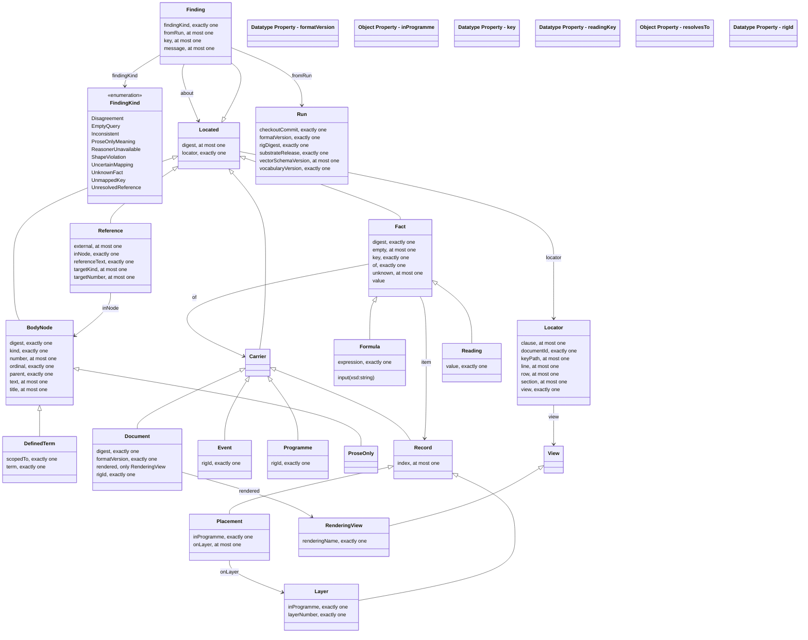

<!-- SPDX-License-Identifier: CC-BY-SA-4.0 -->

# Verification Rig Ontology — The Intermediate Representation of a Case

Literate specification for the verification rig module, in the layout of [ADR-A126](../../docs/architecture/decisions/ADR-A126-literate-specification-layout-and-grammar.md).

---

## 1. Purpose and Scope

A verification rig is a directory of invented documents, each written as Markdown with YAML front matter, with programme files and an events file in YAML, in a stated format with a version. A tool reads a rig and produces one intermediate representation of each case, an RDF graph under the vocabulary here, from which every projection is generated, the graph over the layers, the generated theory, the test vectors and the findings. The vocabulary states what the representation holds and the shapes state what a well-formed representation is, so a consumer outside the repository can pin both at a tag and read, write or diff a representation without the tool.

The vocabulary models no domain. A key of the rig's format is carried as a fact with its key name as a string, a token of the rig's own vocabulary is carried as an uninterpreted literal, and a reading of a legal concept is a fact whose value is a token. What a key or a token means is a mapping's business, never the vocabulary's, so adding a key or a token to a rig adds no term here.

Every node carries a locator, which names the document, programme or events file it was read from, the view it was read in, and its position, and a digest the tool computes over the normalised text the node was read from. A fact has three states, stated with a value, stated as not known, and not stated, and the third is the absence of the fact. Front matter and the body of a document are two views of it, declared and blind, and a rendering of a document, a lossy text form of it, is a view of its own. A finding names what a run found, by kind, document and locator, under an identifier derived from those three and the key, so two runs of one rig revision give the same identifiers and a resolved finding disappears from a diff by id.

## 2. Namespace and Prefixes

| Document | Ontology IRI | Version IRI | Imports |
|---|---|---|---|
| `spec/v-rig.ttl` | <https://www.nebularis.org/neuro-semantic/lattice/v-rig> | <https://www.nebularis.org/neuro-semantic/lattice/v-rig/0.1.0> | none |
| `vocab/v-rig-vocab.ttl` | <https://www.nebularis.org/neuro-semantic/lattice/v-rig-vocab> | <https://www.nebularis.org/neuro-semantic/lattice/v-rig-vocab/0.1.0> | <https://www.nebularis.org/neuro-semantic/lattice/v-rig/0.1.0> |

| Prefix | Namespace |
|---|---|
| `vrig:` | <https://www.nebularis.org/neuro-semantic/lattice/v-rig#> |
| `xsd:` | <http://www.w3.org/2001/XMLSchema#> |
| `rdfs:` | <http://www.w3.org/2000/01/rdf-schema#> |
| `fnd:` | <https://www.nebularis.org/neuro-semantic/lattice/foundation#> |
| `owl:` | <http://www.w3.org/2002/07/owl#> |

| Identifier | Role | Display name |
|---|---|---|
| <https://github.com/nebularis> | creator | Nebularis |

## 3. Extraction Contract

- Sections 1, 2 and 6 generate `spec/v-rig.ttl`, and the individuals of 6.4 generate `vocab/v-rig-vocab.ttl`.
- The restriction rows of section 6 that are checked in SHACL generate `shapes/structural.ttl`.
- The hidden block of section 7 generates `shapes/constraints.ttl`, naming its file.
- Extraction rewrites the class diagram (section 4) and the Axiom Index (6.7), which are never edited by hand.
- `turtle-example` blocks are illustrative only.
- `projection/` holds the mapping scheme from the representation to the layers, its reference data and the competency queries, hand-written, versioned together by the directory's `.version`.

```bash
mise exec -- python tools/literate_extract.py ontology/v-rig/README.md --layer v-rig --root . --check
```

The module's entry in the [repository catalogue](../../repository-catalogue.md) ([ADR-A121](../../docs/architecture/decisions/ADR-A121-repository-catalogue.md)) follows.

```toml repository-catalogue
[module]
kind = "standalone"
roles = ["examples", "projection", "shapes", "spec", "vocab"]
imports = []

[module.extract]
spec = ["spec/v-rig.ttl"]
vocab = ["vocab/v-rig-vocab.ttl"]
shapes = ["shapes/structural.ttl", "shapes/constraints.ttl"]
```

## 4. Overview

<!-- start: {"generated": "class-diagram", "enumerations": "table"} -->



<!-- end -->

A **located** node is anything read from a rig, and every one has exactly one **locator**. A locator names the document, programme or events file by its id, the **view** the node was read in, which is the declared view, the blind view or a **rendering view**, and a position, a section, a clause, a row or a key path.

A **carrier** is a node facts are stated of. A **document**, a **programme** and an **event** are carriers with the id the rig gives them. A **record** is a carrier that is a structured value, an item of a fact's list, and a **layer** and a **placement** are the two records whose structure the rig's format guarantees. A **fact** is one key of a carrier, in one of three states. A **reading** is a fact whose key a mapping declares to name a reading of a legal concept, and a **formula** is a fact whose value is an expression over named inputs.

A **body node** is one element of a document's text, a section, a clause, a definition, a declarations row, a list item or a paragraph, with a kind token, its text, its parent and its order among its siblings. A **defined term** is a body node that defines a word for a scope, and a **prose-only** node is a body node whose meaning the layout conventions do not carry. A **reference** is a cross-reference found in a body node, resolved to what it names or left unresolved.

A **run** records what the tool ran over and on, and a **finding** names what it found, by **finding kind**, document, locator and key.

## 5. Detailed Design

### 5.1 Design decisions

- **No domain terms.** The representation carries the format's structure and nothing of insurance or of any field. A limit is a fact with the key `limit`, a line of business is a token, and a reading is a token. Meaning is given by a mapping that reads the representation, which is where a domain term belongs.
- **Facts of carriers, not properties.** Every key of the front matter, a programme file and an events file is a `vrig:Fact` of the node it is stated of, with its key as a string. A new key in a rig is a new fact and no new term. The format's guaranteed structures, the layers of a programme and the entries that place a contract with an insurer, are typed records so that a mapping can find them without reading key names.
- **Lists keep their order.** A list of scalars in the source is one RDF list, so a period's two dates or a list of tokens reach a mapping in the order written, which a set of values would lose.
- **Three states, two markers.** A fact stated with a value has one or more values or items. A fact stated as not known has the unknown marker. A fact stated with nothing, a null or an empty list in the source, has the empty marker. A fact that is not stated is absent. The constraint of section 7 refuses any other combination.
- **Views on the locator.** Which source a node was read from is part of where it was read, so the view is a field of the locator, not of the node. A body node read from a rendering carries that rendering's view and nothing else distinguishes it.
- **Body nodes carry a kind token, not an element type.** The kinds a body is laid out in are the format's, and open. A mapping maps a kind token to the Wording layer's element types when it projects the representation onto the layers.
- **Resolution is recorded, never guessed.** A fact whose value names an id of the rig, or a reference in a body node, gains `vrig:resolvesTo` only where the tool found the target. One without it is unresolved and a finding says so.
- **Findings carry their locator again.** A finding is itself located, at the position of what it is about, so that its identifier is derived from its own fields alone and a consumer can sort and diff findings without the nodes they concern.
- **No time.** A run records digests, a commit and versions, and no timestamp, so two runs of one revision are byte for byte the same.

### 5.2 Worked reading

A programme file lists two layers. The tool lifts the programme to a `vrig:Programme` with its id, each entry of `layers` to a `vrig:Layer` with its number, and each insurer entry under a layer to a `vrig:Placement` on that layer. Every key under them, `limit`, `attachment`, `share`, `document`, is a `vrig:Fact` of the record with the key path as its locator. The `document` fact's value is an id, and the tool finds a document with that id in the manifest, so the fact gains `vrig:resolvesTo` that document. The second layer's `limit` reads `2 x layer_1_limit`, so the fact is also a `vrig:Formula` with that expression and one input. [`examples/programme-and-findings.ttl`](examples/programme-and-findings.ttl) carries this reading in full, with an event and the findings of a run.

## 6. Description Logic Encoding

### 6.1 Classes

#### `vrig:Located`

**Definition.** A node read from a rig, with the locator saying where and a digest of the text it was read from.

**Utility.** Type every node the tool produces from a rig with one of the subclasses here. The locator is required and the digest is required of every node that has text, a document, a fact or a body node.

**Restrictions.**

| Property | Values | Asserted in | Message |
|---|---|---|---|
| `vrig:locator` | exactly 1 |  | Every node read from a rig has exactly one locator. |
| `vrig:digest` | max 1 |  |  |

#### `vrig:Locator`

**Definition.** Where a node was read from, the id of the document, programme or events file, the view, and a position in it.

**Utility.** Give each located node its own locator. The position fields are optional and each is present only where it applies, a section and clause for a body node, a row for a declarations row or a list item, a key path for a fact of a YAML file. The line is informative and takes no part in the locator's canonical string (section 9).

**Restrictions.**

| Property | Values | Asserted in | Message |
|---|---|---|---|
| `vrig:documentId` | exactly 1 |  | A locator names the id of the file its node was read from. |
| `vrig:view` | exactly 1 |  | A locator names the view its node was read in. |
| `vrig:section` | max 1 |  |  |
| `vrig:clause` | max 1 |  |  |
| `vrig:row` | max 1 |  |  |
| `vrig:keyPath` | max 1 |  |  |
| `vrig:line` | max 1 |  |  |

#### `vrig:View`

**Definition.** A source a node was read from, the declared view, the blind view or a rendering.

**Utility.** Use the two individuals for the declared and the blind view, and a `vrig:RenderingView` for each rendering of a document.

#### `vrig:RenderingView`

**Definition.** The view of one rendering of a document, a lossy text form of it, named as the manifest names it.

**Subclass of.** `vrig:View`

**Restrictions.**

| Property | Values | Asserted in | Message |
|---|---|---|---|
| `vrig:renderingName` | exactly 1 |  |  |

#### `vrig:Carrier`

**Definition.** A node facts are stated of.

**Subclass of.** `vrig:Located`

#### `vrig:Document`

**Definition.** One document of a rig, with the id the rig gives it and the version of the format it is written in.

**Utility.** The declared view's facts are stated of the document, and the body nodes of the blind view and of each rendering have the document as their root.

**Subclass of.** `vrig:Carrier`

**Restrictions.**

| Property | Values | Asserted in | Message |
|---|---|---|---|
| `vrig:rigId` | exactly 1 |  |  |
| `vrig:formatVersion` | exactly 1 |  |  |
| `vrig:digest` | exactly 1 |  |  |
| `vrig:rendered` | only `vrig:RenderingView` |  |  |

#### `vrig:Programme`

**Definition.** One programme of a rig, with the id the rig gives it.

**Subclass of.** `vrig:Carrier`

**Restrictions.**

| Property | Values | Asserted in | Message |
|---|---|---|---|
| `vrig:rigId` | exactly 1 |  |  |

#### `vrig:Event`

**Definition.** One event of a rig's events file, with the id the rig gives it. Its facts are what the event states, and the keys it states as not known are its facts with the unknown marker.

**Subclass of.** `vrig:Carrier`

**Restrictions.**

| Property | Values | Asserted in | Message |
|---|---|---|---|
| `vrig:rigId` | exactly 1 |  |  |

#### `vrig:Record`

**Definition.** A structured value, one item of a fact's list or mapping, carrying facts of its own.

**Subclass of.** `vrig:Carrier`

**Restrictions.**

| Property | Values | Asserted in | Message |
|---|---|---|---|
| `vrig:index` | max 1 |  |  |

#### `vrig:Layer`

**Definition.** One layer of a programme, as the programme file lists it, with the number the file gives it.

**Subclass of.** `vrig:Record`

**Restrictions.**

| Property | Values | Asserted in | Message |
|---|---|---|---|
| `vrig:layerNumber` | exactly 1 |  |  |
| `vrig:inProgramme` | exactly 1 |  |  |

#### `vrig:Placement`

**Definition.** One entry that places a contract, on a layer with an insurer, or in a programme without layers, as the programme file lists it. Its share, role and other keys are its facts.

**Subclass of.** `vrig:Record`

**Restrictions.**

| Property | Values | Asserted in | Message |
|---|---|---|---|
| `vrig:inProgramme` | exactly 1 |  |  |
| `vrig:onLayer` | max 1 |  |  |

#### `vrig:Fact`

**Definition.** One key stated of a carrier, in one of three states, with one or more values or items, with the unknown marker, or with the empty marker.

**Utility.** Lift every key of a front matter, a programme file or an event to one fact. A list of scalars is one fact whose one value is an RDF list of the scalars in the source's order. A list of mappings is one fact with one record item per entry. A key listed as not known is a fact with `vrig:unknown true`. A key whose value is null or an empty list is a fact with `vrig:empty true`. A key that is absent is no fact.

**Subclass of.** `vrig:Located`

**Restrictions.**

| Property | Values | Asserted in | Message |
|---|---|---|---|
| `vrig:of` | exactly 1 |  | A fact is stated of exactly one carrier. |
| `vrig:key` | exactly 1 |  | A fact has exactly one key. |
| `vrig:unknown` | max 1 |  |  |
| `vrig:empty` | max 1 |  |  |
| `vrig:digest` | exactly 1 |  |  |

#### `vrig:Reading`

**Definition.** A fact whose key names a reading of a legal concept, so that its value is a token interpreted by a mapping and never by code.

**Utility.** The mapping scheme that reads a rig's keys asserts this type on the facts of the keys it declares to carry readings. Two readings on one structure give two projections, never merged.

**Subclass of.** `vrig:Fact`

**Restrictions.**

| Property | Values | Asserted in | Message |
|---|---|---|---|
| `vrig:value` | exactly 1 |  | A reading is one token. |

#### `vrig:Formula`

**Definition.** A fact whose value is an expression over named inputs rather than a number, kept as written.

**Subclass of.** `vrig:Fact`

**Restrictions.**

| Property | Values | Asserted in | Message |
|---|---|---|---|
| `vrig:expression` | exactly 1 |  |  |

#### `vrig:BodyNode`

**Definition.** One element of a document's text, a section, a clause, a definition, a declarations row, a list item or a paragraph, with a kind token, its text, its parent and its order among its siblings.

**Utility.** Lift each element of the body, or of a rendering, to one body node under the view it was read in. The kind is a token of the format's layout conventions and is open.

**Subclass of.** `vrig:Located`

**Restrictions.**

| Property | Values | Asserted in | Message |
|---|---|---|---|
| `vrig:kind` | exactly 1 |  | A body node has exactly one kind token. |
| `vrig:parent` | exactly 1 |  | A body node has exactly one parent, a body node or the document. |
| `vrig:ordinal` | exactly 1 |  |  |
| `vrig:digest` | exactly 1 |  |  |
| `vrig:text` | max 1 |  |  |
| `vrig:number` | max 1 |  |  |
| `vrig:title` | max 1 |  |  |

#### `vrig:DefinedTerm`

**Definition.** A body node that defines a word for a scope, the document or one of its sections.

**Subclass of.** `vrig:BodyNode`

**Restrictions.**

| Property | Values | Asserted in | Message |
|---|---|---|---|
| `vrig:term` | exactly 1 |  |  |
| `vrig:scopedTo` | exactly 1 |  |  |

#### `vrig:ProseOnly`

**Definition.** A body node whose meaning the layout conventions do not carry, so that only its prose says what it means.

**Utility.** Every prose-only node is reported as a finding, since no projection can read it without a reader.

**Subclass of.** `vrig:BodyNode`

#### `vrig:Reference`

**Definition.** A cross-reference found in a body node, to a section, an item, a condition, an endorsement, a schedule or a part, of the same document or of another, resolved to what it names or left unresolved.

**Subclass of.** `vrig:Located`

**Restrictions.**

| Property | Values | Asserted in | Message |
|---|---|---|---|
| `vrig:inNode` | exactly 1 |  |  |
| `vrig:referenceText` | exactly 1 |  |  |
| `vrig:targetKind` | max 1 |  |  |
| `vrig:targetNumber` | max 1 |  |  |
| `vrig:external` | max 1 |  |  |

#### `vrig:Run`

**Definition.** One run of the tool, recording the digest of the rig it read, the format version, the commit of the checkout it ran in, the substrate release, and the versions of the vocabulary and the vector schema it wrote.

**Restrictions.**

| Property | Values | Asserted in | Message |
|---|---|---|---|
| `vrig:rigDigest` | exactly 1 |  |  |
| `vrig:formatVersion` | exactly 1 |  |  |
| `vrig:checkoutCommit` | exactly 1 |  |  |
| `vrig:substrateRelease` | exactly 1 |  |  |
| `vrig:vocabularyVersion` | exactly 1 |  |  |
| `vrig:vectorSchemaVersion` | max 1 |  |  |

#### `vrig:Finding`

**Definition.** One thing a run found, named by its kind, the document and locator it concerns, and the key where one applies, with a message in generic words.

**Utility.** The tool derives a finding's identifier from its kind, its locator's document id and canonical string, and its key (section 9). A message names no text of a rig.

**Subclass of.** `vrig:Located`

**Restrictions.**

| Property | Values | Asserted in | Message |
|---|---|---|---|
| `vrig:findingKind` | exactly 1 |  | A finding has exactly one kind. |
| `vrig:key` | max 1 |  |  |
| `vrig:message` | max 1 |  |  |
| `vrig:fromRun` | max 1 |  |  |

#### `vrig:FindingKind`

**Definition.** The closed set of kinds a finding has.

**Equivalent to.** { `vrig:UnmappedKey`, `vrig:UncertainMapping`, `vrig:ShapeViolation`, `vrig:EmptyQuery`, `vrig:UnresolvedReference`, `vrig:Disagreement`, `vrig:ProseOnlyMeaning`, `vrig:UnknownFact`, `vrig:Inconsistent`, `vrig:ReasonerUnavailable` }

### 6.2 Object Properties

#### `vrig:locator`

**Definition.** The locator of a node read from a rig.

**Domain.** `vrig:Located`

**Range.** `vrig:Locator`

**Characteristics.** functional

#### `vrig:view`

**Definition.** The view a locator's node was read in.

**Domain.** `vrig:Locator`

**Range.** `vrig:View`

**Characteristics.** functional

#### `vrig:rendered`

**Definition.** A rendering view of a document.

**Domain.** `vrig:Document`

**Range.** `vrig:RenderingView`

#### `vrig:of`

**Definition.** The carrier a fact is stated of.

**Domain.** `vrig:Fact`

**Range.** `vrig:Carrier`

**Characteristics.** functional

#### `vrig:item`

**Definition.** A structured item of a fact's value, a record.

**Domain.** `vrig:Fact`

**Range.** `vrig:Record`

#### `vrig:inProgramme`

**Definition.** The programme a layer or a placement belongs to.

**Domain.** `(vrig:Layer or vrig:Placement)`

**Range.** `vrig:Programme`

**Characteristics.** functional

#### `vrig:onLayer`

**Definition.** The layer a placement sits on.

**Domain.** `vrig:Placement`

**Range.** `vrig:Layer`

**Characteristics.** functional

#### `vrig:parent`

**Definition.** The node a body node sits under, a body node or the document.

**Domain.** `vrig:BodyNode`

**Range.** `(vrig:BodyNode or vrig:Document)`

**Characteristics.** functional

#### `vrig:scopedTo`

**Definition.** The scope of a defined term, the document or a body node.

**Domain.** `vrig:DefinedTerm`

**Range.** `(vrig:BodyNode or vrig:Document)`

**Characteristics.** functional

#### `vrig:inNode`

**Definition.** The body node a reference was found in.

**Domain.** `vrig:Reference`

**Range.** `vrig:BodyNode`

**Characteristics.** functional

#### `vrig:resolvesTo`

**Definition.** The node a fact's value or a reference names, where the tool found it. A fact or reference without it is unresolved.

**Domain.** `(vrig:Fact or vrig:Reference)`

**Range.** `vrig:Located`

#### `vrig:findingKind`

**Definition.** The kind of a finding.

**Domain.** `vrig:Finding`

**Range.** `vrig:FindingKind`

**Characteristics.** functional

#### `vrig:about`

**Definition.** A node a finding concerns.

**Domain.** `vrig:Finding`

**Range.** `vrig:Located`

#### `vrig:fromRun`

**Definition.** The run that produced a finding.

**Domain.** `vrig:Finding`

**Range.** `vrig:Run`

**Characteristics.** functional

### 6.3 Datatype Properties

#### `vrig:documentId`

**Definition.** The id of the document, programme or events file a locator's node was read from. For the events file it is the string `events`.

**Domain.** `vrig:Locator`

**Range.** `xsd:string`

**Characteristics.** functional

#### `vrig:section`

**Definition.** The number or title of the section a body node sits in.

**Domain.** `vrig:Locator`

**Range.** `xsd:string`

**Characteristics.** functional

#### `vrig:clause`

**Definition.** The number of the clause a body node is or sits in.

**Domain.** `vrig:Locator`

**Range.** `xsd:string`

**Characteristics.** functional

#### `vrig:row`

**Definition.** The number or ordinal of a declarations row, a list item or a reference within its node.

**Domain.** `vrig:Locator`

**Range.** `xsd:string`

**Characteristics.** functional

#### `vrig:keyPath`

**Definition.** The path of a key in a YAML source, with list indices in brackets, for example `layers[0].insurers[1].share`.

**Domain.** `vrig:Locator`

**Range.** `xsd:string`

**Characteristics.** functional

#### `vrig:line`

**Definition.** The line in the source file a node starts on. Informative only, and no part of the canonical locator string.

**Domain.** `vrig:Locator`

**Range.** `xsd:integer`

**Characteristics.** functional

#### `vrig:renderingName`

**Definition.** The name the manifest gives a rendering.

**Domain.** `vrig:RenderingView`

**Range.** `xsd:string`

**Characteristics.** functional

#### `vrig:rigId`

**Definition.** The id a rig gives a document, a programme or an event, stable across the rig's revisions.

**Domain.** `(vrig:Document or vrig:Programme or vrig:Event)`

**Range.** `xsd:string`

**Characteristics.** functional

#### `vrig:formatVersion`

**Definition.** The version of the rig format a document is written in, or a run read.

**Domain.** `(vrig:Document or vrig:Run)`

**Range.** `xsd:string`

**Characteristics.** functional

#### `vrig:digest`

**Definition.** The SHA-256 digest, in lowercase hex, that the tool computed over the normalised text a node was read from (section 9).

**Domain.** `vrig:Located`

**Range.** `xsd:string`

**Characteristics.** functional

#### `vrig:key`

**Definition.** The key of a fact as the source writes it, or the key a finding concerns.

**Domain.** `(vrig:Fact or vrig:Finding)`

**Range.** `xsd:string`

**Characteristics.** functional

#### `vrig:value`

**Definition.** A value of a fact, a literal typed as the source gives it, a string, a number, a date or a boolean, or an RDF list of such literals in the source's order where the source gives a list. A token of the rig's own vocabulary is a string.

**Domain.** `vrig:Fact`

#### `vrig:unknown`

**Definition.** The marker of a fact stated as not known. The source listed the key among those it does not know.

**Domain.** `vrig:Fact`

**Range.** `xsd:boolean`

**Characteristics.** functional

#### `vrig:empty`

**Definition.** The marker of a fact stated with nothing, a null or an empty list in the source.

**Domain.** `vrig:Fact`

**Range.** `xsd:boolean`

**Characteristics.** functional

#### `vrig:index`

**Definition.** The position of a record in the list it is an item of, counted from zero.

**Domain.** `vrig:Record`

**Range.** `xsd:integer`

**Characteristics.** functional

#### `vrig:layerNumber`

**Definition.** The number the programme file gives a layer.

**Domain.** `vrig:Layer`

**Range.** `xsd:integer`

**Characteristics.** functional

#### `vrig:kind`

**Definition.** The kind token of a body node, such as section, clause, definition, row, item, label or paragraph. Open.

**Domain.** `vrig:BodyNode`

**Range.** `xsd:string`

**Characteristics.** functional

#### `vrig:ordinal`

**Definition.** A body node's position among its parent's children, counted from zero.

**Domain.** `vrig:BodyNode`

**Range.** `xsd:integer`

**Characteristics.** functional

#### `vrig:text`

**Definition.** The text of a body node, normalised as section 9 says.

**Domain.** `vrig:BodyNode`

**Range.** `xsd:string`

**Characteristics.** functional

#### `vrig:number`

**Definition.** The number a body node carries in the source, a section or endorsement number, a clause number or a row number.

**Domain.** `vrig:BodyNode`

**Range.** `xsd:string`

**Characteristics.** functional

#### `vrig:title`

**Definition.** The title of a section or an endorsement.

**Domain.** `vrig:BodyNode`

**Range.** `xsd:string`

**Characteristics.** functional

#### `vrig:term`

**Definition.** The word a defined term defines.

**Domain.** `vrig:DefinedTerm`

**Range.** `xsd:string`

**Characteristics.** functional

#### `vrig:expression`

**Definition.** A formula's expression as the source writes it.

**Domain.** `vrig:Formula`

**Range.** `xsd:string`

**Characteristics.** functional

#### `vrig:input`

**Definition.** A name a formula reads.

**Domain.** `vrig:Formula`

**Range.** `xsd:string`

#### `vrig:referenceText`

**Definition.** The text of a reference as the source writes it.

**Domain.** `vrig:Reference`

**Range.** `xsd:string`

**Characteristics.** functional

#### `vrig:targetKind`

**Definition.** The kind of thing a reference names, section, item, condition, endorsement, schedule or part, as a token.

**Domain.** `vrig:Reference`

**Range.** `xsd:string`

**Characteristics.** functional

#### `vrig:targetNumber`

**Definition.** The number a reference names.

**Domain.** `vrig:Reference`

**Range.** `xsd:string`

**Characteristics.** functional

#### `vrig:external`

**Definition.** Whether a reference points into another document, as when the text says of the underlying policy.

**Domain.** `vrig:Reference`

**Range.** `xsd:boolean`

**Characteristics.** functional

#### `vrig:message`

**Definition.** A finding's message, in generic words that name no text of a rig.

**Domain.** `vrig:Finding`

**Range.** `xsd:string`

**Characteristics.** functional

#### `vrig:rigDigest`

**Definition.** The digest of the whole rig a run read, over the digests of its files in path order (section 9).

**Domain.** `vrig:Run`

**Range.** `xsd:string`

**Characteristics.** functional

#### `vrig:checkoutCommit`

**Definition.** The commit of the checkout the tool ran in.

**Domain.** `vrig:Run`

**Range.** `xsd:string`

**Characteristics.** functional

#### `vrig:substrateRelease`

**Definition.** The substrate release of the checkout the tool ran in.

**Domain.** `vrig:Run`

**Range.** `xsd:string`

**Characteristics.** functional

#### `vrig:vocabularyVersion`

**Definition.** The version of this vocabulary a run wrote its representation under.

**Domain.** `vrig:Run`

**Range.** `xsd:string`

**Characteristics.** functional

#### `vrig:readingKey`

**Definition.** A key a mapping scheme declares to carry a reading of a legal concept, stated on the scheme. The tool types the facts of such a key `vrig:Reading`.

**Range.** `xsd:string`

#### `vrig:vectorSchemaVersion`

**Definition.** The version of the test-vector schema a run wrote its vectors under.

**Domain.** `vrig:Run`

**Range.** `xsd:string`

**Characteristics.** functional

### 6.4 Individuals

**Views.**

| Individual | Type | Definition |
|---|---|---|
| `vrig:Declared` | `vrig:View`, `owl:NamedIndividual` | The declared view, the front matter and the programme and events files, taken as stated. |
| `vrig:Blind` | `vrig:View`, `owl:NamedIndividual` | The blind view, the body of a document alone, with the front matter reduced to the id. |

**Finding kinds.**

| Individual | Type | Definition |
|---|---|---|
| `vrig:UnmappedKey` | `vrig:FindingKind`, `owl:NamedIndividual` | A key no mapping row reads. |
| `vrig:UncertainMapping` | `vrig:FindingKind`, `owl:NamedIndividual` | A key a mapping row reads under a stated doubt about the target term. |
| `vrig:ShapeViolation` | `vrig:FindingKind`, `owl:NamedIndividual` | A projected graph that a layer's shapes refuse. |
| `vrig:EmptyQuery` | `vrig:FindingKind`, `owl:NamedIndividual` | A competency query that returns nothing because the encoding has no way to say the fact. |
| `vrig:UnresolvedReference` | `vrig:FindingKind`, `owl:NamedIndividual` | A reference or an id-valued fact nothing resolves. |
| `vrig:Disagreement` | `vrig:FindingKind`, `owl:NamedIndividual` | A value the declared view and a read case give differently. |
| `vrig:ProseOnlyMeaning` | `vrig:FindingKind`, `owl:NamedIndividual` | A body node whose meaning only its prose carries. |
| `vrig:UnknownFact` | `vrig:FindingKind`, `owl:NamedIndividual` | A fact an evaluation asked for that the source states as not known. |
| `vrig:Inconsistent` | `vrig:FindingKind`, `owl:NamedIndividual` | A projected graph a reasoner found inconsistent. |
| `vrig:ReasonerUnavailable` | `vrig:FindingKind`, `owl:NamedIndividual` | A consistency check that did not run because no reasoner was available. |

### 6.5 Disjointness and Keys

**All disjoint.** `vrig:Located`, `vrig:Locator`, `vrig:View`, `vrig:FindingKind`, `vrig:Run`

**All disjoint.** `vrig:Carrier`, `vrig:Fact`, `vrig:BodyNode`, `vrig:Reference`, `vrig:Finding`

**All disjoint.** `vrig:Document`, `vrig:Programme`, `vrig:Event`, `vrig:Record`

**Disjoint.** `vrig:Layer`, `vrig:Placement`

**All different.** `vrig:Declared`, `vrig:Blind`

**All different.** `vrig:UnmappedKey`, `vrig:UncertainMapping`, `vrig:ShapeViolation`, `vrig:EmptyQuery`, `vrig:UnresolvedReference`, `vrig:Disagreement`, `vrig:ProseOnlyMeaning`, `vrig:UnknownFact`, `vrig:Inconsistent`, `vrig:ReasonerUnavailable`

### 6.6 Other Axioms

None.

### 6.7 Axiom Index

<!-- start: {"generated": "axiom-index"} -->

| Term | Kind | Summary |
|---|---|---|
| `vrig:BodyNode` | Class | Subclass of `vrig:Located`. Disjoint with `vrig:Carrier`, `vrig:Fact`, `vrig:Finding`, `vrig:Reference`. Restrictions `vrig:digest` exactly 1, `vrig:kind` exactly 1, `vrig:number` max 1, `vrig:ordinal` exactly 1, `vrig:parent` exactly 1, `vrig:text` max 1, `vrig:title` max 1. |
| `vrig:Carrier` | Class | Subclass of `vrig:Located`. Disjoint with `vrig:BodyNode`, `vrig:Fact`, `vrig:Finding`, `vrig:Reference`. |
| `vrig:DefinedTerm` | Class | Subclass of `vrig:BodyNode`. Restrictions `vrig:scopedTo` exactly 1, `vrig:term` exactly 1. |
| `vrig:Document` | Class | Subclass of `vrig:Carrier`. Disjoint with `vrig:Event`, `vrig:Programme`, `vrig:Record`. Restrictions `vrig:digest` exactly 1, `vrig:formatVersion` exactly 1, `vrig:rendered` only `vrig:RenderingView`, `vrig:rigId` exactly 1. |
| `vrig:Event` | Class | Subclass of `vrig:Carrier`. Disjoint with `vrig:Document`, `vrig:Programme`, `vrig:Record`. Restrictions `vrig:rigId` exactly 1. |
| `vrig:Fact` | Class | Subclass of `vrig:Located`. Disjoint with `vrig:BodyNode`, `vrig:Carrier`, `vrig:Finding`, `vrig:Reference`. Restrictions `vrig:digest` exactly 1, `vrig:empty` max 1, `vrig:key` exactly 1, `vrig:of` exactly 1, `vrig:unknown` max 1. |
| `vrig:Finding` | Class | Subclass of `vrig:Located`. Disjoint with `vrig:BodyNode`, `vrig:Carrier`, `vrig:Fact`, `vrig:Reference`. Restrictions `vrig:findingKind` exactly 1, `vrig:fromRun` max 1, `vrig:key` max 1, `vrig:message` max 1. |
| `vrig:FindingKind` | Class | Equivalent to {`vrig:UnmappedKey`, `vrig:UncertainMapping`, `vrig:ShapeViolation`, `vrig:EmptyQuery`, `vrig:UnresolvedReference`, `vrig:Disagreement`, `vrig:ProseOnlyMeaning`, `vrig:UnknownFact`, `vrig:Inconsistent`, `vrig:ReasonerUnavailable`}. Disjoint with `vrig:Located`, `vrig:Locator`, `vrig:Run`, `vrig:View`. |
| `vrig:Formula` | Class | Subclass of `vrig:Fact`. Restrictions `vrig:expression` exactly 1. |
| `vrig:Layer` | Class | Subclass of `vrig:Record`. Disjoint with `vrig:Placement`. Restrictions `vrig:inProgramme` exactly 1, `vrig:layerNumber` exactly 1. |
| `vrig:Located` | Class | Disjoint with `vrig:FindingKind`, `vrig:Locator`, `vrig:Run`, `vrig:View`. Restrictions `vrig:digest` max 1, `vrig:locator` exactly 1. |
| `vrig:Locator` | Class | Disjoint with `vrig:FindingKind`, `vrig:Located`, `vrig:Run`, `vrig:View`. Restrictions `vrig:clause` max 1, `vrig:documentId` exactly 1, `vrig:keyPath` max 1, `vrig:line` max 1, `vrig:row` max 1, `vrig:section` max 1, `vrig:view` exactly 1. |
| `vrig:Placement` | Class | Subclass of `vrig:Record`. Disjoint with `vrig:Layer`. Restrictions `vrig:inProgramme` exactly 1, `vrig:onLayer` max 1. |
| `vrig:Programme` | Class | Subclass of `vrig:Carrier`. Disjoint with `vrig:Document`, `vrig:Event`, `vrig:Record`. Restrictions `vrig:rigId` exactly 1. |
| `vrig:ProseOnly` | Class | Subclass of `vrig:BodyNode`. |
| `vrig:Reading` | Class | Subclass of `vrig:Fact`. Restrictions `vrig:value` exactly 1. |
| `vrig:Record` | Class | Subclass of `vrig:Carrier`. Disjoint with `vrig:Document`, `vrig:Event`, `vrig:Programme`. Restrictions `vrig:index` max 1. |
| `vrig:Reference` | Class | Subclass of `vrig:Located`. Disjoint with `vrig:BodyNode`, `vrig:Carrier`, `vrig:Fact`, `vrig:Finding`. Restrictions `vrig:external` max 1, `vrig:inNode` exactly 1, `vrig:referenceText` exactly 1, `vrig:targetKind` max 1, `vrig:targetNumber` max 1. |
| `vrig:RenderingView` | Class | Subclass of `vrig:View`. Restrictions `vrig:renderingName` exactly 1. |
| `vrig:Run` | Class | Disjoint with `vrig:FindingKind`, `vrig:Located`, `vrig:Locator`, `vrig:View`. Restrictions `vrig:checkoutCommit` exactly 1, `vrig:formatVersion` exactly 1, `vrig:rigDigest` exactly 1, `vrig:substrateRelease` exactly 1, `vrig:vectorSchemaVersion` max 1, `vrig:vocabularyVersion` exactly 1. |
| `vrig:View` | Class | Disjoint with `vrig:FindingKind`, `vrig:Located`, `vrig:Locator`, `vrig:Run`. |
| `vrig:about` | Object property | Domain `vrig:Finding`. Range `vrig:Located`. |
| `vrig:findingKind` | Object property | Domain `vrig:Finding`. Range `vrig:FindingKind`. Functional. |
| `vrig:fromRun` | Object property | Domain `vrig:Finding`. Range `vrig:Run`. Functional. |
| `vrig:inNode` | Object property | Domain `vrig:Reference`. Range `vrig:BodyNode`. Functional. |
| `vrig:inProgramme` | Object property | Domain `vrig:Layer` or `vrig:Placement`. Range `vrig:Programme`. Functional. |
| `vrig:item` | Object property | Domain `vrig:Fact`. Range `vrig:Record`. |
| `vrig:locator` | Object property | Domain `vrig:Located`. Range `vrig:Locator`. Functional. |
| `vrig:of` | Object property | Domain `vrig:Fact`. Range `vrig:Carrier`. Functional. |
| `vrig:onLayer` | Object property | Domain `vrig:Placement`. Range `vrig:Layer`. Functional. |
| `vrig:parent` | Object property | Domain `vrig:BodyNode`. Range `vrig:BodyNode` or `vrig:Document`. Functional. |
| `vrig:rendered` | Object property | Domain `vrig:Document`. Range `vrig:RenderingView`. |
| `vrig:resolvesTo` | Object property | Domain `vrig:Fact` or `vrig:Reference`. Range `vrig:Located`. |
| `vrig:scopedTo` | Object property | Domain `vrig:DefinedTerm`. Range `vrig:BodyNode` or `vrig:Document`. Functional. |
| `vrig:view` | Object property | Domain `vrig:Locator`. Range `vrig:View`. Functional. |
| `vrig:checkoutCommit` | Datatype property | Domain `vrig:Run`. Range `xsd:string`. Functional. |
| `vrig:clause` | Datatype property | Domain `vrig:Locator`. Range `xsd:string`. Functional. |
| `vrig:digest` | Datatype property | Domain `vrig:Located`. Range `xsd:string`. Functional. |
| `vrig:documentId` | Datatype property | Domain `vrig:Locator`. Range `xsd:string`. Functional. |
| `vrig:empty` | Datatype property | Domain `vrig:Fact`. Range `xsd:boolean`. Functional. |
| `vrig:expression` | Datatype property | Domain `vrig:Formula`. Range `xsd:string`. Functional. |
| `vrig:external` | Datatype property | Domain `vrig:Reference`. Range `xsd:boolean`. Functional. |
| `vrig:formatVersion` | Datatype property | Domain `vrig:Document` or `vrig:Run`. Range `xsd:string`. Functional. |
| `vrig:index` | Datatype property | Domain `vrig:Record`. Range `xsd:integer`. Functional. |
| `vrig:input` | Datatype property | Domain `vrig:Formula`. Range `xsd:string`. |
| `vrig:key` | Datatype property | Domain `vrig:Fact` or `vrig:Finding`. Range `xsd:string`. Functional. |
| `vrig:keyPath` | Datatype property | Domain `vrig:Locator`. Range `xsd:string`. Functional. |
| `vrig:kind` | Datatype property | Domain `vrig:BodyNode`. Range `xsd:string`. Functional. |
| `vrig:layerNumber` | Datatype property | Domain `vrig:Layer`. Range `xsd:integer`. Functional. |
| `vrig:line` | Datatype property | Domain `vrig:Locator`. Range `xsd:integer`. Functional. |
| `vrig:message` | Datatype property | Domain `vrig:Finding`. Range `xsd:string`. Functional. |
| `vrig:number` | Datatype property | Domain `vrig:BodyNode`. Range `xsd:string`. Functional. |
| `vrig:ordinal` | Datatype property | Domain `vrig:BodyNode`. Range `xsd:integer`. Functional. |
| `vrig:readingKey` | Datatype property | Range `xsd:string`. |
| `vrig:referenceText` | Datatype property | Domain `vrig:Reference`. Range `xsd:string`. Functional. |
| `vrig:renderingName` | Datatype property | Domain `vrig:RenderingView`. Range `xsd:string`. Functional. |
| `vrig:rigDigest` | Datatype property | Domain `vrig:Run`. Range `xsd:string`. Functional. |
| `vrig:rigId` | Datatype property | Domain `vrig:Document` or `vrig:Programme` or `vrig:Event`. Range `xsd:string`. Functional. |
| `vrig:row` | Datatype property | Domain `vrig:Locator`. Range `xsd:string`. Functional. |
| `vrig:section` | Datatype property | Domain `vrig:Locator`. Range `xsd:string`. Functional. |
| `vrig:substrateRelease` | Datatype property | Domain `vrig:Run`. Range `xsd:string`. Functional. |
| `vrig:targetKind` | Datatype property | Domain `vrig:Reference`. Range `xsd:string`. Functional. |
| `vrig:targetNumber` | Datatype property | Domain `vrig:Reference`. Range `xsd:string`. Functional. |
| `vrig:term` | Datatype property | Domain `vrig:DefinedTerm`. Range `xsd:string`. Functional. |
| `vrig:text` | Datatype property | Domain `vrig:BodyNode`. Range `xsd:string`. Functional. |
| `vrig:title` | Datatype property | Domain `vrig:BodyNode`. Range `xsd:string`. Functional. |
| `vrig:unknown` | Datatype property | Domain `vrig:Fact`. Range `xsd:boolean`. Functional. |
| `vrig:value` | Datatype property | Domain `vrig:Fact`. |
| `vrig:vectorSchemaVersion` | Datatype property | Domain `vrig:Run`. Range `xsd:string`. Functional. |
| `vrig:vocabularyVersion` | Datatype property | Domain `vrig:Run`. Range `xsd:string`. Functional. |
| `vrig:Blind` | Individual | Type `owl:NamedIndividual`, `vrig:View`. Different from `vrig:Declared`. |
| `vrig:Declared` | Individual | Type `owl:NamedIndividual`, `vrig:View`. Different from `vrig:Blind`. |
| `vrig:Disagreement` | Individual | Type `owl:NamedIndividual`, `vrig:FindingKind`. Different from `vrig:EmptyQuery`, `vrig:Inconsistent`, `vrig:ProseOnlyMeaning`, `vrig:ReasonerUnavailable`, `vrig:ShapeViolation`, `vrig:UncertainMapping`, `vrig:UnknownFact`, `vrig:UnmappedKey`, `vrig:UnresolvedReference`. |
| `vrig:EmptyQuery` | Individual | Type `owl:NamedIndividual`, `vrig:FindingKind`. Different from `vrig:Disagreement`, `vrig:Inconsistent`, `vrig:ProseOnlyMeaning`, `vrig:ReasonerUnavailable`, `vrig:ShapeViolation`, `vrig:UncertainMapping`, `vrig:UnknownFact`, `vrig:UnmappedKey`, `vrig:UnresolvedReference`. |
| `vrig:Inconsistent` | Individual | Type `owl:NamedIndividual`, `vrig:FindingKind`. Different from `vrig:Disagreement`, `vrig:EmptyQuery`, `vrig:ProseOnlyMeaning`, `vrig:ReasonerUnavailable`, `vrig:ShapeViolation`, `vrig:UncertainMapping`, `vrig:UnknownFact`, `vrig:UnmappedKey`, `vrig:UnresolvedReference`. |
| `vrig:ProseOnlyMeaning` | Individual | Type `owl:NamedIndividual`, `vrig:FindingKind`. Different from `vrig:Disagreement`, `vrig:EmptyQuery`, `vrig:Inconsistent`, `vrig:ReasonerUnavailable`, `vrig:ShapeViolation`, `vrig:UncertainMapping`, `vrig:UnknownFact`, `vrig:UnmappedKey`, `vrig:UnresolvedReference`. |
| `vrig:ReasonerUnavailable` | Individual | Type `owl:NamedIndividual`, `vrig:FindingKind`. Different from `vrig:Disagreement`, `vrig:EmptyQuery`, `vrig:Inconsistent`, `vrig:ProseOnlyMeaning`, `vrig:ShapeViolation`, `vrig:UncertainMapping`, `vrig:UnknownFact`, `vrig:UnmappedKey`, `vrig:UnresolvedReference`. |
| `vrig:ShapeViolation` | Individual | Type `owl:NamedIndividual`, `vrig:FindingKind`. Different from `vrig:Disagreement`, `vrig:EmptyQuery`, `vrig:Inconsistent`, `vrig:ProseOnlyMeaning`, `vrig:ReasonerUnavailable`, `vrig:UncertainMapping`, `vrig:UnknownFact`, `vrig:UnmappedKey`, `vrig:UnresolvedReference`. |
| `vrig:UncertainMapping` | Individual | Type `owl:NamedIndividual`, `vrig:FindingKind`. Different from `vrig:Disagreement`, `vrig:EmptyQuery`, `vrig:Inconsistent`, `vrig:ProseOnlyMeaning`, `vrig:ReasonerUnavailable`, `vrig:ShapeViolation`, `vrig:UnknownFact`, `vrig:UnmappedKey`, `vrig:UnresolvedReference`. |
| `vrig:UnknownFact` | Individual | Type `owl:NamedIndividual`, `vrig:FindingKind`. Different from `vrig:Disagreement`, `vrig:EmptyQuery`, `vrig:Inconsistent`, `vrig:ProseOnlyMeaning`, `vrig:ReasonerUnavailable`, `vrig:ShapeViolation`, `vrig:UncertainMapping`, `vrig:UnmappedKey`, `vrig:UnresolvedReference`. |
| `vrig:UnmappedKey` | Individual | Type `owl:NamedIndividual`, `vrig:FindingKind`. Different from `vrig:Disagreement`, `vrig:EmptyQuery`, `vrig:Inconsistent`, `vrig:ProseOnlyMeaning`, `vrig:ReasonerUnavailable`, `vrig:ShapeViolation`, `vrig:UncertainMapping`, `vrig:UnknownFact`, `vrig:UnresolvedReference`. |
| `vrig:UnresolvedReference` | Individual | Type `owl:NamedIndividual`, `vrig:FindingKind`. Different from `vrig:Disagreement`, `vrig:EmptyQuery`, `vrig:Inconsistent`, `vrig:ProseOnlyMeaning`, `vrig:ReasonerUnavailable`, `vrig:ShapeViolation`, `vrig:UncertainMapping`, `vrig:UnknownFact`, `vrig:UnmappedKey`. |

<!-- end -->

## 7. Shapes

### 7.1 Structural shapes

`shapes/structural.ttl` is generated from the restriction tables of section 6 and is never edited by hand. Validation of a representation loads `spec/v-rig.ttl` beside the data, so that a shape targeting `vrig:Located` reaches the instances of its subclasses.

### 7.2 Constraints

`shapes/constraints.ttl` holds one SHACL constraint, the three states of a fact. A fact has exactly one of a value or an item, the unknown marker set true, and the empty marker set true. A fact with none of them says nothing and is refused, and so is a fact with two.

<!-- hidden: {"output-file": "shapes/constraints.ttl"}
```turtle-shapes
# The three states of a fact. Stated with a value, stated as not known, stated
# with nothing. Exactly one holds, and a fact that is not stated is absent.

@prefix sh:   <http://www.w3.org/ns/shacl#> .
@prefix vrig: <https://www.nebularis.org/neuro-semantic/lattice/v-rig#> .
@prefix xsd:  <http://www.w3.org/2001/XMLSchema#> .

vrig:FactStateShape a sh:NodeShape ;
	sh:targetClass vrig:Fact ;
	sh:message "A fact is stated with a value or an item, stated as not known, or stated with nothing, and exactly one of these holds." ;
	sh:xone (
		[ sh:or (
			[ sh:path vrig:value ; sh:minCount 1 ]
			[ sh:path vrig:item ; sh:minCount 1 ]
		) ]
		[ sh:property [ sh:path vrig:unknown ; sh:hasValue true ] ]
		[ sh:property [ sh:path vrig:empty ; sh:hasValue true ] ]
	) .
```
-->

## 8. Examples

The examples in [`examples/`](examples/) are three accepted graphs and three refusals, validated against the structural shapes and the constraint of section 7 with the spec loaded beside them. [`declared-facts.ttl`](examples/declared-facts.ttl) is a document's front matter as facts in their three states, with a list key and a structured value. [`body-nodes.ttl`](examples/body-nodes.ttl) is a body lifted to nodes, with a defined term, a reference resolved and one unresolved, a prose-only node and a rendering view. [`programme-and-findings.ttl`](examples/programme-and-findings.ttl) is a programme with layers and placements, a reading token, a formula, an event, a run and three findings. The refusals are a fact with no state and a fact with two, a body node with no locator, and a finding with no kind.

## 9. Canonicalisation

The tool computes every digest and identifier by the rules here, versioned as `v1`, so that a consumer can recompute and check them. None of them reads a digest a rig supplies.

**Normalised text.** Text is normalised to Unicode NFC, line endings to a single line feed, each run of whitespace to one space, and leading and trailing whitespace is removed. A file is normalised the same way, line by line, with runs of blank lines kept as one.

**Digest.** `vrig:digest` is the SHA-256 of the UTF-8 bytes of the normalised text a node was read from, in lowercase hex. For a document it is over the whole file. For a body node it is over the node's own text, with its number and title where it has them, joined by one space. For a fact it is over the key, `=`, and the value as JSON with keys sorted and no insignificant whitespace, `?` for the unknown marker and `[]` for the empty marker. For a programme, an event or a record it is over the JSON of the mapping it was read from, keys sorted, with the provenance key removed. `vrig:rigDigest` is the SHA-256 over the file digests of the rig's manifest, documents, programme files, events file and renderings, each as `<path>=<digest>` on its own line, in path order.

**Canonical locator string.** A locator's string is its document id, `@`, the view's name, then for each of section, clause, row and key path that is present, in that order, `/`, the field's name, `=`, and its value. The view's name is `declared`, `blind` or `rendering:` followed by the rendering name. Each value is percent-encoded with RFC 3986's unreserved characters kept. The line takes no part.

**Node and locator identifiers.** A node read from a rig has the IRI `urn:lattice-v-rig:v1:node:` followed by its locator's canonical string, and its locator has `urn:lattice-v-rig:v1:locator:` followed by the same. A rendering view has `urn:lattice-v-rig:v1:view:`, the document id, `:` and the rendering name.

**Finding identifiers.** A finding has the IRI `urn:lattice-v-rig:v1:finding:` followed by the SHA-256, in lowercase hex, of the tuple of its kind's local name, its locator's document id, its locator's canonical string and its key or the empty string, encoded by the `length-prefixed-utf8/1` rule of the [identity minting specification](../../docs/architecture/identity-minting-specification.md). Two runs of one rig revision give the same identifiers, and a finding that is resolved disappears from a diff by id.

## 10. Formalisation

Not applicable.

## 11. Dependencies

None. The module imports no other.

## 12. Release Notes

- **0.1.0**.
  - First version. Located nodes and locators, views, carriers (document, programme, event, record, layer, placement), facts in three states with readings, formulas and ordered lists, body nodes with defined terms and prose-only nodes, references, runs, findings and the closed set of finding kinds. Structural shapes generated from section 6 and the fact-state constraint (section 7). The canonicalisation rules of section 9, versioned `v1`.

## 13. Open Issues

- **Body kinds.** The kind tokens a body is lifted to follow the format's layout conventions and are open. A closed set would make the mapping to the Wording layer's element types checkable.
- **Formula grammar.** A formula is kept as written and its inputs are the identifiers found in it. No grammar for expressions is stated.
