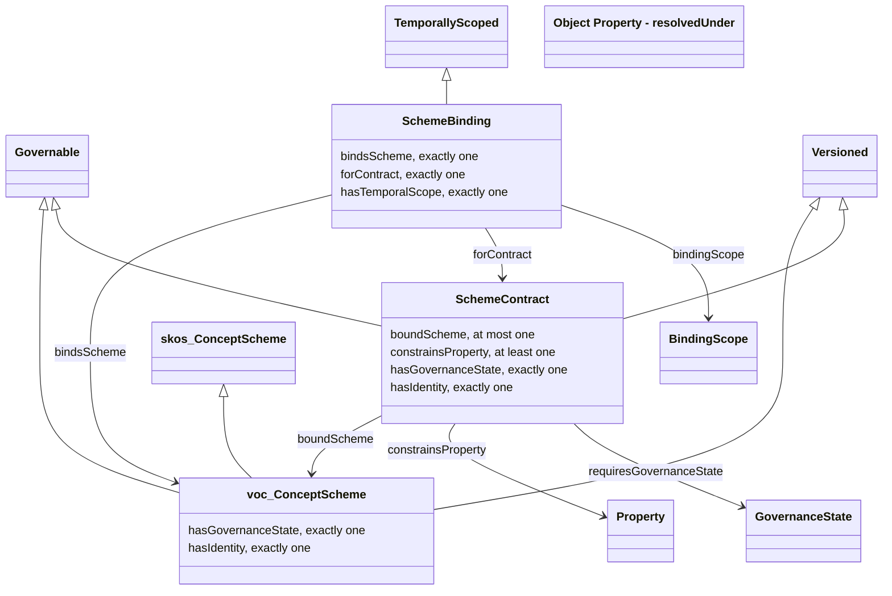

<!-- SPDX-License-Identifier: CC-BY-SA-4.0 -->

# Vocabulary Ontology — Description Logic Elements

Literate specification for the Vocabulary layer, in the layout of
[ADR-A126](../../docs/architecture/decisions/ADR-A126-literate-specification-layout-and-grammar.md).

---

## 1. Purpose and Scope

Vocabulary provides a governed mechanism by which external, domain-specific concept schemes get bound into every other layer's concept-valued properties without those layers' own specifications ever naming a domain concept directly. 

`vocab/` folders elsewhere in this repository hold small, mechanism-intrinsic enumerations (trigger kind, role type). Actual business vocabularies — product codes, jurisdiction lists, currency schemes, etc — are supplied entirely by whoever builds on LATTICE, and never appear in this repository at all.

Vocabulary builds on W3C SKOS rather than reinventing concept-scheme modelling, adding governed versioning of a scheme as a whole, a structural contract mechanism for binding a property to a scheme without either side knowing about the other in advance, and scoped, time-bounded bindings for where the scheme in use differs between contexts or changes over time.

What Vocabulary does *not* do is resolve a fuzzy label to a concept - it defines what a *valid* binding looks like structurally, but has nothing to say about how one was arrived at.

## 2. Namespace and Prefixes

| Document | Ontology IRI | Version IRI | Imports |
|---|---|---|---|
| `spec/vocabulary.ttl` | <https://www.nebularis.org/neuro-semantic/vocabulary> | <https://www.nebularis.org/neuro-semantic/lattice/vocabulary/0.19.0> | <http://www.w3.org/2004/02/skos/core>, <https://www.nebularis.org/neuro-semantic/lattice/foundation/0.19.0> |

| Prefix | Namespace |
|---|---|
| `voc:` | <https://www.nebularis.org/neuro-semantic/lattice/vocabulary#> |
| `fnd:` | <https://www.nebularis.org/neuro-semantic/lattice/foundation#> |
| `skos:` | <http://www.w3.org/2004/02/skos/core#> |

| Identifier | Role | Display name |
|---|---|---|
| <https://github.com/nebularis> | creator | Nebularis |

## 3. Extraction Contract

- Sections 1, 2 and 6 generate `spec/vocabulary.ttl`.
- The restriction rows of section 6 that are checked in SHACL generate `shapes/structural.ttl`.
- The two hidden blocks of section 7 generate `shapes/constraints.ttl` and `shapes/rules.ttl`, each naming its
  file.
- Extraction rewrites the class diagram (section 4) and the Axiom Index (6.7), which are never edited by hand.
- `turtle-example` blocks are illustrative only.

```bash
mise exec -- python tools/literate_extract.py ontology/vocabulary/README.md --layer vocabulary --root . --check
```

The module's entry in the [repository catalogue](../../repository-catalogue.md)
([ADR-A121](../../docs/architecture/decisions/ADR-A121-repository-catalogue.md)) follows.

```toml repository-catalogue
[module]
kind = "substrate"
roles = ["examples", "shapes", "spec"]
imports = ["foundation"]

[module.extract]
spec = ["spec/vocabulary.ttl"]
shapes = ["shapes/structural.ttl", "shapes/constraints.ttl", "shapes/rules.ttl"]
```

## 4. Overview

A `voc:SchemeContract` says that a property, declared in some other layer, takes concept values from a governed
scheme, without either side knowing about the other in advance. A downstream implementation satisfies it, either
once and everywhere with `voc:boundScheme`, or by `voc:SchemeBinding`s that each supply one `voc:ConceptScheme`
edition within named `voc:BindingScope`s for a stated period. A record states the binding its concept values were
resolved under with `voc:resolvedUnder`, so their meaning survives later changes. Vocabulary builds on SKOS, and a
`voc:ConceptScheme` is a governed, versioned `skos:ConceptScheme`.

The class diagram below is generated from section 6.

<!-- start: {"generated": "class-diagram"} -->



<!-- end -->

## 5. Detailed Design

### 5.1 Design decisions

**Scheme-level versioning through Foundation. Concept-level versioning explicitly out of scope.** A `ConceptScheme` is a `fnd:Versioned` — it has identity, and one version of a scheme can supersede another. An individual `skos:Concept` does not get its own independent version thread here. Tracking how a specific concept's meaning drifts or splits across scheme versions is a cross-version alignment problem that we do not address in this ontology.

**`SchemeContract` is structural only — it never encodes what a scheme is *about*.** `SchemeContract` therefore constrains only in structural, governance terms — which property, which scheme, what governance state that scheme must hold. What the scheme is *about* is communicated in prose, by whichever domain ontologies extend the framework.

**Concept-level constraints are out of scope for this pass.** Excluding deprecated concepts, requiring leaf concepts with no narrower terms, and similar refinements are plausible future extensions to `SchemeContract`. They are left out deliberately, as Foundation left OWL-Time alignment out, since they add real complexity for a requirement not yet demonstrated.

**Scoped, time-bounded binding is a separate construct, and `boundScheme` remains the unscoped default.** `boundScheme` gives a contract one binding, everywhere, indefinitely. That is enough for a single deployment, and it stays unchanged. Three requirements need more. First, one deployment can serve contexts in which the same property must draw on different schemes, so a binding needs a scope. Second, replacing a binding in place silently changes what previously recorded concept values meant, so a binding needs a validity period, and a versioned record needs a way to state which binding it was resolved under. Third, `boundScheme` is functional, so asserting a second value is read by a reasoner as the two schemes being the same individual rather than as a conflict — more than one binding therefore has to be expressed as more than one node, not more than one value. `SchemeBinding` meets all three by reifying the binding. Its scopes are opaque to this layer, in the same way `SchemeContract` never encodes what a scheme is about: Vocabulary states *that* a binding applies within a named scope, never what the scope means or how membership of it is decided. A binding naming several scopes applies only where all of them hold, and alternatives are expressed as separate bindings. A contract's `requiresGovernanceState` applies to a scheme however it is bound. `resolvedUnder` states no domain because the records that need it live in the layers above this one, and Vocabulary does not reach upward to name them.

**Resolution precedence is stated here, and not axiomatised.** For a value resolved in a given context at a given time, a `SchemeBinding` is applicable when every scope it names holds in that context and the time falls within its temporal scope. Among applicable bindings for one contract, a binding whose scopes are a strict superset of another's takes precedence. If more than one binding remains, the bindings conflict, which is a governance error rather than a choice to be made silently. If no binding applies, `boundScheme` is used where present. A `SchemeBinding` naming no scope is the time-bounded counterpart of `boundScheme`, and where both exist for one contract they must name the same scheme. Checking these conditions needs whole-graph comparison, so it belongs in SHACL-SPARQL rather than in OWL.

### 5.2 Worked examples

Illustration only. `ins:hasPerilType` isn't defined here — it belongs to Instrument, and appears only to show how a contract would attach to it. `fnd:Active` is a forward reference to a named individual Foundation's own document leaves as an open item (`vocab/foundation-vocab.ttl`), not yet declared anywhere in this repository.

```turtle-example
# Illustrative only — ins: and ex: are not part of Vocabulary's own namespace.

# Authored once, as part of ins:hasPerilType's own definition in Instrument's layer.
# No scheme exists yet, and none is required to exist for this to be valid.
ex:peril-contract
    a voc:SchemeContract ;
    voc:constrainsProperty ins:hasPerilType ;
    voc:requiresGovernanceState fnd:Active .

# Bound later, separately, by a specific downstream implementation —
# this triple could be added months after the one above, by a different party.
ex:acme-peril-codes-v2
    a voc:ConceptScheme ;
    fnd:hasIdentity ex:acme-peril-codes-identity ;
    fnd:hasGovernanceState fnd:Active .

ex:peril-contract voc:boundScheme ex:acme-peril-codes-v2 .
```

`ins:hasPerilType` itself is never mentioned anywhere in this document's own specification content — only in this illustration. The contract mechanism constrains the property without Vocabulary needing to know, or ever encode, what the property is about.

A second illustration shows scoped, time-bounded binding. An organisation classifies roles into job families. Its two regional deployments use different job-family schemes, and one region adopts a new edition part-way through the year. `ex:hasJobFamily` is again not part of Vocabulary.

```turtle-example
# Illustrative only — ex: is not part of Vocabulary's own namespace.

ex:job-family-contract
    a voc:SchemeContract ;
    voc:constrainsProperty ex:hasJobFamily ;
    voc:requiresGovernanceState fnd:Active .

ex:region-north a voc:BindingScope .
ex:region-south a voc:BindingScope .

# North used edition 1 until the end of June, then edition 2.
ex:north-binding-2026a
    a voc:SchemeBinding ;
    voc:forContract ex:job-family-contract ;
    voc:bindsScheme ex:north-job-families-v1 ;
    voc:bindingScope ex:region-north ;
    fnd:hasTemporalScope [
        a fnd:TemporalScope ;
        fnd:validFrom "2026-01-01T00:00:00Z"^^xsd:dateTime ;
        fnd:validTo   "2026-07-01T00:00:00Z"^^xsd:dateTime
    ] .

ex:north-binding-2026b
    a voc:SchemeBinding ;
    voc:forContract ex:job-family-contract ;
    voc:bindsScheme ex:north-job-families-v2 ;
    voc:bindingScope ex:region-north ;
    fnd:hasTemporalScope [
        a fnd:TemporalScope ;
        fnd:validFrom "2026-07-01T00:00:00Z"^^xsd:dateTime
    ] .

ex:south-binding
    a voc:SchemeBinding ;
    voc:forContract ex:job-family-contract ;
    voc:bindsScheme ex:south-job-families-v1 ;
    voc:bindingScope ex:region-south ;
    fnd:hasTemporalScope [
        a fnd:TemporalScope ;
        fnd:validFrom "2026-01-01T00:00:00Z"^^xsd:dateTime
    ] .

# An offer letter issued in the north in March keeps edition 1's meaning,
# even though the north now binds edition 2.
ex:offer-letter-117-v1 voc:resolvedUnder ex:north-binding-2026a .
```

No binding here names a scope the other lacks, so precedence never arises. Had a deployment added a binding scoped to both `ex:region-north` and a further scope, that binding would take precedence within the narrower context, per §4.

## 6. Description Logic Encoding

### 6.1 Classes

#### `voc:ConceptScheme`

**Definition.** A published, identified, governed collection of concepts.

**Utility.** A published, versioned, governed collection of concepts. Use `fnd:hasIdentity` and `fnd:supersededBy` to track successive editions of the same scheme over time, and `fnd:hasGovernanceState` to record its review status.

**Subclass of.** `fnd:Versioned`, `fnd:Governable`, `skos:ConceptScheme`

**Restrictions.**

| Property | Values | Asserted in | Message |
|---|---|---|---|
| `fnd:hasIdentity` | exactly 1 | SHACL |  |
| `fnd:hasGovernanceState` | exactly 1 | SHACL |  |

#### `voc:SchemeContract`

**Definition.** A declared requirement binding a property, defined in some other layer, to concepts drawn from a conformant scheme.

**Utility.** Author one of these when a property should take concept values but you don't yet know which scheme those concepts will come from. Set constrainsProperty to name the property, requiresGovernanceState if needed, and leave boundScheme empty until an implementation supplies one.

**Subclass of.** `fnd:Versioned`, `fnd:Governable`

**Restrictions.**

| Property | Values | Asserted in | Message |
|---|---|---|---|
| `fnd:hasIdentity` | exactly 1 | SHACL |  |
| `fnd:hasGovernanceState` | exactly 1 | SHACL |  |
| `voc:constrainsProperty` | min 1 |  |  |
| `voc:boundScheme` | max 1 | SHACL |  |

#### `voc:SchemeBinding`

**Definition.** A statement that a scheme contract is satisfied by a specific concept scheme, within zero or more named scopes, for a stated period.

**Utility.** Author one of these when a contract's scheme differs between contexts or must change over time. Set forContract, bindsScheme (a specific scheme edition), bindingScope for each scope it applies within (none means everywhere), and a temporal scope. To change the scheme in use, end this binding's validity and add a new one rather than editing it.

**Subclass of.** `fnd:TemporallyScoped`

**Restrictions.**

| Property | Values | Asserted in | Message |
|---|---|---|---|
| `voc:forContract` | exactly 1 |  |  |
| `voc:bindsScheme` | exactly 1 |  |  |
| `fnd:hasTemporalScope` | exactly 1 | SHACL |  |

#### `voc:BindingScope`

**Definition.** A declared context within which a scheme binding applies.

**Utility.** Declare one for each context in which bindings may differ, such as a deployment, tenant, jurisdiction or product. Vocabulary ships no scope individuals and does not decide which scopes hold for a given value.

### 6.2 Object Properties

#### `voc:constrainsProperty`

**Definition.** The property, declared in another layer, that this contract governs.

**Utility.** Names the property a SchemeContract governs. Point this at whichever property needs its values to come from a conformant concept scheme.

**Domain.** `voc:SchemeContract`

**Range.** `rdf:Property`

#### `voc:requiresGovernanceState`

**Definition.** A governance state the bound scheme must currently hold for this contract to be considered satisfied.

**Utility.** States which governance state(s) the bound scheme must currently hold — any one value given is sufficient if more than one is stated. Leave unset if the contract doesn't care about governance status at all.

**Domain.** `voc:SchemeContract`

**Range.** `fnd:GovernanceState`

#### `voc:boundScheme`

**Definition.** The concrete scheme a downstream implementation has bound to satisfy this contract, if one has been bound yet.

**Utility.** Points a SchemeContract at the concrete scheme that satisfies it, once one has been chosen. Leave this unset until an implementation supplies a scheme.

**Domain.** `voc:SchemeContract`

**Range.** `voc:ConceptScheme`

**Characteristics.** functional

#### `voc:forContract`

**Definition.** The scheme contract a scheme binding satisfies.

**Utility.** Names the contract a SchemeBinding satisfies. Every binding names exactly one contract; a contract may have any number of bindings.

**Domain.** `voc:SchemeBinding`

**Range.** `voc:SchemeContract`

**Characteristics.** functional

#### `voc:bindsScheme`

**Definition.** The concept scheme a scheme binding supplies.

**Utility.** Points a SchemeBinding at the specific scheme edition it supplies. Point at the edition itself, the ConceptScheme version, so the binding keeps its meaning when a later edition of the same scheme is published.

**Domain.** `voc:SchemeBinding`

**Range.** `voc:ConceptScheme`

**Characteristics.** functional

#### `voc:bindingScope`

**Definition.** A scope within which a scheme binding applies.

**Utility.** Names a scope within which a SchemeBinding applies. Several values mean the binding applies only where all of them hold; express alternatives as separate bindings. Leave unset for a binding that applies in every scope.

**Domain.** `voc:SchemeBinding`

**Range.** `voc:BindingScope`

#### `voc:resolvedUnder`

**Definition.** A scheme binding in force when a record's concept values were resolved.

**Utility.** Records, on any versioned record in any layer, which SchemeBinding its concept values were drawn under, so their meaning survives later changes to bindings or scheme editions. Give one value per contract the record draws on.

**Range.** `voc:SchemeBinding`

### 6.3 Datatype Properties

None.

### 6.4 Individuals

None. Vocabulary ships no individuals. Scopes, contracts and schemes are an implementation's.

### 6.5 Disjointness and Keys

**All disjoint.** `voc:BindingScope`, `voc:ConceptScheme`, `voc:SchemeBinding`, `voc:SchemeContract`

**Disjoint.** `skos:Concept`, `voc:ConceptScheme`

A collection of concepts, a declared requirement about a property, a statement satisfying that requirement, and a
context are different kinds of thing, and nothing is both a scheme and a concept.

### 6.6 Other Axioms

The spec document declares `rdf:Property`, the range of `voc:constrainsProperty`, an `owl:Class`. It has no
entry, since an entry would give a term of RDF a definition of ours.

```turtle-spec
rdf:Property a owl:Class .
```

### 6.7 Axiom Index

<!-- start: {"generated": "axiom-index"} -->

| Term | Kind | Summary |
|---|---|---|
| `voc:BindingScope` | Class | Disjoint with `voc:ConceptScheme`, `voc:SchemeBinding`, `voc:SchemeContract`. |
| `voc:ConceptScheme` | Class | Subclass of `fnd:Governable`, `fnd:Versioned`, `skos:ConceptScheme`. Disjoint with `skos:Concept`, `voc:BindingScope`, `voc:SchemeBinding`, `voc:SchemeContract`. Restrictions `fnd:hasGovernanceState` exactly 1 (SHACL only), `fnd:hasIdentity` exactly 1 (SHACL only). |
| `voc:SchemeBinding` | Class | Subclass of `fnd:TemporallyScoped`. Disjoint with `voc:BindingScope`, `voc:ConceptScheme`, `voc:SchemeContract`. Restrictions `fnd:hasTemporalScope` exactly 1 (SHACL only), `voc:bindsScheme` exactly 1, `voc:forContract` exactly 1. |
| `voc:SchemeContract` | Class | Subclass of `fnd:Governable`, `fnd:Versioned`. Disjoint with `voc:BindingScope`, `voc:ConceptScheme`, `voc:SchemeBinding`. Restrictions `fnd:hasGovernanceState` exactly 1 (SHACL only), `fnd:hasIdentity` exactly 1 (SHACL only), `voc:boundScheme` max 1 (SHACL only), `voc:constrainsProperty` min 1. |
| `voc:bindingScope` | Object property | Domain `voc:SchemeBinding`. Range `voc:BindingScope`. |
| `voc:bindsScheme` | Object property | Domain `voc:SchemeBinding`. Range `voc:ConceptScheme`. Functional. |
| `voc:boundScheme` | Object property | Domain `voc:SchemeContract`. Range `voc:ConceptScheme`. Functional. |
| `voc:constrainsProperty` | Object property | Domain `voc:SchemeContract`. Range `rdf:Property`. |
| `voc:forContract` | Object property | Domain `voc:SchemeBinding`. Range `voc:SchemeContract`. Functional. |
| `voc:requiresGovernanceState` | Object property | Domain `voc:SchemeContract`. Range `fnd:GovernanceState`. |
| `voc:resolvedUnder` | Object property | Range `voc:SchemeBinding`. |

<!-- end -->

## 7. Shapes

A shape lives in one file only, so no violation is reported twice. The structural shapes restate Foundation's
mixin requirements, identity and governance state for a versioned, governed scheme or contract and a temporal
scope for a binding, since Foundation's shapes do not yet check them.

### 7.1 Structural shapes

`shapes/structural.ttl` is generated from the restriction rows of section 6 that are checked in SHACL.
`voc:BindingScope` has no restriction and no shape.

### 7.2 Constraints

`shapes/constraints.ttl` holds the SHACL-SPARQL constraints of the resolution law (§5.1, ADR-A85). None selects
a winning binding. Each reports a structural defect or an unresolved ambiguity: a temporal scope that ends before
it begins, a scopeless binding disagreeing with `voc:boundScheme`, two bindings of equal scopes valid at once,
and a record resolved under a binding not valid at its resolution time. The last needs a resolution time that no
record class of this layer states, so the file declares one validation-profile term, `vvp:resolvedAt`, used only
by that shape and its examples.

<!-- hidden: {"output-file": "shapes/constraints.ttl"}
```turtle-shapes
# SHACL-SPARQL constraints for the resolution law stated in prose in
# ontology/vocabulary/README.md §4 and decided in ADR-A85. Per that ADR, no
# constraint here selects a winning binding — each shape only ever reports a
# structural defect or an unresolved ambiguity.
#
# Three of these shapes (Temporal interval order, Fallback agreement, Equal
# specificity conflict) are checkable from the graph alone: an interval's own
# two endpoints, a contract's own bindings and boundScheme, and two bindings'
# own scope sets and validity windows never depend on a caller-supplied
# resolution context. A strict-superset winner cannot be decided this way
# (that needs the caller's active context, so it belongs to the reference
# resolver in tools/vocabulary, not here) but two bindings that name exactly
# the same scopes and share any moment of validity are a conflict in every
# context where either could ever apply, which a closed, context-independent
# query can detect on its own.
#
# The fourth shape (Historical provenance time) needs a resolution time that
# belongs to whatever versioned record asserted voc:resolvedUnder, and
# Vocabulary itself declares no such record class or timestamp property. This
# file therefore introduces one validation-profile-only term for that purpose:
#
#   vvp:resolvedAt — a valid-time "as-of" query point: the instant a
#   voc:resolvedUnder-bearing record wants its binding resolved as of, on the
#   same axis as fnd:validFrom/fnd:validTo and resolve()'s own `at` parameter.
#   It is not a transaction-time "recorded when" timestamp (that axis is
#   fnd:recordedAt or an ex:occurredAt-shaped property) — naming it vvp:resolvedAt rather than
#   vvp:recordedAt is deliberate, to avoid suggesting it answers "when was
#   this written down" when it answers "resolved as of when." Not part of the
#   normative Vocabulary specification (spec/vocabulary.ttl); used only by
#   this shape and by the fixtures under ontology/vocabulary/examples/ that
#   exercise it. A real consuming layer states this via its own record's own
#   valid-time property instead, once one exists, following the same
#   recordedAt/occurredAt naming precedent rather than this placeholder's.

@prefix sh:   <http://www.w3.org/ns/shacl#> .
@prefix rdf:  <http://www.w3.org/1999/02/22-rdf-syntax-ns#> .
@prefix rdfs: <http://www.w3.org/2000/01/rdf-schema#> .
@prefix fnd:  <https://www.nebularis.org/neuro-semantic/lattice/foundation#> .
@prefix voc:  <https://www.nebularis.org/neuro-semantic/lattice/vocabulary#> .
@prefix vvp:  <https://www.nebularis.org/neuro-semantic/lattice/vocabulary/validation-profile#> .

vvp:resolvedAt a rdf:Property ;
	rdfs:comment "Validation-profile-only: the valid-time \"as-of\" instant at which a voc:resolvedUnder-bearing record's concept values were resolved (compared against fnd:validFrom/fnd:validTo, the same axis as resolve()'s `at` parameter) — not a transaction-time \"recorded when\" timestamp. Not part of spec/vocabulary.ttl." .

voc:TemporalIntervalOrderShape a sh:NodeShape ;
	sh:targetClass voc:SchemeBinding ;
	sh:sparql [
		sh:message "A scheme binding's temporal scope must not end before it begins." ;
		sh:select """
			PREFIX fnd: <https://www.nebularis.org/neuro-semantic/lattice/foundation#>
			SELECT $this WHERE {
				$this fnd:hasTemporalScope ?scope .
				?scope fnd:validFrom ?from ;
					   fnd:validTo ?to .
				FILTER (?to < ?from)
			}
		"""
	] .

voc:FallbackAgreementShape a sh:NodeShape ;
	sh:targetClass voc:SchemeContract ;
	sh:sparql [
		sh:message "A scopeless scheme binding must name the same scheme as the contract's boundScheme fallback. Discharges README §4 invariant 6." ;
		sh:select """
			PREFIX voc: <https://www.nebularis.org/neuro-semantic/lattice/vocabulary#>
			SELECT $this WHERE {
				$this voc:boundScheme ?fallback .
				?binding voc:forContract $this ;
						 voc:bindsScheme ?bound .
				FILTER NOT EXISTS { ?binding voc:bindingScope ?anyScope }
				FILTER (?bound != ?fallback)
			}
		"""
	] .

voc:EqualSpecificityScopeConflictShape a sh:NodeShape ;
	sh:targetClass voc:SchemeBinding ;
	sh:sparql [
		sh:message "Two bindings for the same contract name exactly the same scopes and share a moment of validity, so neither can ever win by strict-superset precedence. Discharges README §4 invariant 4." ;
		sh:select """
			PREFIX voc: <https://www.nebularis.org/neuro-semantic/lattice/vocabulary#>
			PREFIX fnd: <https://www.nebularis.org/neuro-semantic/lattice/foundation#>
			SELECT $this WHERE {
				$this voc:forContract ?contract .
				?other voc:forContract ?contract .
				FILTER (?other != $this)
				FILTER NOT EXISTS { $this voc:bindingScope ?s1 . FILTER NOT EXISTS { ?other voc:bindingScope ?s1 } }
				FILTER NOT EXISTS { ?other voc:bindingScope ?s2 . FILTER NOT EXISTS { $this voc:bindingScope ?s2 } }
				$this fnd:hasTemporalScope ?t1 .
				?t1 fnd:validFrom ?from1 .
				OPTIONAL { ?t1 fnd:validTo ?to1 }
				?other fnd:hasTemporalScope ?t2 .
				?t2 fnd:validFrom ?from2 .
				OPTIONAL { ?t2 fnd:validTo ?to2 }
				FILTER (!BOUND(?to1) || ?to1 > ?from2)
				FILTER (!BOUND(?to2) || ?to2 > ?from1)
			}
		"""
	] .

voc:HistoricalProvenanceTimeShape a sh:NodeShape ;
	sh:targetSubjectsOf voc:resolvedUnder ;
	sh:sparql [
		sh:message "A record's resolvedUnder binding must have been valid at the record's own resolution time (validation profile: vvp:resolvedAt). Discharges README §4 invariant 7." ;
		sh:select """
			PREFIX voc: <https://www.nebularis.org/neuro-semantic/lattice/vocabulary#>
			PREFIX fnd: <https://www.nebularis.org/neuro-semantic/lattice/foundation#>
			PREFIX vvp: <https://www.nebularis.org/neuro-semantic/lattice/vocabulary/validation-profile#>
			SELECT $this WHERE {
				$this voc:resolvedUnder ?binding ;
					  vvp:resolvedAt ?at .
				?binding fnd:hasTemporalScope ?scope .
				?scope fnd:validFrom ?from .
				OPTIONAL { ?scope fnd:validTo ?to }
				FILTER (?at < ?from || (BOUND(?to) && ?at >= ?to))
			}
		"""
	] .
```
-->

### 7.3 Rules

`shapes/rules.ttl` holds no rule, deliberately. A rule that inferred a resolved scheme would choose a winning
binding, which ADR-A85 leaves to the caller-driven reference resolver in `tools/vocabulary/`.

<!-- hidden: {"output-file": "shapes/rules.ttl"}
```turtle-shapes
# Deliberately empty of SHACL rules (sh:rule / sh:SPARQLRule).
#
# ADR-A85 is explicit that no mechanism in this layer may silently choose a
# winning voc:SchemeBinding: a SPARQL CONSTRUCT rule that inferred, say, a
# materialised voc:resolvedScheme triple would do exactly that — pick one
# candidate out of several applicable bindings and assert it as if it were
# the only answer, which is precedent-sensitive, context-sensitive, and can
# be a governance-reportable conflict rather than a fact to infer. Selection
# belongs to the caller-driven reference resolver in tools/vocabulary/, which
# takes the caller's active context and resolution time as explicit
# arguments and returns a conflict as a decision outcome, not a triple.
#
# ontology/vocabulary/shapes/structural.ttl and constraints.ttl carry every
# validation shape this layer currently needs; revisit this file only if a
# genuinely non-selecting inference (one that adds no information a
# validator couldn't already report as a violation) is identified.
```
-->

## 8. Examples

The examples in [`examples/`](examples/) are validated against the shapes of section 7: alternative regional
bindings, conjunctive scopes, a temporal handover, historical provenance, and fixtures for each defect the
constraints report. §5.2 walks through two of the patterns.

## 9. Canonicalisation

Not applicable.

## 10. Formalisation

Not applicable.

## 11. Dependencies

Vocabulary imports Foundation, for identity, versions, governance and temporal scopes, and SKOS, which a
`voc:ConceptScheme` specialises.

## 12. Release Notes

Earlier versions are listed in the [ontology release register](../../docs/architecture/ontology-releases.md).

- Next release. Re-pinned: a new substrate layer joins the release. No other change.
- 0.19.0. Every document takes the release's number and imports the other layers at it (no effect). No other change.
- 0.18.0, the first release of the substrate and standalone modules as one set
  ([ADR-A129](../../docs/architecture/decisions/ADR-A129-one-release-for-the-substrate.md)). The README
  follows the layout of
  [ADR-A126](../../docs/architecture/decisions/ADR-A126-literate-specification-layout-and-grammar.md), and is the
  source of the spec document and all three shape files (no effect). The document gains a `dct:description` and a
  `dct:creator` (no effect). It imports Foundation at the release's number (no effect), and the shapes directory
  no longer carries a `.version`. No axiom or shape changes.
- `vocabulary` 0.4.0. Re-pinned to Foundation 0.4.0. No other change.
- `vocabulary` 0.3.0. Re-pinned to Foundation 0.3.0. No other change.
- `vocabulary` 0.2.0, the first version under the versioning policy. Scoped, time-bounded scheme bindings:
  `voc:SchemeBinding`, `voc:BindingScope`, `voc:forContract`, `voc:bindsScheme`, `voc:bindingScope` and
  `voc:resolvedUnder` (ADR-A85). Shapes 0.1.0: the structural shapes, and the constraints of the resolution law.

## 13. Open Issues

- **Concept-level constraints**, such as excluding deprecated concepts or requiring leaf concepts, are a plausible
  extension to `voc:SchemeContract`, deliberately deferred (§5.1).
- **Strict-superset precedence** is decided by the reference resolver, not a shape, since it needs the caller's
  active context.
- **Consumers of `voc:boundScheme`.** Surface's shapes and Eligibility's hierarchical match rule read
  `voc:boundScheme` only. They are correct for unscoped deployments. Honouring scoped bindings there means
  resolving the applicable binding first.
- **The constraints' messages** cite "README §4 invariant" numbers that no longer exist. Changing them changes the
  shapes' graph, so it waits for a release.
- **Named contracts and schemes** belong in each consuming layer and in `ontology/governance/`. Nothing here
  populates either.
