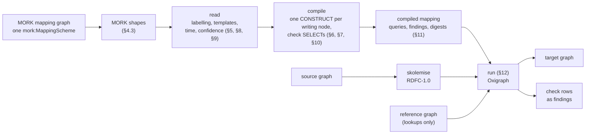

<!-- SPDX-License-Identifier: CC-BY-SA-4.0 -->

# mork_rdf: MORK mappings between RDF vocabularies, compiled to SPARQL

`mork_rdf` compiles a MORK mapping scheme whose source is RDF into SPARQL 1.1 queries. Each mapping node that writes triples becomes one `CONSTRUCT`, and each way a mapping can fail on real data becomes one check `SELECT` that names the focus nodes it could not map. Running the constructs over a source graph gives the target graph, and running the checks says what was left out and why.

It is the RDF-to-RDF backend of MORK's compiler family. [`tools/mork/src/mork2rml.py`](../mork/src/mork2rml.py) compiles the same mapping vocabulary to RML for sources that are not RDF (JSON, XML, CSV), and [`tools/mork_compilers`](../mork_compilers) compiles Eligibility conditions to SPARQL, SHACL and SWRL. One mapping graph serves several backends, and the backend is chosen by the source.

Status: built 2026-10-29 for the contract builder's rule-language import (CB5), autonomously, and not yet reviewed. The decisions this document takes are listed for ratification in §17, and the questions it leaves open in §18.

## Contents

1. [Why compile, and why to SPARQL](#1-why-compile-and-why-to-sparql)
2. [Where it sits](#2-where-it-sits)
3. [Using it](#3-using-it)
4. [Inputs](#4-inputs)
5. [Reading a scheme](#5-reading-a-scheme)
6. [Identity](#6-identity)
7. [Values](#7-values)
8. [Templates](#8-templates)
9. [Time, governance and confidence](#9-time-governance-and-confidence)
10. [Findings](#10-findings)
11. [Output](#11-output)
12. [Running](#12-running)
13. [Security](#13-security)
14. [Cost](#14-cost)
15. [Worked example](#15-worked-example)
16. [Tests](#16-tests)
17. [Decisions for ratification](#17-decisions-for-ratification)
18. [Open questions](#18-open-questions)
19. [Relation to mork2rml, and what comes next](#19-relation-to-mork2rml-and-what-comes-next)

## 1. Why compile, and why to SPARQL

A source that is RDF in every serialisation, such as an ODRL policy in JSON-LD, Turtle or RDF/XML, is a graph whatever bytes carry it. Mapping it as JSON would need a framing step to fix one JSON shape first, and mapping it as a tree throws away the graph it already is. So the mapping is RDF to RDF.

We compile rather than interpret. A compiled query is an artefact a reviewer can read, cache by the mapping graph's digest, and run by hand in any SPARQL 1.1 engine when a result looks wrong. An interpreter would be a second, partial implementation of MORK's semantics, held only in code. The compiler is also smaller than an interpreter, because SPARQL already does what an interpreter would have to: joins, property paths, list membership, grouping and absence.

SPARQL `CONSTRUCT` fits MORK's model closely. A MORK data mapping says which source nodes to visit, what target node each becomes, and what to assert about it. A `CONSTRUCT` says which solutions to find and what triples each writes. A contextual mapping, which MORK evaluates in its parent's context, is a join that the query's WHERE clause states directly. That is why the RML backend's hardest part, join conditions between triples maps, has no counterpart here.

## 2. Where it sits



The compiler reads only the mapping graph, MORK's own specification and shapes, and an optional target vocabulary. It never reads source data. The runner is separate, so a deployment can run the compiled queries in Fuseki or another engine instead.

## 3. Using it

```python
from datetime import datetime, timezone
from rdflib import Graph
from mork_rdf import compile_scheme, run

mapping = Graph().parse("catalogue-mapping.ttl")
compiled = compile_scheme(
    mapping, "http://example.org/mapping#Catalogue",
    base="http://example.org/out/",                     # the namespace minted IRIs fall under
    at=datetime(2026, 10, 29, tzinfo=timezone.utc),     # the instant the mappings in force are read at
    target_vocabulary=Graph().parse("vocabulary.ttl"),  # optional: types the target terms
)
print(compiled.text())          # every query, each headed by the mapping it comes from
result = run(compiled, Graph().parse("source.ttl"), reference=Graph().parse("reference.ttl"))
result.graph                    # the target triples
result.findings                 # the focus nodes the checks report
```

The tests run with `mise run check:mork-rdf`. The package installs with the rest of the environment through `mise run bootstrap`.

## 4. Inputs

### 4.1 The mapping graph and its scheme

The compiler compiles one `mork:MappingScheme` at a time. A mapping node belongs to the scheme when it names it with `mork:mappingScheme`, as MORK's class axiom entails it is then a `mork:DataMapping`. Nodes of other schemes in the same graph are ignored, so one graph can hold several schemes.

### 4.2 The source side in RDF

MORK describes a source with representation schemes, whose `mork:format` is JSON, XML or YAML today. An RDF source needs no description of its own, because its vocabulary already names every class and property. So the representations of an RDF source are the source vocabulary's own terms:

- **What a root iterates.** A root datum's `mork:mappingFor` names a `mork:DataConcept`, and the concept's `mork:representedAs` names the source classes, each declared `a mork:Entity` in the mapping graph. The root visits every node typed with one of them. Several classes are alternatives, as `src:Book` and `src:Pamphlet` are in §15.
- **Where a contextual datum's focus is.** Its concept's `mork:path` is a property path from the parent's focus node, as `src:author` is from a book to its author. A concept with no path keeps the parent's focus, so a mapping can make a second target node from the same source node, as the loan example's principal does.
- **Where a value is.** A mapping's `mork:dataRef` is a property path from its focus node to the value.
- **Prefixes.** A path may write IRIs in full, `<http://…>`, or as prefixed names whose prefixes the scheme declares with SHACL's own vocabulary for declaring prefixes as data, `sh:declare [ sh:prefix "src" ; sh:namespace "http://example.org/src#"^^xsd:anyURI ]`, on the scheme or on a node that the scheme's `sh:prefixes` names. Turtle's own prefixes are syntax and not data, so a path cannot rely on them.

A path is SPARQL 1.1's property path language: a sequence `/`, alternatives `|`, an inverse `^`, the modifiers `*`, `+` and `?`, groups, `a`, and negated property sets `!(…)`. So an RDF list's members are `src:items/rdf:rest*/rdf:first`, and no collection construct is needed. A path is parsed into a tree and written back from the tree (§13).

A root concept's `mork:path` is not read, since a root iterates its classes, and the compiler warns (`RootPathIgnored`). A JSON mapping's root path is `$`, which has no RDF meaning.

### 4.3 Validation before compiling

The mapping graph is validated against MORK's shapes, with MORK's and Foundation's specifications as the ontology, before anything is read (each component validates what it receives, PRI-75). The shapes refuse a cycle in `mork:precedes` and the properties it derives from, a governance state outside Foundation's four, and, in production mode, a generative mapping still in draft (MEC-75). A violation is an error finding (`MorkShape`), and a warning a warning. A caller outside the repository passes the shapes as a `MorkLayer`.

### 4.4 Options

| Option | Meaning |
|---|---|
| `base` | the namespace every minted IRI falls under, absolute and ending in `/` or `#`. Each query declares it as `BASE`, so a relative IRI an identity forms resolves against it |
| `at` | the instant the mappings in force are read at (§9.1). It is an input with a timezone and never the clock (PRI-56) |
| `target_vocabulary` | a graph typing the target terms. It decides a generic match's stratum (§5.1) and adds the term-kind check (§10.3). Without it neither applies |
| `shapes` | MORK's specification and shapes, `layer.load()` by default |
| `min_confidence` | drops a mapping whose effective confidence is below it, with its descendants (§9.4) |

## 5. Reading a scheme

### 5.1 Classification

Each mapping node in force is classified by the case analysis of the MORK foundations' Definition 10.7, in the order `mork2rml` uses, so both backends read a graph alike. A node that fits no case is an error (`Unclassified`), never a guess. The RML backend's pass-through case, which emits a best-effort triples map for such a node, has no counterpart here.

| Kind | Recognised by | Writes |
|---|---|---|
| lookup (Case 6) | `a mork:Lookup`, or `mork:referenceDataPath` | the R-Box property, its value the reference node whose `referenceDataPath` value equals the source value (§7.3) |
| contextual datum (Case 4) | `mork:broaderApplicative`, or a deferred class, a parent and an R-Box match with no value | a target node per focus node, typed, and glued to its parent's target node by the R-Box match |
| datum (Case 2) | `a mork:Datum`, or `mork:deferredMapping` | a target node per focus node, typed with the class it defers to |
| class creation (Case 1a) | `mork:broadTBoxCategoryMatch` | a new class, `rdfs:subClassOf` the broad match |
| class reference (Case 1b) | `mork:exactTBoxMatch` and no R-Box match | nothing. It names a class a datum defers to |
| assertion (Case 3) | an R-Box match and a parent | the property on the parent's target node, its value from §7 |
| correspondence | an A-Box match and a parent assertion | nothing alone. It is one row of its parent's table (§7.2) |

The R-Box match is `mork:exactRBoxMatch` (subject to value), `mork:inverseRBoxMatch` (value to subject), or `mork:broadRBoxCategoryMatch`, which creates a subproperty of the broad match named by `mork:conceptName` and asserts that.

**Generic matches.** `mork:intransitiveExactMatch`, `mork:broadCategoryMatch` and `mork:narrowCategoryMatch` name no stratum. The compiler reads the stratum from the target vocabulary's typing of the target term (a class, a property, or an individual) and treats the match as the specific one. A term the vocabulary does not type is an error (`StratumUnknown`).

**Narrow matches.** A narrow match in any stratum says the target is narrower than the source, so a compiled mapping would claim more than the source says. It is refused (`NarrowMatch`). A broad match compiles, with a warning (`BroadMatch`), since it loses detail but claims nothing false.

### 5.2 The DAG

A node's parent is the node that lists it with `mork:compositeNarrowerMapping`, or that it names with `mork:compositeBroaderMapping` or `mork:broaderApplicative`. Declaring the same edge both ways is allowed and counts once. A node with more than one parent is refused (`SeveralParents`), since its context would be ambiguous. A node whose parent is not compiled is dropped with a warning (`ParentNotCompiled`). The DAG is acyclic by MORK's shapes (§4.3).

The ordering properties (`mork:precedes`, `mork:softPrecedes`, `mork:resolvesIdentityFor` as an ordering) need nothing more, because the queries are independent and each reads only the source. The order of execution matters to RML, where a parent triples map must exist before a child references it, and not here.

### 5.3 Frames: how a query's WHERE is built

A query's WHERE clause is the chain of frames from the root to the mapping. Each frame holds a focus variable, the target term, the patterns that find the focus, and the patterns and `BIND` that form the target.

- A root frame finds its focus by type: `?f a <S>`, or `VALUES ?s { <S1> <S2> } ?f a ?s` for alternatives.
- A contextual frame follows its concept's path from the parent's focus, `?fParent <path> ?f`, or reuses the parent's focus when there is no path.
- An assertion adds its value patterns to its parent's chain.

So a mapping three levels deep is one query with three frames, and a reviewer reading it sees the whole context in which its triples are written.

## 6. Identity

A datum's target node is formed by the first rule that applies.

| Rule | Target node |
|---|---|
| `mork:individualIRI` | that IRI, for every focus node |
| an A-Box match on the datum | that individual, for every focus node |
| `mork:identityTemplateMapping` to a template expression, or a template expression that `mork:resolvesIdentityFor` the datum | `IRI(expression)` (§7.4) |
| `mork:conceptFQNameTemplate` or `mork:conceptNameTemplate`, with `{$path}` or `${path}` placeholders | the base, then the template with each placeholder's value |
| `mork:conceptName` beginning with `#` | the base and the name, one node for every focus node |
| `mork:conceptName` and `mork:dataRef` | `base` + name + `/` + the value of the path, encoded |
| `mork:conceptName` alone | `base` + name + `/` + the SHA-256 of the focus node's IRI |
| none | `base` + the mapping's local name + `/` + the SHA-256 of the focus node's IRI |

A value read inside a concatenation, an interpolation or a name template is encoded with `ENCODE_FOR_URI`, as RML encodes a template's references. A reference or a lookup that is the whole identity is taken as it is, as RML takes a column whose term type is IRI, since it is already an IRI.

A focus node that lacks a value its identity reads gets no target node, and the check `IdentityUnbound` names it. A focus node whose identity reads several values gets one target node per value, and `IdentityAmbiguous` names it.

The default hash rule is what makes a blank-node source usable. The runner gives every blank node an IRI from the source's canonical form first (§12), so `STR(?f)` is defined and the same source always gives the same target IRIs.

## 7. Values

### 7.1 Paths, constants and individuals

An assertion's value is, in order:

1. the value its `mork:dataRef` path reaches from the parent's focus, one triple per value, translated through its correspondences when it has any (§7.2)
2. `mork:dataInline`, a constant literal with its datatype or language
3. its A-Box match, a constant individual

A value keeps its RDF term as the source gives it, with its datatype or language. Nothing is coerced. With a target vocabulary, the check `TermKind` reports a literal reaching an `owl:ObjectProperty`, or an IRI reaching an `owl:DatatypeProperty`.

### 7.2 Correspondences

A correspondence maps one source individual to one target individual, `mork:mappingFor src:Paperback ; mork:exactABoxMatch tgt:Print`. The correspondences beneath an assertion form a table, which the query joins with `VALUES`, so `src:format src:Paperback` becomes `tgt:medium tgt:Print`. A value with no row is not asserted, and the check `UnmappedValue` names it. A broad correspondence compiles, with a warning. A correspondence that is not beneath an assertion is unused and reported (`CorrespondenceUnused`).

This is how a source's controlled values, such as ODRL's actions, become a target's, with every row reviewable as one mapping node.

### 7.3 Lookups

A lookup (Case 6) finds the target value in reference data, by matching the source value against a property of the reference nodes:

```turtle
mm:Map_Genre a mork:DataMapping , mork:Lookup ;
    mork:exactRBoxMatch tgt:genre ;        # the property asserted
    mork:exactTBoxMatch skos:Concept ;     # the class of the reference nodes
    mork:referenceDataPath skos:notation ; # the property matched
    mork:dataRef "src:genre" .             # the source value
```

The reference nodes are read only from the reference graph, which the runner keeps in its own named graph (§12), so source data cannot answer a lookup by declaring its own codes (§13). The match compares the two values' lexical forms with `STR()`, so a plain string matches a typed code. A value no reference node matches is not asserted (`LookupUnresolved`), and a value several match is asserted with each and reported (`LookupAmbiguous`).

### 7.4 Template expressions

MORK's template expression algebra (Foundations §3.9) compiles to SPARQL string expressions:

| Expression | SPARQL |
|---|---|
| `mork:LiteralExpression`, `mork:dataInline "…"` | the string |
| `mork:RefExpression`, `mork:dataRef "path"` | `STR(?v)`, the path bound to `?v`, encoded inside an IRI |
| `mork:ConcatExpression`, `concatLeft`, `concatRight` | `CONCAT(left, right)` |
| `mork:InterpolationExpression`, `templateString "…{p}…"`, `hasBinding` | `CONCAT` of the template's fixed text and each placeholder's binding |
| `mork:LookupExpression`, `lookupScheme`, `lookupProperty`, `lookupSource` | `STR(?concept)`, for the concept of the scheme whose property equals the source expression |

An expression missing an operand, a binding or a placeholder's binding is refused (`ExpressionIncomplete`), and a node that is not an expression (`ExpressionUnknown`).

## 8. Templates

An instantiation (`mork:templateMapping`) is merged with its template before classification, by Definition 3.7's first strategy: the instantiation's own values first, the template's where it gives none. Its children are its own, followed by the template's children that none of its own children correlates with through `mork:templateBinding`. Each of the template's children is compiled under every instantiation, in that instantiation's context, and a query's `path` names the instantiation, so a reviewer sees which one it came from.

A template that is neither a root (it iterates nothing) nor a child is abstract, and is compiled only through its instantiations. A template that is itself a full mapping also compiles on its own.

Definition 3.7's second and third strategies correlate children by an ordered collection and by `mork:mappingIndex`. Both matter where children have an order that a tree source gives, such as a JSON array's positions. A `CONSTRUCT` writes a set, so the compiler takes the union, as `mork2rml` does.

## 9. Time, governance and confidence

### 9.1 In force and superseded

A mapping is in force at `at` when `at` is not before its `mork:effectiveFrom` and is before its `mork:effectiveUntil`. A mapping that a mapping in force supersedes, by `mork:supersedes` or Foundation's `fnd:supersededBy`, is out of force. A mapping out of force is reported (`NotInForce`, `Superseded`) and not compiled, and so are its descendants. So compiling the same graph at two instants gives each instant's mapping, which §15 shows with a status mapping and its successor.

### 9.2 Compilation modes

The scheme's `mork:compilationMode` is draft (the default), review or production (ADR-A22). In every mode the compiler reports what it cannot compile and compiles the rest. In production mode any error refuses the whole compilation with `CompileError`, whose findings say why, since a production mapping must compile whole or not at all. MORK's production gate on generative mappings applies through its shapes (§4.3).

### 9.3 Uncertainty and evidence

A mapping that is a question for review is never compiled, because compiling it would make its answer look decided:

- `a mork:UncertainMapping`, or `mork:incompleteMapping true`, is an error (`Uncertain`).
- A mapping whose only target link is a possible match (`mork:possibleMatch`, `lexicalMatch`, `semanticMatch`, `structuralMatch`, `partialMatch`, `pathMatch`) has no exact, broad or A-Box match, and so classifies as nothing and is refused.
- A hypothesis or weighted match that names no target is evidence for a reviewer, reported as information (`Evidence`).

### 9.4 Confidence

A mapping's effective confidence is its own `mork:weighting` as a fraction of 100, times the least of its children's effective confidences, a mapping with no weighting counting as certain. This is MORK's rule that a chain is only as strong as its weakest link. Every compiled mapping's effective confidence is in the output. With `min_confidence`, a mapping below it is dropped (`BelowConfidence`) and its descendants with it.

## 10. Findings

A finding has a code, the mapping it is about, a message and a severity. Info loses nothing. A warning compiles something a reviewer should know about. An error is a mapping not compiled, which in production mode fails the compilation.

### 10.1 Compile time

| Code | Severity | Meaning |
|---|---|---|
| `MorkShape` | error or warning | the mapping graph violates one of MORK's shapes |
| `EmptyScheme` | error | no mapping node names the scheme |
| `NotInForce`, `Superseded` | info | out of force at `at` |
| `OtherBackend` | info | a generative mapping, for the SHACL, SWRL, projection or RML backend |
| `Uncertain` | error | an uncertain or incomplete mapping |
| `Evidence` | info | a hypothesis or weighted match with no target |
| `PlaceholderForm` | error | the placeholder forms that predate template expressions |
| `NotCompiled` | error | a property this backend does not compile (§10.2) |
| `SeveralParents` | error | more than one parent |
| `BadPath` | error | a path that does not parse or names an undeclared prefix |
| `StratumUnknown` | error | a generic match the target vocabulary does not type |
| `NarrowMatch` | error | a narrow match in any stratum |
| `LookupIncomplete` | error | a lookup missing its R-Box match, reference path, reference class or source |
| `NoGluingProperty` | error | a contextual datum with no R-Box match to join it to its parent |
| `NoParent` | error | an assertion with no parent |
| `NoValue` | error | an assertion with nowhere to take its value from |
| `CorrespondenceSource`, `CorrespondenceUnused` | error, warning | a correspondence with no source individual, or not beneath an assertion |
| `Unclassified` | error | fits no case |
| `NoIterator` | error | a root datum that names no source class |
| `RootPathIgnored` | warning | a root's concept has a `mork:path` |
| `ExpressionIncomplete`, `ExpressionUnknown` | error | a template expression that cannot be compiled |
| `TemplatedClassAsType` | error | a datum typed with a class that a creation makes from data, so no one class types it |
| `NoName` | error | a broad R-Box match with no name for the property it creates |
| `BroadMatch` | warning | a broad match, compiled |
| `ParentNotCompiled` | warning | the parent was not compiled |
| `BelowConfidence` | error | under `min_confidence` |

### 10.2 Not compiled by this backend

Some of MORK's vocabulary is about something other than moving instance data, and is not this backend's to compile. A mapping that uses one of the first group is refused rather than compiled without it, because the property would change what it writes:

- **Refused (`NotCompiled`).** `mork:referenceDataMapping`, whose older lookup form the `mork:Lookup` class replaces. `mork:propertyMappingAssertions`, `assertsPropertyDomains` and `assertsPropertyRanges`, which write property axioms. `mork:egressProjection`, which describes the reverse direction.
- **Another backend's (`OtherBackend`).** Generative mappings (`ShapeMapping`, `RuleMapping`, `TransformMapping`, `ProjectionMapping`), their query templates, targeting, jurisdictions, scopes and constraints.
- **Read for nothing.** The relations between mappings that carry no meaning for instance data (`mork:siblingMapping`, `closeMapping`, `exactMapping`, `relatedMapping`), review annotations and provenance, and the intent layer. They are kept in the mapping graph for reviewers and change no query.

### 10.3 Run time

Each check is a `SELECT` that the compiler emits beside the constructs, and the runner returns its rows as warning findings with the focus node and value.

| Code | Emitted for | A row means |
|---|---|---|
| `IdentityUnbound` | a datum whose identity reads a path | the focus node lacks the value, so it has no target node |
| `IdentityAmbiguous` | the same | the focus node gives several identities |
| `UnmappedValue` | an assertion with correspondences | the value has no row |
| `LookupUnresolved` | a lookup | no reference node matches |
| `LookupAmbiguous` | a lookup | several match, and each was asserted |
| `TermKind` | an assertion whose property the target vocabulary types | a literal for an object property, or an IRI for a datatype property |

A source node that matches no root class is not reported, because a mapping says what to map, not that everything must be mapped. A deployment that needs coverage checks it separately, against its own list of source classes.

## 11. Output

`compile_scheme` returns a `CompiledMapping`:

| Field | Holds |
|---|---|
| `queries` | each a `CompiledQuery` with the mapping it comes from, its path through the DAG, its kind (`construct` or `check`), a check's code, and its text |
| `findings` | the compile-time findings, sorted |
| `confidence` | each compiled mapping's effective confidence |
| `mapping_digest` | SHA-256 of the mapping graph's RDFC-1.0 canonical N-Quads, in lowercase hex (ADR-A143) |
| `at`, `base`, `mode`, `scheme`, `compiler` | what it was compiled from and with |

`text()` is the artefact a reviewer reads, every query headed by the mapping it comes from and its path, and `digest` is the SHA-256 of that text. A compiled mapping is a pure function of the mapping graph, `at`, `base`, the target vocabulary, MORK's shapes and the compiler's version, so a cache keyed by the mapping digest, those inputs and the compiler version never goes stale. The same graph in any triple order gives the same text, which the tests check (PRI-58).

## 12. Running

`run(compiled, source, reference)` runs the queries on Oxigraph, the repository's default engine for generated SPARQL (STD-153):

1. **Skolemise.** The source is canonicalised with RDFC-1.0 and each blank node becomes `urn:mork-rdf:skolem:` and its canonical label. So `STR()` of every focus node is defined, and the same source always gives the same IRIs, whatever order its triples arrive in. ODRL policies and most JSON-LD hold their rules as blank nodes, which is why this step matters.
2. **Load.** The skolemised source goes in the default graph, and the reference graph in `urn:mork-rdf:reference`.
3. **Construct.** Every construct runs, and the result is the union of their triples.
4. **Check.** Every check runs, and its rows become findings.

The queries are SPARQL 1.1 with nothing engine-specific. The tests run the same constructs on rdflib and compare (§16), and a deployment can run them in Fuseki with the same dataset layout.

## 13. Security

- **No text from a mapping reaches a query unparsed (PRI-55).** A path is parsed and written back from its tree, IRI by IRI. An IRI is checked absolute and free of the characters SPARQL's IRI production forbids. A literal is written by rdflib, which escapes it. A path such as `src:author } . DROP ALL #` is refused, not written, as the tests show.
- **Lookups read only reference data.** A source cannot add codes to a lookup's scheme, because the lookup's patterns sit inside `GRAPH <urn:mork-rdf:reference>`.
- **The queries only read.** They are `CONSTRUCT` and `SELECT`, never an update, so running a compiled mapping cannot change the store it runs on.
- **The compiler never reads source data.** A malicious source can make a run return more or fewer triples. It cannot change what is compiled.

## 14. Cost

Costs are in solutions, per query, and have not been measured on any engine (STD-020).

| Query | Solutions | Rules relied on |
|---|---|---|
| a root's construct | the focus nodes of its classes, times the values its identity reads | the type index |
| a contextual construct | its parent's solutions times the focus nodes its path reaches from each | a forward path is one index lookup per step. `*` and `+` walk the graph |
| an assertion | its parent's solutions times its values | as above |
| correspondences | the same, joined with a table of k rows | a `VALUES` join |
| a lookup | its parent's solutions times, per value, the reference nodes of its class | `STR()` equality cannot use an index, so each value scans the class's reference nodes. Reference schemes are small. A large one wants an exact-term lookup instead (§18) |
| `IdentityAmbiguous`, `LookupAmbiguous` | one grouping pass over the construct's solutions | |
| absence checks | one `FILTER NOT EXISTS` per solution | STD-029 |

A mapping of n writing nodes is n constructs and at most two checks per node. Each query repeats its ancestors' patterns, so a deep DAG reads the same focus nodes once per descendant. That is the price of one independent query per mapping. A single combined query would read them once and lose the per-mapping traceability that §11 relies on.

## 15. Worked example

The tests' fixtures in [`tests/fixtures/`](tests/fixtures) map a library catalogue into a works vocabulary, one mapping per construct. The mapping graph is [`catalogue-mapping.ttl`](tests/fixtures/catalogue-mapping.ttl), and it maps the four records of [`catalogue-source.ttl`](tests/fixtures/catalogue-source.ttl) as follows:

| Construct | Mapping | Result for `ex:dune` |
|---|---|---|
| a root over two classes, identity a concatenation | `Map_Item` | `<http://example.org/work/978-0441013593>` |
| a class creation the root defers to | `Map_ItemClass` | `a out:CatalogueItem`, itself `rdfs:subClassOf tgt:Work` |
| an assertion through a template | `Map_Title` | `tgt:title "Dune"` |
| correspondences | `Map_Medium` | `tgt:medium tgt:Print` |
| a lookup | `Map_Genre` | `tgt:genre tgt:SF` |
| a mapping and its successor | `Map_StatusV1`, `Map_Status` | `tgt:status "listed"` at 2026-10-29, `"catalogued"` in 2025 |
| a generic match | `Map_Year` | `tgt:year "1965"^^xsd:gYear` |
| a contextual datum with an inverse match and an assertion | `Map_Author`, `Map_AuthorName` | `tgt:creator <out:agent/…>`, named `"Frank Herbert"` |
| a lookup as the whole identity | `Map_Shelf` | `tgt:SF tgt:shelf 3`, for the shelf record |
| an uncertain mapping, and a retired one | `Map_Maybe`, `Map_Retired` | nothing |

The compiled construct for the root reads:

```sparql
BASE <http://example.org/out/>
CONSTRUCT { ?t3 <http://www.w3.org/1999/02/22-rdf-syntax-ns#type> <http://example.org/out/CatalogueItem> . }
WHERE {
  VALUES ?source2 { <http://example.org/src#Book> <http://example.org/src#Pamphlet> }
  ?f1 <http://www.w3.org/1999/02/22-rdf-syntax-ns#type> ?source2 .
  ?f1 <http://example.org/src#isbn> ?v4 .
  BIND (IRI(CONCAT("http://example.org/work/", ENCODE_FOR_URI(STR(?v4)))) AS ?t3)
}
```

The run reports three focus nodes. `ex:dune-2` has no ISBN (`IdentityUnbound`). `ex:tract`'s genre `"HOR"` matches no reference concept (`LookupUnresolved`), and its format `src:Audiobook` has no correspondence (`UnmappedValue`).

## 16. Tests

`mise run check:mork-rdf` runs [`tests/test_mork_rdf.py`](tests/test_mork_rdf.py):

- **Paths.** Each form parses and writes back to itself, and an undeclared prefix, trailing text, an IRI with a space, a relative IRI, a dangling step and an unclosed group are refused.
- **The catalogue.** Every construct of §15 maps what its mapping says, the compile-time findings are exactly the four expected, and the checks name exactly the three focus nodes.
- **Determinism (PRI-58).** The mapping graph in three shuffled orders compiles to the same text and digest, and the source in three shuffled orders runs to the same triples and findings.
- **Engines.** The constructs give the same triples on rdflib as on Oxigraph.
- **Time and governance.** In 2025 the superseded mapping is in force. A confidence floor drops a mapping and its descendants. A production scheme with an error does not compile. `at` without a timezone is refused.
- **Refusals.** One small graph per refusal code, each refused by name, and the run-time checks for term kinds, an ambiguous lookup and a source that tries to answer its own lookup.

## 17. Decisions for ratification

Taken while building, under the maintainer's direction to compile rather than interpret and to cover more of MORK than exact matches.

| ID | Decision | Why |
|---|---|---|
| MR-1 | A separate package, `tools/mork_rdf`, beside `mork2rml`, rather than a module of `tools/mork` or of `tools/mork_compilers` | `mork_compilers` compiles Eligibility conditions, and `tools/mork` holds the RML compiler and MORK's agents. A package of its own has its own README, tests and check |
| MR-2 | An RDF source's representations are its vocabulary's own terms, a root iterating the classes its concept's `mork:representedAs` names, with no new `mork:SerializationFormat` | no change to MORK's ontology. Adding `mork:RDF` as a format is open (§18) |
| MR-3 | `mork:dataRef` and a contextual concept's `mork:path` are SPARQL 1.1 property paths, with prefixes declared by `sh:declare` | SPARQL's path language is the standard for paths over RDF, and SHACL already declares prefixes as data |
| MR-4 | A contextual datum's focus follows its concept's `mork:path`, and `mork:dataRef` is always a value or identity reference | `dataRef` keeps one meaning in every case, as in `mork2rml` |
| MR-5 | One construct per writing node, its WHERE the chain from the root | each query traces to one mapping, at the cost of repeated ancestor patterns (§14) |
| MR-6 | Failures on data are check queries returned as findings, not silent omissions | a mapping that drops a focus node without saying so is the failure mode §10.3 exists for |
| MR-7 | Classification follows `mork2rml`'s order, and a node that fits no case is an error, with no pass-through | both backends read a graph alike, and a guess is not a mapping |
| MR-8 | Narrow matches are refused, broad matches compile with a warning, uncertain and possible matches never compile | a narrow match over-claims, and a broad one loses detail but claims nothing false |
| MR-9 | Blank nodes are skolemised from the source's RDFC-1.0 canonical form before running | `STR()` of a blank node is undefined, and canonical labels make the target IRIs stable |
| MR-10 | Lookups read only a separate reference graph and compare lexical forms | a source cannot forge a code, and a plain string matches a typed code |
| MR-11 | Default identity is the base, the concept name or the mapping's local name, and the SHA-256 of the focus node's IRI | stable, collision-resistant and free of the source's own IRIs |
| MR-12 | A reference inside an IRI template is encoded, one that is the whole identity is not | as RML treats a template and a column |
| MR-13 | Properties that would change what a mapping writes, which this backend does not compile, refuse the mapping (`NotCompiled`) | ignoring them would compile something other than the mapping says |
| MR-14 | Oxigraph runs the queries, and rdflib must agree | STD-153, and the queries are portable SPARQL 1.1 |

## 18. Open questions

| ID | Question | First thought |
|---|---|---|
| MR-Q1 | Should MORK gain `mork:RDF` as a `mork:SerializationFormat`, so a representation scheme can say its source is RDF? | yes, at the next MORK release, so a scheme declares its backend rather than the caller choosing it |
| MR-Q2 | Should a lookup offer an exact-term comparison beside lexical equality, for large reference schemes? | add `mork:lookupMatch` with exact and lexical values when a large scheme needs it (§14) |
| MR-Q3 | Should a source node that matches no root be reportable, for a deployment that needs full coverage? | a separate coverage check over a declared list of source classes, not part of a mapping |
| MR-Q4 | Should the compiler emit property axioms for `mork:assertsPropertyDomains` and `assertsPropertyRanges`, rather than refusing them? | when a T-Box generation use needs it. Instance mappings have not |
| MR-Q5 | Should `mork2rml` and this compiler share one reader, so classification and template merging have one implementation? | yes, once `mork2rml` moves to W3C RML. The reader here is the candidate (§19) |
| MR-Q6 | Should the compiled mapping be described in RDF, as a `mork:TransformMapping`'s artefact is, rather than as text? | when the platform stores compiled artefacts. `mork:generatesTransformDefinition` ranges over R2RML triples maps today, so it needs a new range or property |

## 19. Relation to mork2rml, and what comes next

`mork2rml` and this compiler read the same vocabulary for different sources. They agree on classification order, identity by concept name and data reference, template merging and the treatment of generative mappings. They differ where the source differs: RML needs join conditions and a logical source per triples map, and SPARQL needs neither. When `mork2rml` moves to the W3C community group's RML, the reader of `read.py` is the natural shared front end (MR-Q5), leaving each backend only its own writer.

The first user is the contract builder's ODRL import (CB5), which compiles a reviewed ODRL-to-Instrument mapping scheme with this compiler and turns the target graph into proposals for review.
